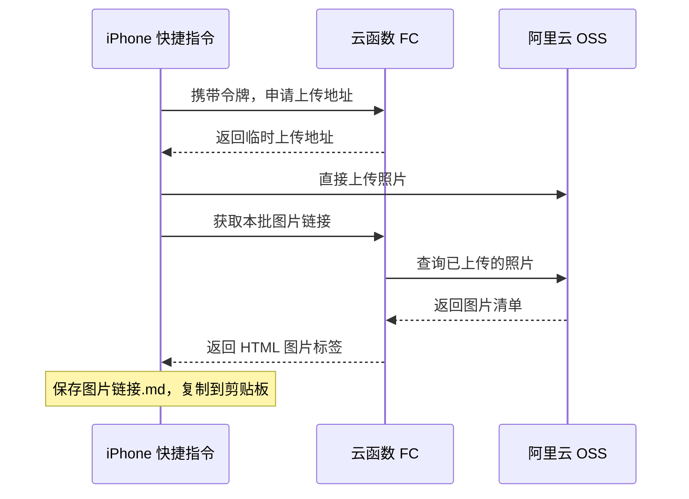

# 用 iPhone 快捷指令批量上传照片到 OSS

手机拍完一组照片，写博客时还要导出、压缩、上传 OSS，再逐个复制图片地址。可以把这些步骤串成一个快捷指令：在相册多选照片，分享到「上传到博客」，上传结束后得到一份包含全部图片链接的 Markdown 文件。

## 上传过程



## 一、先配 OSS

### 1. 确定 Bucket 和图片域名

我这里用的是杭州地域的 `zhihao-blog`，图片放在 `blog/uploads/` 下。你照着做时，把 Bucket 名和地域换成自己的。

需要记下三个值，后面填进函数的环境变量。

```text
OSS_BUCKET=zhihao-blog
OSS_REGION=oss-cn-hangzhou
PUBLIC_BASE_URL=https://zhihao-blog.oss-cn-hangzhou.aliyuncs.com
```

图片域名只填 HTTPS 根地址，函数会自动加上图片路径。

**新开通 OSS 的账号要注意域名限制。** 2025 年 3 月 20 日起新开通 OSS 服务的用户，在中国内地地域需要用自定义域名上传和读取文件。进入 Bucket 的 **Bucket 配置 → 域名管理**，绑定自己的图片域名（中国内地 Bucket 需使用已备案域名），按页面提示添加 DNS CNAME 解析，并为该域名配置 HTTPS 证书。然后把上面的 `PUBLIC_BASE_URL` 换成这个域名，例如 `https://img.example.com`。本文代码会通过它上传和读取图片，需要使用直接绑定到 OSS 的域名。[官方限制说明](https://www.alibabacloud.com/zh/notice/oss_update_notice_policy_change_in_calling_data_api_operations_via_the_default_public_domain_name_45a) · [绑定自定义域名](https://help.aliyun.com/zh/oss/user-guide/access-buckets-via-custom-domain-names)

### 2. 让博客能打开图片

进入 Bucket 的 **权限控制 → Bucket 授权策略**，新增一条规则。

- 授权资源选指定资源，填 `blog/uploads/*`。
- 授权用户选 **匿名账号**。
- 授权效果选 **允许**，操作选 `oss:GetObject`，也就是读取文件。

保存后，这个目录里的图片就可以公开展示。如果开启了“阻止公共访问”，还需要在对应层级关闭它，公开读取授权才能生效。上传成功后图片仍显示 403，先回这里检查。[Bucket Policy 配置说明](https://help.aliyun.com/zh/oss/user-guide/oss-bucket-policy/)

### 3. 给上传函数一个 RAM 角色

函数需要有权限往这个 Bucket 写文件、查询已上传的照片。在 RAM 控制台做下面三步。[打开 RAM 控制台](https://ram.console.aliyun.com/)

1. 进入 **身份管理 → 角色 → 创建角色**，可信主体选 **云服务**，受信服务选 **函数计算 FC**，角色名填 `BlogPhotoUploadRole`。
2. 进入 **权限管理 → 权限策略 → 创建权限策略 → 脚本编辑**，粘贴下面的 JSON，保存为 `BlogPhotoUploadPolicy`。里面两处 `zhihao-blog` 都要换成自己的 Bucket 名。
3. 回到 `BlogPhotoUploadRole`，在 **权限管理 → 新增授权** 中，资源范围选 **整个云账号**，从 **自定义策略** 中选中 `BlogPhotoUploadPolicy` 并保存。

```json
{
  "Version": "1",
  "Statement": [
    {
      "Effect": "Allow",
      "Action": ["oss:PutObject", "oss:GetObject"],
      "Resource": ["acs:oss:*:*:zhihao-blog/blog/uploads/*"]
    },
    {
      "Effect": "Allow",
      "Action": ["oss:ListObjects"],
      "Resource": ["acs:oss:*:*:zhihao-blog"],
      "Condition": {
        "StringLike": {
          "oss:Prefix": ["blog/uploads/*"]
        }
      }
    }
  ]
}
```

这个角色稍后选给 FC 函数使用，代码会自动拿到临时凭证。[函数角色配置说明](https://help.aliyun.com/zh/functioncompute/grant-function-compute-permissions-to-access-other-alibaba-cloud-services)

## 二、部署函数

### 1. 创建函数

打开 FC 控制台，选与 OSS 相同的地域，进入 **函数管理 → 函数列表 → 创建函数**。[打开 FC 控制台](https://fcnext.console.aliyun.com/)

| 配置项 | 填什么 |
| --- | --- |
| 函数类型 | 事件函数 |
| 运行环境 | 内置运行时，Node.js 20 |
| 函数名称 | `blog-photo-upload` |
| 代码上传方式 | 使用示例代码 |
| 请求处理程序 | `index.handler` |
| 内存 | 512 MB |
| 超时时间 | 60 秒 |
| 最小实例数 | `0` |

创建好以后，进入 **代码** 页签，在 WebIDE 中打开 `index.js`，用文末的完整代码替换原来的内容，保存。

再在同一目录创建或打开 `package.json`，填入下面的内容。

```json
{
  "name": "blog-photo-upload",
  "version": "1.1.0",
  "private": true,
  "type": "commonjs",
  "dependencies": {
    "ali-oss": "6.23.0"
  }
}
```

保存后，点击 **终端 → 新建终端**，执行这两行，装好代码需要的依赖。

```bash
cd /code
npm install --omit=dev
```

等安装完成，点击 **部署代码**。[WebIDE 安装依赖说明](https://help.aliyun.com/zh/functioncompute/use-webide-to-package-third-party-dependencies-of-a-function-1)

### 2. 填环境变量，选函数角色

在函数 **配置 → 高级配置 → 权限** 中，把函数角色设为 `BlogPhotoUploadRole`。网络配置中启用公网访问。

然后在 **环境变量** 中添加第一节记下的三项。变量名和变量值分开填，图片域名只填到域名根地址。

| 变量名 | 示例值 |
| --- | --- |
| `OSS_BUCKET` | `zhihao-blog` |
| `OSS_REGION` | `oss-cn-hangzhou` |
| `PUBLIC_BASE_URL` | 你的 OSS 图片域名，例如 `https://img.example.com` |

填完保存部署。

### 3. 配上传令牌和 HTTP 触发器

在 Mac 终端运行下面这行，生成一个上传令牌，把结果保存好。

```bash
openssl rand -hex 32
```

进入函数的 **触发器 → 创建触发器**，类型选 **HTTP**，请求方法选 `POST`，认证方式选 **Bearer**，Token 类型选 **Opaque**。

认证 Token 填下面的 JSON，把 `tokenData` 的值换成刚生成的令牌。

```json
{
  "tokens": [
    {
      "enable": true,
      "tokenName": "iphone",
      "tokenData": "替换为刚生成的64位令牌"
    }
  ]
}
```

保存后，复制触发器的 **HTTPS 公网访问地址**。接下来手机要用的就是这个地址和刚才的令牌。触发器验证令牌后，函数给手机一个临时上传地址，照片直接传到 OSS。[Bearer 认证配置说明](https://help.aliyun.com/zh/functioncompute/enable-bearer-authentication-for-an-http-trigger)

## 三、搭建快捷指令

这部分在 Mac 上编辑更方便。打开「快捷指令」App，新建「上传到博客」和「查看上传记录」两条指令。Mac 和 iPhone 登录同一个 Apple 账户，开启 iCloud 云盘和快捷指令同步。

先在 **iCloud 云盘 → Shortcuts** 下建好 `BlogUploads` 文件夹，后面生成的文件都存这里。

### 1. 先填接口配置

两条指令的顶部都添加两个「文本」动作，每个后面接一个「设定变量」。第一个文本填 FC 的 HTTPS 公网地址，变量名叫 `接口地址`。第二个填令牌原值，变量名叫 `上传令牌`。

下面写到的变量，都要在动作的输入框里点选插入。读取接口返回字段时，每个「获取词典值」的输入都手动选 `接口响应`。

每次调用 FC，都用下面这组动作。后面再次用到时，可以复制这组动作，再修改 JSON 请求体。

1. 添加「获取 URL 内容」，URL 选 `接口地址`，方法选 `POST`，请求体选 **JSON**。
2. 请求头添加 `Authorization`，值为 `Bearer ` 后接变量 `上传令牌`，中间留一个空格。再添加 `Content-Type`，值为 `application/json`。
3. 将返回结果设为 `接口响应`，用「获取词典值」读取 `ok`。
4. 添加「如果」，`ok` 等于 `1` 时继续。否则读取 `error`，用「显示提醒」展示错误，再「停止此快捷指令」。

这段在手机上看起来是这样。


### 2. 搭「上传到博客」

在详情中开启 **在共享表单中显示**，接收类型选 **图像**。接口配置下面，按顺序添加这些动作。

1. 如果「快捷指令输入」有值，把它设为 `照片列表`。否则用「选择照片」，开启多选，把结果设为 `照片列表`。
2. 用「计数」取得照片数量，设为 `总数`。数量为 `0` 时停止，大于 `500` 时显示提醒并停止。
3. 用「询问输入」给这批照片起名，设为 `批次名称`。
4. 调用 FC，JSON 里填 `action=create`。从响应读取 `batch`，设为 `批次编号`。

**先存一份上传记录。** 获取当前日期，用「格式化日期」设为自定格式 `yyyy-MM-dd_HH-mm-ss`。对批次编号用「匹配文本」，表达式填 `^[0-9a-f]{8}`，取前八位作为短编号。

对批次名称用「替换文本」，开启正则表达式，把空白字符、斜杠等不适合文件名的字符替换掉。查找表达式如下，替换内容填 `_`。

```text
[\s/\\:*?"<>|\x00-\x1f]+
```

用「文本」把时间、处理后的名称、短编号拼成 `时间_名称_短编号`，设为 `文件名主体`。再添加「词典」，填入下面四项。

| 键 | 值 | 类型 |
| --- | --- | --- |
| `batch` | `批次编号` | 文本 |
| `title` | `批次名称` | 文本 |
| `total` | `总数` | 数字 |
| `fileStem` | `文件名主体` | 文本 |

用「从输入中获取文本」把词典转成 JSON，命名为 `文件名主体_上传记录.json`，存到 `BlogUploads`。

后面所有存文件的动作都按同样的方式设置。先用「设定名称」填完整文件名，再接「存储文件」，位置选 iCloud 云盘的 `Shortcuts`，子路径填 `BlogUploads/` 后接完整文件名，关闭 **询问存储位置**，开启 **覆盖已存在的文件**。

**接着逐张上传。** 添加「文本」，填 `# ` 后接 `批次名称`，设为 `已完成文本`。然后添加「重复每一项」，输入选 `照片列表`，下面的动作都放进这个循环。

先把「重复项目」设为 `上传文件`。用「获取文件的详细信息」读取扩展名，再用「更改大小写」转成小写。

- 如果扩展名是 `heic` 或 `heif`，用「转换图像」，输入选 `上传文件`，转为 JPEG，质量设为 100%，开启保留元数据。结果设为 `上传文件`，`上传内容类型` 设为 `image/jpeg`。
- 其余格式，用「词典」按下面的表填好映射，再用「获取词典值」按扩展名取出 `上传内容类型`。`jpg` 和 `jpeg` 各建一项。取到的类型为空时，显示“暂不支持此格式”并停止。

| 扩展名 | 上传内容类型 |
| --- | --- |
| `jpg`、`jpeg` | `image/jpeg` |
| `png` | `image/png` |
| `gif` | `image/gif` |
| `webp` | `image/webp` |

然后在循环里依次做下面几步。

1. 调用 FC 申请地址，JSON 按下表填。`index` 的类型选 **数字**，其余选文本。

   | 字段 | 值 |
   | --- | --- |
   | `action` | `sign` |
   | `batch` | `批次编号` |
   | `index` | `重复索引` |
   | `contentType` | `上传内容类型` |

2. 从响应读取 `uploadUrl` 和 `key`，分别设为 `上传地址`、`对象Key`。
3. 新增一个「获取 URL 内容」，URL 选 `上传地址`，方法选 **PUT**，请求体选 **文件**，文件选 `上传文件`。这次请求头只填 `Content-Type`，值选 `上传内容类型`。
4. 再调用 FC，JSON 填 `action=confirm`、`batch=批次编号`、`key=对象Key`，从响应读取 `markdown`。
5. 用「文本」拼接 `已完成文本`、两个换行和 `markdown`，重新设为 `已完成文本`，保存为 `文件名主体_图片链接.md`。

**循环结束后收一次完整结果。** 调用 FC，JSON 填 `action=list`、`batch=批次编号`，读取 `markdown` 和 `count`。用「文本」把 `# 批次名称`、两个换行和 `markdown` 拼起来，设为 `最终Markdown`。

把它保存为同名的 `图片链接.md`，添加「拷贝至剪贴板」，输入选 `最终Markdown`，最后用「显示通知」告诉自己“已上传 count/总数 张，图片标签已复制”。文件名、数量和批次名称都插入对应变量。


### 3. 搭「查看上传记录」

这条简单一些，顶部填同样的接口地址和令牌，然后添加下面几步。

1. 用「选择文件」选中 `BlogUploads` 里的 `上传记录.json`。
2. 用「从输入中获取词典」读取文件，结果设为 `批次记录`。每次「获取词典值」都选这个词典，分别取出 `batch`、`title`、`total`、`fileStem`，设为 `批次编号`、`批次名称`、`总数`、`文件名主体`。
3. 调用 FC，JSON 填 `action=list`、`batch=批次编号`，读取 `markdown` 和 `count`。
4. 和上一条指令一样，拼上批次标题，保存到同名 `图片链接.md`，将 `最终Markdown` 复制到剪贴板，显示“已找回 count/总数 张”的通知。

等两条指令同步到 iPhone，就可以使用了。首次按提示授权，出现「始终允许」就选它。批量照片仍反复弹出数据共享提示时，在「设置」里搜索「快捷指令」，进入 **高级**，开启 **允许共享大量数据**。[Apple 的快捷指令隐私设置说明](https://support.apple.com/zh-cn/guide/shortcuts/apd961a4fc65/ios)

## 四、以后就这样上传

相册里选中照片，点 **分享 → 上传到博客**。截图里我把这条指令命名为「上传到博客 OSS」。


给这批照片起个名字，比如「阳朔旅行」，保持快捷指令在前台，等上传完成。看到下面这样的通知，就可以回博客正文粘贴了。


每批最多 500 张，单张图片上限 50 MiB。照片多的时候可以分几批传。

复制的内容带有批次标题，后面是每张照片的标签。图片部分长这样，写文章时可以把 `alt` 换成照片描述。`400px` 控制的是网页显示宽度。

```html

```

### 照片存在哪儿

OSS 里按上传日期放。例如 11 月 5 日传了三次，这三批都进 `blog/uploads/2026-11-05/`。日期按每张照片申请上传地址时的北京时间计算。

```text
blog/uploads/
├── 2026-11-05/
│   ├── <批次编号>-0001-<图片编号>.jpg
│   └── <批次编号>-0002-<图片编号>.png
└── _records/
    └── <批次编号>/2026-11-05.json
```

其中 `_records` 是程序查找批次用的日期索引，保留着就好。

### JSON 和 MD 到底怎么用

iCloud 云盘的 `Shortcuts/BlogUploads` 里会生成这样的文件。

```text
2026-11-05_21-25-38_阳朔旅行_65934bb5_上传记录.json
2026-11-05_21-25-38_阳朔旅行_65934bb5_图片链接.md
```

**一个 JSON 对应一次选中的一批照片。** 比如这次选了 20 张，就用一个 JSON 记下这批的编号、名称和数量。它在上传开始时生成，留着以后查询这批照片。

**写博客时打开「图片链接.md」。** 里面保存了图片标签，复制需要的部分就行。

如果上传中断了，或者后来找不到链接，运行 **查看上传记录**，选对应的 `上传记录.json`。快捷指令会去 OSS 查这批实际传上去的照片，重新生成 MD 文件，并把标签复制到剪贴板。

剩下没传完的照片，另外选一批补传。已经传过的照片再选一次，会生成新的文件。

## 完整接口代码

下面这段放进 FC 的 `index.js`，配合前面的 `package.json` 使用。

```js
'use strict';

const { randomUUID } = require('node:crypto');
const PREFIX = 'blog/uploads/';
const MAX_IMAGES = 500;
const MAX_BYTES = 50 * 1024 * 1024;
const EXTENSION_BY_CONTENT_TYPE = new Map([
  ['image/jpeg', 'jpg'],
  ['image/png', 'png'],
  ['image/gif', 'gif'],
  ['image/webp', 'webp']
]);
const CONTENT_TYPE_BY_EXTENSION = new Map([
  ['jpg', 'image/jpeg'],
  ['jpeg', 'image/jpeg'],
  ['png', 'image/png'],
  ['gif', 'image/gif'],
  ['webp', 'image/webp']
]);
const UUID = '[0-9a-f]{8}-[0-9a-f]{4}-4[0-9a-f]{3}-[89ab][0-9a-f]{3}-[0-9a-f]{12}';
const BATCH_RE = new RegExp(`^${UUID}$`);
const FILE_RE = new RegExp(`^(\\d{4})-${UUID}\\.(jpg|jpeg|png|gif|webp)$`);
const DATE_RE = /^\d{4}-\d{2}-\d{2}$/;

class HttpError extends Error {
  constructor(status, message) {
    super(message);
    this.status = status;
  }
}

function response(statusCode, data) {
  return {
    statusCode,
    isBase64Encoded: false,
    headers: {
      'Content-Type': 'application/json; charset=utf-8',
      'Cache-Control': 'no-store'
    },
    body: JSON.stringify(data)
  };
}

function parseRequest(event) {
  let request;
  try {
    request = JSON.parse(Buffer.isBuffer(event) ? event.toString('utf8') : event);
  } catch {
    throw new HttpError(400, '请求必须使用 FC HTTP 触发器事件格式');
  }
  if (request?.requestContext?.http?.method !== 'POST') {
    throw new HttpError(405, '请使用 POST 请求');
  }
  const raw = request.isBase64Encoded
    ? Buffer.from(request.body || '', 'base64').toString('utf8')
    : request.body;
  if (typeof raw !== 'string' || Buffer.byteLength(raw) > 8192) {
    throw new HttpError(400, '请求体必须是小于 8 KiB 的 JSON');
  }
  try {
    const data = JSON.parse(raw);
    if (!data || Array.isArray(data) || typeof data !== 'object') throw new Error();
    return data;
  } catch {
    throw new HttpError(400, '请求体不是有效 JSON 对象');
  }
}

function configuration(env, context) {
  const bucket = env.OSS_BUCKET;
  const region = env.OSS_REGION;
  let publicBase;
  try {
    publicBase = new URL(env.PUBLIC_BASE_URL);
  } catch {
    throw new HttpError(500, '请配置 PUBLIC_BASE_URL');
  }
  if (!bucket || !/^oss-[a-z0-9-]+$/.test(region || '') ||
      publicBase.protocol !== 'https:' || publicBase.pathname !== '/' ||
      publicBase.search || publicBase.hash || publicBase.username || publicBase.password) {
    throw new HttpError(500, 'OSS_BUCKET、OSS_REGION 或 PUBLIC_BASE_URL 配置错误');
  }
  const credentials = context?.credentials;
  if (!credentials?.accessKeyId || !credentials.accessKeySecret || !credentials.securityToken) {
    throw new HttpError(500, '请为函数配置具有 OSS 权限的函数角色');
  }
  return {
    publicBase: publicBase.href,
    clientOptions: {
      bucket, region, secure: true, authorizationV4: true,
      endpoint: publicBase.origin, cname: true,
      accessKeyId: credentials.accessKeyId,
      accessKeySecret: credentials.accessKeySecret,
      stsToken: credentials.securityToken,
      timeout: 10000
    }
  };
}

function requireBatch(batch) {
  if (typeof batch !== 'string' || !BATCH_RE.test(batch)) {
    throw new HttpError(400, 'batch 必须是创建批次时返回的 UUID');
  }
  return `${PREFIX}${batch}/`;
}

function validDate(date) {
  if (!DATE_RE.test(date)) return false;
  const parsed = new Date(`${date}T00:00:00.000Z`);
  return Number.isFinite(parsed.getTime()) && parsed.toISOString().slice(0, 10) === date;
}

function beijingDate(date) {
  return new Date(date.getTime() + 8 * 60 * 60 * 1000).toISOString().slice(0, 10);
}

function photoDetails(batch, key) {
  if (typeof key !== 'string') return null;
  const legacyPrefix = `${PREFIX}${batch}/`;
  let filename;
  if (key.startsWith(legacyPrefix)) {
    filename = key.slice(legacyPrefix.length);
  } else {
    const date = key.slice(PREFIX.length, PREFIX.length + 10);
    const dailyPrefix = `${PREFIX}${date}/${batch}-`;
    if (!validDate(date) || !key.startsWith(dailyPrefix)) return null;
    filename = key.slice(dailyPrefix.length);
  }
  const match = FILE_RE.exec(filename);
  if (!match || Number(match[1]) < 1 || Number(match[1]) > MAX_IMAGES) {
    return null;
  }
  return { index: Number(match[1]), filename };
}

function requireKey(batch, key) {
  const photo = photoDetails(batch, key);
  if (!photo) {
    throw new HttpError(400, 'key 不是本服务生成的照片路径');
  }
  return photo.index;
}

function photoItem(publicBase, batch, key, size) {
  const index = requireKey(batch, key);
  const publicUrl = new URL(key.split('/').map(encodeURIComponent).join('/'), publicBase).href;
  const sourceAttribute = publicUrl
    .replaceAll('&', '&amp;')
    .replaceAll('"', '&quot;')
    .replaceAll("'", '&#39;')
    .replaceAll('<', '&lt;')
    .replaceAll('>', '&gt;');
  const markdown = ``;
  return { index, key, size, publicUrl, markdown };
}

async function* listObjects(client, prefix) {
  let continuationToken;
  do {
    const result = await client.listV2({
      prefix, 'max-keys': 1000,
      ...(continuationToken ? { 'continuation-token': continuationToken } : {})
    });
    for (const object of result.objects || []) {
      if (typeof object.name === 'string' && object.name.startsWith(prefix)) yield object;
    }
    continuationToken = result.nextContinuationToken;
  } while (continuationToken);
}

function createHandler({ env = process.env, makeClient, makeId = randomUUID, now = () => new Date() } = {}) {
  const createClient = makeClient || (options => {
    const OSS = require('ali-oss');
    return new OSS(options);
  });
  return async function handler(event, context) {
    try {
      const data = parseRequest(event);
      const config = configuration(env, context);
      if (data.action === 'create') {
        return response(200, { ok: true, batch: makeId(), maxImages: MAX_IMAGES, maxBytes: MAX_BYTES });
      }
      if (!['sign', 'confirm', 'list'].includes(data.action)) {
        throw new HttpError(400, 'action 只能是 create、sign、confirm 或 list');
      }
      const legacyPrefix = requireBatch(data.batch);
      const recordPrefix = `${PREFIX}_records/${data.batch}/`;
      const client = createClient(config.clientOptions);

      if (data.action === 'sign') {
        if (!Number.isInteger(data.index) || data.index < 1 || data.index > MAX_IMAGES) {
          throw new HttpError(400, 'index 必须是 1 到 500 的整数');
        }
        // Omitting contentType retains compatibility with the original JPEG shortcut.
        const contentType = data.contentType === undefined ? 'image/jpeg' : data.contentType;
        const extension = EXTENSION_BY_CONTENT_TYPE.get(contentType);
        if (!extension) {
          throw new HttpError(400, 'contentType 仅支持 image/jpeg、image/png、image/gif、image/webp');
        }
        const date = beijingDate(now());
        const key = `${PREFIX}${date}/${data.batch}-${String(data.index).padStart(4, '0')}-${makeId()}.${extension}`;
        // Persist each used date before issuing a URL, so interrupted PUTs remain discoverable.
        // A separate marker per date makes concurrent uploads and retries idempotent.
        await client.put(`${recordPrefix}${date}.json`, Buffer.from('{}'), {
          headers: { 'Content-Type': 'application/json' }
        });
        const uploadUrl = await client.signatureUrlV4('PUT', 600, {
          headers: { 'Content-Type': contentType }
        }, key);
        return response(200, {
          ok: true, ...photoItem(config.publicBase, data.batch, key, null),
          uploadUrl, contentType, expiresIn: 600, maxBytes: MAX_BYTES
        });
      }

      if (data.action === 'confirm') {
        requireKey(data.batch, data.key);
        let result;
        try {
          result = await client.head(data.key);
        } catch (error) {
          if (error.code === 'NoSuchKey') throw new HttpError(404, '照片尚未上传成功');
          throw error;
        }
        const headers = result.res.headers;
        const size = Number(headers['content-length']);
        const contentType = String(headers['content-type'] || '').split(';')[0].toLowerCase().trim();
        const extension = data.key.slice(data.key.lastIndexOf('.') + 1);
        const expectedContentType = CONTENT_TYPE_BY_EXTENSION.get(extension);
        if (!Number.isSafeInteger(size) || size <= 0 || size > MAX_BYTES || contentType !== expectedContentType) {
          throw new HttpError(422, '已上传对象需为非空图片，Content-Type 与扩展名匹配，且不超过 50 MiB');
        }
        return response(200, { ok: true, ...photoItem(config.publicBase, data.batch, data.key, size) });
      }

      const dates = new Set();
      for await (const object of listObjects(client, recordPrefix)) {
        const filename = object.name.slice(recordPrefix.length);
        const date = filename.slice(0, -5);
        if (filename.endsWith('.json') && validDate(date)) dates.add(date);
      }
      const prefixes = [legacyPrefix, ...[...dates].sort().map(date => `${PREFIX}${date}/${data.batch}-`)];
      const photosByIdentity = new Map();
      for (const prefix of prefixes) {
        for await (const object of listObjects(client, prefix)) {
          const photo = photoDetails(data.batch, object.name);
          if (!photo) continue;
          const size = Number(object.size);
          if (!Number.isSafeInteger(size) || size <= 0 || size > MAX_BYTES) continue;
          // Daily copies replace legacy URLs when a historical photo has been migrated.
          photosByIdentity.set(photo.filename, photoItem(config.publicBase, data.batch, object.name, size));
          if (photosByIdentity.size > MAX_IMAGES) {
            throw new HttpError(422, '本批对象超过 500 张，请通过 OSS 控制台检查重复上传');
          }
        }
      }
      const items = [...photosByIdentity.values()];
      items.sort((a, b) => a.index - b.index || a.key.localeCompare(b.key));
      return response(200, {
        ok: true, batch: data.batch, count: items.length, items,
        markdown: items.map(item => item.markdown).join('\n\n')
      });
    } catch (error) {
      if (error instanceof HttpError) return response(error.status, { ok: false, error: error.message });
      const code = /^[A-Za-z][A-Za-z0-9_]{0,63}$/.test(error?.code || '')
        ? error.code : 'UnknownError';
      console.error('OSS_OPERATION_FAILED', JSON.stringify({
        requestId: context?.requestId,
        code,
        status: Number.isInteger(error?.status) ? error.status : undefined
      }));
      return response(502, { ok: false, error: 'OSS 操作失败，请检查函数角色、地域和网络配置后重试' });
    }
  };
}

exports.createHandler = createHandler;
exports.handler = createHandler();
```
