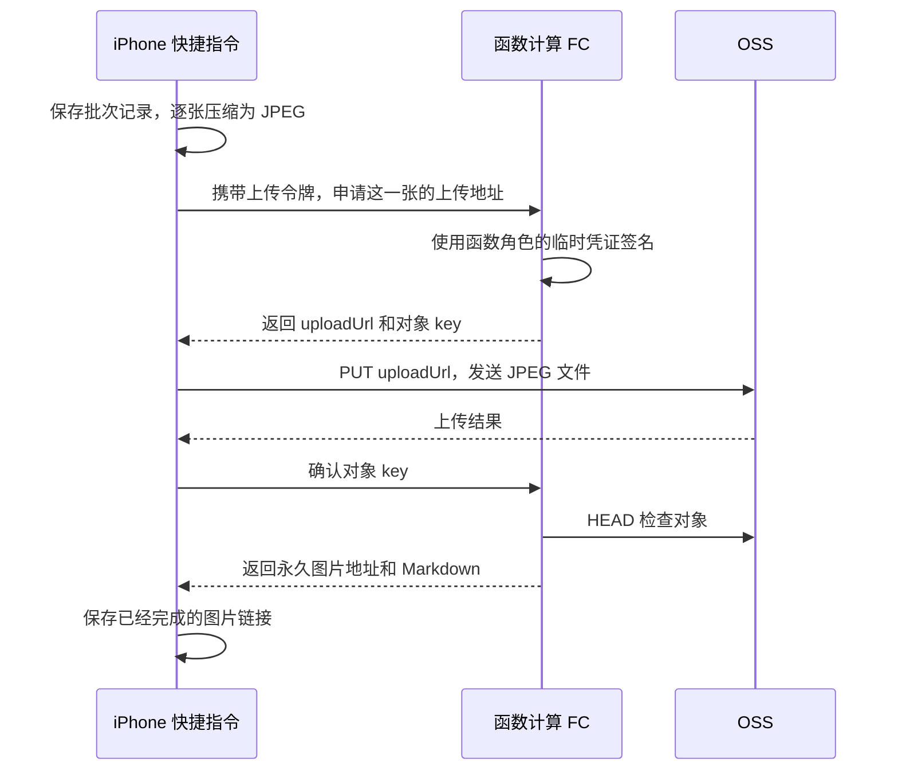

# 用 iPhone 快捷指令批量上传照片到 OSS

手机拍完一组照片，写博客时还要导出、压缩、上传 OSS，再逐个复制图片地址。可以把这些步骤串成一个快捷指令：在相册多选照片，分享到「上传到博客」，上传结束后得到一份包含全部图片链接的 Markdown 文件。

这套方案使用 **iPhone 原生快捷指令、阿里云函数计算 FC 和现有 OSS Bucket**。推荐在 Mac 上编辑快捷指令，通过 iCloud 同步到 iPhone，日常直接在手机相册选图上传。下面包含云端接口的完整代码、部署配置、两个快捷指令的搭建方法、批量上传中断后的操作和费用估算。

本文给出的是可自行部署的实现。云端代码可以独立运行；快捷指令需要按文中的动作搭建，可以在 Mac 上完成编辑。文中示例配置不表示云资源已经创建，也不表示完成了 iPhone 真机验收。

## 搭好以后，手机上怎么用

第一次配置时，把接口地址和专用上传令牌保存进快捷指令，并授权它访问照片、网络和指定的文件夹。日常操作只需要：

1. 打开「照片」，点「选择」，勾选本次要上传的照片。
2. 点分享按钮，选择「上传到博客」。
3. 输入这一批的名称，例如「阳朔旅行」。
4. 保持快捷指令在前台，等待逐张处理。
5. 完成后，图片链接自动复制到剪贴板，Markdown 文件保存在 `iCloud 云盘/Shortcuts/BlogUploads/`。

在 Mac 上打开这份文件，就能把链接粘进博客文章。第一次建议用 2 张照片验收，然后用 20～30 张一批观察手机和网络的表现。这个数量是使用建议，不是苹果规定的上限。

最终文件类似：

```markdown
# 阳朔旅行


```

照片会立即成为可通过链接访问的 OSS 对象。文章和旅行地图仍需要更新源码并重新发布；本方案不会替你选择应该插入哪一篇文章。

## 上传原理，以及令牌到底放在哪里



有两种不同的凭证：

| 凭证 | 保存在什么地方 | 用来做什么 |
| --- | --- | --- |
| 专用上传令牌 | 你自己的快捷指令、FC HTTP 触发器 | 允许手机调用签名、确认和查询接口 |
| 函数角色的临时 OSS 凭证 | FC 每次调用的上下文 | 生成 OSS 上传签名，查询上传结果 |

手机每次调用 FC 时都会自动带上 `Authorization: Bearer 上传令牌`。令牌只需要配置一次，日常上传不会再次询问。它仍是一份密码，导出或分享快捷指令前要移除真实值。

FC 返回的 `uploadUrl` 有效期是 10 分钟，只授权指定对象的 PUT 上传。它在有效期内可以重复使用，并非一次性链接。手机真正上传照片时只需要这个 URL 和约定的请求头，**不要把调用 FC 的 Bearer 令牌发送给 OSS**。

照片字节直接从手机传到 OSS，FC 只处理小请求。博客使用另一个没有临时上传签名的 `publicUrl`，由现有的公开图片域名提供访问。[OSS 预签名上传说明](https://help.aliyun.com/zh/oss/user-guide/upload-files-using-presigned-urls)

## 一、准备 OSS 和访问权限

### 1. 确定存储位置

本方案使用 **`zhihao-blog` Bucket，地域为华东 1（杭州）**。该 Bucket 已有 `blog/` 目录，新上传照片统一放在它下面的 `uploads/` 前缀中。

| 配置 | 本站示例 | 说明 |
| --- | --- | --- |
| Bucket | `zhihao-blog` | 本方案的照片存储 Bucket |
| 地域 | `oss-cn-hangzhou` | 华东 1（杭州），此值为 Node.js OSS SDK 使用的地域格式 |
| 上传前缀 | `blog/uploads/` | 保留末尾的 `/` |
| 图片域名根地址 | `https://zhihao-blog.oss-cn-hangzhou.aliyuncs.com` | 这里不添加 `/blog`，完整对象 key 会包含它 |

对象路径由服务端生成：

```text
blog/uploads/<批次 UUID>/0001-<照片 UUID>.jpg
blog/uploads/<批次 UUID>/0002-<照片 UUID>.jpg
```

同一批照片按快捷指令的循环编号排序；随机后缀避免不同上传覆盖同名照片。重复选择同一张照片会产生新对象，本方案不做内容去重。

### 2. 让博客可以读取新图片

在 `zhihao-blog` Bucket 中检查 `blog/uploads/` 的读取权限。新对象必须能通过 `publicUrl` 在未登录阿里云的浏览器里直接显示；其他 Bucket 的读取权限不会自动应用到这个 Bucket。

如果使用私有 Bucket 配合 Bucket Policy，在 OSS 控制台的「权限控制 → Bucket 授权策略」中，为 **`blog/uploads/*` 这个指定资源范围**授予匿名 `oss:GetObject` 权限即可。无需给匿名访问者列举、上传或删除权限。已有 CDN 图片域名的，可以继续使用它，但需确认新目录的回源和访问规则。

如果“阻止公共访问”或已有显式拒绝策略阻止了这条授权，先按现有图床的访问设计调整相应设置，再进行后面的浏览器验收。不要把签名下载链接当作永久图片地址写入文章。[Bucket Policy 配置说明](https://help.aliyun.com/zh/oss/user-guide/oss-bucket-policy/)

### 3. 创建 FC 使用的 RAM 角色

这一步让函数代码获得访问 `zhihao-blog/blog/uploads/` 的权限。操作完成后，应当有以下对应关系：

| 项目 | 本文使用的名称或配置 |
| --- | --- |
| RAM 角色 | `BlogPhotoUploadRole` |
| 角色的可信服务 | 函数计算 / FC |
| 自定义权限策略 | `BlogPhotoUploadPolicy` |
| 使用这个角色的函数 | 杭州地域的 `blog-photo-upload` |
| 可以访问的照片范围 | `zhihao-blog` Bucket 下的 `blog/uploads/` |

在 **`zhihao-blog` 所属的同一个阿里云账号**里完成下面的配置，使用具有 RAM 管理和 FC 配置权限的登录身份。RAM 角色本身是账号级资源，创建角色时不需要选择杭州；绑定函数时再选择杭州地域。

#### 3.1 创建一个供 FC 使用的角色

1. 打开 [RAM 访问控制台](https://ram.console.aliyun.com/)。也可以在阿里云控制台顶部搜索“访问控制 RAM”进入。
2. 在左侧选择 **身份管理 → 角色**；部分版本的菜单直接显示“角色”。
3. 点击 **创建角色**，按下面的内容填写：

| 页面字段 | 选择或填写 |
| --- | --- |
| 可信主体类型／可信实体类型 | **云服务**，旧版页面显示“阿里云服务” |
| 信任主体名称／受信服务 | **函数计算 / FC** |
| 角色类型，如果页面显示此项 | **普通服务角色** |
| 角色名称 | `BlogPhotoUploadRole` |
| 备注，可选 | `博客照片上传函数访问 OSS 使用` |

4. 点击“确定”或“完成”。有些版本先确认可信服务，再弹出角色名称输入框，按上述值填写即可。
5. 创建成功后进入 `BlogPhotoUploadRole` 的详情页，确认角色名称和可信服务正确。

此处创建的是提供给上传函数的普通服务角色。控制台中的 `AliyunServiceRoleForFC` 是平台维护的服务关联角色，承担日志、网络等平台功能；本文照片访问权限配置在 `BlogPhotoUploadRole` 上。[创建云服务角色的官方步骤](https://help.aliyun.com/zh/ram/user-guide/create-a-ram-role-for-a-trusted-alibaba-cloud-service/) · [FC 服务关联角色说明](https://help.aliyun.com/zh/functioncompute/service-linked-role-of-function-compute)

角色没有登录密码，也不需要为它创建 AccessKey。FC 使用这个角色时会获得临时凭证，后面的 Node.js 代码从 `context.credentials` 读取它们。

#### 3.2 核对信任策略：允许谁使用这个角色

在角色详情中找到 **信任策略** 页签或对应区域。刚才选择“函数计算 / FC”后，控制台会自动生成信任配置，其核心内容如下：

```json
{
  "Version": "1",
  "Statement": [
    {
      "Effect": "Allow",
      "Principal": {
        "Service": ["fc.aliyuncs.com"]
      },
      "Action": "sts:AssumeRole"
    }
  ]
}
```

这里的含义是：允许函数计算服务扮演这个角色。核对 `Principal.Service` 指向 FC、`Action` 为 `sts:AssumeRole` 即可；如果控制台自动生成了额外的账号限制，保留原配置。[官方 FC 角色信任策略示例](https://help.aliyun.com/zh/cdn/user-guide/use-function-compute-to-transfer-offline-logs-to-oss)

**信任策略和下一步的 OSS 权限策略是两个不同的配置位置。** 上面的 JSON 用于允许 FC 使用角色；下面的 JSON 用于授予角色访问照片的权限。

#### 3.3 创建照片目录的权限策略

1. 在 RAM 控制台左侧选择 **权限管理 → 权限策略**。
2. 点击 **创建权限策略**。
3. 切换到 **脚本编辑**或 JSON 编辑模式。
4. 将编辑框中的示例内容替换成下面完整的 JSON。它应保存到“权限策略”，不要粘贴到角色的“信任策略”编辑器里。

```json
{
  "Version": "1",
  "Statement": [
    {
      "Effect": "Allow",
      "Action": ["oss:PutObject", "oss:GetObject"],
      "Resource": ["acs:oss:*:*:zhihao-blog/blog/uploads/*"]
    },
    {
      "Effect": "Allow",
      "Action": ["oss:ListObjects"],
      "Resource": ["acs:oss:*:*:zhihao-blog"],
      "Condition": {
        "StringLike": {
          "oss:Prefix": ["blog/uploads/*"]
        }
      }
    }
  ]
}
```

5. 点击“确定”或“继续编辑基本信息”，填写策略名称 **`BlogPhotoUploadPolicy`**，备注可以填 `允许博客上传函数读写和列举 zhihao-blog/blog/uploads/`。
6. 确认创建。在权限策略列表搜索 `BlogPhotoUploadPolicy`，确认它的类型为 **自定义策略**。[自定义策略的官方创建步骤](https://help.aliyun.com/zh/ram/create-a-custom-policy)

这份策略中的三个动作分别用于：

| 权限 | 对应流程 | 资源写法 |
| --- | --- | --- |
| `oss:PutObject` | 手机使用签名 URL 上传照片 | `acs:oss:*:*:zhihao-blog/blog/uploads/*` |
| `oss:GetObject` | FC 使用 HEAD 确认照片是否上传成功 | 同上，限定对象目录 |
| `oss:ListObjects` | 查询某批已经上传的照片 | `acs:oss:*:*:zhihao-blog`，再用 `oss:Prefix` 限制目录 |

列举操作的资源是 Bucket，因此第二条 `Resource` 只写到 `zhihao-blog`；目录限制放在 `Condition` 中。保留 `oss:Prefix` 的拼写以及 `blog/uploads/*` 末尾的通配符。HEAD 使用的是 `oss:GetObject` 权限。[HeadObject 权限说明](https://help.aliyun.com/zh/oss/developer-reference/headobject)

这份策略不包含删除操作。以后替换 Bucket 时同步修改策略和函数环境变量；替换上传前缀时，同步修改代码的 `PREFIX`、策略和公开读取规则。

#### 3.4 把权限策略授权给角色

策略创建成功后，还要把它绑定到角色，函数才能使用其中的权限：

1. 回到 **身份管理 → 角色**，搜索并打开 `BlogPhotoUploadRole`。
2. 在 **权限管理** 页签点击 **新增授权**；部分页面可能显示“精确授权”。
3. 按下面的内容选择：

| 授权字段 | 配置 |
| --- | --- |
| 资源范围 | **账号级别／整个云账号** |
| 授权主体 | 确认是 **`BlogPhotoUploadRole`** |
| 权限策略类型 | **自定义策略** |
| 权限策略名称 | 搜索并选中 **`BlogPhotoUploadPolicy`** |

4. 确认该策略已进入“已选择权限策略”列表，点击 **确认新增授权**。
5. 回到角色的权限列表，确认能看到 `BlogPhotoUploadPolicy`。

“账号级别”表示这条授权在当前账号内生效，实际可访问的对象仍由策略里的 `Resource` 和 `Condition` 限定。授权主体应当是这个角色；仅把策略加到自己的登录用户上，函数不会因此获得权限。[管理 RAM 角色权限](https://help.aliyun.com/zh/document_detail/2640262.html)

#### 3.5 在函数配置中绑定这个角色

如果还没有创建函数，先继续阅读下一节，创建 `blog-photo-upload` 后完成这里的绑定。已经有函数时直接操作：

1. 打开 [函数计算控制台](https://fcnext.console.aliyun.com/)，选择 **华东 1（杭州）**。
2. 进入 **函数管理 → 函数列表**，打开 `blog-photo-upload`。
3. 进入 **配置**页签，找到 **高级配置**，点击“编辑”。
4. 展开 **权限**，在 **函数角色**中选择 `BlogPhotoUploadRole`。部分版本会把“权限”直接列为独立配置项，从那里进入即可。
5. 点击 **部署**或“保存”，完成后重新查看配置，确认函数角色已显示为 `BlogPhotoUploadRole`。

如果界面要求填写角色 ARN，从 RAM 角色详情中复制 ARN 原值粘贴，不要把角色名称当成 ARN。函数绑定角色后，FC 会在调用时自动获取并注入临时凭证。[官方函数角色配置步骤](https://help.aliyun.com/zh/functioncompute/grant-function-compute-permissions-to-access-other-alibaba-cloud-services)

#### 3.6 部署接口后，验证权限是否生效

完成后文的代码、环境变量和 Bearer 触发器部署后，通过 **HTTP 触发器地址**验证，步骤如下：

| 操作 | 预期结果 | 说明 |
| --- | --- | --- |
| 调用 `create` | 返回 `ok: true` 和 `batch` | 代码检查到了函数角色凭证；此操作还没有访问 OSS |
| 使用这个 `batch` 调用 `list` | 新批次返回 `ok: true`、`count: 0` | 验证该目录的 `ListObjects` 权限 |
| 在快捷指令中上传一张照片 | OSS PUT 成功，随后 `confirm` 返回 `ok: true` | 实际验证 `PutObject` 和 HEAD 所需的 `GetObject` 权限 |
| 打开返回的图片链接 | 浏览器可以显示照片 | 另外验证 Bucket 的公开读取配置 |

`sign` 能生成上传 URL，只说明签名代码运行成功；签名通常在本地计算，只有随后真实 PUT 成功才能证明上传权限有效。

遇到问题时，按位置检查：

| 问题 | 处理方式 |
| --- | --- |
| 创建角色或策略时提示无权限 | 检查当前登录身份的 RAM 管理权限；这是控制台操作身份的权限问题 |
| FC 下拉框找不到角色 | 确认 RAM 和 FC 属于同一账号、角色可信服务是 FC，并刷新角色列表 |
| 保存函数配置时提示 `ram:PassRole` 无权限 | 需要为当前操作账号授予传递这个角色的权限，授权目标应限定到该角色 ARN；这项权限属于部署身份 |
| 运行时提示缺少角色凭证 | 回到函数配置确认角色已绑定并保存，检查角色信任策略 |
| `list` 返回 `AccessDenied` | 核对角色是否绑定了自定义策略，以及桶级 `Resource` 和 `oss:Prefix` 条件 |
| PUT 或 `confirm` 返回 `AccessDenied` | 核对对象路径是否位于 `zhihao-blog/blog/uploads/`，并检查相关权限和 Bucket 显式拒绝规则 |

本节的 RAM 角色负责 **FC → OSS** 的权限。手机调用 FC 时使用的 Bearer 上传令牌，仍在后文的 HTTP 触发器中单独配置。

## 二、部署云端小接口

### 1. 创建函数

**控制台直达入口：[函数计算 FC 3.0](https://fcnext.console.aliyun.com/)。** 使用与 `zhihao-blog` Bucket 相同的阿里云账号登录。

也可以从阿里云控制台顶部搜索“函数计算”，选择 **函数计算 FC** 进入。如果首次使用出现开通页面，按页面提示开通服务后，再进入函数列表。

进入控制台后，按下面的路径操作：

1. 在顶部地域选择 **华东 1（杭州）**，对应 `cn-hangzhou`。
2. 左侧进入 **函数管理 → 函数列表**。
3. 点击 **创建函数**，选择 **事件函数**和内置 Node.js 运行时。
4. 按下表填写配置，创建 `blog-photo-upload`。

这里的控制台入口用于管理函数；手机快捷指令中的“接口地址”要使用后面创建 HTTP 触发器时生成的 HTTPS 地址。

| 选项 | 配置 |
| --- | --- |
| 地域 | 与 OSS 同地域，选择华东 1（杭州），地域 ID 为 `cn-hangzhou` |
| 函数类型 | 事件函数，使用内置运行时 |
| 运行时 | Node.js 20 |
| 函数名 | `blog-photo-upload` |
| 代码上传方式 | **通过 ZIP 包上传代码**，选择下方提供的部署包 |
| 代码入口 | `index.js` |
| 请求处理程序 | `index.handler` |
| CPU / 内存 | 示例起点：0.35 vCPU / 512 MB，按验收结果调整 |
| 临时磁盘 | 512 MB |
| 最小实例数 | `0`，空闲后允许释放实例 |
| 超时时间 | 60 秒 |
| 函数角色 | 上一步创建的 `BlogPhotoUploadRole` |
| 网络 | 允许访问 OSS 公网 Endpoint |

此处的“事件函数”也可以挂 HTTP 触发器。FC 3.0 会将 HTTP 请求包装为事件对象，代码解析其中的 `body`，再返回 HTTP 响应结构。下面的代码针对这套接口，不使用 FC 2.0 的 HTTP Handler，也不需要创建 Web 函数或自定义运行时。[FC HTTP 请求映射说明](https://help.aliyun.com/zh/functioncompute/http-trigger-invoking-function)

#### 1.1 代码上传方式怎么选、怎么上传

**按本文操作，选择“通过 ZIP 包上传代码”即可。** 已准备好[下载函数部署包 blog-photo-upload.zip](/downloads/blog-photo-upload.zip)，包含本文的完整接口代码和 `ali-oss@6.23.0` 依赖，上传这份包后无需再执行 `npm install`。

按下面的顺序操作：

1. 在 Mac 下载上面的 `blog-photo-upload.zip`，保留 ZIP 文件。
2. 在 FC 的“创建事件函数”页面，运行环境选择 **内置运行时 → Node.js 20**。
3. 找到 **代码上传方式**，选择 **通过 ZIP 包上传代码**。
4. 点击上传文件的按钮，选择刚下载的 **`blog-photo-upload.zip` 文件本身**，等待上传完成。
5. **请求处理程序**填写 **`index.handler`**。其中 `index` 对应包里的 `index.js`，`handler` 对应代码导出的处理函数。
6. 按上表补齐地域、函数名、规格和角色，点击 **创建**。
7. 进入函数详情的 **代码** 页签，确认根目录能看到 `index.js`、`package.json`、`package-lock.json` 和 `node_modules`。如果页面提示有未部署的修改，点击 **部署代码**并等待成功。
8. 继续完成后文的 **环境变量 → HTTP 触发器与 Bearer 令牌 → HTTP 请求验证**。

已经用示例代码创建过函数，也可以在 **函数详情 → 代码 → 上传代码 → 上传 ZIP 包** 中选择同一份文件，上传后点击 **部署代码**，并检查请求处理程序为 `index.handler`。[创建与更新函数代码的官方说明](https://help.aliyun.com/zh/functioncompute/creating-an-event-function)

部署包的根目录结构如下：

```text
blog-photo-upload.zip
├── index.js
├── package.json
├── package-lock.json
└── node_modules/
    └── ali-oss/ …
```

这里的“代码上传方式”只决定如何把接口程序交给 FC。“通过 OSS 上传代码”适用于代码压缩包已存入 OSS 的情况；照片实际存入哪个 Bucket，由后面的 `OSS_BUCKET=zhihao-blog` 决定。

包内没有 AccessKey 或上传令牌。Bucket 等参数在环境变量里填写，访问 OSS 的权限来自函数角色，手机的上传令牌在 HTTP 触发器里配置。只完成 ZIP 上传，接口还不能正常使用。

#### 1.2 可选：在 WebIDE 中准备代码

使用上面的完整 ZIP 包时，可以跳过本小节。需要自行复制或修改代码时，可以在创建函数时选择 **使用示例代码**，创建后进入 **代码** 页签的 WebIDE：

1. 在左侧文件列表新建或打开 **`index.js`**，用文末的[完整接口代码](#完整接口代码)替换内容并保存。
2. 在同一层目录新建或打开 **`package.json`**，填入以下内容并保存。这是函数自己的配置文件。

```json
{
  "name": "blog-photo-upload",
  "version": "1.0.0",
  "private": true,
  "type": "commonjs",
  "dependencies": {
    "ali-oss": "6.23.0"
  }
}
```

3. 在 WebIDE 打开 **终端 → 新建终端**，执行以下命令。`/code` 是云端函数的代码目录：

```bash
cd /code
npm install --omit=dev
```

4. 等安装成功后，确认文件列表中出现 `node_modules` 和 `package-lock.json`，再点击 **部署代码**。只保存编辑器里的文件，还没有完成部署。[WebIDE 安装 Node.js 依赖说明](https://help.aliyun.com/zh/functioncompute/use-webide-to-package-third-party-dependencies-of-a-function-1)

#### 1.3 可选：在 Mac 自己打 ZIP 包

若之后需要自己维护部署包，在 Mac 新建一个独立的 `blog-photo-upload` 文件夹，将上面的 `package.json` 和文末代码保存成该目录下的两个文件。在这个文件夹中打开终端，执行：

```bash
npm install --omit=dev
zip -r ../blog-photo-upload.zip index.js package.json package-lock.json node_modules
```

生成的 ZIP 位于文件夹的上一层。解压后应直接看到 `index.js`，不能再套一层 `blog-photo-upload/` 目录，也不要把整个博客项目打进去。本文提供的部署包已包含依赖；如果以后新增需要本地编译的依赖，应在 FC WebIDE 的 Linux 环境中安装和部署，以匹配云端运行环境。[Node.js 代码打包说明](https://help.aliyun.com/zh/functioncompute/deploy-a-code-package)

### 2. 填写环境变量

在函数的环境变量配置里设置：

```text
OSS_BUCKET=zhihao-blog
OSS_REGION=oss-cn-hangzhou
PUBLIC_BASE_URL=https://zhihao-blog.oss-cn-hangzhou.aliyuncs.com
```

这里不填写长期 AccessKey。代码从 `context.credentials` 获取函数角色的临时凭证，每次调用重新创建 OSS 客户端，避免复用过期凭证。[FC 上下文说明](https://help.aliyun.com/zh/functioncompute/context-1-1)

### 3. 配置令牌验证

在自己的电脑终端生成一个随机令牌：

```bash
openssl rand -hex 32
```

将结果保存到密码管理器。不要把真实值写入文章、Git 仓库或公开截图。

在函数「触发器」中创建 HTTP 触发器：

| 选项 | 配置 |
| --- | --- |
| 请求方法 | `POST` |
| 认证方式 | `Bearer` |
| Token 类型 | `Opaque` |
| Token 名称 | `iphone` |
| Token 值 | 刚生成的随机令牌 |
| 是否启用 | 是 |

若控制台使用 JSON 编辑，格式如下，替换占位值后再保存：

```json
{
  "tokens": [
    {
      "enable": true,
      "tokenName": "iphone",
      "tokenData": "替换成刚生成的64位十六进制令牌"
    }
  ]
}
```

复制触发器生成的 **HTTPS 公网访问地址**。后面所有接口操作都 POST 到这一个地址，通过 JSON 中的 `action` 区分功能，不需要自行追加 `/sign` 等路径。Bearer 鉴权由 FC 触发器完成，示例代码依赖这项配置，不能把触发器改成匿名访问。[FC Bearer 认证说明](https://help.aliyun.com/zh/functioncompute/enable-bearer-authentication-for-an-http-trigger)

### 4. 先用 HTTP 请求验证配置

用自己的 API 调试工具向触发器地址发送请求：

```http
POST https://你的触发器地址/
Authorization: Bearer 你的上传令牌
Content-Type: application/json

{"action":"create"}
```

预期返回 `ok: true` 和一个 `batch` 编号。再用错误令牌发送相同请求，应被 FC 拒绝。`create` 只生成编号；OSS 权限、真实上传和公开读取需要在手机验收时继续验证。

接口约定如下：

| action | 额外请求字段 | 作用 |
| --- | --- | --- |
| `create` | 无 | 生成新批次编号 |
| `sign` | `batch`、`index` | 生成这一张的对象 key 和临时上传 URL |
| `confirm` | `batch`、`key` | HEAD 确认文件，返回图片链接与 Markdown |
| `list` | `batch` | 列出该批实际存在的图片，返回 `items`、`count` 和整组 `markdown` |

`create` 不建立数据库记录；照片本身就在以批次编号命名的 OSS 目录中。批次名称和原始选择数量保存在手机的批次记录文件里。

## 三、搭建「上传到博客」快捷指令

### 推荐在 Mac 编辑，自动同步到 iPhone

这条快捷指令包含多个变量和 HTTP 请求，在 Mac 上编辑更方便。Apple 支持在 Mac 创建快捷指令，并通过 iCloud 同步到 iPhone 运行；后续在 Mac 修改动作或参数，也会同步到手机。[Apple 跨设备运行说明](https://support.apple.com/zh-cn/guide/shortcuts-mac/-apd163eb9f95/mac)

先完成一次同步设置：

1. Mac 和 iPhone 登录同一个 Apple 账户。
2. 在 Mac 打开「快捷指令 → 设置 → 通用」，勾选「iCloud 同步」。[Mac 同步设置](https://support.apple.com/zh-cn/guide/shortcuts-mac/apdb3a4240b0/mac)
3. 在 iPhone 的「设置」中搜索“快捷指令”，进入对应设置，开启「iCloud 同步」。[iPhone 同步设置](https://support.apple.com/en-ie/guide/shortcuts/apdb3a4240b0/ios)
4. 在 Mac 按下面的步骤创建「上传到博客」和后文的「查看上传记录」，填写接口地址、上传令牌和各个动作参数。
5. 等待同步后，在 iPhone 打开「快捷指令」确认两条指令都已出现，再用两张照片完成首次测试。

接口地址和令牌如果填在快捷指令的“文本”动作中，也会随指令一起同步，不需要在手机重复填写。同步的是指令内容，首次在手机运行时仍需按系统提示授权照片、网络和文件访问；若保存目录无法访问，在手机重新选择同一个 iCloud 文件夹并授权。

保存目录统一选择 **iCloud 云盘中的 `Shortcuts/BlogUploads`**，并确认两台设备都已启用 iCloud 云盘。Mac 上不要把目录写成 `/Users/用户名/...` 这样的本地绝对路径。快捷指令和生成的文件分别通过快捷指令同步、iCloud 云盘同步。

手机运行时，选图、压缩和网络上传都由手机执行，**Mac 不需要开着**。这套流程使用照片、图像处理、HTTP 和文件等通用动作；如果以后加入仅支持 macOS 的动作，需要另外处理手机端兼容性。

以下步骤默认在 Mac 的「快捷指令」中编辑。不同 macOS、iOS 版本的动作名称可能略有区别，可以按下文的中文关键词搜索。文中形如 `照片列表`、`JPEG文件` 的名字都是自行创建的变量；在动作参数中通过“选择变量”插入它们，不要把变量名当作普通文字输入。

### 1. 准备保存目录和入口

先在 Mac 的「访达 → iCloud 云盘」里创建 `Shortcuts/BlogUploads` 文件夹，也可以在 iPhone 的「文件」App 中创建。

在 Mac 打开「快捷指令」，新建一个指令，命名「上传到博客」。在编辑器的“详细信息”中打开「在共享表单中显示」，输入类型只保留“图像”。同步到 iPhone 后，在相册选择照片，就可以从分享菜单运行它。[Apple 分享菜单配置说明](https://support.apple.com/en-au/guide/shortcuts/apd163eb9f95/ios)

在开头添加这些动作：

1. **文本**：填入 FC 的 HTTPS 地址，再用“设定变量”保存为 `接口地址`。
2. **文本**：填入真实上传令牌，再保存为 `上传令牌`。
3. **如果**“快捷指令输入”有值，设定 `照片列表` 为“快捷指令输入”。
4. **否则**添加“选择照片”，开启“选择多张”，将结果设为 `照片列表`。
5. **计数**：统计 `照片列表`，保存为 `总数`。
6. 如果 `总数` 为 0，停止快捷指令；如果超过 500，显示“请分批选择照片”并停止。500 是示例接口的编号范围，不是推荐一次上传的数量。
7. **请求输入**：提示“这批照片叫什么？”，输入类型为文本，保存为 `批次名称`；留空时使用“照片上传”。

### 2. 创建批次，并先把编号存下来

添加 **获取 URL 内容**，配置：

| 参数 | 值 |
| --- | --- |
| URL | 变量 `接口地址` |
| 方法 | `POST` |
| 请求头 `Authorization` | 文字 `Bearer `，后面接变量 `上传令牌`，中间有一个空格 |
| 请求头 `Content-Type` | `application/json` |
| 请求体 | `JSON` |
| JSON 字段 `action` | 文本 `create` |

先把“获取 URL 内容”的输出设为变量 `接口响应`，再用“获取词典值”从这个变量读取 `ok`。如果不是布尔值 `true`，显示 `error` 并停止；如果网络动作本身报错导致中断，则直接按后面的排障步骤处理。后续每次调用 FC 后也先更新 `接口响应`，所有返回字段都从它读取，避免误把上一步取出的 `ok` 当成整个响应。

读取 `batch`，保存为变量 `批次编号`。创建“词典”动作，填入：

| 字段 | 类型 | 值 |
| --- | --- | --- |
| `batch` | 文本 | `批次编号` |
| `title` | 文本 | `批次名称` |
| `total` | 数字 | `总数` |

用“获取输入中的文本”将词典转换为文本，使用“设置名称”命名为 `[批次编号].json`，然后“存储文件”到刚创建的 `BlogUploads` 文件夹，关闭“询问存储位置”。实际文件名使用完整 UUID，例如 `7d088035-0403-4d42-91b0-155a6caf203e.json`。使用词典动作生成 JSON，不要自己用文本拼接 JSON，否则标题中的引号可能破坏格式。[Apple 词典与 JSON 说明](https://support.apple.com/en-kw/guide/shortcuts/apd43b69f337/ios)

**这一步要放在照片循环之前。** 确认批次文件保存成功后再开始上传。它不包含令牌，是断网后找回整组图片的依据。

再添加一个“文本”动作，内容为 `# ` 后接变量 `批次名称`，保存为变量 `已完成文本`，用于保存逐张确认后的 Markdown。

### 3. 对每张照片重复：先处理图像

添加 **重复每一项**，输入为 `照片列表`。下面的动作都放在这个循环内。系统提供的“重复项目”是当前照片，“重复索引”从 1 开始。

先把“重复项目”设为变量 `待处理图像`。添加两个“获取图像详细信息”动作，输入都明确选择 `待处理图像`，分别取得宽度 `W`、高度 `H`；第二个动作不要沿用上一步输出的宽度数字。通过“如果”和“调整图像大小”按下表处理，调整大小动作的输入也明确选择 `待处理图像`：

| 条件 | 处理方式 |
| --- | --- |
| `W` 大于等于 `H`，且 `W` 大于 2048 | 宽度设为 2048，高度自动，结果覆盖 `待处理图像` |
| `H` 大于 `W`，且 `H` 大于 2048 | 高度设为 2048，宽度自动，结果覆盖 `待处理图像` |
| 其他情况 | 保留 `待处理图像` 原值 |

新版本若提供“长边”模式，也可以在确认长边超过 2048 后直接设为 2048。这个判断用于避免把小图片放大。

接着添加 **转换图像**：

- 输入：变量 `待处理图像`。
- 格式：JPEG。
- 质量：约 85%。
- 展开选项，关闭“保留元数据”。
- 将输出显式保存为变量 **`JPEG文件`**。

手机相册的原照片不被修改；上传的是处理后的副本。Live Photo 在这套流程中只保留静态画面，视频不在本方案的输入范围内。

必须单独保存 `JPEG文件`：下一步会得到 JSON。如果一直使用“上一步输出”，PUT 时很容易把签名接口返回的 JSON 上传成 `.jpg`。

### 4. 申请这一张的上传地址

再添加一个“获取 URL 内容”，URL、POST 方法和 Bearer 请求头与创建批次时相同，请求体使用 JSON：

| 字段 | 类型 | 值 |
| --- | --- | --- |
| `action` | 文本 | `sign` |
| `batch` | 文本 | 变量 `批次编号` |
| `index` | 数字 | 系统变量“重复索引” |

检查 `ok` 后，读取并保存：

- `uploadUrl` → 变量 `上传地址`。
- `key` → 变量 `对象Key`。

每轮都在真正上传前申请签名，不提前为整批照片生成一批即将过期的 URL。

### 5. 直接上传到 OSS

添加新的 **获取 URL 内容**：

| 参数 | 值 |
| --- | --- |
| URL | 变量 `上传地址` |
| 方法 | `PUT` |
| 请求头 `Content-Type` | `image/jpeg` |
| 请求体类型 | **文件** |
| 文件 | 明确选择变量 **`JPEG文件`** |

这一步不设置 FC 的 `Authorization` 请求头，也不使用 JSON 或表单作为请求体。签名代码约定的 Content-Type 是 `image/jpeg`，手机也必须保持一致。[Apple HTTP 请求正文说明](https://support.apple.com/en-eg/guide/shortcuts/apd58d46713f/ios) · [OSS Node.js 预签名上传说明](https://help.aliyun.com/zh/oss/developer-reference/upload-objects-using-a-signed-url-generated-with-oss-sdk-for-node-js)

OSS PUT 成功时响应正文可以是空的，不能用“有没有返回文字”判断成功。后面通过 HEAD 确认对象是否已经存在。

### 6. 确认成功，立即保存链接

再次 POST 到 `接口地址`，带上 FC 的 Bearer 请求头，请求体为：

| 字段 | 类型 | 值 |
| --- | --- | --- |
| `action` | 文本 | `confirm` |
| `batch` | 文本 | `批次编号` |
| `key` | 文本 | `对象Key` |

检查 `ok` 后，从结果中取出 `markdown`。添加“文本”动作，按下面的排版插入变量：

```text
[已完成文本]

[本次返回的 markdown]
```

把新文本重新设为 `已完成文本`，再用“设置名称”命名为 `[批次编号].md`，保存到 `BlogUploads`。关闭“询问存储位置”，打开“如果文件存在则覆盖”。每轮都保存同一文件的最新完整内容。

至此结束“重复每一项”。循环按顺序执行，编号反映收到的输入顺序，不保证一定是拍摄时间顺序。要按时间展示，可以在写文章时整理顺序。[Apple 重复动作说明](https://support.apple.com/en-mt/guide/shortcuts/apdc11deb2c1/ios)

### 7. 整批结束，再从 OSS 获取一次清单

循环外再向 FC POST：

```json
{
  "action": "list",
  "batch": "这里插入批次编号变量"
}
```

检查 `ok`，取出 `markdown` 和 `count`。用“文本”动作将 `# 批次名称`、一个空行、返回的 `markdown` 拼在一起，然后依次执行：

1. “设置名称”→ `[批次编号].md`。
2. “存储文件”→ 覆盖 `BlogUploads` 中的同名文件。
3. “拷贝至剪贴板”→ 使用合并后的 Markdown 文本。
4. “显示通知”→ `已上传 [count]/[总数] 张，链接已复制`。

这里使用 OSS 的实际对象清单作为最终结果。它也能包含“PUT 已成功，但确认请求还没完成就断网”的照片。

## 四、搭建「查看上传记录」快捷指令

这个快捷指令用于断网恢复，也可以在以后重新复制某批照片的全部链接。同样推荐在 Mac 上创建，再同步到 iPhone 使用。

1. 新建「查看上传记录」，在开头配置与上传指令相同的 `接口地址` 和 `上传令牌`。
2. 添加“选择文件”，从 `iCloud 云盘/Shortcuts/BlogUploads` 选择之前保存的 **`.json` 批次记录**，不要选择 `.md`。
3. 使用“从输入中获取词典”，将完整词典保存为变量 `批次记录`。随后三个“获取词典值”动作的输入都选择 `批次记录`，读取 `batch`、`title`、`total`，分别保存为 `批次编号`、`批次名称`、`总数`。
4. “获取 URL 内容”：POST 到 FC，携带 Bearer 请求头；JSON 字段为 `action=list`、`batch=批次编号`。
5. 将 HTTP 动作的完整输出保存为 `接口响应`，从这个变量读取 `ok` 并检查，再分别读取 `markdown`、`count`。不要把上一步的布尔值或文本作为下一次取词典值的输入。
6. 将标题和 Markdown 拼接，覆盖保存为 `[批次编号].md`，同时复制到剪贴板。
7. 显示通知：`已找回 [count]/[总数] 张的链接`。

这个入口会查询 OSS，而不是只读取本地已确认的 Markdown。因此即使本地最后一次保存失败，照片只要已经落到 OSS，仍可找回。

### 中断之后具体怎么补传

假设选了 30 张，中途断网：

1. 网络恢复后，运行「查看上传记录」，得到实际已经上传的链接。
2. 在 Mac 或手机上查看清单，必要时打开图片确认最后成功的是哪张。
3. 回到相册，只选择尚未上传的照片，再运行「上传到博客」，名称可以填“阳朔旅行补传”。
4. 把两份 Markdown 合并到同一篇文章。

补传会创建一个新批次，不会覆盖上一批。整批重新上传会产生重复对象。这一版提供**已上传结果找回和手动补传**；没有持久化待传照片队列，也没有实现自动断点续传、自动去重或后台持续上传。

原生快捷指令的网络动作可能直接中断后续步骤，普通“如果”动作不能代替通用的异常捕获。即使接口返回错误时设置了检查，也不能据此承诺“任何网络错误都会跳过并继续”。

## 五、第一次验收

按下面的顺序检查，避免一开始就传大量照片：

| 验收项 | 操作 | 预期结果 |
| --- | --- | --- |
| 令牌鉴权 | 用正确和错误的令牌调用 `create` | 正确令牌返回批次；错误令牌被 FC 拒绝 |
| 两张照片 | 一张横图、一张竖图 | 正常显示，比例正确，长边不超过 2048 |
| 公开访问 | 在未登录阿里云的浏览器打开图片链接 | 直接显示图片，URL 没有上传签名 |
| 内容检查 | 下载上传后的 JPEG 查看文件信息 | 文件可解码；检查 GPS 等元数据是否已移除 |
| 文件留存 | 查看 iCloud 的 `BlogUploads` | 有批次 `.json` 和图片清单 `.md` |
| 清单找回 | 重新运行「查看上传记录」 | 数量和链接与 OSS 中实际照片一致 |
| 中断恢复 | 在一小批上传途中停止指令，再查询记录 | 已上传对象仍能找回；不会声称剩余照片已上传 |
| 博客显示 | 将一条链接插入 Markdown，打开博客预览 | 图片在文章里正常显示 |

手机首次运行会询问照片、文件和网络访问权限。允许访问自己选择的照片、保存文件夹、FC 域名和 OSS 域名后，再继续测试。

## 六、常见问题

| 现象 | 检查位置 |
| --- | --- |
| Mac 编辑完成，但手机没有出现或仍是旧版本 | 检查两台设备是否使用同一个 Apple 账户、都已开启快捷指令的 iCloud 同步并连接网络；等待同步后重新打开指令确认 |
| 相册分享菜单里找不到快捷指令 | 是否开启“在共享表单中显示”，输入是否包含图像 |
| FC 返回令牌缺失或无效 | `Authorization` 是否为 `Bearer ` 加真实令牌；Token 是否启用；两个快捷指令是否都更新 |
| FC 返回 502 | 检查 FC 3.0 内置 Node.js 运行时、`index.handler` 和 `ali-oss` 依赖；按请求 ID 查日志中的 OSS 错误码，再核对 RAM 权限、地域和网络 |
| 函数提示缺少凭证 | 函数是否配置了正确的 RAM 角色 |
| PUT 返回 `SignatureDoesNotMatch` | 是否使用 PUT；Content-Type 是否精确为 `image/jpeg`；URL 是否原样使用；不要转义或重新拼接签名参数 |
| PUT 返回 `AccessDenied` | 函数角色是否允许这个前缀的 PutObject；Bucket 策略是否存在显式拒绝 |
| confirm 提示找不到对象 | PUT 是否实际成功；传回的 key 是否来自同一轮；是否发生上传完成前的网络中断 |
| list 查询失败 | 是否授予桶级 ListObjects；`oss:Prefix` 条件是否与 `blog/uploads/` 一致 |
| 上传成功但文章里图片 403 | 排查公开读取、CDN 回源、防盗链和阻止公共访问设置，上传权限不会自动赋予读者读取权限 |
| 图片只能下载，无法在浏览器直接显示 | 检查图片域名访问规则和 Content-Disposition；必要时使用已绑定 OSS 的自定义图片域名 |
| 图片扩展名是 jpg，内容打不开 | PUT 的请求体必须是 `JPEG文件`，不能是 JSON、文本或原始 HEIC 文件 |
| iCloud 中没有记录 | 检查固定目录权限和“存储文件”动作；批次 JSON 保存失败时应先解决再上传 |

原生快捷指令通过网络动作发起请求，不需要为它额外开放浏览器 CORS。以后如果增加网页上传界面，再为网页来源配置相应的 CORS 规则。

令牌需要更换时，在 FC HTTP 触发器里新增令牌，更新两个快捷指令，验证成功后禁用旧令牌。已生成的 OSS 签名 URL 通常仍可使用到自身过期；撤销 FC 令牌不会立即撤销这些已经签发的 URL。

## 七、函数计算价格与本方案费用

价格核对日期：**2026 年 11 月 5 日**。以下采用阿里云中国站普通 CPU 弹性实例的按量标准价，适用于本文杭州地域的函数配置；估算不扣除试用包、资源包或账户优惠。国际站、GPU 和常驻资源池使用其他定价。

### 1. 官方单价

FC 将 CPU、内存、调用次数等用量换算成统一的 **CU（计算用量单位）**。CU 按月、按地域分别累计，阶梯内用量分别计价：

| 每月单地域 CU 用量区间 | 标准单价 |
| --- | --- |
| 0～2 亿 CU | **0.00011 元/CU** |
| 超过 2 亿至 10 亿 CU 的部分 | 0.00010 元/CU |
| 超过 10 亿 CU 的部分 | 0.00009 元/CU |

个人照片上传按第一档估算即可。将转换系数乘以第一档单价，得到以下便于理解的等价价格：

| 资源 | CU 换算 | 第一档等价价格 |
| --- | --- | --- |
| 活跃 CPU | 1 CU /（vCPU·秒） | **0.00011 元 /（vCPU·秒）** |
| 内存，含浅休眠期间 | 0.15 CU /（GB·秒） | **0.0000165 元 /（GB·秒）** |
| 函数调用 | 75 CU / 万次 | **0.00825 元 / 万次**，即 0.825 元 / 百万次 |
| 临时磁盘超过 10 GB 的部分 | 0.05 CU /（GB·秒） | 0.0000055 元 /（GB·秒） |

本文配置的 512 MB 临时磁盘位于免费额度内。表中的调用价格只包含调用次数这一项，不能当作“执行一百万次函数的全部费用”。价格表另列的 8 折活动截止日为 2026 年 8 月 27 日，本次估算使用标准价。[官方按量付费价格与换算系数](https://help.aliyun.com/zh/functioncompute/pay-as-you-go-billing-methods)

CPU 和内存按照**配置规格乘以计费时长**计算，不是根据代码实际只用了多少内存计算。例如配置 512 MB，即使用量监控显示只用了 80 MB，仍按配置规格计量。[FC 计费概述](https://help.aliyun.com/zh/functioncompute/billing-overview-of-fc)

### 2. 低频上传更需要看每小时最低消费

当前规则是：**同一个函数，在某个小时内发生调用或占用计算资源，该小时的费用不足 0.01 元时，按 0.01 元计费；超过则按实际用量结算。** 没有调用、实例已经释放的小时不产生这笔消费。它不是每次请求收费 0.01 元，也不是创建函数后全天持续扣费。

按请求创建的 CPU 实例默认会在最后一次请求后延迟约 1 分钟释放，这项机制自 2026 年 3 月 30 日起逐步上线。等待手机处理、上传照片以及延迟释放的间隙，实例若处于浅休眠，CPU 不收费，内存仍计费。上传或延迟释放跨越整点，可能涉及两个计费小时。[小时最低消费与延迟释放说明](https://help.aliyun.com/zh/functioncompute/product-change-description-on-optimizing-function-billing-mode)

所以这里将最小实例数设为 `0`。如果设为 `1`，空闲时仍然保留实例并产生资源费用。

### 3. 一次上传 30 张照片，大约多少钱

按本文接口，正常上传一批 `N` 张照片，需要：

```text
1 次 create + N 次 sign + N 次 confirm + 1 次 list
= 2N + 2 次 FC 调用
```

30 张照片是 **62 次 FC 调用**。手机向 OSS 发出的 30 次 PUT 是 OSS 请求，不增加 FC 调用次数。重试、测试和额外查询记录会增加调用。

下面是一个演算示例，时长是假设值，并非实测结果：

- 函数规格为 0.35 vCPU、512 MB 内存、512 MB 临时磁盘。
- 62 次调用平均每次活跃 0.2 秒，总活跃时间 12.4 秒。
- 从第一条 FC 请求到最后一条响应共 10 分钟，期间复用一个实例；其余等待时间满足浅休眠条件。
- 最后一条响应后再浅休眠 60 秒并释放，整个过程落在同一个计费小时内。
- 这个函数在该小时没有其他用量。

```text
实例占用时间 = 600 + 60 = 660 秒
浅休眠时间 = 660 - 12.4 = 647.6 秒

CPU CU  = 0.35 × 12.4 × 1 = 4.34
内存 CU = 0.5 × 660 × 0.15 = 49.5
调用 CU = 62 × 0.0075 = 0.465
合计    = 54.305 CU

小时 CU 向上取整：55 CU
用量折算：55 × 0.00011 = 0.00605 元
应用小时最低消费：本小时 FC CU 费用为 0.01 元
```

小时 CU 取整和结算规则见[官方计费概述](https://help.aliyun.com/zh/functioncompute/billing-overview-of-fc)。实际估算时，用控制台的资源用量替换上述时长；增加 CPU、内存、并发实例或拉长执行时间都会改变结果。

如果各个有用量小时都满足“实际费用低于 0.01 元”，月度 FC CU 费用可以这样理解：

| 一个月内有调用或占用资源的小时数 | FC CU 费用示例 |
| --- | --- |
| 4 个小时 | 约 0.04 元 |
| 30 个小时，例如 30 天每天集中使用一个小时内 | 约 0.30 元 |
| 60 个小时 | 约 0.60 元 |

这些是特定用量假设下的结果，不是包月套餐，也不是费用上限；同一小时多次上传合并在该小时计量。跨小时使用或持续保留实例，需要计入相应小时。

### 4. 免费试用和另外计费的项目

符合新客资格的用户可以领取 **每周期 15 万 CU、连续 3 个按月周期**的试用额度，阿里云账户与其 RAM 用户共享额度。它是有期限的试用，不是永久每月赠送；资格、有效期和剩余额度到控制台确认。超额或到期后的用量转为按量付费。[FC 试用额度说明](https://help.aliyun.com/zh/functioncompute/trial-quota-1)

上面的 0.01 元或月度示例只计算 FC 的 CU 部分，还需要区分：

| 项目 | 本方案产生费用的位置 |
| --- | --- |
| FC 公网出流量 | 返回上传地址、确认结果和 Markdown，以及函数向公网发起请求的出向流量，由 CDT 计费 |
| OSS | 照片存储、PUT/HEAD/List 等请求、读者浏览图片的流量及使用到的图片处理 |
| 日志服务 SLS | 开启函数日志投递后，按所选日志计费模式计算写入、存储等费用 |

照片直接传 OSS，减少了经过 FC 的数据量，但上传方案并非所有流量免费。上述项目分别参考 [FC 流量计费说明](https://help.aliyun.com/zh/functioncompute/billing-overview-of-fc)、[OSS 计费概述](https://help.aliyun.com/zh/oss/billing-overview)和 [SLS 计费概述](https://help.aliyun.com/zh/sls/billing-overview/)。

部署时选择按量付费、最小实例数为 `0`，先用小规格完成验收。运行几批照片后，在 FC「资源用量明细」和阿里云「费用与成本」分别核对 FC、CDT、OSS、SLS 的实际账单，再决定是否需要调整配置或购买资源包。

## 八、接入本站文章和旅行相册

普通文章直接粘贴生成的 Markdown 即可。照片说明默认使用编号，可以在写文章时替换成实际描述。

本站旅行地图的数据位于 `docs/.vuepress/data/travel.ts`。当前代码中的 `OSS_BASE` 仍指向旧图床，而本方案把新照片上传到杭州的 `zhihao-blog`。接入相册时，需要让新照片使用对应的地址。

在 `travel.ts` 中保留原有 `OSS_BASE`，新增下面的 `UPLOADS_BASE` 常量，并用下面的实现替换原来的 `photoUrl()`。这样以 `uploads/` 开头的新照片从 `zhihao-blog` 读取，已有照片继续使用原来的地址：

```typescript
const UPLOADS_BASE = 'https://zhihao-blog.oss-cn-hangzhou.aliyuncs.com/blog/'

export function photoUrl(file: string, width = 1200): string {
  const base = file.startsWith('uploads/') ? UPLOADS_BASE : OSS_BASE
  return `${base}${file}?x-oss-process=image/resize,w_${width}/format,webp/quality,q_82`
}
```

新增照片条目时，`file` 使用相对于新地址 `/blog/` 的路径：

```typescript
{
  file: 'uploads/批次编号/0001-照片编号.jpg',
  caption: '遇龙河边的傍晚',
  alt: '夕阳下的遇龙河和远处山峰',
}
```

不要在 `file` 中再加一遍 `blog/`。按上面的实现，最终图片地址会以 `https://zhihao-blog.oss-cn-hangzhou.aliyuncs.com/blog/uploads/` 开头，并附加展示时的图片处理参数。确认相册使用的新地址能访问后，再按博客原有流程构建和发布。

## 完整接口代码

将下面代码保存为函数代码目录中的 `index.js`，与前面的独立 `package.json` 配套使用。

```javascript
'use strict';

const { randomUUID } = require('node:crypto');
const PREFIX = 'blog/uploads/';
const MAX_IMAGES = 500;
const MAX_BYTES = 15 * 1024 * 1024;
const UUID = '[0-9a-f]{8}-[0-9a-f]{4}-4[0-9a-f]{3}-[89ab][0-9a-f]{3}-[0-9a-f]{12}';
const BATCH_RE = new RegExp(`^${UUID}$`);
const FILE_RE = new RegExp(`^(\\d{4})-${UUID}\\.jpg$`);

class HttpError extends Error {
  constructor(status, message) {
    super(message);
    this.status = status;
  }
}

function response(statusCode, data) {
  return {
    statusCode,
    isBase64Encoded: false,
    headers: {
      'Content-Type': 'application/json; charset=utf-8',
      'Cache-Control': 'no-store'
    },
    body: JSON.stringify(data)
  };
}

function parseRequest(event) {
  let request;
  try {
    request = JSON.parse(Buffer.isBuffer(event) ? event.toString('utf8') : event);
  } catch {
    throw new HttpError(400, '请求必须使用 FC HTTP 触发器事件格式');
  }
  if (request?.requestContext?.http?.method !== 'POST') {
    throw new HttpError(405, '请使用 POST 请求');
  }
  const raw = request.isBase64Encoded
    ? Buffer.from(request.body || '', 'base64').toString('utf8')
    : request.body;
  if (typeof raw !== 'string' || Buffer.byteLength(raw) > 8192) {
    throw new HttpError(400, '请求体必须是小于 8 KiB 的 JSON');
  }
  try {
    const data = JSON.parse(raw);
    if (!data || Array.isArray(data) || typeof data !== 'object') throw new Error();
    return data;
  } catch {
    throw new HttpError(400, '请求体不是有效 JSON 对象');
  }
}

function configuration(env, context) {
  const bucket = env.OSS_BUCKET;
  const region = env.OSS_REGION;
  let publicBase;
  try {
    publicBase = new URL(env.PUBLIC_BASE_URL);
  } catch {
    throw new HttpError(500, '请配置 PUBLIC_BASE_URL');
  }
  if (!bucket || !/^oss-[a-z0-9-]+$/.test(region || '') ||
      publicBase.protocol !== 'https:' || publicBase.pathname !== '/' ||
      publicBase.search || publicBase.hash || publicBase.username || publicBase.password) {
    throw new HttpError(500, 'OSS_BUCKET、OSS_REGION 或 PUBLIC_BASE_URL 配置错误');
  }
  const credentials = context?.credentials;
  if (!credentials?.accessKeyId || !credentials.accessKeySecret || !credentials.securityToken) {
    throw new HttpError(500, '请为函数配置具有 OSS 权限的函数角色');
  }
  return {
    publicBase: publicBase.href,
    clientOptions: {
      bucket, region, secure: true, authorizationV4: true,
      accessKeyId: credentials.accessKeyId,
      accessKeySecret: credentials.accessKeySecret,
      stsToken: credentials.securityToken,
      timeout: 10000
    }
  };
}

function requireBatch(batch) {
  if (typeof batch !== 'string' || !BATCH_RE.test(batch)) {
    throw new HttpError(400, 'batch 必须是创建批次时返回的 UUID');
  }
  return `${PREFIX}${batch}/`;
}

function requireKey(batch, key) {
  const prefix = requireBatch(batch);
  if (typeof key !== 'string' || !key.startsWith(prefix)) {
    throw new HttpError(400, 'key 不属于指定批次');
  }
  const match = FILE_RE.exec(key.slice(prefix.length));
  if (!match || Number(match[1]) < 1 || Number(match[1]) > MAX_IMAGES) {
    throw new HttpError(400, 'key 不是本服务生成的照片路径');
  }
  return Number(match[1]);
}

function photoItem(publicBase, batch, key, size) {
  const index = requireKey(batch, key);
  const publicUrl = new URL(key.split('/').map(encodeURIComponent).join('/'), publicBase).href;
  return { index, key, size, publicUrl, markdown: `` };
}

function createHandler({ env = process.env, makeClient, makeId = randomUUID } = {}) {
  const createClient = makeClient || (options => {
    const OSS = require('ali-oss');
    return new OSS(options);
  });
  return async function handler(event, context) {
    try {
      const data = parseRequest(event);
      const config = configuration(env, context);
      if (data.action === 'create') {
        return response(200, { ok: true, batch: makeId(), maxImages: MAX_IMAGES });
      }
      if (!['sign', 'confirm', 'list'].includes(data.action)) {
        throw new HttpError(400, 'action 只能是 create、sign、confirm 或 list');
      }
      const prefix = requireBatch(data.batch);
      const client = createClient(config.clientOptions);

      if (data.action === 'sign') {
        if (!Number.isInteger(data.index) || data.index < 1 || data.index > MAX_IMAGES) {
          throw new HttpError(400, 'index 必须是 1 到 500 的整数');
        }
        const key = `${prefix}${String(data.index).padStart(4, '0')}-${makeId()}.jpg`;
        const uploadUrl = await client.signatureUrlV4('PUT', 600, {
          headers: { 'Content-Type': 'image/jpeg' }
        }, key);
        return response(200, {
          ok: true, ...photoItem(config.publicBase, data.batch, key, null),
          uploadUrl, contentType: 'image/jpeg', expiresIn: 600
        });
      }

      if (data.action === 'confirm') {
        requireKey(data.batch, data.key);
        let result;
        try {
          result = await client.head(data.key);
        } catch (error) {
          if (error.code === 'NoSuchKey') throw new HttpError(404, '照片尚未上传成功');
          throw error;
        }
        const headers = result.res.headers;
        const size = Number(headers['content-length']);
        const contentType = String(headers['content-type'] || '').split(';')[0].toLowerCase().trim();
        if (!Number.isSafeInteger(size) || size <= 0 || size > MAX_BYTES || contentType !== 'image/jpeg') {
          throw new HttpError(422, '已上传对象需为非空 JPEG，且不超过 15 MiB');
        }
        return response(200, { ok: true, ...photoItem(config.publicBase, data.batch, data.key, size) });
      }

      const items = [];
      let continuationToken;
      do {
        const result = await client.listV2({
          prefix, 'max-keys': 1000,
          ...(continuationToken ? { 'continuation-token': continuationToken } : {})
        });
        for (const object of result.objects || []) {
          if (!object.name.startsWith(prefix) || !FILE_RE.test(object.name.slice(prefix.length))) continue;
          const size = Number(object.size);
          if (!Number.isSafeInteger(size) || size <= 0 || size > MAX_BYTES) continue;
          const match = FILE_RE.exec(object.name.slice(prefix.length));
          if (Number(match[1]) < 1 || Number(match[1]) > MAX_IMAGES) continue;
          items.push(photoItem(config.publicBase, data.batch, object.name, size));
          if (items.length > MAX_IMAGES) throw new HttpError(422, '本批对象超过 500 张，请通过 OSS 控制台检查重复上传');
        }
        continuationToken = result.nextContinuationToken;
      } while (continuationToken);
      items.sort((a, b) => a.index - b.index || a.key.localeCompare(b.key));
      return response(200, {
        ok: true, batch: data.batch, count: items.length, items,
        markdown: items.map(item => item.markdown).join('\n\n')
      });
    } catch (error) {
      if (error instanceof HttpError) return response(error.status, { ok: false, error: error.message });
      const code = /^[A-Za-z][A-Za-z0-9_]{0,63}$/.test(error?.code || '')
        ? error.code : 'UnknownError';
      console.error('OSS_OPERATION_FAILED', JSON.stringify({
        requestId: context?.requestId,
        code,
        status: Number.isInteger(error?.status) ? error.status : undefined
      }));
      return response(502, { ok: false, error: 'OSS 操作失败，请检查函数角色、地域和网络配置后重试' });
    }
  };
}

exports.createHandler = createHandler;
exports.handler = createHandler();
```

服务端只签发固定前缀、JPEG 类型和指定路径的上传请求。`confirm` 检查对象存在性、Content-Type 和大小，`list` 从 OSS 分页获取记录。Content-Type 是上传方声明的元数据，这些检查不等同于读取图片内容并验证 JPEG 编码。异常日志只记录请求 ID、筛选后的错误码和状态，不记录令牌、签名 URL 或请求正文；可在 FC 开启日志投递后按请求 ID 查询。

15 MiB 是示例的上传后检查阈值，不是 OSS 在接收 PUT 前实施的硬限制；不合格对象不会被代码自动删除。此接口面向个人受信任的手机使用。若要开放给其他人，应增加真正的文件内容校验、上传额度和请求限制。
