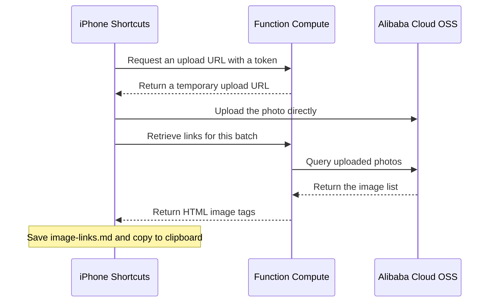

# Batch Upload Photos to OSS with iPhone Shortcuts

After taking a batch of photos on your phone, preparing a blog post usually means exporting them, compressing them, uploading them to OSS, and copying each image URL. A shortcut can connect these steps: select multiple photos, share them to Upload to Blog, and receive a Markdown file containing all the image links when the upload finishes.

## See the Result First

**Select photos → share them to the shortcut → receive image tags ready to paste into your blog.** The notification below shows a completed upload of three photos. The links have been copied to the clipboard and saved in a Markdown file.


The shortcut appears in the Photos share menu. In the screenshot it is named Upload to Blog OSS; this article calls it Upload to Blog for short.


Once everything is set up, follow these steps for everyday use.

1. Open Photos, tap Select, and choose the photos to upload.
2. Tap Share and choose Upload to Blog.
3. Enter a name for this batch, such as Yangshuo Trip.
4. Keep Shortcuts in the foreground while it processes each photo.
5. When finished, the image links are copied to the clipboard automatically, and the Markdown file is saved to `iCloud Drive/Shortcuts/BlogUploads/`.

Open that file on your Mac and paste the links into a blog post. Try two photos first, then upload batches of 20–30. Each batch supports up to 500 photos, with a maximum of 50 MiB per image.

The final file looks like this. The Markdown file contains `` tags that can be pasted directly into the blog.

```markdown
# Yangshuo Trip


```

After uploading, the photos are accessible through their links. Add the generated image tags to an article or travel album, then publish through your usual blog workflow. When writing, replace `alt` with a description of the photo. The `400px` value controls only its displayed width on the page; it does not compress the image file.

## The Upload Process

This approach uses **native iPhone Shortcuts, Alibaba Cloud Function Compute (FC), and an existing OSS bucket**. FC issues temporary upload URLs, confirms successful uploads, and retrieves image lists. The phone uploads the photos directly to OSS.

Below are the complete cloud API code, deployment settings, and instructions for building two shortcuts. Editing shortcuts on a Mac and syncing them to your iPhone through iCloud is recommended. Replace the sample bucket, region, API URL, and upload token with your own values, then grant access to photos, the network, and folders when you first run the shortcuts.



## How Much Does This Cost?

FC does not require a monthly server subscription. CPU time, memory usage duration, and invocations are converted into compute units (CUs). According to the official standard prices checked on November 6, 2026, the first tier is **CNY 0.00011/CU**: active CPU works out to CNY 0.00011 per vCPU-second, memory to CNY 0.0000165 per GB-second, and invocations to CNY 0.00825 per 10,000 calls. [FC pay-as-you-go billing](https://help.aliyun.com/zh/functioncompute/pay-as-you-go-billing-methods)

For light usage, also account for the **minimum charge of CNY 0.01 per function per hour**: if a function is invoked or occupies compute resources during an hour, usage below one cent is still billed at one cent. This article sets the minimum instance count to `0`, so no charge applies after scaling to zero. By default, instances are released one minute after requests finish, and that interval is also billable. [Minimum charges and instance release rules](https://help.aliyun.com/zh/functioncompute/product-change-description-on-optimizing-function-billing-mode)

Photos go directly from the phone to OSS; FC handles only URLs, upload confirmations, and lists. For example, using OSS Standard locally redundant storage in Hangzhou, the following usage gives an estimated monthly cost, excluding resource packages or trial discounts.

| Item | Assumed Usage and Reference Price | Monthly Cost |
| --- | --- | --- |
| FC | 30 billable hours with invocations or resource usage during the month, each below CNY 0.01 in usage charges | About CNY 0.30 |
| OSS storage | Average monthly storage of 2 GB at CNY 0.12/GB/month | About CNY 0.24 |
| OSS image download traffic | 10 GB from readers, estimated at the peak-hour rate of CNY 0.50/GB (08:00–24:00) | About CNY 5 |
| OSS read/write requests | About 10,000 requests in total at CNY 0.01 per 10,000 | About CNY 0.01 |

This example totals about **CNY 5.6/month**, mainly for the traffic generated when readers view images. Storage is charged on the accumulated volume of retained photos, so costs rise as more photos are kept. The estimate excludes domain registration, optional logs, and FC's small amount of public-network traffic. Actual prices depend on the selected region and your bill. [OSS storage fees](https://help.aliyun.com/zh/oss/storage-fees) · [OSS traffic and request billing examples](https://help.aliyun.com/zh/oss/billing-examples)

## I. Configure OSS First

### 1. Choose a Bucket and Image Domain

I use `zhihao-blog` in Hangzhou and store images under `blog/uploads/`. Replace the bucket name and region with your own when following along.

Record these three values; they will become function environment variables later.

```text
OSS_BUCKET=zhihao-blog
OSS_REGION=oss-cn-hangzhou
PUBLIC_BASE_URL=https://zhihao-blog.oss-cn-hangzhou.aliyuncs.com
```

For the image domain, enter only the HTTPS root URL. The function appends the image path automatically.

**New OSS accounts need to consider domain restrictions.** Users who activated OSS on or after March 20, 2025 must use a custom domain to upload and read files in Chinese mainland regions. In the bucket, open **Bucket Configuration → Domain Management**, bind your image domain (a Chinese mainland bucket requires an ICP-filed domain), add the DNS CNAME record as instructed, and configure an HTTPS certificate for it. Then replace `PUBLIC_BASE_URL` above with that domain, such as `https://img.example.com`. The code in this article uses it for both uploading and reading images, so use a domain bound directly to OSS. [Official restriction notice](https://www.alibabacloud.com/zh/notice/oss_update_notice_policy_change_in_calling_data_api_operations_via_the_default_public_domain_name_45a) · [Bind a custom domain](https://help.aliyun.com/zh/oss/user-guide/access-buckets-via-custom-domain-names)

### 2. Allow the Blog to Display Images

Open **Permissions → Bucket Policy** in the bucket and add a rule.

- Select specified resources and enter `blog/uploads/*`.
- Select **Anonymous Accounts** as the authorized users.
- Set the effect to **Allow** and choose `oss:GetObject`, the operation for reading files.

After saving, images in that directory can be displayed publicly. If Block Public Access is enabled, disable it at the applicable level for the public-read grant to take effect. If an uploaded image still returns 403, check here first. [Bucket Policy configuration](https://help.aliyun.com/zh/oss/user-guide/oss-bucket-policy/)

### 3. Give the Upload Function a RAM Role

The function needs permission to write files to this bucket and query uploaded photos. Complete these three steps in the RAM console. [Open the RAM console](https://ram.console.aliyun.com/)

1. Open **Identities → Roles → Create Role**, select **Alibaba Cloud Service** as the trusted entity and **Function Compute** as the trusted service, and name the role `BlogPhotoUploadRole`.
2. Open **Permissions → Policies → Create Policy → JSON**, paste the following JSON, and save it as `BlogPhotoUploadPolicy`. Replace both occurrences of `zhihao-blog` with your bucket name.
3. Return to `BlogPhotoUploadRole`, open **Permissions → Grant Permission**, select **Account** as the resource scope, choose `BlogPhotoUploadPolicy` under **Custom Policies**, and save.

```json
{
  "Version": "1",
  "Statement": [
    {
      "Effect": "Allow",
      "Action": ["oss:PutObject", "oss:GetObject"],
      "Resource": ["acs:oss:*:*:zhihao-blog/blog/uploads/*"]
    },
    {
      "Effect": "Allow",
      "Action": ["oss:ListObjects"],
      "Resource": ["acs:oss:*:*:zhihao-blog"],
      "Condition": {
        "StringLike": {
          "oss:Prefix": ["blog/uploads/*"]
        }
      }
    }
  ]
}
```

Assign this role to the FC function later. The code obtains temporary credentials automatically. [Function role configuration](https://help.aliyun.com/zh/functioncompute/grant-function-compute-permissions-to-access-other-alibaba-cloud-services)

## II. Deploy the Function

### 1. Create a Function

Open the FC console, select the same region as OSS, and go to **Functions → Function List → Create Function**. [Open the FC console](https://fcnext.console.aliyun.com/)

| Setting | Value |
| --- | --- |
| Function type | Event function |
| Runtime | Built-in runtime, Node.js 20 |
| Function name | `blog-photo-upload` |
| Code upload method | Use sample code |
| Handler | `index.handler` |
| Memory | 512 MB |
| Timeout | 60 seconds |
| Minimum instances | `0` |

After creation, open the **Code** tab and `index.js` in WebIDE. Replace its contents with the complete code at the end of this article, then save.

Create or open `package.json` in the same directory and enter the following contents.

```json
{
  "name": "blog-photo-upload",
  "version": "1.1.0",
  "private": true,
  "type": "commonjs",
  "dependencies": {
    "ali-oss": "6.23.0"
  }
}
```

After saving, choose **Terminal → New Terminal** and run these two lines to install the required dependencies.

```bash
cd /code
npm install --omit=dev
```

When installation finishes, click **Deploy Code**. [Installing dependencies with WebIDE](https://help.aliyun.com/zh/functioncompute/use-webide-to-package-third-party-dependencies-of-a-function-1)

### 2. Set Environment Variables and the Function Role

Under **Configuration → Advanced Settings → Permissions**, set the function role to `BlogPhotoUploadRole`. Enable public-network access in the network settings.

Then add the three values recorded in the first section under **Environment Variables**. Enter variable names and values separately, and use only the root URL for the image domain.

| Variable | Example Value |
| --- | --- |
| `OSS_BUCKET` | `zhihao-blog` |
| `OSS_REGION` | `oss-cn-hangzhou` |
| `PUBLIC_BASE_URL` | Your OSS image domain, such as `https://img.example.com` |

Save and deploy when finished.

### 3. Configure an Upload Token and HTTP Trigger

Run the following line in Terminal on your Mac to generate an upload token, and keep the result.

```bash
openssl rand -hex 32
```

Open **Triggers → Create Trigger** for the function. Choose **HTTP**, allow `POST`, select **Bearer** authentication, and choose the **Opaque** token type.

Use the following JSON as the authentication token configuration, replacing `tokenData` with the token you just generated.

```json
{
  "tokens": [
    {
      "enable": true,
      "tokenName": "iphone",
      "tokenData": "replace-with-the-generated-64-character-token"
    }
  ]
}
```

After saving, copy the trigger's **public HTTPS endpoint**. Your phone will use this URL and the token. Once the trigger verifies the token, the function gives the phone a temporary upload URL, and the photo goes directly to OSS. [Bearer authentication configuration](https://help.aliyun.com/zh/functioncompute/enable-bearer-authentication-for-an-http-trigger)

## III. Build the Shortcuts

This part is easier to edit on a Mac. Open Shortcuts and create two shortcuts named Upload to Blog and View Upload Records. Sign in to the same Apple Account on your Mac and iPhone, and enable iCloud Drive and Shortcuts syncing.

First, create the `BlogUploads` folder under **iCloud Drive → Shortcuts**. All generated files will be saved there.

### 1. Enter the API Settings

At the top of both shortcuts, add two Text actions, each followed by Set Variable. Put the FC public HTTPS endpoint in the first Text action and name its variable `API URL`. Put the raw token in the second and name its variable `Upload Token`.

Insert the variables mentioned below by selecting them in each action's input field. Whenever reading a response field, manually select `API Response` as the input of every Get Dictionary Value action.

Use this group of actions for every FC call. When it is needed again later, copy the group and change the JSON request body.

1. Add Get Contents of URL, select `API URL`, choose `POST`, and set the request body to **JSON**.
2. Add an `Authorization` header whose value is `Bearer ` followed by the `Upload Token` variable, keeping the space between them. Add `Content-Type` with the value `application/json`.
3. Set the result to `API Response` and use Get Dictionary Value to read `ok`.
4. Add If and continue when `ok` equals `1`. Otherwise, read `error`, display it with Show Alert, and use Stop This Shortcut.

On the phone, that section looks like this.


### 2. Build Upload to Blog

In Details, enable **Show in Share Sheet** and accept **Images**. Below the API settings, add these actions in order.

1. If Shortcut Input has a value, set it to `Photo List`. Otherwise, use Select Photos with multiple selection enabled and set its result to `Photo List`.
2. Use Count to get the number of photos and set it to `Total`. Stop if it is `0`; show an alert and stop if it is greater than `500`.
3. Use Ask for Input to name the batch, and set the result to `Batch Name`.
4. Call FC with `action=create` in the JSON. Read `batch` from the response and set it to `Batch ID`.

**Save an upload record first.** Get the current date and use Format Date with the custom format `yyyy-MM-dd_HH-mm-ss`. Apply Match Text to the batch ID with `^[0-9a-f]{8}`, taking its first eight characters as a short ID.

Use Replace Text on the batch name with regular expressions enabled to replace whitespace, slashes, and other characters unsuitable for filenames. Use the following search expression and `_` as the replacement.

```text
[\s/\\:*?"<>|\x00-\x1f]+
```

Use Text to combine the timestamp, sanitized name, and short ID into `timestamp_name_short-id`, and set it to `File Stem`. Add a Dictionary with these four entries.

| Key | Value | Type |
| --- | --- | --- |
| `batch` | `Batch ID` | Text |
| `title` | `Batch Name` | Text |
| `total` | `Total` | Number |
| `fileStem` | `File Stem` | Text |

Use Get Text from Input to turn the dictionary into JSON, name it `File Stem_upload-record.json`, and save it to `BlogUploads`.

Configure all later file-saving actions the same way. First use Set Name for the complete filename, then Save File. Select `Shortcuts` in iCloud Drive as the destination, set the subpath to `BlogUploads/` followed by the complete filename, disable **Ask Where to Save**, and enable **Overwrite If File Exists**.

**Next, upload each photo.** Add Text containing `# ` followed by `Batch Name`, and set it to `Completed Text`. Add Repeat with Each with `Photo List` as its input. Put all the following actions inside that loop.

First set Repeat Item to `Upload File`. Use Get Details of Files to read its extension, then Change Case to convert it to lowercase.

- If the extension is `heic` or `heif`, use Convert Image on `Upload File`, convert it to JPEG at 100% quality, and keep metadata enabled. Set the result to `Upload File`, and set `Upload Content Type` to `image/jpeg`.
- For other formats, create a Dictionary with the mappings below, then use Get Dictionary Value with the extension as the key to obtain `Upload Content Type`. Create separate entries for `jpg` and `jpeg`. If the resulting type is empty, show Format not supported and stop.

| Extension | Upload Content Type |
| --- | --- |
| `jpg`、`jpeg` | `image/jpeg` |
| `png` | `image/png` |
| `gif` | `image/gif` |
| `webp` | `image/webp` |

Then perform these steps inside the loop.

1. Call FC to request a URL, using the JSON fields below. Set the type of `index` to **Number** and all other fields to Text.

   | Field | Value |
   | --- | --- |
   | `action` | `sign` |
   | `batch` | `Batch ID` |
   | `index` | `Repeat Index` |
   | `contentType` | `Upload Content Type` |

2. Read `uploadUrl` and `key` from the response, setting them to `Upload URL` and `Object Key` respectively.
3. Add another Get Contents of URL, select `Upload URL`, choose **PUT**, set the request body to **File**, and select `Upload File`. This time add only the `Content-Type` header, using `Upload Content Type` as its value.
4. Call FC again with `action=confirm`, `batch=Batch ID`, and `key=Object Key` in the JSON, and read `markdown` from the response.
5. Use Text to combine `Completed Text`, two line breaks, and `markdown`. Set it back to `Completed Text`, then save it as `File Stem_image-links.md`.

**Retrieve the complete result after the loop.** Call FC with `action=list` and `batch=Batch ID`, and read `markdown` and `count`. Use Text to combine `# Batch Name`, two line breaks, and `markdown`, setting the result to `Final Markdown`.

Save it to the same `image-links.md` filename, add Copy to Clipboard with `Final Markdown` as input, and finish with Show Notification saying Uploaded count/Total photos; image tags copied. Insert the corresponding variables for the filename, count, and batch name.


### 3. Build View Upload Records

This shortcut is simpler. Enter the same API URL and token at the top, then add these steps.

1. Use Select File to choose an `upload-record.json` file in `BlogUploads`.
2. Use Get Dictionary from Input to read the file and set the result to `Batch Record`. Select that dictionary for each Get Dictionary Value action and retrieve `batch`, `title`, `total`, and `fileStem`, assigning them to `Batch ID`, `Batch Name`, `Total`, and `File Stem`.
3. Call FC with `action=list` and `batch=Batch ID`, and read `markdown` and `count`.
4. As in the previous shortcut, prepend the batch title, save to the same `image-links.md` filename, copy `Final Markdown` to the clipboard, and show a Recovered count/Total photos notification.

Once both shortcuts sync to your iPhone, they are ready to use. Grant permissions when prompted on first use and choose Always Allow whenever offered. If data-sharing prompts keep appearing for large photo batches, search for Shortcuts in Settings, open **Advanced**, and enable **Allow Sharing Large Amounts of Data**. [Apple's Shortcuts privacy settings](https://support.apple.com/zh-cn/guide/shortcuts/apd961a4fc65/ios)

## IV. Files and Upload Records

### Where Are the Photos Stored?

OSS groups photos by upload date. For example, three batches uploaded on November 5 all go into `blog/uploads/2026-11-05/`. Each photo's date is calculated in Beijing time when its upload URL is requested.

```text
blog/uploads/
├── 2026-11-05/
│   ├── <batch-id>-0001-<image-id>.jpg
│   └── <batch-id>-0002-<image-id>.png
└── _records/
    └── <batch-id>/2026-11-05.json
```

The `_records` directory is the date index the program uses to find batches. Keep it in place.

### How to Use the JSON and Markdown Files

Files like these are created in `Shortcuts/BlogUploads` on iCloud Drive.

```text
2026-11-05_21-25-38_Yangshuo-Trip_65934bb5_upload-record.json
2026-11-05_21-25-38_Yangshuo-Trip_65934bb5_image-links.md
```

**One JSON file corresponds to one selected batch of photos.** If you select 20 photos, one JSON file records the batch ID, name, and count. It is created when uploading begins and kept for querying that batch later.

**Open image-links.md when writing your blog.** It contains the image tags; copy whichever ones you need.

If an upload is interrupted or you later lose the links, run **View Upload Records** and select the corresponding `upload-record.json`. The shortcut queries OSS for photos actually uploaded in that batch, regenerates the Markdown file, and copies the tags to the clipboard.

Select the remaining photos separately to finish uploading them. Selecting an already uploaded photo again creates a new file.

## Complete API Code

Put the following code in FC's `index.js`, together with the `package.json` shown earlier.

```js
'use strict';

const { randomUUID } = require('node:crypto');
const PREFIX = 'blog/uploads/';
const MAX_IMAGES = 500;
const MAX_BYTES = 50 * 1024 * 1024;
const EXTENSION_BY_CONTENT_TYPE = new Map([
  ['image/jpeg', 'jpg'],
  ['image/png', 'png'],
  ['image/gif', 'gif'],
  ['image/webp', 'webp']
]);
const CONTENT_TYPE_BY_EXTENSION = new Map([
  ['jpg', 'image/jpeg'],
  ['jpeg', 'image/jpeg'],
  ['png', 'image/png'],
  ['gif', 'image/gif'],
  ['webp', 'image/webp']
]);
const UUID = '[0-9a-f]{8}-[0-9a-f]{4}-4[0-9a-f]{3}-[89ab][0-9a-f]{3}-[0-9a-f]{12}';
const BATCH_RE = new RegExp(`^${UUID}$`);
const FILE_RE = new RegExp(`^(\\d{4})-${UUID}\\.(jpg|jpeg|png|gif|webp)$`);
const DATE_RE = /^\d{4}-\d{2}-\d{2}$/;

class HttpError extends Error {
  constructor(status, message) {
    super(message);
    this.status = status;
  }
}

function response(statusCode, data) {
  return {
    statusCode,
    isBase64Encoded: false,
    headers: {
      'Content-Type': 'application/json; charset=utf-8',
      'Cache-Control': 'no-store'
    },
    body: JSON.stringify(data)
  };
}

function parseRequest(event) {
  let request;
  try {
    request = JSON.parse(Buffer.isBuffer(event) ? event.toString('utf8') : event);
  } catch {
    throw new HttpError(400, 'The request must use the FC HTTP trigger event format');
  }
  if (request?.requestContext?.http?.method !== 'POST') {
    throw new HttpError(405, 'Use a POST request');
  }
  const raw = request.isBase64Encoded
    ? Buffer.from(request.body || '', 'base64').toString('utf8')
    : request.body;
  if (typeof raw !== 'string' || Buffer.byteLength(raw) > 8192) {
    throw new HttpError(400, 'The request body must be JSON smaller than 8 KiB');
  }
  try {
    const data = JSON.parse(raw);
    if (!data || Array.isArray(data) || typeof data !== 'object') throw new Error();
    return data;
  } catch {
    throw new HttpError(400, 'The request body is not a valid JSON object');
  }
}

function configuration(env, context) {
  const bucket = env.OSS_BUCKET;
  const region = env.OSS_REGION;
  let publicBase;
  try {
    publicBase = new URL(env.PUBLIC_BASE_URL);
  } catch {
    throw new HttpError(500, 'Configure PUBLIC_BASE_URL');
  }
  if (!bucket || !/^oss-[a-z0-9-]+$/.test(region || '') ||
      publicBase.protocol !== 'https:' || publicBase.pathname !== '/' ||
      publicBase.search || publicBase.hash || publicBase.username || publicBase.password) {
    throw new HttpError(500, 'Invalid OSS_BUCKET, OSS_REGION, or PUBLIC_BASE_URL configuration');
  }
  const credentials = context?.credentials;
  if (!credentials?.accessKeyId || !credentials.accessKeySecret || !credentials.securityToken) {
    throw new HttpError(500, 'Configure a function role with OSS permissions');
  }
  return {
    publicBase: publicBase.href,
    clientOptions: {
      bucket, region, secure: true, authorizationV4: true,
      endpoint: publicBase.origin, cname: true,
      accessKeyId: credentials.accessKeyId,
      accessKeySecret: credentials.accessKeySecret,
      stsToken: credentials.securityToken,
      timeout: 10000
    }
  };
}

function requireBatch(batch) {
  if (typeof batch !== 'string' || !BATCH_RE.test(batch)) {
    throw new HttpError(400, 'batch must be the UUID returned when creating the batch');
  }
  return `${PREFIX}${batch}/`;
}

function validDate(date) {
  if (!DATE_RE.test(date)) return false;
  const parsed = new Date(`${date}T00:00:00.000Z`);
  return Number.isFinite(parsed.getTime()) && parsed.toISOString().slice(0, 10) === date;
}

function beijingDate(date) {
  return new Date(date.getTime() + 8 * 60 * 60 * 1000).toISOString().slice(0, 10);
}

function photoDetails(batch, key) {
  if (typeof key !== 'string') return null;
  const legacyPrefix = `${PREFIX}${batch}/`;
  let filename;
  if (key.startsWith(legacyPrefix)) {
    filename = key.slice(legacyPrefix.length);
  } else {
    const date = key.slice(PREFIX.length, PREFIX.length + 10);
    const dailyPrefix = `${PREFIX}${date}/${batch}-`;
    if (!validDate(date) || !key.startsWith(dailyPrefix)) return null;
    filename = key.slice(dailyPrefix.length);
  }
  const match = FILE_RE.exec(filename);
  if (!match || Number(match[1]) < 1 || Number(match[1]) > MAX_IMAGES) {
    return null;
  }
  return { index: Number(match[1]), filename };
}

function requireKey(batch, key) {
  const photo = photoDetails(batch, key);
  if (!photo) {
    throw new HttpError(400, 'key is not a photo path generated by this service');
  }
  return photo.index;
}

function photoItem(publicBase, batch, key, size) {
  const index = requireKey(batch, key);
  const publicUrl = new URL(key.split('/').map(encodeURIComponent).join('/'), publicBase).href;
  const sourceAttribute = publicUrl
    .replaceAll('&', '&amp;')
    .replaceAll('"', '&quot;')
    .replaceAll("'", '&#39;')
    .replaceAll('<', '&lt;')
    .replaceAll('>', '&gt;');
  const markdown = ``;
  return { index, key, size, publicUrl, markdown };
}

async function* listObjects(client, prefix) {
  let continuationToken;
  do {
    const result = await client.listV2({
      prefix, 'max-keys': 1000,
      ...(continuationToken ? { 'continuation-token': continuationToken } : {})
    });
    for (const object of result.objects || []) {
      if (typeof object.name === 'string' && object.name.startsWith(prefix)) yield object;
    }
    continuationToken = result.nextContinuationToken;
  } while (continuationToken);
}

function createHandler({ env = process.env, makeClient, makeId = randomUUID, now = () => new Date() } = {}) {
  const createClient = makeClient || (options => {
    const OSS = require('ali-oss');
    return new OSS(options);
  });
  return async function handler(event, context) {
    try {
      const data = parseRequest(event);
      const config = configuration(env, context);
      if (data.action === 'create') {
        return response(200, { ok: true, batch: makeId(), maxImages: MAX_IMAGES, maxBytes: MAX_BYTES });
      }
      if (!['sign', 'confirm', 'list'].includes(data.action)) {
        throw new HttpError(400, 'action must be create, sign, confirm, or list');
      }
      const legacyPrefix = requireBatch(data.batch);
      const recordPrefix = `${PREFIX}_records/${data.batch}/`;
      const client = createClient(config.clientOptions);

      if (data.action === 'sign') {
        if (!Number.isInteger(data.index) || data.index < 1 || data.index > MAX_IMAGES) {
          throw new HttpError(400, 'index must be an integer from 1 to 500');
        }
        // Omitting contentType retains compatibility with the original JPEG shortcut.
        const contentType = data.contentType === undefined ? 'image/jpeg' : data.contentType;
        const extension = EXTENSION_BY_CONTENT_TYPE.get(contentType);
        if (!extension) {
          throw new HttpError(400, 'contentType supports only image/jpeg, image/png, image/gif, or image/webp');
        }
        const date = beijingDate(now());
        const key = `${PREFIX}${date}/${data.batch}-${String(data.index).padStart(4, '0')}-${makeId()}.${extension}`;
        // Persist each used date before issuing a URL, so interrupted PUTs remain discoverable.
        // A separate marker per date makes concurrent uploads and retries idempotent.
        await client.put(`${recordPrefix}${date}.json`, Buffer.from('{}'), {
          headers: { 'Content-Type': 'application/json' }
        });
        const uploadUrl = await client.signatureUrlV4('PUT', 600, {
          headers: { 'Content-Type': contentType }
        }, key);
        return response(200, {
          ok: true, ...photoItem(config.publicBase, data.batch, key, null),
          uploadUrl, contentType, expiresIn: 600, maxBytes: MAX_BYTES
        });
      }

      if (data.action === 'confirm') {
        requireKey(data.batch, data.key);
        let result;
        try {
          result = await client.head(data.key);
        } catch (error) {
          if (error.code === 'NoSuchKey') throw new HttpError(404, 'The photo has not been uploaded successfully');
          throw error;
        }
        const headers = result.res.headers;
        const size = Number(headers['content-length']);
        const contentType = String(headers['content-type'] || '').split(';')[0].toLowerCase().trim();
        const extension = data.key.slice(data.key.lastIndexOf('.') + 1);
        const expectedContentType = CONTENT_TYPE_BY_EXTENSION.get(extension);
        if (!Number.isSafeInteger(size) || size <= 0 || size > MAX_BYTES || contentType !== expectedContentType) {
          throw new HttpError(422, 'The uploaded object must be a nonempty image with Content-Type matching its extension and must not exceed 50 MiB');
        }
        return response(200, { ok: true, ...photoItem(config.publicBase, data.batch, data.key, size) });
      }

      const dates = new Set();
      for await (const object of listObjects(client, recordPrefix)) {
        const filename = object.name.slice(recordPrefix.length);
        const date = filename.slice(0, -5);
        if (filename.endsWith('.json') && validDate(date)) dates.add(date);
      }
      const prefixes = [legacyPrefix, ...[...dates].sort().map(date => `${PREFIX}${date}/${data.batch}-`)];
      const photosByIdentity = new Map();
      for (const prefix of prefixes) {
        for await (const object of listObjects(client, prefix)) {
          const photo = photoDetails(data.batch, object.name);
          if (!photo) continue;
          const size = Number(object.size);
          if (!Number.isSafeInteger(size) || size <= 0 || size > MAX_BYTES) continue;
          // Daily copies replace legacy URLs when a historical photo has been migrated.
          photosByIdentity.set(photo.filename, photoItem(config.publicBase, data.batch, object.name, size));
          if (photosByIdentity.size > MAX_IMAGES) {
            throw new HttpError(422, 'This batch exceeds 500 objects; check for duplicate uploads in the OSS console');
          }
        }
      }
      const items = [...photosByIdentity.values()];
      items.sort((a, b) => a.index - b.index || a.key.localeCompare(b.key));
      return response(200, {
        ok: true, batch: data.batch, count: items.length, items,
        markdown: items.map(item => item.markdown).join('\n\n')
      });
    } catch (error) {
      if (error instanceof HttpError) return response(error.status, { ok: false, error: error.message });
      const code = /^[A-Za-z][A-Za-z0-9_]{0,63}$/.test(error?.code || '')
        ? error.code : 'UnknownError';
      console.error('OSS_OPERATION_FAILED', JSON.stringify({
        requestId: context?.requestId,
        code,
        status: Number.isInteger(error?.status) ? error.status : undefined
      }));
      return response(502, { ok: false, error: 'OSS operation failed; check the function role, region, and network settings before retrying' });
    }
  };
}

exports.createHandler = createHandler;
exports.handler = createHandler();
```
