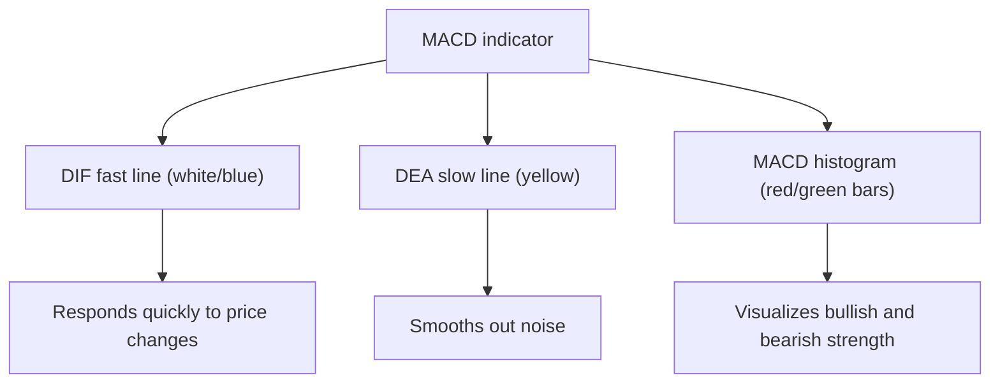
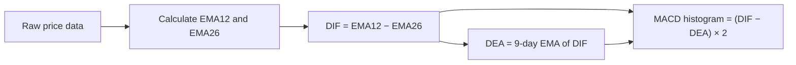
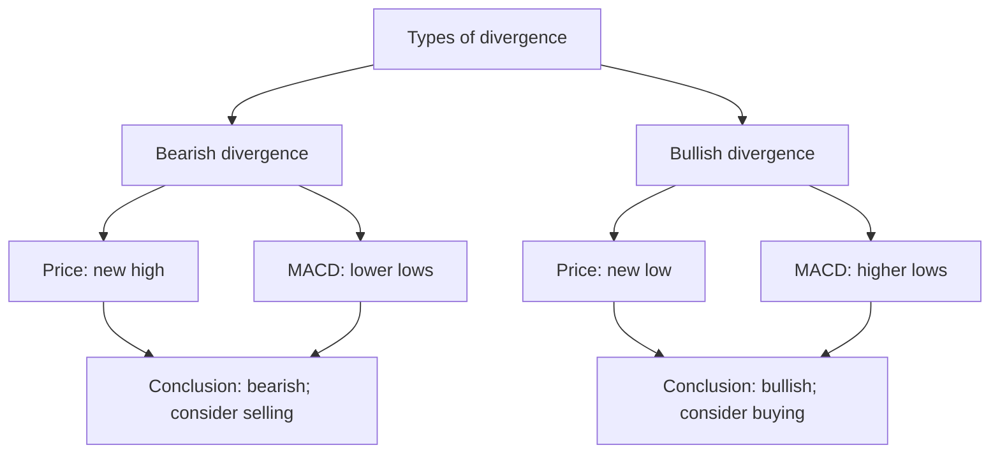
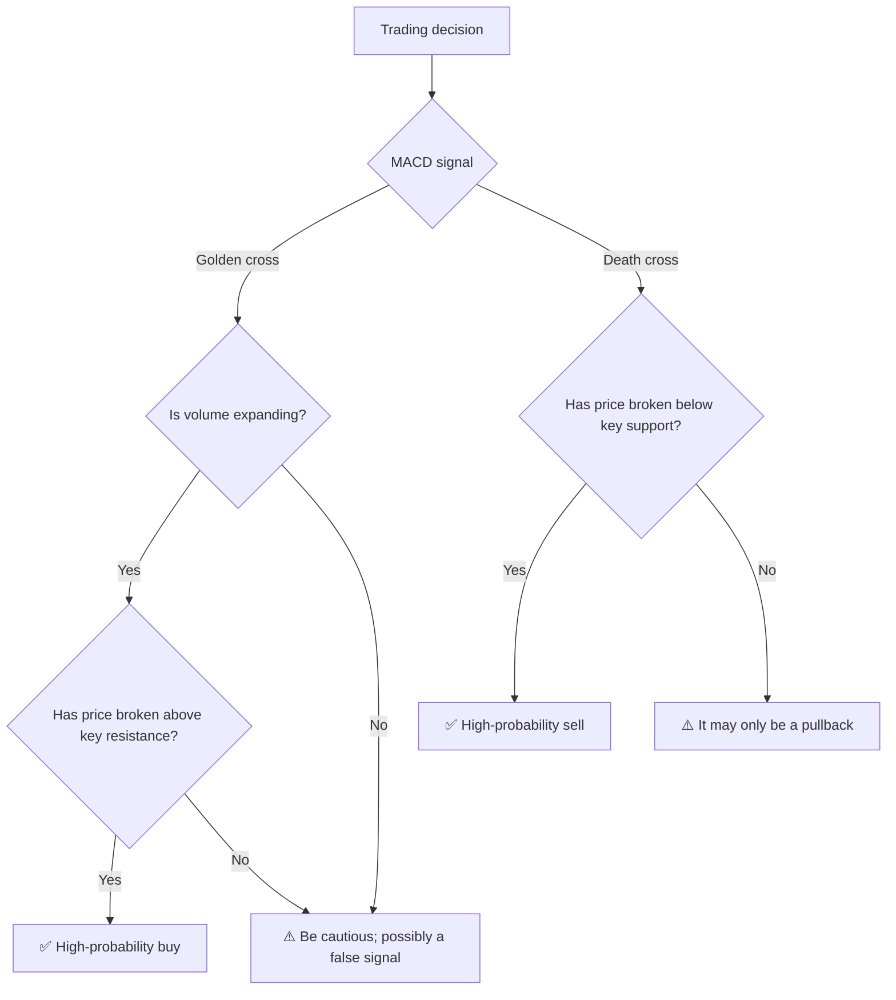

# What Is MACD? Understanding the "King of Indicators" in Technical Analysis

## 1. The Essence of MACD: Three Lines That Reveal the Trend

**MACD** stands for **Moving Average Convergence Divergence**, a name that describes the convergence and divergence of exponentially smoothed moving averages. The name is long, but you only need to remember its central purpose:

> **MACD helps you assess three things: the direction of a trend, its strength, and whether it may soon reverse.**

It consists of three parts, collectively known as the "three musketeers of MACD":

| Component | English Name | Common Name | Typical Display in Trading Software |
|---------|--------|------|------------------|
| **DIF** | MACD Line | Fast line / DIF line | White or blue curve |
| **DEA** | Signal Line | Slow line / signal line | Yellow curve |
| **MACD bars** | Histogram | Red/green bars / momentum bars | Alternating red and green bars |



> **In one sentence**: The relationship between DIF and DEA tells you **whether the trend is still intact**, while the height of the MACD bars tells you **whether it still has enough strength**.

## 2. How Is MACD Calculated?

MACD sounds complicated, but its calculation follows just three steps. Once you understand these steps, you truly understand MACD.

### 2.1 Step One: Calculate Two Moving Averages

MACD starts with two **exponential moving averages (EMAs)**:

- **EMA12**: The exponentially weighted average price over the past 12 days (fast line)
- **EMA26**: The exponentially weighted average price over the past 26 days (slow line)

> Why 12 and 26? These are the original settings chosen by MACD inventor Gerald Appel, tested by the market for half a century. You can also change them to 5 and 20 or 10 and 30, but 12/26 is the most widely used default.

The difference between an EMA and an ordinary moving average (MA / SMA) is that an EMA gives **more weight to recent prices**. It is therefore more responsive than an ordinary moving average and captures price changes sooner.

### 2.2 Step Two: DIF = Fast Line Minus Slow Line

Subtract EMA26 from EMA12 to obtain **DIF**:

```
DIF = EMA12 − EMA26
```

| DIF Value | Meaning |
|:--------:|------|
| **DIF > 0** | Short-term prices exceed long-term prices → an **uptrend** |
| **DIF < 0** | Short-term prices are below long-term prices → a **downtrend** |
| **DIF = 0** | Short-term and long-term prices match → a **turning point** in the trend |

> DIF is essentially the distance between **short-term sentiment** and the **long-term trend**. The greater the distance, the stronger the trend.

### 2.3 Step Three: DEA = A Smoothed Version of DIF

DEA is the 9-day EMA of DIF:

```
DEA = 9-day EMA of DIF
```

DEA is smoother and slower to react than DIF. Its purpose is to filter out short-term noise in DIF.

### 2.4 Step Four: MACD Histogram = DIF − DEA

```
MACD histogram = (DIF − DEA) × 2
```

> Multiplying by 2 simply magnifies the bars to make them more visible on the chart; it does not change how to interpret them.

| MACD Bar Color | Meaning |
|:----------:|------|
| **Red bars (positive)** | DIF is above DEA → **bullish strength dominates** |
| **Green bars (negative)** | DIF is below DEA → **bearish strength dominates** |
| **Bars become shorter** | The **gap between bullish and bearish strength is narrowing** → the trend may reverse |



## 3. How to Read MACD: Four Classic Signals

Open your trading software and display the MACD indicator. You will usually see something like this:

```
    ┌──────────────────────────────────────────┐
    │  Candlestick chart (price)                 │
    │      /\                                  │
    │     /  \     /\                          │
    │    /    \   /  \    /\                   │
    │   /      \ /    \  /  \                  │
    │  /        V      \/    \                 │
    ├──────────────────────────────────────────┤
    │  MACD indicator panel                      │
    │                                          │
    │  ─── DIF (fast line, white/blue)            │
    │  ─── DEA (slow line, yellow)               │
    │  ┃┃┃ Red/green bars (MACD histogram)       │
    │                                          │
    │  ───────── Zero line ─────────             │
    └──────────────────────────────────────────┘
```

### 3.1 Signal One: The Golden Cross — A Buy Signal

> **When DIF crosses above DEA from below, it forms a golden cross.**

```
   DIF  ──→ crosses DEA ──→ upward

   DEA ──────────────────────
            ↑
          Golden cross
```

| Location of the Golden Cross | Signal Strength | Explanation |
|:----------:|:------:|------|
| **Below the zero line** | ⭐⭐ Weak | A rebound within a downtrend; may be a false signal |
| **Near the zero line** | ⭐⭐⭐ Moderate | A potential turning point in the trend; worth watching |
| **Above the zero line** | ⭐⭐⭐⭐ Strong | A renewed advance within an uptrend; more reliable |

### 3.2 Signal Two: The Death Cross — A Sell Signal

> **When DIF crosses below DEA from above, it forms a death cross.**

```
   DIF ──→ crosses DEA ──→ downward

   DEA ──────────────────────
            ↑
          Death cross
```

| Location of the Death Cross | Signal Strength | Explanation |
|:----------:|:------:|------|
| **Above the zero line** | ⭐⭐ Weak | A pullback within an uptrend, not necessarily a reversal |
| **Near the zero line** | ⭐⭐⭐ Moderate | The trend may be weakening; caution is needed |
| **Below the zero line** | ⭐⭐⭐⭐ Strong | The downtrend is accelerating; risk is higher |

### 3.3 Signal Three: Crossing the Zero Line — Trend Confirmation

The zero line separates bullish and bearish territory in MACD:

```
    Above zero (bullish territory)   Below zero (bearish territory)
    ┌─────────────────┬─────────────────┐
    │  DIF > 0        │  DIF < 0        │
    │  Uptrend          │  Downtrend           │
    │  Favor long trades│  Wait or sell short  │
    └─────────────────┴─────────────────┘
```

- **DIF crosses above zero**: Confirms that the short-term trend has turned upward
- **DIF crosses below zero**: Confirms that the short-term trend has turned downward

> Note: Zero-line crossings usually **lag behind** golden/death crosses, but are more reliable. A golden cross is an early warning; a zero-line crossing is confirmation.

### 3.4 Signal Four: Divergence — The Most Powerful Reversal Signal

Divergence is one of the most sought-after MACD signals because it often warns of a major trend reversal in advance.

#### Bearish Divergence at a Peak

> **Price makes a new high, but MACD makes a lower high.**

```
  Price:   /\              ← Second peak (higher)
         /  \    /\
        /    \  /  \
       /      \/    \

  MACD:   /\          ← First peak (higher)
        /  \    /\
       /    \  /  \    ← Second peak (lower!)
      /      \/    \

  Conclusion: The rally is losing strength, and a decline may be approaching.
```

**The logic of bearish divergence**: Although price has reached a new high, the energy driving the advance (MACD bar height / DIF height) is much weaker than before. It is like someone climbing stairs: they are still moving upward, but each step takes more effort. They may stop or even fall at any moment.

#### Bullish Divergence at a Trough

> **Price makes a new low, but MACD makes a higher low.**

```
  Price:  \    /\         ← Second trough (lower)
           \  /  \
            \/    \
                  \

  MACD:    \  /\         ← Second trough (higher!)
            \/  \  /\
                  \/

  Conclusion: Downward momentum is fading, and a rebound may be approaching.
```

**The logic of bullish divergence**: Although price is still falling, selling pressure is growing weaker. It is like a car rolling downhill: it is still moving, but the brakes have already been applied. Slowing down or stopping is only a matter of time.



## 4. Advanced MACD Techniques: Beyond Golden and Death Crosses

### 4.1 Contracting and Expanding MACD Bars

Sometimes you do not need to wait for a golden or death cross. Changes in the MACD histogram alone can be useful:

```
Changes in red bars:
  ┃ ┃ ┃ ┃ ┃ ┃ ┃ ← Red bars grow taller each day → Bullish momentum accelerates (hold/add)
  ┃ ┃ ┃ ┃ ┃     ← Red bars grow shorter each day (contract) → Bullish momentum slows (consider reducing)

Changes in green bars:
  ┃ ┃ ┃ ┃ ┃ ┃ ┃ ← Green bars grow longer each day → Bearish momentum accelerates (wait/reduce)
  ┃ ┃ ┃ ┃ ┃     ← Green bars grow shorter each day (contract) → Bearish momentum slows (a bottom may form)
```

> Shorter red bars mean the advance is losing steam; shorter green bars mean the decline is losing steam. This is one of the simplest and most practical MACD signals.

### 4.2 Confirmation Across Multiple Time Frames

Professional traders often examine MACD on more than one time frame:

```
Daily MACD golden cross + weekly MACD golden cross → ⭐⭐⭐⭐⭐ Strongly bullish
Daily MACD golden cross + weekly MACD death cross → ⭐⭐ Only a rebound; participate cautiously
Daily MACD death cross + weekly MACD death cross → ⭐⭐⭐⭐⭐ Strongly bearish
Daily MACD death cross + weekly MACD golden cross → ⭐⭐ Only a pullback; no need to panic
```

> **Use the longer time frame to determine direction and the shorter one to find entry points.** This is the central idea of multiple-time-frame analysis.

## 5. MACD in Practice: An Apple (AAPL) Example

Suppose Apple's MACD changes as follows during a particular period:

```
Date       Price     DIF     DEA     Bars          Signal
─────────────────────────────────────────────────
Week 1     $150     −2.1    −1.8    ██ Green      Declining
Week 2     $148     −2.3    −2.0    ██ Green      Continues falling after a death cross
Week 3     $145     −2.0    −1.9    █ Short green Green bars shrink! Bearish momentum slows
Week 4     $147     −1.5    −1.7    █ Red         Golden cross! DIF crosses above DEA
Week 5     $152     −0.5    −1.2    ██ Red        Red bars expand; bullish momentum accelerates
Week 6     $158     +1.2    −0.3    ███ Red       DIF crosses above zero! Trend confirmed
Week 7     $165     +2.5    +1.0    ████ Red      Strong uptrend
Week 8     $170     +3.0    +1.8    ███ Red       Red bars shrink! Bullish momentum slows
Week 9     $168     +2.8    +2.2    █ Red         Red bars continue shrinking
Week 10    $163     +2.0    +2.1    █ Green       Death cross! DIF crosses below DEA
```

> This example illustrates two key patterns:
> 1. **MACD bars signal changes earlier than golden/death crosses**: You can start watching in week 3 when the green bars shorten, then use the golden cross in week 4 to confirm a purchase, instead of waiting for the crossing above zero in week 6.
> 2. **Shortening red bars are a clear signal to reduce a position**: In week 8, the red bars start to shorten. Although price is still rising, momentum has weakened. Reducing the position then is less rushed than waiting to sell at the death cross in week 10.

## 6. MACD's Main Limitations: Its Blind Spots

No indicator is perfect, and MACD is no exception. Understanding its limitations matters more than knowing how to use it.

### 6.1 Lag: An Inherent Weakness of MACD

MACD is calculated from moving averages, which naturally lag behind price. This means:

- **By the time a golden cross appears, price has often already risen for a while**
- **By the time a death cross appears, price has often already fallen for a while**

```
Price:  ────↗────
              ↑ A golden cross appears, but the best entry point has already passed
MACD：  ──────✚──
```

> **Response**: Do not rely on MACD alone. Combine it with candlestick patterns, trading volume, support and resistance levels, and other tools.

### 6.2 Repeated Whipsaws in Sideways Markets

During sideways, range-bound trading, MACD produces many **false signals**:

```
MACD in a sideways market:
  Golden cross → Buy → Price falls instead of rising → Stop out
  Death cross → Sell → Price rises instead of falling → Miss the rally
  Golden cross → Buy → Price falls again → Stop out again
  ...The cycle repeats...
```

> **Response**: Trade less frequently in sideways markets, or combine MACD with oscillators such as Bollinger Bands and RSI. MACD is inherently a **trend indicator**: it thrives in trending markets and struggles in range-bound ones.

### 6.3 The Parameter-Selection Dilemma

The default parameters (12, 26, 9) are classic, but do not suit every situation:

| Parameters | Characteristics | Suitable Uses |
|---------|------|------|
| **(5, 20, 7)** | More responsive, more signals | Short-term and intraday trading |
| **(12, 26, 9)** | Classic, balanced settings | Short- to medium-term trading, daily charts |
| **(20, 50, 12)** | Smoother, fewer but more reliable signals | Medium- to long-term trading, weekly charts |

> There is no universally optimal parameter set, only the one that best suits your trading style.

### 6.4 Comparing MACD with Other Indicators

| Indicator | Type | Main Purpose | Relationship to MACD |
|------|:--:|------|------|
| **MACD** | Trend indicator | Assess trend direction and strength | — |
| **RSI** | Oscillator | Identify overbought and oversold conditions | Complements MACD in sideways markets |
| **KDJ** | Oscillator | Identify short-term entry and exit points | More responsive than MACD, but produces more false signals |
| **Moving average (MA)** | Trend indicator | Identify support, resistance, and trends | The raw material of MACD |
| **Bollinger Bands** | Channel indicator | Assess volatility and overbought/oversold conditions | Supports MACD in sideways markets |
| **Trading volume** | Volume indicator | Validate the credibility of price movements | MACD golden cross + rising volume = strong signal |

## 7. A Mindset for Using MACD: Three Golden Rules

### Rule One: Trade with the Trend

```
Above zero → Favor long positions; buy at golden crosses
Below zero → Favor waiting; treat golden crosses cautiously
```

> Buying on a golden cross below zero is like rowing upstream: a correct call brings a small gain, while a wrong one can bring a large loss.

### Rule Two: Wait for Confirmation

```
MACD bars contract → Early warning (watch, but do not place an order)
A golden/death cross appears → Confirmation (an order can be placed)
A zero-line breakout → Stronger confirmation (the position can be increased)
```

### Rule Three: Seek Agreement Across Indicators

The strongest trading signals often come from several indicators pointing in the same direction, rather than from MACD alone:

```
✅ MACD golden cross + breakout above resistance on rising volume + RSI not overbought → High-probability buy signal
❌ MACD golden cross + shrinking volume + price near resistance → A false breakout is more likely
```



## 8. Summary

| Key Point | In One Sentence |
|------|------|
| **What MACD is** | It uses the distance between two moving averages to measure trend direction and strength |
| **Most important signals** | Divergence > zero-line crossings > golden/death crosses > histogram changes |
| **Greatest strength** | Visual, easy to understand, and highly reliable in trending markets |
| **Greatest weakness** | Lag and frequent false signals in sideways markets |
| **Best strategy** | Combine confirmation across time frames and indicators; never base decisions on a single indicator |

> **MACD interprets trends; it does not dispense wealth.** It can help you understand what the market is doing, but cannot decide what you should do. Ultimately, the person using the indicator makes money, not the indicator itself.
