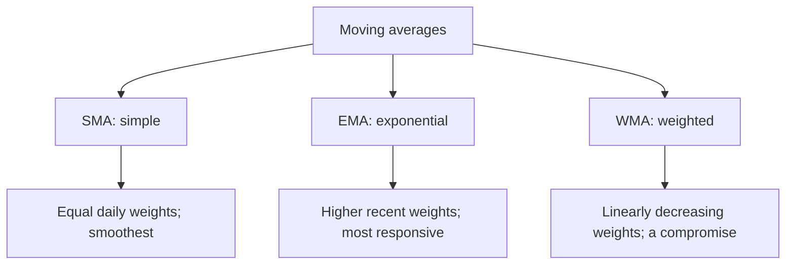
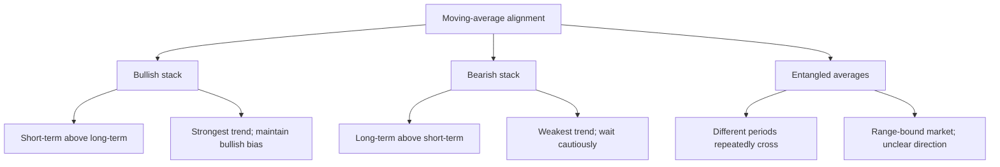

# What Is a Moving Average? A Foundation of Technical Analysis

## 1. The Essence of a Moving Average: Average Price

The **Moving Average (MA)** is among the oldest, simplest, and most important technical indicators. Its calculation can be explained in one sentence:

> **Add the closing prices from the last N days and divide by N to obtain one point. Calculate one point each day and connect them to form a moving average.**

| Example | Calculation |
|------|------|
| **5-day average (MA5)** | Average closing price over the last five days |
| **20-day average (MA20)** | Average closing price over the last twenty days |
| **Annual average (MA250)** | Average closing price over the last 250 days |


A moving average's main job is **filtering noise**. Prices jump around daily; the average smooths those short-term fluctuations to reveal the **underlying direction**.

```
Raw price:  /\      /\
          /  \    /  \    /\
         /    \/\/    \/\/  \
        /                    \

5-day MA:  ~~~~~~~~~~~~~~~~~~~~~~~~~~  ← Smoothed: the trend is clear
```

## 2. Three Types of Moving Averages

There are many calculation methods, but three dominate everyday use:

### 2.1 Simple Moving Average (SMA)

```
SMA = (P₁ + P₂ + ... + Pₙ) ÷ N
```

**Every price has equal weight.** This is the most traditional and commonly used average.

| Advantage | Disadvantage |
|------|------|
| Simple, intuitive, and transparent | Slow to respond to recent price changes |
| Useful for identifying larger trends | A price affects the average twice: when it enters the window and when it leaves |

### 2.2 Exponential Moving Average (EMA)

```
EMA_today = today's price × α + yesterday's EMA × (1 − α)
where α = 2 ÷ (N + 1)
```

**Recent prices receive more weight; older prices receive progressively less.**

| Advantage | Disadvantage |
|------|------|
| Responds quickly and tracks price changes closely | More signals, including more false ones |
| Used in derived indicators such as MACD and Bollinger Bands | Sensitive to extreme prices |

### 2.3 Weighted Moving Average (WMA)

```
WMA = (P₁×1 + P₂×2 + ... + Pₙ×N) ÷ (1+2+...+N)
```

**The most recent day has weight N and the oldest weight 1, decreasing linearly.**

> WMA sits between SMA and EMA: more responsive than SMA, steadier than EMA. In actual trading, however, EMA is used far more widely than WMA.



## 3. Four Classic Uses

### 3.1 Direction: One Average Defines the Trend

The simplest rule: **above the average is bullish; below it is bearish.**

```
Price above MA60 → bullish trend → buy pullbacks
─────────────────────── ← MA60, the lifeline
Price below MA60 → bearish trend → sell rallies
```

Some of the market's most important reference averages:

| Average | Common name | Main use |
|:----:|------|------|
| **MA5** | Weekly average | Very short-term sentiment; most responsive |
| **MA10** | Half-month average | Short-term trend reference |
| **MA20** | Monthly average | Short-term bull/bear boundary |
| **MA60** | Quarterly average | **Lifeline**: a central medium-term trend measure |
| **MA120** | Half-year average | Medium- to long-term direction |
| **MA250** | Annual average | **Bull/bear dividing line** for the larger cycle |

> MA60 is called the lifeline for a reason: sixty trading days roughly equal one quarter, representing **the average cost of longer-term capital**. Holding above it suggests those investors are profitable and the trend healthy; falling below suggests trapped holders and a weakening trend.

### 3.2 Support and Resistance: A Magnet and a Ceiling

A striking practical property of averages is that **they can provide both support and resistance**.

```
Uptrend: price rebounds after pulling back to MA20
    ↗  ↗  ↗
  ↗  ↘↗  ↘↗  ↘↗   ← Buyers step in at MA20 each time
 ↗          MA20
────────────────────  MA20, support
```

```
Downtrend: rebounds are pushed back down at MA20
    ↘  ↘  ↘
  ↘  ↗↘  ↗↘  ↗↘   ← Holders sell near breakeven at MA20
 ↘          MA20
────────────────────  MA20, resistance
```

**Why does this happen?** The average represents **market participants' average cost**:

- **In an uptrend**: later buyers have higher costs. Near the average, early buyers can still hold profitably while later buyers see an attractive pullback, creating support.
- **In a downtrend**: many holders are trapped above the average. A rebound toward it prompts them to sell, creating resistance.

### 3.3 Crossovers: Golden Crosses and Death Crosses

When averages of different periods cross, they produce strong trading signals:

#### Golden Cross: Bullish

> **A shorter-term average crosses above a longer-term average from below.**

```
MA5 crosses above MA20 → golden cross → short-term strength, buy signal
```

```
                  ↗ MA5, fast line
                ↗
    ──────────✚──────────  MA20, slow line
            ↗
          ↗
        ↗  MA5
```

| Golden-cross pair | Signal strength | Practical meaning |
|---------|:------:|------|
| **MA5 above MA10** | ⭐⭐ | Very short-term rebound, with many false signals |
| **MA5 above MA20** | ⭐⭐⭐ | Short-term strengthening; a common entry signal |
| **MA10 above MA60** | ⭐⭐⭐⭐ | Medium-term trend turns bullish; relatively reliable |
| **MA20 above MA60** | ⭐⭐⭐⭐⭐ | Classic medium-term bullish signal |

#### Death Cross: Bearish

> **A shorter-term average crosses below a longer-term average from above.**

```
MA5 crosses below MA20 → death cross → short-term weakness, sell signal
```

> **Reliability depends on the timeframe**: daily-chart crossovers suit short-term trading, while weekly-chart crossovers indicate larger trends.

### 3.4 Alignment: Bullish and Bearish Stacks

When multiple averages follow a specific order, the market is in its strongest trending state:

#### Bullish Alignment: The Strongest Uptrend Signal

```
MA5     ← Highest, most recent
MA10
MA20
MA60
MA120
MA250   ← Lowest, longest period

Short-term MA > medium-term MA > long-term MA
The averages fan upward like an opening fan
```

> **Bullish alignment means participants across all timeframes are profitable.** It reflects highly optimistic sentiment and a powerful trend.

#### Bearish Alignment: The Strongest Downtrend Signal

```
MA250   ← Highest, longest period
MA120
MA60
MA20
MA10
MA5     ← Lowest, most recent

Long-term MA > medium-term MA > short-term MA
The averages fan downward
```

> **Bearish alignment means participants across all timeframes are losing money.** Layers of trapped holders create resistance at successive averages whenever prices rebound.



## 4. Practical Examples

### 4.1 Kweichow Moutai: A Simulated Price Sequence

```
Date        Close    MA5    MA20   MA60   MA condition
─────────────────────────────────────────────────
Week 1      ¥1600    —      —      —      Position-building phase
Week 2      ¥1620   ¥1610   —      —      MA5 turns upward
Week 3      ¥1650   ¥1635   —      —
Week 4      ¥1680   ¥1650  ¥1640   —      MA5 golden cross above MA20 ✚
Week 5      ¥1720   ¥1670  ¥1660   —      Bullish acceleration
Week 6      ¥1780   ¥1700  ¥1690  ¥1680   Breaks above MA60
Week 7      ¥1750   ¥1720  ¥1710  ¥1695   Pullback toward MA20
Week 8      ¥1800   ¥1745  ¥1730  ¥1710   Support holds; advance continues
Week 9      ¥1850   ¥1780  ¥1750  ¥1725   Bullish alignment forms
```

> The transition **from entangled to diverging averages mirrors the transition from an unclear to a clear trend**. When MA5 > MA20 > MA60 and all fan upward, the strongest holding phase has arrived.

### 4.2 Convergence and Divergence: The Key Pattern Transition

```
Converging averages, buildup       Diverging averages, breakout
MA5  ──                        MA5  ──↗
MA10 ──  Three lines intertwined    MA10 ──↗  Three lines fan upward
MA20 ──                        MA20 ──↗

→ Unclear direction; wait           → Clear trend; follow it
→ Volume usually contracts         → Volume usually expands
→ Longer base, larger breakout     → The most profitable phase
```

> The first direction in which tightly grouped averages diverge often becomes the next major trend. This is one of the moving-average system's most valuable signals.

## 5. Core Limitations

### 5.1 Lag: The Inherent Tradeoff

Moving averages use **past** prices, so they naturally react after price moves:

```
Price has already risen 10% → MA20 only starts turning upward
Price has already fallen 10% → the death cross finally arrives
```

| Period | Lag | Suitable use |
|:------:|:------:|------|
| MA5 | Low | Very short-term trading, with considerable noise |
| MA20 | Medium | Short-term swings |
| MA60 | Relatively high | Medium- to long-term trends |
| MA250 | High | Bull/bear assessment rather than precise entries |

> **Lag is a characteristic, not a defect.** Moving averages trade speed for stability. Accept that compromise rather than expecting them to be simultaneously fast and precise.

### 5.2 Entanglement in Range-Bound Markets

In sideways markets, short- and long-term averages cross repeatedly, twisting together:

```
MA5  ──╲ ╱──╲ ╱──
MA10 ───╳───╳───  ← Repeated golden/death crosses and whipsaws
MA20 ──╱ ╲──╱ ╲──
```

> **Response**: crossover signals in range-bound markets are often traps. Move to a longer timeframe, such as weekly or monthly charts, or use range-oriented indicators such as Bollinger Bands or RSI.

### 5.3 False Breakouts

A brief move above an average followed by a quick retreat is a common false signal:

```
  False breakout, a trap
   ↗↘
  ↗  ↘
 ↗    ↘
───────────  MA60
            ↘
              ↘
```

> **Response**: do not rely on an intraday break. Wait for closing prices to hold above the average for at least two or three consecutive days. Many professionals require more than three days above the average and a move exceeding 3% before confirming the breakout.

## 6. Relationships with Other Indicators

| Derived indicator | Relationship to averages |
|------|------|
| **MACD** | DIF = EMA12 − EMA26, the difference between two averages; MACD is a further transformation of moving averages |
| **Bollinger Bands** | Middle = MA20; upper = MA20 + 2σ; lower = MA20 − 2σ |
| **MA envelope** | A channel offset by fixed percentages above and below an average |
| **Price/MA divergence** | An unusually large distance from the average often indicates an excessive short-term move |

> **Moving averages underpin trend indicators.** Understanding them makes MACD, Bollinger Bands, and Ichimoku easier to learn. Studying MACD first is like studying calculus before addition and subtraction.

## 7. Choosing Moving-Average Parameters

### 7.1 Different Trading Styles Need Different Periods

| Trading style | Suggested combination | Core logic |
|------|------|------|
| **Very short term: intraday / 1–3 days** | MA5, MA10, MA20 | Capture intraday and multiday moves |
| **Swing trading: 1–4 weeks** | MA10, MA20, MA60 | Capture part of a medium-term trend |
| **Medium/long term: 1–6 months** | MA20, MA60, MA120 | Tolerate short-term volatility for larger moves |
| **Long-term investing: over six months** | MA60, MA120, MA250 | Assess bull/bear conditions and regular-investment timing |

### 7.2 Fibonacci Averages

Some traders choose periods from the Fibonacci sequence:

```
MA5, MA8, MA13, MA21, MA34, MA55, MA89, MA144
```

> This is more a preference than an evidence-backed advantage over conventional periods. But if many traders watch the same lines, they can become a self-fulfilling reference: shared attention gives them practical influence.

## 8. Three Rules for Using Moving Averages

### Rule One: Trade in the Direction of the Average

```
MA60 rising → take long positions, not shorts
MA60 falling → take short positions, not longs
MA60 flat → wait for direction rather than trade
```

> A moving average's main value is **filtering out countertrend trades**. Strictly applying this rule can avoid at least half of losing trades.

### Rule Two: A Golden Cross Permits a Trade; It Does Not Command One

A golden cross is a signal, not an order. Before buying, confirm:

```
✅ Golden cross + expanding volume + averages beginning to diverge → go long
❌ Golden cross + shrinking volume + averages still entangled → wait
```

### Rule Three: Enter Near the Average

Avoid chasing prices far away from their average:

```
Chase a rally far above MA20 → a pullback quickly traps you
Enter on a pullback near MA20 → smaller stop distance and better reward/risk
```

> The average is your anchor. Move too far from it and prices may be pulled back at any time.

## 9. Summary

| Point | In one sentence |
|------|------|
| **What an MA is** | Average price, filtering noise and clarifying direction |
| **Key averages** | MA20, monthly; MA60, lifeline; MA250, annual bull/bear line |
| **Four uses** | Direction → support/resistance → crossovers → alignment |
| **Strongest pattern** | Bullish alignment with averages fanning upward |
| **Greatest weakness** | Lag and repeated whipsaws in sideways markets |
| **Best approach** | Trade with the averages, enter nearby, and confirm with volume |

> **Moving averages are a tool for discipline, not a money-making spell.** They cannot predict the future, but can help decide whether to hold, move, or pause. In markets, knowing what to avoid often matters more than knowing what to do.
