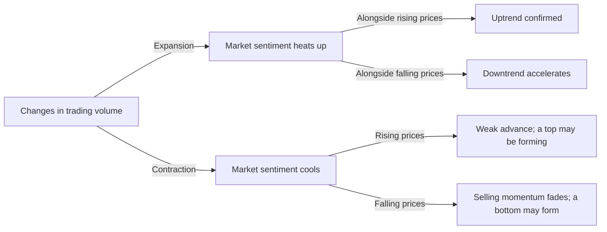
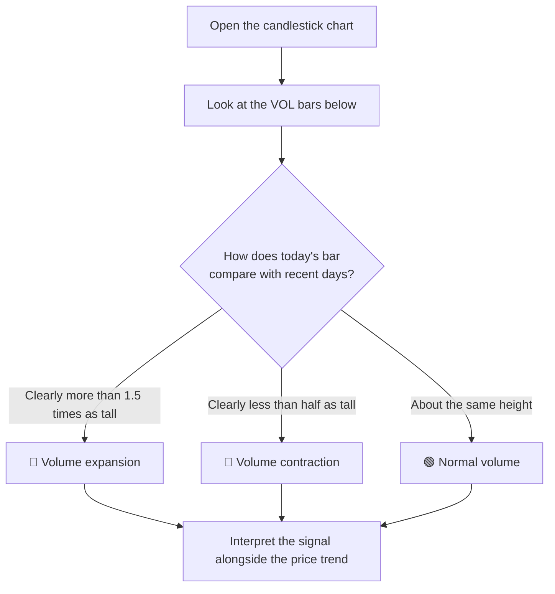
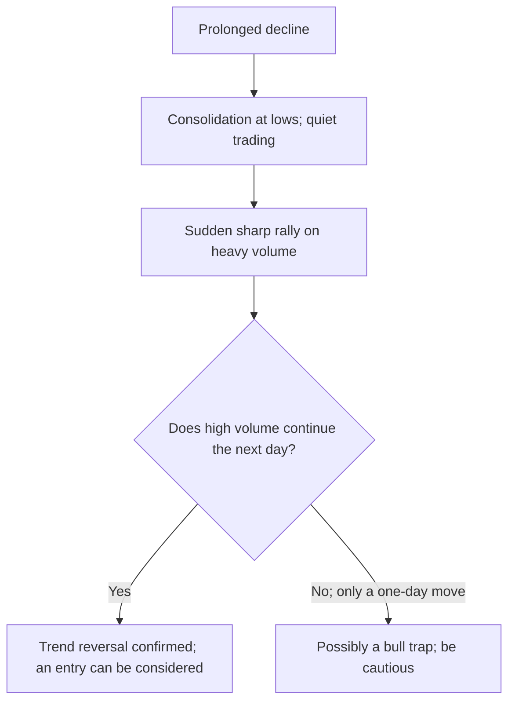
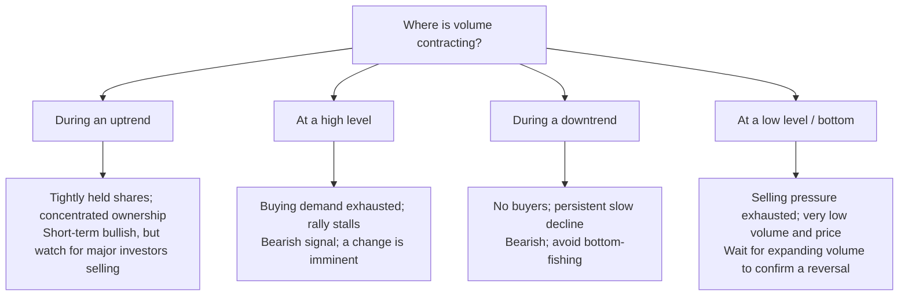
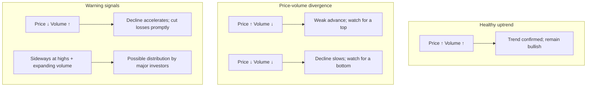
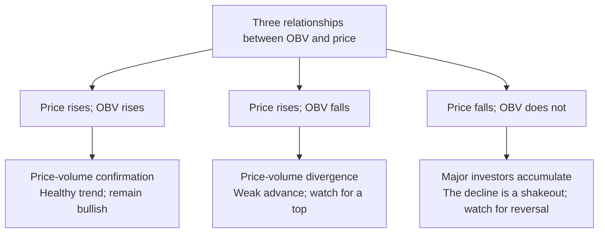

# What Are Volume Expansion and Contraction? Understanding Key Trading Volume Signals

## 1. The Essence of Trading Volume: The Market's Breathing

In the stock market, **trading volume** is the number of shares that buyers and sellers trade over a given period. If price is the market's language, volume is its breathing: it tells you how much lung capacity the current market move has.

| Concept | Definition | Plain-Language Interpretation |
|------|------|------|
| **Volume expansion** | Trading volume rises significantly, well above its recent average | The market takes a deep breath: substantial funds are entering or leaving |
| **Volume contraction** | Trading volume shrinks significantly, below its recent average | The market holds its breath: funds wait on the sidelines and trading is quiet |

> **Core principle: Volume precedes price.** Volume often foreshadows price changes. Expansion usually signals the start of a trend or a turning point, while contraction suggests a trend is weakening or pausing.



## 2. How Can You Spot Volume Expansion or Contraction at a Glance?

When watching the market, you do not need to calculate volume manually. Nearly every trading platform displays it visually. Here are three steps for a quick assessment.

### 2.1 Step One: Find the Volume Bars (VOL Indicator)

Open any stock's candlestick chart. Below the price area, you will see a row of **red and green bars**: these are the volume bars (Volume, or VOL).

```
┌─────────────────────────────────────────┐
│  Candlestick chart (price)               │
│     ┃ ┃                                 │
│   ┃ ┃ ┃ ┃  ← Candles (up red/down green) │
│     ┃ ┃                                 │
├─────────────────────────────────────────┤
│  VOL volume bars                        │
│  ┃                                     │
│  ┃ ┃  ┃                                │
│  ┃ ┃  ┃  ┃  ┃  ← Each bar = daily volume│
│  ┃ ┃  ┃  ┃  ┃                          │
│  ┃ ┃  ┃  ┃  ┃  ┃                       │
│  ┃ ┃  ┃  ┃  ┃  ┃  ┃ ← Taller = more volume│
└─────────────────────────────────────────┘
```

- **Red bar**: The day's close ≥ its open (an up candle); buying dominates
- **Green bar**: The day's close < its open (a down candle); selling dominates
- **Bar height**: Represents the size of trading volume; taller means greater volume

### 2.2 Step Two: Compare the Bars' Relative Heights

Volume expansion and contraction depend on whether bars are taller or shorter **than those in the preceding period**, rather than on their **absolute heights**.

```
Volume bars over the past 20 days:
                                            ██ ← This one is especially tall!
    ██          ██                         ██
    ██  ██      ██  ██      ██  ██      ██  ██
    ██  ██  ██  ██  ██  ██  ██  ██  ██  ██  ██
    ██  ██  ██  ██  ██  ██  ██  ██  ██  ██  ██
    ─────────────────────────────────────────
    Previous 19 days (normal volume)      Day 20 (volume expansion!)
```

> **Visual rule of thumb**: Look at the past month's volume bars. If today's bar is clearly **more than 1.5 times the height** of most previous bars, volume is expanding. If it is clearly **less than half their height**, volume is contracting.

### 2.3 Step Three: Refer to the Built-In Average-Volume Line

Nearly every trading platform draws one or more **average-volume lines** in the volume panel, usually 5-day and 20-day averages. These smooth curves represent the recent average level of trading volume.

```
VOL volume bars + average-volume line (dotted):

        Expansion area             Contraction area
    ┃   /\                   /\        ┃
    ┃  /  \                 /  \       ┃
    ┃ /    \   ┃    ┃      /    \      ┃
    ┃/      \  ┃    ┃     /      \     ┃
    ┃        \ ┃    ┃    ┃        \    ┃
    ┃         \┃    ┃    ┃         \   ┃
    ┗━━━━━━━━━━━━━━━━━━━━━━━━━━━━━━━━━━━┛
    .........Average volume (20-day average).........

    Bars break above average volume → Expansion
    Bars fall far below average volume → Contraction
```

**Interpretation rules**:
- Volume bars **break above and move far from** the average-volume line → **Expansion**
- Volume bars **are well below the average-volume line and notably short** → **Contraction**
- Volume bars **fluctuate slightly around** the average-volume line → Normal volume

### 2.4 Where to Find Volume in Common Platforms

| Software/App | Location | Shortcut/Action |
|------|------|------|
| **Tonghuashun** | "VOL" area below the candlestick chart | Shown by default: bars + average-volume lines |
| **East Money** | Volume area below the candlestick chart | Shown by default |
| **Xueqiu** | Stock page → Daily candles → Scroll down to volume | Tap the candlestick chart to change indicators |
| **TradingView** | Volume indicator below the candlestick chart | Shown by default; adjustable in the indicator menu |
| **Futu Niuniu** | "Trades" area below the candlestick chart | Shown by default |

### 2.5 A Quick Practical Checklist

> **First compare bar heights with earlier bars; then check their position relative to average volume (breaking through or moving away); finally check turnover for unusual activity.**
>
> **Bars suddenly shoot up → Expansion; bars shrink into tiny stubs → Contraction.**



## 3. Volume Expansion: When the Market Takes a Deep Breath

### 3.1 What Is Volume Expansion?

**Volume expansion** means that trading volume in a stock or the broader market is significantly above its recent average. Generally, daily volume exceeding **1.5 times** the 20-day average counts as expansion; exceeding **2 times** counts as significant expansion.

```
Expansion ratio = Today's volume ÷ Average volume over the past N days

Reference levels for expansion:
- 1.0x–1.5x: Normal fluctuation
- 1.5x–2.0x: Moderate expansion
- 2.0x–3.0x: Significant expansion
- Above 3.0x: Extremely heavy / record volume
```

### 3.2 Four Typical Scenarios for Volume Expansion

#### Scenario One: A Rally from the Bottom on Higher Volume — New Money Enters

After a prolonged decline, the stock consolidates at a low level, then suddenly surges on heavy volume one day.

| Feature | Meaning |
|------|------|
| Price | Breaks out from the bottom with a significant gain |
| Volume | Several times the recent average |
| Signal | **Major investors enter; the bottom is confirmed; a bullish signal** |



#### Scenario Two: A Decline from the Top on Higher Volume — Major Investors Sell

After a substantial rally, the stock is trading at a high level and suddenly falls on heavy volume.

| Feature | Meaning |
|------|------|
| Price | Pulls back sharply from a high level |
| Volume | Extremely heavy, often a recent high |
| Signal | **Major investors distribute shares; a topping signal; bearish** |

> ⚠️ **Record volume accompanies record prices** is a common saying in China's A-share market: when a stock trades at a high price on record volume, an intermediate top is often close.

#### Scenario Three: Higher Volume During an Uptrend — Refueling Mid-Flight

The stock is already in an uptrend and advances again on expanding volume.

| Feature | Meaning |
|------|------|
| Price | Rises along its moving average, breaking a previous high or consolidation range |
| Volume | Continues to expand moderately |
| Signal | **A healthy uptrend with continued fund inflows** |

> A healthy uptrend should feature rising prices and rising volume: as price makes new highs, volume should also expand moderately.

#### Scenario Four: Higher Volume During a Downtrend — Panic Selling

The stock is in a downtrend and suddenly plunges again on exceptionally heavy volume.

| Feature | Meaning |
|------|------|
| Price | Declines faster, with widening losses |
| Volume | Expands sharply |
| Signal | **Panic selling emerges; the rush toward a bottom may accelerate in the short term** |

> Heavy volume during a decline is often the final wave of panic. When even the most committed holders cut their losses, a bottom may actually be close.

## 4. Volume Contraction: When the Market Holds Its Breath

### 4.1 What Is Volume Contraction?

**Volume contraction** means trading volume is significantly below its recent average. Generally, daily volume below **0.5 times** the 20-day average counts as significant contraction.

```
Contraction ratio = Today's volume ÷ Average volume over the past N days

Reference levels for contraction:
- 0.7x–1.0x: Low end of normal
- 0.5x–0.7x: Moderate contraction
- 0.3x–0.5x: Significant contraction
- Below 0.3x: Extremely low volume
```

### 4.2 Four Typical Scenarios for Volume Contraction

#### Scenario One: Shrinking Volume During an Uptrend — Shares Held Tightly as Price Rises

The stock price rises while trading volume shrinks.

| Feature | Meaning |
|------|------|
| Price | Continues to rise, possibly reaching new highs |
| Volume | Gradually contracts |
| Signal | **Shares are tightly held, with extremely little selling pressure** |

> This usually occurs in stocks **tightly controlled by major investors**. They have accumulated enough shares that few loosely held shares remain available in the market, so little volume is needed to lift the price. However, it also means that once those investors start selling, the decline can be severe.

#### Scenario Two: Sideways Trading at Highs on Low Volume — Risk of a Stalled Rally

The stock consolidates sideways at a high level while volume contracts significantly.

| Feature | Meaning |
|------|------|
| Price | Moves in a narrow range at a high level, unable to rise further |
| Volume | Continues to contract |
| Signal | **Buying demand is exhausted; a change is imminent; bearish bias** |

> Shrinking volume at a high level means fewer funds are chasing the rally and fewer people are willing to buy at that price. Negative news can then trigger a rapid decline.

#### Scenario Three: Shrinking Volume During a Downtrend — A Slow Grind Lower

The stock continues falling as trading volume gradually contracts.

| Feature | Meaning |
|------|------|
| Price | Falls slowly, with small but persistent declines |
| Volume | Remains extremely low |
| Signal | **No buyers step in; the slow decline continues; avoid bottom-fishing** |

> Falling prices on shrinking volume suggest that no funds want to buy at this level, while no panic selling is occurring either. This slow, "frog in warming water" decline often lasts the longest and is the most exhausting.

#### Scenario Four: Low-Volume Consolidation at the Bottom — Rock-Bottom Volume, Rock-Bottom Prices

The stock trades in a narrow range at a low price, while volume contracts to an extreme low.

| Feature | Meaning |
|------|------|
| Price | Moves sideways at a low level with minimal volatility |
| Volume | Shrinks to an extremely low level |
| Signal | **Selling pressure is exhausted; a bottoming area; wait for expanding volume to confirm** |

> **Rock-bottom volume accompanies rock-bottom prices** is an important principle in technical analysis. Extremely low volume suggests that almost everyone who wanted to sell has already done so, while remaining holders are unfazed by further losses. Price then has little room left to fall, and even modest buying can trigger a rebound, but expanding volume is needed for final confirmation.



## 5. Eight Classic Price-Volume Combinations

In technical analysis, **confirmation between price and volume** is central to assessing trends. Here are eight classic combinations and their meanings:

| No. | Price | Volume | Technical Meaning | Suggested Action |
|:---:|:---:|:---:|------|------|
| 1 | ↑ Rising | ↑ Expanding | **Price up, volume up**: A healthy uptrend | Hold or buy |
| 2 | ↑ Rising | ↓ Contracting | **Price up, volume down**: A weak advance; price-volume divergence | Hold cautiously and watch for profit-taking opportunities |
| 3 | ↓ Falling | ↑ Expanding | **Price down, volume up**: A downtrend is confirmed or accelerates | Cut losses or wait |
| 4 | ↓ Falling | ↓ Contracting | **Price down, volume down**: Downward momentum weakens | Wait for signs of stabilization |
| 5 | → Sideways | ↑ Expanding | **Flat price, rising volume**: A signal of an approaching change | Watch the breakout direction |
| 6 | → Sideways | ↓ Contracting | **Flat price, falling volume**: Consolidation before a move | Wait for a direction to emerge |
| 7 | ↑ Breakout | ↑ Very heavy | **Breakout on very heavy volume**: Greater breakout validity | An entry can be considered, with a stop-loss |
| 8 | ↑ Breakout | ↓ Contracting | **Breakout on shrinking volume**: High risk of a false breakout | Be cautious; it may be a bull trap |



## 6. Advanced Methods for Quantifying Volume Expansion and Contraction

### 6.1 Comparing Volume with Its Moving Average

The most common method compares trading volume with an **average-volume line**, such as the 5-day or 20-day average:

| Comparison | Interpretation |
|------|------|
| Today's volume > 5-day average × 1.5 | Short-term expansion |
| Today's volume > 20-day average × 2 | Significant medium-term expansion |
| Today's volume < 5-day average × 0.5 | Short-term contraction |
| Below the 20-day average × 0.5 for 3 consecutive days | Persistent contraction; watch for a change |

### 6.2 Using Turnover as Supporting Evidence

Turnover (daily volume ÷ freely tradable shares) offers a more intuitive measure of trading activity:

| Turnover Range | Activity Level | Corresponding Volume |
|:--------:|------|------|
| **< 1%** | Extremely quiet | Extremely low / contracting volume |
| **1%–3%** | Low end of normal | Contracting or normal volume |
| **3%–7%** | Active | Moderate expansion |
| **7%–15%** | Highly active | Significant expansion |
| **> 15%** | Unusually active | Extremely heavy / record volume; be alert |

> ⚠️ Normal turnover varies by stock. Daily turnover of 1% is already active for a large blue chip, while 10% may be routine for a small speculative stock.

### 6.3 Relative Volume Ratio

The **volume ratio** measures current volume relative to recent levels in real time:

```
Volume ratio = Current volume ÷ Average volume over the same elapsed period in the past 5 days
```

| Volume Ratio | Meaning |
|:---:|------|
| 0.5–1.0 | Low end of normal |
| 1.0–1.5 | Normal |
| 1.5–2.5 | Moderate expansion |
| 2.5–5.0 | Significant expansion |
| > 5.0 | Unusually heavy volume; pay close attention |

### 6.4 Trading Value (AMO): Who Is Behind the Heavy Volume?

**Trading value** = Trading volume × Average execution price. It represents **how much money buyers and sellers actually exchange** that day.

```
Trading value (AMO) = Daily trading volume × Daily average execution price
```

Why does trading value matter? Because **the same share volume can represent very different kinds of capital:**

| Scenario | Trading Volume | Trading Value | Meaning |
|------|:---:|:---:|------|
| Moutai rises 2% on expanding volume | 5 million shares | ≈ RMB 9 billion | Large institutional funds trading |
| A low-priced RMB 5 stock sees expanding volume | 5 million shares | ≈ RMB 25 million | Retail investors / speculative funds trading |

> Both trade 5 million shares, but the capital involved in Moutai is **360 times** that of the low-priced stock. Looking only at share volume without trading value is like counting vehicles without distinguishing bicycles from trucks.

**Practical uses of trading value:**

| Trading Value Pattern | Interpretation |
|------|------|
| Rising trading value + rising price | Real money flows in; the advance is more credible |
| Rising trading value + falling price | Real money flows out; the decline is more credible |
| Higher share volume but little change in trading value | Possibly activity in low-priced shares or large orders split up; limited significance |
| Trading value shrinks to a recent low | A quiet market; a potential precursor to a change |

### 6.5 OBV (On-Balance Volume): Is Volume Flowing In or Out?

**OBV (On-Balance Volume)** is a classic indicator derived from volume, used to assess whether funds are flowing in or out.

```
OBV calculation rules (accumulated daily):

Today's close > Yesterday's close → Today's OBV = Yesterday's OBV + Today's volume
Today's close < Yesterday's close → Today's OBV = Yesterday's OBV - Today's volume
Today's close = Yesterday's close → Today's OBV = Yesterday's OBV (unchanged)
```

**Plain-language interpretation**: Add volume on rising days, treating it as buying strength; subtract volume on falling days, treating it as selling strength; then examine the cumulative trend.

```
Price trend vs. OBV trend:

Price rises and OBV also rises:
  Price:  /\/\/\/\  (Uptrend)
  OBV:   /\/\/\/\  (Rising in tandem)
  → Price and volume confirm each other; healthy trend ✅

Price rises but OBV falls:
  Price:  /\/\/\/\  (Uptrend)
  OBV:   \/\/\/\/  (Gradual decline)
  → Price-volume divergence; weak advance ⚠️ A top may be forming

Price falls while OBV is flat or rising:
  Price:  \/\/\/\/  (Downtrend)
  OBV:   ————————  (Refuses to fall)
  → Major investors quietly accumulate; the decline shakes out holders 🔍
```



> OBV's main value lies in **whether it moves in the same direction as price**, rather than in its absolute level. When price reaches a new high but OBV does not, this is a classic bearish-divergence warning.

**How to find OBV in different platforms:**

| Software/App | Steps |
|------|------|
| **Futu Niuniu** | Stock candlestick page → Tap the lower indicator area → Search for or select **OBV** under the price-volume indicators category |
| **Tonghuashun** | Below the candlestick chart → Type **OBV** and press Enter, or switch indicators → Price-volume → OBV |
| **East Money** | Candlestick chart → Lower indicator bar → Switch indicators → Select **OBV / On-Balance Volume** |
| **Xueqiu** | Stock candlestick page → Tap the indicator area → Search for **OBV** |
| **TradingView** | Indicators → Search for **OBV** → Select "On Balance Volume" |

> In Futu Niuniu, OBV appears as a **cumulative line chart** below the candlestick chart. Compare it with the stock price above to see whether they move in the same direction.

### 6.6 Projected Volume (VOL-TDX): Estimating Full-Day Volume During Trading

**Projected volume** estimates the day's total volume in real time during the session, helping you assess whether volume is expanding or contracting before the close.

```
Projected volume = (Volume traded so far ÷ Elapsed trading time) × Total daily trading time
```

For example: At 10:30 a.m., one hour after the open, 5 million shares have traded, and the full trading day lasts four hours:

```
Projected full-day volume = 5 million × (4 ÷ 1) = 20 million shares
```

| Projected Volume / Yesterday's Volume | Interpretation |
|:---:|------|
| **> 1.5** | Volume is likely to expand today |
| **0.5–1.5** | Roughly in line with yesterday |
| **< 0.5** | Volume is likely to contract today |

> ⚠️ Trading volume is not evenly distributed throughout the day. It is usually highest **near the open and close** and lower in the middle of the session. A simple proportional estimate is therefore biased, but is sufficient for a broad assessment of expansion or contraction.

### 6.7 Quick Reference for Volume Indicators

| Indicator | Full Name | Main Purpose | Suitable Use |
|------|------|------|------|
| **VOL** | Trading volume | Observe absolute volume | Identify expansion/contraction |
| **Average-volume line** | 5/20-day average volume | Observe relative volume | Compare with historical norms |
| **Turnover** | Turnover Rate | Observe how actively shares change hands | Assess interest in a stock |
| **Volume ratio** | Volume Ratio | Observe real-time changes in volume | Quick intraday assessment |
| **Trading value** | AMO / Amount | Measure the capital involved | Distinguish institutional/retail activity |
| **OBV** | On-Balance Volume | Observe fund inflows and outflows | Assess trend validity |
| **Projected volume** | VOL-TDX | Forecast full-day volume | Anticipate volume during trading |

## 7. The Main Limitations of Volume Signals: What They Do Not Tell You

### 7.1 Volume Can Be Manufactured

Major investors can create the appearance of expanding volume through **wash trades** (buying from and selling to themselves), attracting retail followers. Therefore:

> **Not every increase in volume represents genuine fund flows.** Especially in small-cap stocks, manufactured volume is a common way to lure buyers.

### 7.2 Low Volume Does Not Mean Safety

Many people believe a decline on shrinking volume is nothing to fear, but in reality:

- A low-volume decline can mean **there are no buyers**: you may be unable to sell even if you want to
- Low-volume sideways trading may end in a **downward breakout**: prolonged consolidation can lead to a fall
- A limit-up move on shrinking volume looks strong, but once the limit-up breaks, it often comes with **massive selling**

### 7.3 Volume Means Different Things in Different Markets

| Market Environment | Meaning of Expansion | Meaning of Contraction |
|------|------|------|
| **Bull market** | Money rushes in; the trend strengthens | A brief pause; shares are tightly held |
| **Bear market** | Panic selling or bottom-fishing funds enter | Quiet trading; market despair |
| **Sideways market** | A signal that a direction is emerging | Building up to the next move |

### 7.4 Volume Behaves Differently in Large and Small Caps

| | Large Blue Chips | Small Speculative Stocks |
|---|:---:|:---:|
| Normal turnover | 0.5%–2% | 3%–10% |
| Expansion threshold | Turnover > 3% | Turnover > 15% |
| Contraction threshold | Turnover < 0.3% | Turnover < 1% |
| Wash-trading risk | Low | **High** |

## 8. Summary: Key Price-Volume Rules of Thumb

> **Volume up, price up: a healthy trend. Volume up, price down: a worsening trend.**
> **Volume down, price up: watch for a top. Volume down, price down: wait for a bottom.**
> **Record volume, record price; rock-bottom volume, rock-bottom price. Volume leads price; changing volume precedes changing price.**

Volume expansion and contraction are not standalone indicators. They become practically useful only alongside **price trends, candlestick patterns, and moving averages**. Looking at volume alone is like measuring someone's breathing rate without knowing whether they are running or sleeping: the data alone means little; context gives it meaning.

Remember the most important principle: **Watch for unusual changes in volume**. Whether volume expands or contracts, a departure from recent norms deserves attention, because it often means the market is preparing for a new development.
