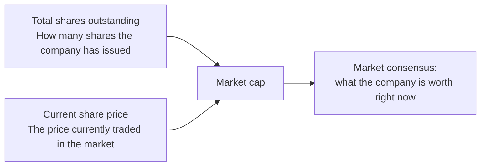
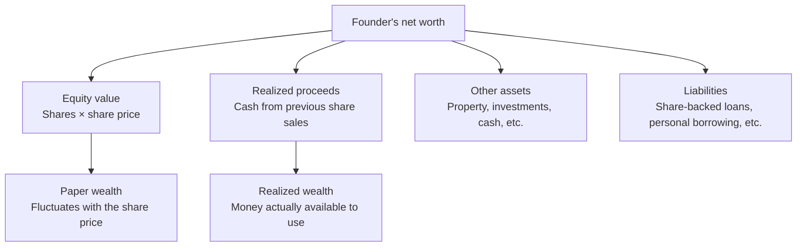
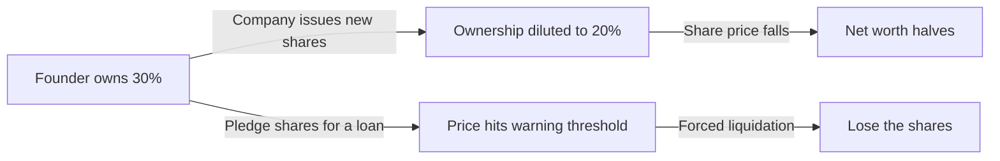
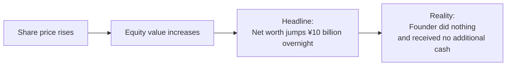
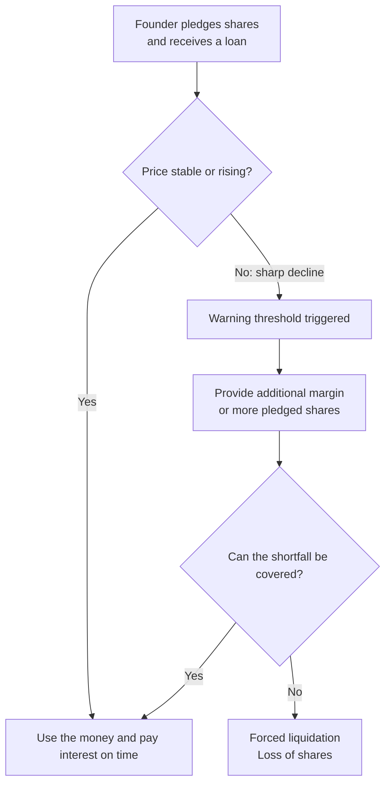
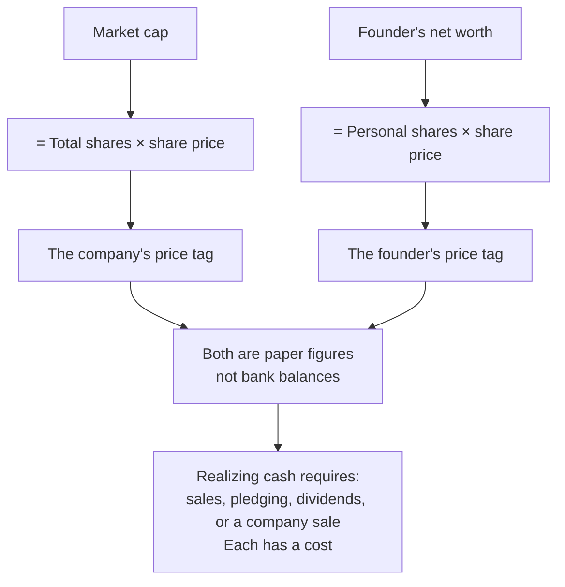

# What Is Market Capitalization, and What Is a Founder's Net Worth?

Two frequently confused concepts, explained together.

## 1. Market Capitalization: The Market's Collective Vote on a Company

**Market capitalization**, or market cap, is the total stock-market value of a publicly traded company. Its formula is simple:

$$
\text{Market cap} = \text{Total shares outstanding} \times \text{Current share price}
$$

For example, if a company has issued 100 million shares and each trades at ¥50, its market cap is **100 million × ¥50 = ¥5 billion**.

Market cap represents **the market's collective vote on a company's overall value**. It is neither net assets nor the actual sale price of the entire business, but a consensus figure produced by investors trading with real money.



### Key Characteristics of Market Cap

| Characteristic | Explanation |
|------|------|
| **Changes in real time** | Share prices fluctuate constantly, and market cap moves with them. A company can lose tens of billions in market value within a day or gain it overnight. |
| **Not cash** | A ¥10 billion market cap does not mean ¥10 billion in the company's bank account. It is a theoretical cost of buying all shares at the current price. |
| **Driven by sentiment** | Expectations, sentiment, macroeconomics, and industry enthusiasm strongly affect market cap. A consistently profitable company may be valued below a loss-making company with a compelling story. |
| **Different from private valuation** | Private-company valuations are negotiated by investors and founders during financing; public-company market caps emerge from secondary-market trading. The mechanisms differ. |

### Common Market-Cap Categories

| Category | Market cap | Typical examples |
|------|----------|----------|
| **Large cap** | Above US$10 billion | Apple, Microsoft, Tencent, Moutai |
| **Mid cap** | US$2–10 billion | Leaders in specialized industries |
| **Small cap** | US$300 million–2 billion | Regional businesses and early-growth companies |
| **Micro cap** | Below US$300 million | Newly listed young companies |

---

## 2. A Founder's Net Worth: Paper Wealth or Spendable Money?

**A founder's net worth** loosely answers "how much money does this founder have?" It relates to market cap, but the relationship is not a simple division.

### How Is Net Worth Calculated?

A founder's net worth usually consists of:

$$
\text{Net worth} \approx \text{Equity holdings} + \text{Realized sale proceeds} + \text{Other assets} - \text{Liabilities}
$$

**Equity holdings** usually dominate:

$$
\text{Equity holdings} = \text{Shares owned by the founder} \times \text{Current share price}
$$

If a company has a ¥10 billion market cap and the founder owns 30%, that holding is worth **¥3 billion** on paper. Headlines claiming a founder's wealth has soared usually refer to this figure.



### Why Call It Paper Wealth?

Several factors inflate the apparent accessibility of a founder's net worth:

#### Factor One: The Liquidity Trap

Founder shares usually have a **lock-up period**, commonly preventing sales for 6–12 months after listing. Even afterward, selling large quantities can depress the price: selling 1% might push the price down 10%, reducing the value of the remaining 29%.

Imagine owning a painting said to be worth ¥100 million. An auction house may value it at that amount, but an actual buyer may be hard to find. Offer ten comparable paintings at once and the whole market could collapse.

#### Factor Two: Pledging and Dilution

Many founders pledge shares to banks for loans. If the price falls to a warning threshold, forced liquidation can rapidly destroy their wealth. Further financing, employee options, and new share issuance can also dilute their ownership percentage.



#### Factor Three: Net Worth Is Not Disposable Wealth

A founder worth ¥10 billion may have only tens of millions in the bank; the rest is stock. Everyday spending comes from salary, dividends, or small share sales. Many people listed as multibillionaires do not have abundant cash flow.

#### Factor Four: Paper Wealth Is Fragile

Halve the share price and equity wealth halves. From 2021 to 2022, many US-listed Chinese stocks fell 80–90%, wiping out much of their founders' wealth—not necessarily because of personal mistakes, but because market sentiment changed.

---

## 3. Market Cap and Founder Net Worth Compared

| Dimension | Market cap | Founder's net worth |
|------|------|------------|
| **Subject** | Entire company | Individual |
| **Calculation** | Total shares × price | Personal shares × price + other assets |
| **Drivers** | Price changes, issuance / buybacks | Price changes + sales / purchases + pledged shares |
| **Liquidity** | Theoretical value, not realizable all at once | Even worse; large sales depress the price |
| **Ranking context** | Forbes' largest-company rankings | Forbes' billionaire rankings |
| **Immediately spendable?** | No: a paper figure | No, unless shares are sold for cash |

---

## 4. Common Misconceptions

### Misconception One: "The Company Is Worth ¥10 Billion and the Founder Owns 30%, So the Founder Has Earned ¥3 Billion."

No. That ¥3 billion is **unrealized paper value**. Turning it into a bank balance requires selling shares. The selling itself may drive down the price, leaving substantially less than ¥3 billion in actual proceeds.

> **A practical analogy**: you own a Beijing apartment worth ¥10 million, adding ¥10 million to your net worth. Can you spend it immediately? Only by selling the apartment—and a weak market might yield only ¥9 million, while leaving you without that home. Founder shares follow the same logic.

### Misconception Two: "Market Cap Is the Price at Which the Entire Company Can Be Sold."

Market cap assumes every share can be bought at today's price, which is not how a full acquisition works. Buying a company usually requires a **premium**, often 20–50% above market price, to persuade enough shareholders to sell. Conversely, liquidating an entire holding at once may require a **discount** to attract buyers.

**Market cap reflects a marginal transaction price, not a whole-company transaction price.**

```
Marginal pricing: last traded share price × total shares = market cap
Whole-company pricing: an actual acquisition price > market cap, because of an acquisition premium
```

### Misconception Three: "A Jump in the Founder's Net Worth Means They Made Money."

Their shares became more valuable on paper; everyday life may be unchanged. Money is actually realized when they **sell for cash**.



### Misconception Four: "If the Company Loses Money, the Founder Is No Longer Wealthy."

Not necessarily. Amazon lost money for years while Jeff Bezos's net worth rose, because investors believed in its future profitability. Market cap and wealth reflect **expectations**, not only **the past**.

### Misconception Five: "Founders Can Sell Whenever They Want and Withdraw the Money."

There are three major restrictions:

| Restriction | Explanation |
|------|------|
| **Lock-up** | Shares usually cannot be sold for 6–12 months after the IPO |
| **Disclosure** | Major shareholders must announce reductions in advance, giving the market time to react |
| **Market impact** | Large sales depress prices; selling more tends to produce worse prices |

---

## 5. How Do Founders Actually Access the Money?

If shares cannot be freely sold, how can founders turn paper wealth into cash? Four main routes exist:

### Method One: Sell Part of the Holding

Sell small batches in compliance with applicable rules. This is the most direct route, constrained by lock-ups, disclosure requirements, and market demand.

### Method Two: Borrow Against Shares

Pledge shares to a bank or broker for a loan. This supplies cash while preserving control of the company. The risks are:



### Method Three: Dividends

Profitable companies can distribute earnings to shareholders. A founder's large stake can generate substantial dividends. Many high-growth companies, however, reinvest profits instead of paying dividends.

### Method Four: Sell the Company

Sell the company to a strategic investor or take it public to realize proceeds. This is the most complete exit route, but also means giving up control.

---

## 6. Can You Trust Rich-List Figures?

Net-worth figures published by Forbes, Hurun, and similar rankings need several qualifications:

| Consideration | Explanation |
|--------|------|
| **Calculation** | Usually the share price on a cutoff date multiplied by known shareholdings |
| **Lag** | Share prices may already have changed when the list is published |
| **Opaque ownership** | Offshore companies, family trusts, and nominee holdings mean outsiders can only estimate ownership |
| **Unknown liabilities** | Rankings generally do not deduct personal liabilities or share-backed loans |
| **After-tax discount** | Cashing out may incur capital-gains tax: the article's reference is an exemption for A-shares and 20%+ for US shares; rankings do not account for this |

> **Conclusion**: rich lists are informal references, not audited financial statements. They approximate what someone could theoretically receive by selling every share on the cutoff date without affecting the price. That cannot happen in practice and is not their actual disposable wealth.

---

## 7. Summary

- **Market cap** is the market's collective pricing of a company, reflecting expectations rather than realized value. It equals total shares multiplied by price, but is not the company's actual sale price.
- **A founder's net worth** largely reflects paper equity value, which differs from money available to spend.
- Both depend heavily on share prices, which respond to company fundamentals and market sentiment.
- Founders access money through sales, pledging, dividends, or selling the company; every route has costs and restrictions.
- When a headline says someone gained ¥10 billion overnight, remember: **it is a change in share-price arithmetic. They neither received ¥10 billion in cash nor can necessarily turn it into cash immediately.**



---

*Understanding the difference between market cap and net worth does not make either meaningless. It gives a clearer perspective on financial news and rich lists: wealth is ultimately the ability to command resources, not a number. A share's realizable value becomes clear when it is sold.*
