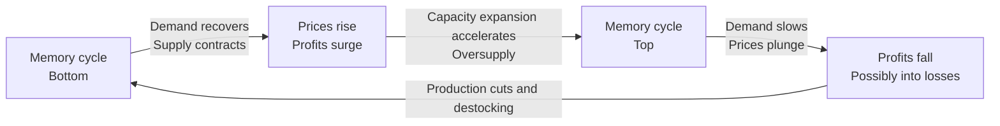
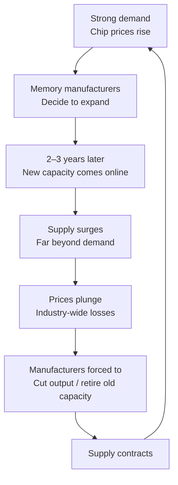
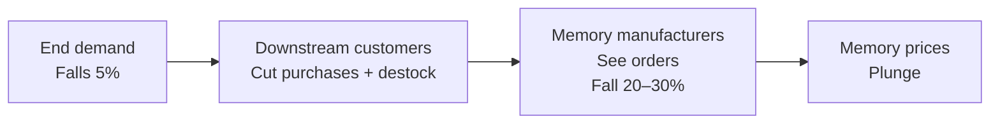
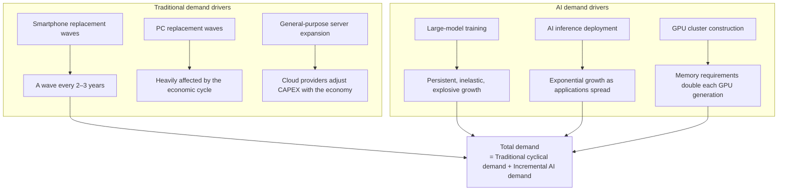
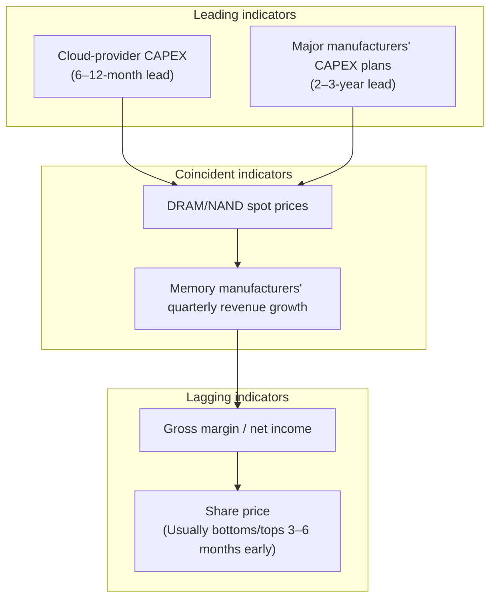
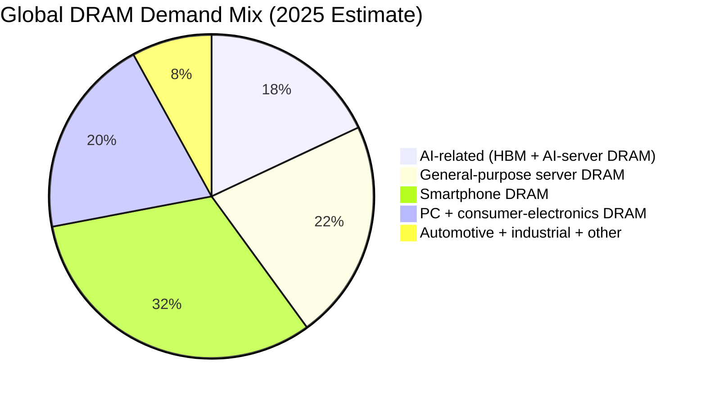
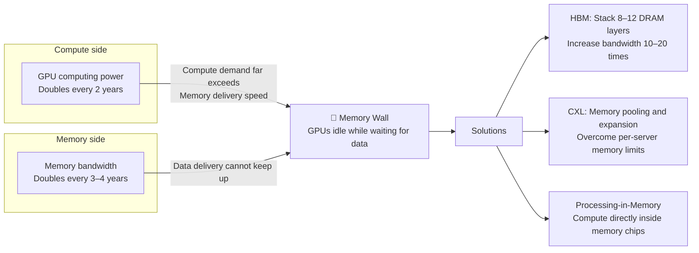

# Are Memory Stocks Cyclical? Why, and How Can Investors Navigate the Cycle?

## 1. The Conclusion First

> **Memory is the most representative strongly cyclical segment of the semiconductor industry, with fluctuations far more severe than those of other semiconductor segments.**

Memory-chip prices, including DRAM and NAND Flash, can double within a year or fall by half. Take U.S.-listed Micron Technology (MU): its share price rose from a 2023 low of $48 to a 2024 high of $157, a gain exceeding 200%. In 2022, the same MU fell from $98 to $48, more than halving. Korea's Samsung Electronics and SK hynix show similar behavior: this is the defining characteristic of cyclical stocks.

Being cyclical does not mean a stock is uninvestable. On the contrary, **understanding the cycle, buying near its bottom, and selling near its top form the central investment logic for the memory sector.**



## 2. First, What Is a Cyclical Stock?

### 2.1 Definition of a Cyclical Stock

A **cyclical stock** is a stock whose company's financial performance and share price closely track the economic cycle or its industry's supply-demand cycle. Product prices, sales volumes, and profits fluctuate sharply with the cycle rather than growing steadily.

| Feature | Cyclical Stocks | Noncyclical (Defensive) Stocks |
|------|--------|-------------------|
| **Earnings fluctuations** | Large swings; profits can move from a windfall to losses | Relatively stable, with moderate growth |
| **Economic relationship** | Strong: profits surge in good times and plunge in downturns | Weak: demand persists regardless of the economy |
| **Product characteristics** | Homogeneous and standardized; supply and demand determine prices | Differentiated and branded, with some pricing power |
| **Typical examples** | Memory chips, steel, shipping, oil | Food, pharmaceuticals, utilities |
| **Investment logic** | Buy near the cycle bottom and sell near the top | Hold long term and benefit from earnings growth |

### 2.2 Cyclical Stocks vs. Growth Stocks: A Key Distinction

People often equate high growth with growth stocks. The memory industry is a classic counterexample:

- During an upswing, memory-industry profits can grow 100% or even 200%, appearing highly growth-oriented
- This happens because **memory-chip prices have risen**, rather than because the company itself has become stronger
- When the cycle turns, the same company's profits may plunge 80% or turn into losses

> **True growth stocks depend on widening competitive moats, such as technology barriers, brands, and network effects. Cyclical stocks depend on favorable winds: a temporary advantage in supply and demand.**

## 3. Why Is the Memory Industry So Strongly Cyclical?

The industry's cyclicality is rooted in three fundamental tensions:

### 3.1 Tension One: Highly Homogeneous Products → Price Is the Only Competitive Dimension

DRAM and NAND Flash are highly standardized products. A Samsung DDR5 memory module and a Micron DDR5 module have almost identical performance: both follow JEDEC standards.

```
DRAM chip characteristics:
├── Standardized interfaces (JEDEC specifications)
├── Uniform performance metrics (frequency, timings, capacity)
├── Products from different manufacturers are interchangeable
└── → Competition revolves almost entirely around PRICE
```

This means that when supply exceeds demand, manufacturers **can compete for market share only by lowering prices**. There is no brand premium or exclusive technology to support pricing. Once a price war starts, it can easily drive the entire industry into losses.

The industry resembles **commodities** such as oil, copper, and steel, rather than **branded consumer products** such as Moutai or Apple.

### 3.2 Tension Two: Inflexible Supply → Major Delays in Capacity Adjustment

Memory-chip manufacturing is among the world's most complex manufacturing processes:

| Manufacturing Characteristic | Impact |
|----------|------|
| **A fab takes 2–3 years to build** | There is a 2–3-year gap between deciding to expand and bringing new capacity online |
| **Each fab costs $10–20 billion** | Once built, even a loss-making fab is hard to shut down because sunk costs are enormous |
| **Production lines must run continuously** | Shutdown and restart costs are extremely high, so production continues even at a loss |
| **Rapid technological iteration** | A new process arrives every 1–2 years; old capacity must be fully depreciated before retirement |



> This is the core mechanism of the memory cycle: **Demand changes quickly; supply adjusts slowly.** When demand rises, supply cannot keep up and prices surge. By the time supply catches up, demand may have peaked, causing prices to plunge.

### 3.3 Tension Three: Demand Depends Heavily on Downstream Conditions → An Amplifying Effect

Downstream demand for memory chips is concentrated in three major areas:

| Downstream Market | Estimated Share | Cyclical Characteristics |
|----------|:--------:|-----------|
| **Smartphones** | ~30% | Replacement cycles and consumer willingness to spend → moderate cyclicality |
| **Servers / data centers** | ~40% | Cloud-provider and AI capital expenditure → strong cyclicality, though AI is changing the structure |
| **PCs and consumer electronics** | ~20% | Replacement cycles → moderate cyclicality |
| **Automotive / industrial** | ~10% | Relatively stable |

The problem is that **all three main demand sources are cyclical**. During a downturn, consumers delay phone replacements, businesses cut IT budgets, and cloud providers reduce capital expenditure. Memory demand takes three hits at once.

Worse still, there is a **bullwhip effect**:



When demand weakens, downstream customers reduce purchases and **actively draw down inventories**, because stocked chips are losing value. Together, these factors magnify the demand fluctuations experienced by memory manufacturers severalfold.

### 3.4 A New Variable in the AI Era: Demand Is Being Reshaped

The preceding discussion describes the industry's classic script over the **past thirty years**. But **the AI era is introducing a completely new demand variable**, fundamentally different from traditional demand:



**Three key differences between AI and traditional demand:**

| Dimension | Traditional Memory Demand | AI Memory Demand |
|------|-------------|------------|
| **Drivers** | Consumers' replacement decisions and corporate IT budgets | Large-model scaling laws and AI application adoption |
| **Cyclicality** | Strongly cyclical, fluctuating with the macroeconomy | **Currently in an early explosive phase, exhibiting inelastic growth** |
| **Memory types** | DDR4/DDR5 memory, TLC/QLC NAND | HBM, high-capacity DDR5, high-speed SSDs |
| **Growth rate** | Tracks GDP / consumer-electronics shipments (low single digits) | 50–100% annually, far above traditional memory |
| **Pricing model** | Commodity pricing determined by supply and demand | HBM uses long-term contracts and premium pricing; traditional DRAM remains a commodity |

> **Key insight**: AI has not eliminated memory cyclicality, but is **creating a noncyclical layer within the cycle**. AI-specific memory such as HBM enjoys structural undersupply, while traditional DDR4/NAND continues moving through cycles. This produces unprecedented **structural divergence** within the industry.

## 4. Key U.S. and Korean Memory Stocks

The global memory-chip industry is highly concentrated: essentially three major manufacturers plus their equipment suppliers. Investors in the memory cycle mainly focus on these companies:

### 4.1 Memory Manufacturers (IDMs): The Greatest Cyclical Sensitivity

| Company | Ticker | Market | Global DRAM Share | Global NAND Share | Characteristics |
|------|------|------|:----------:|:----------:|------|
| **Samsung Electronics** | 005930.KS | Korea, KOSPI | ~42% | ~35% | Global memory leader, ranking first in both DRAM and NAND, but memory is only ~30% of revenue alongside phones, appliances, and other businesses; less pure memory exposure than Micron |
| **SK hynix** | 000660.KS | Korea, KOSPI | ~28% | ~18% | Second-largest DRAM supplier, global HBM market-share leader supplying NVIDIA, and a core AI memory investment |
| **Micron Technology** | MU | U.S., NASDAQ | ~23% | ~12% | **The world's purest memory stock**, with DRAM + NAND above 90%; extremely volatile and the preferred U.S. stock for trading the memory cycle |
| **Western Digital** | WDC | U.S., NASDAQ | — | ~15% | Primarily NAND Flash through its Kioxia joint venture, plus HDDs; less cyclically sensitive than Micron but still volatile |

### 4.2 Memory Equipment Suppliers: Indirect Beneficiaries of the Cycle

| Company | Ticker | Market | Business Connection |
|------|------|------|----------|
| **Applied Materials** | AMAT | U.S., NASDAQ | The world's largest semiconductor equipment supplier; directly benefits when memory manufacturers sharply increase CAPEX to expand capacity |
| **Lam Research** | LRCX | U.S., NASDAQ | Leading etching-equipment supplier; memory manufacturing has very high demand for etching |
| **Tokyo Electron** | 8035.T | Japan, TSE | Coating/developing and etching equipment, closely integrated with Samsung and SK hynix supply chains |

> **Sensitivity ranking**: Memory manufacturers (MU / Samsung / SK hynix) > equipment suppliers (AMAT / LRCX) > semiconductor ETFs. For **pure exposure to the memory cycle**, Micron Technology (MU) is the best U.S. stock; for **combined AI and memory exposure**, SK hynix (000660.KS) is the best Korean stock.

## 5. A Historical Review: The Memory Cycle's Harsh Repetition

### 5.1 Complete Cycles over the Past Decade

| Cycle | Upswing Drivers | Downswing Drivers | MU Share Price | Samsung Memory Division |
|------|----------|----------|-------------|-----------------|
| **2016–2019** | Smartphone upgrades + cloud-server expansion | Concentrated capacity additions + smartphone peak | $10 → $60 → $30 | Revenue growth from +74% to −34% |
| **2020–2023** | Pandemic remote work + 5G | Inflation, rate hikes + consumer-electronics collapse | $40 → $98 → $48 | From exceptional profits to losses |
| **2023–2025** | Explosive AI-computing demand (HBM) | Traditional memory still destocking | $48 → $157 → pullback | Record division profits |
| **2025–present** | AI data-center expansion + HBM capacity additions | Yet to be seen | Yet to be seen | Yet to be seen |

### 5.2 A Typical Memory-Cycle Timeline

The 2020–2023 cycle provides an example lasting roughly 3–4 years:

```
Stage 1: Cycle bottom (about 6–12 months)
├── Industry-wide losses or thin profits (MU quarterly losses reached $2.3 billion in Q4 2022–Q1 2023)
├── Manufacturers cut production and close old lines
├── Inventories keep declining
├── Share prices remain low (MU falls to $48)
└── Signal: Major manufacturers announce output cuts + inventory days decline

Stage 2: Early recovery (about 6–9 months)
├── Downstream demand starts recovering (AI-server orders surge)
├── Inventories fall below normal levels
├── Memory-chip prices start rising moderately (DRAM spot prices up 5–10% monthly)
├── Share prices begin rebounding from the bottom (MU $48 → $70)
└── Signal: Spot prices rise for 2–3 consecutive months

Stage 3: Boom (about 12–18 months)
├── Tight supply; HBM priced at 3–5 times traditional DRAM
├── Manufacturer profits surge (MU FY2024 net income approaches $5 billion)
├── Share prices soar (MU $48 → $157, up over 200%)
├── Samsung, SK hynix, and Micron all announce expansion
└── Signal: Major manufacturers announce new fab expansions + price increases accelerate

Stage 4: Peak and reversal (about 3–6 months)
├── New supply arrives + demand growth slows
├── Memory-chip prices start weakening
├── Inventories begin accumulating again
├── Share prices peak before fundamentals
└── Signal: Major customers cut orders + inventory days rise again
```

## 6. How to Navigate the Memory Cycle: A Practical Guide

### 6.1 Core Principle: Countercyclical Investing

The iron rule for investing in memory is one sentence:

> **Buy when everyone is pessimistic; sell when everyone is optimistic.**

| Cycle Stage | Market Sentiment | Typical Headlines | Suggested Action |
|----------|----------|-------------|--------|
| **Bottom** | Extremely pessimistic | "Memory winter arrives," "Micron announces layoffs and production cuts," "Samsung profits plunge 95%" | **Start buying in batches** |
| **Recovery** | Skeptical | "DRAM prices stabilize," "Inventory days fall below normal" | **Add to the position** |
| **Boom** | Broad optimism | "The memory supercycle has arrived," "Analysts raise price targets to new highs" | **Hold and watch; do not chase prices** |
| **Top** | Frenzied optimism | "A golden decade for memory," "This time is different; AI changes everything" | **Sell gradually** |

### 6.2 Which Key Indicators Should You Track?

To navigate the cycle, continuously monitor these **leading indicators**:

#### Indicator One: DRAM / NAND Spot Prices (Most Direct)

- Sources: Weekly TrendForce DRAMeXchange quotations; CFM Flash Memory Market
- **Interpretation**: Price **direction** matters more than its absolute level. Two consecutive months of rises or falls generally establish a trend
- Watch: DDR5 16Gb spot prices and NAND 512Gb TLC wafer prices

#### Indicator Two: Inventory Days (Most Important and Reliable)

- Sources: Quarterly earnings reports from MU / Samsung / SK hynix
- **Interpretation**:

| Inventory Days | Meaning | Action Signal |
|:--------:|------|----------|
| > 130 days | Severe oversupply, near a cycle bottom | 🟢 Start watching and prepare to buy |
| 100–130 days | Supply exceeds demand | 🟡 Hold and watch |
| 80–100 days | Normal level | 🟡 Hold |
| 60–80 days | Supply somewhat tight | 🟠 Hold and monitor closely |
| < 60 days | Tight supply, boom phase | 🔴 Prepare to sell gradually |

#### Indicator Three: Major Manufacturers' CAPEX — The Strongest Signal with a 2–3-Year Lead

- Look at CAPEX guidance in Samsung, SK hynix, and Micron quarterly reports
- **Interpretation**:

| CAPEX Change | Signal |
|-----------|----------|
| **Sharp cuts** (down more than 30% year over year) | 🟢 Cycle-bottom signal: supply will contract in 2–3 years, setting up the next price increase |
| **Moderate growth** (up 10–20% year over year) | 🟡 Normal expansion |
| **Sharp increases** (up more than 30% year over year) | 🔴 Cycle-top signal: substantial new capacity will arrive in 2–3 years, pressuring prices |

#### Indicator Four: Downstream Demand Conditions (A 6–12-Month Lead)

- Global quarterly smartphone shipments (IDC / Counterpoint)
- Global server shipments (TrendForce)
- Combined capital expenditure of the three major North American cloud providers (AWS / Azure / GCP)
- **Interpretation**: Turning points in downstream demand growth are **leading indicators** for memory demand, signaling direction 6–12 months ahead



### 6.3 How to Execute Trades: U.S. and Korean Stock Examples

#### Buying Phase: Cycle Bottom → Early Recovery

| Confirmed Signal | Action |
|----------|------|
| MU or Samsung inventory days start declining from 130+ days | Begin building a small position |
| DRAM spot prices rise month over month for 2 consecutive months | Increase to 50% of the target position |
| Earnings reports confirm stable prices and recovering demand | Increase to 80% of the target position |
| Quarterly revenue returns to positive growth | Hold the full position |

#### Selling Phase: Boom → Top

| Confirmed Signal | Action |
|----------|------|
| Brokerage reports start calling for a "supercycle" or "golden decade" | 🚨 Be alert; stop adding |
| MU or Samsung announces large-scale new fab construction | Start reducing the position by 20–30% |
| DRAM prices keep rising, but MU trades sideways for 2–3 months without new highs | Reduce by another 30–40% |
| Inventory days begin rising again | Exit the position |

### 6.4 Most Important: Avoid Buying at the Cycle Top

The biggest risk is **mistaking a cyclical stock for a growth stock at the peak**. Watch for these danger signals:

| 🚨 Danger Signal | Real Example |
|-------------|----------|
| Brokerages predict a "supercycle" or "golden decade" | At the end of 2021, several brokerages said the memory supercycle had just begun; MU subsequently fell more than 50% |
| MU's P/E looks cheap at "only 8 times earnings" | Profits are at the cycle peak! Once profits plunge, P/E may jump to 100 or even turn negative |
| Samsung, SK hynix, and Micron all announce major expansion | When that capacity comes online in 2–3 years, it fuels the next collapse |
| Chip prices keep rising, but share prices stop rising | Share prices often peak 3–6 months before fundamentals; this is the most important exit signal |

## 7. Memory in the AI Era: Will the Cycle Disappear?

This is the central question in memory investing today. Will explosive AI growth smooth out the memory cycle? The answer is: **The cycle will remain, but it will be profoundly reshaped.**

### 7.1 Why Will AI Not Eliminate the Cycle?

#### 7.1.1 AI Memory Is Only Part of Total Demand (Currently Around 15–20%)

Although AI memory demand is growing dramatically, at 50–100% annually, AI-related memory (HBM + AI-server DRAM + AI SSDs) currently accounts for only about **15–20%** of the global memory market in absolute terms. The remaining 80% is still traditional cyclical demand from smartphones, PCs, and general-purpose servers.



> Even if AI demand doubles annually, total demand could still decline if the remaining 80% of traditional demand falls 15–20% during a recession. AI is not yet large enough to fully offset a traditional cyclical downturn.

#### 7.1.2 Supply-Side Cyclicality Has Not Changed

However strong AI demand becomes, it cannot change a physical fact: **Building a DRAM fab takes 2–3 years and costs $15–20 billion.** Seeing HBM's profitability, all three major manufacturers are expanding aggressively:

| Manufacturer | HBM Expansion Plan | Risk |
|------|-------------|------|
| **SK hynix** | Triple HBM capacity during 2025–2027 | If enthusiasm for AI investment cools, massive HBM capacity could have nowhere to go |
| **Samsung Electronics** | Substantially expand HBM3E to catch up with SK hynix | Historically, Samsung has often expanded most aggressively at peaks, followed by plunging prices |
| **Micron Technology** | Take HBM3E from zero to volume production | The latest entrant faces technology catch-up risk |

AI does not change the historical pattern: **When all three manufacturers expand aggressively at once, oversupply inevitably follows in 2–3 years.** This time the excess may include HBM as well as traditional DRAM: when growth in NVIDIA GPU shipments slows, HBM demand growth slows with it.

#### 7.1.3 AI Demand Is Itself Cyclical

Many assume AI investment can only keep growing, but history tells us:

- Every technological wave follows a cycle of **overinvestment → disappointed expectations → investment contraction**
- The cloud-computing CAPEX contraction of 2022–2023 is a warning example
- If large-model scaling laws hit a bottleneck, with larger models no longer delivering meaningful improvements, AI-computing investment may temporarily cool
- If AI commercialization falls short of expectations, inference-demand growth may undershoot today's optimistic forecasts

> **AI does not eliminate the cycle; it adds a layer of fast-growing structural demand. When growth in that layer fluctuates alongside the traditional demand cycle, volatility in the memory industry may actually increase.**

### 7.2 How Is AI Reshaping the Memory Industry? Structural Changes

Although cycles will remain, AI has **irreversibly changed the industry's structure** in three ways:

#### Change One: HBM — From Commodity to Strategic Resource

HBM (High Bandwidth Memory) is the closely integrated memory companion of an AI GPU. Without HBM, a GPU cannot realize its computing potential.

```
Memory configuration for an NVIDIA H100 GPU:
├── HBM3: 80GB (packaged directly with the GPU via a silicon interposer)
├── Associated system DRAM (DDR5): About 2TB per 8 GPUs
└── Memory-demand comparison:
    Traditional server: 256–512GB DDR5 per CPU
    AI server: 80GB HBM + 256GB system DRAM per GPU
    → Memory content by value is 5–10 times higher in AI servers
```

Key differences between HBM and traditional DRAM:

| Dimension | Traditional DRAM (DDR5/DDR4) | HBM (HBM3/HBM3E/HBM4) |
|----------|------------------------|-------------------------|
| **Applications** | Ordinary servers, PCs, phones | AI GPUs (NVIDIA H100/H200/B200/Rubin) |
| **Supply and demand** | Frequent oversupply → price wars | Severe undersupply → customers prepay to secure capacity |
| **Pricing model** | Commodity-style, with daily spot-price changes | Long-term contracts + customization + **prices 3–5 times equivalent-capacity DDR5** |
| **Customer concentration** | Highly fragmented: distributors, ODMs, module makers | Highly concentrated: NVIDIA alone accounts for 60%+ |
| **Competition** | Samsung, SK hynix, and Micron are evenly matched | **SK hynix above 50%; Samsung catching up; Micron starting out** |
| **Gross margin** | As low as 0–10% at cycle bottoms and 50–60% at tops | Estimated 50–70%, with much less volatility than traditional DRAM |

> **SK hynix (000660.KS) is the biggest winner of the HBM era.** Its first-mover advantage secured the largest share of NVIDIA's HBM supply, transforming it from the DRAM industry's second-place player into the leader in AI memory.

#### Change Two: Memory Demand Is Driven by Both Volume and Bandwidth

Traditional memory-demand growth mainly comes from **unit shipments**: more phones and more servers. AI adds a new dimension: **memory density and bandwidth requirements per device are growing explosively**.

| Metric | Before the AI Era | In the AI Era |
|------|------------|------------|
| Average server DRAM capacity | 256–512 GB | 1–2 TB (AI servers) |
| Memory bandwidth requirement | DDR4 25.6 GB/s → DDR5 51.2 GB/s | HBM3E 1.2 TB/s, an increase of more than 20 times |
| Memory demand per unit of computing power | Relatively stable | **Memory per GPU doubles each generation** (H100: 80GB → B200: 192GB → Rubin: expected 288GB+) |
| SSD demand | Mainly SATA SSDs | High-speed NVMe SSDs become a bottleneck for AI data processing |

> **Key conclusion: Even if AI-server shipment growth slows, upgrades in memory capacity and bandwidth per server will continue driving memory demand.** This adds a foundation of structural growth to the industry, partly easing its cyclicality.

#### Change Three: Memory Is Becoming a Bottleneck for AI Computing

A fact many overlook: **The true bottleneck in AI computing is now memory bandwidth rather than GPU processing capacity.**

The industry calls this the **memory wall**:



> **Memory has moved from a supporting role to a central bottleneck in AI infrastructure.** For investors, this means memory is becoming an indispensable part of the AI value chain, beyond its former role as a commodity industry earning cyclical profits. The market may therefore assign memory companies a higher baseline valuation, provided AI demand persists.

### 7.3 New Indicators to Track in the AI Era

Beyond traditional DRAM spot prices, inventory days, and CAPEX, the AI era requires these additional measures:

| New Indicator | Source | Interpretation |
|--------|----------|--------|
| **NVIDIA GPU shipments** | NVIDIA quarterly reports | GPU shipments × HBM capacity per GPU = minimum HBM demand |
| **HBM contract prices vs. spot premiums** | TrendForce / supply-chain research | Narrowing premiums → HBM supply is catching up with demand; be alert |
| **HBM share of the three manufacturers' capacity** | Company reports / brokerage research | Higher HBM share of total DRAM capacity → tighter traditional DRAM supply → firmer prices |
| **AI CAPEX of the four major North American cloud providers** | AWS/Azure/GCP/Oracle earnings reports | A turning point in AI-investment growth leads HBM demand by 6–12 months |
| **Trends in large AI-model parameter counts** | Public information on GPT-5, Gemini 3, etc. | Slowing parameter-count growth → a signal that training demand may peak |
| **CXL ecosystem maturity** | Industry events such as OCP/MemCon | Large-scale CXL commercialization → memory-architecture changes → a new growth driver |

### 7.4 Industry Concentration May Reduce Cyclical Volatility

Over the past 20 years, the DRAM industry has consolidated from more than 20 manufacturers to **just three**: Samsung, SK hynix, and Micron, with a combined market share exceeding 95%.

Greater concentration gives the three manufacturers more ability to **adjust supply together**, cutting production to support prices rather than entering mutually destructive price wars. AI reinforces this trend: HBM has extremely high technological barriers, requiring advanced through-silicon vias (TSVs) and stacked packaging, making entry nearly impossible for newcomers.

- Traditional DRAM: A three-player oligopoly with stronger supply discipline → potentially smaller cyclical swings than historically
- HBM: Effectively only SK hynix and Samsung as the two main suppliers → highly controllable supply and more stable pricing

### 7.5 Geopolitical Risk: An Additional Variable for Korean Stocks

Investing in Korean memory stocks such as Samsung and SK hynix requires extra attention to:

- Tensions on the Korean Peninsula → supply-chain disruption risk, as almost all global HBM capacity is in South Korea
- Samsung's Xi'an NAND fab and SK hynix's Wuxi DRAM fab → potential exposure to U.S.–China technology conflict
- Potential U.S. pressure on South Korea to restrict HBM exports to China → near-term loss of the Chinese market, with longer-term benefits for Micron
- Korean won fluctuations → won depreciation erodes dollar-denominated returns

> **Risk-management suggestion**: When taking long positions in Korean memory stocks, consider hedging won exposure, since the won is highly positively correlated with the technology cycle, or participate through U.S.-listed **MU** to avoid geopolitical uncertainty. For investors positive on HBM but concerned about Korean geopolitical risk, **MU** is currently the only U.S.-listed HBM alternative.

## 8. Summary

| Question | Answer |
|------|------|
| **Are memory stocks cyclical?** | **Yes, and memory is the most strongly cyclical semiconductor segment.** |
| **Can AI eliminate the cycle?** | **No.** AI memory is only ~15–20% of total demand, supply remains inflexible, and AI investment itself is cyclical. However, AI adds a fast-growing layer of structural demand. |
| **What has AI changed?** | Three structural changes: ① HBM shifts from commodity to strategic resource, with long contracts and premiums; ② memory density per device surges, doubling each GPU generation; ③ memory becomes an AI-computing bottleneck, the memory wall. |
| **How long is the cycle?** | Historically 3–4 years. AI-era cycles may shorten because faster AI-demand growth accelerates supply-demand mismatches. |
| **How should investors navigate it?** | **Countercyclical investing + structural selection**: Track prices, inventories, and CAPEX for traditional memory; track NVIDIA GPU shipments and HBM premiums for AI memory. Buy near bottoms and sell near tops. |
| **Key U.S. stocks** | Micron Technology (MU): the purest memory exposure and the only U.S. HBM stock; Western Digital (WDC); Applied Materials (AMAT) / Lam Research (LRCX): indirect equipment beneficiaries. |
| **Key Korean stocks** | SK hynix (000660.KS): the HBM leader and biggest AI-memory beneficiary; Samsung Electronics (005930.KS): a diversified memory leader catching up in HBM. |
| **Current central issue** | AI-driven HBM strength versus a traditional-memory downturn: **the split within the memory industry is the biggest current investment theme.** Going long structurally scarce HBM and short cyclical oversupply in traditional DRAM may both make sense within the same industry. |
| **Biggest risks** | ① Buying cyclicals as growth stocks at a cycle peak; ② ignoring cyclicality in AI investment itself, as scaling-law bottlenecks could sharply reduce HBM-demand expectations; ③ geopolitical risk in Korean stocks. |

> **Core mindset: AI-era memory investing combines understanding cycles with recognizing structural change.** Traditional memory still follows the rule of buying when nobody is interested and selling when excitement peaks. AI memory such as HBM looks more like a long-term ticket to structural growth. The key is obtaining that ticket near the cycle bottom, rather than chasing high prices when everyone is talking about AI.
