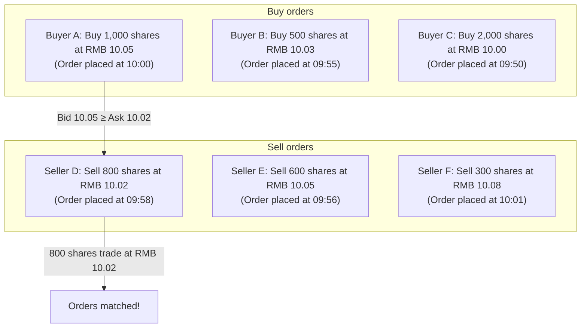
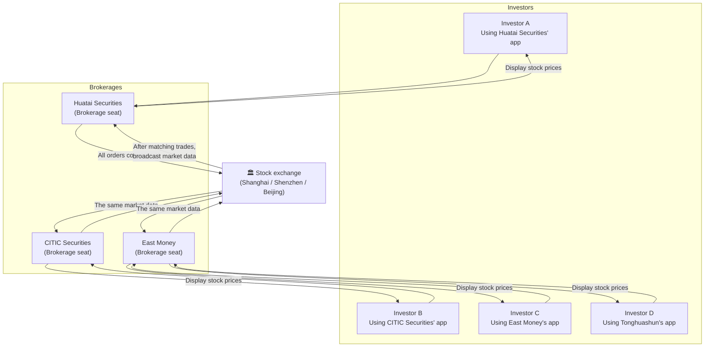
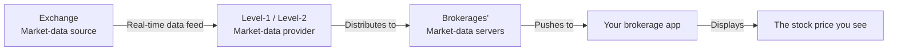
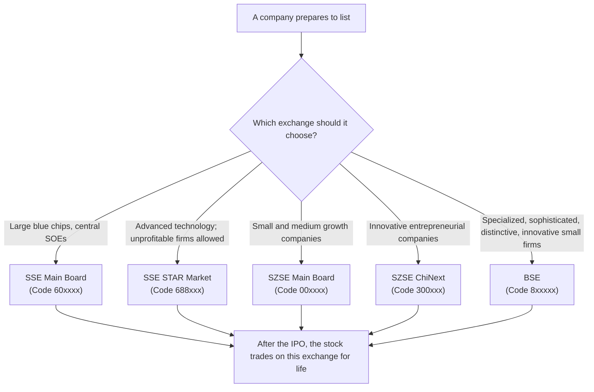
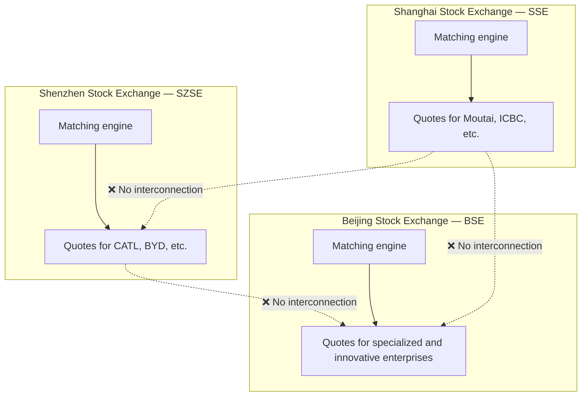
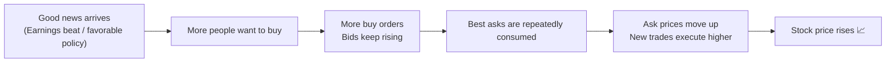
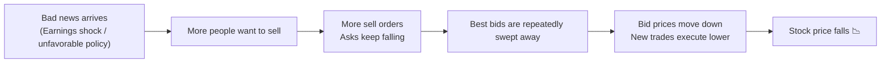
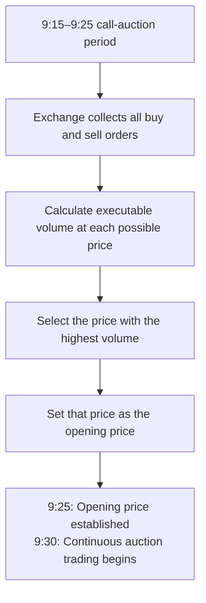
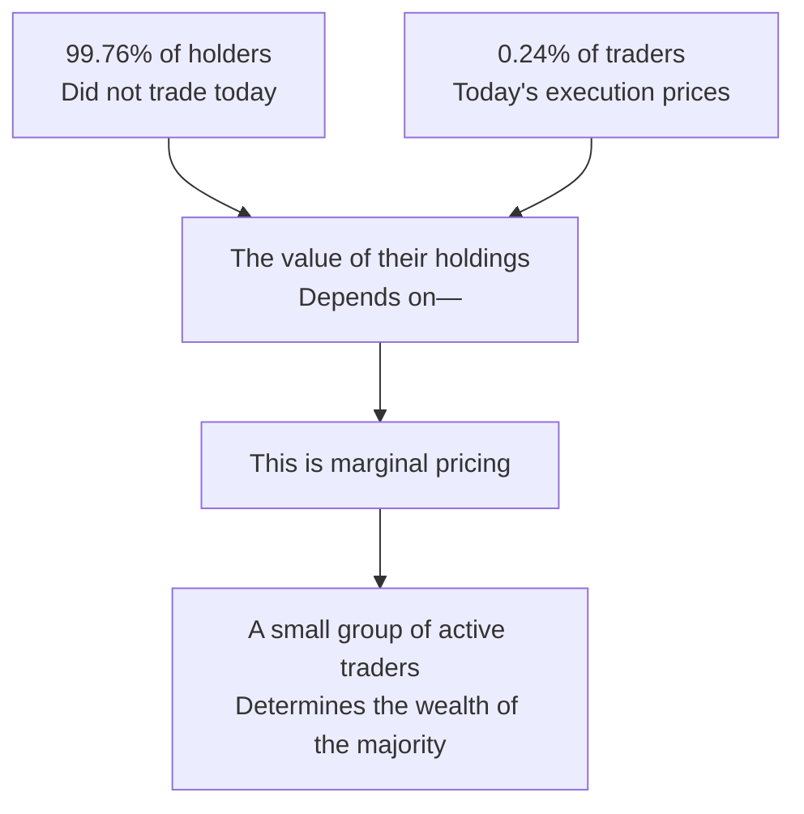

# Why Do Stock Prices Rise and Fall? Where Do Trade Prices Come From?

## 1. A Fundamental Question Often Overlooked

Many people trade stocks for years yet cannot answer a basic question:

> **How exactly does a stock price change? Who sets it?**

You might intuitively assume there is an official price or one calculated by the exchange. In reality, **nobody sets the price: it emerges naturally from the interaction of buyers and sellers.**

This article starts with the underlying trading mechanics to explain the fundamental reasons stock prices rise and fall.

## 2. The Nature of a Stock Price: Created One Trade at a Time

### 2.1 A Stock Price Is a Sequence of Trades, Not Just a Number

The stock market is not a supermarket with marked selling prices. The stock price you see, such as Moutai at RMB 1,800, is actually **the price of the most recent trade**.

```
Timeline: Today's trades in Moutai

09:30:01  → 100 shares trade at RMB 1,798
09:30:02  → 500 shares trade at RMB 1,799
09:30:03  → 200 shares trade at RMB 1,800  ← The displayed price is now 1,800
09:30:04  → 300 shares trade at RMB 1,799  ← The price changes back to 1,799
```

> **Stock price = the execution price of the latest trade.** Every price tick has an actual transaction behind it.

### 2.2 Where Does the Execution Price Come From? Order Matching

An exchange's central job is **matching** people who want to buy with people who want to sell. But their offers often differ: if you want to buy at 10 and I want to sell at 11, how can a trade happen?

The answer is the matching rule of **price priority followed by time priority**.



The core matching rules:

| Rule | Explanation |
|------|------|
| **Price priority** | Higher-priced buy orders execute first; lower-priced sell orders execute first |
| **Time priority** | At the same price, the order placed earlier executes first |

For a concrete example, suppose the current best bid is RMB 10.00, meaning someone will buy at 10.00, and the best ask is RMB 10.02, meaning someone will sell at 10.02:

- **To buy immediately**: Submit an order at the best ask of 10.02 → It executes immediately at 10.02 → The stock price becomes 10.02
- **To sell immediately**: Submit an order at the best bid of 10.00 → It executes immediately at 10.00 → The stock price becomes 10.00
- **If you are in no hurry**: Place a buy order at 10.01 and wait → If someone is willing to sell at 10.01, the trade executes

## 3. The Central System Behind Stock Prices: The Exchange Matching Engine

### 3.1 Why Do Different Brokerages Show Exactly the Same Price?

If you have used several trading apps, such as Tonghuashun, East Money, Huatai Zhangle, or CITIC Securities, you may have noticed:

> **The same stock has exactly the same price, order book, and volume across every brokerage app, synchronized in real time.**

This is because they all connect to **the same place**, rather than because brokerages reconcile prices with each other.

### 3.2 The Exchange: The Single Trading Hall

The basic architecture of stock trading is simple:



> **The exchange is the market's single central hub.** Brokerages are channels: they send your orders to the exchange, which matches trades and broadcasts market data back to every brokerage.

### 3.3 The Full Lifecycle of a Trade

Suppose you buy 100 Moutai shares in Huatai Securities' app. The complete chain is:

```
1. You tap "Buy" in the app
        ↓
2. Huatai Securities receives your order
        ↓
3. Huatai sends the order over a dedicated network → Shanghai Stock Exchange
        ↓
4. The exchange matching engine receives orders from brokerages nationwide
        ↓
5. The engine matches buy and sell orders using price priority, then time priority
        ↓
6. Your buy order matches a sell order → Trade executed!
        ↓
7. The exchange creates a trade record and broadcasts it to all brokerages through its market-data feed
        ↓
8. You see "Executed," and your holdings increase by 100 shares
   At the same time, all trading apps update the stock price to this execution price
```

| Role | Responsibility |
|------|------|
| **Exchange** | The sole matching center, market-data source, and enforcer of trading rules |
| **Brokerage** | A channel that receives your order, forwards it to the exchange, and reports execution results |
| **Investor** | Sends buy and sell instructions through a brokerage |

### 3.4 Why Can Different Brokerages Not Have Different Prices?

Because **another investor in the market sells you the stock, rather than the brokerage**. The brokerage simply forwards your instructions to the exchange.

- If you buy Moutai through Huatai, the person selling to you may use CITIC Securities
- Both orders meet in **the same exchange matching engine**
- There is only one execution price: the price at which the match succeeds

> Analogy: The exchange resembles the **Taobao/Xianyu marketplace**, while the brokerage resembles **the Taobao app on your phone**. Whether you use an iPhone or Android, or a new or old app version, you see the same products and prices because there is only one data source.

### 3.5 China's Three Major Stock Exchanges

| Exchange | Abbreviation | Main Markets | Established |
|------|:---:|------|:---:|
| **Shanghai Stock Exchange** | SSE | Main Board, STAR Market | 1990 |
| **Shenzhen Stock Exchange** | SZSE | Main Board, ChiNext | 1990 |
| **Beijing Stock Exchange** | BSE | Innovative small and medium enterprises | 2021 |

Each stock is listed on only one exchange: for example, Moutai on the SSE and CATL on the SZSE. All its trades are completed in that exchange's matching engine.

### 3.6 How Does Market Data Reach Your Phone?

Market data generated through exchange matching reaches your app through this chain:



- **Level-1 data**: Basic quotes, including five bid/ask levels, last price, and volume; free or inexpensive
- **Level-2 data**: Depth data, including ten bid/ask levels, individual trades, and order queues; usually paid

> Brokerage apps may differ in **latency by milliseconds**, depending on network and server performance, but they share the same source, so the prices are the same.

### 3.7 Which Exchange Does a Stock Use, and Who Decides?

**A stock trades on one fixed exchange from its first listing day and remains there for its lifetime.**

The **company chooses the exchange when conducting its IPO (initial public offering)**, based on its market positioning, financial qualifications, and financing needs.

**Identify the exchange at a glance from the stock code:**

| Code Prefix | Exchange | Board | Typical Example |
|:---:|:---:|------|------|
| **60xxxx** | SSE | Main Board | Kweichow Moutai (600519) |
| **688xxx** | SSE | STAR Market | SMIC (688981) |
| **00xxxx** | SZSE | Main Board | CATL (300750 → formerly used) |
| **002xxx** | SZSE | SME Board, now merged into the Main Board | BYD (002594) |
| **300xxx** | SZSE | ChiNext | CATL (300750) |
| **301xxx** | SZSE | ChiNext | — |
| **8xxxxx** | BSE | Innovative small and medium enterprises | — |
| **4xxxxx** | BSE | Old Third Board / delisting period | — |

> **Practical tip**: Codes starting with 60 identify the SSE; 00 or 30 identify the SZSE; and 8 identifies the BSE. A stock never changes exchanges unless it is delisted and relisted, which is extremely rare.



### 3.8 Is Data Synchronized Between Exchanges?

**No: different exchanges operate independently and do not interconnect.**



The reasons are straightforward:

| Reason | Explanation |
|------|------|
| **Different companies** | Each stock lists on one exchange; the same stock does not trade simultaneously on two exchanges |
| **Independent matching** | Each exchange has its own matching engine and processes only its listed stocks |
| **No need to synchronize** | The SSE does not need to know CATL's execution price on the SZSE; the two exchanges are entirely separate companies |

> Analogy: The SSE and SZSE resemble **a produce market in Beijing and another in Shenzhen**. Each operates independently, sells its own produce, and has prices determined by buyers and sellers within that market.

**There is one exception: cross-market indexes.**

Although exchanges do not interconnect, **index providers**, such as China Securities Index Co., collect data from both Shanghai and Shenzhen to compile indexes spanning markets:

| Index | Exchanges Covered | Description |
|------|:---:|------|
| **CSI 300** | SSE + SZSE | The 300 largest stocks by market capitalization across both markets |
| **CSI 500** | SSE + SZSE | The next 500 largest stocks after excluding the CSI 300 |
| **SSE Composite** | SSE only | A composite index of all SSE stocks |
| **SZSE Component** | SZSE only | 500 representative SZSE stocks |
| **ChiNext Index** | SZSE ChiNext only | 100 representative ChiNext stocks |
| **STAR 50** | SSE STAR Market only | 50 representative STAR Market stocks |

> When your trading app says the CSI 300 is up 1%, the exchange did not calculate that figure. **The index provider calculated it from data collected separately from both exchanges.**

## 4. The Order Book: Comparing Buyer and Seller Strength

### 4.1 Five-Level Quotes: The Bid and Ask Book

The bid 1, bid 2, bid 3 and ask 1, ask 2, ask 3 commonly shown in trading software form the **order book**, displaying orders currently queued for execution.

```
┌──────────────────────────────────┐
│         Asks (sell orders)        │
│  Ask 5  10.08   1,200 shares      │
│  Ask 4  10.07     800 shares      │
│  Ask 3  10.06     500 shares      │
│  Ask 2  10.05   2,000 shares      │
│  Ask 1  10.03   1,500 shares ← Lowest ask│
├──────────────────────────────────┤
│  ———— Last price: 10.00 ————     │
├──────────────────────────────────┤
│  Bid 1  10.00   3,000 shares ← Highest bid│
│  Bid 2   9.99   1,000 shares      │
│  Bid 3   9.98   2,500 shares      │
│  Bid 4   9.97     600 shares      │
│  Bid 5   9.95   4,000 shares      │
│         Bids (buy orders)         │
└──────────────────────────────────┘
```

- **Best bid (RMB 10.00)**: The highest current buy price, with 3,000 shares queued
- **Best ask (RMB 10.03)**: The lowest current sell price, with 1,500 shares queued
- **RMB 0.03 spread**: Buyers and sellers have not yet agreed, so the orders wait

### 4.2 Reading the Order Book: Which Side Is Stronger?

Changes in the order book directly foreshadow short-term price direction:

| Order-Book Pattern | Meaning | Expected Direction |
|------|------|:---:|
| Buy-order volume >> sell-order volume | Strong buyers and ample buying support | ↑ |
| Sell-order volume >> buy-order volume | Strong sellers and heavy selling pressure | ↓ |
| Best bids are continually consumed and bid prices rise | Buyers actively press forward | ↑ |
| Best asks are continually consumed and ask prices fall | Sellers actively retreat | ↓ |
| Both sides of the book are thin | Poor liquidity; large orders can easily sweep through levels | High volatility |

## 5. Why Prices Rise: Buying Strength Exceeds Selling Strength

There is one fundamental reason a stock rises: **At a given price, buyers outnumber sellers or are more eager, and they keep raising their bids to secure shares.**



More specifically, the process is:

1. Buyers believe the stock is worth more, whether because of good news or following others, and submit buy orders
2. The best bid keeps rising (10.00 → 10.01 → 10.02...)
3. Orders at the best ask are consumed as buyers actively execute at that price
4. New sell orders ask higher prices, which buyers continue to accept
5. Execution prices rise step by step → **The stock price rises**

### Several Drivers of Rising Prices

| Driver | Example |
|------|------|
| **Fundamentals** | Earnings beat expectations → More investors recognize value → Buying |
| **News** | Favorable industry policy → Higher expected future profits → Buying |
| **Liquidity** | Central bank cuts rates and injects liquidity → More money in the market → Inflows to stocks |
| **Sentiment** | Seeing others make money → FOMO (fear of missing out) → Following them into purchases |
| **Technical factors** | Price breaks above a key moving average → Quantitative/technical traders buy automatically |

## 6. Why Prices Fall: Selling Strength Exceeds Buying Strength

There is likewise one fundamental reason a stock falls: **At a given price, sellers outnumber buyers or are more eager, and they keep lowering their asking prices to sell shares.**



The process is:

1. Holders believe the stock has peaked, or panic, and submit sell orders
2. The best ask keeps falling (10.05 → 10.03 → 10.01...)
3. Orders at the best bid are swept away as sellers actively execute at that price
4. New buy orders offer lower prices, which sellers continue to accept
5. Execution prices fall step by step → **The stock price falls**

### Several Drivers of Falling Prices

| Driver | Example |
|------|------|
| **Deteriorating fundamentals** | Earnings decline → Holders lose confidence → Selling |
| **Negative news** | Industry crackdowns or tighter regulation → Expected profits suffer → Selling |
| **Capital outflows** | Central bank raises rates and tightens liquidity → Money leaves stocks |
| **Panic** | Seeing a sharp price drop → Fear of larger losses → Selling at a loss |
| **Profit-taking** | Gains feel sufficient → Lock in profits → Selling |
| **Forced liquidation** | Margin positions become unsustainable → Broker liquidates them → Forced selling |

## 7. Daily Price Limits: The A-Share Market's Brakes

A-shares on the Shanghai and Shenzhen exchanges have **daily price limits** that restrict the range of daily moves:

| Board | Daily Limit | Description |
|------|:---:|------|
| **Main Board** | ±10% | Ordinary shares on the Shanghai and Shenzhen Main Boards |
| **ST / \*ST stocks** | ±5% | Stocks under risk warnings |
| **ChiNext** | ±20% | Codes beginning with 300 |
| **STAR Market** | ±20% | Codes beginning with 688 |
| **BSE** | ±30% | Codes beginning with 8 |
| **First day of a new listing** | ±44% (Main Board) | Returns to 10% afterward |

> A price limit means that when buying or selling becomes extreme, trading does not stop; the price simply cannot move farther in that direction. The queued orders at a limit-up price belong to people who want to buy but cannot obtain shares.

## 8. Call Auctions: Where Do Opening and Closing Prices Come From?

You may notice an opening price appearing at 9:25 each morning. It is determined through a **call auction**, rather than randomly.

### 8.1 How a Call Auction Works

The central principle is: **Find the price at which the greatest number of shares can trade.**

```
Suppose a stock has these orders before the open:

Buy orders:                    Sell orders:
RMB 10.10   500 shares         RMB 10.00   800 shares
RMB 10.05  1000 shares         RMB 10.05   600 shares
RMB 10.00  2000 shares         RMB 10.10  1000 shares
RMB  9.95  1500 shares         RMB 10.15   500 shares

Test each possible execution price:

Price = RMB 10.00:
  Total buy orders ≥ 10.00: 500+1000+2000 = 3500 shares
  Total sell orders ≤ 10.00: 800 shares
  Executable volume: min(3500, 800) = 800 shares

Price = RMB 10.05:
  Total buy orders ≥ 10.05: 500+1000 = 1500 shares
  Total sell orders ≤ 10.05: 800+600 = 1400 shares
  Executable volume: min(1500, 1400) = 1400 shares  ← Maximum!

Price = RMB 10.10:
  Total buy orders ≥ 10.10: 500 shares
  Total sell orders ≤ 10.10: 800+600+1000 = 2400 shares
  Executable volume: min(500, 2400) = 500 shares

→ RMB 10.05 produces the highest volume, so the opening price is RMB 10.05
```



### 8.2 A-Share Trading Schedule

| Time | Session | Description |
|------|------|------|
| 9:15–9:20 | Call auction, cancellations allowed | Orders accepted and may be canceled |
| 9:20–9:25 | Call auction, no cancellations | Orders accepted but **cannot be canceled** |
| 9:25–9:30 | Opening pause | Opening price established; no trades |
| 9:30–11:30 | Continuous auction, morning | Normal trading |
| 13:00–14:57 | Continuous auction, afternoon | Normal trading |
| 14:57–15:00 | Closing call auction | Closing price established |
| After 15:00 | Block trades / after-hours fixed-price trading | Special trading methods |

> ⚠️ The five minutes from 9:20 to 9:25 are crucial. Orders cannot be canceled, so displayed orders reflect genuine intentions. Orders from 9:15 to 9:20 may only test the market, with major players withdrawing artificial large orders before 9:20.

## 9. A Unifying Way to Think: Marginal Pricing

The most important concept for understanding price moves is **marginal pricing**:

> **A stock price is determined by the small group most eager to trade right now, rather than by the average cost of all shareholders.**

For example:

- Moutai has approximately 1.256 billion shares outstanding
- On a given day, 3 million shares trade, a turnover rate of about 0.24%
- **The transfer of this 0.24% determines the paper value of the remaining 99.76% of shares**

This means:

- Not everyone needs to sell: **the most urgent sellers** alone can drive the price down
- Not everyone needs to buy: **the most urgent buyers** alone can drive the price up
- The profit or loss on your holdings is, in essence, **produced by other people's trades**



## 10. Summary

| Question | Answer |
|------|------|
| Where does a stock price come from? | Each execution price is produced by matching a buyer and seller |
| Why does it rise? | Buyers are more eager than sellers and keep raising bids to obtain shares |
| Why does it fall? | Sellers are more eager than buyers and keep lowering asks to sell shares |
| How is the execution price determined? | Price priority, then time priority; a trade occurs when the highest bid and lowest ask match |
| How is the opening price determined? | A call auction finds the price that maximizes executable volume |
| Who sets the price? | **No individual sets it; the market does.** Price results from interaction, rather than design |

> **A stock price is the compromise reached right now between the person most eager to buy and the person most eager to sell.**
>
> Understand that sentence, and you understand the entire secret behind rising and falling stock prices.
