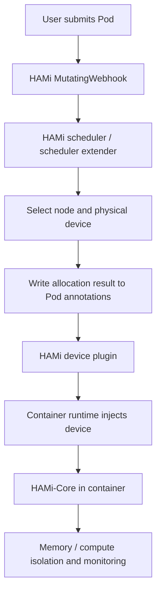

# What HAMi Does

HAMi stands for **Heterogeneous AI Computing Virtualization Middleware**, officially styled `HAMi`. Formerly `k8s-vGPU-scheduler`, it is now a CNCF Sandbox project that provides sharing, isolation, and scheduling of heterogeneous AI accelerators on Kubernetes.

Project links:

- GitHub organization: [https://github.com/Project-HAMi](https://github.com/Project-HAMi)
- Core repository: [https://github.com/Project-HAMi/HAMi](https://github.com/Project-HAMi/HAMi)
- Official documentation: [https://project-hami.io/zh/docs](https://project-hami.io/zh/docs)

In one sentence:

> HAMi extends Kubernetes' whole-GPU allocation model into one that allocates heterogeneous devices by memory, compute, model, UUID, topology, and scheduling policy.

It does not solve low-level tasks such as installing NVIDIA drivers. It addresses how multiple AI workloads can use expensive GPU / NPU / MLU / DCU devices more efficiently and with better control after those devices are integrated with Kubernetes.

## Why HAMi Is Needed

The typical native Kubernetes approach to GPUs uses a Device Plugin:

```yaml
resources:
  limits:
    nvidia.com/gpu: 1
```

This model is simple, but `nvidia.com/gpu: 1` requests an entire GPU.

In inference, notebooks, development, debugging, or small-model training, a Pod may consume only 20–40% of GPU compute and a small part of its memory. Whole-card allocation then leads to:

- Plenty of unused GPU memory while Kubernetes considers the whole card occupied.
- Small inference services unable to share one card.
- Teams competing for GPUs despite low utilization.
- Node labels struggling to express device model, UUID, NUMA, NVLink, and remaining memory.
- Inconsistent resource models across NVIDIA, Huawei Ascend, Cambricon, Hygon DCU, MetaX, Moore Threads, and other devices.

HAMi fills this gap using Kubernetes' existing extension mechanisms.

## HAMi's Core Capabilities

### 1. Device Sharing

HAMi allows multiple Pods to share a physical GPU or another accelerator. Users can request portions of memory and compute instead of only whole cards.

For an NVIDIA GPU:

```yaml
apiVersion: v1
kind: Pod
metadata:
  name: hami-gpu-demo
spec:
  containers:
  - name: app
    image: nvidia/cuda:12.4.1-base-ubuntu22.04
    command: ["sleep", "3600"]
    resources:
      limits:
        nvidia.com/gpu: 1
        nvidia.com/gpumem: 3000
        nvidia.com/gpucores: 50
```

This means:

- `nvidia.com/gpu: 1`: request one GPU device instance.
- `nvidia.com/gpumem: 3000`: allocate about 3000 MiB of memory per GPU instance.
- `nvidia.com/gpucores: 50`: allocate about 50% of GPU compute-core time slices.

Memory can also be allocated as a percentage:

```yaml
resources:
  limits:
    nvidia.com/gpu: 1
    nvidia.com/gpumem-percentage: 50
```

Note: `nvidia.com/gpumem` and `nvidia.com/gpumem-percentage` cannot be used together.

### 2. Resource Isolation

Scheduling alone is insufficient for shared GPUs. The container runtime must also limit actual resource use.

For NVIDIA devices, HAMi typically uses `HAMi-Core` to intercept CUDA APIs inside the container, limiting visible and usable GPU memory and compute in software. A Pod requesting 3GiB sees or uses only its allocation; exceeding the quota produces an OOM inside the container instead of exhausting the whole card.

This differs from NVIDIA Time-Slicing:

- Time-Slicing primarily allows multiple Pods to use one GPU concurrently.
- HAMi additionally provides memory and compute quota semantics.
- MIG provides hardware isolation but requires supported data-center GPUs such as A100 / H100. HAMi's software virtualization covers more models, while isolation strength depends on backend and driver capabilities.

### 3. Device-Aware Scheduling

The default Kubernetes scheduler sees only extended-resource counts on a Node, such as `nvidia.com/gpu: 10`. It does not know each physical card's UUID, model, memory, NUMA node, health, or already allocated memory.

HAMi's scheduler extender maintains this information and participates in placement decisions.

Its main scheduling dimensions are:

- Node: which GPU node to choose.
- Device: which card on that node to choose.
- Resources: whether memory, compute, and device-count requirements are satisfied.
- Policy: `binpack` or `spread`.
- Topology: GPU topology such as NVLink / NUMA affinity where supported.

For example, annotations can select scheduling policies:

```yaml
metadata:
  annotations:
    hami.io/node-scheduler-policy: "spread"
    hami.io/gpu-scheduler-policy: "binpack"
```

The policies mean:

- `node binpack`: concentrate tasks on nodes already in use to improve resource consolidation.
- `node spread`: distribute tasks among nodes to reduce node-level contention.
- `gpu binpack`: pack small tasks onto the same card, leaving entire cards free for larger tasks.
- `gpu spread`: distribute tasks among cards to reduce contention on individual GPUs.

### 4. Selecting Models or Particular Devices

In mixed GPU clusters, users often want tasks to run only on A100/V100 or avoid certain consumer GPUs. HAMi supports including or excluding models through annotations.

Select models:

```yaml
metadata:
  annotations:
    nvidia.com/use-gputype: "A100,V100"
```

Exclude models:

```yaml
metadata:
  annotations:
    nvidia.com/nouse-gputype: "1080,2080"
```

A particular GPU UUID can also be specified:

```yaml
metadata:
  annotations:
    nvidia.com/use-gpuuuid: "GPU-123456"
```

This adds device-level selection on top of Kubernetes' native whole-card scheduling.

### 5. Unified Management of Heterogeneous Devices

HAMi is not limited to NVIDIA GPUs. Backends listed in the official documentation include:

- NVIDIA GPU
- Huawei Ascend NPU
- Cambricon MLU
- Hygon DCU
- Iluvatar GPU
- Moore Threads GPU
- MetaX GPU
- Enflame GCU
- AWS Neuron
- Vastai / Vaststream and additional backends

Resource names, isolation granularity, and multi-device capabilities differ across vendors. HAMi brings them into one Kubernetes scheduling and allocation flow. Platforms can manage heterogeneous accelerators through a unified scheduler, monitoring, WebUI, and Helm configuration.

## HAMi Architecture

HAMi is not one component; several parts cooperate to provide GPU virtualization.



### MutatingWebhook

MutatingWebhook is the entry point. It checks whether newly submitted Pods request resources managed by HAMi. If a Pod uses only CPU, memory, or HAMi devices, the webhook changes its `schedulerName` to the name used by HAMi's scheduler.

Users can therefore keep writing ordinary Pod YAML without directly calling a HAMi API.

### HAMi scheduler

HAMi scheduler performs the actual node and device selection.

It reads node device information, existing allocations, Pod resource requests, and annotations, then performs Filter / Score / Bind:

- Filter: remove nodes and devices that do not satisfy memory, compute, model, or UUID requirements.
- Score: rank candidates using binpack / spread / topology-aware policies.
- Bind: select the node and particular device, then write the allocation to Pod annotations.

HAMi needs its own scheduling logic because standard Device Plugins expose only device counts to kubelet / scheduler, not per-card remaining memory, UUID, or topology as standard scheduling inputs.

### Device Plugin

HAMi's device plugin still uses Kubernetes' Device Plugin mechanism to register resources with kubelet. It:

- Discovers physical devices on the node.
- Expands physical devices into schedulable logical resources.
- Writes device information into Node annotations for the scheduler.
- Maps selected devices into containers when kubelet calls `Allocate`, using allocation results from Pod annotations.

For example, one physical GPU can be configured as multiple logical vGPU slots. kubelet sees the expanded count, while HAMi scheduler additionally tracks the physical card behind the slots and its remaining memory and compute.

### HAMi-Core

HAMi-Core is the resource-control layer inside containers.

It monitors and limits GPU use inside containers. For NVIDIA, it intercepts CUDA APIs to enforce memory and compute limits. The `nvidia.com/gpucores` limit is fundamentally time-slice control, so GPU utilization observed with `nvidia-smi` may fluctuate.

This distinguishes HAMi from a scheduler extender alone: it determines which GPU a Pod receives and prevents the running Pod from exceeding its GPU allocation.

## A Complete Scheduling Flow

Consider a Pod requesting one GPU, 3GiB of memory, and 50% compute:

```yaml
apiVersion: v1
kind: Pod
metadata:
  name: hami-demo
  annotations:
    nvidia.com/use-gputype: "A100,V100"
    hami.io/gpu-scheduler-policy: "binpack"
spec:
  containers:
  - name: app
    image: nvidia/cuda:12.4.1-base-ubuntu22.04
    command: ["sleep", "3600"]
    resources:
      limits:
        nvidia.com/gpu: 1
        nvidia.com/gpumem: 3000
        nvidia.com/gpucores: 50
```

The flow is:

1. The user submits the Pod.
2. HAMi MutatingWebhook recognizes its HAMi device-resource request.
3. The Pod is passed to HAMi scheduler.
4. The scheduler reads device information from GPU-node annotations.
5. It filters for A100 or V100 devices with enough remaining memory and compute.
6. It chooses the most suitable physical card under `gpu binpack`.
7. It writes allocation details such as device UUID, memory, and compute into Pod annotations.
8. kubelet calls HAMi's device plugin during container creation.
9. The plugin injects the specified device according to those annotations.
10. HAMi-Core limits GPU memory and compute inside the container.

## Installation

HAMi recommends Helm installation.

```bash
helm repo add hami-charts https://project-hami.github.io/HAMi/
helm repo update
```

Match the bundled kube-scheduler image version to the cluster version. For a `v1.29.0` cluster:

```bash
helm install hami hami-charts/hami \
  --set scheduler.kubeScheduler.imageTag=v1.29.0 \
  -n kube-system
```

Default configurations generally require labeling the GPU nodes HAMi should manage; follow the current Helm values:

```bash
kubectl label node <node-name> gpu=on
```

Verify:

```bash
kubectl get pods -n kube-system | grep hami
```

You should normally see `hami-device-plugin` and `hami-scheduler` Pods in Running state.

Common NVIDIA prerequisites include:

- NVIDIA drivers installed on the nodes.
- NVIDIA runtime / toolkit configured in the container runtime.
- A Kubernetes version meeting the current HAMi requirements.
- A Helm version greater than 3.

## Observability and Troubleshooting

HAMi provides metrics, example Grafana dashboards, and HAMi WebUI.

Common starting points:

```bash
# Inspect HAMi components
kubectl get pods -n kube-system | grep hami

# Inspect device information HAMi wrote to the node
kubectl get node <node-name> -o yaml | grep -A 5 'hami.io/node'

# Inspect devices allocated to the Pod
kubectl get pod <pod-name> -o yaml | grep -A 10 'hami.io'

# Inspect scheduling failures
kubectl describe pod <pod-name>
kubectl get events --sort-by=.lastTimestamp
```

For NVIDIA, focus on:

- Whether the node exposes resources such as `nvidia.com/gpu`, `nvidia.com/gpumem`, and `nvidia.com/gpucores`.
- Whether Node annotations contain HAMi device-registration information.
- Whether Pod annotations contain allocation results.
- Whether `nvidia-smi` inside the container reports the expected memory.
- Whether scheduler / device-plugin logs show insufficient resources, model mismatches, missing UUIDs, or similar errors.

## HAMi and Device Plugins

HAMi's traditional mode still uses Kubernetes Device Plugins.

The differences are:

- An ordinary Device Plugin primarily tells kubelet how many GPUs a node has.
- HAMi's plugin expands one physical GPU into multiple allocatable logical resources.
- HAMi scheduler additionally tracks device memory, compute, model, UUID, and allocation state.
- HAMi-Core isolates memory and compute inside containers.

HAMi therefore layers scheduling and isolation on top of Device Plugins rather than merely replacing them.

## HAMi and MIG

MIG provides strong hardware partitioning on selected NVIDIA data-center GPUs, with several limitations:

- Only certain GPUs, such as A100 and H100, support it.
- Partition profiles are relatively fixed.
- Dynamic changes usually involve node-level operations and affect existing workloads.

HAMi's software virtualization is more flexible:

- It covers more NVIDIA GPU models.
- Memory can be requested in MiB or percentages.
- Compute can be requested as a percentage.
- It can combine with dynamic MIG to adjust MIG instances in supported environments.

From an engineering perspective:

- Evaluate MIG first for strong isolation, fixed configurations, and critical production inference pools.
- HAMi offers more flexibility for mixed card models, small tasks, substantial sharing needs, and rapid utilization improvements.
- They are not mutually exclusive. HAMi can unify scheduling of MIG, software partitioning, and heterogeneous devices.

## HAMi and DRA

DRA is Kubernetes' next-generation native device-allocation API. Objects such as `DeviceClass`, `ResourceSlice`, and `ResourceClaim` let the scheduler understand device attributes and allocation state natively.

Traditional HAMi uses Device Plugins, webhooks, a scheduler extender, and an annotation protocol. This is mature and usable, but device information is not represented by standard Kubernetes API objects.

HAMi now officially provides a DRA mode:

- Requires Kubernetes 1.34+.
- Requires relevant feature gates, including DRA Consumable Capacity.
- Uses a HAMi DRA webhook to preserve an experience close to traditional resource declarations.
- The current official documentation mainly lists NVIDIA GPUs as supported DRA devices.
- DRA mode and traditional mode are incompatible and cannot be enabled together.

Example installation in DRA mode:

```bash
helm install hami hami-charts/hami \
  --set dra.enable=true \
  -n hami-system
```

DRA aligns more closely with Kubernetes' long-term native direction. Traditional HAMi remains the more common production deployment path today. Platforms can first address utilization with traditional HAMi while tracking HAMi-DRA maturity.

## Suitable HAMi Use Cases

HAMi is suitable for:

- Multi-tenant AI platforms where teams share a GPU pool.
- Many inference services that do not individually require an entire GPU.
- Numerous notebook / development / debugging tasks where whole-card allocation wastes resources.
- Mixed GPU models requiring selection by model, UUID, or topology.
- Unified management of NVIDIA, Ascend, Cambricon, Hygon, Iluvatar, MetaX, and other accelerators.
- Balancing utilization and performance isolation through binpack / spread policies.
- Introducing vGPU semantics quickly on Kubernetes without waiting for the full DRA ecosystem to mature.

Less suitable scenarios include:

- Every task consistently saturates a whole GPU, making whole-card scheduling sufficient.
- Extremely strong isolation requirements that demand MIG or vendor hardware virtualization.
- Workloads sensitive to CUDA interception, time slicing, or in-container preloading.
- Extremely demanding GPU communication, such as large multi-node, multi-GPU training requiring strict topology and bandwidth control.
- Platforms unable to accept the added complexity of schedulers, webhooks, device plugins, and in-container runtime hooks.

## Key Risks

### Resource Isolation Does Not Guarantee Performance

HAMi can cap memory and compute quotas, but Pods sharing a physical GPU still compete for:

- HBM bandwidth
- L2 cache
- PCIe / NVLink
- Kernel-launch overhead
- Context switches
- Internal GPU-runtime locks

HAMi improves average utilization; it does not guarantee that sharing tenants have no effect on one another's performance.

### Memory Isolation Depends on the Backend

Results differ by vendor, driver version, and isolation mode. NVIDIA HAMi-Core, Ascend vNPU / hami-vnpu-core, and Cambricon / Hygon / Iluvatar backends each have limitations and prerequisites. Load-test and test quota violations on the target card models before production rollout.

### Scheduling State Depends on Annotations

Traditional HAMi writes device information and allocations to Node / Pod annotations. This bypasses the Device Plugin integer-resource limitation, but troubleshooting must inspect all of:

- Kubernetes Pod status
- HAMi scheduler cache
- Node annotation
- Pod annotation
- Device-plugin logs
- In-container HAMi-Core behavior

This is more complex than a conventional GPU Operator + Device Plugin setup.

### Avoid Conflicts with Existing GPU Plugins

If NVIDIA GPU Operator or NVIDIA device plugin is already installed, ensure resource names, device plugins, runtime configuration, and scheduler configuration do not conflict. Do not let two plugins register the same resource name on one node or manage the same devices twice.

## Summary

HAMi does four core things:

1. **Sharing**: divides whole GPU / NPU / MLU / DCU devices into finer-grained requestable resources.
2. **Isolation**: uses HAMi-Core or vendor backends to limit memory and compute inside containers.
3. **Scheduling**: uses a scheduler extender to understand model, UUID, memory, compute, topology, and binpack / spread policies.
4. **Unified management**: brings heterogeneous accelerators from multiple vendors into one Kubernetes resource-use model.

HAMi is heterogeneous compute virtualization middleware for Kubernetes, beyond a simple GPU device plugin. For AI infrastructure, it turns expensive GPUs from exclusively allocated whole cards into a resource pool shared by quota, scheduled by policy, and isolated according to backend capabilities.

## References

- [Project-HAMi GitHub](https://github.com/Project-HAMi/HAMi)
- [HAMi website](https://project-hami.io/)
- [HAMi: GPU Virtualization Principles](https://project-hami.io/docs/core-concepts/gpu-virtualization)
- [HAMi: Architecture](https://project-hami.io/docs/core-concepts/architecture)
- [HAMi: Device sharing](https://project-hami.io/docs/key-features/device-sharing)
- [HAMi: Device resource isolation](https://project-hami.io/docs/key-features/device-resource-isolation/)
- [HAMi: Online Installation from Helm](https://project-hami.io/docs/installation/online-installation)
- [HAMi: Allocate NVIDIA device memory](https://project-hami.io/docs/userguide/nvidia-device/specify-device-memory-usage/)
- [HAMi: Allocate NVIDIA device core usage](https://project-hami.io/docs/userguide/nvidia-device/specify-device-core-usage/)
- [HAMi: HAMi DRA for Kubernetes](https://project-hami.io/docs/installation/how-to-use-hami-dra/)
