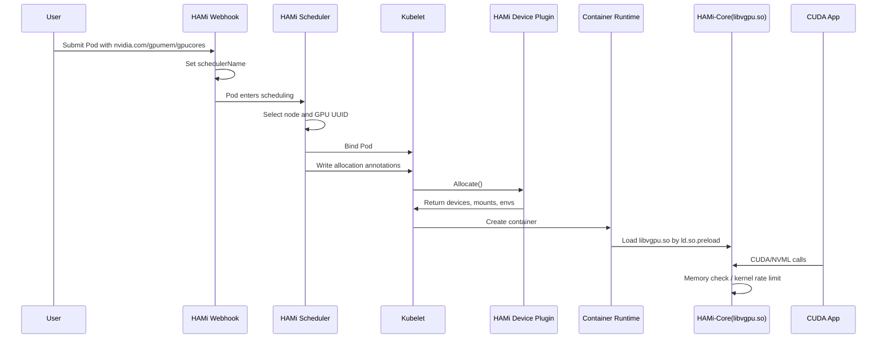

# HAMi Device Injection and Library Interposition

HAMi's GPU-sharing capabilities have two layers:

- Kubernetes: lets Pods request fine-grained resources such as `nvidia.com/gpumem` and `nvidia.com/gpucores`, then schedules them onto suitable nodes and physical GPUs.
- Container runtime: ensures that, once running, a container sees and uses only its allocated memory and compute.

The first layer is mainly implemented by `hami-scheduler`; the second by `hami-device-plugin` and `HAMi-Core`.

This article focuses on the second layer: **device injection** and **library interposition**.

If mechanisms such as `LD_PRELOAD`, `/etc/ld.so.preload`, and `dlsym(RTLD_NEXT)` are unfamiliar, first read [Dynamic Linker Resolution and Interposition](/en/notes/program-language/r79yeegl/).

In one sentence:

> HAMi's scheduler decides which GPU a Pod receives and its memory and compute quotas; the Device Plugin injects devices, environment variables, and `libvgpu.so`; `libvgpu.so` then enforces resource limits inside the container by intercepting CUDA / NVML APIs.

## The Complete Path

Start with the full flow:



Two boundaries matter in this flow:

- The scheduler calculates resources and selects devices; it does not modify containers directly.
- The Device Plugin only places the materials needed for enforcement inside the container. Actual memory and compute limits take effect when container processes call CUDA / NVML APIs.

## Passing Scheduling Results to the Device Plugin

The standard Kubernetes Device Plugin model is simple: the scheduler knows extended-resource counts on a node, such as `nvidia.com/gpu: 10`. It does not pass structured information such as "this Pod requests 3000 MiB, 30% compute, and GPU-xxx" to kubelet.

HAMi uses Pod annotations to pass allocation results from its scheduler to the device plugin.

A typical Pod resource request:

```yaml
resources:
  limits:
    nvidia.com/gpu: 1
    nvidia.com/gpumem: 3000
    nvidia.com/gpucores: 30
```

After Filter / Bind, the scheduler writes the result into Pod annotations, including:

```yaml
metadata:
  annotations:
    hami.io/bind-time: "1716199325"
    hami.io/vgpu-devices-allocated: "GPU-0fc3eda5-e98b-a25b-5b0d-cf5c855d1448,NVIDIA,3000,30:;"
    hami.io/vgpu-devices-to-allocate: "GPU-0fc3eda5-e98b-a25b-5b0d-cf5c855d1448,NVIDIA,3000,30:;"
```

Their approximate meanings are:

- `hami.io/bind-time`: scheduling bind time, which the Device Plugin can use to detect allocation timeouts.
- `hami.io/vgpu-devices-allocated`: the final allocation record, including GPU UUID, device type, memory quota, and compute quota.
- `hami.io/vgpu-devices-to-allocate`: the devices awaiting Device Plugin processing; the plugin updates or clears it after successful processing.

During `Allocate()`, the plugin therefore receives more than an abstract device ID. It can determine which physical card to inject into the container and which memory and compute limits apply.

## What the Device Plugin Injects

After a Pod reaches its target node, kubelet calls the local HAMi Device Plugin's `Allocate()`. Device injection happens here.

From the container's perspective, the plugin injects four main categories of configuration.

### 1. Device Visibility

The Device Plugin restricts the container to its allocated GPUs. For NVIDIA, this usually involves:

- Device files such as `/dev/nvidia0`, `/dev/nvidiactl`, and `/dev/nvidia-uvm`.
- `NVIDIA_VISIBLE_DEVICES`, restricting visible devices to the GPU UUIDs selected by the scheduler.
- CDI device descriptions in runtimes that support CDI.

The goal is to enforce device selection: the Pod sees only the card or cards HAMi assigned to it, rather than every GPU on the node.

### 2. `libvgpu.so`

HAMi-Core's central artifact is `libvgpu.so`. The Device Plugin mounts this host library into the container, commonly at:

```text
/usr/local/vgpu/libvgpu.so
```

This only places the library in the container; it does not yet enforce limits. Enforcement requires the next step: making the dynamic linker load it first.

### 3. `/etc/ld.so.preload`

The Linux glibc [dynamic linker](/en/notes/program-language/r79yeegl/) reads `/etc/ld.so.preload`. Libraries listed there load before ordinary dynamically linked programs start.

HAMi mounts the host's preload file into the container at:

```text
/etc/ld.so.preload
```

The file usually contains a single line:

```text
/usr/local/vgpu/libvgpu.so
```

Its effect is similar to setting:

```bash
LD_PRELOAD=/usr/local/vgpu/libvgpu.so
```

However, users do not need to modify the image entry point, startup command, or environment variables. If the CUDA program starts through glibc dynamic linking, `libvgpu.so` is preloaded.

If the container explicitly sets:

```bash
CUDA_DISABLE_CONTROL=true
```

HAMi can skip this control injection, effectively disabling in-container limits. This option should generally be reserved for debugging or cases explicitly requiring no HAMi enforcement.

### 4. Quota Environment Variables

The Device Plugin also converts scheduling results into environment variables for `libvgpu.so` to read.

Typical variables include:

```bash
CUDA_DEVICE_MEMORY_LIMIT_0=3000m
CUDA_DEVICE_SM_LIMIT=30
LIBCUDA_LOG_LEVEL=1
```

They mean:

- `CUDA_DEVICE_MEMORY_LIMIT_0=3000m`: the first visible GPU inside the container has a 3000 MiB memory limit.
- `CUDA_DEVICE_SM_LIMIT=30`: the target compute ceiling is 30%.
- `LIBCUDA_LOG_LEVEL`: controls HAMi-Core logging verbosity.

Multi-GPU containers have multiple memory limits numbered by their in-container device indexes, for example:

```bash
CUDA_DEVICE_MEMORY_LIMIT_0=3000m
CUDA_DEVICE_MEMORY_LIMIT_1=6000m
```

These indexes refer to container-visible devices and need not match host GPU indexes.

## Why Interpose Libraries?

Mounting `/dev/nvidia*` alone does not limit GPU memory. Allocations happen inside NVIDIA driver / CUDA API calls. Kubernetes cgroups cannot directly cap GPU memory in the same way as CPU or system memory.

HAMi-Core therefore intercepts the CUDA API layer.

The application call chain roughly looks like:

```text
PyTorch / TensorFlow / vLLM / llama.cpp
        |
        v
CUDA Runtime: libcudart.so
        |
        v
CUDA Driver API: libcuda.so
        |
        v
NVIDIA kernel driver
```

HAMi-Core sits between CUDA Runtime and CUDA Driver API:

```text
Application
    |
    v
libcudart.so
    |
    v
libvgpu.so  <-- hook layer
    |
    v
libcuda.so / libnvidia-ml.so
    |
    v
NVIDIA driver
```

It does not modify application code or the NVIDIA driver. Instead, CUDA / NVML symbol resolution preferentially returns wrapper functions supplied by HAMi-Core.

## The Core Idea of dlsym Interposition

Many CUDA runtimes and frameworks obtain CUDA Driver API addresses through dynamic linking or [`dlsym()`](/en/notes/program-language/r79yeegl/), for example:

```c
cuMemAlloc_v2
cuMemAllocManaged
cuLaunchKernel
nvmlDeviceGetMemoryInfo
```

Once preloaded, `libvgpu.so` replaces `dlsym`. During symbol lookup, HAMi-Core checks whether the symbol is a CUDA / NVML function it handles:

```text
if symbol starts with "cu" or "nvml":
    return HAMi wrapper function
else:
    return real dlsym result
```

The real implementation handles more details, such as version suffixes, real-address caching, and recursion protection. Conceptually:

```c
void *dlsym(void *handle, const char *symbol) {
    if (is_cuda_or_nvml_symbol(symbol)) {
        if (has_hami_wrapper(symbol)) {
            return hami_wrapper(symbol);
        }
    }
    return real_dlsym(handle, symbol);
}
```

The application believes it is calling native CUDA / NVML functions, but first enters a HAMi-Core wrapper. After validation, accounting, or rate limiting, the wrapper decides whether to call the real function.

## How Memory Limits Take Effect

Memory limits primarily rely on two types of hooks.

### 1. Virtualize Query Results

Many programs query total and free GPU memory at startup to choose batch size, KV-cache size, or model-loading strategy.

HAMi-Core intercepts queries such as:

```text
nvmlDeviceGetMemoryInfo
nvmlDeviceGetMemoryInfo_v2
cuDeviceTotalMem_v2
```

If a Pod receives 3000 MiB, its programs should see total memory near 3000 MiB rather than the physical GPU's 24 GiB, 40 GiB, or 80 GiB.

This addresses perception: applications adapt to their virtual quota instead of assuming they own the entire card.

### 2. Intercept Allocation Requests

The actual hard check happens at memory-allocation functions such as:

```text
cuMemAlloc_v2
cuMemAllocManaged
cuMemAllocAsync
```

Before calling the real allocator, HAMi-Core calculates:

```text
currently_used_memory + requested_memory <= CUDA_DEVICE_MEMORY_LIMIT_<index>
```

If the request stays within quota, it calls the real CUDA function and records the allocation.

If the request exceeds quota, the wrapper skips the real allocator and directly returns a result such as:

```text
CUDA_ERROR_OUT_OF_MEMORY
```

The application sees an ordinary CUDA OOM. A Pod exceeding its HAMi quota therefore fails inside the container rather than exhausting the whole physical GPU.

## Memory Accounting Across Processes

Memory limits cannot consider only one process. A container may contain:

- A main process and workers.
- Python multiprocessing。
- Multiprocess model serving or training through vLLM / Ray / TorchRun.

If each process maintains only a local counter, each might believe it still has 3000 MiB, allowing total usage to greatly exceed the quota.

HAMi-Core therefore coordinates memory accounting across processes. The local cache files and `/tmp/vgpulock/` mentioned in its README allow processes to share or protect accounting state.

During Kubernetes injection, the Device Plugin also mounts HAMi's working and lock directories so multiple processes in a container cooperate around the same quota.

## How Compute Limits Take Effect

Memory permits a hard allocation-time check, but GPU compute is not a static quantity that can simply be deducted. HAMi implements `nvidia.com/gpucores` through software rate limiting around CUDA kernel launches.

HAMi-Core intercepts kernel-submission functions such as:

```text
cuLaunchKernel
cuLaunchKernelEx
```

Before every submission, HAMi-Core enters its `rate_limiter` logic:

1. Estimate submission cost from the kernel's grid information.
2. Deduct it from global tokens / counters.
3. If enough counter capacity remains, call the real `cuLaunchKernel`.
4. Otherwise, briefly wait, for example with `nanosleep`, until a background watcher replenishes the budget.

The watcher periodically samples GPU utilization and adjusts replenishment according to `CUDA_DEVICE_SM_LIMIT`. It replenishes faster below the target and slower above it, bringing overall container utilization toward the requested percentage.

Understand `gpucores` as **software time-slice throttling**, not hardware SM partitioning. It can reduce long-term average consumption but is not equivalent to MIG hardware isolation.

## Why nvidia-smi Output Changes Too

`nvidia-smi` primarily queries GPUs through NVML. When HAMi-Core intercepts NVML functions, `nvidia-smi` inside the container sees virtualized results.

For a physical 24 GiB card and a Pod requesting only 3000 MiB, the container might report:

```text
Memory-Usage: 0MiB / 3000MiB
```

This does not mean the physical GPU was divided into a 3000 MiB hardware partition. HAMi-Core rewrote the NVML query result.

The host, or a process without HAMi-Core injection, still sees the complete physical GPU information and all process usage.

## Differences from NVIDIA MIG

HAMi library interposition and MIG are easy to confuse, but isolate at different layers.

| Dimension | HAMi-Core interposition | NVIDIA MIG |
| --- | --- | --- |
| Isolation layer | CUDA / NVML API | GPU hardware partitions |
| Applicability | Does not require MIG; covers more NVIDIA GPUs | Selected data-center GPUs only |
| Memory limits | Intercepts allocators and returns OOM | Hardware instances have separate memory |
| Compute limits | Throttles before kernel launch; converges over time | Hardware partitions SM / cache and other resources |
| Security boundary | Software isolation, dependent on hook coverage | Stronger hardware isolation |
| Flexibility | Flexible quota granularity | Restricted by MIG profiles |

HAMi provides software GPU time sharing and memory quotas on Kubernetes to improve utilization. MIG partitions a card into hardware instances and suits requirements for stronger isolation.

## Boundaries of This Mechanism

HAMi-Core is general and flexible, requiring no application-code changes, but has clear limits.

### 1. It Depends on Dynamic Linking and Hook Coverage

`/etc/ld.so.preload` primarily affects glibc dynamically linked programs. Static linking, bypassing ordinary CUDA Driver APIs, or directly using uncovered new APIs may bypass or weaken limits.

HAMi-Core must continuously track CUDA / NVML changes. New functions or suffixes in CUDA releases can cause inaccurate accounting or incomplete enforcement if hooks do not cover them.

### 2. It Is Not a Security Sandbox

HAMi targets resource reuse and quotas, not strong security isolation. A container with enough privileges to modify `/etc/ld.so.preload`, replace libraries, or disable control variables can undermine enforcement.

Production deployments still need:

- Unprivileged containers.
- Read-only root filesystems or write restrictions on critical paths.
- Appropriate PodSecurity / admission policies.
- Avoidance of excessive Linux capabilities for ordinary workloads.

### 3. Compute Limits Are Not Precise Real-Time SLAs

`gpucores` is software throttling based on kernel launches. It controls long-term average utilization but cannot guarantee exactly 30% or 50% at every instant.

Very short or fragmented kernels, or large differences in kernel behavior between Pods, can cause fluctuations. The official documentation also notes fluctuating core utilization in `nvidia-smi`.

### 4. Framework Caching Allocators Affect What You Observe

PyTorch, TensorFlow, vLLM, and similar frameworks usually maintain their own GPU-memory caches. An application may request a large CUDA memory pool once and then reuse it internally.

HAMi still counts that allocation against the quota. Users may observe:

- Usage near the quota immediately after startup.
- OOM with a slightly larger batch size.
- Framework reserved / allocated figures differing from NVML figures.

This is not unique to HAMi. It commonly results from different accounting perspectives between framework memory pools and underlying GPU allocations.

## What to Inspect When Troubleshooting

If a HAMi Pod does not enforce memory or compute limits as expected, follow this path.

### 1. Inspect Pod Resource Requests

```bash
kubectl get pod <pod> -o yaml | yq '.spec.containers[].resources'
```

Confirm these requests are present:

```yaml
nvidia.com/gpu: 1
nvidia.com/gpumem: 3000
nvidia.com/gpucores: 30
```

### 2. Inspect Scheduling Annotations

```bash
kubectl get pod <pod> -o yaml | yq '.metadata.annotations'
```

Focus on:

```text
hami.io/vgpu-devices-allocated
hami.io/vgpu-devices-to-allocate
hami.io/bind-time
```

Missing annotations may indicate that the Pod bypassed HAMi scheduler or that resource names, schedulerName, or webhook configuration are incorrect.

### 3. Check In-Container Preloading

Enter the container:

```bash
kubectl exec -it <pod> -- sh
```

Check:

```bash
cat /etc/ld.so.preload
ls -l /usr/local/vgpu/libvgpu.so
env | grep -E 'CUDA_DEVICE_MEMORY_LIMIT|CUDA_DEVICE_SM_LIMIT|NVIDIA_VISIBLE_DEVICES|LIBCUDA'
```

Expected output:

```text
/usr/local/vgpu/libvgpu.so
CUDA_DEVICE_MEMORY_LIMIT_0=3000m
CUDA_DEVICE_SM_LIMIT=30
```

If `/etc/ld.so.preload` is absent or `libvgpu.so` was not mounted, Device Plugin injection did not succeed.

### 4. Inspect nvidia-smi Inside the Container

```bash
nvidia-smi
```

If HAMi-Core intercepts NVML correctly, reported total memory should be close to the requested `nvidia.com/gpumem`, rather than the full physical GPU memory.

### 5. Inspect HAMi-Core Logs

Increase logging verbosity:

```yaml
env:
- name: LIBCUDA_LOG_LEVEL
  value: "3"
```

Then inspect container logs for HAMi-Core initialization, memory allocation, OOM, and throttling output.

## Summary

HAMi device injection and library interposition do not physically divide a GPU. They combine a Kubernetes scheduling protocol with in-container API hooks to provide usable virtual-GPU semantics.

The complete sequence is:

1. Users declare memory and compute with `nvidia.com/gpumem` / `nvidia.com/gpucores`.
2. HAMi Scheduler selects a node and GPU UUID and writes the result into Pod annotations.
3. kubelet calls HAMi Device Plugin's `Allocate()`.
4. The plugin injects GPU visibility, `libvgpu.so`, `/etc/ld.so.preload`, and quota environment variables.
5. The dynamic linker preloads `libvgpu.so` when the container starts.
6. HAMi-Core intercepts CUDA / NVML to virtualize memory queries, check for OOM before allocation, and throttle kernel launches.

Understanding this path makes failures easier to locate:

- Scheduling failure: inspect the scheduler and Pod annotations.
- Missing container limits: inspect Device Plugin `Allocate()` injection results.
- Unexpected `nvidia-smi` output: inspect NVML hooks and preloading.
- No OOM when exceeding quota: check whether CUDA allocation functions are hooked.
- Compute fluctuations: inspect kernel-launch throttling and workload behavior.

References:

- [HAMi: GPU Virtualization Principles](https://project-hami.io/zh/docs/core-concepts/gpu-virtualization)
- [HAMi-core design](https://project-hami.io/docs/next/developers/hami-core-design)
- [Project-HAMi/HAMi-core](https://github.com/Project-HAMi/HAMi-core)
- [Project-HAMi/HAMi](https://github.com/Project-HAMi/HAMi)
