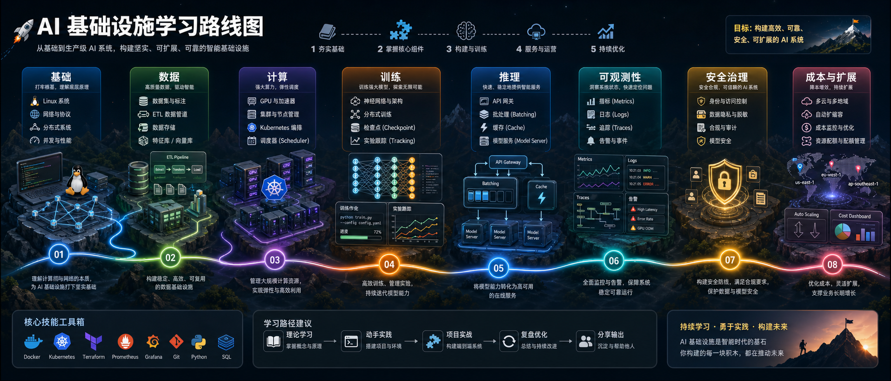

Notes on AI infrastructure, covering GPU resource management, device allocation, virtualization implementations, and the mathematical foundations and inference mechanisms of LLMs.

- [DRA and Device Plugin](/en/notes/ai-infra/dra-device-plugin/)
- [HAMi](/en/notes/ai-infra/hami/)
- [HAMi device injection and library interception](/en/notes/ai-infra/hjzbo16q/)
- [The Mathematics of Transformers: A Complete Worked Example](/en/notes/ai-infra/llm/transformer-math/)
- [Understanding vLLM from a Mathematical Perspective](/en/notes/ai-infra/llm/kv-cache-vllm/)
- [Qwen3-1.7B Model Files: Roles, Relationships, and Loading](/en/notes/ai-infra/llm/model-files-vllm/)

Most notes were created with AI assistance to organize ideas, collect references, and support later lookup. They may contain omissions or errors; check the official documentation or your actual environment before relying on them.
