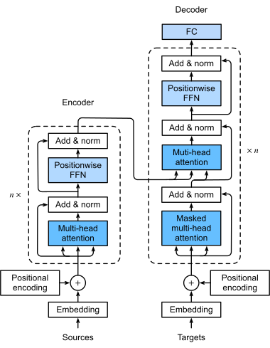
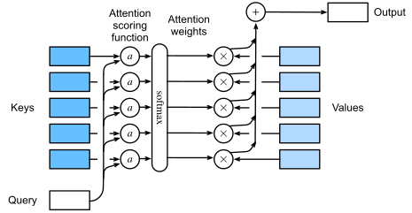
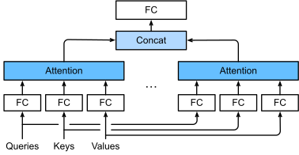

# The Mathematics of Transformers: A Complete Worked Example

A Transformer turns a token sequence into vectors, exchanges information between positions through attention, and maps the vector at each position to prediction scores. In an autoregressive language model, the scores at the last position are used to select the next token. Appending that token to the input allows generation to continue.

First, look at the original Transformer architecture: the encoder on the left processes the source sequence, while the decoder on the right combines the source sequence with the target sequence so far to predict the next token.



<div class="llm-figure-caption">

Figure 1: The original Transformer encoder-decoder architecture, read from bottom to top. The $n\times$ in the figure denotes the number of stacked layers, whereas this article uses $n$ for sequence length. Source: [Dive into Deep Learning, Figure 11.7.1](https://d2l.ai/chapter_attention-mechanisms-and-transformers/transformer.html), original figure by the authors, used under [CC BY-SA 4.0](https://creativecommons.org/licenses/by-sa/4.0/).

</div>

Follow the arrows from bottom to top: tokens become vectors with positional information at the bottom, pass repeatedly through attention, feed-forward networks, residual connections, and normalization in the middle, and reach the FC layer at the top, which maps the final features to vocabulary scores. Softmax then produces prediction probabilities; the figure omits this final softmax.

The numerical example below uses a **single-layer, decoder-only, Post-LN Transformer**. It retains the causal self-attention and FFN on the right, with their residual connections and normalization, while omitting the encoder on the left and the cross-attention connecting the two sides. We use handpicked weights to illustrate the computation.

We will follow “input → attention → complete block → vocabulary probabilities,” then explain how training updates parameters and how inference generates tokens one at a time.

| Part | Question to answer | Do the parameters change? |
| --- | --- | --- |
| Shared forward computation | Given inputs and parameters, how do we compute prediction probabilities at each position? | Fixed during this computation |
| Training | How do we use the correct answers to adjust the parameters? | The optimizer updates the parameters |
| Inference | How do we use the existing parameters to generate tokens in sequence? | Parameters stay fixed; the input grows each round |

## 1. Shared Foundation: One Forward Pass

### 1.1 What the Model Computes

Given input tokens $x_1,\ldots,x_n$, the model computes:

$$
p_\theta(x_{n+1}\mid x_1,\ldots,x_n)
$$

Here, $\theta$ denotes the model parameters. The output is a probability distribution over the entire vocabulary. A decoding strategy then selects a token.

For example, take the input `我 爱` and a vocabulary with just five entries: `我` (I), `爱` (love), `你` (you), `<eos>`, and `学习` (study). The model must output five probabilities that sum to 1. We specify the tokens and vocabulary by hand here; a real tokenizer may segment the text differently.

Sequence representation matrices store the vector for each position in a row, and we omit the batch dimension. Parameter tables use their own indexing conventions: for example, rows in the embedding table correspond to vocabulary entries. The main example uses the following notation:

| Symbol | Meaning | Value or shape in this example |
| --- | --- | --- |
| $n$ | Input sequence length | $2$ |
| $m$ | Vocabulary size | $5$ |
| $d$ | Model hidden dimension, or $d_{\text{model}}$ | $4$ |
| $h$ | Number of attention heads | $2$ |
| $d_k,d_v$ | Q/K and V dimensions per head | Both $2$ |
| $d_{\text{ff}}$ | Feed-forward network intermediate dimension | $3$ |
| $E$ | Embedding parameter table: each row stores the vector for one vocabulary entry | $m\times d$ |
| $X$ | Current layer input: each row represents one position | $n\times d$ |
| $Q_a,K_a,V_a$ | Queries, keys, and values projected from the input for head $a$ | $n\times2$ |
| $A_a$ | Attention weights for head $a$: each row determines how much to take from each source position | $n\times n$ |
| $O_a$ | Output of head $a$: each row contains the content vector after weighted aggregation | $n\times2$ |
| $O$ | Attention sublayer output after concatenating and projecting the heads | $n\times d$ |
| $H$ | Transformer block output; the final layer's $H$ goes to the vocabulary output layer | $n\times d$ |
| $L$ | Logits: each row contains one position's prediction scores for all vocabulary candidates | $n\times m$ |
| $P_{\text{vocab}}$ | Vocabulary probabilities: prediction distributions obtained by normalizing each row of $L$ | $n\times m$ |

Real models usually use $d_{\text{ff}}>d$. We choose 3 only to keep the matrices small enough for hand calculation. Decimal values are displayed to six places, while subsequent computations use unrounded values.

### 1.2 From Tokens to the Input Matrix

#### 1.2.1 Embedding Is a Table Lookup

Assign token IDs as follows: `我=0`, `爱=1`, `你=2`, `<eos>=3`, and `学习=4`. Each vocabulary entry is represented by a four-dimensional vector, giving this $5\times4$ embedding table:

$$
E=
\begin{bmatrix}
1&0&0&0\\
0&1&1&0\\
0&0&1&1\\
1&-1&0&0\\
0&0&0&1
\end{bmatrix}
$$

Looking up rows 0 and 1 for the input `我 爱` gives $X_{\text{token}}$. Its vectors follow the positions in the sentence: each row corresponds to an input token, and each column to a feature component:

$$
X_{\text{token}}=
\begin{bmatrix}
1&0&0&0\\
0&1&1&0
\end{bmatrix}
$$

The implementation simply uses each token ID to retrieve the corresponding row from the embedding table.

The coordinates of these vectors have no predefined linguistic meanings. Training adjusts $E$ so that it works with subsequent layers to make predictions.

#### 1.2.2 Adding Position Information

With token embeddings alone, two identical tokens have the same initial vector. Positional encoding supplies a vector for each position so the model can use sequence order. The positional encoding matrix $P$ has the same shape as the input, $2\times4$ in this example.

This example uses the four-dimensional sinusoidal position vector $P_p=[\sin p,\cos p,\sin(p/100),\cos(p/100)]$, with position index $p$ starting at 0. The same rule applies to new tokens during generation. The first two positions form:

$$
P=\begin{bmatrix}
0&1&0&1\\
\sin1&\cos1&\sin0.01&\cos0.01
\end{bmatrix}
$$

This example defines $X=X_{\text{token}}+P$, giving:

$$
X\approx
\begin{bmatrix}
1&1&0&1\\
0.841471&1.540302&1.010000&0.999950
\end{bmatrix}
$$

The original Transformer multiplies token embeddings by $\sqrt d$ before adding positional encodings. This example explicitly omits that scaling. Sinusoidal encoding is also only one choice of position representation. [Original paper, §3.4–3.5](https://arxiv.org/html/1706.03762v7#S3.SS4)

### 1.3 Deriving Attention from Dot Products

The model's hidden dimension $d$ determines how many numbers represent each token, while the sequence length $n$ determines how many tokens it contains. These are two independent quantities:

$$
X\in\mathbb R^{n\times d},\qquad XX^\top\in\mathbb R^{n\times n}
$$

For example, with five tokens and 4096 dimensions per vector, $X$ has shape $5\times4096$, while the matching matrix remains $5\times5$. Each matching score is the dot product of two 4096-dimensional vectors.

Starting with the dot product of two vectors, we will build attention step by step using a separate example with five tokens and four dimensions per vector. This section considers a single head whose Q, K, and V vectors are all four-dimensional, making it easier to follow how vectors are compared and aggregated. Section 1.4 returns to the two-head model defined above for a complete forward pass.

#### 1.3.1 Compute the Dot Product of Two Vectors

Let the four-dimensional vectors be $a=[1,2,0,1]$ and $b=[2,1,1,0]$. A dot product multiplies corresponding components and adds the four results:

$$
a b^\top=1\times2+2\times1+0\times1+1\times0=4
$$

Keep $a=[1,2,0,1]$ fixed and compare it with a few other four-dimensional vectors:

| Other vector | Component-wise calculation | Dot product | Direction relative to $a$ |
| --- | --- | --- | --- |
| $[1,2,0,1]$ | $1\times1+2\times2+0\times0+1\times1$ | $6$ | Same direction |
| $[2,1,1,0]$ | $1\times2+2\times1+0\times1+1\times0$ | $4$ | Fairly similar direction |
| $[-1,0,2,1]$ | $1\times(-1)+2\times0+0\times2+1\times1$ | $0$ | Perpendicular |
| $[-1,-2,0,-1]$ | $1\times(-1)+2\times(-2)+0\times0+1\times(-1)$ | $-6$ | Opposite direction |

All these vectors have length $\sqrt6$, so the dot product reflects how closely their directions align. For general nonzero vectors:

$$
a b^\top=\sum_{r=1}^{d}a_rb_r
=\lVert a\rVert\lVert b\rVert\cos\theta
$$

Vector lengths also contribute to the calculation. For example, doubling $b$ doubles the dot product. Whether a vector has 4 or 4096 dimensions, the dot product follows the same rule and produces one matching score.

#### 1.3.2 Arrange the Dot Products for All Positions into a Matrix

Suppose the input is split into five tokens: `我 / 今天 / 在 / 家 / 学习` (I / today / at / home / study). To keep the calculations manageable, assign these four-dimensional vectors to the five positions:

| Position | Token | Vector |
| --- | --- | --- |
| 1 | `我` | $x_1=[1,0,1,0]$ |
| 2 | `今天` | $x_2=[0,1,0,1]$ |
| 3 | `在` | $x_3=[1,1,0,0]$ |
| 4 | `家` | $x_4=[0,1,1,0]$ |
| 5 | `学习` | $x_5=[1,0,0,1]$ |

These handpicked values demonstrate the computation. Below, $x_i$ denotes row $i$ of the input matrix $X$, the vector at position $i$. Arranging the five vectors as rows gives:

$$
X=\begin{bmatrix}
1&0&1&0\\
0&1&0&1\\
1&1&0&0\\
0&1&1&0\\
1&0&0&1
\end{bmatrix}_{5\times4}
$$

Comparing each position with all five positions requires $5\times5=25$ dot products. Each dot product sums the products of four pairs of components. For example, the fourth position, `家` (home), compares with every position as follows:

$$
\begin{aligned}
x_4x_1^\top&=0\times1+1\times0+1\times1+0\times0=1\\
x_4x_2^\top&=0\times0+1\times1+1\times0+0\times1=1\\
x_4x_3^\top&=0\times1+1\times1+1\times0+0\times0=1\\
x_4x_4^\top&=0\times0+1\times1+1\times1+0\times0=2\\
x_4x_5^\top&=0\times1+1\times0+1\times0+0\times1=0
\end{aligned}
$$

These five scores form the fourth row of the matrix. Performing the same calculation for the other positions gives the complete matching matrix:

$$
S_0=XX^\top=\begin{bmatrix}
2&0&1&1&1\\
0&2&1&1&1\\
1&1&2&1&1\\
1&1&1&2&0\\
1&1&1&0&2
\end{bmatrix}_{5\times5}
$$

The shapes in this operation are:

$$
\underbrace{X}_{5\times4}\;\underbrace{X^\top}_{4\times5}
=\underbrace{S_0}_{5\times5}
$$

Row $i$ contains the matching scores between position $i$ and every position. For example, the fourth row $[1,1,1,2,0]$ records the fourth position's comparisons with the five positions in order. Both rows and columns follow the token order `我`, `今天`, `在`, `家`, `学习`.

#### 1.3.3 Turn Scores into Weights and Aggregate the Vectors

Next, we turn the score matrix into a weight matrix and use these weights to aggregate the input vectors. To make the weighted sum easier to follow, we use the dot-product scores directly here; the complete formula will include the standard scaling factor.

Read the score matrix's **rows as the positions requesting information and its columns as the positions supplying information**. In an autoregressive model, each position can read itself and earlier positions: the first row can read 1 position, the third can read 3, and the fifth can read all 5.

The causal-mask matrix $M$ specifies which positions are visible: 0 for accessible positions and $-\infty$ for future positions. Adding it to the scores masks out future positions:

$$
M=\begin{bmatrix}
0&-\infty&-\infty&-\infty&-\infty\\
0&0&-\infty&-\infty&-\infty\\
0&0&0&-\infty&-\infty\\
0&0&0&0&-\infty\\
0&0&0&0&0
\end{bmatrix}
$$

After adding the mask, the score matrix becomes:

$$
\widetilde S=S_0+M=\begin{bmatrix}
2&-\infty&-\infty&-\infty&-\infty\\
0&2&-\infty&-\infty&-\infty\\
1&1&2&-\infty&-\infty\\
1&1&1&2&-\infty\\
1&1&1&0&2
\end{bmatrix}
$$

Apply softmax **separately to each row**. For row $i$, exponentiate each entry and divide by the sum of the exponentials in that row:

$$
A_{ij}=\frac{e^{\widetilde S_{ij}}}{\sum_{k=1}^{5}e^{\widetilde S_{ik}}}
$$

Since $e^{-\infty}=0$, future positions receive zero weight. The first row therefore becomes $[1,0,0,0,0]$.

Continue with the fourth position, `家` (home). After masking, its row is $[1,1,1,2,-\infty]$, allowing it to read the first three positions and itself. The softmax denominator is:

$$
D_4=e^1+e^1+e^1+e^2+0\approx15.543902
$$

The fourth row's five weights are therefore:

$$
[A_{41},A_{42},A_{43},A_{44},A_{45}]
=\frac{1}{D_4}[e^1,e^1,e^1,e^2,0]
\approx[0.174878,0.174878,0.174878,0.475367,0]
$$

Computing all five rows separately gives the complete attention-weight matrix:

$$
A=\operatorname{softmax}_{\text{row}}(\widetilde S)
\approx\begin{bmatrix}
1&0&0&0&0\\
0.119203&0.880797&0&0&0\\
0.211942&0.211942&0.576117&0&0\\
0.174878&0.174878&0.174878&0.475367&0\\
0.164307&0.164307&0.164307&0.060445&0.446633
\end{bmatrix}
$$

Each row sums to 1, subject to rounding in the displayed final digits. The fourth row takes about 17.5% from each of the first three positions, 47.5% from itself, and 0 from the future position `学习` (study). Normalization is performed separately within each row.

The next operation is to **multiply each token's entire vector by its weight, then add the five vectors together**.

Use the fourth row's actual weights to see how `家` aggregates information. Each weight applies to the corresponding token's entire vector. For example, `今天` has a weight of approximately 0.174878, so all four components are multiplied by that weight. The weight for `学习` is 0, making its entire weighted vector zero.

Decimals in the table and calculations below are displayed to six places; the aggregate results use unrounded weights:

| Token | Original vector | Weight | Entire vector multiplied by the weight |
| --- | --- | --- | --- |
| `我` | `[1, 0, 1, 0]` | $A_{41}\approx0.174878$ | `[0.174878, 0, 0.174878, 0]` |
| `今天` | `[0, 1, 0, 1]` | $A_{42}\approx0.174878$ | `[0, 0.174878, 0, 0.174878]` |
| `在` | `[1, 1, 0, 0]` | $A_{43}\approx0.174878$ | `[0.174878, 0.174878, 0, 0]` |
| `家` | `[0, 1, 1, 0]` | $A_{44}\approx0.475367$ | `[0, 0.475367, 0.475367, 0]` |
| `学习` | `[1, 0, 0, 1]` | $A_{45}=0$ | `[0, 0, 0, 0]` |

Next, add the five vectors in the rightmost column. Vector addition adds first components to first components, second components to second components, and so on:

```text
  [0.174878, 0.000000, 0.174878, 0.000000]
+ [0.000000, 0.174878, 0.000000, 0.174878]
+ [0.174878, 0.174878, 0.000000, 0.000000]
+ [0.000000, 0.475367, 0.475367, 0.000000]
+ [0.000000, 0.000000, 0.000000, 0.000000]
------------------------------------------
≈ [0.349755, 0.825122, 0.650245, 0.174878]
```

This gives the fourth position's aggregated vector $o_4$:

$$
\begin{aligned}
o_4&=A_{41}x_1+A_{42}x_2+A_{43}x_3+A_{44}x_4+0x_5\\
&\approx[0.349755,0.825122,0.650245,0.174878]
\end{aligned}
$$

Now focus on the first result, 0.349755. It comes from the first component of each of the five original vectors, multiplied by its respective weight and then added:

$$
\begin{aligned}
O_{4,1}
&=A_{41}\times1+A_{42}\times0+A_{43}\times1+A_{44}\times0+0\times1\\
&=A_{41}+A_{43}=\frac{2e^1}{D_4}\approx0.349755
\end{aligned}
$$

The five values used here, $1,0,1,0,1$, are exactly the first column of $X$. The same calculation can therefore be written as the weight row multiplied by the first column of $X$:

$$
O_{4,1}=
[A_{41},A_{42},A_{43},A_{44},0]
\begin{bmatrix}1\\0\\1\\0\\1\end{bmatrix}
\approx0.349755
$$

Multiplying the same weight row by the second column of $X$ gives the second component, approximately 0.825122. Multiplying it by the third and fourth columns gives approximately 0.650245 and 0.174878. Placing these four results together produces the same $o_4\approx[0.349755,0.825122,0.650245,0.174878]$.

**Row-by-column multiplication computes the weighted sum of whole vectors one component at a time.** A row of $X$ stores one token's complete vector, while a column collects the values of all five tokens at the same coordinate. The first column computes the new vector's first component; the second computes its second component. The model learns the coordinates of token vectors, and an individual coordinate may not have an easily named semantic meaning. The calculation simply aligns values by their shared coordinate order.

Each other position does the same thing with its own row of weights. Placing the five new vectors in rows gives $O=AX$. Component $r$ of the new vector at position $i$ is:

$$
O_{ir}=\sum_{j=1}^{5}A_{ij}X_{jr}
$$

Here, $i$ selects the position to update, $r$ selects a component of the new vector, and $j$ ranges over the five positions that provide information.

Aggregating all five positions gives the complete output:

$$
O\approx\begin{bmatrix}
1&0&1&0\\
0.119203&0.880797&0.119203&0.880797\\
0.788058&0.788058&0.211942&0.211942\\
0.349755&0.825122&0.650245&0.174878\\
0.775248&0.389060&0.224752&0.610940
\end{bmatrix}_{5\times4}
$$

The fourth position, `家`, started with $[0,1,1,0]$ and now has $[0.349755,0.825122,0.650245,0.174878]$, containing information from the first three positions and itself. The causal mask excludes the fifth position, `学习`, from this aggregation. The shapes throughout this operation are:

$$
\underbrace{A}_{5\times5}\;\underbrace{X}_{5\times4}
=\underbrace{O}_{5\times4}
$$

| Matrix | Meaning of each row | Meaning of each column | Shape in this example |
| --- | --- | --- | --- |
| $A$ | Attention weights assigned by one position | A source position | $5\times5$ |
| $X$ | Input vector at one position | A feature dimension | $5\times4$ |
| $O=AX$ | Aggregated vector at one position | A feature dimension | $5\times4$ |

$A_{ij}$ specifies how much position $i$ takes from position $j$, while row $i$ of $O$ stores the resulting vector. For $n$ positions with $d$-dimensional vectors, the respective matrix shapes are $n\times n$, $n\times d$, and $n\times d$. The computation remains:

$$
o_i=\sum_{j=1}^{n}A_{ij}x_j
$$

#### 1.3.4 Make Matching Learnable by Introducing Q and K

Earlier, each token was represented by a vector. Taking dot products between every pair of vectors gave $XX^\top$, with each entry describing how well two token vectors match.

We want the model to learn which relationships between tokens help prediction and what information to extract from those tokens. We therefore introduce three sets of learnable parameters, $W_Q,W_K,W_V$, to transform the input vectors:

$$
Q=XW_Q,\qquad K=XW_K,\qquad V=XW_V
$$

Let the input $X$ have shape $n\times d$: $n$ tokens, each with $d$ features. For one attention head, let Q and K have output dimension $d_k$, and V have output dimension $d_v$. **The shape of W is “input dimension × output dimension”:**

| Parameter matrix | Shape of W | Result after multiplying X by W |
| --- | --- | --- |
| $W_Q$ | $d\times d_k$ | $Q$: $n\times d_k$ |
| $W_K$ | $d\times d_k$ | $K$: $n\times d_k$ |
| $W_V$ | $d\times d_v$ | $V$: $n\times d_v$ |

Each column of W determines how to combine the $d$ input components into one output component, so the number of columns is the output dimension. For example, mapping a four-dimensional input to a two-dimensional output requires a $4\times2$ W, with dimensions $(n\times4)(4\times2)\to n\times2$. The same W is applied to every token, so the token count $n$ does not change its shape. Q and K use the same dimension $d_k$ so that their vectors can be compared using dot products.

**Q and K compute association scores between tokens, while V stores the content to aggregate.** In all three matrices, rows correspond to input positions and columns to transformed features. We replace $XX^\top$ with $QK^\top$, apply the mask and softmax to obtain attention weights, and multiply those weights by V:

$$
A=\operatorname{softmax}_{\text{row}}(QK^\top+M),\qquad O=AV
$$

Here, $A$ is the attention weight matrix: $A_{ij}$ determines how much information position $i$ takes from position $j$. $O$ is the output matrix: row $i$ stores the new vector at position $i$ after incorporating context.

$W_Q,W_K,W_V$ are model parameters updated during training; $Q,K,V,A,O$ are results computed from the current input and parameters. Training adjusts these parameters for the prediction task, while inference uses the learned parameters to perform the same computation.

#### 1.3.5 Make the Content Being Aggregated Learnable by Introducing V

The earlier $AX$ aggregates input vectors directly. With $W_V$, each position first produces a transformed content vector:

$$
v_j=x_jW_V,\qquad V=XW_V
$$

$V$ is called Value and has shape $n\times d_v$. Its row $v_j$ is the content vector that position $j$ contributes to the attention aggregation, containing $d_v$ components. $W_V$ has shape $d\times d_v$.

Then apply the same operation we have already worked through: multiply each whole vector by its weight, and add the results:

$$
o_i=\sum_{j=1}^{n}A_{ij}v_j,\qquad O=AV
$$

$O$ has shape $n\times d_v$: each row is the aggregated vector for one position, and each column is an output feature component. **A determines how much to take from each position, V supplies the content to aggregate, and O stores the result.**

#### 1.3.6 Assemble the Complete Attention Computation

Each role of Q/K/V has now appeared in the derivation:

| Matrix | Where it comes from | What it does | Shape for one head |
| --- | --- | --- | --- |
| Q: Query | $XW_Q$ | Each row is the vector a position uses to query | $n\times d_k$ |
| K: Key | $XW_K$ | Each row is the vector a position supplies for query matching | $n\times d_k$ |
| V: Value | $XW_V$ | Each row is the content a position contributes to weighted aggregation | $n\times d_v$ |

During training, the next-token prediction loss updates $W_Q,W_K,W_V$, the embedding, and other parameters through backpropagation. This allows the matching mechanism and content representations to work together for prediction. Section 2 derives the gradient of this loss.

Connecting the steps gives the complete formula for one attention head. Standard dot-product attention also divides the scores by $\sqrt{d_k}$ to control their scale:

$$
Q=XW_Q,\qquad K=XW_K,\qquad V=XW_V
$$

$$
S=\frac{QK^\top}{\sqrt{d_k}},\qquad
A=\operatorname{softmax}_{\text{row}}(S+M),\qquad O=AV
$$

$M$ is the causal mask introduced earlier, and softmax still operates row by row. The matrices in this computation record the scores, visibility constraints, attention weights, and aggregated results, respectively:

| Matrix | Meaning of an element or row | Shape |
| --- | --- | --- |
| $S$ | $S_{ij}$ is the unnormalized matching score between positions $i$ and $j$ | $n\times n$ |
| $M$ | $M_{ij}$ determines whether position $i$ can read position $j$: 0 allows it, and $-\infty$ masks it | $n\times n$ |
| $A$ | $A_{ij}$ is the attention weight assigned to source position $j$; each row sums to 1 | $n\times n$ |
| $O$ | Row $i$ is the new vector for position $i$ after aggregating the values | $n\times d_v$ |

Columns in $S,M,A$ correspond to source positions, while columns in $O$ correspond to feature components. The earlier unscaled score matrix $S_0$ and its masked version $\widetilde S$ helped us understand this computation step by step. The model now uses Q/K/V projections to learn matching and content representations, then performs the same weighted aggregation. [Original paper, §3.2](https://arxiv.org/html/1706.03762v7#S3.SS2)



<div class="llm-figure-caption">

Figure 2: Reading from left to right, the attention weights after softmax correspond to one row of $A$. Multiplying each weight by its corresponding value and summing gives the output $o_i$ at one position. Arranging all positions' outputs as rows gives $O$. The lowercase $a$ in the figure denotes a scoring function; this article also applies a causal mask before softmax. Source: [Dive into Deep Learning, Figure 11.3.1](https://d2l.ai/chapter_attention-mechanisms-and-transformers/attention-scoring-functions.html), original figure by the authors, used under [CC BY-SA 4.0](https://creativecommons.org/licenses/by-sa/4.0/).

</div>

### 1.4 From Single-Head to Multi-Head Attention

Previously, we computed one set of $Q,K,V$ from $X$, then one set of weights $A$, and finally $AV$. **One such attention computation is called a “head.”** Multi-head attention passes the same input through several such computations, each with its own parameters, and then combines the results.

Below, $O_1,O_2$ denote the outputs of the two heads, while $O$ denotes their combined output.

#### 1.4.1 Why Use Multiple Heads?

Look back at the five-token example: when computing the new vector for `家`, the weight assigned to `今天` was approximately 0.174878, so all four components of the `今天` vector were multiplied by 0.174878. The same applies to $O=AV$: **for the position being updated, all value components from a given source token share one weight.**

Suppose we want one group of features to take more information from `今天`, and another group to take more from `家`. With just one row of weights, we cannot assign separate attention proportions to these two feature groups.

We can therefore split the aggregation into two branches: each starts from the complete input $X$, uses its own three parameter sets to extract Q, K, and V, then computes its own weights and aggregates the values. These two branches are the two heads.

**The two parameter sets can learn different attention weights, and both aggregated results are retained.** Training determines which features each head extracts and which tokens it focuses on. [Original paper, §3.2.2](https://arxiv.org/html/1706.03762v7#S3.SS2.SSS2)

#### 1.4.2 Set the Input and Each Head's Dimensions

Now return to the main `我 爱` example from Section 1.2 and compute both branches. Each input token still has four components:

$$
X\approx\begin{bmatrix}
1&1&0&1\\
0.841471&1.540302&1.010000&0.999950
\end{bmatrix}_{2\times4}
$$

This example uses the common equal-width configuration: with hidden dimension $d$ and $h$ attention heads, each head has dimension $d/h$:

$$
d_k=d_v=\frac{d}{h}=\frac{4}{2}=2
$$

The number of heads $h$ is chosen when designing the model; this configuration requires $d$ to be divisible by $h$. Each head therefore extracts two components in this example. Every head processes both `我` and `爱`, so each head's $Q,K,V$ have two rows and two columns: the first row corresponds to `我`, and the second to `爱`; the two columns are the two features extracted by that head. **Each head's feature column count goes from $d$ to $d/h$, while the token row count $n$ stays unchanged.**

In matrix multiplication, $(n\times d)(d\times k)$ produces $n\times k$: each input row is multiplied by each column of the parameter matrix to produce one output component. To map each token's four-dimensional input to two-dimensional features, each head therefore needs its own three sets of $4\times2$ projection parameters:

$$
(2\times4)(4\times2)\longrightarrow2\times2
$$

We will specify the parameters for the two heads separately, with all biases set to 0. These parameters can be learned during training; here we choose simple values to illustrate the computation.

#### 1.4.3 The First Head: From X to O₁

First, specify three parameter matrices for head 1, each with shape $4\times2$:

$$
W_{Q,1}=\begin{bmatrix}
1&0\\0&1\\0&0\\0&0
\end{bmatrix},\qquad
W_{K,1}=\begin{bmatrix}
0&1\\1&0\\0&0\\0&0
\end{bmatrix},\qquad
W_{V,1}=\begin{bmatrix}
1&0\\0&2\\0&0\\0&0
\end{bmatrix}
$$

Multiply the same $X$ by each of these three matrices to obtain head 1's queries, keys, and values directly. Each multiplication has dimensions $(2\times4)(4\times2)$, producing a $2\times2$ result:

$$
Q_1=XW_{Q,1}\approx\begin{bmatrix}1&1\\0.841471&1.540302\end{bmatrix}_{2\times2}
$$

$$
K_1=XW_{K,1}\approx\begin{bmatrix}1&1\\1.540302&0.841471\end{bmatrix}_{2\times2}
$$

$$
V_1=XW_{V,1}\approx\begin{bmatrix}1&2\\0.841471&3.080605\end{bmatrix}_{2\times2}
$$

Next, compute the scores from $Q_1,K_1$, then apply the same scaling, causal mask, and row-wise softmax as before to obtain head 1's attention weights:

$$
A_1=\operatorname{softmax}_{\text{row}}\left(\frac{Q_1K_1^\top}{\sqrt2}+M\right)
\approx\begin{bmatrix}1&0\\0.462863&0.537137\end{bmatrix}
$$

The dimensions in $Q_1K_1^\top$ follow $(n\times d_k)(d_k\times n)\to n\times n$. After masking and softmax, $A_1$ still has shape $n\times n$. Its rows and columns both correspond to token positions; here $n=2$, so its shape is $2\times2$. **The size of the attention matrix $A$ is determined by sequence length. As each head's feature dimension gets smaller, $A$ still retains weights between all positions.**

Look at the second row, the position of `爱`: it takes approximately 46.3% of the value from `我` and 53.7% of its own value. We still multiply each whole vector by its weight and then add:

$$
0.462863[1,2]+0.537137[0.841471,3.080605]
\approx[0.914848,2.580433]
$$

The first row, `我`, can read only itself, so its output is its own value. Combining the two rows gives head 1's output:

$$
O_1=A_1V_1\approx\begin{bmatrix}1&2\\0.914848&2.580433\end{bmatrix}_{2\times2}
$$

#### 1.4.4 The Second Head: From X to O₂

The second head also starts from **the same input $X$**, using its own three sets of $4\times2$ parameters:

$$
W_{Q,2}=\begin{bmatrix}
0&0\\0&0\\1&0\\0&1
\end{bmatrix},\qquad
W_{K,2}=\begin{bmatrix}
0&0\\0&0\\0&1\\1&0
\end{bmatrix},\qquad
W_{V,2}=\begin{bmatrix}
0&0\\0&0\\1&0\\0&2
\end{bmatrix}
$$

Multiply $X$ by each matrix to obtain head 2's queries, keys, and values, each still with shape $2\times2$:

$$
Q_2=XW_{Q,2}\approx\begin{bmatrix}0&1\\1.010000&0.999950\end{bmatrix}_{2\times2}
$$

$$
K_2=XW_{K,2}\approx\begin{bmatrix}1&0\\0.999950&1.010000\end{bmatrix}_{2\times2}
$$

$$
V_2=XW_{V,2}\approx\begin{bmatrix}0&2\\1.010000&1.999900\end{bmatrix}_{2\times2}
$$

The zero parameter entries in this example make the two heads select different input components. Training can change these parameters, allowing each head to learn how to combine the complete four-dimensional input.

Next, compute the weights using head 2's own $Q_2,K_2$:

$$
A_2=\operatorname{softmax}_{\text{row}}\left(\frac{Q_2K_2^\top}{\sqrt2}+M\right)
\approx\begin{bmatrix}1&0\\0.328692&0.671308\end{bmatrix}
$$

Again, look at the position of `爱`. This time, it takes approximately 32.9% from `我` and 67.1% from itself, aggregating head 2's own values:

$$
0.328692[0,2]+0.671308[1.010000,1.999900]
\approx[0.678021,1.999933]
$$

Head 2's complete output is therefore:

$$
O_2=A_2V_2\approx\begin{bmatrix}0&2\\0.678021&1.999933\end{bmatrix}_{2\times2}
$$

For the same position, `爱`, the two heads use different attention proportions:

| Attention head | How much comes from `我` | How much comes from `爱` |
| --- | --- | --- |
| Head 1 | 46.3% | 53.7% |
| Head 2 | 32.9% | 67.1% |

The two feature groups thus use their own proportions for each source.

#### 1.4.5 Concatenate and Project

First, place the two heads' computed outputs together. In both matrices, the first row corresponds to `我` and the second to `爱`:

$$
O_1\approx\begin{bmatrix}
1&2\\0.914848&2.580433
\end{bmatrix}_{2\times2},\qquad
O_2\approx\begin{bmatrix}
0&2\\0.678021&1.999933
\end{bmatrix}_{2\times2}
$$

Concat joins the outputs along the columns: append the two entries from each row of $O_2$ to the two entries in the corresponding row of $O_1$. For example, the row for `爱` joins $[0.914848,2.580433]$ with $[0.678021,1.999933]$. Doing this for both rows gives the complete concatenated matrix:

$$
\operatorname{Concat}(O_1,O_2)\approx\begin{bmatrix}
1&2&0&2\\
0.914848&2.580433&0.678021&1.999933
\end{bmatrix}_{2\times4}
$$

The first two columns come from $O_1$, and the last two from $O_2$. The column counts add up while the row count stays unchanged: each of the $h$ heads supplies $d_v$ components, so each token has $h\times d_v=2\times2=4$ components after concatenation. What returns to its original size is the feature width; the four components contain new information aggregated by attention.

Next, multiply this $2\times4$ concatenated matrix on the right by the learnable output matrix $W_O$ to combine the features supplied by the heads. The concatenated width is $hd_v$, so $W_O$ has shape $hd_v\times d$, mapping the result to $n\times d$. Here $hd_v=d=4$, so $W_O$ has shape $4\times4$. Set its values as follows, with bias 0:

$$
W_O=\begin{bmatrix}
1&0&0&0\\0&1&0&0\\0&0&1&0\\0&0&0&1
\end{bmatrix}
$$

Multiplying by this matrix leaves the concatenated values unchanged, so:

$$
O=\operatorname{Concat}(O_1,O_2)W_O
\approx\begin{bmatrix}
1&2&0&2\\
0.914848&2.580433&0.678021&1.999933
\end{bmatrix}_{2\times4}
$$

With the $d_k=d_v=d/h$ configuration used in this example, the dimensions change as follows:

| Step | Dimension calculation | This example |
| --- | --- | --- |
| Each head's projections $Q_a,K_a,V_a$ | $(n\times d)(d\times d/h)\to n\times d/h$ | $(2\times4)(4\times2)\to2\times2$ |
| Compute matching scores, then obtain $A_a$ | $(n\times d/h)(d/h\times n)\to n\times n$ | $(2\times2)(2\times2)\to2\times2$ |
| Each head's aggregation $O_a=A_aV_a$ | $(n\times n)(n\times d/h)\to n\times d/h$ | $(2\times2)(2\times2)\to2\times2$ |
| Concatenate the outputs of $h$ heads | $n\times(h\cdot d/h)=n\times d$ | Two $2\times2$ matrices placed side by side give $2\times4$ |
| Multiply by the output projection $W_O$ | $(n\times d)(d\times d)\to n\times d$ | $(2\times4)(4\times4)\to2\times4$ |



<div class="llm-figure-caption">

Figure 3: Reading from bottom to top, the FC groups represent independent linear projections. Each Attention box computes one head's weights and output, Concat joins the heads' results, and the top FC corresponds to $W_O$. In the self-attention used here, all three inputs at the bottom come from $X$; each head's projections then produce $Q_a,K_a,V_a$. Source: [Dive into Deep Learning, Figure 11.5.1](https://d2l.ai/chapter_attention-mechanisms-and-transformers/multihead-attention.html), original figure by the authors, used under [CC BY-SA 4.0](https://creativecommons.org/licenses/by-sa/4.0/).

</div>

Now both $O$ and this layer's input $X$ have shape $n\times d$, or $2\times4$ in this example. $O$ supplies information aggregated from the context. We next add it back to the original $X$ so that the original representation and the new information both enter the subsequent computation.

### 1.5 From O to the Prediction

Continue with the input `我 爱` from the previous section and the $O$ we have already computed. **Each step below takes the previous step's numerical result as its input**, until we obtain vocabulary probabilities for both positions. We keep the same example and parameters: two input positions, four-dimensional hidden vectors, and five vocabulary candidates.

First, place the two matrices we need together: $O$ is the attention output, and $X$ is the original input to this layer from Section 1.2. In both matrices, the first row corresponds to `我` and the second to `爱`:

$$
O\approx\begin{bmatrix}
1&2&0&2\\
0.914848&2.580433&0.678021&1.999933
\end{bmatrix}_{2\times4}
$$

$$
X\approx\begin{bmatrix}
1&1&0&1\\
0.841471&1.540302&1.010000&0.999950
\end{bmatrix}_{2\times4}
$$

Decimal values in the matrices are still displayed to six places; subsequent results are computed using unrounded values.

#### 1.5.1 Add the Attention Result Back to the Input: O to R

First, apply a residual connection: add each entry of $O$ to the corresponding entry of $X$, giving $R=X+O$. This preserves the original representation while adding the information supplied by attention.

For example, the second entry in the second row is $1.540302+2.580433\approx4.120735$. Adding the other entries in the same way gives:

$$
R=X+O\approx\begin{bmatrix}
2&3&0&3\\
1.756319&4.120735&1.688021&2.999883
\end{bmatrix}_{2\times4}
$$

This $R$ is the matrix we process next. Its shape remains $2\times4$.

#### 1.5.2 Normalize the Features: R to U

LayerNorm adjusts feature scales separately in each row, helping stabilize subsequent computation and training without changing the output shape. Both LayerNorm operations in this example use a learnable scale of 1, a bias of 0, and the stability term $\varepsilon=10^{-5}$; see [PyTorch LayerNorm](https://docs.pytorch.org/docs/stable/generated/torch.nn.LayerNorm.html) for the definition.

Passing the $R$ we just computed through the first LayerNorm gives:

$$
U=\operatorname{LN}_1(R)\approx\begin{bmatrix}
0&0.816494&-1.632988&0.816494\\
-0.883895&1.477782&-0.952115&0.358228
\end{bmatrix}_{2\times4}
$$

The FFN below takes this $U$ as its input.

#### 1.5.3 Transform Features with the Feed-Forward Network: U to F

Attention has aggregated information from different positions into the current vector. **The FFN applies a learned nonlinear transformation to combine these features further and model more complex feature relationships for prediction.** Their roles can be understood as follows: attention focuses on exchanging information between positions, while the FFN focuses on processing features within each position.

In this example, the sequence is “multiply by $W_1$ → ReLU → multiply by $W_2$,” with both layers' biases set to 0. The first weight matrix is:

$$
W_1=\begin{bmatrix}
1&0&-1\\
0&1&0\\
1&0&1\\
0&-1&0
\end{bmatrix}_{4\times3}
$$

Multiply the $U$ we just computed by this matrix, changing the shape from $2\times4$ to $2\times3$. For example, the second row multiplied by the second column of $W_1$ gives $1.477782-0.358228\approx1.119554$. The complete result is:

$$
UW_1\approx\begin{bmatrix}
-1.632988&0&-1.632988\\
-1.836010&1.119554&-0.068219
\end{bmatrix}_{2\times3}
$$

ReLU replaces the negative values with 0 and keeps the positive values. Let $G$ denote this intermediate result:

$$
G=\operatorname{ReLU}(UW_1)\approx\begin{bmatrix}
0&0&0\\
0&1.119554&0
\end{bmatrix}_{2\times3}
$$

Next, use the second weight matrix to combine the three intermediate features back into four dimensions:

$$
W_2=\begin{bmatrix}
1&0&0&1\\
0&1&0&0\\
0&0&1&-1
\end{bmatrix}_{3\times4}
$$

Only the middle entry in the second row of $G$ is nonzero, so the result for this row is approximately $1.119554$ times the second row of $W_2$, $[0,1,0,0]$:

$$
F=GW_2\approx\begin{bmatrix}
0&0&0&0\\
0&1.119554&0&0
\end{bmatrix}_{2\times4}
$$

We have now computed the FFN output $F$, with the complete operation written as $F=\operatorname{ReLU}(UW_1)W_2$. ReLU provides nonlinearity between the two transformations; both positions use the same parameters, each undergoing a $4\to3\to4$ feature transformation.

#### 1.5.4 Obtain the Current Layer's Output: U and F to H

Apply another residual connection: add the $F$ we just computed back to the FFN input $U$. In this example, only the second component of the second row increases, giving:

$$
U+F\approx\begin{bmatrix}
0&0.816494&-1.632988&0.816494\\
-0.883895&2.597336&-0.952115&0.358228
\end{bmatrix}_{2\times4}
$$

Pass this sum through the second LayerNorm to obtain the entire block's output:

$$
H=\operatorname{LN}_2(U+F)\approx\begin{bmatrix}
0&0.816492&-1.632985&0.816492\\
-0.810406&1.613765&-0.857911&0.054552
\end{bmatrix}_{2\times4}
$$

Starting from $O$, we have now applied two residual connections, two normalizations, and one FFN to obtain $H$. The first row still corresponds to `我` and the second to `爱`; each row still contains four features.

This example has only one block, so we now use $H$ directly to predict vocabulary candidates. If the model has more layers, first pass $H$ to the next layer, which repeats this processing with its own parameters. Only the last layer's output enters the vocabulary projection.

#### 1.5.5 Map to Vocabulary Scores: H to L

Next, turn the four features in each row into five candidate scores. The vocabulary is ordered as `[我, 爱, 你, <eos>, 学习]`. Give each candidate a column of four-dimensional weights and take its dot product with each row of $H$.

This example shares the vocabulary projection's parameters with the embedding from Section 1.2, setting $W_{\text{vocab}}=E^\top$ and the output bias to 0:

$$
W_{\text{vocab}}=E^\top=\begin{bmatrix}
1&0&0&1&0\\
0&1&0&-1&0\\
0&1&1&0&0\\
0&0&1&0&1
\end{bmatrix}_{4\times5}
$$

Taking the dot product of the second row, $h_2\approx[-0.810406,1.613765,-0.857911,0.054552]$, with each of the five weight columns gives five candidate scores:

| Candidate | Corresponding weight vector | Calculation using the second row | Score |
| --- | --- | --- | --- |
| `我` | `[1,0,0,0]` | Take $-0.810406$ | $-0.810406$ |
| `爱` | `[0,1,1,0]` | $1.613765+(-0.857911)$ | $0.755854$ |
| `你` | `[0,0,1,1]` | $-0.857911+0.054552$ | $-0.803359$ |
| `<eos>` | `[1,-1,0,0]` | $-0.810406-1.613765$ | $-2.424170$ |
| `学习` | `[0,0,0,1]` | Take $0.054552$ | $0.054552$ |

Compute the first row in the same way. The two rows form the score matrix $L$:

$$
L=HW_{\text{vocab}}\approx\begin{bmatrix}
0&-0.816492&-0.816492&-0.816492&0.816492\\
-0.810406&0.755854&-0.803359&-2.424170&0.054552
\end{bmatrix}_{2\times5}
$$

The shape change is $[2\times4]\,[4\times5]=[2\times5]$. **Going from $H$ to $L$ turns each row's four hidden features into scores for five candidate tokens.** These unnormalized scores are called logits. The vocabulary order determines which candidate each column represents; training lets the hidden features and candidate weights adapt together to the prediction task.

#### 1.5.6 Turn Scores into Probabilities: L to P_vocab

Finally, apply softmax separately to each row of $L$: exponentiate that row's scores, then divide by the sum of all exponential values in the same row. The shape remains $2\times5$.

First, look at $L$'s second row, $\ell_2$. After exponentiating its five scores, their sum is approximately $4.166548$, giving:

| Candidate token | Score in the second row | Exponentiated score | Probability: divide by this row's sum |
| --- | --- | --- | --- |
| `我` | $-0.810406$ | $0.444678$ | $0.106726$ |
| `爱` | $0.755854$ | $2.129429$ | $0.511078$ |
| `你` | $-0.803359$ | $0.447822$ | $0.107480$ |
| `<eos>` | $-2.424170$ | $0.088552$ | $0.021253$ |
| `学习` | $0.054552$ | $1.056067$ | $0.253463$ |

For example, the probability of `爱` is approximately $2.129429/4.166548\approx0.511078$. Applying the same calculation to the first row's own five scores gives the complete vocabulary probability matrix:

$$
P_{\text{vocab}}=\operatorname{softmax}_{\text{row}}(L)
\approx\begin{bmatrix}
0.217937&0.096324&0.096324&0.096324&0.493093\\
0.106726&0.511078&0.107480&0.021253&0.253463
\end{bmatrix}_{2\times5}
$$

This is the $P_{\text{vocab}}$ computed step by step from the earlier $O$. The inputs and outputs at each stage are:

| Input to this step | Operation | Output passed to the next step |
| --- | --- | --- |
| Original input $X$ and attention output $O$, both $2\times4$ | Add corresponding entries | $R$, $2\times4$ |
| $R$ | First LayerNorm | $U$, $2\times4$ |
| $U$ | Multiply by $W_1$, then apply ReLU | $G$, $2\times3$ |
| $G$ | Multiply by $W_2$ | $F$, $2\times4$ |
| $U$ and $F$ | Add, then apply the second LayerNorm | $H$, $2\times4$ |
| $H$ from the last layer | Multiply by $W_{\text{vocab}}$ | $L$, $2\times5$ |
| $L$ | Apply softmax to each row | $P_{\text{vocab}}$, $2\times5$ |

The first row of $P_{\text{vocab}}$ predicts the token after `我`; the second predicts the token after `我 爱`. Generation uses the last row: greedy selection chooses `爱`, which has the highest probability. Appending it gives `我 爱 爱` as the next round's input. During training, if the correct answer is `你`, its probability $0.107480$ is used to compute the loss and update the preceding parameters. The following sections explain these two uses separately.


## 2. Training: Use the Correct Answers to Update Parameters

Training starts with the same forward computation. The training text supplies the correct answer at every position, allowing us to measure prediction error and backpropagate it to the parameters.

### 2.1 How Inputs and Labels Correspond

Using the vocabulary from the main example, suppose the complete training sequence is `我 爱 你 <eos>`. Use the first three tokens as inputs and the last three as labels:

```text
输入：我    爱    你
标签：爱    你    <eos>
```

Each input position predicts the token immediately after it. Providing the true prefix during training is called teacher forcing. All three input positions are known, so they can be processed in the same forward pass; the causal mask ensures that each position can use only itself and the preceding content.

Feeding `我 爱 你` into the tiny model above gives the following results. Appending the third position does not change the outputs at the first two positions, so the position containing `爱` still produces the prediction probabilities calculated earlier:

| Position | Visible prefix | Correct next token | Probability assigned to the correct token | Loss at this position |
| --- | --- | --- | --- | --- |
| 1 | `我` | `爱` | $0.096324$ | $2.340043$ |
| 2 | `我 爱` | `你` | $0.107480$ | $2.230446$ |
| 3 | `我 爱 你` | `<eos>` | $0.094370$ | $2.360536$ |

### 2.2 Compute the Loss from the Prediction Probabilities

We want a higher probability for the correct answer to produce a lower loss. Cross entropy at position $t$ is defined as:

$$
\mathcal L_t=-\log p_\theta(x_{t+1}\mid x_1,\ldots,x_t)
$$

At the second position, the correct answer is `你`, so $\mathcal L_2=-\log0.107480\approx2.230446$. We use the natural logarithm, and all results are calculated from unrounded probabilities.

Average the losses across positions to obtain the training objective for this example:

$$
\mathcal L_{\text{train}}=\frac{\mathcal L_1+\mathcal L_2+\mathcal L_3}{3}
\approx2.310342
$$

The total loss across the three positions is approximately $6.931026$. The loss turns the prediction quality of an entire forward pass into a numerical value that can be optimized. [PyTorch CrossEntropyLoss](https://docs.pytorch.org/docs/stable/generated/torch.nn.CrossEntropyLoss.html)

### 2.3 Derive Gradients from the Loss and Update Parameters

Again using the second position, the one-hot label vector is $y_2=[0,0,1,0,0]$. The cross-entropy gradient with respect to each logit has a concise form: the predicted probability minus the correct label.

$$
\frac{\partial\mathcal L_2}{\partial\ell_{2,j}}=p_{2,j}-y_{2,j}
$$

The gradient at this position is therefore:

$$
g_2=\frac{\partial\mathcal L_2}{\partial\ell_2}
\approx[0.106726,0.511078,-0.892520,0.021253,0.253463]
$$

In logit space, moving along the negative gradient raises the score of the correct token, `你`, and lowers the other scores. The chain rule then propagates the gradient through the preceding layers. In this example, $\ell_2=h_2E^\top$, so the gradient passed back to the hidden vector is $g_2E$. Propagating further through LayerNorm, the FFN, attention, and the other operations yields the parameter gradients for each layer.

Because the training objective averages over three positions, the parameter gradients must also sum the contributions from all three positions and divide by 3. The shared embedding parameter $E$ participates in both the input lookup and the output projection, so contributions from both paths must be included.

For the simplest example, gradient descent with learning rate $\eta$ updates the parameters as follows:

$$
\theta\leftarrow\theta-\eta\nabla_\theta\mathcal L_{\text{train}}
$$

Here, $\theta$ includes the embedding, $W_Q,W_K,W_V$, FFN, normalization, and other parameters. **One training step consists of: forward computation → loss computation → backpropagation → parameter update.** Subsequent training repeats this process with the updated parameters. This article uses the output-layer gradient to show where backpropagation starts; the chain rule connects the remaining layers.

## 3. Inference: Keep Parameters Fixed and Generate Tokens One at a Time

Inference uses existing parameters to continue generating from a prefix supplied by the user. **The model parameters, such as $W_Q,W_K,W_V$, stay fixed; Q, K, and V must still be computed from the input.** We now use the same model parameters to generate three tokens in sequence.

Let the current sequence length be $n$. A complete forward pass produces the vocabulary probability matrix $P_{\text{vocab}}^{(n)}\in\mathbb R^{n\times m}$. The superscript $(n)$ marks the input length for this round, and each row is the prediction distribution at one position. With greedy decoding, select the token with the highest probability in the last row:

$$
P_{\text{vocab}}^{(n)}=f_\theta(x_1,\ldots,x_n),\qquad
x_{n+1}=\operatorname*{argmax}_{j}(P_{\text{vocab}}^{(n)})_{n,j}
$$

Append this token to the input, increasing the sequence length to $n+1$, and run the next forward pass. Sampling from the probabilities is also possible; we use greedy selection here to make each step deterministic.

Starting with `我 爱`, compute three consecutive rounds. The coordinates of every probability vector follow the order `[我, 爱, 你, <eos>, 学习]`:

| Round | Complete input for this round | Probability vector at the last position | Selected token |
| --- | --- | --- | --- |
| 1 | `我 爱` | `[0.106726, 0.511078, 0.107480, 0.021253, 0.253463]` | `爱` |
| 2 | `我 爱 爱` | `[0.063432, 0.162082, 0.206430, 0.026439, 0.541617]` | `学习` |
| 3 | `我 爱 爱 学习` | `[0.057395, 0.022791, 0.321742, 0.151722, 0.446349]` | `学习` |

The first round uses the result from the forward section directly. Since `爱` has the highest probability, the second round receives `我 爱 爱`. The second round selects `学习`, so the third round processes `我 爱 爱 学习`. After three rounds, the sequence is `我 爱 爱 学习 学习`. This example stops at its three-round limit; generation can also stop when `<eos>` is produced. These handpicked parameters demonstrate the computation, but they do not have the language capabilities of a trained model.

In this example, each round sends the current complete sequence through the model. The input lengths are 2, 3, and 4. Each round follows the forward computation from Section 1, then uses the output at the last position to continue generation.

During training, the known text can supply inputs and targets for all positions at once. During inference, the new input needed for round 2 comes from the choice made in round 1, so this generation chain must advance one round at a time.

## 4. References

For further reading, follow this order:

1. [Attention Is All You Need](https://arxiv.org/abs/1706.03762): §3 covers attention, the FFN, positional encodings, and the encoder-decoder architecture.
2. [Layer Normalization](https://arxiv.org/abs/1607.06450) and [PyTorch LayerNorm](https://docs.pytorch.org/docs/stable/generated/torch.nn.LayerNorm.html): learn about normalization dimensions, variance, and learned parameters.
3. [PyTorch scaled_dot_product_attention](https://docs.pytorch.org/docs/stable/generated/torch.nn.functional.scaled_dot_product_attention.html): map Q/K/V, scaling, and masking to their code implementation.
4. [Dive into Deep Learning: Transformer](https://d2l.ai/chapter_attention-mechanisms-and-transformers/transformer.html): use the architecture diagram and code to connect attention, FFNs, residual connections, and normalization.
