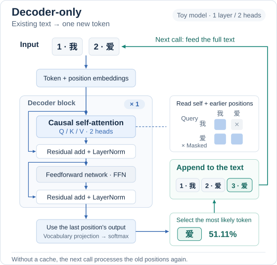
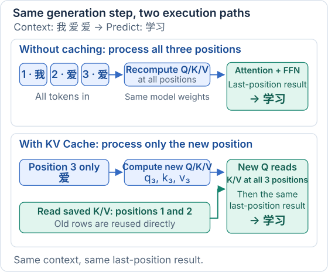
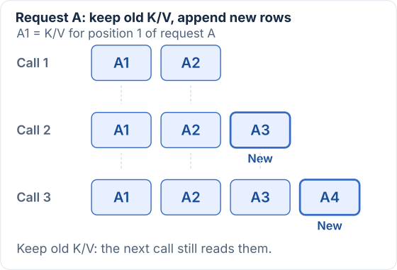
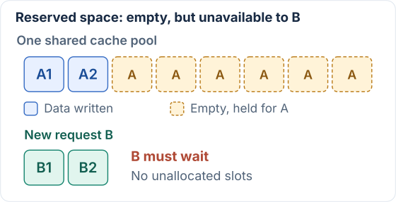
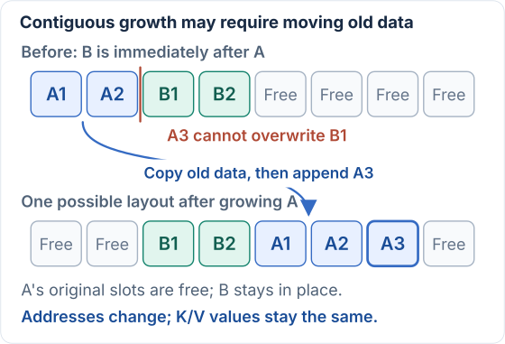
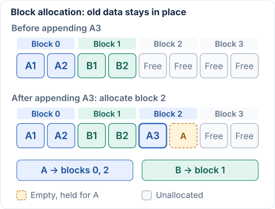
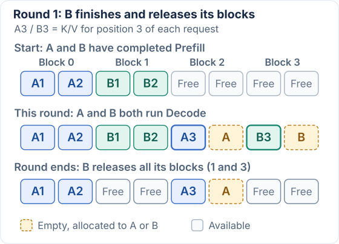
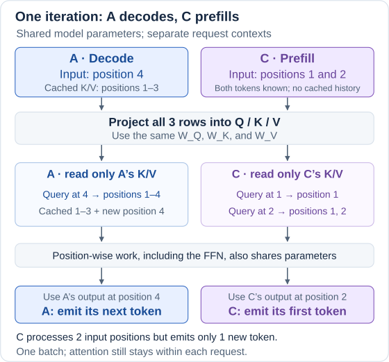
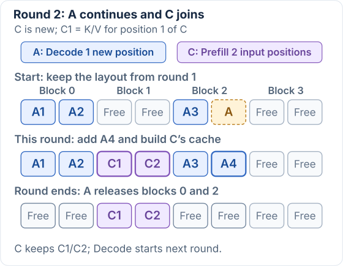
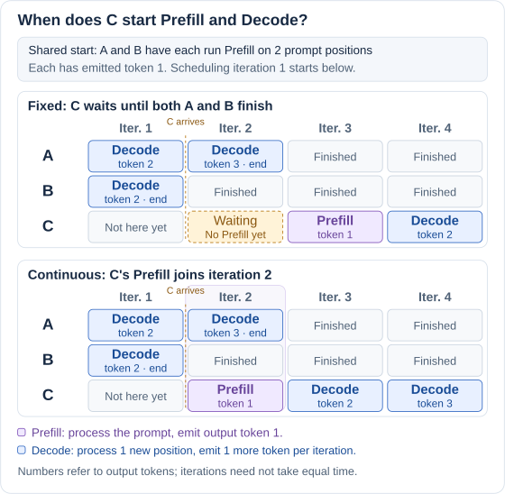

# Understanding vLLM from a Mathematical Perspective

The [previous article](/en/notes/ai-infra/llm/transformer-math/) broke down the Transformer's calculations. This article follows the same generation example: first see how the model runs, then address repeated computation, GPU memory occupied by caches, and waiting requests, before connecting these ideas to vLLM.

## 1. Start with the Big Picture: How a Decoder-Only Model Generates Tokens

Follow the **blue arrows** through the current call: `我 爱` becomes vectors with position information and passes through the decoder block. **The last position's output predicts the next token**, which is `爱` in this example. Then follow the **green arrows** around the generation loop: append it to form `我 爱 爱`, and feed the full text into the next call.

The diagram uses the previous article's teaching model with **one layer and two attention heads**. Its parameters were hand-picked for illustration, so the generated text may sound unnatural. Start by processing the entire text again on every call; next, we will identify the repeated work.

## 2. The First Problem: What Gets Recalculated Without a Cache?

### 2.1 Each Call Adds One Token but Processes the Entire Input Again

Start with the most direct implementation: retain the existing text and model parameters, feed the full text into the model on every call, and do not save intermediate Q/K/V.

| Call | Text fed into the model | Positions processed again on this call | Next token selected |
| --- | --- | --- | --- |
| First | `我 爱` | Positions 1 and 2 | `爱`, with probability about 51.11% |
| Second | `我 爱 爱` | Positions 1, 2, and 3 | `学习`, with probability about 54.16% |

Only position 3 is new on the second call. The tokens and positions at 1 and 2 have not changed, yet the program processes them again. **To reduce this work, identify which results at old positions stay unchanged and can be saved for reuse on the next call.**

### 2.2 Q/K/V: Appending One Input Row Leaves Old Projections Unchanged

The following X_old and X_new describe the full input processed by the uncached implementation. Each position corresponds to a row vector: x₁ is `我` at position 1, x₂ is `爱` at position 2, and x₃ is the newly added `爱` at position 3. The first call has two input rows; the second has three:

$$
\begin{aligned}
X_{\mathrm{old}}&=\begin{bmatrix}x_1\\x_2\end{bmatrix}\\
X_{\mathrm{new}}&=\begin{bmatrix}x_1\\x_2\\x_3\end{bmatrix}
=\begin{bmatrix}X_{\mathrm{old}}\\x_3\end{bmatrix}
\end{aligned}
$$

**old/new refer to consecutive calls, not consecutive layers.** Stacking vertically means appending the new row below the old matrix. Positions 2 and 3 both contain `爱`, but their positional encodings differ, so x₂ and x₃ differ.

Continue with the same attention head in the first layer. It calculates $Q=XW_Q$, $K=XW_K$, and $V=XW_V$ using fixed parameters. W contains model parameters; Q/K/V are results calculated from the input.

**Q**

$$
\begin{aligned}
Q_{\mathrm{new}}&=\begin{bmatrix}X_{\mathrm{old}}\\x_3\end{bmatrix}W_Q\\
&=\begin{bmatrix}X_{\mathrm{old}}W_Q\\x_3W_Q\end{bmatrix}\\
&=\begin{bmatrix}Q_{\mathrm{old}}\\q_3\end{bmatrix}
\end{aligned}
$$

The upper block multiplies the two old input rows by W_Q to give Q_old. The lower block multiplies the new input x₃ by W_Q to give q₃. **The new input takes no part in calculating the first two rows of Q.**

**K**

$$
\begin{aligned}
K_{\mathrm{new}}&=\begin{bmatrix}X_{\mathrm{old}}\\x_3\end{bmatrix}W_K\\
&=\begin{bmatrix}X_{\mathrm{old}}W_K\\x_3W_K\end{bmatrix}\\
&=\begin{bmatrix}K_{\mathrm{old}}\\k_3\end{bmatrix}
\end{aligned}
$$

The first two rows still multiply the same X_old by the same W_K, so their result is still K_old. Only the third row is the new k₃ for this call.

**V**

$$
\begin{aligned}
V_{\mathrm{new}}&=\begin{bmatrix}X_{\mathrm{old}}\\x_3\end{bmatrix}W_V\\
&=\begin{bmatrix}X_{\mathrm{old}}W_V\\x_3W_V\end{bmatrix}\\
&=\begin{bmatrix}V_{\mathrm{old}}\\v_3\end{bmatrix}
\end{aligned}
$$

All three equations say the same thing: **when the old input and parameters stay unchanged, old Q/K/V stay unchanged. Appending one input row appends just one projection-result row.**

This describes how the result is composed. The uncached program still recalculates the old block. Writing the matrix in blocks does not automatically make the program save or reuse data.

**The matrix rule used here**

This is the **block matrix multiplication rule, specifically the case of partitioning by rows**. Split a matrix into an upper block B and a lower block C, then multiply both on the right by the same W:

$$
\begin{bmatrix}B\\C\end{bmatrix}W
=\begin{bmatrix}BW\\CW\end{bmatrix}
$$

The condition is that **B and C have the same number of columns, equal to the number of rows in W**. B and C may have different numbers of rows. In our example:

| Matrix | Shape | Meaning |
| --- | --- | --- |
| B, or X_old | `2 × 4` | Two old positions, each with four features |
| C, or x₃ | `1 × 4` | One new position, also with four features |
| W_Q, W_K, or W_V | `4 × 2` | Map the four-dimensional input to this head's two-dimensional representation |
| Result after stacking and multiplying | `3 × 2` | Two old result rows plus one new result row |

This follows directly from the definition of matrix multiplication: **row i of the result takes the dot product of row i of the left matrix with each column of W**. Calculating row 1 uses only x₁; row 2 uses only x₂; only row 3 uses x₃. We can therefore calculate the upper two rows and the lower row separately, then stack the results in their original order. The textbook also calls this the “row interpretation” of a matrix product. [Reference 3](#ref-matrix)

The vertical blocks represent **concatenation**, not B + C. This example's `2 × 4` and `1 × 4` blocks cannot even be added directly as matrices. The appropriate name is block matrix multiplication, rather than the ordinary distributive law over addition.

This rule holds for a general W; it does not require many entries to be 0 or 1. This example's hand-selected parameters affect the specific numbers, but not the three block equations.

This block multiplication rule alone proves that **when a layer's old inputs remain unchanged, its old Q/K/V remain unchanged**. Next, calculate the attention weights A from Q/K, then obtain the output O.

### 2.3 From Attention Weights to Outputs: The Causal Mask Preserves Old Rows

**First, calculate weights A from Q/K**

**A is a weight matrix calculated from the current Q/K.** Its row i gives the proportions that position i uses to combine V from each position. It is not a model parameter supplied in advance.

The complete calculation chain from Q/K to O is:

$$
\begin{aligned}
S&=\frac{QK^\top}{\sqrt2}+M\\
A&=\operatorname{softmax}_{\mathrm{row}}(S)\\
O&=AV
\end{aligned}
$$

Read the three lines in order:

- **Q/K produce matching scores**: take the dot product of row i of Q with row j of K to score “position i reading position j.” Each head's Q/K has two components in this example, so divide by √2 to control the score scale.
- **M sets the visible range**: add 0 at permitted positions and negative infinity at future positions. S contains the scores after applying the causal mask.
- **Softmax turns scores into weights**: the row subscript means that each row is handled separately. Exponentiate its scores, then divide by that row's exponential sum to obtain weights summing to 1. Only after combining V with those weights do we obtain O.

For example, position 3 in the same example has scores of approximately `[1.0558, 1.3378, 0.7508]`. Softmax gives the weight row a₃, approximately `[0.3265, 0.4328, 0.2407]`. These are the proportions used to combine three input positions, distinct from probabilities of generating candidate tokens.

When old inputs and parameters are unchanged, scores between old positions are unchanged. For old positions, the causal mask blocks the new position, so the additional exponential term is 0. The old rows' softmax denominators and weights therefore stay unchanged. A for the two calls is:

$$
\begin{aligned}
A_{\mathrm{old}}&\approx\begin{bmatrix}
1&0\\
0.4629&0.5371
\end{bmatrix}\\
A_{\mathrm{new}}&\approx\begin{bmatrix}
1&0&0\\
0.4629&0.5371&0\\
0.3265&0.4328&0.2407
\end{bmatrix}
\end{aligned}
$$

**The first two rows of A_new are A_old with a column of zeros appended on the right; only the third row is the new position's a₃.** This connects directly to the block equation for O below.

**Then combine V with those weights to obtain O**

Q/K/V multiply each position's input by fixed parameters. In $O=AV$, we use the proportions in A to combine V from different positions.

**Row i of A determines row i of O; entry j in that row multiplies row j of V.** Call the rows of V v₁, v₂, and v₃. Each is a vector containing two numbers. In this example, v₁ is `[1, 2]`, and v₂ is approximately `[0.8415, 3.0806]`.

**Focus only on position 2 first.** Row 2 of A on the first call is `[0.4629, 0.5371]`: take 46.29% of v₁ and add 53.71% of v₂. Expanding the matrix multiplication gives:

$$
\begin{aligned}
o_{2,\mathrm{old}}
&\approx[0.4629,0.5371]\begin{bmatrix}v_1\\v_2\end{bmatrix}\\
&=0.4629v_1+0.5371v_2\\
&\approx[0.9148,2.5804]
\end{aligned}
$$

The result is still a vector containing two numbers: row 2 of O. The decimals below are displayed to four places; results are calculated from unrounded values.

**What happens to position 2 when position 3 is added on the second call?** We saw above that its weight row changes from `[0.4629, 0.5371]` to `[0.4629, 0.5371, 0]`. Therefore:

$$
\begin{aligned}
o_{2,\mathrm{new}}
&\approx[0.4629,0.5371,0]\begin{bmatrix}v_1\\v_2\\v_3\end{bmatrix}\\
&=0.4629v_1+0.5371v_2+0v_3\\
&\approx[0.9148,2.5804]
\end{aligned}
$$

**The two old Values and their weights are unchanged. Adding a zero term therefore leaves position 2's output unchanged.** The causal mask prevents position 2 from reading position 3; that restriction makes the added term's weight 0.

The same applies to position 1: its weights change from `[1, 0]` to `[1, 0, 0]`, and its output remains v₁.

**Position 3 needs a new output.** It uses its own weight row, `[0.3265, 0.4328, 0.2407]`, to combine all three Values:

$$
\begin{aligned}
o_3&\approx0.3265v_1+0.4328v_2+0.2407v_3\\
&\approx[0.9096,2.2674]
\end{aligned}
$$

The new v₃ is approximately `[0.9093, 1.1677]`. Calculating o₃ still requires v₁ and v₂, and its weights must be calculated by matching q₃ against all of K again.

Now put the three output rows back into one matrix:

$$
\begin{aligned}
O_{\mathrm{new}}
&=\begin{bmatrix}o_{1,\mathrm{old}}\\o_{2,\mathrm{old}}\\o_3\end{bmatrix}\\
&=\begin{bmatrix}O_{\mathrm{old}}\\o_3\end{bmatrix}
\end{aligned}
$$

**This block equation simply collects the observation that the first two output rows stay unchanged and the third row is new.** It needs two conditions: old V stays unchanged, and the causal mask preserves the weights at old positions.

Here, O is one attention head's output, and the equation describes the composition of the full-sequence result. Expand the comparison below when you want to check the numbers. The next section will actually save these unchanged old K/V.

Expand the matrix results from both calls to check which rows were recalculated

Using the previous article's model and parameters, we list only head 1's key results below to see which rows repeat and which are new. Numbers are displayed to four decimal places; calculations use unrounded values.

**First Call: Process Two Positions and Generate `爱`**

For input `我 爱`, calculate Q/K/V separately for the two positions:

$$
\begin{aligned}
Q_{\mathrm{old}}&\approx\begin{bmatrix}1&1\\0.8415&1.5403\end{bmatrix}\\
K_{\mathrm{old}}&\approx\begin{bmatrix}1&1\\1.5403&0.8415\end{bmatrix}\\
V_{\mathrm{old}}&\approx\begin{bmatrix}1&2\\0.8415&3.0806\end{bmatrix}
\end{aligned}
$$

Both positions continue through attention in both heads and the subsequent Transformer operations. Finally, use position 2's result to predict the next token. **This example selects `爱`, with a probability of approximately 51.11%, making the text `我 爱 爱`.**

After the first call, the uncached program keeps the text and model parameters, but does not pass the Q/K/V or other intermediate results to the next call for reuse.

**Second Call: Process All Three Positions Again and Generate `学习`**

The input becomes `我 爱 爱`. The first two tokens and their positions have not changed; only position 3 is new. The uncached program still recalculates all three Q/K/V rows:

$$
\begin{aligned}
Q_{\mathrm{new}}&\approx\begin{bmatrix}
1&1\\
0.8415&1.5403\\
0.9093&0.5839
\end{bmatrix}\\
K_{\mathrm{new}}&\approx\begin{bmatrix}
1&1\\
1.5403&0.8415\\
0.5839&0.9093
\end{bmatrix}\\
V_{\mathrm{new}}&\approx\begin{bmatrix}
1&2\\
0.8415&3.0806\\
0.9093&1.1677
\end{bmatrix}
\end{aligned}
$$

Compare these with the three block equations above: **each matrix's first two rows are identical to those from the first call; only the third row contains the new position's q₃, k₃, or v₃.** The two occurrences of `爱` have different positional encodings, so positions 2 and 3 produce different results.

All three rows here were recalculated on this call. **The result simply appends a new row below the old block, yet the uncached program has also calculated that old block again.**

All three positions continue through attention and the subsequent operations. Finally, use position 3's result to predict the next token. **This example selects `学习`, with a probability of approximately 54.16%, making the text `我 爱 爱 学习`.**

**Attention Results Also Show That Old Positions Were Calculated Again**

Attention scores each position's Q against the K at visible positions, applies softmax to obtain weights, then combines V using those weights. The causal mask restricts each position to reading itself and earlier positions.

Head 1's attention outputs from the two calls are:

$$
\begin{aligned}
O_{\mathrm{old}}&\approx\begin{bmatrix}
1&2\\
0.9148&2.5804
\end{bmatrix}\\
O_{\mathrm{new}}&\approx\begin{bmatrix}
1&2\\
0.9148&2.5804\\
0.9096&2.2674
\end{bmatrix}
\end{aligned}
$$

Position 3 reads K/V from all three positions, obtains weights of `[0.3265, 0.4328, 0.2407]`, and produces the combined result in row 3, `[0.9096, 2.2674]`. These weights combine information from existing positions; they are distinct from the probabilities used to select the next token.

**The second call's first two output rows are also identical to the first call's, but the program has recalculated them.** The first call processes two positions; the second processes all three from scratch. The repeated work includes not only Q/K/V projections, but also attention and subsequent operations at old positions.

## 3. KV Cache: Process Only the New Position and Reuse Historical K/V

To avoid repeated computation, retain the old K/V that has already been calculated. First compare the two ways to execute the same second call:

**Both methods use context containing all three positions.** With caching, saved K/V supplies the historical information. Feeding only one new token does not mean that attention can see only that token.

### 3.1 Keep Old K/V, Then Add the New Row

After processing `我 爱` on the first call, retain the K/V already calculated for both positions:

| Processed position | K retained | V retained |
| --- | --- | --- |
| 1: `我` | k₁ = `[1, 1]` | v₁ = `[1, 2]` |
| 2: `爱` | k₂ = `[1.5403, 0.8415]` | v₂ = `[0.8415, 3.0806]` |

The `爱` at position 3 has just been selected but has not yet been processed, so the cache has only the first two rows. **After a token is selected, it must be fed into the model on the next call before its own K/V can be calculated.**

The second call feeds in only this new position 3. Using its original positional encoding gives x₃ = `[0.9093, 0.5839, 1.0200, 0.9998]`. Calculate:

$$
\begin{aligned}
q_3&=x_3W_Q\approx[0.9093,\ 0.5839]\\
k_3&=x_3W_K\approx[0.5839,\ 0.9093]\\
v_3&=x_3W_V\approx[0.9093,\ 1.1677]
\end{aligned}
$$

Append the new K/V to the old cache:

$$
\begin{aligned}
K_{\mathrm{new}}&=\begin{bmatrix}K_{\mathrm{old}}\\k_3\end{bmatrix}
=\begin{bmatrix}k_1\\k_2\\k_3\end{bmatrix}\\
V_{\mathrm{new}}&=\begin{bmatrix}V_{\mathrm{old}}\\v_3\end{bmatrix}
=\begin{bmatrix}v_1\\v_2\\v_3\end{bmatrix}
\end{aligned}
$$

**Read the old upper block directly from the cache; calculate only the new lower row.** We now have one new Q row, three K rows, and three V rows. The matrix concatenation describes the data in position order; Section 4 will examine its physical storage addresses.

### 3.2 Query All K/V with the New Q to Obtain the Same Next Token

Match q₃ against each of the three Keys to obtain scores `[1.0558, 1.3378, 0.7508]`. The first two Keys come from the cache; the third comes from this call. Softmax produces three weights:

$$
\begin{aligned}
a_3&=\operatorname{softmax}\left(\frac{q_3K_{\mathrm{new}}^\top}{\sqrt2}\right)\\
&\approx[0.3265,\ 0.4328,\ 0.2407]
\end{aligned}
$$

Use these weights to combine the three corresponding Values:

$$
\begin{aligned}
o_3&=a_3V_{\mathrm{new}}\\
&\approx0.3265v_1+0.4328v_2+0.2407v_3\\
&\approx[0.9096,\ 2.2674]
\end{aligned}
$$

This is exactly the third row obtained by full recomputation in Section 2. The second head also calculates only the new position. After the output projection, residual operations, LayerNorm, and FFN, the model still selects `学习` with probability about **54.16%**.

**Why save K/V but not Q?** This call needs the new position's output, so it uses the new q₃. Historical K/V contains the information that the new position must read. Old q₁ and q₂ are queries for old positions, whose outputs no longer need to be calculated on this call. K/V is therefore what later calls need to reuse. [Reference 2](#ref-cache)

### 3.3 Why Calculating Only One Row Is Equivalent

Full recomputation produces three rows of O; the cached method produces only one row on this call. **We compare the cached output with the last row of full recomputation. We are not claiming that the two differently sized O matrices are equal as whole matrices.** That final position is exactly the one used to predict the next token.

The full derivation below follows the uncached calculation, the cached calculation, and then substitution for comparison:

Expand the formula-only proof: cached output = the last row of the full calculation

**① Without caching: calculate the full output, then take row 3**

$$
\begin{aligned}
Q_{\mathrm{full}}&=\begin{bmatrix}x_1\\x_2\\x_3\end{bmatrix}W_Q
=\begin{bmatrix}x_1W_Q\\x_2W_Q\\x_3W_Q\end{bmatrix}\\
K_{\mathrm{full}}&=\begin{bmatrix}x_1\\x_2\\x_3\end{bmatrix}W_K
=\begin{bmatrix}x_1W_K\\x_2W_K\\x_3W_K\end{bmatrix}\\
V_{\mathrm{full}}&=\begin{bmatrix}x_1\\x_2\\x_3\end{bmatrix}W_V
=\begin{bmatrix}x_1W_V\\x_2W_V\\x_3W_V\end{bmatrix}
\end{aligned}
$$

$$
\begin{aligned}
O_{\mathrm{full}}
&=\operatorname{softmax}_{\mathrm{row}}\left(
\frac{Q_{\mathrm{full}}K_{\mathrm{full}}^\top}{\sqrt2}
+\begin{bmatrix}
0&-\infty&-\infty\\
0&0&-\infty\\
0&0&0
\end{bmatrix}
\right)V_{\mathrm{full}}\\[6pt]
&=\operatorname{softmax}_{\mathrm{row}}\left(
\begin{bmatrix}
\frac{(x_1W_Q)K_{\mathrm{full}}^\top}{\sqrt2}+[0,-\infty,-\infty]\\[6pt]
\frac{(x_2W_Q)K_{\mathrm{full}}^\top}{\sqrt2}+[0,0,-\infty]\\[6pt]
\frac{(x_3W_Q)K_{\mathrm{full}}^\top}{\sqrt2}+[0,0,0]
\end{bmatrix}
\right)V_{\mathrm{full}}\\[6pt]
&=\begin{bmatrix}
\operatorname{softmax}\left(\frac{(x_1W_Q)K_{\mathrm{full}}^\top}{\sqrt2}+[0,-\infty,-\infty]\right)\\[6pt]
\operatorname{softmax}\left(\frac{(x_2W_Q)K_{\mathrm{full}}^\top}{\sqrt2}+[0,0,-\infty]\right)\\[6pt]
\operatorname{softmax}\left(\frac{(x_3W_Q)K_{\mathrm{full}}^\top}{\sqrt2}+[0,0,0]\right)
\end{bmatrix}V_{\mathrm{full}}\\[6pt]
&=\begin{bmatrix}
\operatorname{softmax}\left(\frac{(x_1W_Q)K_{\mathrm{full}}^\top}{\sqrt2}+[0,-\infty,-\infty]\right)V_{\mathrm{full}}\\[6pt]
\operatorname{softmax}\left(\frac{(x_2W_Q)K_{\mathrm{full}}^\top}{\sqrt2}+[0,0,-\infty]\right)V_{\mathrm{full}}\\[6pt]
\operatorname{softmax}\left(\frac{(x_3W_Q)K_{\mathrm{full}}^\top}{\sqrt2}+[0,0,0]\right)V_{\mathrm{full}}
\end{bmatrix}
\end{aligned}
$$

$$
\begin{aligned}
\left(O_{\mathrm{full}}\right)_{\text{row 3}}
&=\operatorname{softmax}\left(
\frac{(x_3W_Q)K_{\mathrm{full}}^\top}{\sqrt2}+[0,0,0]
\right)V_{\mathrm{full}}\\
&=\operatorname{softmax}\left(
\frac{(x_3W_Q)K_{\mathrm{full}}^\top}{\sqrt2}
\right)V_{\mathrm{full}}\\
&=\operatorname{softmax}\left(
\frac{(x_3W_Q)
\begin{bmatrix}x_1W_K\\x_2W_K\\x_3W_K\end{bmatrix}^{\!\top}}{\sqrt2}
\right)
\begin{bmatrix}x_1W_V\\x_2W_V\\x_3W_V\end{bmatrix}
\end{aligned}
$$

**② With caching: append the new row to the old K/V**

$$
\begin{aligned}
K_{\mathrm{old}}&=\begin{bmatrix}x_1W_K\\x_2W_K\end{bmatrix}\\
V_{\mathrm{old}}&=\begin{bmatrix}x_1W_V\\x_2W_V\end{bmatrix}
\end{aligned}
$$

$$
O_{\mathrm{cache}}
=\operatorname{softmax}\left(
\frac{(x_3W_Q)
\begin{bmatrix}K_{\mathrm{old}}\\x_3W_K\end{bmatrix}^{\!\top}}{\sqrt2}
\right)
\begin{bmatrix}V_{\mathrm{old}}\\x_3W_V\end{bmatrix}
$$

**③ Substitute the old K/V to obtain the same expression**

$$
\begin{aligned}
O_{\mathrm{cache}}
&=\operatorname{softmax}\left(
\frac{(x_3W_Q)
\begin{bmatrix}K_{\mathrm{old}}\\x_3W_K\end{bmatrix}^{\!\top}}{\sqrt2}
\right)
\begin{bmatrix}V_{\mathrm{old}}\\x_3W_V\end{bmatrix}\\
&=\operatorname{softmax}\left(
\frac{(x_3W_Q)
\begin{bmatrix}x_1W_K\\x_2W_K\\x_3W_K\end{bmatrix}^{\!\top}}{\sqrt2}
\right)
\begin{bmatrix}x_1W_V\\x_2W_V\\x_3W_V\end{bmatrix}\\
&=\left(O_{\mathrm{full}}\right)_{\text{row 3}}
\end{aligned}
$$

$$
\boxed{O_{\mathrm{cache}}=\left(O_{\mathrm{full}}\right)_{\text{row 3}}}
$$

Once each head gives the same final row, applying the same position-wise operations produces the same next-token probabilities. This example has one layer. A multilayer model saves each layer's own K/V, and the new position reads the corresponding cache as it passes through those layers. [Reference 2](#ref-cache)

### 3.4 What Work Is Saved, and What Remains?

The first call processes the complete input and builds the cache; this is **Prefill**. Later calls use the cache to process new tokens; this is **Decode**. Decoder-only names the model architecture, while Decode names this execution phase.

When processing `学习` at position 4, the method stays the same: calculate only this row, read K/V from positions 1–4, and select `学习` again. Compare the positions processed across the three calls:

| Call | Full recomputation: positions running projections and FFN again | With caching: positions running those calculations |
| --- | --- | --- |
| First | 1, 2 | 1, 2 |
| Second | 1, 2, 3 | Only 3 |
| Third | 1, 2, 3, 4 | Only 4 |
| Total | 9 positions | 4 positions |

Attention also changes from calculating the full causal triangle to calculating only its newest row. Valid scores on the second call fall from `1 + 2 + 3 = 6` to 3; on the third call, they fall from `1 + 2 + 3 + 4 = 10` to 4.

**The new Q still reads all visible historical K/V.** That row grows with the context. The table's 9 and 4 cannot directly give a speedup factor either: reading model weights and caches, among other work, remains necessary.

Repeated computation has now decreased, at the cost of keeping K/V in GPU memory. The next problem is how multiple requests should share that space as their caches grow.

## 4. The Second Problem: How Do We Allocate and Read Memory as Caches Grow?

We have seen that old K/V can be reused directly. Now consider one question: **where should GPU memory hold this data, which must remain available and keeps growing?**

### 4.1 Follow A: Keep Old Data and Append New Data

Our example request A retains A1 and A2 after processing the input `我 爱`. The next call processes the new `爱` at position 3 and adds A3. The following call processes `学习` at position 4 and adds A4:

In this example, each new position still reads K/V from all earlier positions, so the old boxes must stay, and processing each new position requires keeping another box. **As generation continues, the cache keeps growing.** When multiple requests generate at once, each must retain its data within the available GPU memory.

Now return to the moment when A has only A1 and A2, and compare several ways to place them.

### 4.2 Reserve Space in Advance: Empty Boxes May Be Unavailable to Others

One simple way to let A keep appending data is to reserve an entire contiguous region for it, based on a preset maximum length.

Another request, B, now arrives and needs to store its own B1 and B2:

The dashed boxes marked “A” contain no data, but they have already been allocated to A. This cache pool has no boxes available to allocate to B, so B must wait.

**The problem is occupying space too early for data that may arrive later.** Reserving space in advance is an allocation choice; KV Cache itself does not require it.

### 4.3 Allocate Only What Is Needed: B Fits, but A Has Trouble Growing

Try a different arrangement: give A only the boxes it currently needs, then place B immediately after A. B can now enter, and free space remains farther along.

But when A needs to append A3, B1 already sits immediately after A2. If the program requires all of A's data to remain contiguous, one way to grow it is to move A1 and A2 into a larger free region farther along, then append A3.

The arrows represent copying existing K/V. Once the move is complete, the original two boxes can be allocated again. **Adding just one position to A may require moving its old data too.** Further growth may run into the same issue. The tension between contiguous storage and dynamic growth is also a memory-management problem discussed in [Reference 4](#ref-pagedattention).

### 4.4 Allow Separate Blocks: Keep Old Data in Place and Put New Data Elsewhere

Start again from the layout **before the move** in the previous diagram. This time, allow A's data to live in separate regions: divide the cache pool into fixed-size blocks and allocate another block when needed. Each block holds two positions in this illustration.

A1 and A2 stay in block 0, and B1 and B2 stay in block 1. When A3 arrives, allocate block 2 to A and write A3 there:

The remaining empty slot in block 2 belongs to A and can hold A4 on the next call. Block 3 is still unallocated and can go to another request. This keeps old data at its existing addresses without reserving A's entire maximum capacity at the start.

Blocks may still contain some unfilled slots, and the cache itself still grows. What improves is how space is allocated.

**A's K/V now lives in blocks 0 and 2, while B's data lives in block 1. Next, follow the block table to read A's data and check whether the result changes.**

### 4.5 Read the Same K/V Through a Block Table: PagedAttention

A's first two rows are in block 0, and its third row is in block 2, with B's data in between.

Keep a small address table for A:

| A's logical positions | Where to read them |
| --- | --- |
| Positions 1, 2 | First and second slots in block 0 |
| Positions 3, 4 | First and second slots in block 2 |

This **block table** can be written as `[0, 2]`. The numbers 0 and 2 identify memory blocks, not tokens.

Now replay the second call's weighted sum, this time writing down the addresses too:

| Position | Where to fetch V | Head 1's V read from that address | Weight to multiply by |
| --- | --- | --- | --- |
| 1 | First slot in block 0 | `[1, 2]` | 0.3265 |
| 2 | Second slot in block 0 | `[0.8415, 3.0806]` | 0.4328 |
| 3 | First slot in block 2 | `[0.9093, 1.1677]` | 0.2407 |

The numbers match Section 3 exactly, so the result is still `[0.9096, 2.2674]`. B's data in block 1 is absent from A's block table, so A never reads it.

Mathematically, we have only grouped the same weighted sum by storage location. Let $v_1,v_2,v_3$ denote the three Values in the table:

$$
o_3\approx
\underbrace{(0.3265v_1+0.4328v_2)}_{\text{block 0}}
+\underbrace{0.2407v_3}_{\text{block 2}}
$$

Addition allows grouping, and each position still corresponds to the same K/V. Changing the addresses from which we read therefore does not change the mathematical result. After exponentiating each of the three matching scores, all three weights still use the same softmax denominator, `2.8743 + 3.8105 + 2.1187 = 8.8035`; block 0 cannot normalize using only the sum of its own two terms. Actual kernels arrange block reads and numerically stable reductions, but must still produce an attention result covering all visible positions.

This is what **PagedAttention** supports: storing K/V in blocks and accessing them through each request's block table during attention. It requires both block management and an attention implementation that can read those blocks. [Reference 4](#ref-pagedattention)

Paging therefore saves unnecessary space in cache allocation. Attention still reads the same historical information.

## 5. The Third Problem: How Can New Requests Join When Others Finish at Different Times?

We have covered where K/V is stored and how to read it. Serving multiple users introduces another problem: **requests in the same batch may finish at different times, while new requests can arrive at any time.**

Consider a simple approach: put A and B in one batch, then wait until both finish before admitting the next batch. A has a longer response to generate, while B has a shorter one. When B finishes first, the newly arrived C must still wait for A, even if B has returned its space and the next iteration has enough computation budget. Only A continues computing on that next iteration, while C remains queued.

**The problem to solve is whether a new request can join the next iteration after one request finishes, without waiting for the whole batch to end.** Follow the same cache blocks to see how this works.

### 5.1 Scheduling Iteration 1: A and B Advance Together, and B Finishes First

Return to the moment just after A and B have completed Prefill: each has processed two input positions and emitted its first token. A's K/V is in block 0, and B's is in block 1. A still needs to generate two more tokens; B will finish after generating one more. **This section starts counting “scheduling iterations” here, excluding the Prefill that has already completed.**

Scheduling iteration 1 processes A's and B's respective new positions in the same model execution. They share the model parameters, but each request's attention still reads only its own K/V. A's new A3 entry goes into block 2, and B's new B3 entry goes into block 3:

After this iteration's outputs, A must continue, while B has finished. In this example, a request's saved K/V is released when it finishes. Therefore, **B returns all its blocks: both the old block 1 and block 3, newly allocated on this iteration.**

### 5.2 Scheduling Iteration 2: A Continues, and C Joins Using the Released Space

C now arrives with two input tokens. Assigning the newly released block 1 to C gives it space for its K/V. A is already in Decode while C needs Prefill. **These stages can share a batch: they still execute the same model, with different numbers of positions to process and different amounts of cached history.**

Look at the work required in this iteration:

- **A: Decode.** K/V for positions 1–3 is cached. This iteration processes only the token at position 4.
- **C: Prefill.** There is no cache yet, so it processes prompt positions 1 and 2. Both tokens have already been supplied by the user and can be processed in the same iteration.

**Why the work can be batched**

At a given layer, denote the three input vectors by $x_{A,4}$, $x_{C,1}$, and $x_{C,2}$. Using the block multiplication rule from Section 2, stack these rows for the projection:

$$
\begin{bmatrix}
x_{A,4}\\
x_{C,1}\\
x_{C,2}
\end{bmatrix}W
=
\begin{bmatrix}
x_{A,4}W\\
x_{C,1}W\\
x_{C,2}W
\end{bmatrix}
$$

W can be W_Q, W_K, or W_V from that layer. **The three rows share parameters, while their projection results remain independent.** Position-wise operations such as the FFN can also be batched this way.

Attention must preserve request boundaries and causality: A's query reads only A's K/V, and C's queries read only C's K/V. C's position 1 cannot read position 2. The diagram therefore places three rows of work in one batch while keeping their contexts separate:

“Together” means **batched model execution in the same scheduling iteration**; it does not require every operation to fit into one GPU kernel. This iteration processes `1 new position for A + 2 for C = 3 tokens`. The scheduler checks both the token budget and cache space. Reading A's historical K/V does not require feeding those old tokens through the model again.

With **Chunked Prefill** enabled, vLLM V1 schedules Decode first, then uses the remaining token budget for Prefill. Long prompts can be split across iterations. C has only two input tokens here, so enough budget lets it finish Prefill in one iteration. If Prefill spans several iterations, the first new token is emitted only after the entire prompt has been processed. [Reference 6](#ref-scheduling)

**How this iteration updates the cache**

Return to the blocks that store K/V. A writes A4 into the empty slot in block 2, while C writes C1 and C2 into block 1:

At the end of this iteration, A emits its third token, reaches the chosen generation limit, and returns blocks 0 and 2. C finishes Prefill and emits its **first new token**. Processing two input tokens does not mean generating two new tokens.

C keeps the K/V for C1 and C2. On the next iteration, it feeds the newly generated token into the model as position 3 and begins Decode. **C reuses the space B returned, but always writes its own K/V there.**

### 5.3 Choosing Requests Again Each Iteration Lets C Start Earlier

Now place both Prefill and Decode on the timeline. The two arrangements share a starting point: **A and B have each completed Prefill on two input tokens and emitted their first new token.** They therefore run Decode starting at scheduling iteration 1. C arrives just after that iteration ends.

Every active cell identifies the stage and the output token's ordinal number. **Prefill processes the prompt and emits the first new token when complete. Each subsequent Decode iteration processes the token generated in the previous step and emits the next one.** Output numbers exclude the prompt tokens.

Follow C's row to see the difference:

- **Fixed batch:** C waits in iteration 2 for A's last Decode step. In iteration 3, C runs Prefill and emits its first new token. In iteration 4, it runs Decode and emits its second.
- **Continuous batch:** C's Prefill shares iteration 2 with A's Decode, so C emits its first new token then. In iteration 3, C starts Decode and emits its second token, then continues generating in later iterations.

**C still goes through Prefill → Decode; its Prefill is simply scheduled earlier.** This is the role of continuous batching in this example: after each iteration, remove finished requests and admit new ones according to cache space and the token budget, instead of waiting for the entire batch to finish. Each request's own Decode step still waits for the preceding step to generate its input token. [Reference 4](#ref-pagedattention)

Columns show scheduling order; iterations do not necessarily take equal time. They show that C's Prefill and first Decode step can be scheduled earlier, not a fixed speedup factor.

## 6. Bringing Caching, Memory Management, and Scheduling Together: vLLM

Suppose you wrote this service yourself. You would already need to handle these tasks:

| What happens this iteration | What your program needs to do |
| --- | --- |
| A's new position needs a row of K/V | Find a free slot and allocate another block if necessary |
| A needs to calculate attention | Use A's block table to find the correct K/V and run the calculation on the GPU |
| B reaches its output limit | Finish the request and return reclaimable space to the cache pool |
| C arrives | Check the available cache space and computation budget, then schedule it for an iteration |
| The model produces probabilities | Select a token, return it to the user, and record whether generation should continue |

**vLLM is an engine that runs model inference and organizes cache management, request scheduling, and output.** It combines these mechanisms with model execution. Its V1 scheduler allocates how many tokens each request processes in an iteration. [Reference 5](#ref-vllm)

Each term now refers to an action we have already followed:

- **KV Cache**: keep the first call's two K/V rows and read them on the second call.
- **PagedAttention**: A's K/V live in blocks 0 and 2, yet attention still reads the correct positions and performs the same calculation.
- **Continuous batching**: after B finishes, add C's work to the next iteration.
- **vLLM**: organize these actions into an inference engine that keeps serving incoming requests.

KV Cache reduces repeated computation. Paging reduces unnecessary space allocation. Scheduling puts newly available resources to work on the next request. They address different parts of the process, and none eliminates a new token's need to read historical K/V.

## 7. References

The resources below cover the architecture figure, caching, matrix multiplication, and the papers and implementations behind paging and scheduling.

1. [Radford et al.: Improving Language Understanding by Generative Pre-Training](https://cdn.openai.com/research-covers/language-unsupervised/language_understanding_paper.pdf): the original paper for understanding the decoder-only architecture. Section 3.1 describes the language model's inputs and outputs, and Figure 1 on page 4 shows its structure. For more visual explanations, see [Jay Alammar: The Illustrated GPT-2](https://jalammar.github.io/illustrated-gpt2/).

2. [Hugging Face: How caching works](https://huggingface.co/docs/transformers/main/cache_explanation): explains how historical K/V is saved, appended, and read, including cache tensor shapes. Read alongside Section 3.

3. [Boyd and Vandenberghe: Introduction to Applied Linear Algebra](https://web.stanford.edu/~boyd/vmls/): the authors' freely available textbook. Section 10.1 (book pages 179–180) introduces matrix multiplication and its row interpretation, corresponding to the block multiplication in Section 2.

4. [Efficient Memory Management for Large Language Model Serving with PagedAttention](https://arxiv.org/html/2309.06180v1): focus on Section 2.3's batching challenges, Section 3's memory-management problems, and Section 4's paged attention and block tables. These correspond to Sections 4 and 5 of this article.

5. [vLLM V1 guide](https://docs.vllm.ai/en/latest/usage/v1_guide/): how a practical inference engine organizes model execution, request state, and scheduling, corresponding to Section 6.

6. [vLLM: Optimization and Tuning — Chunked Prefill](https://docs.vllm.ai/en/latest/configuration/optimization/#chunked-prefill): further details on batching Prefill with Decode and how the token budget for each iteration affects scheduling.
