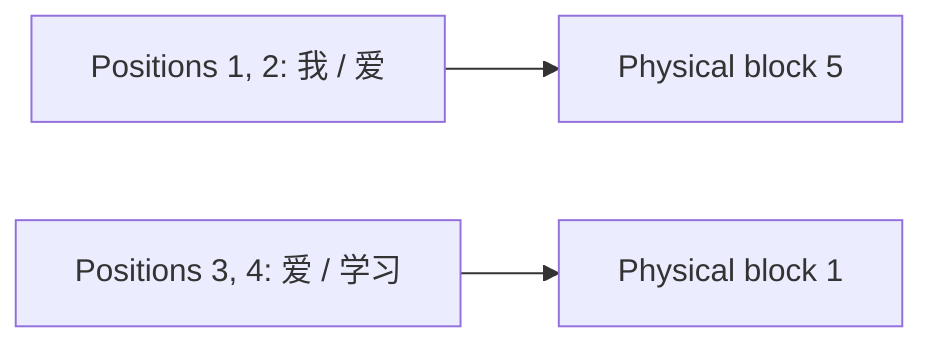

# Understanding KV Cache and vLLM Through One Generation Example

In the [previous article](/en/notes/ai-infra/llm/transformer-math/), we fed `我 爱` into the model, calculated the probabilities of the next token, and selected `爱`, the most probable candidate.

The input is now `我 爱 爱`, and we want to predict the next token. Compared with the previous call, only the last `爱` is new.

**We have already processed the first two tokens. Can we use their previous results directly?**

That is where this article begins. We will follow the same small model as it generates the next token, then see how its saved results occupy GPU memory and how they can be stored in blocks, leading up to vLLM.

## 1. What Have We Already Computed?

### 1.1 Start with the Two Rows of K/V

We use the model from the previous article: one Transformer layer and two attention heads. To see how the cache changes, we will first work through **head 1** alone. Each Q, K, and V vector in this head contains only two numbers.

After processing `我 爱`, head 1 has already computed:

| Position | Token | Key: matched against subsequent Queries | Value: combined by attention |
| --- | --- | --- | --- |
| 1 | `我` | `[1, 1]` | `[1, 2]` |
| 2 | `爱` | `[1.5403, 0.8415]` | `[0.8415, 3.0806]` |

These numbers come from the input vectors and projection matrices in the previous article. We reuse those results here and will perform the calculation when adding a new row later. Decimal values are generally shown to four places; subsequent calculations use unrounded values.

Stack the Key vectors to form the K matrix, and stack the Value vectors to form the V matrix:

$$
K\approx\begin{bmatrix}1&1\\1.5403&0.8415\end{bmatrix},\qquad
V\approx\begin{bmatrix}1&2\\0.8415&3.0806\end{bmatrix}
$$

**Each row corresponds to a position, and its two numbers are features for this head.** K and V each have two rows because we have processed two tokens.

### 1.2 What Gets Repeated on the Next Call?

The straightforward approach in the previous article feeds the entire sequence into the model again:

```text
Previous call: 我  爱       → generate 爱
Current call:  我  爱  爱   → predict the next token
               └───┘
          These positions were already processed
```

Processing the full sequence again recalculates Q/K/V, the attention outputs, and the subsequent FFN for the first two positions. The new position clearly needs computation. Whether the old positions also need it depends on whether appending a token changes their results.

## 2. Does Adding a Token Change the Two Existing Rows?

Recall the causal mask from the previous article: **a position can see itself and preceding positions, but not later positions.**

After appending `爱` at position 3, each position can see the following:

| Position | Visible before appending | Visible after appending | Has it changed? |
| --- | --- | --- | --- |
| 1: `我` | `我` | `我` | No |
| 2: `爱` | `我 爱` | `我 爱` | No |
| 3: new `爱` | Does not exist yet | `我 爱 爱` | Needs new computation |

For the first two positions, the tokens, their positions, and the context they can read are all unchanged. Model parameters are fixed during inference, so these positions produce the same results as before.

This holds beyond the first layer. If the outputs at the old positions in layer 1 stay the same, layer 2 receives the same old inputs. The same reasoning continues through every layer. This assumes causal attention and unchanged existing prefixes, positional encoding rules, and inference settings.

We can therefore keep the K/V already computed in each layer and read them directly on the next call. **These saved K/V are called the KV Cache.** [Hugging Face cache explanation](https://huggingface.co/docs/transformers/main/cache_explanation)

For our first head, the cache consists of the two two-by-two tables above. Let us now use them to generate the next token.

## 3. Process Only the New `爱`, Step by Step

### 3.1 Compute Q, K, and V for the New Position

The new token is still `爱`, but it is now the third token, at position index 2. Using the embedding and positional encoding from the previous article gives this input vector:

$$
z_3\approx[0.9093,\ 0.5839,\ 1.0200,\ 0.9998]
$$

This vector comes from the embedding of `爱`, `[0, 1, 1, 0]`, plus the vector for position index 2. The same token at different positions can have different input vectors, so we cannot simply use the K/V of `爱` at position 2 as the K/V of `爱` at position 3.

The projection matrices assigned to head 1 in the previous article perform simple operations:

| What to compute | Operation on the input vector | Result for the new position |
| --- | --- | --- |
| Query | Take the first two numbers | `[0.9093, 0.5839]` |
| Key | Swap the first two numbers | `[0.5839, 0.9093]` |
| Value | Take the first two numbers and multiply the second by 2 | `[0.9093, 1.1677]` |

For example, the second number in Value is approximately $0.583853\times2\approx1.1677$. We are still computing $Q=XW_Q$, $K=XW_K$, and $V=XW_V$, as before. The difference is that X now contains only the new position's row.

### 3.2 Append the New K/V to the Cache

Keep the existing two rows and add only the third:

| Position | Token | Key | Value | Where it comes from |
| --- | --- | --- | --- | --- |
| 1 | `我` | `[1, 1]` | `[1, 2]` | Saved from the previous call |
| 2 | `爱` | `[1.5403, 0.8415]` | `[0.8415, 3.0806]` | Saved from the previous call |
| 3 | New `爱` | `[0.5839, 0.9093]` | `[0.9093, 1.1677]` | Computed in this call |

The cache now contains three positions. Next, the new Query `[0.9093, 0.5839]` must determine how much information to take from each of these three Values.

### 3.3 Compare the New Query with Each of the Three Keys

First, take the dot product of the new Query with each Key, then divide by $\sqrt2$. We divide by $\sqrt2$ because this head's Q/K vectors have two components, following the same scaling rule as in the previous article.

For example, the calculation with the first Key, `[1, 1]`, is:

$$
\frac{0.9093\times1+0.5839\times1}{\sqrt2}\approx1.0558
$$

Perform the calculation for all three Keys:

| Source position | Scaled dot product | Resulting score |
| --- | --- | --- |
| 1: `我` | $(0.9093\times1+0.5839\times1)/\sqrt2$ | About 1.0558 |
| 2: old `爱` | $(0.9093\times1.5403+0.5839\times0.8415)/\sqrt2$ | About 1.3378 |
| 3: new `爱` | $(0.9093\times0.5839+0.5839\times0.9093)/\sqrt2$ | About 0.7508 |

The table uses results calculated from unrounded inputs. Substituting the displayed decimals directly may give slightly different last digits.

This step computes only **the relationships between the new Query and the three Keys**. The Queries at the old positions do not need to perform their lookups again.

### 3.4 Turn the Three Scores into Three Weights

We cannot use the scores directly as weights. As in the previous article, apply softmax: exponentiate each score, then divide by the sum.

| Source position | Score | Exponentiated score | Weight after dividing by the sum |
| --- | --- | --- | --- |
| 1: `我` | 1.0558 | About 2.8743 | About 0.3265 |
| 2: old `爱` | 1.3378 | About 3.8105 | About 0.4328 |
| 3: new `爱` | 0.7508 | About 2.1187 | About 0.2407 |

The sum of the exponentials is approximately $2.8743+3.8105+2.1187=8.8035$. For example, the first weight is:

$$
\frac{2.8743}{8.8035}\approx0.3265
$$

The three weights add up to approximately 1. They mean that the new position takes about 32.65% from `我`, 43.28% from the old `爱`, and 24.07% from itself.

### 3.5 Combine the Three Values Using These Weights

Use the same operation as before: **multiply each entire Value vector by its weight, then add the three vectors.**

$$
\begin{aligned}
o_3
&\approx0.3265[1,2]\\
&\quad+0.4328[0.8415,3.0806]\\
&\quad+0.2407[0.9093,1.1677]\\
&\approx[0.9096,2.2674]
\end{aligned}
$$

We can also calculate the two components separately:

| Output component | Calculation | Result |
| --- | --- | --- |
| First number | $0.3265\times1+0.4328\times0.8415+0.2407\times0.9093$ | About 0.9096 |
| Second number | $0.3265\times2+0.4328\times3.0806+0.2407\times1.1677$ | About 2.2674 |

Head 1 has now finished its attention computation for this call. It read the old K/V from the cache and computed only one new row of Q/K/V.

### 3.6 Continue Through the Full Model and Select `学习`

We have worked through only head 1. Head 2 follows the same procedure with its own K/V cache, producing approximately `[0.8159, 1.9998]`.

Concatenate the results of the two heads into a four-dimensional vector:

$$
[0.9096,2.2674,0.8159,1.9998]
$$

Then apply the output projection, residual connections, LayerNorm, FFN, and vocabulary projection explained in the previous article. The rules and parameters are unchanged; only the new position's row needs processing. The resulting five logits are approximately:

$$
[-1.0276,-0.0894,0.1524,-1.9027,1.1170]
$$

Apply vocabulary softmax once more:

| Candidate token | Probability |
| --- | --- |
| `我` | About 6.34% |
| `爱` | About 16.21% |
| `你` | About 20.64% |
| `<eos>` | About 2.64% |
| `学习` | About 54.16% |

The selected token is `学习`. This is the same result obtained in the previous article by feeding the entire sequence `我 爱 爱` into the model again.

**We preserved the prediction while avoiding repeated computation for the first two positions.**

## 4. Repeat the Same Procedure on the Next Call

### 4.1 Add One More Row to Continue Generation

On the next call, feed the newly generated `学习` into the model. It is the fourth position, and head 1 computes the following new K/V:

| New position | Key | Value |
| --- | --- | --- |
| 4: `学习` | `[-0.9900, 0.1411]` | `[0.1411, -1.9800]` |

Append them to the cache, growing it from three rows to four. The new Query reads these four rows of K/V, both heads complete attention, and the remaining modules run. This call selects `学习` again, matching the previous article.

The complete generation process is now:

| Call | Content actually fed into the model | Existing cache | Output token | Cached positions afterward |
| --- | --- | --- | --- | --- |
| First | `我 爱` | Empty | `爱` | Positions 1, 2 |
| Second | `爱` at the third position | Positions 1, 2 | `学习` | Positions 1, 2, 3 |
| Third | `学习` at the fourth position | Positions 1, 2, 3 | `学习` | Positions 1, 2, 3, 4 |

The final text is `我 爱 爱 学习 学习`. The fifth token has just been selected and has not yet been fed into the model, so the cache currently contains only four positions. If generation continues, its K/V will be computed on the next call.

### 4.2 This Introduces Prefill and Decode

The first call processes the user's entire input and builds the cache. This is called **Prefill**.

Subsequent calls use the existing cache and process one new token at a time. This is called **Decode**.

These names now correspond to concrete actions: first fill in the two rows of K/V for `我 爱`, then add one row on each subsequent call.

Recomputing the entire sequence on every call would process 2, 3, and 4 positions. With the cache, we process 2, 1, and 1 new positions instead:

| Comparison | Recompute the entire sequence each time | Use KV Cache |
| --- | --- | --- |
| Positions requiring projections and FFN on each call | 2, 3, 4 | 2, 1, 1 |
| Total across three calls | 9 positions | 4 positions |
| Must the new Query still read historical K/V? | Yes | Still yes |

This count shows the reduction in repeated work; it cannot be converted directly into a generation speedup factor. It also reminds us that **caching avoids recomputing old content, but the new token must still read that content.**

### 4.3 Why Not Keep the Old Queries Too?

Look back at the second call: we used the new Query `[0.9093, 0.5839]` to look up three Keys, then combined three Values. The Queries at the old positions were never used.

Old Queries have already completed their lookups for their own positions. Each new position has its own Query, so ordinary incremental decoding mainly needs to retain K and V.

Likewise, we cannot simply reuse the three attention weights from the second call on the third call. The third call has a different Query, so its weights must be calculated again.

## 5. How Much GPU Memory Do These Saved K/V Require?

### 5.1 First Count the Numbers Stored by This Small Model

For clarity, we have shown only head 1. The full model has two heads; each stores both a Key and a Value, with two numbers per vector.

One token therefore requires storing:

$$
2\times2\times2=8
$$

Assuming FP32 storage at 4 bytes per number, the cache for one token occupies $8\times4=32$ bytes. This model has only one layer. With multiple layers, each layer must store its own K/V.

| Point in time | Cached positions | Number of values | K/V size |
| --- | --- | --- | --- |
| After the first call | 2 | 16 | 64 bytes |
| After the second call | 3 | 24 | 96 bytes |
| After the third call | 4 | 32 | 128 bytes |

Every newly processed token adds 32 bytes to the cache. Our example is tiny, but real models must retain far more than eight numbers per token.

### 5.2 Scale Up the Same Calculation

Suppose another model has 32 layers, with 32 independent K/V heads per layer. Each head's Key and Value contain 128 numbers each, and each number occupies 2 bytes. Multiply the counts just as before:

$$
32\times32\times2\times128\times2
=524\,288\text{ bytes}=512\text{ KiB}
$$

That is the cache for **just one token**. A request with 8192 cached tokens needs $8192\times512\text{ KiB}=4\text{ GiB}$.

Sixteen such requests require 64 GiB for K/V alone, before model weights and temporary data. Here, $1\text{ GiB}=2^{30}$ bytes. This is a capacity example for a particular model configuration; other models must be counted according to their actual K/V structure.

A new problem emerges: **after removing repeated computation, the cache itself can consume substantial GPU memory and limit the number of concurrent requests.**

### 5.3 Even If the Cache Fits, It Still Has to Be Read

When generating `学习` on the second call, we did not recompute the K/V of the first two positions, but we still read them to calculate the three dot products and the weighted sum of the three Values.

The third call reads four positions. With eight thousand positions in the context, the new Query must use the K/V of all eight thousand. For the full attention discussed here, a longer cache means more historical data to access on each call.

This explains why using KV Cache does not guarantee fast inference: besides computing the new token, the system spends time reading model weights and historical K/V from GPU memory.

## 6. How Should Memory Be Allocated as the Cache Grows?

### 6.1 Start with an Intuitive but Wasteful Approach

Return to our small model, with 32 bytes of cache per token.

We do not know how long a request will eventually become. One straightforward approach is to reserve space for eight positions at the beginning, avoiding the need to find new space for every generated token.

But after processing the fourth position in our main example, we need only 128 bytes. The reserved space is $8\times32=256$ bytes, so half remains unused.

With multiple requests, these reserved empty slots accumulate. We would like to add capacity as new tokens arrive while avoiding unnecessary movement of existing K/V.

### 6.2 Allocate One Block for Every Two Tokens

Suppose each block holds K/V for two tokens. In this small model, one block occupies $2\times32=64$ bytes.

First, allocate a block for `我 爱`, numbered 5:

```text
After the first call:
Block 5: [Position 1: 我][Position 2: 爱]
```

When the new `爱` arrives on the second call, block 5 is full. Allocate another free block, numbered 1:

```text
After the second call:
Block 5: [Position 1: 我][Position 2: 爱]
Block 1: [Position 3: 爱][    Empty     ]
```

On the third call, place `学习` directly into the remaining slot in block 1:

```text
After the third call:
Block 5: [Position 1: 我][Position 2: 爱]
Block 1: [Position 3: 爱][Position 4: 学习]
```

The tokens in these diagrams label positions. The blocks actually store the K/V values for those positions.

| Point in time | Actual K/V data | Allocated capacity | Remaining empty slots |
| --- | --- | --- | --- |
| After the first call | 64 bytes | 1 block, 64 bytes | 0 |
| After the second call | 96 bytes | 2 blocks, 128 bytes | 1 position, 32 bytes |
| After the third call | 128 bytes | 2 blocks, 128 bytes | 0 |

Capacity is added in whole blocks, so a little space may still be unused. However, there is no need to reserve the full maximum length in advance, and existing blocks can stay where they are.

### 6.3 How Does the Model Find Data Stored Apart?

From the sequence's perspective, the four positions are still ordered. In storage, the first two positions live in block 5 and the last two in block 1.

The request only needs a small **block table**:

| Part of the sequence | Storage location |
| --- | --- |
| Positions 1 and 2 | Physical block 5 |
| Positions 3 and 4 | Physical block 1 |

This table can also be written as `[5, 1]`.



For example, to read the Value at the fourth position, first find that it is in block 1, then read the block's second position. Physical blocks need not be adjacent, while the sequence order remains clear.

This introduces **PagedAttention**: store K/V in blocks and locate them through a block table, allowing attention to read these separately stored blocks. [PagedAttention paper, §4](https://arxiv.org/html/2309.06180v1#S4)

### 6.4 Attention Still Performs the Same Calculation After Blocking

Consider the second call, which generated `学习`. At that point, block 5 held the first two positions and block 1 held the third.

The new Query still produces the same three scores. Applying one softmax across them still gives weights of approximately 0.3265, 0.4328, and 0.2407. When reading the Values, the first two now come from block 5 and the third from block 1.

The final calculation still adds the same three weighted terms from Section 3.5, producing approximately `[0.9096, 2.2674]`.

**The storage locations change; the K/V, position order, and attention rules do not.** We cannot normalize each block independently and simply add the results; the weights must still cover all visible positions.

## 7. Serving Multiple Requests Also Requires Scheduling

### 7.1 Why Put Multiple Requests Together?

Within a request, the next token must wait until the current token has been selected. Different users' requests do not have this dependency on each other.

We can therefore put requests A, B, and C into one batch, advancing each by one token. They use the same model weights, so the GPU can reuse those weights more effectively within the batch and perform more work in parallel.

Each request still has its own K/V and block table. For example, A uses blocks `[5, 1]`, while B and C use other blocks. Batching lets them compute together without mixing their contexts.

Another connection becomes clear: **larger batches generally provide more opportunities to reuse weights, but more requests also require more K/V space.** More compact cache allocation can make room for more requests.

### 7.2 A Finished Request Can Make Room for the Next One

Suppose A, B, and C have all finished processing their initial inputs and need another 2, 1, and 3 decode calls, respectively. A corresponds to our main example: the first call has already generated `爱`, and two more calls will generate `学习` twice.

If we wait for the whole batch to finish before admitting the next one, the process is:

| Decode iteration | Slot 1 | Slot 2 | Slot 3 |
| --- | --- | --- | --- |
| 1 | A | B, then finishes | C |
| 2 | A, then finishes | Empty | C |
| 3 | Empty | Empty | C, then finishes |

B finishes quickly, but its slot cannot be reused until C finishes.

A more flexible approach checks after each iteration which requests should continue, which have finished, and whether new ones can enter. For example, after B finishes, the next iteration can schedule work for a new request D.

This is called **Continuous batching**. It adjusts the request set between iterations instead of keeping one group fixed until everyone finishes. Paged management lets request caches grow and be released as needed, so the two mechanisms work together. [PagedAttention paper, §2.3](https://arxiv.org/html/2309.06180v1#S2.SS3)

If D has no cache yet, it must process its input first rather than immediately start decoding. A long input can be split into several prefill chunks and processed over subsequent iterations, allowing requests already producing output to keep advancing. This is the basic purpose of **Chunked prefill**. [vLLM tuning documentation](https://docs.vllm.ai/en/latest/configuration/optimization/#chunked-prefill)

### 7.3 Now Consider What vLLM Does

We have now encountered several tasks that need to be coordinated:

| What happens during this iteration | What the engine needs to do |
| --- | --- |
| A inputs a new `爱`, adding one cache row | Find a writable slot and allocate a new block if necessary |
| A's Query needs historical K/V | Read the corresponding data using A's block table |
| B has finished generating | Finish the request and release its references to cache blocks |
| D is waiting | Schedule it to start or continue, according to available space and this iteration's compute budget |

**vLLM is an engine that executes model inference and coordinates this cache management and scheduling.** KV Cache provides the foundation for reusing historical results, paging makes the cache easier to manage, and the scheduler decides which requests process how many tokens in each iteration. [vLLM V1 guide](https://docs.vllm.ai/en/latest/usage/v1_guide/)

The paging and scheduling described here preserve the original attention computation. vLLM mainly improves how the same model computation can serve more requests within limited memory and compute resources.

## 8. A Shared Prefix Can Save a Little More

Follow the same example one final step.

Suppose the inputs of both A and B begin with `我 爱`, using the same model and positional settings. As Section 2 explained, the K/V at these two positions depend only on that same prefix, so their computed values are identical.

If the cache is still retained, B can reuse the existing prefix block. The block tables of A and B can both point to block 5:

| Request | Positions 1 and 2 | Subsequent content |
| --- | --- | --- |
| A | Shared block 5: K/V for `我 爱` | Uses its own subsequent blocks |
| B | The same shared block 5 | Uses its own subsequent blocks |

In our small model, this shared block occupies 64 bytes. Storing separate copies requires 128 bytes; sharing one copy requires only 64 bytes and can also avoid repeated prefill for the matching prefix.

Reusing the K/V of matching prefixes across requests is called **Prefix caching**. vLLM's Automatic Prefix Caching uses existing prefix caches when the matching conditions are satisfied. [vLLM prefix caching explanation](https://docs.vllm.ai/en/latest/features/automatic_prefix_caching/)

This requires an identical prefix and compatible model settings. The presence of `爱` in two different sentences does not by itself allow its K/V to be shared. Cached blocks may also have been evicted. Even on a cache hit, subsequent new Queries must still read those K/V for attention.

Following this example, we first kept two rows of K/V, then added just one row on each call. We stored those rows in blocks and tracked each request's block table. Finally, we scheduled multiple requests together and shared prefixes where appropriate. These actions form the main progression from KV Cache to vLLM.

## 9. Complete Example and References

To check all of the previous model's parameters, both heads, and the subsequent FFN, download the <a href="/examples/llm/kv_cache_walkthrough.py" download="kv_cache_walkthrough.py">complete calculation script</a>. It requires only the Python standard library:

```bash
python3 kv_cache_walkthrough.py
```

The script performs both full recomputation and incremental cached computation, checks that their intermediate results and final probabilities agree, and prints the values from all three calls. Add `--json` to obtain the complete unrounded data. The script calculates with Python floating-point numbers; FP32 is used for the capacity estimates in this article. These handpicked parameters explain the process and do not represent a real model's language ability or GPU performance.

Further reading:

1. [Hugging Face: How caching works](https://huggingface.co/docs/transformers/main/cache_explanation): how generation proceeds after saving K/V in each layer.
2. [PagedAttention paper](https://arxiv.org/abs/2309.06180): the original design for managing caches in blocks, sharing, and scheduling requests.
3. [vLLM V1 guide](https://docs.vllm.ai/en/latest/usage/v1_guide/) and [tuning documentation](https://docs.vllm.ai/en/latest/configuration/optimization/): how the engine organizes real requests. This article uses official documentation consulted on November 9, 2026.
