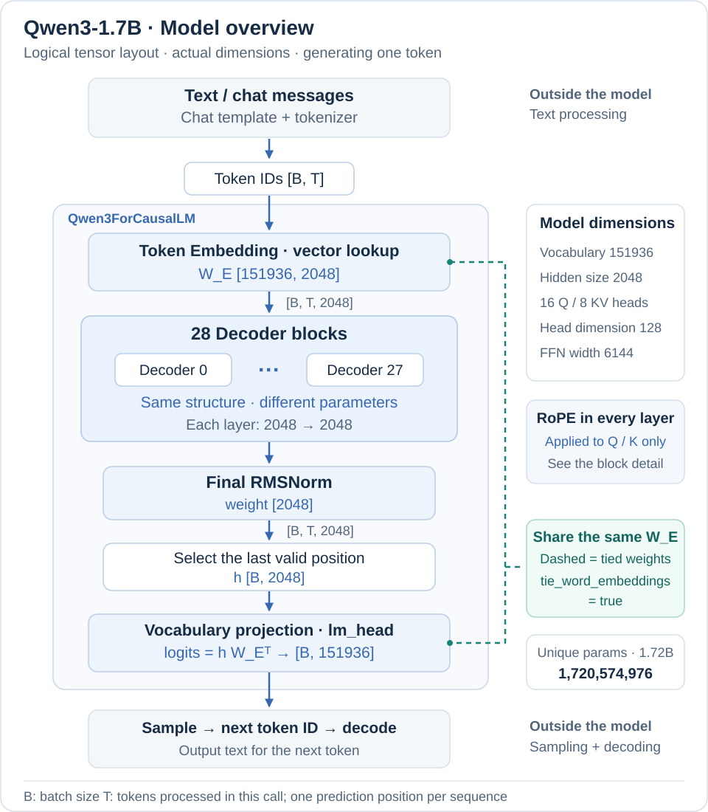
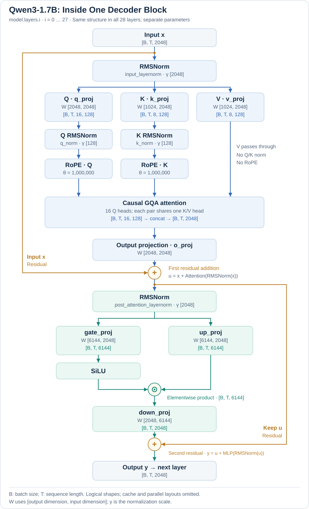
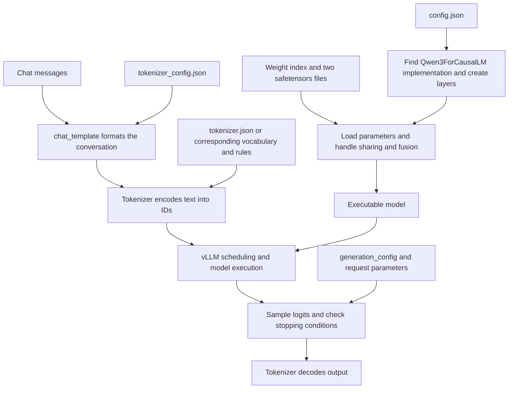

# Qwen3-1.7B Model Files: Roles, Relationships, and Loading

After downloading Qwen3-1.7B, you find both gigabytes of weights and JSON files of only a few hundred bytes. Start with one connecting idea: **configuration and weights together form the model, the tokenizer and template turn text into model input, and generation configuration determines how to select the next token from output scores.**

Files in the same group usually work together. For example, the index and weight headers locate parameters; the vocabulary and merge rules define BPE tokenization; and the same EOS ID in two configuration files refers to one token at different stages. This article groups files by those relationships, explains their responsibilities and why they are separated, opens the actual data, and then connects it to the model structure and vLLM loading.

The specific fields, counts, tensor shapes, and shard information below come from a read-only inspection of `/root/models/Qwen3-1.7B` on the `nanovllm` host. Except for the explicitly identified BPE teaching example, JSON examples are either complete displays of the actual data or explicitly marked excerpts. Copies of the same model from different sources or serialization versions may use different sharding layouts.

## 1. Meet the 11 Files by Their Responsibilities

```text
Qwen3-1.7B/
├── LICENSE
├── README.md
├── config.json
├── generation_config.json
├── merges.txt
├── model-00001-of-00002.safetensors
├── model-00002-of-00002.safetensors
├── model.safetensors.index.json
├── tokenizer.json
├── tokenizer_config.json
└── vocab.json
```

| File | Approximate size on this host | File format | Main question it answers |
| --- | --- | --- | --- |
| `config.json` | 726 B | JSON object | What is the model's structure, and how large are its layers? |
| `generation_config.json` | 239 B | JSON object | What sampling and stopping defaults does generation use? |
| `model-00001-of-00002.safetensors` | 3.20 GiB | Binary: JSON header + tensor data | What are the parameter values for the embedding and model layers? |
| `model-00002-of-00002.safetensors` | 593.5 MiB | Same as above | What are the output-layer parameters saved separately in this distribution? |
| `model.safetensors.index.json` | 25.0 KiB | JSON object | Which shard contains each parameter? |
| `vocab.json` | 2.6 MiB | JSON object | Which ID corresponds to an internal token string? |
| `merges.txt` | 1.6 MiB | Text rules arranged by line | In what order should smaller fragments be merged into tokens? |
| `tokenizer.json` | 10.9 MiB | JSON object | How does the full tokenization, encoding, and decoding pipeline work? |
| `tokenizer_config.json` | 9.5 KiB | JSON object containing a template string | How should the tokenizer be loaded and chat messages formatted? |
| `README.md` | 13.6 KiB | Markdown with YAML metadata at the beginning | What is this model, and how is it used? |
| `LICENSE` | 11.1 KiB | Plain text | Under which license is the model distributed? |

The files can be grouped by the work they perform together:

| File group | Related files | Shared responsibility |
| --- | --- | --- |
| Model structure and parameters | `config.json`, two weight shards, and the weight index | Determine the network structure, locate trained parameters, and load them |
| Text processing | `vocab.json`, `merges.txt`, `tokenizer.json`, and `tokenizer_config.json` | Format conversations and convert between text and token IDs |
| Generation control | `generation_config.json` | Supply default sampling and stopping settings |
| Release documentation | `README.md` and `LICENSE` | Explain the model and its license terms to users |

This separation reflects differences in responsibilities, storage formats, and loading compatibility. It is how this distribution is organized, rather than a requirement for every model to provide exactly 11 files. The following sections explain how each group works together.

GiB, MiB, and KiB in the table use powers of 1024. The directory also contains a `.gitattributes` file, hidden by the default `tree` command. It controls Git file handling and does not participate in the model's forward computation.

## 2. Model Files: How Configuration, Weights, and the Index Reconstruct the Network

This group connects the model's structure to its trained values: `config.json` supplies the dimensions and options needed to create the network, model code defines its computation, and weight files store matrix values. The shard index and weight headers locate those values.

**Configuration and weights are separate because their contents, sizes, and access patterns differ.** Metadata such as layer counts and dimensions fits naturally in a small, readable JSON file; billions of parameters suit binary tensors with type and shape information. The loader can read the configuration first to select an implementation and establish expected dimensions before opening large files. The two must still match: storing them separately does not mean you can arbitrarily change layer counts or dimensions and continue using the original weights.

### 2.1 config.json: Network Structure Parameters

This is an ordinary JSON object whose values include strings, integers, floating-point numbers, booleans, arrays, and `null`. The following excerpt contains the main fields from this copy:

```json
{
  "architectures": ["Qwen3ForCausalLM"],
  "model_type": "qwen3",
  "hidden_size": 2048,
  "intermediate_size": 6144,
  "num_hidden_layers": 28,
  "num_attention_heads": 16,
  "num_key_value_heads": 8,
  "head_dim": 128,
  "hidden_act": "silu",
  "attention_bias": false,
  "vocab_size": 151936,
  "max_position_embeddings": 40960,
  "rope_theta": 1000000,
  "rope_scaling": null,
  "tie_word_embeddings": true,
  "torch_dtype": "bfloat16",
  "bos_token_id": 151643,
  "eos_token_id": 151645,
  "use_cache": true
}
```

| Field | Meaning in this model |
| --- | --- |
| `architectures` | List of architecture names. The loading framework uses it to find the `Qwen3ForCausalLM` computation implementation |
| `model_type` | Configuration type; the configuration class for `qwen3` interprets the parameters |
| `hidden_size` | Each token's hidden representation in the main network has 2048 components |
| `intermediate_size` | The MLP intermediate projection has dimension 6144 |
| `num_hidden_layers` | Stack 28 decoder blocks |
| `num_attention_heads` | 16 Query heads |
| `num_key_value_heads` | 8 Key/Value heads, with each K/V group shared by two Q heads: GQA |
| `head_dim` | Each attention head has dimension 128 |
| `hidden_act` | The MLP uses the SiLU activation function |
| `attention_bias` | This model's attention linear projections do not use biases |
| `vocab_size` | Model-side vocabulary dimension; the embedding and output projection cover 151936 positions |
| `max_position_embeddings` | The declared position-length parameter; usable length also depends on the model documentation, engine configuration, and GPU memory |
| `rope_theta`, `rope_scaling` | RoPE parameters; no additional scaling scheme is configured here |
| `tie_word_embeddings` | Share weights between the input embedding and output projection |
| `torch_dtype` | The configuration declares BF16; the local weight headers also confirm that the data is actually stored as BF16 |
| `bos_token_id`, `eos_token_id` | Configured beginning- and end-token IDs; insertion and stopping behavior also involve the tokenizer and generation configuration |
| `use_cache` | Configuration flag for caching; the cache itself is produced at runtime and managed by the inference framework |

For this model, `16 × 128 = 2048`, exactly matching `hidden_size`. When reading other models, however, prefer an explicit `head_dim`; do not assume that dividing the hidden dimension by the head count works for every architecture.

**`config.json` describes the parameters needed to construct the network. It stores neither trained matrix values nor a complete `forward()` definition.** Model code in Transformers or vLLM still determines the order of normalization, attention, and residual connections. Compare the local file with the [official Qwen3-1.7B config.json](https://huggingface.co/Qwen/Qwen3-1.7B/blob/main/config.json).

### 2.2 Weight Shards: Storing Trained Values

Weights are further split into shards to make large files easier to store, transfer, and read in parts. Loading one shard at a time can avoid materializing all shards in host memory simultaneously. Sharding neither reduces the total parameter count nor determines the number of GPUs.

Reading the headers of both files gives the following result:

| Shard | Tensor count | Actual contents |
| --- | --- | --- |
| `model-00001-of-00002.safetensors` | 310 | `model.embed_tokens.weight`, parameters for 28 decoder layers, and the final `model.norm.weight` |
| `model-00002-of-00002.safetensors` | 1 | `lm_head.weight` |

“310 tensors” and “1.7 billion parameters” count different things. A tensor can contain millions of numbers, each of which is one parameter element. For example, `model.layers.0.self_attn.q_proj.weight` is one matrix containing `2048 × 2048` elements.

The parameter names also describe a hierarchy: `model.layers.0` is layer 0, `self_attn` is its attention module, `q_proj` is the projection that produces Query, and `weight` identifies its weights. It stores the parameters used to compute Q, rather than the Q produced for a particular input.

### 2.3 Safetensors Headers: Describing Tensors Within a File

The Safetensors layout can be written as:

```text
Start of file
  │
  ├─ 8 bytes: little-endian unsigned integer N, the JSON header length
  │
  ├─ N bytes: UTF-8 JSON header
  │           parameter name → dtype, shape, data_offsets
  │
  └─ Data region: raw bytes of tensor values
                  not stored as JSON arrays of numbers
```

The first shard's JSON header is **35648 bytes** long. These are the actual entries for two of its tensors, with the other entries omitted:

```json
{
  "model.embed_tokens.weight": {
    "dtype": "BF16",
    "shape": [151936, 2048],
    "data_offsets": [0, 622329856]
  },
  "model.layers.0.self_attn.q_proj.weight": {
    "dtype": "BF16",
    "shape": [2048, 2048],
    "data_offsets": [710418944, 718807552]
  }
}
```

| Field | How to read it |
| --- | --- |
| Parameter name | Identifies the parameter to which this block of values belongs |
| `dtype` | Encoding of each element; `BF16` is a 16-bit floating-point format using 2 bytes per element |
| `shape` | How to interpret the continuous values as a tensor; `[2048, 2048]` describes a two-dimensional matrix |
| `data_offsets` | The tensor's byte range **within the data region**, with an inclusive start and exclusive end; these are not offsets from the start of the whole file |

The Q projection above therefore occupies:

```text
718807552 - 710418944 = 8388608 bytes
2048 × 2048 × 2      = 8388608 bytes = 8 MiB

Starting position of this tensor within the whole file:
8 + 35648 + 710418944 = 710454600
```

Reading only the JSON header reveals which matrices exist, their sizes, and where to read them, without first loading the entire 3 GB file into GPU memory. If present, `__metadata__` holds string metadata such as `{"format":"pt"}` and is excluded from the tensor count. See the [Safetensors specification](https://github.com/safetensors/safetensors#format) for the format definition.

The actual values follow in the binary data region. The first 8 BF16 elements of the local Q projection decode to:

```text
[-0.008056640625, -0.006866455078125, -0.006805419921875,
 -0.00677490234375, 0.010498046875, -0.0194091796875,
 -0.01611328125, 0.00335693359375]
```

These are the learned parameter values. The file does not store the lines above as text; this display was produced by reading and decoding the raw bytes.

### 2.4 Weight Index: Locating Each Parameter's Shard

The index organizes multiple shards into a searchable set of weights. It is a JSON object. This excerpt retains the local `metadata` and some `weight_map` entries:

```json
{
  "metadata": {
    "total_size": 4063479808
  },
  "weight_map": {
    "lm_head.weight": "model-00002-of-00002.safetensors",
    "model.embed_tokens.weight": "model-00001-of-00002.safetensors",
    "model.layers.0.self_attn.q_proj.weight": "model-00001-of-00002.safetensors",
    "model.layers.0.self_attn.k_proj.weight": "model-00001-of-00002.safetensors",
    "model.layers.0.self_attn.v_proj.weight": "model-00001-of-00002.safetensors"
  }
}
```

Each `weight_map` key is a parameter name, and its value is a shard filename. It tells the loader which file to search; the Safetensors header's `data_offsets` then identify where to find the tensor within that file's data region.

In this copy, `metadata.total_size` equals the total bytes of tensor data, excluding headers. The two actual files total 4063515592 bytes. The extra 35784 bytes exactly match the two length fields and headers: `8 + 35648 + 8 + 120`.

This gives two levels of lookup: **parameter name → shard filename → byte range within the data region**. The index handles lookup across files, and each header handles lookup within a file, with each storing the metadata it needs. A single weight file usually does not require an additional index for lookup across files.

The index stores neither matrix values nor GPU assignments. **Two shards do not imply a requirement for two GPUs.** An engine can load both files onto one GPU with enough memory, or divide a matrix across multiple GPUs according to parallel execution rules. See [Hugging Face's sharded checkpoint documentation](https://huggingface.co/docs/transformers/main/en/big_models#sharded-checkpoints) for the general conventions.

### 2.5 Cross-Check the Configuration Against Actual Tensor Shapes

Cross-checking shapes is a useful first step in checking whether the configuration, weights, and model code agree. The following shapes come from the local file headers. Linear layer weights follow the convention `[output dimension, input dimension]`:

| Parameter | Actual shape | Relationship to the configuration |
| --- | --- | --- |
| `model.embed_tokens.weight` | `[151936, 2048]` | `vocab_size × hidden_size` |
| `model.layers.0.self_attn.q_proj.weight` | `[2048, 2048]` | Produces `16 × 128` Query dimensions |
| `model.layers.0.self_attn.k_proj.weight` | `[1024, 2048]` | Produces `8 × 128` Key dimensions |
| `model.layers.0.self_attn.v_proj.weight` | `[1024, 2048]` | Produces `8 × 128` Value dimensions |
| `model.layers.0.self_attn.o_proj.weight` | `[2048, 2048]` | Projects the attention result back to the hidden dimension |
| `model.layers.0.self_attn.q_norm.weight` | `[128]` | Per-head normalization parameters for Q |
| `model.layers.0.self_attn.k_norm.weight` | `[128]` | Per-head normalization parameters for K |
| `model.layers.0.mlp.gate_proj.weight` | `[6144, 2048]` | MLP gate projection |
| `model.layers.0.mlp.up_proj.weight` | `[6144, 2048]` | MLP up projection |
| `model.layers.0.mlp.down_proj.weight` | `[2048, 6144]` | Projects from the MLP intermediate dimension back to the hidden dimension |
| `lm_head.weight` | `[151936, 2048]` | Converts hidden representations into output scores for vocabulary positions |

Qwen3 normalizes Q/K over each head's 128-dimensional representation, so the shape here is `[128]`, not `[2048]`. The ordering of normalization and projections can be checked against [vLLM's Qwen3 implementation](https://github.com/vllm-project/vllm/blob/main/vllm/model_executor/models/qwen3.py).

### 2.6 Shared Weights and Disk Size: Why 1.7B Occupies Almost 4 GB

The second shard has a 120-byte header. Its complete JSON contents are shown below; the formatting whitespace differs from the bytes in the file:

```json
{
  "__metadata__": {"format": "pt"},
  "lm_head.weight": {
    "dtype": "BF16",
    "shape": [151936, 2048],
    "data_offsets": [0, 622329856]
  }
}
```

It separately stores the output layer's `151936 × 2048` elements, totaling **622329856 bytes**, or about 593.5 MiB.

Yet the configuration explicitly sets `tie_word_embeddings: true`. To establish what this copy contains, we computed streaming SHA-256 hashes of the data ranges for `model.embed_tokens.weight` and `lm_head.weight`. The hashes matched: **this distribution saves a second copy of the shared weights.**

The two shards contain 2031739904 BF16 elements in total. Subtracting the duplicated 311164928 elements leaves 1720574976, or about **1.72B**. Thus, the number of tensor elements stored on disk need not equal the number of independent model parameters, and disk size need not equal the engine's eventual GPU memory usage.

This section subtracts the shared duplicate from the total elements on disk to obtain about 1.72B independent parameters. Section 5 sums the network components to cross-check the same result.

This finding applies to the files on this host. Other serialization methods can retain only one copy and let loading code restore the shared binding. It does not mean that every Qwen3-1.7B distribution must separately provide `lm_head.weight`. See [Safetensors and shared PyTorch tensors](https://huggingface.co/docs/safetensors/en/torch_shared_tensors) for shared-tensor serialization.

## 3. Text Processing: Why Four Tokenizer Files Coexist

The model receives token IDs, while users provide text or chat messages. These four files jointly describe the path from messages to IDs and from output IDs back to text. They divide responsibilities while also retaining some duplicate contents for different loading methods.

### 3.1 First Understand BPE: Learning Tokens from Smaller Pieces

**BPE stands for Byte Pair Encoding.** In tokenization, it starts with small symbols and progressively combines frequently adjacent pairs into larger tokens. For example, `a` and `n` can merge into `an`, after which `b` and `an` can merge into `ban`. A pair consists of two current symbols; later in the process, each symbol may already contain multiple characters or bytes.

Why do this? A vocabulary containing every complete word would be large and still struggle to cover new words. Always encoding one character or byte at a time, however, can produce long sequences. BPE gives common fragments their own IDs while retaining smaller fragments to compose other text. Thus, **a token may be a complete word, part of a word, or another byte fragment; it is not equivalent to a word in natural language.** See the [Hugging Face BPE tutorial](https://huggingface.co/learn/llm-course/en/chapter6/5) for the basic training and encoding process.

**First, training: learn the vocabulary and merge rules from a corpus.** The following is a constructed teaching example that starts with characters and assumes each word is already a separate pre-tokenized fragment. Neither the rules nor the IDs are actual Qwen data.

| Training text | Occurrences | Initial symbol sequence |
| --- | ---: | --- |
| `banana` | 3 | `[b, a, n, a, n, a]` |
| `band` | 2 | `[b, a, n, d]` |
| `ban` | 1 | `[b, a, n]` |

The initial vocabulary contains only `a`, `b`, `d`, and `n`. Count adjacent symbol pairs within each fragment, weighted by the text's number of occurrences. `a + n` appears twice in each `banana`, giving a total count of `2 × 3 + 1 × 2 + 1 × 1 = 9`, the highest pair frequency in the first round.

| Round | Most frequent adjacent pair in this round | Weighted count | Representation of `banana` after merging |
| --- | --- | ---: | --- |
| 1 | `a + n → an` | 9 | `[b, an, an, a]` |
| 2 | `b + an → ban` | 6 | `[ban, an, a]` |

Each round replaces the corresponding adjacent pairs in the corpus with the new symbol, then recounts the current adjacent pairs. In the second round, all three text types begin with `b, an`, so that pair occurs `3 + 2 + 1 = 6` times. Old tokens remain in the vocabulary, and new tokens are added. Real training stops according to conditions such as a target vocabulary size; this demonstration stops after two rounds.

This training produces two complementary datasets. If we assign the following illustrative IDs, the vocabulary becomes:

```json
{"a": 0, "b": 1, "d": 2, "n": 3, "an": 4, "ban": 5}
```

The merge rules are stored in the order learned, with two symbols per line:

```text
a n
b an
```

This corresponds to **`vocab.json` storing IDs and `merges.txt` storing merge rules and their priorities**. The former tells us the ID of `ban`; the latter explains how to construct it from the initial symbols.

**Next, encoding: apply the already fixed rules to new input.** Encoding `band` with this teaching tokenizer gives:

```text
Input text:           band
Initial symbols:      [b, a, n, d]
Apply a + n:          [b, an, d]
Apply b + an:         [ban, d]
Look up IDs in vocab: [5, 2]
```

During encoding, higher-ranked rules take priority among the currently mergeable adjacent pairs, until no rule applies. The tokenizer neither recounts word frequencies in this input nor creates a new token for `band` on the fly. It also does not simply find the longest vocabulary string greedily. Training a tokenizer prepares tokenization data; it is a separate process from training Transformer weights.

**Back to Qwen: it uses ByteLevel BPE.** The character-based example above is easy to work through by hand. Qwen normalizes ordinary text, pre-tokenizes it with a regular expression, maps each fragment's UTF-8 bytes to internal symbols, and then applies BPE merges. For example, the Chinese character `你` has three UTF-8 bytes, `E4 BD A0`, so one Chinese character cannot be assumed to correspond to one token. Final boundaries depend on the learned rules: a token may end inside a character or contain multiple characters. ByteLevel uses 256 internal symbols to represent all possible byte values; see the [Tokenizers ByteLevel documentation](https://huggingface.co/docs/tokenizers/en/components#pre-tokenizers).

Checking the local files entry by entry confirmed that all 151387 merge results are distinct and present in the base vocabulary. Removing those results leaves exactly 256 initial symbols:

**256 initial byte symbols + 151387 merge results = 151643 base tokens.**

This explains the relationship between vocabulary size and merge-rule count in this example. The 26 added tokens discussed below are registered separately and are not part of this base BPE vocabulary.

### 3.2 Their Relationship: Separate BPE Data, an Integrated Backend, and Higher-Level Settings

First, place the four files side by side. The diagram below shows corresponding contents; it does not mean the engine must read all four files in sequence every time:

```text
tokenizer.json
├── model
│   ├── type: BPE
│   ├── vocab ───────── Same as vocab.json: 151643 base tokens
│   └── merges ──────── Ordered rules matching merges.txt without its version header
├── added_tokens ────── 26 added tokens, including two used as EOS by default
├── normalizer ──────── Text normalization
├── pre_tokenizer ───── Pre-tokenization and byte mapping
├── post_processor ──── Processing after encoding
└── decoder ─────────── Convert internal token representations back to text

tokenizer_config.json
├── Higher-level loading settings such as tokenizer_class, eos_token, and pad_token
├── added_tokens_decoder: mapping from added token IDs to their descriptions
└── chat_template: template for formatting chat messages
```

| Why files are separate or contain repeated data | Specific relationship |
| --- | --- |
| Vocabulary and rules have different roles | `vocab.json` maps tokens to IDs; `merges.txt` stores ordered BPE merge rules |
| Compatibility with different loading methods | `tokenizer.json` integrates vocabulary, rules, and processing components into a serialized file a backend can read; independent vocabulary and rule files serve corresponding alternative tokenizer implementations and loading paths |
| Tokenization backend and higher-level settings have different roles | `tokenizer.json` describes encoding and decoding; `tokenizer_config.json` helps higher-level libraries select a tokenizer class, assign token roles, and, in this model, supply the chat template |

At initialization, the loader restores one tokenizer from the applicable files. A fast tokenizer can restore its pipeline from the integrated JSON; other paths can use separate vocabulary and rule files with the corresponding implementation. The loader determines which files it reads. Incoming requests typically reuse the objects in memory for template formatting, encoding, and decoding as needed, without rereading these files each time.

**These boundaries overlap.** In this copy, `tokenizer.json.model.vocab` exactly matches `vocab.json`, and `model.merges` matches the ordered rules of `merges.txt` entry by entry. Added tokens also appear in both `added_tokens` and `added_tokens_decoder`. Repeated descriptions should agree; these files are not independently interchangeable components.

### 3.3 vocab.json: The Base Token ID Table

This JSON object has the structure **`internal token string → integer ID`**. The following entries are taken from the actual local file:

```json
{
  "!": 0,
  "\"": 1,
  "#": 2,
  "a": 64,
  "b": 65,
  "Ċ": 198,
  "Ġ": 220,
  "hello": 14990,
  "Ġhello": 23811
}
```

It acts as an ID table. For example, the internal token `hello` has ID 14990, which the model can use to select embedding row 14990. This ID is not a probability, word frequency, or string length.

The characters `Ġ` and `Ċ` are easy to mistake for corrupted text. Qwen uses ByteLevel BPE, mapping bytes to internal character representations: `Ġ` represents a space byte and `Ċ` a newline byte. Thus, `hello` and `Ġhello` are different tokens, with the latter representing a leading space. The UTF-8 bytes of Chinese text also undergo this mapping, so vocabulary keys need not show the original Chinese characters directly. See the [ByteLevel component documentation](https://huggingface.co/docs/tokenizers/en/components#pre-tokenizers).

The local base vocabulary has **151643 entries**, with consecutive IDs from **0 through 151642**. The `tokenizer.json` section below compares the added tokens with the model-side vocabulary dimension.

### 3.4 merges.txt: How These Tokens Are Merged

This is plain text, beginning with a format version and followed by one pair of mergeable internal symbols per line. The first few lines of the local file are:

```text
#version: 0.2
Ġ Ġ
ĠĠ ĠĠ
i n
Ġ t
ĠĠĠĠ ĠĠĠĠ
e r
ĠĠ Ġ
o n
```

For example, `i n` means that adjacent `i` and `n` symbols can merge into `in`; `Ġ t` means the symbol representing a space can merge with `t` into `Ġt`. The ordinary space in the middle of each line separates the two columns, while the visible `Ġ` represents a space byte inside a token.

**Rule order in the file determines priority: earlier rules have higher merge priority.** This is why the teaching example applies `a n` before `b an`; that priority is commonly called the merge rank. BPE works within fragments produced by pre-tokenization and cannot arbitrarily cross their boundaries.

The local file has 151388 lines: one version header and **151387 merge rules**. `vocab.json` answers “What ID does the merged token have?” while `merges.txt` answers “How should merging proceed?”

### 3.5 tokenizer.json: The Complete Tokenization Pipeline and Added Tokens

`vocab.json` and `merges.txt` mainly describe BPE data. `tokenizer.json` also combines the preprocessing, post-processing, and decoding components, and can be read by a fast tokenizer backend.

The following structural excerpt comes from the local file. Only a few actual members of `added_tokens`, `model.vocab`, and `model.merges` are retained. The remaining top-level components are explained in the table below; this excerpt cannot replace the complete file:

```json
{
  "version": "1.0",
  "truncation": null,
  "padding": null,
  "added_tokens": [
    {
      "id": 151644,
      "content": "<|im_start|>",
      "single_word": false,
      "lstrip": false,
      "rstrip": false,
      "normalized": false,
      "special": true
    }
  ],
  "normalizer": {"type": "NFC"},
  "decoder": {
    "type": "ByteLevel",
    "add_prefix_space": false,
    "trim_offsets": false,
    "use_regex": false
  },
  "model": {
    "type": "BPE",
    "unk_token": null,
    "byte_fallback": false,
    "vocab": {"!": 0, "hello": 14990},
    "merges": [["Ġ", "Ġ"], ["ĠĠ", "ĠĠ"], ["i", "n"]]
  }
}
```

| Top-level field | Local contents and purpose |
| --- | --- |
| `version` | Tokenizer serialization format version `1.0`, not the Qwen model generation |
| `truncation`, `padding` | Both are `null` in the file, meaning these settings are not fixed here; callers can still specify them |
| `added_tokens` | Array describing 26 additional tokens, including IDs, strings, and matching properties |
| `normalizer` | `NFC`, which normalizes Unicode text |
| `pre_tokenizer` | A `Sequence` that first divides text using the regex in `Split`, then applies `ByteLevel` byte mapping |
| `model` | `BPE`, containing the complete base vocabulary, ordered merge rules, and other tokenization options |
| `post_processor` | `ByteLevel`, which processes information associated with the encoding results; `trim_offsets` is `false` here |
| `decoder` | `ByteLevel`, which converts internal token representations back into bytes and text |

Within `added_tokens`, `lstrip` and `rstrip` determine whether matching also absorbs whitespace on either side. `single_word` affects word-boundary matching, `normalized` determines whether matching uses normalized text, and `special` marks whether the token is treated as special. **Not every added token is marked as special**: in this copy, `<think>` and `</think>` have IDs 151667 and 151668 respectively, and both have `special: false`.

In this serialized file, `model.merges` uses a two-dimensional array; the independent `merges.txt` expresses each corresponding rule as two symbols on a line.

Comparing this token mapping with the model matrices gives three counts:

| Level | Local count | Meaning |
| --- | ---: | --- |
| Base BPE vocabulary | 151643 | Entries in `vocab.json` / `model.vocab` |
| Complete tokenizer mapping | 151669 | Base vocabulary plus 26 added tokens, with a maximum ID of 151668 |
| Model-side vocabulary dimension | 151936 | `config.json.vocab_size`, also the row count of the embedding / lm_head |

The model matrices have 267 more rows than the mapped tokens. Token count, maximum ID, and matrix row count are therefore different concepts and need not be equal. Section 4 follows the two EOS IDs through their storage locations and generation configuration.

For ordinary text fragments, the pipeline can be understood as **NFC normalization → regex pre-tokenization → ByteLevel mapping → BPE merging → token IDs**. Added tokens are also recognized separately according to their matching properties. `byte_fallback: false` is a BPE option and does not mean ByteLevel is unused. See the [Tokenizers pipeline](https://huggingface.co/docs/tokenizers/en/pipeline) for each component's role.

### 3.6 tokenizer_config.json: Higher-Level Loading Options and Token Roles

This file focuses on how higher-level code such as Transformers uses the tokenization backend. It is also JSON, suitable for metadata such as loading options, special-token roles, and templates. The following excerpt retains two `added_tokens_decoder` entries; the chat template is shown separately below:

```json
{
  "tokenizer_class": "Qwen2Tokenizer",
  "add_bos_token": false,
  "add_prefix_space": false,
  "bos_token": null,
  "eos_token": "<|im_end|>",
  "pad_token": "<|endoftext|>",
  "model_max_length": 131072,
  "clean_up_tokenization_spaces": false,
  "added_tokens_decoder": {
    "151644": {
      "content": "<|im_start|>",
      "lstrip": false,
      "normalized": false,
      "rstrip": false,
      "single_word": false,
      "special": true
    },
    "151645": {
      "content": "<|im_end|>",
      "lstrip": false,
      "normalized": false,
      "rstrip": false,
      "single_word": false,
      "special": true
    }
  }
}
```

Several relationships deserve attention:

- The model architecture is `Qwen3ForCausalLM`, but the tokenizer class is `Qwen2Tokenizer`. This reuses a tokenization implementation; the name alone does not indicate the wrong model version. The loader may also select the corresponding fast implementation.
- `added_tokens_decoder` is an object keyed by string representations of IDs, because JSON object keys must be strings. In contrast, `tokenizer.json` stores `added_tokens` as an array with an `id` field in each entry.
- `<|im_start|>` begins a message, `<|im_end|>` ends a message, and `<|endoftext|>` is also used as PAD here. Their token IDs are 151644, 151645, and 151643 respectively.
- `add_bos_token: false` and `bos_token: null` mean that having a `bos_token_id` in the model configuration does not imply that BOS is automatically inserted before every input.
- `model_max_length: 131072` is tokenizer length metadata. It differs from `max_position_embeddings: 40960` and does not establish that a deployed service already supports a 131072-token context. The local README states a context length of 32768.

This tokenizer also retains several tokens with `vision` or `image` in their names. **Having these strings in the vocabulary does not give this text-only Qwen3-1.7B model a vision encoder or image-understanding capability.** Those capabilities also depend on model structure and training.

### 3.7 chat_template: Connecting Message Lists to Tokenization

There is no separate `chat_template.jinja` in this directory. The template resides in the `chat_template` field of `tokenizer_config.json`. In JSON it is a long string containing escapes such as `\n`; after parsing the JSON, it can be read as a multiline Jinja template.

The following actual logic from the end of the local template creates the assistant header and handles disabling thinking:

```jinja

    {{- '<|im_start|>assistant\n' }}
    
        {{- '<think>\n\n</think>\n\n' }}
    

```

The complete template also iterates through messages and handles roles, previous reasoning content, and tool calls. Consider this message:

```json
[{"role": "user", "content": "你好"}]
```

Rendering it with the actual template and `add_generation_prompt=true`, without explicitly disabling thinking, produces:

```text
<|im_start|>user
你好<|im_end|>
<|im_start|>assistant
```

Setting `enable_thinking=false` adds an empty thinking section at the end:

```text
<|im_start|>user
你好<|im_end|>
<|im_start|>assistant
<think>

</think>

```

These two outputs were verified by rendering the actual template with Jinja2 on the host; no model generation was performed. The template only arranges messages into a specific format, so its rendered output must not be mistaken for an answer already generated by the model.

This also explains why the template is separate from the BPE data: vocabulary and merge rules process text fragments, while the template handles conversation structure such as message roles and tool calls. Different code layers can handle these tasks, but the template must still match the format used during model training.

**The chat template converts a message list into text to continue, and the tokenizer then converts that text into IDs.** The model reads the latter. For template storage and usage, see [Hugging Face's chat template documentation](https://huggingface.co/docs/transformers/en/chat_templating); compare the local contents with the [Qwen3 tokenizer configuration](https://huggingface.co/Qwen/Qwen3-1.7B/blob/main/tokenizer_config.json).

## 4. Generation: Why Sampling and Stopping Have Their Own Configuration

The preceding files determine how inputs are encoded and how the network computes. `generation_config.json` then describes the defaults for selecting tokens from logits and ending generation.

**Generation settings are stored separately to manage output policy apart from network structure and trained weights.** Adjusting temperature or the sampling range requires neither rewriting gigabytes of weights nor redefining BPE. Frameworks or requests can override defaults in supported ways; IDs such as BOS, EOS, and PAD must still refer to this tokenizer's conventions.

### 4.1 generation_config.json: Defaults for Selecting Output

This file is small. Its complete contents on the host are:

```json
{
  "bos_token_id": 151643,
  "do_sample": true,
  "eos_token_id": [151645, 151643],
  "pad_token_id": 151643,
  "temperature": 0.6,
  "top_k": 20,
  "top_p": 0.95,
  "transformers_version": "4.51.0"
}
```

The model's forward computation produces logits: scores for the possible output tokens. The generation process then selects the next token according to the sampling settings and checks whether generation should stop.

| Field | Meaning |
| --- | --- |
| `do_sample: true` | Use sampling by default |
| `temperature: 0.6` | Adjust the sharpness of the distribution derived from the scores; lower temperatures generally make it more concentrated |
| `top_k: 20` | Retain the 20 highest-scoring candidates for subsequent sampling |
| `top_p: 0.95` | Filter candidates by cumulative probability, keeping the high-probability portion needed to reach the threshold |
| `eos_token_id` | An array here, listing two token IDs that can serve as stopping conditions |
| `pad_token_id` | Padding token ID; padding and ending have different meanings even when they reuse an ID |
| `transformers_version` | Transformers version recorded when the configuration was saved, not a detected runtime service version |

For field definitions, see the [GenerationConfig documentation](https://huggingface.co/docs/transformers/en/main_classes/text_generation).

By default, vLLM can read the model directory's generation configuration; `--generation-config vllm` instead uses vLLM's defaults together with request settings. See [vLLM's generation configuration argument](https://docs.vllm.ai/en/stable/configuration/engine_args/#--generation-config).

### 4.2 Follow EOS IDs Across Generation Configuration and the Tokenizer

The base vocabulary above covers only IDs 0 through 151642, so `grep 151645 vocab.json` or `grep 151643 vocab.json` returns nothing. To understand this, consider both the token mapping and the generation configuration.

These two end markers are **added tokens**, stored as follows:

| ID | Token string | `vocab.json` / `model.vocab` | `tokenizer.json.added_tokens` |
| --- | --- | --- | --- |
| 151643 | `<\|endoftext\|>` | Absent | Present, with `special: true` |
| 151645 | `<\|im_end\|>` | Absent | Present, with `special: true` |

Their records also appear under the string keys `"151643"` and `"151645"` in `tokenizer_config.json`'s `added_tokens_decoder`. The complete tokenizer includes both the base vocabulary and added tokens in its ID mapping, so these tokens can be encoded and decoded and have corresponding model output positions.

In this example, `generation_config.json` uses both IDs as EOS by default. A newly generated token matching either ID can satisfy the EOS stopping condition; both do not have to be generated in sequence.

End markers already present in input messages separate those messages. Their presence in the prompt alone does not trigger the EOS stopping check for this generation. Nor does `special: true` itself mean that generation must stop after producing that token; stopping depends on the engine's effective EOS settings. This separates **a token's definition and storage location** from **how generation uses it**.

Run this standard-library script in the model directory to look up the two IDs:

```python
import json
from pathlib import Path

tokenizer = json.loads(Path("tokenizer.json").read_text())
for token in tokenizer["added_tokens"]:
    if token["id"] in (151643, 151645):
        print(token["id"], token["content"])
```

The output is:

```text
151643 <|endoftext|>
151645 <|im_end|>
```

The same ID appears in several configuration files because they refer to it at different levels:

| Location | What it declares here |
| --- | --- |
| `tokenizer.json.added_tokens` | Which token string an ID represents and how it is matched |
| `tokenizer_config.json` | Which strings the tokenizer treats as EOS, PAD, and other roles |
| `config.json` | BOS, EOS, and other IDs recorded in the model configuration |
| `generation_config.json` | Default stopping IDs and sampling behavior for generation |

In this copy, `config.json.eos_token_id` is 151645, while the generation configuration accepts both 151645 and 151643. They express model configuration and generation defaults respectively; actual behavior follows the engine's effective settings. Unlike temperature, token IDs cannot be replaced arbitrarily because they refer to existing vocabulary entries and model output positions.

## 5. Draw the Actual Model Structure from Configuration and Weights

We now know that the configuration supplies structural parameters while file headers supply actual matrix dimensions, so we can connect them into a computation graph. Layers in these diagrams differ from disk shards: layers describe network computation, while shards describe how parameters are stored.

### 5.1 Overall Structure: From Token IDs to the Next Token

The dimensions in these diagrams come from the local configuration and weight headers. The computation order was checked against the [Qwen3 model implementation](https://github.com/huggingface/transformers/blob/main/src/transformers/models/qwen3/modeling_qwen3.py). `B` is the batch size and `T` is the number of tokens processed in the current call. These are logical shapes for explanation; vLLM may flatten tokens from multiple requests at runtime.



Follow the main path: token IDs look up 2048-dimensional embedding vectors, pass through 28 decoder blocks, and then pass through final RMSNorm. To generate the next token, select the hidden representation `h` at each sequence's last valid position and calculate `h × W_Eᵀ`, producing scores for 151936 vocabulary positions.

The teal dashed line means **the input and output share parameters; it does not carry data around the 28 layers**. The input uses `W_E` as a lookup table, while the output projects with the transpose of that same matrix. If logits are calculated for every position, their logical shape is `[B, T, 151936]`; this diagram shows generation using one prediction position per sequence.

### 5.2 Expand One Decoder Block

All 28 blocks have the same structure but their own parameters. This diagram expands layer `i`; the shared prefix of its weight names is `model.layers.i`. Blue indicates attention, green the gated MLP, and orange the two residual paths.



Each block has two sublayers. Each normalizes its input before computation, then adds the bypassed input back, making this a **Pre-RMSNorm** architecture. Despite the name `post_attention_layernorm`, that normalization occurs before the MLP. The two residual additions are:

$$
u = x + \operatorname{Attention}(\operatorname{RMSNorm}(x)),\qquad
y = u + \operatorname{MLP}(\operatorname{RMSNorm}(u))
$$

The attention sublayer first projects Q/K/V, applies RMSNorm to each 128-dimensional Q and K head, and then applies RoPE to Q/K. V goes directly into attention. The 16 Q heads share 8 K/V heads, with each pair of Q heads using one K/V head: this is the model's GQA. The causal mask restricts each position to itself and earlier positions.

The MLP uses SwiGLU. The same input enters `gate_proj` and `up_proj`, each expanding to 6144 dimensions. The gate branch passes through SiLU and is multiplied elementwise by the up branch; `down_proj` then maps the result back to 2048 dimensions. In the diagram, `⊙` is elementwise multiplication and `+` is residual addition.

KV Cache is not expanded in the diagram. When caching is used, each layer saves K after normalization and RoPE, together with V. The cache retains 8 K/V heads; Q does not need to be stored in KV Cache. This cache is runtime data, not trainable parameters in the weight files.

### 5.3 Verify the Independent Parameter Count from the Structure

Multiplying the dimensions in the weight headers and accounting for shared parameters gives:

| Component | Calculation | Independent parameters |
| --- | --- | ---: |
| Shared embedding / lm_head | `151936 × 2048`, counted once | 311164928 |
| Q/K/V/O projections per layer | `2 × 2048 × 2048 + 2 × 1024 × 2048` | 12582912 |
| Q/K RMSNorm per layer | `128 + 128` | 256 |
| Gated MLP per layer | `3 × 2048 × 6144` | 37748736 |
| Two main-path RMSNorms per layer | `2048 + 2048` | 4096 |
| 28 decoder blocks | `28 × 50336000` | 1409408000 |
| Final RMSNorm | `2048` | 2048 |
| **Entire model** | `311164928 + 1409408000 + 2048` | **1720574976, approximately 1.72B** |

The per-layer rows break down a block; do not add them again to the 28-layer subtotal. The Q/K RMSNorm scale vectors are reused across their respective heads, so each has only 128 parameters. RoPE, the causal mask, SiLU, and residual additions have no additional trainable weights. The shared output layer also contributes no second set of independent parameters.

## 6. Documentation: The Roles of README and LICENSE

`README.md` is a Markdown model card. It typically begins with YAML frontmatter, excerpted from this copy below:

```yaml
library_name: transformers
license: apache-2.0
pipeline_tag: text-generation
base_model:
- Qwen/Qwen3-1.7B-Base
```

These fields help model platforms display and classify the model: which library it uses, which task it performs, which model it is based on, and so on. The Markdown body describes parameter count, layer count, context length, thinking mode, usage examples, and recommended settings. It is not the runtime structural configuration; a loader does not create a network from a README sentence saying “28 layers.”

`LICENSE` is plain text. The local file begins with:

```text
Apache License
Version 2.0, January 2004
http://www.apache.org/licenses/
```

It provides distribution license terms, stores no parameters, and does not participate in token encoding. The model card's `license: apache-2.0` is a metadata label, while the complete terms appear in `LICENSE`. Both documents are available in the [official Qwen3-1.7B model repository](https://huggingface.co/Qwen/Qwen3-1.7B/tree/main).

These documents are separate from runtime configuration because they serve different readers: programs need parseable structural fields and values, while people need model background, examples, and complete license text. The README's license label helps platforms display metadata, and LICENSE retains the full terms; they do not represent two different sets of model parameters.

## 7. How vLLM Assembles and Uses These Files

Connecting the four file groups gives the following assembly and request-processing flow. The diagram shows functional dependencies rather than promising the exact order in which a particular version reads individual files:



In the native implementation path, vLLM uses `architectures: ["Qwen3ForCausalLM"]` to locate its own Qwen3 implementation, creates the computation layers from the configuration, and loads the weights. It is normal for the model directory to lack `modeling_qwen3.py`, because the installed framework can provide the code. See [vLLM's Hugging Face integration](https://docs.vllm.ai/en/stable/design/huggingface_integration/).

Loading also maps parameters. For example, separate Q/K/V weights in the files can enter a fused `qkv_proj`. Their output dimensions here are 2048, 1024, and 1024, totaling 4096. Ignoring quantization and multi-GPU partitioning, the fused weight shape is `[4096, 2048]`. `gate_proj` and `up_proj` can likewise enter a fused layer. `tie_word_embeddings` binds the runtime input and output projections to shared weights. See the [vLLM Qwen3 source](https://github.com/vllm-project/vllm/blob/main/vllm/model_executor/models/qwen3.py).

The engine then manages batches, KV Cache, and multi-GPU execution. **Reading Safetensors solves only the problem of obtaining values; the engine must also have the correct model computation implementation.** Current vLLM can use the Transformers modeling backend for compatible models, in addition to native model classes. Backend support, quantization, and parallel capabilities still need to be checked individually. See [vLLM's supported models documentation](https://docs.vllm.ai/en/stable/models/supported_models/).

To follow how these matrices participate in inference, continue with [Transformer computation](/en/notes/ai-infra/llm/transformer-math/) and [KV Cache and vLLM](/en/notes/ai-infra/llm/kv-cache-vllm/).

## 8. Inspect the Files by Cross-Checking Their Relationships

From the model directory, you can format JSON directly or view the beginning of a text file:

```bash
cd /root/models/Qwen3-1.7B
python3 -m json.tool config.json
python3 -m json.tool generation_config.json
head -n 12 merges.txt
```

Do not use `cat` to inspect the weight files. The Python snippet below reads only each shard's first 8 bytes and JSON header, then prints tensor counts, data types, and shapes. It does not read the complete weight data region and requires neither PyTorch nor a GPU:

```python
from pathlib import Path
import json
import struct

model_dir = Path("/root/models/Qwen3-1.7B")

for path in sorted(model_dir.glob("*.safetensors")):
    with path.open("rb") as f:
        raw_length = f.read(8)
        if len(raw_length) != 8:
            raise ValueError(f"Incomplete file: {path.name}")
        header_size = struct.unpack("<Q", raw_length)[0]
        if header_size > 10_000_000 or 8 + header_size > path.stat().st_size:
            raise ValueError(f"Unexpected header length: {path.name}")
        header = json.loads(f.read(header_size))

    tensors = {k: v for k, v in header.items() if k != "__metadata__"}
    print(path.name, "header bytes:", header_size, "tensors:", len(tensors))
    for name, info in list(tensors.items())[:5]:
        print(" ", name, info["dtype"], info["shape"], info["data_offsets"])
```

When reading the output, connect three levels: `config.json` supplies the expected structure, the index locates each parameter's file, and the header describes the actual stored shapes and types. Then inspect the vocabulary, merge rules, and chat template to understand how text becomes model input and how parameter files are assembled into an inference computation.
