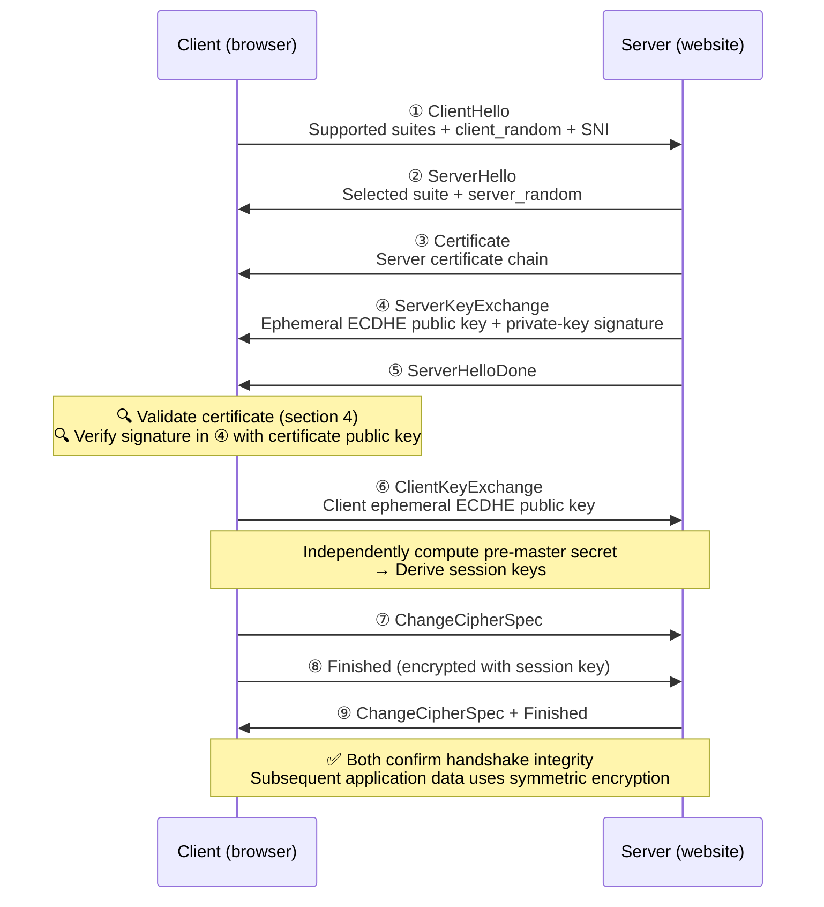
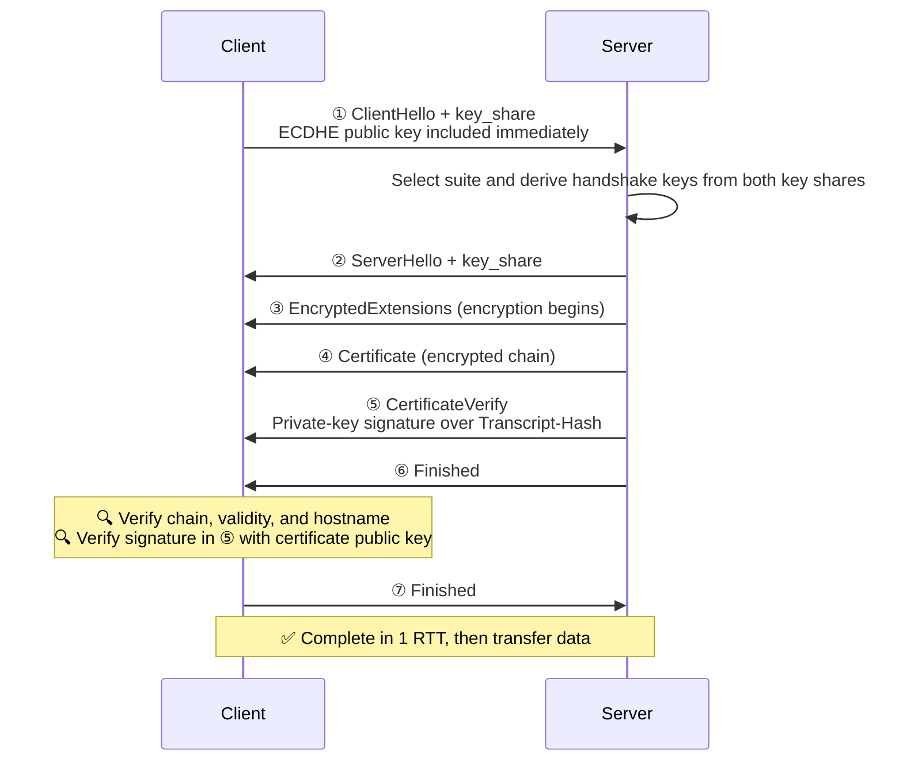
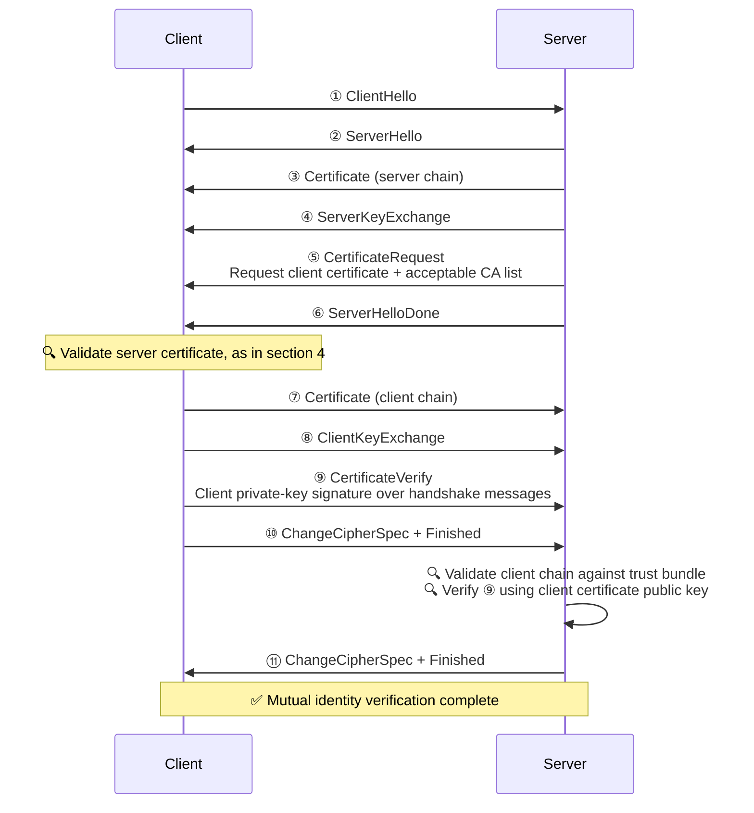
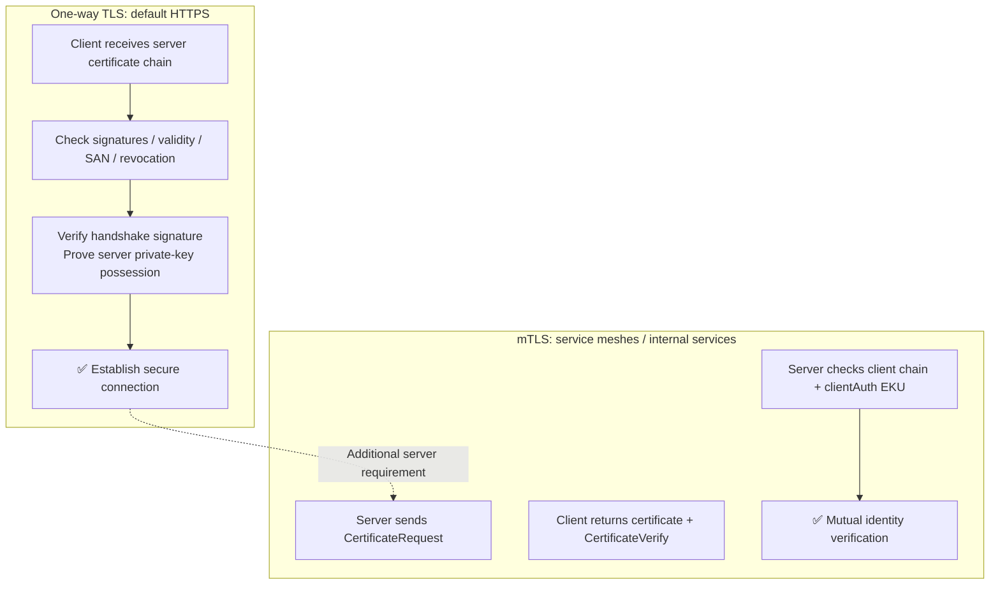

# Certificate Verification During the TLS Handshake

## 1. The Question Left by the Previous Article

[How Certificates Are Issued](/en/notes/basic-knowledge/cert-issuance/) answered:

> Why does a browser trust that it is really connected to GitHub?

The answer is a digital certificate: a CA signs the binding between a public key and an identity. That article explained **where certificates come from**, but left another question:

> After receiving the server certificate during a handshake, **exactly what does the client verify** before sending data? What if the server also needs to authenticate the client?

This article continues with **the complete TLS handshake, certificate verification during it, and mutual authentication with mTLS**.

---

## 2. What a TLS Handshake Must Accomplish

Certificates are only one part of a handshake. Looking at the complete process, a TLS handshake has four tasks:

| # | Goal | Mechanism | Result |
|---|------|------|------|
| 1 | **Negotiate a cipher suite** | ClientHello / ServerHello | Select key-exchange, encryption, and hash algorithms |
| 2 | **Exchange keys** | ECDHE and similar mechanisms | Both parties independently derive the same pre-master secret |
| 3 | **Authenticate identities** | Certificates + signatures | Confirm that the peer is the entity named by the certificate |
| 4 | **Derive session keys** | PRF / HKDF | Generate symmetric keys to encrypt subsequent application data |

> 💡 Asymmetric cryptography is too slow for bulk data. The handshake uses it for key exchange and identity verification; **actual data transfer switches to symmetric encryption**.

**Certificates appear only in step 3.** With that distinction clear, we can examine their verification.

---

## 3. The Full TLS 1.2 Handshake with ECDHE

Start with a classic full TLS 1.2 handshake. Common modern suites use ECDHE for key exchange:



### 3.1 Why the Signature in ④ Matters

Look at ④, `ServerKeyExchange`: the server sends an **ephemeral ECDHE public key** together with a signature:

```
Signature = Sign(server_private_key, Hash(client_random + server_random + ECDHE_parameters))
```

On receiving it, the client:

1. Extracts the **server public key** from the certificate in ③.
2. Uses that public key to verify the signature in ④.

Successful verification shows that **the online peer actually possesses the certificate's private key**. The signature was freshly computed, and only the private-key holder can produce it.

> 💡 This is an easily overlooked part of certificate validation. A certificate is public and anyone can copy and replay it. **The signature proves live possession of the private key.**

> 📌 With legacy RSA key exchange, ④ is absent. The client encrypts the pre-master secret directly with the certificate public key; the server's ability to decrypt it **implicitly** proves private-key possession. TLS 1.3 removes this key-exchange method entirely.

### 3.2 The Purpose of Finished

The `Finished` messages in ⑦⑨ apply a PRF with the newly derived session key to **the hash of all handshake messages so far**.

- If a middlebox alters any handshake message, the two sides' hashes differ and Finished verification fails.
- It also proves that both sides derived **the same** session keys.

---

## 4. Five Checks When the Client Verifies the Server Certificate

Focus on what "🔍 Validate certificate" in section 3 actually means. After receiving the chain, the browser performs **five checks**:

### 4.1 Verify the Certificate Chain

Walk up the chain, using each issuer's public key to verify the next certificate's signature, until reaching a **root certificate**. That root must be in the system trust store as a trust anchor. Section 7 of the [previous article](/en/notes/basic-knowledge/cert-issuance/) explains the mechanism.

### 4.2 Check Validity

The current time must lie between `Not Before` and `Not After`. Even one day past expiry is unacceptable, which is why forgotten certificate renewals frequently cause site-wide operational incidents.

### 4.3 Match the Hostname with SAN

Find the target hostname in the certificate's **SAN (Subject Alternative Name)** list:

- `*.baidu.com` matches `a.baidu.com` but **not** `a.b.baidu.com`; the wildcard covers only one level.
- Older certificates placed domains in CN, but **Chrome 58+ ignores CN** and uses SAN only.
- If the visited domain is absent from SAN, validation fails.

### 4.4 Check Revocation

A certificate may be revoked after private-key compromise or a change in domain ownership. Clients check using:

| Method | Mechanism | Characteristics |
|------|------|------|
| CRL | Client downloads the CA's certificate revocation list | Lists can be large and updates delayed |
| OCSP | Client asks the CA online whether the certificate is revoked | Timely, but exposes browsing information |
| OCSP Stapling | Server **includes** a CA-signed OCSP response in the handshake | Balances freshness and privacy; a mainstream approach |

### 4.5 Prove Private-Key Possession

This is the handshake-signature verification described in section 3.1: TLS 1.2's `ServerKeyExchange` signature or TLS 1.3's `CertificateVerify`, explained in section 5.

### 4.6 Errors When Checks Fail

Different failed checks produce different browser error pages:

| Failed check | Example Chrome error |
|----------|-----------------|
| Untrusted chain: root absent from trust store | `NET::ERR_CERT_AUTHORITY_INVALID` |
| Expired certificate | `NET::ERR_CERT_DATE_INVALID` |
| Hostname mismatch | `NET::ERR_CERT_COMMON_NAME_INVALID` |
| Revoked certificate | `NET::ERR_CERT_REVOKED` |

---

## 5. TLS 1.3: A Shorter Handshake with More Explicit Verification

TLS 1.3, defined in RFC 8446, reduces round trips and makes private-key possession proof explicit:



### 5.1 CertificateVerify: Explicit Proof of Private-Key Possession

```
CertificateVerify = Sign(server_private_key,
    Transcript-Hash(all handshake messages from ClientHello through Certificate))
```

The client verifies this signature with the certificate public key, achieving two things:

1. Proving that the server **currently possesses** the certificate private key.
2. Proving that both parties saw **identical handshake messages**; a mismatched Transcript-Hash makes signature verification fail.

### 5.2 TLS 1.2 vs 1.3

| | TLS 1.2 | TLS 1.3 |
|---|---------|---------|
| Handshake completion | 2 RTT | 1 RTT, with optional 0 RTT |
| Key exchange | ECDHE or RSA | ECDHE only; RSA exchange removed |
| Certificates and handshake messages | Sent in plaintext | Everything after ServerHello is encrypted |
| Private-key proof | ServerKeyExchange signature for ECDHE; implicit for RSA | Explicit `CertificateVerify` |
| Symmetric encryption | Includes older algorithms such as CBC | AEAD only, such as AES-GCM and ChaCha20 |

> 💡 Another benefit of TLS 1.3: encrypted certificates prevent middleboxes from passively reading the server's domain certificate, reducing fingerprinting.

---

## 6. Hands-On: Observe Verification with OpenSSL

Reuse the private-CA environment from the previous article: `ca.crt` and `server.crt`.

### 6.1 Observe a Real Handshake

```bash
# Connect to a real website and inspect protocol, cipher suite, and verification result
echo | openssl s_client -connect www.baidu.com:443 \
  -servername www.baidu.com -tls1_3 2>/dev/null | \
  grep -E "Protocol|Cipher|Verify"
```

Example output:

```
Protocol  : TLSv1.3
Cipher    : TLS_AES_256_GCM_SHA384
Verify return code: 0 (ok)
```

`Verify return code: 0 (ok)` means certificate-chain verification succeeded.

### 6.2 Failure Example One: Untrusted Root

Issue a certificate using the previous article's private CA and start a server:

```bash
openssl s_server -cert server.crt -key server.key -accept 8443 -www &
```

Connect without a trust bundle, simulating a system that does not trust this CA:

```bash
echo | openssl s_client -connect localhost:8443 2>&1 | grep "Verify return"
# Verify return code: 19 (self-signed certificate in certificate chain)
```

Connect again with `ca.crt`:

```bash
echo | openssl s_client -connect localhost:8443 -CAfile ca.crt 2>&1 | grep "Verify return"
# Verify return code: 0 (ok)
```

### 6.3 Failure Example Two: Hostname Mismatch

```bash
echo | openssl s_client -connect localhost:8443 \
  -CAfile ca.crt -verify_hostname wrong.example.com 2>&1 | \
  grep -E "Verify return|Hostname"
# Verify return code: 62 (hostname mismatch)
```

> ⚠️ **A common pitfall**: `openssl s_client` does **not validate hostnames by default**; it validates only the certificate chain. Add `-verify_hostname` for SAN matching. Browsers check both by default, so differences in hostname checking can explain cases where a command-line request works but the browser reports an error.

---

## 7. mTLS: The Server Authenticates the Client Too

All previous flows use **one-way TLS**: only the client authenticates the server. mTLS, or Mutual TLS, adds the reverse direction:

> **The server also requires a client certificate and verifies the client's identity.**

### 7.1 Changes to the TLS 1.2 Handshake



There are three additions compared with one-way TLS:

1. ⑤ **CertificateRequest**: the server requests a client certificate and includes its trusted CA list, allowing the client to choose a suitable certificate.
2. ⑦ The client sends its **certificate chain**.
3. ⑨ Client **CertificateVerify**: the client signs handshake messages with its private key, proving live possession of the certificate's private key.

### 7.2 What the Server Checks in the Client Certificate

The checks are almost symmetrical with section 4:

- The client chain validates to a root in the server's trust bundle.
- The certificate is within its validity period and has not been revoked.
- Its **EKU includes `clientAuth`**, TLS Web Client Authentication; a certificate with only `serverAuth` cannot instead serve as a client certificate.
- The CertificateVerify signature in ⑨ verifies successfully.

### 7.3 Hands-On: A Complete mTLS Environment

```bash
# 1. Issue a client certificate with the clientAuth EKU
openssl genrsa -out client.key 2048
openssl req -new -key client.key -out client.csr \
  -subj "/CN=client.internal"
openssl x509 -req -in client.csr \
  -CA ca.crt -CAkey ca.key -CAcreateserial \
  -out client.crt -days 365 \
  -extfile <(printf "extendedKeyUsage=clientAuth")

# 2. Server: -Verify 2 requires a client certificate and sets verification depth to 2
openssl s_server -accept 8443 \
  -cert server.crt -key server.key \
  -CAfile ca.crt -Verify 2

# 3. Client: connect with a certificate
openssl s_client -connect localhost:8443 \
  -cert client.crt -key client.key \
  -CAfile ca.crt -quiet
```

The server prints verification results, for example:

```
depth=0 C = CN, CN = client.internal
verify return:1
```

### 7.4 What If the Client Has No Certificate?

```bash
# Connect without -cert / -key
openssl s_client -connect localhost:8443 -CAfile ca.crt
```

The server cannot validate the client and returns a **fatal `certificate required` alert**, causing the handshake to fail. mTLS therefore acts as an access gate: without a valid certificate, the handshake above TCP cannot complete.

### 7.5 Nginx Configuration Example

Nginx commonly handles mTLS in production:

```nginx
server {
    listen 443 ssl;
    server_name api.internal.com;

    ssl_certificate     /etc/nginx/certs/server.crt;
    ssl_certificate_key /etc/nginx/certs/server.key;

    # mTLS: trust bundle plus mandatory verification
    ssl_client_certificate /etc/nginx/certs/client-ca.crt;  # Trust bundle for client certificates
    ssl_verify_client on;          # on: require and verify; optional: certificate may be omitted
    ssl_verify_depth 2;            # Client certificate-chain verification depth
}
```

### 7.6 Common mTLS Use Cases

| Scenario | Description |
|------|------|
| Service meshes, such as Istio / Linkerd | mTLS between sidecars provides transparent traffic encryption and authentication |
| SPIRE / SVID | SPIFFE IDs represent service identities; the Workload API delivers short-lived certificates |
| Internal enterprise microservices | Only services holding company-issued certificates can call each other |
| Financial / payment APIs | Mutual authentication prevents impersonation of merchants or channels |
| Kubernetes management channels | Mutual authentication between kubelet and API Server |
| IoT device onboarding | Factory-provisioned certificates allow servers to authenticate devices |

---

## 8. Summary



Key points:

| Point | Description |
|------|------|
| **Four handshake tasks** | Negotiate suites, exchange keys, authenticate identities, and derive session keys; certificates serve the third task |
| **Five validation checks** | Chain, validity, SAN hostname, revocation status, and proof of private-key possession |
| **Private-key proof is live** | Certificates can be replayed; handshake signatures in ServerKeyExchange / CertificateVerify prove current private-key possession |
| **TLS 1.3 is faster and more explicit** | 1 RTT, encrypted certificate transfer, and explicit CertificateVerify signatures |
| **mTLS is an access gate** | Server validates the client chain against its trust bundle and checks clientAuth EKU; no certificate means handshake failure |

Together with the previous article, this completes the HTTPS trust story:

> **Issuance** answers where a certificate comes from: a CA vouches for the public-key/identity binding. **Handshake verification** answers how it is used: signatures prove live identity on each connection.

With these two stages understood, errors such as `CERT_AUTHORITY_INVALID` or `certificate required` can be traced through five checks: chain, validity, hostname, revocation, and private-key possession.
