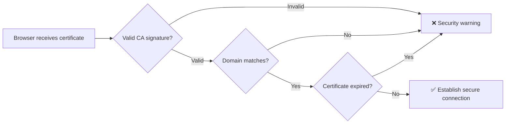
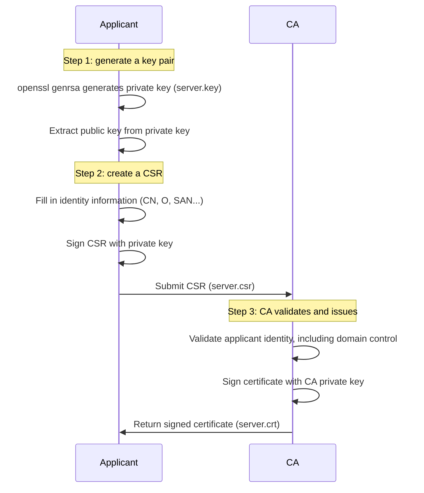
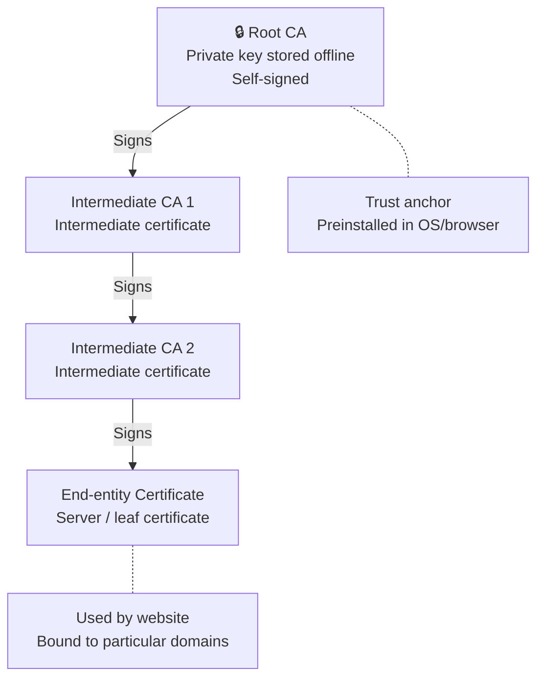
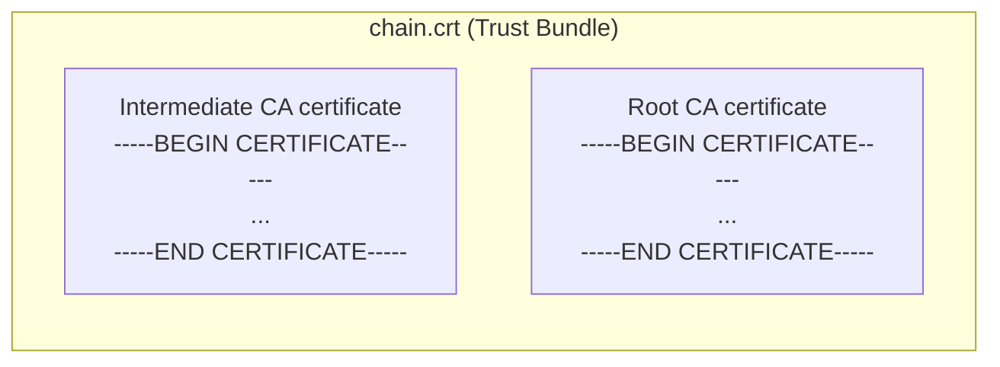
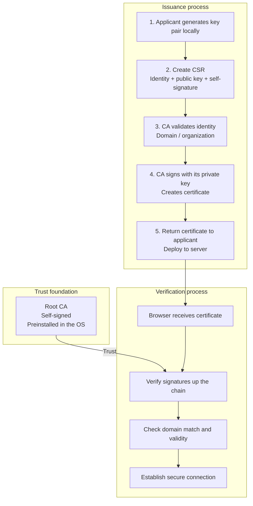

# How Certificates Are Issued

## 1. Start with "Who Are You?"

Suppose you open `https://github.com` in a browser. A small padlock 🔒 says the connection is secure. Have you ever wondered:

> Why does the browser believe it is connected to GitHub rather than a phishing site impersonating GitHub?

The answer is **digital certificates**. This article explains from the ground up how certificates are issued, why they resist forgery, and how to perform each step with OpenSSL.

---

## 2. Prerequisite: Asymmetric Cryptography

Before understanding certificates, you need to understand **asymmetric cryptography**, also called public-key cryptography.

### 2.1 The Problem with Symmetric Encryption

Symmetric encryption uses **the same key** for encryption and decryption, much like using one key to lock and unlock your front door.

```
A and B communicate using symmetric encryption:
  A --[encrypt with key K]--> B --[decrypt with key K]--> plaintext
```

The question is: **how do you deliver key K to the other party securely?** Sending it over the network could expose it to an eavesdropper.

### 2.2 Asymmetric Cryptography

Asymmetric cryptography has **two keys**: a public key and a private key.

- **Public key**: can be published and obtained by anyone. Used for **encryption**.
- **Private key**: must remain secret and known only to its owner. Used for **decryption**.

```
Encrypt with the public key; decrypt with the private key:
  A --[encrypt with B's public key]--> B --[decrypt with B's private key]--> plaintext

Sign with the private key; verify with the public key:
  A --[sign with A's private key]--> B --[verify with A's public key]--> verification succeeds
```

Key properties:
- **Only** the matching private key can decrypt content encrypted with a public key.
- **Anyone** with the public key can verify that a private-key signature came from the corresponding private-key holder.

### 2.3 A New Problem: Man-in-the-Middle Attacks

Asymmetric cryptography addresses key transmission but introduces another question:

```
A wants to communicate with B:
  A --"Please send your public key"--> [intercepted by intermediary M]
                                      M sends its own public key to A
  A --[encrypt data with M's public key]--> M decrypts and reads it, then re-encrypts with B's public key and forwards to B
```

A thinks it is communicating with B, but is actually communicating with intermediary M. This is a **man-in-the-middle attack (MITM)**.

**The central problem**: A has a public key but cannot confirm that it really belongs to B.

---

## 3. What Problem Do Certificates Solve?

The essence of a certificate is:

> **A trusted third party, the CA, signs a binding between a public key and identity information.**

A real-world analogy:
- Your **identity card** carries your name and photograph, issued and stamped by the public-security authority.
- A **digital certificate** carries a website's domain and public key, issued and signed by a CA (Certificate Authority).

When a browser validates a certificate:



---

## 4. What an X.509 Certificate Looks Like

Modern HTTPS uses certificates following the **X.509 v3** standard. Inspect a Baidu certificate with OpenSSL:

```bash
# Connect to Baidu on port 443 and extract the certificate
echo | openssl s_client -connect www.baidu.com:443 -servername www.baidu.com 2>/dev/null | \
  openssl x509 -text -noout | head -50
```

You will see a structure like this:

```
Certificate:
    Version: 3 (0x2)                    # X.509 v3
    Serial Number: 0a:5e:...            # Unique certificate serial number assigned by the CA
    Signature Algorithm: sha256WithRSAEncryption  # Algorithm used for the CA signature
    Issuer: C=BE, O=GlobalSign nv-sa, CN=GlobalSign RSA OV SSL CA 2018  # Issuer: who signed it
    Validity                             # Validity period
        Not Before: Jul 10 00:00:00 2025 GMT
        Not After : Aug 11 23:59:59 2026 GMT
    Subject: C=CN, ST=beijing, L=beijing, O=Beijing Baidu Netcom Science Technology Co., Ltd, CN=baidu.com
    Subject Public Key Info:            # Website's public key
        Public Key Algorithm: rsaEncryption
        RSA Public-Key: (2048 bit)
        Modulus: ...
        Exponent: 65537 (0x10001)
    X509v3 extensions:                  # Extension fields
        X509v3 Subject Alternative Name: # SAN: domains bound to the certificate
            DNS:www.baidu.com, DNS:baidu.com, DNS:*.baidu.com
```

The core fields of an X.509 certificate:

| Field | Meaning | Example |
|------|------|------|
| **Subject** | Identity of the certificate holder | `CN=baidu.com, O=Beijing Baidu...` |
| **Subject Public Key** | Holder's public key | RSA 2048-bit |
| **Issuer** | Identity of the issuing CA | `CN=GlobalSign RSA OV SSL CA 2018` |
| **Validity** | Validity period | 2025-07-10 ~ 2026-08-11 |
| **Serial Number** | Certificate serial number | Unique number assigned by the CA |
| **Signature** | CA's digital signature over the preceding certificate content | A long sequence of binary data |
| **SAN** | Subject Alternative Name: domains bound to the certificate | `DNS:*.baidu.com` |

---

## 5. The Complete Issuance Process

Certificate issuance has three steps: **generate a key pair → create a CSR → obtain a CA signature**.



### 5.1 Step One: Generate a Key Pair

The applicant first generates a public/private key pair **locally**:

```bash
# Generate a 2048-bit RSA private key; keep it secret and never share it
openssl genrsa -out server.key 2048

# Inspect the private key
openssl rsa -in server.key -text -noout | head -10
```

Example output:
```
RSA Private-Key: (2048 bit, 2 primes)
modulus:
    00:b5:8e:3c:21:a7:f9:12:4e:6d:...
publicExponent: 65537 (0x10001)
privateExponent:
    00:9a:3d:72:11:5e:c8:...
```

> 💡 **The private key never leaves the applicant's machine.** The CA never receives your private key, a foundation of certificate security.

### 5.2 Step Two: Create a CSR (Certificate Signing Request)

A CSR is a certificate-signing request containing:
- Your **identity information**, such as domain and organization
- Your **public key**
- A **signature made with your private key**, proving you hold the matching private key

```bash
# Method 1: generate a CSR interactively
openssl req -new -key server.key -out server.csr
# Prompts for country, province, organization, Common Name (domain), and other fields

# Method 2: generate non-interactively with one command
openssl req -new \
  -key server.key \
  -out server.csr \
  -subj "/C=CN/ST=Guangdong/L=Shenzhen/O=MyCompany/CN=mysite.com"
```

Inspect the CSR:

```bash
openssl req -in server.csr -text -noout
```

Example output:
```
Certificate Request:
    Subject: C=CN, ST=Guangdong, L=Shenzhen, O=MyCompany, CN=mysite.com
    Subject Public Key Info:
        Public Key Algorithm: rsaEncryption
        RSA Public-Key: (2048 bit)
        Modulus: ...(same public key as in server.key)
    Signature Algorithm: sha256WithRSAEncryption
    Signature: ...(signature made with the private key in server.key)
```

Pay attention to:
1. **Subject** — your identity information; CN is usually the domain.
2. **Public key** — the public key paired with your private key.
3. **Signature** — signed with your private key. The CA verifies it using the public key in the CSR, checking that the sender possesses the private key and that the request was not altered.

### 5.3 Step Three: The CA Issues the Certificate

After receiving your CSR, the CA:

1. **Validates your identity**:
   - DV (Domain Validation): asks you to add a DNS TXT record or place a specific file on the website to prove control of the domain.
   - OV (Organization Validation): additionally checks that your company really exists.
   - EV (Extended Validation): the strictest validation; the browser address bar displays the company name in green.

2. **Issues the certificate**: after validation, the CA uses **its own private key** to sign the request and produce a certificate:

```bash
# The CA uses its private key (ca.key) and root certificate (ca.crt) to issue your certificate
openssl x509 -req \
  -in server.csr \          # Your CSR
  -CA ca.crt \              # CA's own certificate
  -CAkey ca.key \           # CA's private key
  -CAcreateserial \         # Generate a serial number automatically
  -out server.crt \         # Output: signed certificate
  -days 365 \               # Valid for 365 days
  -extfile <(printf "subjectAltName=DNS:mysite.com,DNS:www.mysite.com")  # SAN extension
```

3. **The signing process in detail**:

```
CA signing performs these operations on certificate content:

  1. Hash TBSCertificate (To Be Signed, the portion awaiting signature) to obtain HASH
     Certificate content = [version, serial number, signature algorithm, issuer, validity, subject, public key, extensions...]
                └──────────────── TBSCertificate ────────────────┘

  2. Encrypt HASH using the CA private key to obtain SIGNATURE
     SIGNATURE = RSA_Encrypt(CA_private_key, SHA256(TBSCertificate))

  3. Append SIGNATURE to the certificate
     Final certificate = TBSCertificate + signature algorithm identifier + SIGNATURE

During verification:
  Browser decrypts SIGNATURE with the CA public key -> original_hash
  Browser computes SHA256 over TBSCertificate -> computed_hash
  If original_hash == computed_hash -> ✅ certificate was not altered and was issued by this CA
```

---

## 6. Hands-On: Create a CA and Issue a Certificate

Now simulate the full process: create a Root CA, then use it to issue a server certificate.

### 6.1 Create the Root CA

```bash
# 1. Generate the Root CA private key (4096 bits for greater security)
openssl genrsa -out ca.key 4096

# 2. Use it to create a self-signed root certificate: the Root CA signs itself
openssl req -new -x509 \
  -key ca.key \
  -out ca.crt \
  -days 3650 \                    # Valid for ten years
  -subj "/C=CN/ST=Guangdong/L=Shenzhen/O=MyRootCA/CN=My Root CA"

# 3. Inspect the root certificate
openssl x509 -in ca.crt -text -noout | head -20
```

Output:
```
Certificate:
    Issuer: C=CN, ST=Guangdong, L=Shenzhen, O=MyRootCA, CN=My Root CA
    Subject: C=CN, ST=Guangdong, L=Shenzhen, O=MyRootCA, CN=My Root CA
    # 👆 Note: Issuer == Subject for this self-signed certificate
```

> The root certificate's Issuer and Subject are the same entity: the Root CA signs itself. This is the **trust anchor** of the entire chain.

### 6.2 Generate the Server Certificate

```bash
# 1. Generate the server private key
openssl genrsa -out server.key 2048

# 2. Generate a CSR
openssl req -new \
  -key server.key \
  -out server.csr \
  -subj "/C=CN/ST=Guangdong/L=Shenzhen/O=MyServer/CN=mysite.local"

# 3. Issue the certificate with the Root CA; remember to add SAN
openssl x509 -req \
  -in server.csr \
  -CA ca.crt \
  -CAkey ca.key \
  -CAcreateserial \
  -out server.crt \
  -days 365 \
  -extfile <(printf "subjectAltName=DNS:mysite.local,DNS:www.mysite.local")

# 4. Verify the server certificate using the CA certificate
openssl verify -CAfile ca.crt server.crt
# Output: server.crt: OK ✅
```

Inspect the server certificate's issuer:

```bash
openssl x509 -in server.crt -issuer -subject -noout
# issuer=C = CN, ST = Guangdong, L = Shenzhen, O = MyRootCA, CN = My Root CA
# subject=C = CN, ST = Guangdong, L = Shenzhen, O = MyServer, CN = mysite.local
```

Issuer is My Root CA and Subject is mysite.local. **Issuer and holder differ**; this is a normal end-entity certificate.

### 6.3 Run an HTTPS Service with the Certificate

```bash
# Start a quick HTTPS server with openssl for testing
openssl s_server \
  -cert server.crt \
  -key server.key \
  -accept 8443 \
  -www &
```

Visit `https://localhost:8443` in a browser. It warns that the connection is unsafe because our Root CA is absent from the browser's trust list. Importing `ca.crt` into the system trust store removes the warning.

---

## 7. Certificate Chains: Passing Trust from Root to Leaf

In practice, Root CA private keys are physically isolated and protected, for example in a hardware security module (HSM), and are not used directly to issue end-entity certificates. Actual certificate chains usually have at least three levels:



During verification, the browser walks up the chain one level at a time:

```
Verify server.crt:
  1. Verify server.crt's signature with Intermediate CA 2's public key ✅
  2. Verify Intermediate CA 2's signature with Intermediate CA 1's public key ✅
  3. Verify Intermediate CA 1's signature with the Root CA public key ✅
  4. Root CA is in the system trust store -> entire chain is trusted ✅
```

### 7.1 Hands-On: Build a Three-Level Chain

```bash
# === Level 1: Root CA, self-signed ===
openssl genrsa -out root.key 4096
openssl req -new -x509 -key root.key -out root.crt -days 7300 \
  -subj "/CN=Root CA"

# === Level 2: Intermediate CA, issued by Root CA ===
openssl genrsa -out intermediate.key 4096
openssl req -new -key intermediate.key -out intermediate.csr \
  -subj "/CN=Intermediate CA"
openssl x509 -req \
  -in intermediate.csr \
  -CA root.crt -CAkey root.key \
  -CAcreateserial \
  -out intermediate.crt \
  -days 3650 \
  -extfile <(printf "basicConstraints=CA:TRUE\nkeyUsage=keyCertSign,cRLSign")
# 💡 The intermediate CA also uses the .crt extension, just like root and server certificates.
#    Extensions (.crt / .pem / .ca) are naming conventions and do not participate in validation.
#    Certificate extension fields determine whether a certificate is a CA or end-entity certificate:
#      - basicConstraints=CA:TRUE -> CA certificate, allowed to sign other certificates
#      - No basicConstraints=CA:TRUE -> end-entity certificate, not allowed to sign others
#    Root and intermediate CAs are both CA certificates, at different levels.

# === Level 3: server certificate, issued by Intermediate CA ===
openssl genrsa -out www.key 2048
openssl req -new -key www.key -out www.csr \
  -subj "/CN=mysite.local"
openssl x509 -req \
  -in www.csr \
  -CA intermediate.crt -CAkey intermediate.key \
  -CAcreateserial \
  -out www.crt \
  -days 365 \
  -extfile <(printf "subjectAltName=DNS:mysite.local,DNS:www.mysite.local")

# === Verify the certificate chain ===
# Combine intermediate and root certificates into a chain file
cat intermediate.crt root.crt > chain.crt
openssl verify -CAfile chain.crt www.crt
# Output: www.crt: OK ✅
```

### 7.2 Trust Bundles

The `chain.crt` produced by `cat intermediate.crt root.crt > chain.crt` is a **Trust Bundle**, also called a CA Bundle.

**A bundle is a file containing multiple concatenated CA certificates.** It tells the verifier: "These are the CAs I trust; use them to validate certificate chains."



Inside a bundle, several PEM certificates are placed back to back:

```
-----BEGIN CERTIFICATE-----
MIID...(Intermediate CA certificate contents)...
-----END CERTIFICATE-----
-----BEGIN CERTIFICATE-----
MIID...(Root CA certificate contents)...
-----END CERTIFICATE-----
```

**Common uses of bundles**:

| Scenario | Description |
|------|------|
| **TLS server configuration** | Nginx's `ssl_trusted_certificate` takes a bundle for validating client certificates |
| **SPIRE** | The Workload API delivers a trust bundle containing CA certificates in the trust domain to verify peer SVIDs |
| **Operating-system trust stores** | Linux's `/etc/ssl/certs/` and macOS Keychain are effectively system-level trust bundles |
| **Programming languages** | Go's `x509.SystemCertPool()` and Python's `certifi` package are variations on bundles |

> 💡 **In one sentence**: a bundle is a collection of CA certificates. Servers use it to express which CAs they trust, while clients use it to validate the server certificate's issuing chain.

---

## 8. Why Do Certificates Need Chains?

Why not have the Root CA issue server certificates directly and omit the intermediate layer?

**Security considerations**:

1. **Private-key security**: compromise of a Root CA key undermines the entire trust system, requiring OS/browser updates to revoke trust. The impact of an intermediate CA key compromise is more limited.
2. **Offline private keys**: Root CA keys are usually stored offline in HSMs, physically disconnected from networks. Intermediate CAs handle everyday issuance online.
3. **Flexible revocation**: if one intermediate CA has a problem, revoke that CA without affecting the others.

---

## 9. Issuance by a Public CA in Practice

Using Let's Encrypt, a free CA, as an example, the actual request looks like this:

```bash
# Use certbot, Let's Encrypt's official client
certbot certonly --standalone -d mysite.com -d www.mysite.com
```

Behind the scenes, certbot does the following:

```
1. certbot generates a key pair and CSR locally
2. certbot sends the CSR to Let's Encrypt's ACME server
3. Let's Encrypt issues a challenge:
   - HTTP-01: place specified content at http://mysite.com/.well-known/acme-challenge/<token>
   - DNS-01: add a TXT record at _acme-challenge.mysite.com
4. certbot completes the challenge and Let's Encrypt validates it
5. Let's Encrypt issues the certificate; certbot downloads and saves it locally
```

**Throughout this process, Let's Encrypt never receives your private key.**

---

## 10. Summary



Key points:

| Point | Description |
|------|------|
| **Private keys stay local** | Keys are generated locally; the CA never receives your private key |
| **The CA vouches for the binding** | The CA signs public key + identity with its own private key |
| **Trust follows the chain** | Root CA → Intermediate CA → end-entity certificate, verified one level at a time |
| **Security rests on the root** | Root CAs preinstalled in OS/browser trust stores are the system's trust anchors |
| **Verification uses signatures** | Use the CA public key to recover the signature hash and compare hashes to detect alteration |

With these concepts, you can see why the HTTPS padlock 🔒 can be trusted: behind it is an entire trust system built on asymmetric cryptography.
