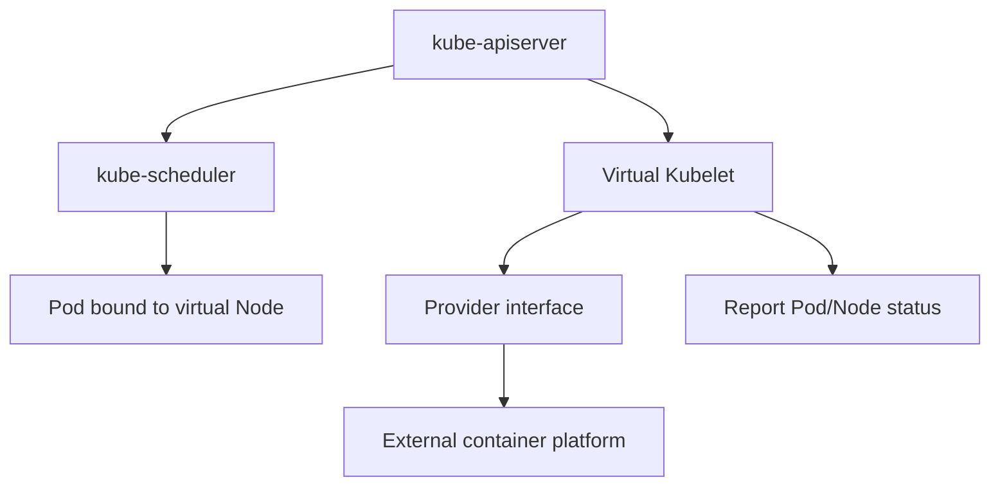
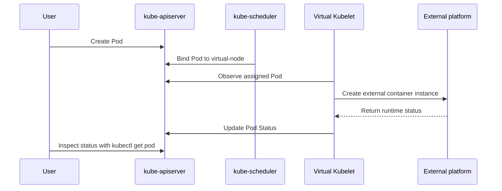

# What Is Virtual Kubelet?

## In One Sentence

Virtual Kubelet is an adapter layer that "acts like a kubelet". It registers a virtual node with Kubernetes that looks like a normal Node, but it does not start containers on that node itself. Instead, it forwards operations such as Pod creation, deletion, and status queries to an external compute platform.

In other words:

> A normal kubelet manages the container runtime on a real machine; Virtual Kubelet manages container resources on an external platform.

That external platform can be a serverless container service, a cloud provider's elastic container instances, an edge platform, a batch-processing platform, or any system implementing the Virtual Kubelet provider interface.

## Why Virtual Kubelet Exists

In a standard Kubernetes cluster, each Node runs a kubelet. Its core responsibilities include:

1. Registering the Node with the apiserver.
2. Watching Pods scheduled to this node.
3. Calling the container runtime to create containers.
4. Reporting Pod, container, and Node status.
5. Providing logs, exec, attach, metrics, and related capabilities.

This model requires real worker nodes. Scaling the cluster means adding machines or VMs; maintaining it means dealing with node operating systems, container runtimes, network plugins, disks, kernel parameters, and other infrastructure details.

Virtual Kubelet addresses a different question: can we run Pods on an external platform while avoiding real-node maintenance and continuing to use Kubernetes APIs, the scheduler, Deployments, Jobs, Services, and other abstractions?

The answer is to make the external platform "look like" a Kubernetes node.

## Core Architecture

Virtual Kubelet typically runs as a process inside or outside the cluster. It registers a Node object, such as `virtual-node`, with Kubernetes. Once the scheduler sees that Node, it can schedule eligible Pods onto it.

The overall architecture is:



More specifically:

1. Virtual Kubelet registers a virtual Node with the apiserver when it starts.
2. Users create Pods, Deployments, Jobs, and other resources.
3. kube-scheduler schedules Pods onto the virtual Node according to `nodeSelector`, `nodeAffinity`, `tolerations`, and related rules.
4. Virtual Kubelet observes Pods assigned to it.
5. Virtual Kubelet calls its provider to convert each Pod into a container creation request that the external platform understands.
6. The external platform actually runs the containers.
7. Virtual Kubelet periodically queries the external platform and writes Pod status back to Kubernetes.

The crucial point is that the Kubernetes control plane does not know whether the backend is a machine, a serverless container platform, or another execution system. It sees only a Node that behaves like a kubelet-managed node.

## Virtual Kubelet vs. kubelet

| Comparison | kubelet | Virtual Kubelet |
| --- | --- | --- |
| Runs on | Every real Node | Usually a standalone process |
| Manages | The local container runtime | Container resources on an external platform |
| Requires a real node | Yes | Not necessarily |
| Creates containers through | CRI, such as containerd | A provider, such as a cloud API |
| Networking | Depends on CNI | Depends on the provider implementation |
| Storage | Standard Kubernetes volume capabilities | Depends on the provider |
| Host capabilities | Supports hostPath, hostNetwork, DaemonSets, and more | Usually unsupported or limited |
| Typical scenarios | Conventional Kubernetes workloads | Traffic bursts, serverless containers, external compute integration |

Think of kubelet as a "local executor" and Virtual Kubelet as an "adapter for a remote executor".

## How Scheduling Works

Virtual Kubelet does not schedule Pods itself. Scheduling remains the responsibility of the Kubernetes scheduler.

To prevent ordinary Pods from being scheduled accidentally onto virtual nodes, Nodes registered by Virtual Kubelet usually have special labels and taints. Only Pods explicitly configured to use virtual nodes are scheduled there.

A simplified example:

```yaml
apiVersion: v1
kind: Pod
metadata:
  name: vk-demo
spec:
  nodeSelector:
    type: virtual-kubelet
  tolerations:
    - key: virtual-kubelet.io/provider
      operator: Exists
      effect: NoSchedule
  containers:
    - name: nginx
      image: nginx:1.25
      resources:
        requests:
          cpu: "250m"
          memory: "256Mi"
        limits:
          cpu: "500m"
          memory: "512Mi"
```

This configuration means:

1. `nodeSelector` requires scheduling onto a node labeled `type=virtual-kubelet`.
2. `tolerations` allows the Pod to tolerate the virtual node's `NoSchedule` taint.
3. After the scheduler binds the Pod, Virtual Kubelet takes over the rest of its lifecycle.

Actual label and taint names depend on the installation method and provider configuration; they may differ from this example.

## Pod Lifecycle

After a Pod is scheduled onto a virtual node, the approximate flow is:



From the user's perspective, the Pod is still a Kubernetes Pod:

```bash
kubectl get pods -o wide
```

You might see output like this:

```text
NAME      READY   STATUS    RESTARTS   AGE   IP           NODE
vk-demo   1/1     Running   0          30s   10.0.1.23    virtual-node
```

However, this Pod runs on the external platform behind Virtual Kubelet, rather than on a traditional worker node.

## Suitable Use Cases

### 1. Bursting Capacity

When real nodes lack resources, some stateless tasks can be scheduled onto virtual nodes, letting an external serverless container platform handle traffic spikes.

This avoids keeping a large pool of idle machines ready and suits workloads with pronounced traffic peaks and troughs.

### 2. Batch Tasks

Jobs, CronJobs, and temporary computations generally do not need nodes for extended periods. If the provider supports these tasks, Virtual Kubelet can forward them to a platform better suited to elastic execution.

### 3. Isolated Workloads

Some tasks should be isolated from the main cluster's worker nodes, such as untrusted tasks, workloads with unpredictable resource consumption, or temporary experiments. Scheduling them onto virtual nodes reduces their impact on the primary node pool.

### 4. Integrating Non-Kubernetes Compute Platforms

If a company already operates a container execution, edge computing, or batch-processing platform, a Virtual Kubelet provider can connect it to Kubernetes so users can keep using the familiar Kubernetes API.

## Unsuitable Use Cases

Virtual Kubelet is not a complete replacement for a full kubelet. Its capabilities depend heavily on the provider, and it is usually unsuitable for these scenarios:

1. **Pods with strong dependencies on host capabilities**
   - `hostPath`
   - `hostNetwork`
   - `hostPID`
   - `privileged` containers.
   - Device plugins, such as GPU or RDMA plugins.

2. **DaemonSet**
   DaemonSet semantics call for "one Pod on every real node". A virtual node has no traditional underlying host, so DaemonSets usually have little meaning or have restricted behavior.

3. **Complex networking requirements**
   Full support for Services, Pod IPs, NetworkPolicies, Ingress, and related features depends on how the external platform connects to the cluster network.

4. **Complex storage requirements**
   PVCs, CSI, local disks, mount propagation, and similar features are generally not fully supported by default; support depends on the provider.

5. **Heavy reliance on local debugging capabilities**
   Support for `kubectl logs`, `kubectl exec`, `kubectl attach`, metrics, and related features may be incomplete, and troubleshooting can differ from ordinary nodes.

## Comparison with Cluster Autoscaler

Virtual Kubelet and Cluster Autoscaler can both address insufficient resources, but they take different approaches.

| Comparison | Cluster Autoscaler | Virtual Kubelet |
| --- | --- | --- |
| Scaling target | Real Nodes | The external platform behind a virtual Node |
| Scaling mechanism | Add VMs or physical machines | Create external container instances |
| Startup speed | Depends on node startup time | Usually faster, but provider-dependent |
| Compatibility | Close to normal Kubernetes nodes | Provider-dependent |
| Operational cost | Node pools still require maintenance | Less node maintenance |

Cluster Autoscaler is a better fit when workloads need full Kubernetes node capabilities. Virtual Kubelet may fit better for stateless, short-lived tasks with few host dependencies.

## Relationship to Serverless Kubernetes

Many cloud vendors' serverless Kubernetes products aim to let users focus on Pods or workloads without managing nodes.

Virtual Kubelet is one way to provide that experience: it abstracts external serverless container resources into Kubernetes Nodes. Users still submit Pods and use Deployments, Jobs, HPAs, and other Kubernetes objects, while the underlying compute need not be traditional worker nodes.

However, not all serverless Kubernetes products use Virtual Kubelet. They may employ custom schedulers, controllers, sandbox runtimes, or other architectures. Evaluate a platform by the Kubernetes API features it supports, rather than by whether it carries the Virtual Kubelet name.

## Can HPA Work with Virtual Kubelet?

Yes, provided certain conditions are met.

HPA adjusts replica counts for Deployments, ReplicaSets, and similar objects based on metrics. When the replica count increases, the scheduler still schedules the new Pods. If their scheduling rules target virtual nodes, Virtual Kubelet can take over those additional replicas.

Consider the following:

1. HPA requires an available Metrics API or custom metrics.
2. The provider must correctly report Pod resource usage, or you must use external metrics.
3. The external platform must have sufficient quota.
4. Cold-start time affects scaling effectiveness.

HPA and Virtual Kubelet can therefore work together, but scaling latency and the metrics pipeline must be load-tested before production use.

## Production Recommendations

1. **Treat virtual nodes as a separate node pool.**
   Use explicit labels, taints, tolerations, and node affinity to control precisely which workloads may run on virtual nodes.

2. **Start with stateless tasks.**
   Stateless Deployments, Jobs, and CronJobs fit best. Do not casually migrate tasks that depend heavily on local disks, host networking, or privileged capabilities.

3. **Declare requests and limits explicitly.**
   External platforms typically create instances according to resource specifications. Unclear resource declarations harm scheduling, billing predictability, and stability.

4. **Verify network paths in advance.**
   Check Pod-to-Service, Service-to-Pod, Pod-to-external-dependency, DNS, Ingress, and NetworkPolicy paths.

5. **Confirm logging and troubleshooting support.**
   At minimum, verify `kubectl logs`, events, Pod status, external platform logs, and reporting of failure reasons back to Kubernetes.

6. **Watch quotas and cold starts.**
   Virtual nodes may appear to have ample capacity, but real limits usually come from account or regional quotas, image-pull speeds, and container startup speeds on the external platform.

7. **Do not assume every Kubernetes feature is supported.**
   Each provider implements a different scope. Maintain a compatibility checklist before going live.

## Summary

The core value of Virtual Kubelet is extending the Kubernetes workload API beyond traditional worker nodes.

It registers a virtual Node so that the Kubernetes scheduler can schedule Pods onto it, then forwards Pod lifecycle operations to an external platform through a provider. Users retain Kubernetes' declarative API while compute resources may come from serverless containers, edge platforms, batch systems, or other external execution environments.

It is not a complete replacement for an ordinary kubelet. Virtual Kubelet best suits stateless, short-lived, bursty workloads with few host dependencies. Workloads with demanding networking, storage, debugging, monitoring, security, or Kubernetes API compatibility requirements need thorough validation against the specific provider.
