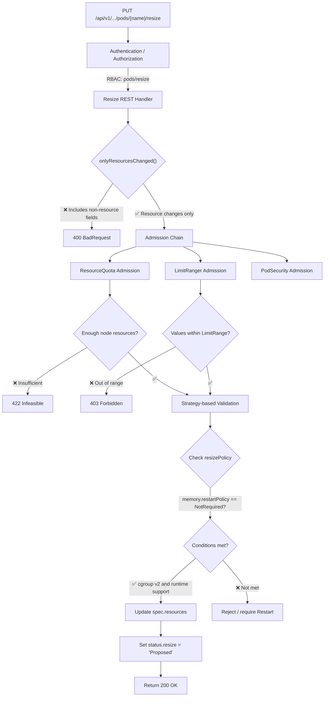
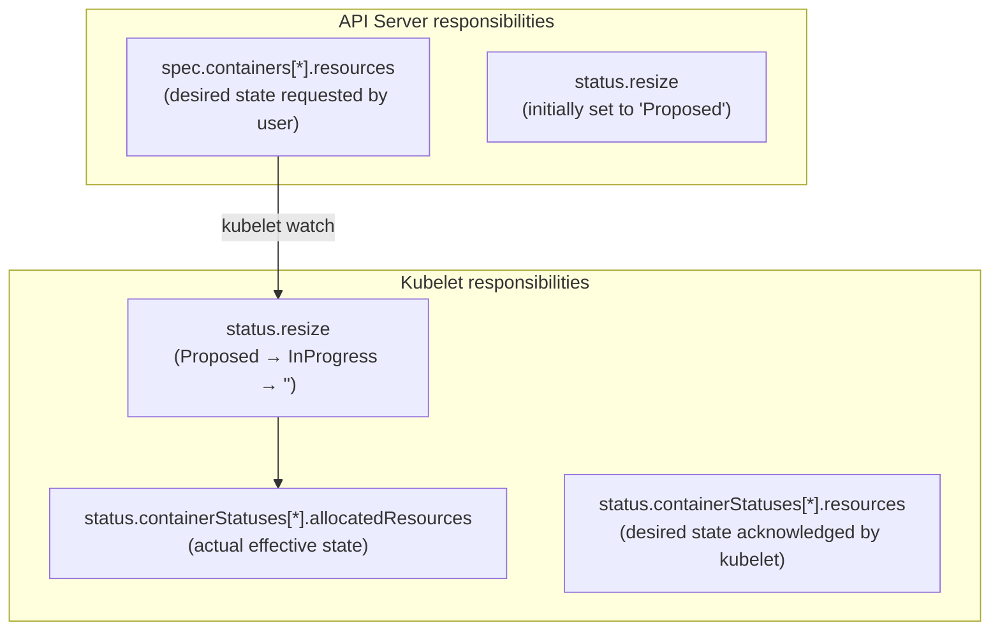
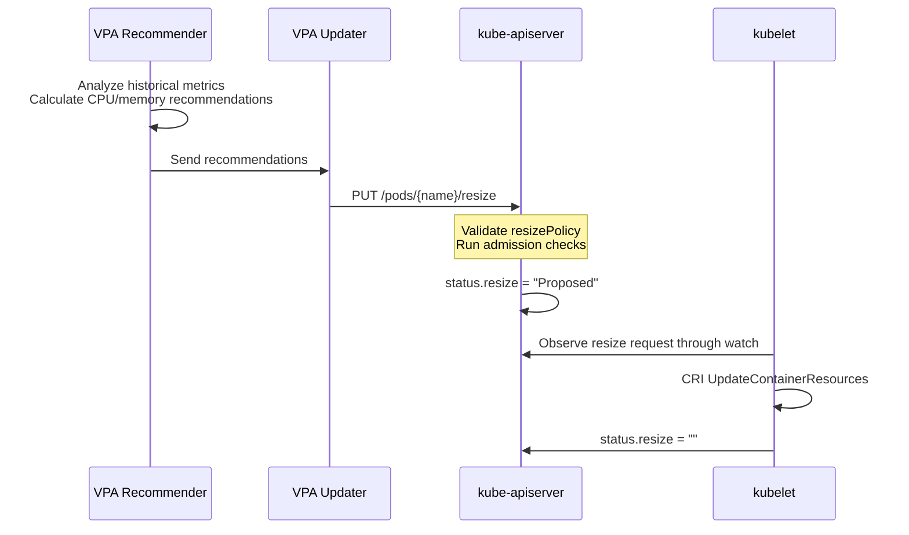

# Kubernetes Resize Subresource and In-Place Memory Resizing

## Background: Why a Dedicated Resize Subresource?

In-place Pod resource resizing, defined by KEP-1287, became GA in Kubernetes 1.28. Many discussions focus only on the outcome, "changing CPU or memory without restarting a Pod", and overlook the key design that enables it: the **Resize Subresource**.

The original problem is simple: in early Kubernetes versions, a Pod's `spec` was immutable after creation. Changing container CPU or memory required recreating the Pod, potentially changing its IP, breaking connections, losing caches, and causing other disruptions.

The community needed to solve more than whether cgroups could technically be changed online. The central challenge was **allowing Pod resource changes safely and controllably at the API level**. Simply making `spec.containers[].resources` mutable would introduce serious problems:

1. **Security**: If Pod specs could be patched freely, any role with Pod write access could change resources without separate controls.
2. **Validation complexity**: Resource changes would mix with other spec changes, making validation hard to isolate.
3. **Status tracking**: No dedicated mechanism would track a resize from request to completion.

The KEP-1287 authors therefore made a key decision: **introduce a new Pod `/resize` subresource** dedicated to in-place resource changes.

This article follows the **design and implementation of the Resize Subresource**, using **memory resizing** as a concrete scenario to examine the complete mechanism.

## 1. What Is the Resize Subresource?

### 1.1 API Definition

The Resize Subresource is a separate REST endpoint on a Pod:

```text
PUT /api/v1/namespaces/{namespace}/pods/{name}/resize
```

This is a real subresource registered in the Kubernetes API, at the same level as `/status`, `/exec`, and `/log`.

```go
// Pod subresources registered in staging/src/k8s.io/api/core/v1/register.go
func addKnownTypes(scheme *runtime.Scheme) error {
    // ...other registrations...
    // Pod /resize subresource
    // Pod /status subresource
    // Pod /exec subresource
    // ...
}
```

Within the API Server, the Resize Subresource has its own **REST handler**, **admission chain**, and **validation logic**, separate from the main Pod resource handler.

### 1.2 Why a Subresource Instead of Making the Spec Mutable?

This classic design tradeoff has three aspects:

**First: RBAC isolation**

```yaml
# Allow changes to Pod resources but not other spec fields, such as images or commands
apiVersion: rbac.authorization.k8s.io/v1
kind: Role
metadata:
  name: pod-resizer
rules:
- apiGroups: [""]
  resources: ["pods/resize"]   # Authorize only the resize subresource
  verbs: ["update", "patch"]
```

If resource changes used PATCH on the main Pod resource, RBAC would be all-or-nothing: a role could change both resources and images, or neither.

**Second: validation isolation**

The Resize Subresource has independent admission and validation logic. It permits only `spec.containers[].resources` changes and explicitly rejects attempts to include image, environment variable, volume, or other field changes. This allowlist-based validation is safer than conditional checks inside the main resource handler.

**Third: a state-machine model**

Resizing is asynchronous: time passes between a user's request and kubelet completing the cgroup update. Together, the Resize Subresource and `status.resize` form a complete state machine, making the process observable, traceable, and recoverable.

### 1.3 Request Body Constraints

Resize request bodies have strict constraints: **only `spec.containers[].resources` may be included**.

```json
// ✅ Valid resize request body
{
  "spec": {
    "containers": [
      {
        "name": "app",
        "resources": {
          "requests": {"memory": "4Gi"},
          "limits": {"memory": "4Gi"}
        }
      }
    ]
  }
}
```

```json
// ❌ Invalid resize request body: includes a non-resource field
{
  "spec": {
    "containers": [
      {
        "name": "app",
        "image": "nginx:new",           // Rejected
        "resources": {
          "requests": {"memory": "4Gi"},
          "limits": {"memory": "4Gi"}
        }
      }
    ]
  }
}
```

The API Server's resize REST handler performs validation equivalent to the following source-level logic:

```go
// staging/src/k8s.io/apiserver/pkg/endpoints/handlers/patch.go (simplified)
func (r *PodResizeREST) Update(ctx context.Context, name string,
    objInfo rest.UpdatedObjectInfo, ...) (runtime.Object, bool, error) {

    // 1. Retrieve the old Pod
    oldPod, _ := r.store.Get(ctx, name, &metav1.GetOptions{})

    // 2. Apply the resize request to produce a new Pod
    newPod, _ := objInfo.UpdatedObject(ctx, oldPod)

    // 3. Validate: only spec.containers[].resources may change
    if !onlyResourcesChanged(oldPod, newPod) {
        return nil, false, errors.NewBadRequest(
            "only updates to spec.containers[*].resources are allowed via /resize")
    }

    // 4. Continue through admission and validation...
}
```

`onlyResourcesChanged` compares the old and new Pod specs field by field, ensuring that everything outside `containers[].resources` is identical.

## 2. The Memory Resize Validation Chain

A memory resize request passes through a complete validation chain. The API Server processing flow is:



### 2.1 Memory-Specific Validation

The Resize Subresource applies additional validation to memory:

**Check 1: Valid memory quantity**

```go
// Memory must use a Kubernetes-recognized format
// ✅ Valid: "128974848", "129e6", "129M", "128974848000m", "123Mi"
// ❌ Invalid: "1.5Gi" (fractional values supported from K8s 1.30, not earlier versions)
```

**Check 2: requests ≤ limits**

```go
if newMemoryRequest.Cmp(newMemoryLimit) > 0 {
    return fmt.Errorf("memory request %s exceeds limit %s",
        newMemoryRequest.String(), newMemoryLimit.String())
}
```

**Check 3: ResizePolicy matches node capabilities**

```go
func validateMemoryResize(pod *v1.Pod, container v1.Container) error {
    // Find the memory resizePolicy
    policy := findResizePolicy(container.ResizePolicy, v1.ResourceMemory)

    if policy.RestartPolicy == v1.NotRequired {
        // Check whether the node supports NotRequired memory resizing
        // Requirements: cgroup v2 and runtime support for UpdateContainerResources
        if !nodeSupportsInPlaceMemoryResize(pod.Spec.NodeName) {
            return fmt.Errorf(
                "node does not support in-place memory resize, " +
                "set restartPolicy to 'Restart' or upgrade node")
        }
    }
    return nil
}
```

**Check 4: Do not shrink below current usage (soft validation)**

The API Server does not strictly reject memory reductions, but kubelet performs a safety check before resizing. If the target limit is below current container memory usage, kubelet records a Warning Event about OOM risk:

```text
Warning  MemoryResizeRisk
  New memory limit (1Gi) is below current container usage (1.5Gi).
  Container may be OOM killed after resize.
```

### 2.2 Admission Policy for Reducing Memory

**Reducing memory**, from a larger value to a smaller one, triggers additional admission checks:

| Check | Logic | Failure handling |
|--------|------|----------|
| Target ≥ requests | `newLimit >= newRequest` | 400 BadRequest |
| Target ≥ 0 | Nonnegative value | 400 BadRequest |
| Correct quantity format | Kubernetes resource quantity | 400 BadRequest |
| resizePolicy = NotRequired | Node supports cgroup v2 | Warning Event, no rejection |
| resizePolicy = Restart | Always allowed, but restarts the container | Accepted |
| Current usage > target limit | — | Warning Event |

Thus, **the API Server does not prevent dangerous memory reductions**, but it leaves observable evidence in resize status.

## 3. The Resize State Machine: Lifecycle of a Memory Change

The core of the Resize Subresource is the **asynchronous state machine** it drives. A memory adjustment passes through these states:

```
                      User PUT /resize
                           │
                           ▼
                    ┌──────────────┐
                    │   Proposed   │  ← Written by API Server
                    └──────┬───────┘
                           │ Accepted by kubelet
                           ▼
                    ┌──────────────┐
                    │  InProgress  │  ← Written by kubelet
                    └──────┬───────┘
                           │ CRI update completes
                    ┌───────┴───────┐
                    │               │
           Success  ▼       Failure ▼
            ┌──────────┐   ┌──────────────┐
            │    ""    │   │  Infeasible  │
            │ (complete)│   │  / Deferred  │
            └──────────┘   └──────────────┘
```

### 3.1 Status Field Definition

```go
// staging/src/k8s.io/api/core/v1/types.go

// PodResizeStatus is used by Pod.Status.Resize
type PodResizeStatus string

const (
    // Proposed: API Server accepted the request; waiting for kubelet acknowledgment
    PodResizeStatusProposed PodResizeStatus = "Proposed"

    // InProgress: kubelet accepted the request and is updating the cgroup
    PodResizeStatusInProgress PodResizeStatus = "InProgress"

    // Deferred: kubelet cannot resize temporarily, for example because node resources are insufficient
    PodResizeStatusDeferred PodResizeStatus = "Deferred"

    // Infeasible: the resize cannot complete, for example because resources exceed node allocatable capacity
    PodResizeStatusInfeasible PodResizeStatus = "Infeasible"

    // "" (empty string): no resize is in progress
)
```

### 3.2 Who Writes What? API Server and kubelet Responsibilities

This distinction is crucial: the API Server and kubelet own different fields.



Comparison of key fields:

| Field | Location | Writer | Meaning |
|------|------|--------|------|
| `spec.containers[].resources` | Pod spec | User, through API Server | User's **desired** resource quantities. |
| `status.containerStatuses[].resources` | Pod status | kubelet | Desired quantities **acknowledged** by kubelet. |
| `status.containerStatuses[].allocatedResources` | Pod status | kubelet | Resource quantities **actually effective** in the cgroup. |
| `status.resize` | Pod status | API Server and kubelet | Current resize state. |

**Why are three similarly typed fields needed?**

Suppose a user requests a memory limit increase from `2Gi` to `8Gi` through `/resize`, but only `4Gi` remains allocatable on the node:

- `spec.containers[].resources.limits.memory` = `8Gi`: the user's desired value.
- `status.resize` = `"Infeasible"`: kubelet finds insufficient node resources.
- `status.containerStatuses[].allocatedResources.limits.memory` = `2Gi`: the cgroup still has the old value.
- `status.containerStatuses[].resources.limits.memory` = `2Gi`: kubelet has not updated it.

These fields differ at different stages and together describe desired values, actual values, and progress.

### 3.3 Example Memory Resize State Transitions

The following shows every field transition for an increase from `2Gi` to `4Gi`:

**T0: Initial state**

```yaml
spec:
  containers:
  - name: app
    resources:
      requests: {memory: "2Gi"}
      limits:   {memory: "2Gi"}
    resizePolicy:
    - resourceName: memory
      restartPolicy: NotRequired
status:
  containerStatuses:
  - name: app
    allocatedResources:  # Actual effective value
      memory: "2Gi"
    resources:            # Value acknowledged by kubelet
      requests: {memory: "2Gi"}
      limits:   {memory: "2Gi"}
  resize: ""              # No resize in progress
```

**T1: User sends PUT /resize with desired memory=4Gi**

```yaml
# The spec is updated
spec:
  containers:
  - name: app
    resources:
      requests: {memory: "4Gi"}
      limits:   {memory: "4Gi"}

# The API Server updates status
status:
  resize: "Proposed"
  containerStatuses:
  - name: app
    allocatedResources: {memory: "2Gi"}   # Still the old value!
    resources: {limits: {memory: "2Gi"}}  # Not yet acknowledged by kubelet
```

**T2: kubelet receives the request and starts resizing**

```yaml
status:
  resize: "InProgress"
  containerStatuses:
  - name: app
    allocatedResources: {memory: "2Gi"}   # Cgroup has not changed yet
    resources: {limits: {memory: "4Gi"}}  # New desired value acknowledged
```

**T3: Cgroup update completes**

```yaml
status:
  resize: ""                    # Cleared to indicate completion
  containerStatuses:
  - name: app
    allocatedResources: {memory: "4Gi"}   # Cgroup updated
    resources: {limits: {memory: "4Gi"}}  # Matches allocatedResources
```

The T2-to-T3 interval is usually only tens of milliseconds because cgroup file writes are fast, but it may be longer on heavily loaded nodes.

## 4. Memory Resize Execution in kubelet

During syncPod, kubelet enters the following logic when `status.resize == "Proposed"` and spec resources differ from allocatedResources.

### 4.1 kubelet's Handler

```go
// pkg/kubelet/kubelet.go (simplified core flow)
func (kl *Kubelet) computePodResize(pod *v1.Pod, podStatus *kubecontainer.PodStatus) {

    for _, container := range pod.Spec.Containers {
        // 1. Find the container's corresponding status entry
        cs, found := findContainerStatus(pod, container.Name)
        if !found { continue }

        // 2. Compare spec.desired with status.allocated
        desired := container.Resources
        current := cs.AllocatedResources

        if resourceListEqual(desired.Requests, current) &&
           resourceListEqual(desired.Limits, current) {
            continue // No change
        }

        // 3. Get the memory resizePolicy
        memPolicy := getResizePolicy(container.ResizePolicy, v1.ResourceMemory)

        // 4. If memory restartPolicy is Restart
        if memPolicy != nil && memPolicy.RestartPolicy == v1.RestartContainer {
            // Do not handle it here: mark the container for restart
            // Resources update later during killContainer + startContainer
            podShouldRestart = true
            continue
        }

        // 5. For NotRequired, use CRI UpdateContainerResources
        // Update only resources that differ from current allocatedResources
        resourcesToUpdate := computeResourceDelta(desired, current)

        if hasMemoryChange(resourcesToUpdate) {
            // Safety check: current memory usage versus new limit
            if shouldWarnAboutMemoryResize(container.ID, resourcesToUpdate.Memory) {
                kl.recorder.Eventf(pod, v1.EventTypeWarning,
                    "MemoryResizeRisk",
                    "New memory limit (%s) is below current usage",
                    resourcesToUpdate.Memory.Limit)
            }
        }

        // 6. Call CRI
        err := kl.containerRuntime.UpdateContainerResources(
            container.ID,
            convertToCRIResources(resourcesToUpdate),
        )
        if err != nil {
            // Handle failure...
            pod.Status.Resize = v1.PodResizeStatusInfeasible
            return
        }
    }
}
```

### 4.2 From CRI to Cgroups

kubelet ultimately passes resource changes through the CRI gRPC `UpdateContainerResources` interface. For memory, the key field is `memory_limit_in_bytes`:

```protobuf
// CRI API: k8s.io/cri-api/pkg/apis/runtime/v1/api.proto
message LinuxContainerResources {
    int64 cpu_period = 1;
    int64 cpu_quota = 2;
    int64 cpu_shares = 3;
    int64 memory_limit_in_bytes = 4;         // Hard memory limit
    int64 oom_score_adj = 5;
    string cpuset_cpus = 6;
    string cpuset_mems = 7;
    repeated HugepageLimit hugepage_limits = 8;
    // Added for cgroup v2
    int64 memory_swap_limit_in_bytes = 9;    // Swap limit
    int64 memory_min = 10;                   // Memory protection, corresponding to requests
}
```

containerd receives the request and calls runc:

```go
// Internal containerd path
// criService.UpdateContainerResources()
//   → container.Task.Update()
//     → runc --update <container-id>
//       → write to /sys/fs/cgroup/.../memory.max
```

At the Linux level, the final operation is simply a file write:

```bash
# cgroup v2: write an int64 value to memory.max
echo 4294967296 > /sys/fs/cgroup/kubepods.slice/.../memory.max  # = 4GiB
```

The container process does not need to cooperate. That is why `NotRequired` works: cgroups enforce constraints in the kernel, transparently to the process.

## 5. Memory Resizing Differences Between Cgroup v1 and v2

Earlier sections noted the strong dependence on cgroup v2. The following explains why from the Resize Subresource perspective.

### 5.1 How Cgroup Versions Affect Resizing

| Scenario | cgroup v1 | cgroup v2 |
|------|-----------|-----------|
| Increase memory | Write a new `memory.limit_in_bytes`; usually works | Write `memory.max`; natively supported ✅ |
| Reduce memory | Writing `memory.limit_in_bytes` **may fail** because the kernel rejects limits below current usage | Write `memory.max`; the kernel enforces it immediately **regardless of current usage** ✅ |
| Container restart required? | Required for memory reductions | Not required for increases or reductions ✅ |
| ResizePolicy requirement | Memory must use `Restart` | Memory can use `NotRequired` ✅ |

### 5.2 Why Can Memory Reductions Fail with Cgroup v1?

The cgroup v1 memory controller does not allow `memory.limit_in_bytes` to be lowered below `memory.usage_in_bytes`; the kernel returns `EBUSY`:

```bash
# cgroup v1: lowering the limit below current usage fails
echo 1073741824 > /sys/fs/cgroup/memory/.../memory.limit_in_bytes
# bash: echo: write error: Device or resource busy
```

Even when current usage is below the new limit, cgroup v1's reclamation of allocated pages is less reliable than v2. This is why memory resizePolicy must use `Restart` on cgroup v1: recreating the container and its cgroup is necessary to apply a new limit safely.

### 5.3 Production Checklist

```bash
# 1. Check the cgroup version
stat -fc %T /sys/fs/cgroup/
# cgroup2fs → NotRequired can be used
# tmpfs     → Use Restart; memory reductions are unsafe

# 2. Check the kernel version
uname -r
# >= 5.8 → cgroup v2 is broadly usable
# >= 5.15 → Recommended; more mature memory controller

# 3. Check the container runtime
crictl info | jq '.config.cgroupDriver'
# "systemd" → The systemd driver for cgroup v2
```

## 6. Hands-On Memory Resizing Through the Resize Subresource

### 6.1 Call the Resize API Directly

Although `kubectl patch` can use the resize subresource under certain conditions, explicitly targeting it is clearest:

```bash
# Call the Pod /resize subresource directly
kubectl proxy --port=8080 &
# Alternatively, use kubectl --raw

# Increase memory
kubectl patch pod mem-resize-demo --subresource='resize' \
  --type='merge' -p='{
  "spec": {
    "containers": [{
      "name": "app",
      "resources": {
        "requests": {"memory": "1Gi"},
        "limits": {"memory": "1Gi"}
      }
    }]
  }
}'
```

### 6.2 Complete End-to-End Example

**Step 1: Create a Pod supporting in-place memory resizing**

```yaml
apiVersion: v1
kind: Pod
metadata:
  name: mem-resize-demo
spec:
  containers:
  - name: app
    image: python:3.11-slim
    command: ["python3", "-c"]
    args:
    - |
      import time
      data = []
      while True:
          try:
              data.append(bytearray(50 * 1024 * 1024))
              print(f"Allocated {len(data) * 50}MB")
          except MemoryError:
              print("OOM!")
          time.sleep(5)
    resources:
      requests: {memory: "256Mi"}
      limits:   {memory: "512Mi"}
    resizePolicy:
    - resourceName: memory
      restartPolicy: NotRequired
    - resourceName: cpu
      restartPolicy: NotRequired
```

**Step 2: Increase memory through /resize**

```bash
kubectl apply -f pod.yaml

# Resize through the subresource
kubectl patch pod mem-resize-demo --subresource='resize' \
  --type='merge' -p='{
  "spec": {
    "containers": [{
      "name": "app",
      "resources": {
        "requests": {"memory": "512Mi"},
        "limits":   {"memory": "1Gi"}
      }
    }]
  }
}'
```

**Step 3: Monitor resize status live**

```bash
# Terminal 1: observe the resize state machine
watch -n 0.5 '
kubectl get pod mem-resize-demo \
  -o jsonpath="Resize: {.status.resize}" && echo "" && \
kubectl get pod mem-resize-demo \
  -o jsonpath="Allocated: {.status.containerStatuses[0].allocatedResources.memory}" && echo "" && \
kubectl get pod mem-resize-demo \
  -o jsonpath="Restarts: {.status.containerStatuses[0].restartCount}"
'
# Expected observations:
# Resize: Proposed → InProgress → ""
# Allocated: 512Mi → 1Gi
# Restarts: 0 (remains 0 throughout!)
```

**Step 4: Verify the cgroup update**

```bash
# On the node hosting the Pod
POD_UID=$(kubectl get pod mem-resize-demo -o jsonpath='{.metadata.uid}')
CGROUP_PATH=$(find /sys/fs/cgroup -name "*${POD_UID}*" -type d 2>/dev/null | head -1)

cat ${CGROUP_PATH}/memory.max
# 1073741824 (= 1GiB) ✅ Effective
```

### 6.3 Troubleshooting Resize Problems

```bash
# 1. Check whether resize status is stuck
kubectl get pod <pod> -o jsonpath='{.status.resize}'

# 2. If Infeasible, inspect kubelet logs
journalctl -u kubelet --since "5 min ago" | grep -i resize

# 3. Compare spec with allocatedResources to identify the difference
diff <(kubectl get pod <pod> -o jsonpath='{.spec.containers[0].resources}') \
     <(kubectl get pod <pod> -o jsonpath='{.status.containerStatuses[0].allocatedResources}')

# 4. Inspect events
kubectl describe pod <pod> | grep -A5 -i resize

# 5. Confirm that the Pod actually uses cgroup v2
kubectl exec <pod> -- cat /sys/fs/cgroup/memory.max 2>/dev/null && echo "cgroup v2" || echo "cgroup v1"
```

## 7. Effects on QoS

Resizing through the subresource changes a Pod's QoS class, taking effect immediately when the resize completes:

| Original QoS | Resize operation | New QoS | Change in eviction protection |
|--------|------------|--------|---------------|
| Guaranteed | Increase CPU/memory only | Guaranteed | Unchanged |
| Guaranteed | Reduce below Guaranteed requirements | Burstable | ⬇️ Lower |
| Burstable | Increase to meet Guaranteed requirements | Guaranteed | ⬆️ Higher |
| Burstable | Adjust while remaining Burstable | Burstable | Unchanged |
| BestEffort | Add requests/limits | Burstable or Guaranteed | ⬆️ Higher |

QoS changes take effect at kubelet's next status update. In particular, **reducing memory may also lower the QoS class**, increasing the chance of eviction under node resource pressure.

## 8. Choosing a Memory ResizePolicy: Restart vs. NotRequired

Using the Resize Subresource requires choosing a policy. For memory:

| Application type | Recommended policy | Reason |
|---------|---------|------|
| Java (JVM) / Go (GC) | `NotRequired` | GC can detect cgroup memory limits and adapt heap size. |
| Python / Node.js | `NotRequired` | Usually no large preallocated memory pool. |
| C/C++ custom memory pools, such as jemalloc pools | `Restart` | Pools are allocated according to the startup limit and cannot shrink at runtime. |
| MySQL / PostgreSQL | `Restart` | `innodb_buffer_pool_size` / `shared_buffers` are fixed at startup. |
| Redis | `Restart` | `maxmemory` is configuration-controlled; cgroup changes do not trigger active reclamation. |
| Envoy / Nginx | `NotRequired` | Relatively stable, small memory use means low adjustment risk. |

**Decision rule**: Does the application preallocate substantial memory according to its startup limit? If yes, choose `Restart`; otherwise, choose `NotRequired`.

## 9. Integration with VPA

The Vertical Pod Autoscaler is a major consumer of the Resize Subresource. VPA Updater calls Pod `/resize` directly to apply recommendations:



Key configuration:

```yaml
apiVersion: autoscaling.k8s.io/v1
kind: VerticalPodAutoscaler
metadata:
  name: my-app-vpa
spec:
  targetRef:
    apiVersion: apps/v1
    kind: Deployment
    name: my-app
  updatePolicy:
    updateMode: Auto      # VPA resizes automatically
  resourcePolicy:
    containerPolicies:
    - containerName: app
      controlledResources: ["cpu", "memory"]
      controlledValues: RequestsAndLimits
      minAllowed:
        memory: "256Mi"     # VPA will not go below this value
      maxAllowed:
        memory: "8Gi"       # VPA will not go above this value
```

With `resizePolicy.memory = NotRequired`, VPA memory changes require no restart; with `Restart`, VPA changes restart the container.

## 10. Limitations and Considerations

### 10.1 Only CPU and Memory Can Be Resized

As of v1.32, the Resize Subresource accepts only these two resource names. The following **cannot** be changed through `/resize`:

- `ephemeral-storage`
- `hugepages-*`
- Extended resources, such as `nvidia.com/gpu`.
- `claims`, for dynamic resource allocation.

### 10.2 Risks of Reducing Memory

If current usage exceeds the new limit, lowering the memory limit in cgroup v2 immediately triggers OOM. This is fundamental Linux memory-management behavior, rather than a Kubernetes bug.

### 10.3 Interaction with HPA

- HPA changes replica counts based on metrics: horizontal scaling.
- The Resize Subresource changes resources of individual Pods: vertical scaling.
- Applied to the same workload, the two can interfere; for example, resizing changes the metrics baseline and causes an unexpected scale-in.
- **Recommendation**: Do not apply HPA and in-place VPA to the same workload unless their interaction is understood.

### 10.4 Container Runtime Compatibility

| Runtime | UpdateContainerResources support |
|--------|------------------------------|
| containerd >= 1.6 | ✅ Full support |
| CRI-O >= 1.25 | ✅ Full support |
| Docker (dockershim) | ❌ Removed from Kubernetes |

### 10.5 Resize Status Consistency

kubelet may lose resize progress when it restarts. For example:
- kubelet restarts while `status.resize = "InProgress"`.
- After restart, it sees `spec.resources != allocatedResources`, but `status.resize` may be stale.
- It executes the complete resize flow again; CRI UpdateContainerResources ensures idempotency.

## Summary

The Resize Subresource is a core API design for **vertical scaling** in Kubernetes. Its major design decisions deserve careful attention:

1. **Separate subresource** → RBAC isolation authorizes resource changes without opening the entire Pod spec.
2. **State machine** → `status.resize` makes asynchronous resizing observable and traceable.
3. **Three resource fields** → `spec.resources` for desired values, `status.resources` for acknowledged values, and `status.allocatedResources` for actual values describe the full process.
4. **Transparent cgroups** → Memory resizing is a kernel operation requiring no container-process awareness.

For workloads on cgroup v2 and Kubernetes 1.28+, restart-free dynamic memory resizing through the Resize Subresource is already a mature, production-ready capability.
