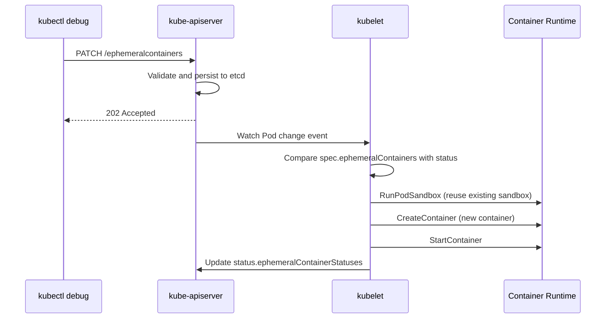
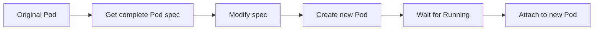
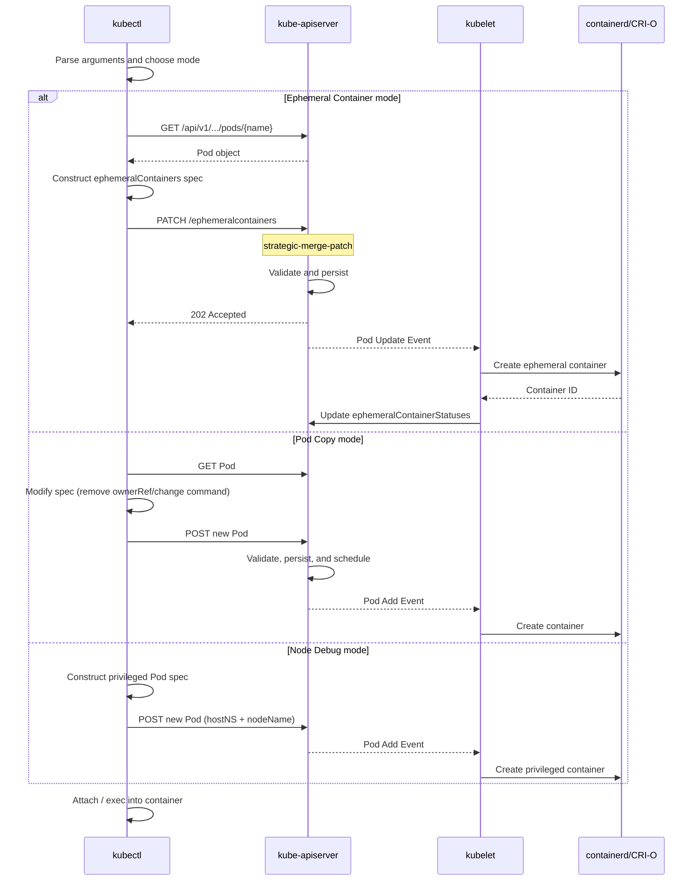
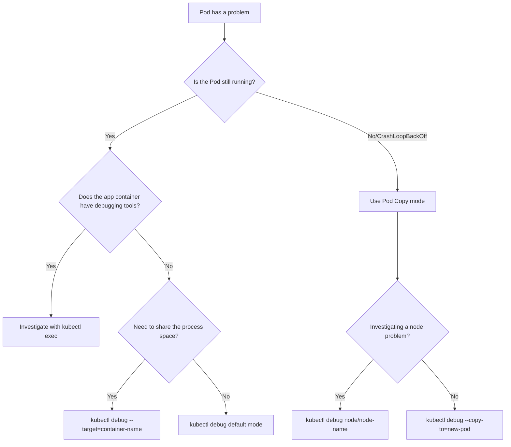

# How kubectl debug Works

## 1. What Is kubectl debug?

`kubectl debug` is a debugging command introduced in Kubernetes v1.18, reaching beta in v1.20 and GA in v1.23. Before it existed, troubleshooting Pods often presented a dilemma: application images used minimal runtimes such as distroless or scratch for size and security, leaving out even basic tools such as `curl`, `ps`, and `tcpdump`. Operators had to rebuild images with debugging tools or exec into containers where they could do very little.

`kubectl debug` addresses this problem with three debugging modes:

| Mode | Example command | Use case |
|------|----------|----------|
| **Ephemeral Container** (dynamic injection) | `kubectl debug -it <pod> --image=busybox --target=<container>` | A running Pod cannot be modified, and a temporary container is needed for investigation. |
| **Pod Copy** (debug a copy) | `kubectl debug <pod> --copy-to=debug-pod --share-pid -- bash` | Change startup commands or images to reproduce a problem. |
| **Node Debug** (debug a node) | `kubectl debug node/<node> -it --image=busybox` | Investigate node-level filesystem, process, or networking problems. |

The following sections examine the underlying mechanisms one by one.

## 2. Core Mechanism 1: Ephemeral Containers

### 2.1 Why Ephemeral Containers Are Needed

A Pod is Kubernetes' smallest scheduling unit. Once created, its `.spec.containers` field is **immutable**: you cannot add a regular container at runtime. kube-apiserver enforces this design constraint during Pod object schema validation.

Ephemeral containers take a separate route. Instead of `.spec.containers`, they use the Pod's **dedicated subresource**, `/ephemeralcontainers`, declared in `PodStatus`. This means:

1. **No Pod spec validation path**: There is no need to change the immutable `.spec.containers` field.
2. **No scheduling involvement**: The scheduler is not asked to reschedule the Pod.
3. **No resource guarantees**: Ephemeral containers cannot set `resources.requests/limits`; they "borrow" spare resources on the node hosting the Pod.
4. **No restarts**: kubelet does not try to restart them after exit.
5. **Not represented in the Pod spec**: They do not appear in the top-level spec of `kubectl get pod -o yaml`.

### 2.2 API Implementation

Ephemeral containers use the Pod subresource `/api/v1/namespaces/{ns}/pods/{name}/ephemeralcontainers`.

```text
# Equivalent API request made by kubectl debug
PATCH /api/v1/namespaces/default/pods/my-pod/ephemeralcontainers
Content-Type: application/strategic-merge-patch+json

{
  "spec": {
    "ephemeralContainers": [
      {
        "name": "debug-abc123",
        "image": "busybox:latest",
        "command": ["sh"],
        "targetContainerName": "my-app",
        "stdin": true,
        "tty": true
      }
    ]
  }
}
```

Key points:
- This is a **PATCH**, not PUT or POST, allowing incremental additions to the existing ephemeral container list.
- The Content-Type is `strategic-merge-patch+json`.
- After an ephemeral container is appended to `spec.ephemeralContainers[]`, kubelet records it in `status.ephemeralContainerStatuses[]`.

### 2.3 Creation by kubelet

When kubelet detects a change to the Pod's `spec.ephemeralContainers`, it performs these steps:



Key differences from regular containers:
1. **Reuses the Pod sandbox**: Joins the target Pod's existing network/PID namespaces instead of creating new ones, depending on whether `--target` is specified.
2. **No resource reservation**: Skips resource admission and creates the container directly.
3. **Does not affect Pod status**: The Pod phase remains unchanged even if the ephemeral container exits or is OOM-killed.

### 2.4 Namespace Sharing

An ephemeral container's namespace behavior is controlled by `--target`:

```bash
# Without --target: independent namespaces plus shared Pod namespaces
kubectl debug -it my-pod --image=busybox
# Has its own process space but shares the Pod network

# With --target <container>: join all namespaces of the target container
kubectl debug -it my-pod --image=busybox --target=my-app
# Process space, networking, and filesystem match the target container
```

`--target` maps to `targetContainerName` in the ephemeral container spec. When set, kubelet/CRI places the new container in the target container's Linux namespaces. At the implementation level, a CRI runtime such as containerd uses `/proc/{pid}/ns/{net,pid,mnt}` from the target container as namespace references for the new container, enabling "sidecar-style" process injection.

This explains why:
- Without `--target`, `ps aux` only shows the debugger's own processes.
- With `--target`, `ps aux` shows all processes in the target container through the shared PID namespace.
- With `--target`, the target filesystem can be accessed directly, for example via `/proc/1/root`.

## 3. Core Mechanism 2: Pod Copy

### 3.1 How It Works

When you run `kubectl debug <pod> --copy-to=<new-name>`, kubectl performs this flow:



Detailed steps:
1. **Get** the original Pod's complete object, including spec and metadata.
2. **Modify** key fields:
   - Remove `metadata.ownerReferences` so a higher-level controller no longer manages it.
   - Clear selector labels in `metadata.labels` to avoid selection by a Service.
   - Remove non-reusable fields such as `metadata.resourceVersion` and `metadata.uid`.
   - Replace `.spec.containers[0].command` with a debugging command such as `["sleep", "1d"]` or `["sh"]`.
   - If `--share-pid` is specified, set `shareProcessNamespace: true` in the Pod spec.
3. **Create** the new Pod through the standard API.
4. **Attach** to its stdin/stdout.

### 3.2 Isolation from the Original Pod

Pod Copy creates a **completely independent new Pod**. Its main isolation properties are:

| Property | Behavior |
|------|------|
| **Networking** | Separate network namespace and Pod IP. |
| **Storage** | Volumes are not shared by default, except node-level storage such as hostPath. |
| **Node** | May run on the same node, depending on resources; a node can be specified with `--node`. |
| **Labels** | Stripped to avoid Service selection and accidental traffic routing. |

### 3.3 When to Use Pod Copy

- **Change startup commands**: The original entrypoint is an application that crashes immediately; replace it with `sleep 1d` to investigate.
- **Reproduce startup problems**: The original Pod exits before an ephemeral container can be injected with `kubectl debug`.
- **Require full resource isolation**: Avoid having the debugger compete for resources on the original Pod's node.

## 4. Core Mechanism 3: Node Debug

### 4.1 How It Works

```bash
kubectl debug node/<node-name> -it --image=busybox
```

This command essentially creates a **privileged Pod using host namespaces** and forces it onto the target node:

```yaml
# Equivalent to the Pod created by kubectl debug:
spec:
  nodeName: <target-node>          # Force placement on the target node
  hostNetwork: true                # Use host networking
  hostPID: true                    # Use the host process space
  hostIPC: true                    # Use host IPC
  containers:
  - name: debugger
    image: busybox
    stdin: true
    tty: true
    volumeMounts:
    - name: host-root
      mountPath: /host             # Mount the host root filesystem
    securityContext:
      privileged: true             # Privileged mode
  volumes:
  - name: host-root
    hostPath:
      path: /
```

### 4.2 Key Design Choices

1. **Node filesystem access**: Mounts the host's `/` at `/host` using `hostPath`, allowing direct inspection and modification of node files.
2. **Host process space**: `hostPID: true` allows `nsenter` into any host process and inspection of all node processes.
3. **Host networking**: `hostNetwork: true` gives direct access to node network interfaces for investigating iptables rules and network configuration.
4. **Privileged mode**: `privileged: true` bypasses most security checks and permits system-level operations.

### 4.3 Implementation Details

Unlike an ordinary Pod, a Node Debug Pod:

- Bypasses the scheduler because `nodeName` is set directly.
- Binds directly to the node through `spec.nodeName`.
- Follows kubelet's normal CRI container-creation flow, but privileged mode and host namespaces make it effectively a highly privileged process on the node.

## 5. Debugging Profiles

Starting in Kubernetes v1.23, `kubectl debug` supports `--profile`, which simplifies configuration for different scenarios using predefined profiles:

```bash
# Show supported profiles
kubectl debug --help

# Use the general profile (default)
kubectl debug -it my-pod --image=busybox --profile=general

# Use netadmin, which includes network administration capabilities
kubectl debug -it my-pod --image=busybox --profile=netadmin
```

A profile is essentially a **preset of security capabilities for an ephemeral container**:

| Profile | Linux capabilities | Purpose |
|---------|-------------------|------|
| `general` | `NET_ADMIN`, `NET_RAW` | General debugging, including tcpdump. |
| `baseline` | No additional capabilities | Minimal privileges, basic shell only. |
| `netadmin` | `NET_ADMIN`, `NET_RAW`, `SYS_ADMIN` | Full network administration. |
| `sysadmin` | `SYS_ADMIN`, `SYS_PTRACE`, and others | System administration debugging. |
| `debug` | All capabilities | Equivalent to privileged mode, with maximum permissions. |

Internally, profiles map to the ephemeral container's `securityContext.capabilities.add` and `securityContext.privileged` fields.

## 6. Complete kubectl debug Execution Flow



## 7. Ephemeral Container Limitations

Knowing these limits helps you choose correctly during troubleshooting:

### 7.1 Hard Constraints
- **Cannot be removed**: Once added, it cannot be deleted. Its status remains in the Pod after exit until the Pod is destroyed.
- **Cannot be modified**: After creation, fields such as image and command are immutable.
- **No resource reservation**: `resources.requests/limits` cannot be set, so the node OOM killer may terminate it.
- **No health checks**: `livenessProbe`, `readinessProbe`, and `startupProbe` are unsupported.
- **No lifecycle hooks**: `lifecycle.postStart` and `preStop` are unsupported.
- **No exposed ports**: Ephemeral containers cannot declare `ports`.

### 7.2 Version Compatibility
- Kubernetes v1.16–1.22: Ephemeral containers are alpha/beta and require manually enabling `EphemeralContainers=true`.
- Kubernetes v1.23+: GA and enabled by default.
- The `kubectl debug` command is available from kubectl v1.18 onward.

### 7.3 Security
- Users of `kubectl debug` are permitted through RBAC to perform `update` or `patch` on the `pods/ephemeralcontainers` subresource.
- This permission must be granted explicitly in RBAC.
- Misuse can create security risks because an ephemeral container can be injected into any Pod and share its namespaces.

## 8. Practical Scenarios and Selection Strategy



## 9. Summary

| Dimension | Ephemeral Container | Pod Copy | Node Debug |
|------|--------------------|----------|------------|
| **API resource** | Pod subresource `/ephemeralcontainers` | New Pod | New Pod |
| **Creation method** | PATCH | POST | POST |
| **Pod lifecycle** | Attached to the original Pod | Independent new Pod | Independent new Pod |
| **Namespace sharing** | Optional, using `--target` | Optional, using `--share-pid` | Host namespaces |
| **Resource reservation** | Unsupported | Supported | Supported |
| **Use case** | Runtime troubleshooting | Startup/crash troubleshooting | Node-level troubleshooting |

Understanding `kubectl debug` helps you quickly select a debugging strategy. It also illustrates the distinctive ephemeral container API design: enabling "injection" within Kubernetes' immutable Pod model.
