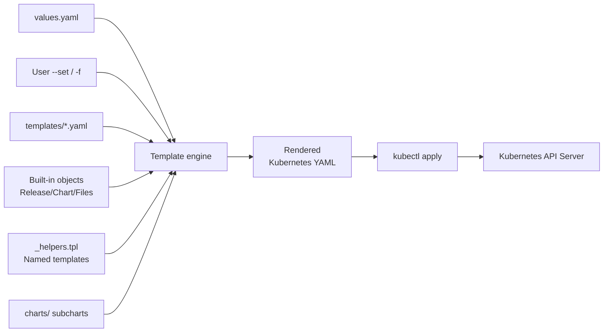

# Helm Explained: Chart Structure and Template Rendering

## 1. Helm Overview

Helm is Kubernetes' package manager, analogous to `apt` or `yum` on Linux. It helps developers with:

1. **Unified management**: Package related Kubernetes resources into a Chart for distribution and reuse.
2. **Parameterized deployment**: Separate configuration from templates through `values.yaml`, adapting the same templates to different environments.
3. **Version control**: Manage Chart versions, upgrades, and rollbacks for more reliable application lifecycle management.
4. **Dependency management**: Automatically handle dependencies between Charts.

### Core Helm Concepts

| Concept | Description |
|------|------|
| **Chart** | A Helm package containing all Kubernetes resource definitions required to run an application. |
| **Repository** | Stores and shares Charts. |
| **Release** | An instance of a Chart running in a Kubernetes cluster. |
| **Revision** | A Release snapshot; each `helm upgrade` creates a new revision. |

## 2. Chart Directory Structure

A standard Helm Chart has this structure:

```
mychart/
├── Chart.yaml          # Chart metadata
├── values.yaml         # Default configuration values
├── values.schema.json  # Optional JSON Schema validation for values
├── charts/             # Subchart dependencies
├── templates/          # Kubernetes resource templates
│   ├── NOTES.txt       # Help displayed after installation
│   ├── _helpers.tpl    # Helpers: named templates
│   ├── deployment.yaml # Deployment template
│   ├── service.yaml    # Service template
│   ├── ingress.yaml    # Ingress template
│   ├── hpa.yaml        # HPA template
│   ├── serviceaccount.yaml
│   ├── configmap.yaml
│   └── tests/          # Test templates
│       └── test-connection.yaml
├── crds/               # Optional CustomResourceDefinitions
├── .helmignore         # Files excluded from packaging
├── LICENSE             # License
└── README.md           # Documentation
```

### 2.1 `Chart.yaml`: Chart Metadata

This is the Chart's identity document, defining its basic information. **Every Chart must contain this file**.

```yaml
apiVersion: v2          # Chart API version: v2 corresponds to Helm 3
name: mychart           # Chart name
version: 0.1.0          # Chart version in SemVer 2 format
appVersion: "1.16.0"    # Application version
description: A Helm chart for Kubernetes
type: application       # application or library
keywords:
  - nginx
  - web
maintainers:
  - name: zhihao
    email: zhihao@example.com
dependencies:           # Other Charts this Chart depends on
  - name: mysql
    version: "9.4.0"
    repository: "https://charts.bitnami.com/bitnami"
    condition: mysql.enabled
```

**Key fields**:

- **`apiVersion: v2`**: Helm 3 uses v2; Helm 2 uses v1.
- **`type`**：
  - `application`: Deployable application Chart, the default.
  - `library`: Generates no resources; provides reusable named templates.
- **`dependencies`**: Declares Chart dependencies, downloaded into `charts/` by `helm dependency update`.
- **`condition`**: Conditional dependency, enabling a subchart according to values.

### 2.2 `values.yaml`: Default Configuration

This is the Chart's configuration center, defining defaults for every configurable template parameter. Templates access them through `.Values.xxx`.

```yaml
# Replica count
replicaCount: 2

# Image configuration
image:
  repository: nginx
  pullPolicy: IfNotPresent
  tag: "1.25.0"

# Service configuration
service:
  type: ClusterIP
  port: 80

# Ingress configuration
ingress:
  enabled: false
  className: nginx
  hosts:
    - host: example.local
      paths:
        - path: /
          pathType: Prefix

# Resource limits
resources:
  limits:
    cpu: 500m
    memory: 512Mi
  requests:
    cpu: 250m
    memory: 256Mi

# Environment variables
env:
  - name: LOG_LEVEL
    value: info

# Node selector
nodeSelector: {}

# Tolerations
tolerations: []

# Affinity
affinity: {}
```

**Ways to override configuration**:

```bash
# Option 1: Command-line --set
helm install my-release ./mychart --set replicaCount=3 --set image.tag=v2.0

# Option 2: Custom values file
helm install my-release ./mychart -f custom-values.yaml

# Option 3: Multiple values files; later files take precedence
helm install my-release ./mychart -f base.yaml -f production.yaml
```

**Precedence from lowest to highest**:

```
Chart values.yaml  <  Parent Chart values  <  User -f files  <  --set arguments
```

### 2.3 `templates/`: Template Directory

This is the Chart's core, containing Kubernetes resource templates to render. Helm uses **Go templates**, extended with the **Sprig function library** and **Helm built-in objects and functions**.

#### Template Filename Rules

- **Extensions must be `.yaml`, `.yml`, `.tpl`, or `.txt`**.
- Files starting with `_`, such as `_helpers.tpl`, are not rendered into Kubernetes resources.
- `NOTES.txt` is special: its rendered content is printed after `helm install` completes.

#### Built-In Helm Objects

Templates can directly access these objects:

| Object | Description | Example |
|------|------|------|
| `.Release` | Release information | `.Release.Name`, `.Release.Namespace`, `.Release.Revision` |
| `.Values` | Configuration from `values.yaml` | `.Values.replicaCount`, `.Values.image.tag` |
| `.Chart` | Metadata from `Chart.yaml` | `.Chart.Name`, `.Chart.Version` |
| `.Files` | Access to non-template Chart files | `.Files.Get "config.json"` |
| `.Capabilities` | Cluster capabilities | `.Capabilities.KubeVersion` |
| `.Template` | Current template metadata | `.Template.Name` |

#### `_helpers.tpl`: Named Templates

##### Why Do We Need `_helpers.tpl`?

Suppose Deployment, Service, and ConfigMap templates all need identical labels in `metadata.labels` and `spec.selector.matchLabels`:

```yaml
# deployment.yaml: write the labels once
metadata:
  labels:
    app.kubernetes.io/name: mychart
    app.kubernetes.io/instance: my-release

# service.yaml: write the same labels again
metadata:
  labels:
    app.kubernetes.io/name: mychart
    app.kubernetes.io/instance: my-release

# configmap.yaml: write exactly the same labels a third time
metadata:
  labels:
    app.kubernetes.io/name: mychart
    app.kubernetes.io/instance: my-release
```

**The problems are obvious**:
1. **Repeated work**: Identical content is written three times.
2. **Difficult maintenance**: Renaming a label requires changing all three files.
3. **Error-prone updates**: Missing one file creates inconsistent labels.

`_helpers.tpl` solves this by **defining repeated fragments once and referencing them everywhere**. Compare it to programming:

| Programming language | Helm template |
|---------|----------|
| Define `func getName() { ... }` | `{{- define "mychart.name" -}} ... {{- end }}` |
| Call `getName()` | `{{ include "mychart.name" . }}` |
| Header file / utility module | `_helpers.tpl` file |

> **Why does the filename begin with `_`?**
>
> When Helm renders `templates/`, **files starting with `_` do not produce Kubernetes resource YAML**. Helm loads their `define` declarations as helpers for other templates. They resemble C `.h` headers: declarations without executable output.

---

##### Dissecting `_helpers.tpl` from Scratch

The following breaks down the syntax line by line to explain **what each line does and why it is written that way**.

##### 1. Comments: `{{/* ... */}}`

```yaml
{{/*
This Helm template comment is removed completely during rendering and does not appear in the final YAML.
It can span multiple lines, like a /* ... */ comment in code.
*/}}
```

- Unlike YAML `#` comments, `{{/* */}}` disappears during rendering, **leaving no trace in the final YAML**.
- It is commonly placed before each `define` to explain its purpose.

##### 2. Defining Named Templates: `define` and `end`

```yaml
{{- define "template-name" -}}
  Template content...
{{- end }}
```

- **`define "template-name"`**: Declares a named template. The string name must be **globally unique** across the Chart.
- **`end`**: Ends the definition.
- **`{{-` and `-}}`**: The hyphen **removes whitespace**, including spaces and newlines, as explained below.

##### 3. First Named Template: `mychart.fullname`

```yaml
{{- define "mychart.fullname" -}}
{{- .Release.Name | trunc 63 | trimSuffix "-" }}
{{- end }}
```

Line-by-line explanation:

| Syntax | Meaning |
|------|------|
| `{{- define "mychart.fullname" -}}` | Defines `mychart.fullname`; surrounding hyphens consume the line's newline characters. |
| `{{- .Release.Name \| trunc 63 \| trimSuffix "-" }}` | **Pipeline**: Take the Release name → truncate to 63 characters → remove a trailing hyphen. |
| `{{- end }}` | Ends the definition. |

> **Why 63 characters?** Kubernetes resource names, such as Deployment and Service names, cannot exceed 63 characters. Helm uses `trunc 63` to prevent overlong generated names.

**What is the `|` pipeline?** As in a Linux shell, it passes the left-hand output to the right-hand operation:

```
.Release.Name          →  "my-very-long-release-name-with-extra-words"
      ↓  trunc 63      →  "my-very-long-release-name-with-extra-words" (under 63 characters, unchanged)
      ↓  trimSuffix "-" →  Remove a trailing hyphen, preventing a name truncated at a hyphen
Final result             →  "my-very-long-release-name-with-extra-words"
```

##### 4. Second Named Template: `mychart.labels`

```yaml
{{/*
mychart.labels: generate standard Kubernetes recommended labels
These labels go into metadata.labels on every resource
*/}}
{{- define "mychart.labels" }}
app.kubernetes.io/name: {{ include "mychart.name" . }}
app.kubernetes.io/instance: {{ .Release.Name }}
app.kubernetes.io/version: {{ .Chart.AppVersion }}
app.kubernetes.io/managed-by: {{ .Release.Service }}
{{- end }}
```

Line-by-line explanation:

| Line | Meaning |
|----|------|
| `app.kubernetes.io/name: {{ include "mychart.name" . }}` | Outputs YAML with key `app.kubernetes.io/name` and the result of `mychart.name` as its value. The dot passes the current context, explained later. |
| `app.kubernetes.io/instance: {{ .Release.Name }}` | Outputs a YAML line using the Release name. |
| `app.kubernetes.io/version: {{ .Chart.AppVersion }}` | Outputs the `appVersion` from `Chart.yaml`. |
| `app.kubernetes.io/managed-by: {{ .Release.Service }}` | Outputs the deployment tool name, set to `"Helm"` by Helm. |

> **`app.kubernetes.io/xxx` labels follow Kubernetes' recommended convention** ([documentation](https://kubernetes.io/docs/concepts/overview/working-with-objects/common-labels/)) and are recognized by tools including kubectl, monitoring systems, and service meshes.

##### 5. Third Named Template: `mychart.selectorLabels`

```yaml
{{/*
mychart.selectorLabels: generate selector labels
Deployments use selector labels to find their managed Pods.
They must be a subset of Pod template labels and are immutable after creation.
*/}}
{{- define "mychart.selectorLabels" }}
app.kubernetes.io/name: {{ include "mychart.name" . }}
app.kubernetes.io/instance: {{ .Release.Name }}
{{- end }}
```

> **Why does selectorLabels contain fewer fields than labels?**
>
> `spec.selector.matchLabels` **associates a Deployment with Pods** and is **immutable** after Deployment creation. Including a version would force Deployment recreation on every version upgrade. Keep only the stable **name and instance** dimensions in selectors.

---

##### Key Concept: What Does the Second `include` Argument, `.`, Mean?

This often confuses beginners. Consider:

```yaml
{{ include "mychart.name" . }}
```

- **First argument, `"mychart.name"`**: The template to call.
- **Second argument, `.`**: The **context object** passed to the template. In Go templates, the dot denotes the top-level object of the current scope.

**Plain-language analogy**: Imagine being in a room. The dot means everything visible in that room, including `.Values`, `.Release`, and `.Chart`. Passing it to a subtemplate means "here is all the data I can access; take what you need".

A code analogy:

```go
// Go analogy
type Context struct {
    Values  map[string]interface{}
    Release ReleaseInfo
    Chart   ChartInfo
    // ...
}

// mychart.name corresponds to this function; ctx is the dot
func mychart_name(ctx Context) string {
    return ctx.Chart.Name  // Corresponds to .Chart.Name in the template
}

// Pass the current context when calling
name := mychart_name(currentContext)  // Corresponds to include "mychart.name" .
```

---

##### Key Concept: Whitespace Control with `{{-` and `-}}`

This is one of Helm's most frustrating details. Compare these versions:

**❌ Without hyphens: extra blank lines**:

Template:
```yaml
{{ define "mychart.fullname" }}
{{ .Release.Name }}
{{ end }}
```

Rendered output, including extra newlines:
```


my-release


```

**✅ With hyphens: remove extra whitespace**:

Template:
```yaml
{{- define "mychart.fullname" -}}
{{- .Release.Name }}
{{- end }}
```

Clean rendered output:
```
my-release
```

**Quick rules**:
- `{{-` removes whitespace on the **left**, including spaces, tabs, and newlines.
- `-}}` removes whitespace on the **right**, including spaces, tabs, and newlines.
- Hyphens on both sides compact the surrounding line whitespace.

> **Memory aid**: A hyphen consumes whitespace on its own side. `-}}` removes following whitespace; `{{-` removes preceding whitespace.

---

##### Practical Example: Referencing `_helpers.tpl` in a Deployment

Use the preceding named templates in a real Deployment template:

```yaml
# templates/deployment.yaml
apiVersion: apps/v1
kind: Deployment
metadata:
  name: {{ include "mychart.fullname" . }}        # ① Reference fullname
  labels:
    {{- include "mychart.labels" . | nindent 4 }} # ② Reference labels and indent
spec:
  replicas: {{ .Values.replicaCount }}
  selector:
    matchLabels:
      {{- include "mychart.selectorLabels" . | nindent 6 }}  # ③ Selector labels
  template:
    metadata:
      labels:
        {{- include "mychart.labels" . | nindent 8 }}        # ④ Pod template labels
    spec:
      containers:
        - name: {{ .Chart.Name }}
          image: "{{ .Values.image.repository }}:{{ .Values.image.tag }}"
```

**Explanation by location**:

| Location | Code | Meaning |
|------|------|------|
| ① | `{{ include "mychart.fullname" . }}` | Generates a Deployment name such as `my-release-mychart`. |
| ② | `{{- include "mychart.labels" . \| nindent 4 }}` | Generates four label lines and indents them **four spaces**, matching `metadata.labels`. |
| ③ | `{{- include "mychart.selectorLabels" . \| nindent 6 }}` | Generates two selector label lines and indents them **six spaces**, matching the deeper `spec.selector.matchLabels`. |
| ④ | `{{- include "mychart.labels" . \| nindent 8 }}` | Pod template labels require **eight spaces** of indentation. |

> **What is `nindent N`?**
>
> `nindent` means **n**ewline plus **indent**. It performs two actions:
> 1. Prefixes a **newline** character, `\n`.
> 2. Indents each following line by `N` spaces.
>
> Because `{{-` consumes preceding whitespace, `nindent` restores the correct indentation. Without it, labels would begin at the left margin and break the YAML hierarchy.

**Demonstrating `nindent`**:

```
# Raw include "mychart.labels" . output: no indentation or leading newline
app.kubernetes.io/name: mychart
app.kubernetes.io/instance: my-release
app.kubernetes.io/version: 1.16.0
app.kubernetes.io/managed-by: Helm

# After | nindent 4: leading newline and four spaces per line
(Blank line produced by nindent's newline)
    app.kubernetes.io/name: mychart
    app.kubernetes.io/instance: my-release
    app.kubernetes.io/version: 1.16.0
    app.kubernetes.io/managed-by: Helm
```

---

##### Walking Through the Complete Rendering Process

Assume:
- `Release.Name` = `my-release`
- `Chart.Name` = `mychart`
- `Chart.AppVersion` = `1.16.0`
- `Release.Service` = `Helm`
- Both `nameOverride` and `fullnameOverride` are empty.

**Step 1**: Helm loads `_helpers.tpl` and registers its three `define` declarations in the named-template pool.

**Step 2**: While rendering `deployment.yaml`, it encounters `{{ include "mychart.fullname" . }}`:

```
Enter mychart.fullname
  → .Release.Name = "my-release"
  → After trunc 63: "my-release" (under 63 characters)
  → After trimSuffix "-": "my-release" (no trailing hyphen)
  → Return "my-release", the Deployment name
```

**Step 3**: At `labels:`, it encounters `{{- include "mychart.labels" . | nindent 4 }}`:

```
Enter mychart.labels and evaluate each line:
  app.kubernetes.io/name: ... → Call mychart.name → .Chart.Name = "mychart"
  app.kubernetes.io/instance: ... → .Release.Name = "my-release"
  app.kubernetes.io/version: ... → .Chart.AppVersion = "1.16.0"
  app.kubernetes.io/managed-by: ... → .Release.Service = "Helm"

Apply nindent 4 to the four output lines, indent each by four spaces, and insert them beneath labels:.
```

**Step 4**: Render selector labels and Pod template labels in the same way.

**Final output**:

```yaml
apiVersion: apps/v1
kind: Deployment
metadata:
  name: my-release-mychart
  labels:
    app.kubernetes.io/name: mychart
    app.kubernetes.io/instance: my-release
    app.kubernetes.io/version: 1.16.0
    app.kubernetes.io/managed-by: Helm
spec:
  replicas: 2
  selector:
    matchLabels:
      app.kubernetes.io/name: mychart
      app.kubernetes.io/instance: my-release
  template:
    metadata:
      labels:
        app.kubernetes.io/name: mychart
        app.kubernetes.io/instance: my-release
        app.kubernetes.io/version: 1.16.0
        app.kubernetes.io/managed-by: Helm
    spec:
      containers:
        - name: mychart
          image: "nginx:1.25.0"
```

All three label sets, on the Deployment itself, selector matchLabels, and Pod template, are generated consistently through `_helpers.tpl`. **One change in `_helpers.tpl` updates labels across all resource files**: the central benefit of named templates.

---

##### `include` vs. `template`

| Feature | `include` | `template` |
|------|-----------|------------|
| Return value | Returns a **string**, usable in assignments and pipelines | Writes directly into the template without a return value |
| Pipelines | ✅ Supported, such as `include "x" . \| quote` | ❌ No pipeline processing |
| Indentation | Use `indent` / `nindent` | Handled automatically |
| Recommendation | ⭐⭐⭐ **Preferred** | ⭐ Simple cases only |

**Why prefer `include`?** Its string result combines with pipeline functions:

```yaml
# ✅ include: call the template, then quote its result
key: {{ include "mychart.name" . | quote }}
# Result: key: "mychart"

# ✅ include: call the template, then indent
labels:
  {{- include "mychart.labels" . | nindent 4 }}

# ❌ template writes directly, so its output cannot be post-processed this way
```

**Rule of thumb**: Prefer `include` unless you are certain that the result needs no processing.

---

##### Common Sprig Function: `dig` for Safe Nested Lookups

Helpers and templates often read nested configuration from `.Values`. For example:

```yaml
# values.yaml
global:
  spire:
    eksProfiles:
      enabled: true
      server: "spire-server.example.com"
```

**❌ The problem with direct dot access**:

```yaml
{{ .Values.global.spire.eksProfiles.server }}
```

If **any** of `global`, `spire`, or `eksProfiles` is missing, Helm rendering **fails** with a Go template nil panic. Common examples:

- An environment does not use SPIRE, so `global.spire` is absent from `values.yaml`.
- `helm install --set` overrides only some values, leaving intermediate levels missing.

**✅ `dig` addresses this problem**:

```
dig "key1" "key2" ... "keyN" default-value data-source
```

`dig` attempts nested lookups **one level at a time**. If any level is missing or nil, it **returns the specified default** instead of failing.

**Dissecting the example**:

```yaml
{{- $profiles := dig "spire" "eksProfiles" (dict) .Values.global -}}
```

Part-by-part explanation:

| Part | Meaning |
|------|------|
| `$profiles :=` | Defines **variable** `$profiles` and stores the right-hand result; `:=` is Go template assignment syntax. |
| `dig` | Sprig's safe nested lookup function. |
| `"spire"` | First-level key, looking for `.Values.global.spire`. |
| `"eksProfiles"` | Second-level key, then looking for `.spire.eksProfiles`. |
| `(dict)` | **Default**: An **empty dictionary `{}`** if `spire.eksProfiles` is missing beneath `.Values.global`; Sprig's `dict` creates an empty map. |
| `.Values.global` | **Data source**: The object where lookup starts. |

**Flow diagram**:

```
dig "spire" "eksProfiles" (dict) .Values.global

Step 1: Does .Values.global exist?
  ├─ No → Return default (dict) = {}
  └─ Yes → Continue to step 2

Step 2: Does .Values.global.spire exist?
  ├─ No → Return default {}
  └─ Yes → Continue to step 3

Step 3: Does .Values.global.spire.eksProfiles exist?
  ├─ No → Return default {}
  └─ Yes → Return its value, such as {enabled: true, server: "spire-server.example.com"}
```

**Practical comparison**:

```yaml
# values.yaml scenario A: complete configuration
global:
  spire:
    eksProfiles:
      enabled: true
      server: "spire.example.com"

# Use dig in the template:
{{- $profiles := dig "spire" "eksProfiles" (dict) .Values.global -}}
# $profiles = map[enabled:true server:spire.example.com]
# Safely access $profiles.enabled and $profiles.server afterward ✅


# values.yaml scenario B: no spire under global, for example in a development environment without SPIRE
global:
  imageRegistry: my-registry.com
  # No spire key here!

# Use dig in the template:
{{- $profiles := dig "spire" "eksProfiles" (dict) .Values.global -}}
# $profiles = map[] (empty dictionary, no error!) ✅
# Using {{ .Values.global.spire.eksProfiles }} instead → 💥 Rendering fails!


# values.yaml scenario C: spire exists, but eksProfiles does not
global:
  spire:
    serverAddr: "spire-server.example.com"
    # No eksProfiles key here!

# Use dig in the template:
{{- $profiles := dig "spire" "eksProfiles" (dict) .Values.global -}}
# $profiles = map[] (silently returns an empty dictionary) ✅
```

**How is `$profiles` used afterward?**

```yaml
{{- $profiles := dig "spire" "eksProfiles" (dict) .Values.global -}}
{{- range $name, $profile := $profiles }}
---
# Generate configuration for each EKS profile
profile: {{ $name }}
server: {{ $profile.server }}
{{- end }}
```

> **`dig` vs. `default`**:
>
> | Function | Purpose | Example |
> |------|------|------|
> | `default` | A default for a **single value** | `{{ .Values.image.tag \| default "latest" }}`: handles one level. |
> | `dig` | Safely traverses **multiple nested levels** | `{{ dig "a" "b" "c" "default" .Values }}`: traverses a→b→c, returning the default if a level is absent. |
>
> **Rule of thumb**: Use `dig` for paths deeper than one level and `default` for a single level.

##### `_helpers.tpl` Best Practices

1. **Comment every named template**: Use `{{/* */}}` to explain its purpose and return format.
2. **Prefix names with the Chart name**: Use `mychart.fullname`, rather than `fullname`, to avoid subchart conflicts.
3. **Follow Kubernetes label conventions**: Use recommended `app.kubernetes.io/` labels.
4. **Separate `labels` and `selectorLabels`**: Keep immutable selectors minimal; mutable labels can be richer.
5. **Use `nindent` wherever indentation is needed**: Avoid counting spaces manually.
6. **Use `dig` instead of direct dot access for nested values**: Prevent missing configuration from crashing rendering.

### 2.4 `charts/`: Subchart Dependencies

This directory contains subcharts on which the current Chart depends. There are two ways to populate it:

**Option 1: Place them manually**

Put subchart archives or directories directly in `charts/`.

**Option 2: Dependency management, recommended**

Declare `dependencies` in `Chart.yaml`, then run:

```bash
# Download dependencies into charts/ and generate Chart.lock to pin versions
helm dependency update mychart/

# Package dependencies into mychart-0.1.0.tgz
helm dependency build mychart/
```

Example directory after downloading:

```
charts/
├── mysql-9.4.0.tgz       # Archive format
└── redis-18.0.0.tgz
```

### 2.5 `Chart.lock`: Dependency Lockfile

Like `package-lock.json`, this pins exact dependency Chart versions for reproducible builds.

```yaml
dependencies:
- name: mysql
  version: 9.4.0
  repository: https://charts.bitnami.com/bitnami
  digest: sha256:abc123...
```

### 2.6 `crds/`: Custom Resource Definitions

Contains CustomResourceDefinition YAML files. These files:

- **Are not templated** and are installed unchanged.
- **Do not support upgrades or rollbacks**: Helm does not modify installed CRDs during later upgrades, and uninstalling a Release does not delete them.
- Suit scenarios involving Operator installation.

### 2.7 `.helmignore`: Excluded Files

Like `.gitignore`, this lists files excluded by `helm package`.

```
# Ignore .git
.git/
# Ignore temporary files
*.swp
*.bak
*.tmp
# Ignore IDE configuration
.idea/
.vscode/
```

## 3. Helm Rendering: Flow and Mechanisms

### 3.1 Complete Rendering Pipeline



### 3.2 Step-by-Step Rendering

When `helm install` or `helm template` runs, Helm follows these steps:

**Step 1: Load and merge values**

Helm merges configuration sources from lowest to highest precedence:

```
Chart's built-in values.yaml
  → Parent Chart values, if any
    → Custom -f values files, overriding in the specified order
      → --set command-line arguments
```

It uses **deep merging**: nested maps merge recursively rather than being replaced wholesale.

```yaml
# values.yaml: base
image:
  repository: nginx
  tag: "1.25"

# custom.yaml: override
image:
  tag: "1.26"
  pullPolicy: Always

# Merged result
image:
  repository: nginx      # Original value retained
  tag: "1.26"            # Overridden
  pullPolicy: Always      # Added
```

**Step 2: Resolve Chart dependencies**

Process `Chart.yaml` dependencies and ensure subcharts in `charts/` are current. If a `condition` is declared, its corresponding values entry determines whether the subchart is enabled.

**Step 3: Build the template context**

Create a rendering context containing all built-in objects:

- `.Release`: Current Release Name, Namespace, Service, and related data.
- `.Values`: Complete configuration merged in step 1.
- `.Chart`: Metadata from `Chart.yaml`.
- `.Files`: Access to non-template files in the Chart package.
- `.Capabilities`: Capabilities of the target Kubernetes cluster.
- `.Template`: Name and BasePath of the current template file.

**Step 4: Recursively render templates/**

Run Go template rendering for each `.yaml` or `.tpl` file in `templates/`:

1. **Parse**: Go's `text/template` engine parses the syntax.
2. **Inject functions**: Add the Sprig library, with over 70 functions, and Helm-specific functions.
3. **Load named templates**: Process `_`-prefixed files such as `_helpers.tpl` first, loading `define` declarations into the named-template pool.
4. **Render each file**: Process remaining YAML files, looking up `include` and `template` calls in that pool.

**Step 5: Post-process and output**

Helm post-processes the rendered YAML:

1. **Remove extra blank lines** created during rendering.
2. **Split multi-document YAML**: Templates may produce several `---`-separated documents; Helm splits them into individual resources.
3. **Sort by resource kind**: For example, Namespace → ServiceAccount → ConfigMap → Deployment → Service.
4. **Identify subchart resources**: Automatically add `helm.sh/chart` labels to identify their source.

### 3.3 Complete Rendering Example

#### values.yaml

```yaml
replicaCount: 2
image:
  repository: nginx
  tag: "1.25.0"
  pullPolicy: IfNotPresent
service:
  type: ClusterIP
  port: 80
nameOverride: ""
fullnameOverride: ""
```

#### templates/_helpers.tpl

```yaml
{{- define "mychart.name" -}}
{{- default .Chart.Name .Values.nameOverride | trunc 63 | trimSuffix "-" }}
{{- end }}

{{- define "mychart.fullname" -}}
{{- if .Values.fullnameOverride }}
{{- .Values.fullnameOverride | trunc 63 | trimSuffix "-" }}
{{- else }}
{{- $name := default .Chart.Name .Values.nameOverride }}
{{- printf "%s-%s" .Release.Name $name | trunc 63 | trimSuffix "-" }}
{{- end }}
{{- end }}
```

#### templates/deployment.yaml: Template

```yaml
apiVersion: apps/v1
kind: Deployment
metadata:
  name: {{ include "mychart.fullname" . }}
  labels:
    {{- include "mychart.labels" . | nindent 4 }}
spec:
  replicas: {{ .Values.replicaCount }}
  selector:
    matchLabels:
      {{- include "mychart.selectorLabels" . | nindent 6 }}
  template:
    metadata:
      labels:
        {{- include "mychart.selectorLabels" . | nindent 8 }}
    spec:
      containers:
        - name: {{ .Chart.Name }}
          image: "{{ .Values.image.repository }}:{{ .Values.image.tag }}"
          imagePullPolicy: {{ .Values.image.pullPolicy }}
          ports:
            - name: http
              containerPort: {{ .Values.service.port }}
```

#### Run the Renderer

```bash
helm template my-release ./mychart --debug
```

#### Rendered Result

```yaml
apiVersion: apps/v1
kind: Deployment
metadata:
  name: my-release-mychart
  labels:
    app.kubernetes.io/name: mychart
    app.kubernetes.io/instance: my-release
spec:
  replicas: 2
  selector:
    matchLabels:
      app.kubernetes.io/name: mychart
      app.kubernetes.io/instance: my-release
  template:
    metadata:
      labels:
        app.kubernetes.io/name: mychart
        app.kubernetes.io/instance: my-release
    spec:
      containers:
        - name: mychart
          image: "nginx:1.25.0"
          imagePullPolicy: IfNotPresent
          ports:
            - name: http
              containerPort: 80
```

The `{{ }}` expressions have been replaced by actual values: Helm's core rendering capability.

### 3.4 Subchart Rendering

Subcharts have several special rendering properties:

1. **Independent rendering**: Each subchart renders in its own scope and accesses only its `.Values`, passed through its corresponding key in the parent values.
2. **Global values**: The `global` field shares configuration across Charts.

```yaml
# Parent Chart values.yaml
mysql:
  enabled: true
  auth:
    rootPassword: "secret123"

global:
  imageRegistry: my-registry.com
  imagePullSecrets:
    - name: regcred
```

Subchart templates access global configuration through `.Values.global`.

3. **Conditional dependencies**: `condition` in `Chart.yaml` dynamically enables or disables a subchart.

```yaml
dependencies:
  - name: mysql
    version: "9.4.0"
    repository: "https://charts.bitnami.com/bitnami"
    condition: mysql.enabled   # Install only when mysql.enabled=true
```

## 4. Common Helm Commands

### Repository Management

```bash
# Add a repository
helm repo add bitnami https://charts.bitnami.com/bitnami

# Update repository indexes
helm repo update

# List repositories
helm repo list

# Search for Charts
helm search repo nginx
helm search hub nginx      # Search Artifact Hub
```

### Chart Management

```bash
# Create a Chart
helm create mychart

# Syntax checking: lint
helm lint mychart/

# Package the Chart
helm package mychart/

# Inspect rendered output without installing
helm template my-release mychart/

# Render with debugging information
helm template my-release mychart/ --debug

# Inspect a Chart's values documentation
helm show values bitnami/nginx
helm show readme bitnami/nginx
```

### Release Management

```bash
# Install
helm install my-release mychart/ -n my-namespace --create-namespace

# List Releases
helm list -n my-namespace
helm list -A                        # All namespaces

# Inspect Release status
helm status my-release -n my-namespace

# Inspect actual Release configuration
helm get values my-release -n my-namespace
helm get values my-release --all    # Include defaults

# Inspect rendered Release manifests
helm get manifest my-release -n my-namespace

# Inspect Release history
helm history my-release -n my-namespace

# Upgrade
helm upgrade my-release mychart/ -n my-namespace -f new-values.yaml

# Roll back
helm rollback my-release 1 -n my-namespace   # Roll back to revision 1
helm rollback my-release -n my-namespace      # Roll back to the previous revision

# Uninstall
helm uninstall my-release -n my-namespace

# Dry-run
helm install my-release mychart/ --dry-run --debug
helm upgrade my-release mychart/ --dry-run --debug
```

### Dependency Management

```bash
# Update dependencies and download into charts/
helm dependency update mychart/

# List dependencies
helm dependency list mychart/

# Build and package dependencies
helm dependency build mychart/
```

## 5. Best Practices

### 5.1 Template Conventions

1. **Use named templates**: Extract repeated label, naming, and similar logic into `_helpers.tpl`.
2. **Use hyphens for whitespace control**: `{{-` removes left whitespace; `-}}` removes right whitespace.
3. **Provide defaults**: Sensible defaults for all values make Charts easier to use.
4. **Use `required`** to validate mandatory parameters.

```yaml
# Fail rendering if image.repository is unset
image: "{{ required "image.repository is required" .Values.image.repository }}:{{ .Values.image.tag }}"
```

### 5.2 Values Design

1. **Prefer flat structures over deep nesting**: Excessive nesting complicates overrides.
2. **Use descriptive names**: Parameters should explain themselves.
3. **Add comments** explaining each parameter's purpose in `values.yaml`.

### 5.3 Version Management

1. **Use SemVer** for Chart versions.
2. **Pin subchart versions** with `Chart.lock` for consistent dependencies.
3. **Distinguish Chart and application versions**: `version` is the Chart version; `appVersion` is the application version.

### 5.4 Security Considerations

1. **Use Secrets for sensitive information**: Do not put plaintext passwords or tokens in `values.yaml`.
2. **Use sealed-secrets or External Secrets** for secret management.
3. **Configure `values.schema.json`** to validate structure and prevent misconfiguration.

## 6. Managing Deployments Across Environments

Applications commonly run in development, testing, staging, and production, with different configuration requirements. Helm provides several strategies for managing these environments.

### 6.1 Strategy 1: Multiple Values Files, Base Plus Overlays

This is the most common and recommended approach. Extract shared configuration into a base file and override environment-specific differences in separate overlay files.

#### Directory Structure

```
mychart/
├── Chart.yaml
├── templates/
├── values.yaml              # Chart defaults: broadly applicable, safe defaults
└── envs/
    ├── base.yaml            # Shared by all environments
    ├── dev.yaml             # Development-specific overrides
    ├── staging.yaml         # Staging-specific overrides
    └── prod.yaml            # Production-specific overrides
```

#### `envs/base.yaml`: Shared Configuration

```yaml
# Configuration shared by all environments
image:
  repository: my-registry.com/myapp

service:
  type: ClusterIP
  port: 8080

ingress:
  enabled: true
  className: nginx
  hosts:
    - paths:
        - path: /
          pathType: Prefix

# Common resource limits
resources:
  requests:
    cpu: 200m
    memory: 256Mi
```

#### `envs/dev.yaml`: Development

```yaml
# Development overrides
image:
  tag: "dev-latest"

replicaCount: 1

ingress:
  hosts:
    - host: dev.myapp.example.com

resources:
  limits:
    cpu: 500m
    memory: 512Mi

# Enable debugging
env:
  - name: LOG_LEVEL
    value: debug
  - name: DEBUG
    value: "true"

# Disable HPA in development
autoscaling:
  enabled: false
```

#### `envs/prod.yaml`: Production

```yaml
# Production overrides
image:
  tag: "v2.5.3"       # Use an explicit version, never latest

replicaCount: 6

ingress:
  hosts:
    - host: myapp.example.com

resources:
  limits:
    cpu: 2000m
    memory: 2Gi

env:
  - name: LOG_LEVEL
    value: info

# Enable autoscaling
autoscaling:
  enabled: true
  minReplicas: 3
  maxReplicas: 20
  targetCPUUtilizationPercentage: 70

# Production probe configuration
livenessProbe:
  initialDelaySeconds: 30
  periodSeconds: 10
readinessProbe:
  initialDelaySeconds: 10
  periodSeconds: 5
```

#### Deployment Commands

```bash
# Shared plus development configuration
helm upgrade --install myapp ./mychart \
  -f envs/base.yaml -f envs/dev.yaml \
  -n dev --create-namespace

# Shared plus production configuration
helm upgrade --install myapp ./mychart \
  -f envs/base.yaml -f envs/prod.yaml \
  -n prod --create-namespace
```

### 6.2 Strategy 2: Umbrella Chart

For a microservice system composed of several independent Charts, a top-level umbrella Chart can manage all services together.

#### Directory Structure

```
myplatform/
├── Chart.yaml              # Umbrella Chart declaring all subchart dependencies
├── values.yaml             # Global shared configuration
├── envs/
│   ├── base.yaml           # Shared service configuration
│   ├── dev.yaml            # Development overrides
│   └── prod.yaml           # Production overrides
└── charts/                 # Subcharts downloaded by helm dependency update
    ├── frontend-1.2.0.tgz
    ├── backend-2.0.1.tgz
    ├── redis-18.0.0.tgz
    └── postgresql-15.0.0.tgz
```

#### `Chart.yaml`

```yaml
apiVersion: v2
name: myplatform
version: 1.0.0
type: application

dependencies:
  - name: frontend
    version: "1.2.0"
    repository: "https://charts.mycompany.com"
    condition: frontend.enabled
  - name: backend
    version: "2.0.1"
    repository: "https://charts.mycompany.com"
    condition: backend.enabled
  - name: redis
    version: "18.0.0"
    repository: "https://charts.bitnami.com/bitnami"
    condition: redis.enabled
  - name: postgresql
    version: "15.0.0"
    repository: "https://charts.bitnami.com/bitnami"
    condition: postgresql.enabled
```

#### `envs/dev.yaml`: Development Overrides

```yaml
frontend:
  enabled: true
  replicaCount: 1
  ingress:
    host: dev.myapp.example.com

backend:
  enabled: true
  replicaCount: 1
  resources:
    limits:
      cpu: 500m
      memory: 512Mi

redis:
  enabled: true
  auth:
    password: "dev-redis-pass"

postgresql:
  enabled: true
  auth:
    password: "dev-pg-pass"
```

#### `envs/prod.yaml`: Production Overrides

```yaml
frontend:
  enabled: true
  replicaCount: 4
  ingress:
    host: myapp.example.com

backend:
  enabled: true
  replicaCount: 6
  resources:
    limits:
      cpu: 2000m
      memory: 4Gi
  autoscaling:
    enabled: true
    minReplicas: 3
    maxReplicas: 20

redis:
  enabled: true
  auth:
    password: "prod-secure-password"
  master:
    persistence:
      enabled: true
      size: 20Gi

postgresql:
  enabled: true
  auth:
    password: "prod-secure-password"
  primary:
    persistence:
      enabled: true
      size: 100Gi
```

#### Deployment Commands

```bash
# Update subchart dependencies first
helm dependency update myplatform/

# Deploy into different environments
helm upgrade --install platform-dev ./myplatform \
  -f myplatform/envs/base.yaml -f myplatform/envs/dev.yaml \
  -n dev

helm upgrade --install platform-prod ./myplatform \
  -f myplatform/envs/base.yaml -f myplatform/envs/prod.yaml \
  -n prod
```

### 6.3 Strategy 3: Library Chart

Encapsulate common template logic in a library Chart for reuse by multiple application Charts, avoiding duplication.

```yaml
# Library Chart's Chart.yaml
apiVersion: v2
name: mylib
version: 1.0.0
type: library    # Essential: type must be library
```

```yaml
# Library Chart's templates/_deployment.tpl
{{- define "mylib.deployment" -}}
apiVersion: apps/v1
kind: Deployment
metadata:
  name: {{ .name }}
spec:
  replicas: {{ .replicaCount }}
  selector:
    matchLabels:
      app: {{ .name }}
  template:
    spec:
      containers:
        - name: {{ .name }}
          image: "{{ .image.repo }}:{{ .image.tag }}"
{{- end -}}
```

```yaml
# Application Chart references the library through dependencies
# Chart.yaml
dependencies:
  - name: mylib
    version: "1.0.0"
    repository: "file://../mylib"   # Local path reference
```

```yaml
# Application templates directly use the defined named template
{{ include "mylib.deployment" (dict "name" .Values.appName "replicaCount" .Values.replicaCount "image" .Values.image) }}
```

### 6.4 Strategy 4: Native Helm Plus Environment Variables

For simple multi-environment scenarios, combine Helm's `--set` with conditional template logic.

```yaml
# templates/configmap.yaml
apiVersion: v1
kind: ConfigMap
metadata:
  name: app-config
data:
  log-level: {{ .Values.logLevel | default "info" }}
  {{- if eq .Values.environment "production" }}
  cache-ttl: "3600"
  db-pool-size: "50"
  {{- else }}
  cache-ttl: "60"
  db-pool-size: "5"
  {{- end }}
```

This increases template complexity, so **avoid extensive use**. It is acceptable only when environment differences are small.

### 6.5 Comparing the Four Strategies

| Strategy | Use case | Advantages | Drawbacks |
|------|---------|------|------|
| **Multiple values files** | One application across environments | Simple and easy for teams to understand | Many files require careful inheritance management |
| **Umbrella Chart** | Microservice systems | Centralized service versions and configuration | Complex dependencies require cautious upgrades |
| **Library Chart** | Applications sharing templates | Template reuse and DRY | Extra abstraction makes debugging harder |
| **Template conditionals** | Few environment differences | No extra files | More complex, harder-to-maintain templates |

### 6.6 Multi-Environment Best Practices

1. **Use namespaces for environment isolation**: One Kubernetes Namespace per environment isolates resources.

   ```bash
   helm install myapp ./mychart -f envs/prod.yaml -n prod
   helm install myapp ./mychart -f envs/dev.yaml -n dev
   ```

2. **Keep Release names consistent**: Use the same name, such as `myapp`, and distinguish environments by Namespace to simplify CI/CD scripts.

3. **Never put secrets in values files**: Inject database passwords and API keys through External Secrets Operator or Sealed Secrets instead of storing plaintext values.

4. **Keep secrets out of Git-managed values files**:

   ```
   envs/
   ├── base.yaml          # ✅ Commit to Git
   ├── dev.yaml           # ✅ Commit to Git
   ├── prod.yaml          # ✅ Commit to Git, containing only nonsensitive configuration
   └── secrets/
       └── prod-secrets.yaml  # ❌ Exclude with .gitignore or use external secret management
   ```

5. **Pin versions**: Use explicit image tags and Chart versions in production; avoid `latest`.

6. **Integrate with CI/CD**:

   ```yaml
   # GitLab CI example
   deploy-dev:
     stage: deploy
     script:
       - helm upgrade --install myapp ./chart
           -f chart/envs/base.yaml
           -f chart/envs/dev.yaml
           -n dev --wait
     only:
       - develop

   deploy-prod:
     stage: deploy
     script:
       - helm upgrade --install myapp ./chart
           -f chart/envs/base.yaml
           -f chart/envs/prod.yaml
           -n prod --wait
     only:
       - main
     when: manual   # Production deployment requires manual triggering
   ```

7. **Validate rendered output**: Render and validate final YAML in CI to ensure correct configuration.

   ```bash
   # Validate rendered output in CI
   helm template myapp ./mychart -f envs/base.yaml -f envs/prod.yaml | kubeconform -strict
   ```

## 7. Debugging Techniques

### Inspect Rendered Output

```bash
# Render to stdout
helm template my-release ./mychart -f values.yaml

# Render with debugging output
helm template my-release ./mychart --debug 2>&1 | head -100

# Render only a specific template
helm template my-release ./mychart -s templates/deployment.yaml
```

### Find Rendering Problems

```bash
# Syntax checking
helm lint ./mychart

# Dry-run installation: send to API Server without persisting
helm install my-release ./mychart --dry-run --debug

# Compare pre-upgrade and post-upgrade changes
helm diff upgrade my-release ./mychart -f new-values.yaml  # Requires helm-diff
```

## 8. Summary

Helm's central value is **separating configuration from templates**. Its operation follows three main threads:

1. **Directory structure**: `Chart.yaml` for metadata, `values.yaml` for configuration, `templates/` for templates, and `charts/` for dependencies, each with a distinct role.
2. **Rendering flow**: Merge values → build context → render with Go templates → post-process YAML → submit to API Server.
3. **Configuration precedence**: Default values < parent Chart values < `-f` files < `--set`, with successive overrides.

With these concepts understood, you can flexibly write, debug, and deploy Helm Charts for efficient, reliable Kubernetes application management.
