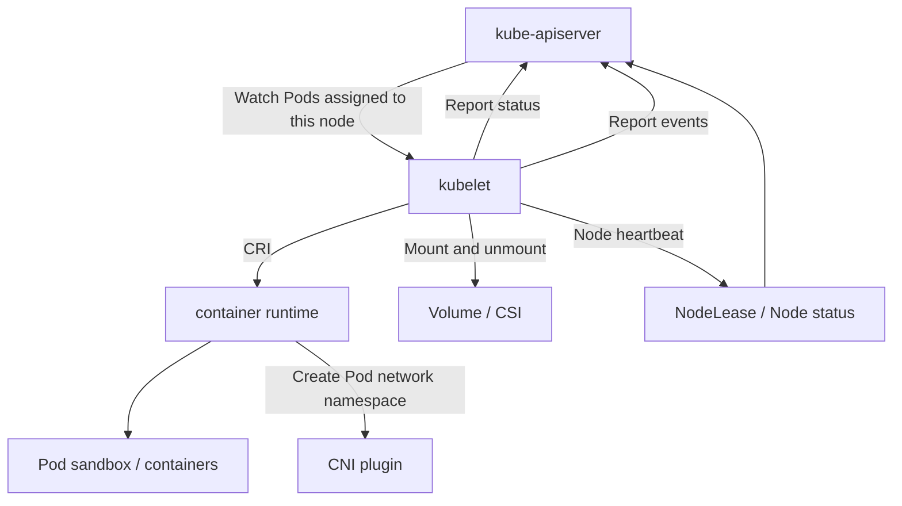
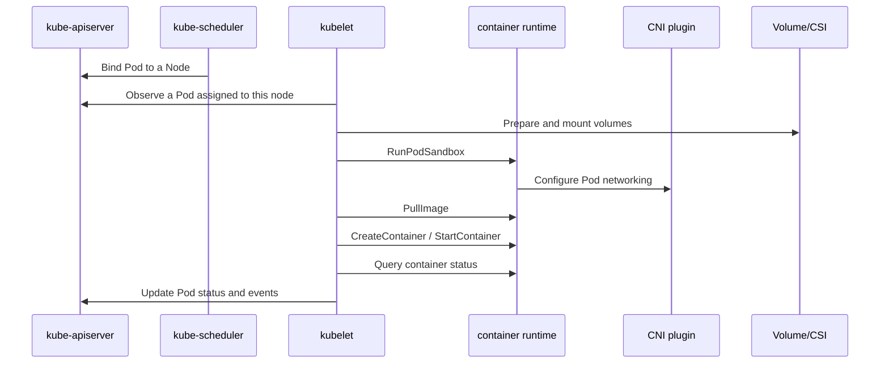
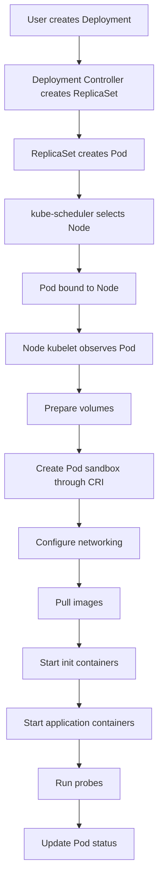

# What Is kubelet?

## In One Sentence

kubelet is the core agent running on every Kubernetes Node. It translates the control plane's declaration of which Pods should run on a node into actual actions to start, stop, inspect, and maintain containers.

In other words:

> kube-apiserver stores desired state, the scheduler chooses a node for each Pod, and kubelet makes those Pods run there and keeps them healthy.

Without kubelet, a node in a standard Kubernetes cluster is just an ordinary machine. It becomes a Kubernetes worker when kubelet registers its Node, continually reports status, receives PodSpecs, and calls the container runtime to create containers.

## kubelet's Place in Kubernetes Architecture

Kubernetes can be divided roughly into two layers:

1. **Control plane**
   - kube-apiserver
   - kube-scheduler
   - kube-controller-manager
   - etcd

2. **Node components**
   - kubelet
   - kube-proxy
   - Container runtime, such as containerd or CRI-O.
   - CNI plugins.
   - CSI plugins.
   - device plugin

kubelet runs on the node and bridges the control plane with the local execution environment.



kubelet does not replace the container runtime, networking plugins, or storage plugins. It coordinates local resources; lower-level components generally create containers, configure networking, and mount storage.

## Main Responsibilities

### 1. Register and Maintain the Node

On startup, kubelet registers a Node object with kube-apiserver, describing its identity and capabilities:

1. Node name.
2. Node IP.
3. Operating system and architecture.
4. kubelet version.
5. Container runtime information.
6. Capacity for CPU, memory, ephemeral storage, Pod count, and other resources.
7. Node conditions such as `Ready`, `MemoryPressure`, `DiskPressure`, and `PIDPressure`.

Inspect them with:

```bash
kubectl get nodes -o wide
kubectl describe node <node-name>
```

Common Node conditions:

| Condition | Meaning |
| --- | --- |
| `Ready=True` | kubelet is functioning and the node can run Pods. |
| `Ready=False` | The node is unavailable, often due to kubelet, runtime, networking, or system resource problems. |
| `Ready=Unknown` | The control plane has not received a heartbeat for an extended period. |
| `MemoryPressure=True` | Excessive memory pressure. |
| `DiskPressure=True` | Pressure on node disks or image storage. |
| `PIDPressure=True` | Too few PIDs remain available. |
| `NetworkUnavailable=True` | Node networking is not configured correctly. |

kubelet continually sends heartbeats. Modern Kubernetes primarily uses fast updates to `Lease` objects for heartbeats, while Node status carries more complete information.

### 2. Watch and Execute PodSpecs

kubelet's core input is the PodSpec, which describes what a Pod should look like:

1. Which images to use.
2. Containers and init containers.
3. Required environment variables.
4. Volumes to mount.
5. Resource requests and limits.
6. Restart policy.
7. Liveness, readiness, and startup probes.
8. Special capabilities such as hostNetwork, hostPID, and securityContext.

The most common source is kube-apiserver. After the scheduler binds a Pod to a Node, that node's kubelet observes it and starts execution.

kubelet can also read PodSpecs from a local static Pod manifest directory. kubeadm-deployed control-plane components, such as apiserver, scheduler, and controller-manager, are usually static Pods managed by kubelet.

```bash
# Common static Pod directory in kubeadm clusters
/etc/kubernetes/manifests
```

### 3. Ask the Container Runtime to Create Containers

kubelet does not start containers directly. It communicates with the container runtime through CRI.

The Container Runtime Interface is the gRPC interface between kubelet and runtimes. Common implementations include:

1. containerd
2. CRI-O
3. Other CRI-compatible runtimes.

Creating a Pod roughly involves these actions:

1. kubelet discovers a Pod assigned to its node.
2. It checks the PodSpec, admission conditions, and resource constraints.
3. It prepares volumes.
4. It asks the runtime through CRI to create a Pod sandbox.
5. The runtime creates a network namespace and configures Pod networking through CNI.
6. kubelet pulls images through CRI.
7. It starts init containers sequentially.
8. It starts application containers.
9. It continually checks container status and health probes.
10. It writes Pod status back to the apiserver.



### 4. Maintain Actual Pod State

kubelet does not work only at Pod creation. It runs a continuous synchronization loop, comparing:

1. **Desired state**: The PodSpec in the apiserver or static manifest.
2. **Actual state**: The local runtime's real sandbox, container, volume, network, and process state.

When they diverge, kubelet attempts to reconcile actual state with desired state. For example:

1. If a container exits unexpectedly and restartPolicy permits it, kubelet restarts it.
2. If a Pod is deleted, kubelet stops its containers and cleans up resources.
3. If an image is missing, kubelet pulls it.
4. If a volume is not mounted, kubelet attempts to mount it.
5. If a probe fails, kubelet updates Pod conditions and restarts the container if necessary.

This mechanism implements Kubernetes' declarative model on each node.

### 5. Perform Health Checks

kubelet executes three types of configured probes:

| Probe | Purpose | Typical behavior after failure |
| --- | --- | --- |
| `startupProbe` | Determines whether application startup is complete. | The container may restart if startup probing fails. |
| `readinessProbe` | Determines whether the container can receive traffic. | The Pod is removed from Service Endpoints. |
| `livenessProbe` | Determines whether the container remains healthy. | kubelet restarts it. |

Example:

```yaml
apiVersion: v1
kind: Pod
metadata:
  name: probe-demo
spec:
  containers:
    - name: app
      image: nginx:1.25
      ports:
        - containerPort: 80
      startupProbe:
        httpGet:
          path: /
          port: 80
        failureThreshold: 30
        periodSeconds: 2
      readinessProbe:
        httpGet:
          path: /
          port: 80
        periodSeconds: 5
      livenessProbe:
        httpGet:
          path: /
          port: 80
        periodSeconds: 10
```

These probes are often confused. In production, think of them as follows:

1. Configure `startupProbe` for slow-starting applications to prevent liveness checks from killing them before startup completes.
2. Use `readinessProbe` to decide whether to receive traffic.
3. Use `livenessProbe` to detect stuck, unrecoverable processes.

### 6. Manage Resources and Evictions

kubelet uses Pod requests, limits, node resource state, and Linux cgroups to manage resources.

Common resource types include:

1. CPU
2. Memory
3. Ephemeral storage
4. HugePages
5. PID
6. Devices exposed through device plugins, such as GPUs.

Requests and limits determine a Pod's QoS class:

| QoS | Requirements | Stability |
| --- | --- | --- |
| `Guaranteed` | Every container has equal requests and limits for CPU and memory. | Least likely to be evicted. |
| `Burstable` | At least some requests or limits are set, but Guaranteed requirements are unmet. | Intermediate. |
| `BestEffort` | No CPU or memory requests or limits. | Most likely to be evicted. |

Under node resource pressure, kubelet's eviction manager selects Pods according to thresholds and QoS. For example:

1. When memory is scarce, evict lower-priority Pods with greater resource overuse.
2. Under disk pressure, remove unused images and container logs, evicting Pods if necessary.
3. When PIDs are scarce, evict some Pods to keep the node operational.

Do not omit `resources.requests` in production: they affect both scheduling and stability under pressure.

### 7. Support Logs, Exec, Attach, and Port Forwarding

Common commands such as `kubectl logs`, `kubectl exec`, `kubectl attach`, and `kubectl port-forward` all involve kubelet.

The approximate path is:

```text
kubectl -> kube-apiserver -> kubelet -> container runtime / container
```

These commands can fail if kubelet port 10250 is unreachable, certificates are invalid, authorization fails, or the container runtime has problems.

## What kubelet Does Not Do

Understanding its boundaries is equally important.

### 1. kubelet Does Not Schedule Pods

kubelet does not decide which node a Pod uses. kube-scheduler makes that decision.

If a Pod is `Pending` and not yet bound to a Node, first investigate the scheduler, resource shortages, nodeSelector, affinity, and taints/tolerations, rather than kubelet.

```bash
kubectl describe pod <pod-name>
```

Events such as these generally indicate a scheduling-stage problem:

```text
0/3 nodes are available: insufficient cpu
0/3 nodes are available: node(s) had untolerated taint
```

### 2. kubelet Does Not Implement Service Load Balancing

Service VIP forwarding is usually handled by kube-proxy, iptables, IPVS, eBPF, or CNI-related features. kubelet does not maintain Service forwarding rules.

### 3. kubelet Does Not Implement CNI Networking Directly

kubelet requires Pods to have networking, but creating veth pairs, assigning Pod IPs, configuring routes, and implementing NetworkPolicy generally belong to the container runtime and CNI plugin.

In the CRI model, kubelet requests a Pod sandbox and the runtime calls CNI to configure its network.

### 4. kubelet Does Not Manage Containers Created Outside Kubernetes

kubelet manages only containers described by Kubernetes PodSpecs. Containers started manually with `ctr`, `crictl`, or other tools are outside its desired state and are not managed as Kubernetes Pods.

## Core Workflow

The complete path from a Deployment-created Pod to a running node workload is:



kubelet is the final executor that brings a Pod into the running state. The control plane creates objects and binds nodes, but container startup ultimately depends on the node's kubelet, runtime, networking, storage, image registry access, and system resources.

## Static Pod

A static Pod is created directly by kubelet from a local manifest, without scheduler involvement.

Common directory:

```bash
/etc/kubernetes/manifests
```

If the directory contains a file such as:

```yaml
apiVersion: v1
kind: Pod
metadata:
  name: static-nginx
spec:
  containers:
    - name: nginx
      image: nginx:1.25
      ports:
        - containerPort: 80
```

kubelet discovers it and starts the corresponding Pod on that node.

Static Pod characteristics:

1. Bypass the scheduler and run only on the local kubelet's node.
2. kubelet reflects their status into mirror Pods in the apiserver for inspection with `kubectl get pod`.
3. Deleting a mirror Pod from the apiserver has no effect: kubelet keeps maintaining it while the local manifest remains.
4. Control-plane components deployed by kubeadm are usually static Pods.

When troubleshooting control-plane components, inspect these together:

```bash
ls /etc/kubernetes/manifests
crictl ps -a
journalctl -u kubelet
```

## kubelet and CRI

CRI is the interface between kubelet and the container runtime. Without it, kubelet would require a separate adapter for every runtime, creating substantial maintenance cost.

CRI primarily provides two services:

| Service | Purpose |
| --- | --- |
| RuntimeService | Manages Pod sandbox and container lifecycles. |
| ImageService | Pulls, queries, and deletes images. |

Common configuration:

```yaml
apiVersion: kubelet.config.k8s.io/v1
kind: KubeletConfiguration
containerRuntimeEndpoint: unix:///run/containerd/containerd.sock
```

The endpoint can also be passed as a kubelet argument:

```bash
kubelet --container-runtime-endpoint=unix:///run/containerd/containerd.sock
```

`crictl` is commonly used to troubleshoot runtimes:

```bash
# List running Pod sandboxes
crictl pods

# List containers
crictl ps -a

# List images
crictl images

# View container logs
crictl logs <container-id>

# View runtime information
crictl info
```

Common reasons kubelet cannot connect to a runtime:

1. containerd or CRI-O is not running.
2. The socket path is incorrect.
3. The runtime version is incompatible with kubelet's required CRI API.
4. Permissions or SELinux/AppArmor policies block socket access.

## kubelet and CNI

CNI handles Pod networking. kubelet is not a network plugin, but network problems eventually appear as kubelet Pod creation failures.

Typical errors:

```text
FailedCreatePodSandBox
failed to setup network for sandbox
cni plugin not initialized
```

Common troubleshooting directions:

1. Check that CNI configuration files exist.
2. Check that plugin binaries exist.
3. Check that the CNI DaemonSet is running normally.
4. Inspect node routes, iptables, and eBPF programs.
5. Confirm Pod CIDR allocation.

Common paths:

```bash
/etc/cni/net.d
/opt/cni/bin
```

CNI implementations differ substantially: Calico, Cilium, and Flannel require different troubleshooting techniques. From kubelet's perspective, if the runtime cannot configure sandbox networking, the Pod remains in `ContainerCreating` or repeatedly reports `FailedCreatePodSandBox`.

## kubelet and CSI / Volumes

kubelet coordinates Pod volume mounts. For a PVC, the typical flow is:

1. The scheduler places the Pod on a Node.
2. The attach/detach controller or CSI controller attaches remote volumes, such as cloud disks.
3. kubelet invokes the CSI node plugin to mount them locally.
4. kubelet mounts the volume at the container path.

Volume problems also commonly leave Pods in `ContainerCreating`, with events such as:

```text
MountVolume.SetUp failed
Unable to attach or mount volumes
timed out waiting for the condition
```

Start with:

```bash
kubectl describe pod <pod-name>
kubectl describe pvc <pvc-name>
kubectl get csinode
kubectl get pods -n kube-system | grep csi
journalctl -u kubelet
```

## kubelet Configuration

In production, systemd usually manages kubelet. Common kubeadm cluster files include:

```bash
# kubelet systemd configuration
/usr/lib/systemd/system/kubelet.service
/etc/systemd/system/kubelet.service.d/10-kubeadm.conf

# kubelet configuration
/var/lib/kubelet/config.yaml

# kubeconfig used by kubelet to access apiserver
/etc/kubernetes/kubelet.conf

# bootstrap kubeconfig
/etc/kubernetes/bootstrap-kubelet.conf

# kubelet certificates
/var/lib/kubelet/pki
```

A simplified `KubeletConfiguration` example:

```yaml
apiVersion: kubelet.config.k8s.io/v1
kind: KubeletConfiguration
clusterDomain: cluster.local
clusterDNS:
  - 10.96.0.10
containerRuntimeEndpoint: unix:///run/containerd/containerd.sock
authentication:
  anonymous:
    enabled: false
  webhook:
    enabled: true
authorization:
  mode: Webhook
readOnlyPort: 0
rotateCertificates: true
evictionHard:
  memory.available: "100Mi"
  nodefs.available: "10%"
  imagefs.available: "15%"
```

Changing configuration usually requires restarting kubelet:

```bash
sudo systemctl daemon-reload
sudo systemctl restart kubelet
sudo systemctl status kubelet
```

Paths vary between Kubernetes versions, distributions, and installation tools. During troubleshooting, use the actual systemd startup arguments as the source of truth:

```bash
systemctl cat kubelet
ps aux | grep kubelet
```

## Common kubelet Ports

| Port | Description |
| --- | --- |
| `10250` | kubelet HTTPS API, used by apiserver for logs, exec, attach, metrics, and related operations. |
| `10248` | kubelet healthz, commonly used for local health checks. |
| `10255` | Legacy read-only port; disable it in production. |

Do not expose kubelet port 10250 directly to untrusted networks. TLS, authentication, and authorization are essential; otherwise, the risk is very high.

At minimum, verify:

1. Anonymous authentication is disabled.
2. `authorization.mode` is `Webhook`.
3. `readOnlyPort` is `0`.
4. kubelet certificate rotation is enabled.
5. Node authorizer and NodeRestriction admission limit node identity permissions.

## Common States and Troubleshooting

### 1. Pod Remains Pending

First determine whether it has been scheduled:

```bash
kubectl get pod <pod-name> -o wide
kubectl describe pod <pod-name>
```

If `NODE` is empty, the problem usually lies in scheduling rather than kubelet:

1. Insufficient resources.
2. nodeSelector mismatch.
3. Unsatisfied nodeAffinity.
4. Missing tolerations for taints.
5. PVC binding or topology restrictions prevent scheduling.

### 2. Pod Stuck in ContainerCreating

If a Node is assigned but the Pod remains `ContainerCreating`, kubelet has taken over. Focus on node dependencies:

1. Image pulls.
2. Runtime health.
3. CNI health.
4. Successful volume mounts.
5. Required Secrets and ConfigMaps.
6. Node disk pressure.

Commands:

```bash
kubectl describe pod <pod-name>
journalctl -u kubelet -f
crictl ps -a
crictl pods
```

### 3. ImagePullBackOff

This is the result of kubelet failing to pull an image through the runtime.

Common causes:

1. Incorrect image address.
2. Missing tag.
3. Unreachable registry.
4. Missing imagePullSecret for a private registry.
5. Node DNS or proxy misconfiguration.

Inspect events:

```bash
kubectl describe pod <pod-name>
```

Verify on the node:

```bash
crictl pull <image>
```

### 4. CrashLoopBackOff

CrashLoopBackOff means the container repeatedly exits after startup and kubelet restarts it with backoff.

Common causes:

1. Application startup failure.
2. Incorrect startup command or arguments.
3. Missing configuration files or environment variables.
4. Unreachable dependencies.
5. Overly aggressive livenessProbe settings.

Check these first:

```bash
kubectl logs <pod-name> -c <container-name>
kubectl logs <pod-name> -c <container-name> --previous
kubectl describe pod <pod-name>
```

### 5. NodeNotReady

A NotReady Node means the control plane considers it unavailable or kubelet has reported abnormal conditions.

Troubleshooting sequence:

```bash
kubectl describe node <node-name>
ssh <node>
systemctl status kubelet
journalctl -u kubelet -n 200
systemctl status containerd
crictl info
df -h
free -m
ip route
```

Common causes:

1. kubelet has exited.
2. kubelet cannot reach the apiserver.
3. Container runtime problems.
4. CNI not initialized.
5. Node disk full.
6. Excessive memory or PID pressure.
7. Expired certificates or damaged kubeconfig.

### 6. Pod Evicted

An Evicted Pod usually did not exit voluntarily; kubelet evicted it under node resource pressure.

Inspect:

```bash
kubectl describe pod <pod-name>
kubectl describe node <node-name>
```

Pay particular attention to:

1. `MemoryPressure`
2. `DiskPressure`
3. `PIDPressure`
4. Pod QoS
5. Ephemeral-storage usage.
6. Excessive container log sizes.
7. Image garbage collection health.

## Reading kubelet Logs

Because systemd usually manages kubelet, the most common commands are:

```bash
journalctl -u kubelet -f
journalctl -u kubelet -n 200
journalctl -u kubelet --since "1 hour ago"
```

Filter by keywords while investigating:

```bash
journalctl -u kubelet | grep -i "failed"
journalctl -u kubelet | grep -i "runtime"
journalctl -u kubelet | grep -i "cni"
journalctl -u kubelet | grep -i "eviction"
journalctl -u kubelet | grep -i "certificate"
```

Common log clues:

| Log keyword | Likely direction |
| --- | --- |
| `container runtime is down` | Runtime problem or unavailable socket. |
| `FailedCreatePodSandBox` | Runtime or CNI sandbox creation failure. |
| `MountVolume.SetUp failed` | Volume, CSI, Secret, or ConfigMap issue. |
| `ImagePullBackOff` | Image pull problem. |
| `eviction manager` | Node resource pressure. |
| `certificate` | kubelet certificates or apiserver authentication. |

## Relationships with Other Components

### kubelet and kube-apiserver

kubelet retrieves PodSpecs from the apiserver and reports:

1. Node status。
2. Pod status。
3. Event。
4. Lease heartbeats.

The apiserver also connects back to kubelet for:

1. `kubectl logs`
2. `kubectl exec`
3. `kubectl attach`
4. `kubectl port-forward`
5. kubelet metrics

### kubelet and the Scheduler

The scheduler chooses a Node for each Pod; kubelet executes only Pods already bound to its Node.

Setting `.spec.nodeName` manually bypasses the scheduler and hands a Pod directly to a specific kubelet. Avoid doing this casually in production because it skips scheduler resource and constraint checks.

### kubelet and controller-manager

Several controllers depend indirectly on kubelet-reported state. For example:

1. The Node controller uses heartbeats to determine whether nodes are unreachable.
2. The ReplicaSet controller replaces replicas according to Pod state.
3. The EndpointSlice controller updates Service backends according to Pod readiness.
4. The Job controller advances Jobs according to Pod success or failure.

Inaccurate kubelet status reports affect decisions throughout the control plane.

### kubelet and kube-proxy

kubelet manages Pod lifecycles; kube-proxy manages Service forwarding rules. Both run on nodes, but their responsibilities differ.

When a Pod's readinessProbe fails:

1. kubelet marks the Pod NotReady.
2. The EndpointSlice controller updates Service backends.
3. kube-proxy updates forwarding rules from the new EndpointSlice.
4. Traffic is no longer forwarded to that Pod.

kubelet does not modify kube-proxy rules directly, but its readiness reports influence Service traffic.

## Production Recommendations

### 1. Set Requests and Limits for Every Application Pod

At minimum, set CPU and memory requests. Otherwise, the scheduler cannot assess resources accurately, and kubelet is more likely to evict these Pods under pressure.

Recommended example:

```yaml
resources:
  requests:
    cpu: "200m"
    memory: "256Mi"
  limits:
    cpu: "1"
    memory: "512Mi"
```

### 2. Configure livenessProbe Carefully

More sensitive liveness probes are not necessarily better. Aggressive settings can repeatedly restart applications during transient fluctuations, garbage collection, or cold starts.

Recommendations:

1. Add `startupProbe` for slow-starting applications.
2. Use readinessProbe to remove traffic.
3. Reserve livenessProbe for truly unrecoverable failures.

### 3. Monitor kubelet and the Runtime

Monitor at least:

1. Node Ready status.
2. kubelet process availability.
3. Container runtime availability.
4. Pod startup failure rate.
5. Image pull failure rate.
6. Node disk, memory, and PID pressure.
7. kubelet certificate validity.
8. Pod eviction count.

### 4. Control Container Log Sizes

Container stdout/stderr logs ultimately occupy node disk. Without limits, logs can fill disks, trigger `DiskPressure`, and lead to Pod evictions.

Combine runtime log rotation, log collection systems, and application log-level controls.

### 5. Check the Node Environment Regularly

Stable kubelet operation depends on many node fundamentals:

1. Synchronized system time.
2. Working DNS.
3. A healthy container runtime.
4. Complete CNI configuration.
5. Sufficient disk space.
6. Kernel parameters meeting cluster requirements.
7. Valid certificates.
8. Connectivity to apiserver and image registries.

### 6. Avoid Directly Modifying Runtime State Managed by kubelet

Do not casually delete kubelet-managed containers, sandboxes, Pause containers, volume directories, or CNI state on production nodes. Doing so can confuse kubelet's view of actual state and cause further failures.

If manual intervention is necessary, cordon/drain the node first and confirm the impact.

```bash
kubectl cordon <node-name>
kubectl drain <node-name> --ignore-daemonsets --delete-emptydir-data
```

## kubelet and Virtual Kubelet

A normal kubelet is the agent on a real Node, managing the local container runtime.

Virtual Kubelet is an adapter that "acts like kubelet". It registers a virtual Node, potentially without a real machine behind it, and forwards Pod lifecycle operations to an external serverless container service, edge platform, or other compute system.

A brief comparison:

| Comparison | kubelet | Virtual Kubelet |
| --- | --- | --- |
| Manages | Containers on a real node | Container resources on an external platform |
| Runs on | Every Node | Usually a standalone process |
| Creates containers through | CRI calls to the runtime | Provider calls to external platform APIs |
| Host capabilities | Broad support | Provider-dependent |
| Typical scenarios | Conventional Kubernetes nodes | Serverless, bursting capacity, and external compute integration |

For more detail, continue with the next article on Virtual Kubelet.

## Summary

kubelet is the most important node-side Kubernetes component. Its role is to turn PodSpecs already assigned to its node into running containers and maintain their health, rather than schedule Pods or implement Service load balancing.

Think of kubelet as the node's "executor" and "status reporter":

1. Registers the Node with apiserver.
2. Watches Pods assigned to the node.
3. Calls the CRI runtime to create sandboxes and containers.
4. Coordinates volumes, networking, probes, resources, and evictions.
5. Continually reports Node, Pod, Event, and Lease state.
6. Provides the node-side entry point for `kubectl logs/exec/attach/port-forward`.

A useful troubleshooting rule is:

> If the Pod has not reached a node, start with the scheduler. If it is assigned but cannot start, focus on kubelet, the runtime, CNI, CSI, image registries, and node resources.

Knowing kubelet's responsibilities helps identify whether a problem lies in the control plane, scheduling, or node execution.

## References

1. [Kubernetes documentation: kubelet](https://kubernetes.io/docs/reference/command-line-tools-reference/kubelet/)
2. [Kubernetes documentation: Kubelet Sync Loop](https://kubernetes.io/docs/reference/node/kubelet-sync-loop/)
3. [Kubernetes documentation: Container Runtime Interface](https://kubernetes.io/docs/concepts/architecture/cri/)
4. [Kubernetes documentation: Set Kubelet Parameters Via A Configuration File](https://kubernetes.io/docs/tasks/administer-cluster/kubelet-config-file/)
5. [Kubernetes documentation: Local Files And Paths Used By The Kubelet](https://kubernetes.io/docs/reference/node/kubelet-files/)
