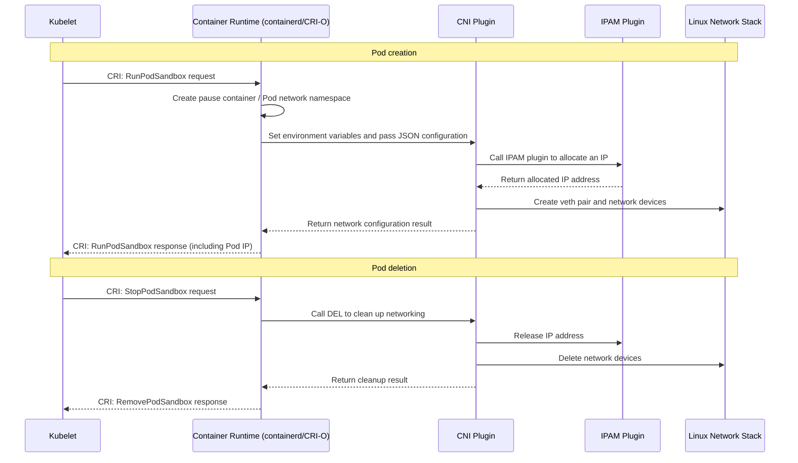

# Kubernetes CNI Network Plugins Explained: From Core Concepts to Implementation Details

## 1. Introduction: The Kubernetes Network Model and the Origins of CNI

Kubernetes defines a simple yet powerful network model that requires every container runtime to satisfy four basic conditions:
1. Pods have unique IP addresses and can communicate directly
2. Pods can access services through Service IPs
3. Nodes can communicate directly with every Pod
4. Pods in HostNetwork mode can communicate with the cluster network

The **Container Network Interface (CNI)** was introduced to implement this model. It provides a standardized plugin framework so different network solutions can work seamlessly in Kubernetes. CNI defines the contract between container runtimes and network plugins, making network configuration modular and extensible.

## 2. How CNI Plugins Work

### 2.1 The Call Path: From Kubelet to Network Plugins

Kubernetes delegates network management through a clear call chain rather than managing the network directly:



### 2.2 Plugin Invocation

The container runtime passes information to a CNI plugin in two ways:

1. **Environment variables**: Provide execution context
   - `CNI_COMMAND`: Operation type (ADD/DEL/CHECK/VERSION)
   - `CNI_CONTAINERID`: Unique container identifier
   - `CNI_NETNS`: Path to the Pod network namespace
   - `CNI_IFNAME`: Interface name inside the Pod, usually eth0
   - `CNI_PATH`: Search path for CNI plugins

2. **Standard input (stdin)**: Provides the complete configuration as JSON

## 3. Three Types of CNI Plugins and Plugin Chaining

The CNI ecosystem consists of three plugin types that cooperate through chained invocation.

### 3.1 Main Plugins
These establish the data path and form the core of network configuration:
- **Responsibilities**: Create virtual network devices (veth pairs, bridges, tunnels, and so on) and configure their state
- **Examples**: `bridge`, `macvlan`, `ipvlan`, `vlan`, and plugins implemented by Calico, Flannel, and others

### 3.2 IPAM Plugins (IP Address Management)
These allocate and manage IP addresses:
- **Responsibilities**: Allocate available IPs from pools, record allocations, and reclaim addresses
- **Examples**: `host-local` (local file-based management), `dhcp` (allocation by a DHCP server)

### 3.3 Meta Plugins
These orchestrate and modify other plugins to extend networking capabilities:
- **Responsibilities**: Control plugin-chain execution and modify network configuration
- **Examples**:
  - `portmap`: Provides HostPort functionality through iptables port mapping
  - `bandwidth`: Limits network bandwidth with tc
  - `tuning`: Adjusts network interface parameters such as MTU and sysctl settings
  - `flannel`: A specialized meta plugin that generates configuration from cluster state and calls other plugins

### 3.4 Example Plugin Chain

```json
{
  "cniVersion": "0.4.0",
  "name": "mynet",
  "plugins": [
    {
      "type": "bridge",
      "bridge": "cni0",
      "ipam": {
        "type": "host-local",
        "subnet": "10.244.0.0/24"
      }
    },
    {
      "type": "portmap",
      "capabilities": {"portMappings": true}
    },
    {
      "type": "bandwidth",
      "capabilities": {"bandwidth": true}
    }
  ]
}
```

## 4. Information Available to CNI Plugins

### 4.1 Information from Environment Variables
| Variable | Description | Example |
|--------|------|--------|
| `CNI_COMMAND` | Operation to execute | `ADD`, `DEL`, `CHECK` |
| `CNI_CONTAINERID` | Unique container ID | `a1b2c3d4...` |
| `CNI_NETNS` | Network namespace path | `/proc/12345/ns/net` |
| `CNI_IFNAME` | Interface name inside the container | `eth0` |
| `CNI_PATH` | Plugin search path | `/opt/cni/bin` |

### 4.2 Information from Standard Input

```json
{
  "cniVersion": "0.4.0",
  "name": "mybridge",
  "type": "bridge",
  "bridge": "cni0",
  "ipam": {"type": "host-local", "subnet": "10.244.0.0/24"},
  "args": {
    "K8S_POD_NAMESPACE": "my-namespace",
    "K8S_POD_NAME": "nginx-55f5c6d859-abcde",
    "K8S_POD_UID": "a1b2c3d4-5678-90ef-...",
    "K8S_POD_INFRA_CONTAINER_ID": "containerd://a1b2c3d4..."
  },
  "runtimeConfig": {
    "org.example.cni": {"ip": "10.244.0.123"}
  },
  "prevResult": {
    "ips": [{"address": "10.244.0.123/24"}],
    "interfaces": [...]
  }
}
```

**Key data fields:**
- **Network configuration**: Plugin type, bridge name, IPAM policy, and so on
- **Kubernetes metadata**: Pod name, namespace, UID, and so on, through the `args` field
- **Runtime configuration**: Configuration parameters overridden by the CRI runtime
- **Previous result**: The previous execution result used for DEL or subsequent plugins in a chain

## 5. Writing a Simple CNI Plugin

The following simple Bash CNI plugin demonstrates the basic structure:

```bash
#!/bin/bash

# Read environment variables
COMMAND=$CNI_COMMAND
NETNS=$CNI_NETNS
CONTAINER_ID=$CNI_CONTAINERID

# Read configuration from standard input
CONFIG=$(cat /dev/stdin)
NETWORK_NAME=$(echo $CONFIG | jq -r '.name')
BRIDGE_NAME=$(echo $CONFIG | jq -r '.bridge')

# Extract Kubernetes information, if present
K8S_POD_NAMESPACE=$(echo $CONFIG | jq -r '.args.K8S_POD_NAMESPACE // empty')
K8S_POD_NAME=$(echo $CONFIG | jq -r '.args.K8S_POD_NAME // empty')

case $COMMAND in
ADD)
    # Call the IPAM plugin to allocate an IP
    IPAM_RESULT=$(echo $CONFIG | /opt/cni/bin/host-local)
    POD_IP=$(echo $IPAM_RESULT | jq -r '.ips[0].address')

    # Write a log entry, including Kubernetes information
    if [[ -n "$K8S_POD_NAMESPACE" ]]; then
        echo "Configuring network for Pod: $K8S_POD_NAMESPACE/$K8S_POD_NAME" >&2
    fi

    # Create network devices
    ip link add veth0 type veth peer name eth0
    ip link set veth0 master $BRIDGE_NAME
    ip link set veth0 up
    ip link set eth0 netns $NETNS
    ip netns exec $NETNS ip addr add $POD_IP dev eth0
    ip netns exec $NETNS ip link set eth0 up

    echo $IPAM_RESULT
    ;;

DEL)
    # Clean up network resources
    echo $CONFIG | /opt/cni/bin/host-local
    # More complex logic is needed here to find and delete veth devices
    ;;

VERSION)
    echo '{"cniVersion": "0.4.0", "supportedVersions": ["0.3.0", "0.3.1", "0.4.0"]}'
    ;;

*)
    echo "Unknown CNI_COMMAND: $COMMAND" >&2
    exit 1
    ;;
esac
```

## 6. Advanced Topics and Production Practice

### 6.1 Multi-Node Networking
A single-node plugin only enables communication between Pods on the same node. Cross-node communication requires:
- **Overlay networks**: Encapsulate Pod traffic with tunneling technologies such as VXLAN or IPsec
- **Routing solutions**: Provide cross-node routing through BGP or cloud-platform routing tables
- **Network policies**: Use plugins such as Calico and Cilium for fine-grained policies based on namespaces and Pod labels

### 6.2 Production Considerations
- **Performance**: Choose a plugin with a high-performance data plane, such as Calico in BPF mode or Cilium
- **Reliability**: Ensure high availability of the network control plane
- **Security**: Apply network policies and the principle of least privilege
- **Observability**: Integrate monitoring, logging, and tracing
- **Maintainability**: Choose a CNI plugin with an active community and good documentation

## 7. Summary

Through standardized interfaces and modular design, Kubernetes CNI breaks complex container networking into manageable components. Main, IPAM, and meta plugins each fulfill their responsibilities and cooperate through chaining to provide flexible, powerful networking for containers.
