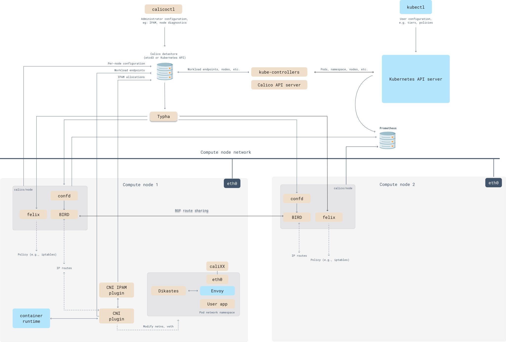

In Calico, or other BGP-based network architectures, route advertisement is closely linked to topology changes, policy adjustments, and system events. The following sections examine scenarios and their triggering mechanisms:

---

## **1. Calico Architecture Diagram**



---


| **Component** | **Submodule/File** | **Core Responsibilities** | **Example Configuration** | **Interacting Components** | **Typical Scenario** |
|------------------------|--------------------------|-----------------------------------------------------------------------------|---------------------------------------------------------------------------------|----------------------------------|---------------------------------------------------------------------------------|
| **Felix** | `felix.cfg` | - Manage node-local routing tables (`route table`) <br>- Configure iptables/eBPF chains (`cali-INPUT`, `cali-FORWARD`, etc.) <br>- Enforce network policies (mark traffic `allow/deny`) | `RouteRefreshInterval=10s` <br>`MetadataAddr=127.0.0.1` <br>`IptablesMarkMask=0xff000000` | BIRD, etcd/K8s API, Typha | Add routes when Pods are created; apply policy updates immediately |
| **BIRD** | `bird.cfg` (generated by confd) | - Advertise this node's Pod CIDR over BGP, such as `10.0.1.0/24` <br>- Learn routes from other nodes (`via Node2`) | `protocol bgp { local as 64512; neighbor 192.168.1.2 as 64512; }` | Felix, Route Reflector | Establish BGP peering automatically when a node joins |
| **Calico CNI Plugin** | `10-calico.conflist` | - Call IPAM to allocate Pod IPs <br>- Create veth pairs (`caliXXXXX`) <br>- Set routes in Pod network namespaces | `"ipam": { "type": "calico-ipam", "subnet": "usePodCidr" }` | kubelet, IPAM, Felix | Invoked by kubelet during `kubectl run` to configure Pod networking |
| **calico-kube-controllers** | `policy-controller` | - Watch K8s `NetworkPolicy` and synchronize with Felix <br>- Reclaim orphaned IPs (`IPGC`) <br>- Maintain node heartbeats | `controllers: node, policy, serviceaccount` | K8s API Server, etcd | Convert user-created `NetworkPolicy` objects into Calico format and distribute them |
| **Typha** | `typha-deployment.yaml` | - Proxy Felix API requests (cache `Nodes`, `Policies`) <br>- Reduce API Server load (connections from O(N) to O(1)) | `maxConnsPerClient=4` <br>`clientPort=5473` | Felix, K8s API | In clusters exceeding 50 nodes, Felix obtains policies through Typha instead of accessing the API directly |
| **Route Reflector** | `bgpconfiguration.yaml` | - Centralize route distribution in place of a full mesh <br>- Support a cluster AS number (`AS 64512`) and route aggregation | `routeReflectorClusterID: 1.0.0.1` <br>`logSeverityScreen: Info` | BIRD on all nodes | Avoid direct BGP sessions between nodes in cross-availability-zone deployments |
| **etcd/K8s API** | `calico-config` ConfigMap | - Store `IPPools` (`10.0.0.0/16`) <br>- Store `BGPPeers` and `NetworkPolicy` definitions | `etcd_endpoints: "https://etcd:2379"` <br>`useKubernetesAPI: true` | All components | Write to etcd when an administrator creates an IP pool with `calicoctl` |
| **confd** | `/etc/calico/confd` | - Watch etcd/K8s API changes, such as `BGPPeer` updates <br>- Generate BIRD configuration dynamically and trigger reloads | `confd -watch -interval 10` | BIRD, etcd | Update `bird.cfg` and run `birdc configure` when a BGP peer IP changes |
| **eBPF Dataplane** | `bpfnat`, `bpfilter` | - Replace kube-proxy for Service load balancing <br>- Accelerate policy matching through eBPF maps (`calico_prefilter`) | `bpfEnabled: true` <br>`bpfExternalServiceMode: DSR` | Linux kernel, Felix | Handle Service DNAT rules with eBPF programs in performance-sensitive environments |
| **WireGuard** | `wg-cali` (interface) | - Encrypt inter-node traffic (`udp port 51820`) <br>- Support PSK or certificate authentication | `wireguardEnabled: true` <br>`wireguardListeningPort: 51820` | Node network stack | Establish encrypted tunnels automatically across public clouds |


## **2. Using Calico**

### 1. Set Up a kind Cluster
```bash
kind: Cluster
apiVersion: kind.x-k8s.io/v1alpha4
nodes:
  - role: control-plane
  - role: worker
  - role: worker
networking:
  disableDefaultCNI: true
  podSubnet: 192.168.0.0/16
```

```bash
kind create cluster --name=calico-cluster --config=config.yaml
```

### 2. Install Calico
```bash
kubectl create -f https://raw.githubusercontent.com/projectcalico/calico/v3.30.2/manifests/tigera-operator.yaml
```
```bash
kubectl create -f https://raw.githubusercontent.com/projectcalico/calico/v3.30.2/manifests/custom-resources.yaml
```

### 3. Open the Web Interface
```bash
kubectl port-forward -n calico-system service/whisker 8081:8081
```

### 4. Install Nginx for Testing

```bash
kubectl create namespace quickstart
```
```bash
kubectl create deployment --namespace=quickstart nginx --image=nginx
```
```bash
kubectl expose --namespace=quickstart deployment nginx --port=80
```
After installing and exposing the service, create a BusyBox container and access the Nginx Pod.
```bash
kubectl run --namespace=quickstart access --rm -ti --image busybox /bin/sh
```
At this point, both the Nginx instance in the cluster and the Internet are reachable over the Pod network.
```bash
wget -qO- http://nginx
wget -qO- https://docs.tigera.io/pod-connection-test.txt
```

### 5. Add Network Restrictions with Calico
Restrict both ingress and egress.
```bash
kubectl create -f - <<EOF
apiVersion: projectcalico.org/v3
kind: GlobalNetworkPolicy
metadata:
  name: default-deny
spec:
  selector: projectcalico.org/namespace not in {'kube-system', 'calico-system', 'calico-apiserver'}
  types:
    - Ingress
    - Egress
EOF
```
After applying the restrictions, access to both Nginx and the Internet fails.
```bash
wget -qO- http://nginx
wget -qO- https://docs.tigera.io/pod-connection-test.txt
```

### 5. Relax the Network Restrictions
Allow egress.
```bash
kubectl create -f - <<EOF
apiVersion: projectcalico.org/v3
kind: NetworkPolicy
metadata:
  name: allow-busybox-egress
  namespace: quickstart
spec:
  selector: run == 'access'
  types:
  - Egress
  egress:
  - action: Allow
EOF
```
Internet access now works, but Nginx remains unreachable.
```bash
wget -qO- https://docs.tigera.io/pod-connection-test.txt
wget -qO- http://nginx
```
Allow ingress to Nginx.
```bash
kubectl create -f - <<EOF
apiVersion: projectcalico.org/v3
kind: NetworkPolicy
metadata:
  name: allow-nginx-ingress
  namespace: quickstart
spec:
  selector: app == 'nginx'
  types:
  - Ingress
  ingress:
  - action: Allow
    source:
      selector: run == 'access'
EOF
```
Nginx is now reachable.
```bash
wget -qO- http://nginx
```

### 6. Clean Up
```bash
kind delete cluster --name calico-cluster
```
