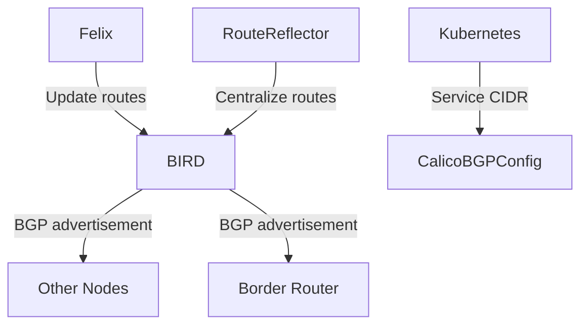

kind create cluster --name calico-cluster --config - <<EOF
kind: Cluster
apiVersion: kind.x-k8s.io/v1alpha4
nodes:
- role: control-plane
- role: worker
- role: worker
networking:
  disableDefaultCNI: true
  podSubnet: 192.167.0.0/16
EOF

kubectl create -f https://raw.githubusercontent.com/projectcalico/calico/v3.30.2/manifests/tigera-operator.yaml

kubectl create -f https://raw.githubusercontent.com/projectcalico/calico/v3.30.2/manifests/custom-resources.yaml


cat <<EOF | calicoctl apply -f -
---
apiVersion: projectcalico.org/v3
kind: IPPool
metadata:
  name: external-pool
spec:
  cidr: 192.168.64.0/24
  blockSize: 29
  ipipMode: Never
  natOutgoing: true
  nodeSelector: "!all()"
EOF


multipass set local.bridged-network.range=10.168.64.0/24


cat <<EOF | calicoctl apply -f -
---
apiVersion: projectcalico.org/v3
kind: BGPPeer
metadata:
  name: bgppeer-global-host1
spec:
  peerIP: 192.168.64.5
  asNumber: 64512
EOF


sudo bash -c "cat > /etc/bird/bird.conf <<EOF
router id 192.168.64.6;

protocol kernel {
    scan time 60;
    import none;
    export all;
}

protocol device {
    scan time 60;
}

protocol bgp k8s_calico {
    local as 64512;
    neighbor 172.18.0.3 as 64511;  # Point to the kind node's IP
    import all;
    export none;
    multihop;
}
EOF"


kubectl apply -f - <<EOF
apiVersion: projectcalico.org/v3
kind: BGPPeer
metadata:
  name: multipass-peer
spec:
  peerIP: 192.168.64.6
  asNumber: 64512
  nodeSelector: all()
EOF


### **1. A Node Joins the Cluster**
When a new node joins a Kubernetes cluster, Calico triggers route advertisement as follows:
1. **Node registration**:
   - The new node registers with the Kubernetes API Server through `kubelet`.
   - Calico's `CNI plugin` assigns the node a Pod CIDR, such as `10.244.3.0/24`.
2. **Felix detects the change**:
   - Felix watches the Kubernetes API and discovers the new node and its assigned Pod CIDR.
   - Felix configures the local routing table so local Pods can reach the new node's Pod CIDR.
3. **BIRD triggers BGP advertisement**:
   - BIRD detects the new route, such as `10.244.3.0/24` belonging to the new node, and advertises it to all peers (other nodes) over BGP.
   - Other nodes learn the route through BGP and update their kernel routing tables.

**Key logs** (view with `journalctl -u bird`):
```
BGP: Sending UPDATE to neighbor 192.168.100.3: Added 10.244.3.0/24
```

---

### **2. A Node Leaves or Fails**
1. **The node becomes unreachable**:
   - The BGP session disconnects because the node is down or the network is interrupted (the default Keepalive timeout is 90 seconds).
2. **Route withdrawal**:
   - BIRD detects the failed peer and automatically sends a `WITHDRAW` message, notifying other nodes to remove that node's routes, such as `10.244.3.0/24`.
3. **Cluster convergence**:
   - Other nodes remove the invalid routes and stop forwarding traffic to the failed node.

**Impact**:
- If the node recovers, the BGP session is reestablished and routes are advertised again.

---

### **3. Pod Creation or Deletion**
1. **Pod creation**:
   - Calico `IPAM` allocates an IP from the Pod CIDR, such as `10.244.1.5`.
   - Felix adds a directly connected route for the Pod on the host (no BGP advertisement is needed because it belongs to the local CIDR).
2. **Cross-node Pod communication**:
   - Only the **Pod CIDR subnet**, such as `10.244.1.0/24`, is advertised over BGP; individual Pod IPs are not advertised separately.
   - Other nodes locate the specific Pod using learned Pod CIDR routes together with the host's ARP resolution.

**Exception**:
- If `host-local` IPAM is enabled and the Pod CIDR is exhausted, a new node may be added to expand the address pool.

---

### **4. Network Policy Changes**
1. **Policy updates**:
   - Changing `NetworkPolicy` may cause Felix to regenerate iptables/eBPF rules.
2. **Routing policy adjustments**:
   - If a policy affects routing, such as blocking communication with certain subnets, BIRD may filter or readvertise routes.
   - For example, use an `export filter` to restrict the advertised route range.

---

### **5. Manual Intervention**
1. **Force a route refresh**:
   ```bash
   birdc reload  # Reload BIRD configuration
   birdc disable bgp_peer  # Disable the peer temporarily, then reenable it to trigger a route update
   ```
2. **Calico configuration changes**:
   - Changing `BGPConfiguration`, such as adjusting the AS number or enabling RR mode, triggers cluster-wide route resynchronization.

---

### **6. Other Scenarios**
| **Scenario** | **Trigger** | **Route Advertisement Behavior** |
|-------------------------|---------------------------------------|--------------------------------------|
| **Cluster expansion** | Multiple new nodes | Each new node's Pod CIDR is advertised separately |
| **Node IP changes** | Host IP update, such as a DHCP renewal | Reestablish the BGP session and readvertise routes |
| **BGP peer configuration changes** | Add/remove BGP neighbors, such as in a spine-leaf topology | Adjust the scope of route propagation dynamically |
| **IP pool changes** | Modify an `IPPool` CIDR | All affected nodes readvertise routes |

---

### **Underlying Mechanisms from the BGP Perspective**
1. **Conditions for route updates**:
   - When a BGP speaker such as BIRD detects local routing-table changes (routes added or removed), it sends `UPDATE` messages to its peers.
2. **Convergence**:
   - The default `Full-Mesh` mode has every node exchange routes directly.
   - Large clusters can use a `Route Reflector (RR)` to reduce BGP connection counts.

---

### **Verifying Route Advertisements**
1. **Check BGP neighbor status**:
   ```bash
   calicoctl node status
   # Or
   birdc show protocols
   ```
2. **Inspect routing tables**:
   ```bash
   ip route  # Show the kernel routing table
   birdc show route  # Show routes learned by BIRD
   ```
3. **Analyze packet captures**:
   ```bash
   tcpdump -i eth0 'tcp port 179'  # Capture BGP traffic
   ```

---

### **Summary**
Calico route advertisements are mainly triggered by:
1. **Node lifecycle changes** (joining/leaving).
2. **Pod CIDR allocation or reclamation**.
3. **BGP session state changes**, such as peer disconnection.
4. **Policy or configuration updates**.

This design provides **high availability** and **fast convergence** for the cluster network while avoiding the single-point bottleneck of a traditional SDN controller.


In Calico, **route advertisement responsibilities** are shared by the following components, with different components leading in different scenarios:

---

### **1. Default Scenario: Pod Network Route Advertisement**
#### **Advertiser: BIRD (BGP Client)**
- **Role**: The lightweight BGP client deployed by Calico on each node, using BIRD or GoBGP by default.
- **Workflow**:
  1. **Felix** watches local Pod changes and updates the local routing table, such as `10.244.1.0/24 via veth-host`.
  2. **BIRD** detects route changes and advertises them over BGP to peers, either other nodes or external routers.
  3. Peers learn the routes and update their own routing tables.
- **Key configuration**:
  ```yaml
  # Inspect Calico's BGP configuration
  calicoctl get bgpconfiguration
  ```
- **Log verification**:
  ```bash
  journalctl -u bird | grep "UPDATE"  # View routes advertised by BIRD
  ```

---

### **2. Special Scenario: Service CIDR Advertisement (Experimental)**
#### **Advertiser: BIRD on Calico Nodes**
- **Trigger**: Explicitly configure `serviceClusterIPs` in `BGPConfiguration`.
- **Example configuration**:
  ```yaml
  apiVersion: projectcalico.org/v3
  kind: BGPConfiguration
  metadata:
    name: default
  spec:
    serviceClusterIPs:
      - cidr: 10.96.0.0/16  # Kubernetes Service CIDR
  ```
- **Behavior**:
  - Calico uses BIRD to advertise `10.96.0.0/16` as an aggregate route.
  - **Note**: `kube-proxy` or `eBPF` still handles Service IP load balancing; BGP provides only route reachability.

---

### **3. Advanced Scenario: Route Reflectors**
#### **Advertiser: Calico Route Reflector (RR)**
- **Use case**: Avoid excessive full-mesh BGP connections in large clusters.
- **Role**:
  - Dedicated RR nodes centrally manage route advertisement.
  - Other nodes (RR clients) exchange routes only with the RR instead of connecting directly to each other.
- **Configuration**:
  ```bash
  # Mark a node as a Route Reflector
  calicoctl patch node node1 -p '{"spec": {"bgp": {"routeReflectorClusterID": "224.0.0.1"}}}'
  ```

---

### **4. External Network Integration**
#### **Advertiser: Border Node**
- **Scenario**: Advertise cluster routes (Pods or Services) to an external network, such as data-center routers.
- **Configuration**:
  - Configure BGP peering on the border node:
  ```yaml
  apiVersion: projectcalico.org/v3
  kind: BGPPeer
  metadata:
    name: border-router
  spec:
    peerIP: 192.168.100.254  # External router IP
    asNumber: 65000          # External AS number
  ```

---

### **Component Interaction Diagram**


---

### **Key Points**
| **Route Type** | **Advertiser** | **Dependencies** | **Configuration** |
|--------------------|---------------------|--------------------|----------------------------------|
| **Pod routes** | BIRD on each node | Felix | Triggered automatically; no extra configuration |
| **Service routes** | BIRD (experimental) | BGPConfiguration | Explicitly declare `serviceClusterIPs` |
| **External routes** | BIRD on border nodes | BGPPeer | Configure peer IP and AS number |
| **Aggregate routes** | Route Reflector | Cluster topology | Mark nodes as RRs |

---

### **Frequently Asked Questions**
#### **Q1: Why Are My Pod Routes Not Being Advertised?**
- Check BGP session status:
  ```bash
  calicoctl node status
  ```
- Confirm BGP is enabled:
  ```bash
  calicoctl get bgpconfig -o yaml
  ```

#### **Q2: How Do I Troubleshoot Failed Service Route Advertisements?**
- Verify the configuration:
  ```bash
  calicoctl get bgpconfiguration -o yaml
  ```
- Inspect BIRD logs:
  ```bash
  journalctl -u bird | grep "service"
  ```

#### **Q3: How Do I Restrict Which Routes Are Advertised?**
Use `exportFilter` to filter routes:
```yaml
apiVersion: projectcalico.org/v3
kind: BGPConfiguration
spec:
  nodeToNodeMeshEnabled: false
  serviceClusterIPs:
    - cidr: 10.96.0.0/16
  exportFilter:
    - action: Deny
      matchExpression: '!has(10.244.0.0/16)'  # Allow only routes for 10.244.0.0/16
```