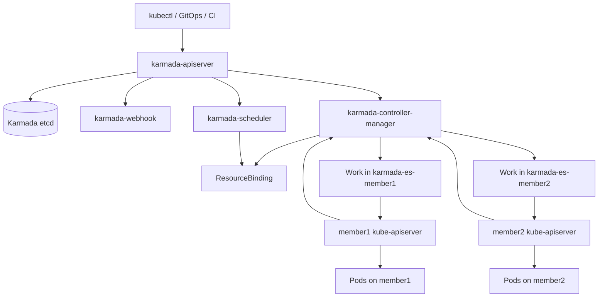
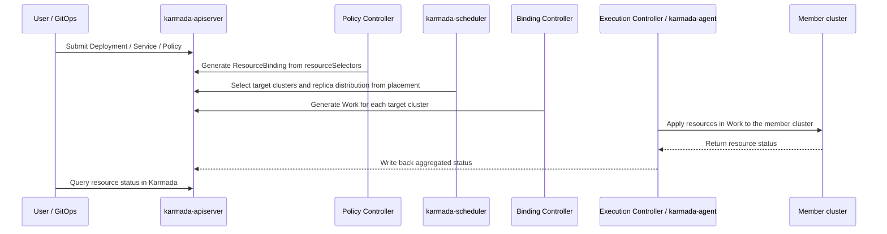

# What Is Karmada?

## The Idea in One Sentence

Karmada is a multi-cluster, multi-cloud, and hybrid-cloud orchestration system for Kubernetes. Rather than merging clusters into one enormous Kubernetes cluster, it provides a unified control plane above independent Kubernetes clusters. Users continue using native Kubernetes APIs, while policies distribute, schedule, customize, and fail over applications across member clusters.

In other words:

> Single-cluster Kubernetes schedules Pods onto Nodes; Karmada schedules Kubernetes resources onto Clusters.

These Clusters can span regions, availability zones, cloud providers, data centers, and edge environments. Karmada's core value is extending the single-cluster application-management model to multiple clusters while minimizing changes to application YAML.

## Why Karmada Is Needed

Kubernetes solves container orchestration within a single cluster, but production environments frequently face additional multi-cluster challenges.

### 1. A Single Cluster Does Not Automatically Protect Against All Failure Domains

A Kubernetes cluster is typically tied to a region, data center, network, and control plane. Even with multiple replicas, a highly available control plane, and isolated node pools, the entire cluster can still be affected by regional, network, control-plane, cloud-provider, or large-scale node failures.

Multiple clusters allow further separation of failure domains:

1. Deployment across multiple availability zones in the same city.
2. Cross-region disaster recovery.
3. Multi-cloud redundancy.
4. Separate clusters for critical and noncritical services.
5. Separation of central and edge clusters.

Multiple clusters introduce new questions: which clusters should host an application, how should replicas be divided, how should workloads move after a cluster fails, and how should differences in registries, StorageClasses, and LoadBalancer configuration across cloud providers be handled? These are the problems Karmada addresses.

### 2. Multi-Cloud and Hybrid-Cloud Details Should Not Intrude into Application YAML

If an application must run on AWS, GCP, Alibaba Cloud, and an on-premises data center, the most direct approach is to maintain separate YAML sets:

1. AWS uses one registry, StorageClass, and set of Ingress annotations.
2. GCP uses another registry, StorageClass, and set of Ingress annotations.
3. An on-premises data center may lack a cloud LoadBalancer and require an internal gateway.
4. Edge clusters have fewer resources and need fewer replicas or smaller requests.

Putting all these differences into application Helm values or Kustomize overlays makes the application repository increasingly complex. Karmada separates resource templates from multi-cluster policies:

1. Keep application YAML as close as possible to native Kubernetes form.
2. Use `PropagationPolicy` to decide destination clusters and replica distribution.
3. Use `OverridePolicy` to decide how fields change across clusters.

The application itself then does not need to understand every cluster's details.

### 3. GitOps Handles Delivery, but Does Not Provide Multi-Cluster Scheduling

GitOps tools such as Argo CD and Flux are well suited to declarative delivery and continuous synchronization. When used alone for multi-cluster management, a common pattern creates one Application or Kustomize overlay per cluster.

This is simple and reliable, but does not inherently solve:

1. Dynamically dividing replicas according to cluster capacity.
2. Scheduling constraints based on region, zone, or provider.
3. Automatically moving replicas to other clusters after failure.
4. Aggregating an application's status across clusters.
5. Querying multi-cluster resources through a unified API.

Karmada can work with GitOps. GitOps submits resources to the Karmada control plane, and Karmada distributes them to member clusters according to policy.

### 4. Multi-Cluster Management Needs Unified Abstractions

Without unified abstractions, a multi-cluster platform often becomes a collection of scripts, CI pipelines, Helm values, kubectl contexts, and manual conventions. It may work initially but becomes an operational burden over time.

Karmada provides these main abstractions:

| Abstraction | Problem addressed |
| --- | --- |
| `Cluster` | Member registration, status, labels, regions, cloud providers, and taints |
| `PropagationPolicy` | Resource selection, cluster selection, replica scheduling, and spread constraints |
| `OverridePolicy` | Per-cluster field overrides |
| `ResourceBinding` | The clusters to which a resource is ultimately bound |
| `Work` | The resource package delivered to a member cluster |
| `MultiClusterService` | Multi-cluster service discovery and cross-cluster access |
| `Failover` | Resource migration policies for cluster failures |

## What Karmada Is Not

Understanding Karmada also requires keeping its boundaries clear.

1. Karmada is not Cluster API. Cluster API focuses on creating Kubernetes clusters and managing their lifecycle; Karmada focuses on orchestrating applications across existing clusters.
2. Karmada is not a CNI. It does not automatically connect Pod networks across clusters. Cross-cluster access still requires Submariner, Cilium Cluster Mesh, a service mesh, cloud networking, or another networking solution.
3. Karmada is not a storage replication system. It can distribute StatefulSets, but databases, middleware, or storage systems must provide data replication, RPO, RTO, and primary/replica failover.
4. Karmada is not a Service Mesh. It can provide multi-cluster discovery and ingress orchestration, but L7 traffic management, circuit breaking, rate limiting, and mTLS generally remain the responsibility of a service mesh or gateway.
5. Karmada does not turn all clusters into one large cluster sharing a kube-scheduler. Karmada schedules at cluster granularity; each member cluster's own kube-scheduler still schedules Pods onto Nodes.

# Core Architecture

## The Control Plane and Member Clusters

Karmada's overall structure has two layers:

1. **Karmada control plane**: runs components such as `karmada-apiserver`, `karmada-controller-manager`, `karmada-scheduler`, `karmada-webhook`, and etcd.
2. **Member clusters**: Kubernetes clusters that actually run application Pods.

The Karmada control plane usually runs in a host cluster. However, users submitting application resources connect to `karmada-apiserver`, not the host cluster's native kube-apiserver. Deployments, Services, ConfigMaps, and other application resources are first stored in the Karmada control plane's etcd, then distributed to member clusters by Karmada controllers.



From the user's perspective, Karmada exposes a Kubernetes-style API Server. You can still use `kubectl apply -f deployment.yaml`, Argo CD, Flux, Helm, and similar tools; the destination kubeconfig simply points to the Karmada control plane.

## Resource Distribution Flow

A Deployment generally follows this sequence from submission to running in member clusters:



The key point is that Karmada does not create application Pods in its control plane. A Deployment submitted to `karmada-apiserver` is only a resource template. The actual Deployment is delivered to member clusters, whose Deployment Controllers then create ReplicaSets and Pods.

## Main Components

### 1. karmada-apiserver

`karmada-apiserver` is the entry point to the Karmada control plane. It is implemented using Kubernetes' `kube-apiserver`, making it inherently compatible with Kubernetes API semantics.

Its responsibilities include:

1. Exposing native Kubernetes APIs, such as Deployment, Service, and ConfigMap.
2. Exposing Karmada APIs, such as Cluster, PropagationPolicy, OverridePolicy, ResourceBinding, and Work.
3. Receiving requests from clients such as `kubectl`, `karmadactl`, GitOps tools, and controllers.
4. Storing control-plane objects in Karmada's own etcd.

This design underpins Karmada's compatibility with the Kubernetes ecosystem. Existing tools that support the Kubernetes API can potentially work with Karmada.

### 2. etcd

Karmada uses etcd to store control-plane data, including:

1. User-submitted resource templates.
2. Karmada policy objects.
3. Member-cluster objects and status.
4. Internal objects such as ResourceBinding and Work.

In production, Karmada's etcd is a critical control-plane component requiring high availability, backups, recovery drills, and capacity planning. Once resources have reached member clusters, a brief Karmada control-plane outage usually does not stop application Pods there, but it affects new policy changes, status aggregation, and failover.

### 3. karmada-controller-manager

`karmada-controller-manager` is Karmada's collection of controllers. It watches Karmada API objects and drives member clusters toward the desired state.

Common controllers include:

1. **Cluster Controller**: manages member-cluster lifecycle and status.
2. **Policy Controller**: watches `PropagationPolicy` / `ClusterPropagationPolicy` and finds matching resources through `resourceSelectors`.
3. **Binding Controller**: generates `Work` for destination clusters based on scheduling results.
4. **Execution Controller**: writes resources from `Work` into member clusters in Push mode.
5. **Status Controller**: collects member-cluster resource status and writes it back to the Karmada control plane.
6. **Failover controllers**: trigger migration when a cluster becomes unavailable or receives particular taints.

Think of `karmada-controller-manager` as Karmada's core execution layer. Policy objects are declarations; these controllers actually distribute resources, synchronize status, and perform failover.

### 4. karmada-scheduler

`karmada-scheduler` schedules resources onto member clusters.

Its distinction from kube-scheduler is essential:

| Scheduler | Scheduled object | Destination |
| --- | --- | --- |
| kube-scheduler | Pod | Node |
| karmada-scheduler | Kubernetes resource template | Cluster |

For example, if a user submits a six-replica Deployment, Karmada's scheduler does not choose a Node for each Pod. It chooses which member clusters receive the Deployment and how many replicas each receives. Each member cluster's kube-scheduler then assigns Pods to specific Nodes.

`karmada-scheduler` considers:

1. Placement in `PropagationPolicy`.
2. Member-cluster labels, fields, taints, and health.
3. Member-cluster resource capacity and schedulable replica counts.
4. Spread constraints across regions, zones, or clusters.
5. Replica scheduling strategies, such as duplication, division, and weighted division.
6. workload affinity / anti-affinity。

### 5. karmada-webhook

`karmada-webhook` provides mutating and validating webhooks.

Typical responsibilities include:

1. Setting resource defaults.
2. Validating Karmada API objects.
3. Rejecting obviously conflicting or incomplete policies.
4. Helping inject fields required by the control plane in some scenarios.

As with Kubernetes webhooks, mutating webhooks may change incoming objects, while validating webhooks perform final validation.

### 6. karmada-aggregated-apiserver

`karmada-aggregated-apiserver` extends Karmada APIs using the Kubernetes API Aggregation Layer. It commonly provides aggregated APIs, cluster proxying, and cross-cluster resource access.

For example, accessing member-cluster resources through the Karmada control plane may use aggregated APIs and proxy capabilities underneath.

### 7. kube-controller-manager

The Karmada control plane also runs a `kube-controller-manager`, but its purpose is not to create application Pods within that control plane.

When a user submits a Deployment to `karmada-apiserver`, it is recorded in Karmada's etcd and synchronized to member clusters. A Deployment Controller in the Karmada control plane does not directly reconcile it into Pods as in an ordinary Kubernetes cluster.

Karmada retains only selected Kubernetes controllers to preserve necessary API behavior and user experience.

### 8. karmada-agent

`karmada-agent` is required only in Pull mode. It normally runs on the member-cluster side and handles:

1. Registering the member cluster with the Karmada control plane.
2. Pulling `Work` assigned to this cluster from the Karmada control plane.
3. Applying resources in `Work` to the local cluster.
4. Reporting member-cluster and resource status.
5. Maintaining Lease heartbeats in Pull mode.

Pull mode is better suited when the Karmada control plane cannot directly reach the member kube-apiserver, such as clusters behind NAT, edge networks, or customer VPCs.

## Optional Components and Plugins

### 1. karmada-scheduler-estimator

`karmada-scheduler-estimator` provides the scheduler with more accurate estimates of schedulable cluster capacity.

Looking only at total resources is insufficient. A cluster with 100 CPU cores cannot necessarily fit a Pod requiring 16 cores because capacity may be fragmented across nodes. The estimator uses member-cluster node information and resource requests to estimate how many additional workload replicas can actually be scheduled, avoiding the case where aggregate capacity is sufficient but no individual node can fit the Pod.

### 2. karmada-descheduler

`karmada-descheduler` performs rescheduling. It checks whether already distributed replicas are still placed in suitable clusters.

For example:

1. A member cluster has fewer resources available.
2. The actual status of some replicas changes.
3. A dynamic replica-division strategy needs rebalancing.
4. Cluster weights change, requiring replica redistribution.

It does not move Pods directly. It triggers Karmada to recalculate distribution, then resource changes cause member clusters to perform the updates.

### 3. karmada-search

`karmada-search` provides multi-cluster resource search and proxy capabilities.

Troubleshooting a multi-cluster environment often requires answers to questions such as:

1. Which clusters host a particular Deployment?
2. Which member cluster contains a particular Pod?
3. Which clusters contain a particular Service?
4. How are events for a resource type distributed?

Manually switching kubeconfig contexts every time is inefficient. `karmada-search` provides a global resource view.

# Cluster Registration Modes: Push and Pull

Karmada supports Push and Pull registration modes. The central difference is which side initiates access.

| Mode | How it works | Advantages | Suitable scenarios |
| --- | --- | --- | --- |
| Push | The Karmada control plane directly accesses member kube-apiservers | Simple architecture with direct control-plane management | Same data center or VPC, reachable networks, smaller cluster counts |
| Pull | Members run `karmada-agent`, which pulls Work from the control plane | No need for the control plane to directly reach members; suited to isolated networks and large fleets | Edge clusters, clusters behind NAT, customer-side clusters, large fleets |

Common Push-mode registration command:

```bash
karmadactl join member1 \
  --kubeconfig=<karmada-kubeconfig> \
  --cluster-kubeconfig=<member1-kubeconfig>
```

Common Pull-mode registration command:

```bash
karmadactl register <karmada-apiserver-address> \
  --token <bootstrap-token> \
  --discovery-token-ca-cert-hash <hash>
```

After registration, inspect the clusters:

```bash
kubectl get clusters
kubectl describe cluster member1
```

Each member cluster corresponds to a `Cluster` object in Karmada. Its name appears frequently in scheduling policies, for example:

```yaml
placement:
  clusterAffinity:
    clusterNames:
      - member1
      - member2
```

# Core Concepts

## 1. Cluster

`Cluster` represents a member Kubernetes cluster managed by Karmada.

A `Cluster` usually includes:

1. Cluster name.
2. Access method and sync mode.
3. Fields such as provider, region, and zone.
4. labels。
5. taints。
6. Ready status.
7. API Server reachability and version information.

Cluster labels and fields form the basis of scheduling. For example:

```bash
kubectl label cluster member1 location=cn provider=aws env=prod
kubectl label cluster member2 location=sg provider=gcp env=prod
```

Policies can then select clusters by label:

```yaml
placement:
  clusterAffinity:
    labelSelector:
      matchLabels:
        env: prod
```

They can also select by built-in fields:

```yaml
placement:
  clusterAffinity:
    fieldSelector:
      matchExpressions:
        - key: region
          operator: In
          values:
            - cn-east-1
            - cn-north-1
```

Cluster supports taints similar to Kubernetes Node taints. A cluster with a `NoSchedule` taint does not accept new workloads unless a policy declares the corresponding toleration. A `NoExecute` taint can trigger migration of existing workloads.

## 2. Resource Template

A Resource Template is the original Kubernetes resource template submitted by a user to Karmada.

Common resources include:

1. Deployment
2. StatefulSet
3. DaemonSet
4. Job / CronJob
5. Service
6. ConfigMap
7. Secret
8. Ingress
9. CRDs and custom resources

Karmada reuses native Kubernetes APIs wherever possible, so many existing YAML files can be submitted directly to its control plane. For example:

```yaml
apiVersion: apps/v1
kind: Deployment
metadata:
  name: nginx
  labels:
    app: nginx
spec:
  replicas: 6
  selector:
    matchLabels:
      app: nginx
  template:
    metadata:
      labels:
        app: nginx
    spec:
      containers:
        - name: nginx
          image: nginx:1.25
          resources:
            requests:
              cpu: 100m
              memory: 128Mi
```

Submitting a Deployment alone is insufficient, because Karmada also needs to know which clusters should receive it. That requires a PropagationPolicy.

## 3. PropagationPolicy and ClusterPropagationPolicy

`PropagationPolicy` describes how resources propagate to member clusters. Its two core fields are:

1. `resourceSelectors`: which resources to select.
2. `placement`: which clusters to select and how replicas are distributed.

`PropagationPolicy` is namespace-scoped and affects only resources in the same namespace. `ClusterPropagationPolicy` is cluster-scoped and can affect matching resources across the cluster.

A minimal example:

```yaml
apiVersion: policy.karmada.io/v1alpha1
kind: PropagationPolicy
metadata:
  name: nginx-propagation
  namespace: default
spec:
  resourceSelectors:
    - apiVersion: apps/v1
      kind: Deployment
      name: nginx
  placement:
    clusterAffinity:
      clusterNames:
        - member1
        - member2
```

This distributes the `default/nginx` Deployment among the candidate clusters `member1` and `member2`.

A more complete example:

```yaml
apiVersion: policy.karmada.io/v1alpha1
kind: PropagationPolicy
metadata:
  name: nginx-propagation
  namespace: default
spec:
  resourceSelectors:
    - apiVersion: apps/v1
      kind: Deployment
      name: nginx
    - apiVersion: v1
      kind: Service
      name: nginx
  propagateDeps: true
  placement:
    clusterAffinity:
      clusterNames:
        - member1
        - member2
    spreadConstraints:
      - spreadByField: cluster
        minGroups: 2
        maxGroups: 2
    replicaScheduling:
      replicaSchedulingType: Divided
      replicaDivisionPreference: Weighted
      weightPreference:
        staticWeightList:
          - targetCluster:
              clusterNames:
                - member1
            weight: 1
          - targetCluster:
              clusterNames:
                - member2
            weight: 2
```

For a six-replica Deployment, these static weights give approximately two replicas to `member1` and four to `member2`. `spreadConstraints` ensures that exactly two groups at the cluster dimension are selected.

### resourceSelectors

`resourceSelectors` selects resources by:

1. `apiVersion`
2. `kind`
3. `name`
4. `namespace`
5. `labelSelector`

Select one resource:

```yaml
resourceSelectors:
  - apiVersion: apps/v1
    kind: Deployment
    name: nginx
```

Select a group of resources by label:

```yaml
resourceSelectors:
  - apiVersion: apps/v1
    kind: Deployment
    labelSelector:
      matchLabels:
        app: payment
```

With `propagateDeps: true`, Karmada can automatically propagate certain dependencies referenced by a workload, such as ConfigMaps and Secrets used by a Deployment. Use this carefully in production, especially for Secrets, with clear boundaries and auditing rules.

### clusterAffinity

`clusterAffinity` defines the candidate cluster set. Being a candidate does not mean every cluster will ultimately be selected.

A common option is selection by name:

```yaml
placement:
  clusterAffinity:
    clusterNames:
      - member1
      - member2
```

Selection by label:

```yaml
placement:
  clusterAffinity:
    labelSelector:
      matchLabels:
        env: prod
```

Selection by field:

```yaml
placement:
  clusterAffinity:
    fieldSelector:
      matchExpressions:
        - key: provider
          operator: In
          values:
            - aws
        - key: region
          operator: NotIn
          values:
            - us-west-1
```

Explicit exclusion is also supported:

```yaml
placement:
  clusterAffinity:
    exclude:
      - member3
```

### clusterAffinities

`clusterAffinities` defines multiple ordered candidate-cluster groups for primary/standby, overflow, and priority scenarios.

For example, prefer an on-premises IDC and overflow to the cloud when capacity is insufficient:

```yaml
placement:
  clusterAffinities:
    - affinityName: idc-primary
      clusterNames:
        - idc-cluster1
      overflowAffinities:
        - affinityName: cloud-overflow
          clusterNames:
            - cloud-cluster1
            - cloud-cluster2
  replicaScheduling:
    replicaSchedulingType: Divided
    replicaDivisionPreference: Weighted
    weightPreference:
      dynamicWeight: AvailableReplicas
```

This policy suits cost-sensitive environments: prefer on-premises resource pools under normal conditions, then overflow to cloud pools during peaks or resource shortages.

### spreadConstraints

`spreadConstraints` controls resource distribution across topology domains.

Common goals:

1. Span at least two clusters.
2. Span at least two regions.
3. Select only one cluster per region.
4. Avoid concentrating all replicas in one failure domain.

Example:

```yaml
placement:
  replicaScheduling:
    replicaSchedulingType: Duplicated
  spreadConstraints:
    - spreadByField: region
      minGroups: 2
      maxGroups: 2
    - spreadByField: cluster
      minGroups: 2
      maxGroups: 2
```

This requests distribution across two regions, with two clusters selected in total.

### clusterTolerations

Karmada Clusters can be tainted, and policies can tolerate these taints through `clusterTolerations`.

For example, taint a cluster:

```bash
karmadactl taint clusters member1 dedicated=special-user:NoSchedule
```

Declare a toleration in the policy:

```yaml
placement:
  clusterTolerations:
    - key: dedicated
      value: special-user
      effect: NoSchedule
```

The semantics closely resemble Kubernetes Node taints / tolerations, with Cluster replacing Node as the target.

## 4. Replica Scheduling Strategies

Karmada supports replica scheduling for workloads with a `replicas` field, most commonly Deployments, StatefulSets, and some custom workloads.

### Duplicated

`Duplicated` gives every destination cluster the full replica count.

```yaml
placement:
  clusterAffinity:
    clusterNames:
      - member1
      - member2
  replicaScheduling:
    replicaSchedulingType: Duplicated
```

If the Deployment specifies `replicas: 3`, `member1` receives three replicas and `member2` also receives three, for six replicas in total.

Suitable scenarios:

1. Active-active deployments.
2. A complete service instance is needed in each region.
3. Edge clusters need permanent local replicas.
4. Disaster-recovery clusters need warm replicas.

### Divided + Aggregated

`Divided` splits the total replica count across clusters. `Aggregated` tries to place the replicas in as few clusters as possible.

```yaml
placement:
  clusterAffinity:
    clusterNames:
      - member1
      - member2
  replicaScheduling:
    replicaSchedulingType: Divided
    replicaDivisionPreference: Aggregated
```

For a six-replica Deployment, Karmada tries to host all six using fewer clusters. This suits cost optimization or cases where reducing cross-cluster distribution complexity is desirable.

### Divided + Weighted

`Weighted` divides replicas according to weights.

Static weights:

```yaml
placement:
  replicaScheduling:
    replicaSchedulingType: Divided
    replicaDivisionPreference: Weighted
    weightPreference:
      staticWeightList:
        - targetCluster:
            clusterNames:
              - member1
          weight: 1
        - targetCluster:
            clusterNames:
              - member2
          weight: 2
```

Dynamic weights:

```yaml
placement:
  replicaScheduling:
    replicaSchedulingType: Divided
    replicaDivisionPreference: Weighted
    weightPreference:
      dynamicWeight: AvailableReplicas
```

Dynamic weights calculate distribution based on how many replicas each member cluster can currently accommodate. This generally benefits from more accurate resource estimation, especially in large clusters with significant resource fragmentation.

## 5. OverridePolicy and ClusterOverridePolicy

`OverridePolicy` describes how resources should be modified before delivery to different clusters.

Common override scenarios:

1. Different image registries for different regions.
2. Different StorageClasses for different cloud providers.
3. Different annotations for different clusters.
4. Smaller requests / limits for edge clusters.
5. Replacing ConfigMap settings for a particular cluster.
6. Different startup arguments for different environments.

`OverridePolicy` is namespace-scoped; `ClusterOverridePolicy` is cluster-scoped. For namespaced resources, `ClusterOverridePolicy` is generally applied first, followed by `OverridePolicy`.

Example: add an image registry for a region and override the CPU limit for a particular cluster.

```yaml
apiVersion: policy.karmada.io/v1alpha1
kind: ClusterOverridePolicy
metadata:
  name: nginx-override
spec:
  resourceSelectors:
    - apiVersion: apps/v1
      kind: Deployment
      labelSelector:
        matchLabels:
          app: nginx
  overrideRules:
    - targetCluster:
        fieldSelector:
          matchExpressions:
            - key: region
              operator: In
              values:
                - cn-east-1
      overriders:
        imageOverrider:
          - component: Registry
            operator: add
            value: registry.cn-east-1.example.com
    - targetCluster:
        clusterNames:
          - edge-member1
      overriders:
        plaintext:
          - path: /spec/template/spec/containers/0/resources/limits/cpu
            operator: replace
            value: 500m
```

Karmada provides several overriders:

| Overrider | Purpose |
| --- | --- |
| `imageOverrider` | Override image registry, repository, tag, or digest |
| `commandOverrider` | Override container commands |
| `argsOverrider` | Override container arguments |
| `labelsOverrider` | Override labels |
| `annotationsOverrider` | Override annotations |
| `plaintext` | Override fields by path, similar to JSON Patch |
| `fieldOverrider` | Override parts of the contents of YAML / JSON fields |

OverridePolicy is essential for multi-cloud adoption. It keeps application templates relatively uniform while moving environment differences into platform policies.

## 6. ResourceBinding and Work

`ResourceBinding` and `Work` are generally internal objects generated by Karmada controllers, rather than objects users write manually.

### ResourceBinding

`ResourceBinding` represents the binding between a resource template and its propagation policy.

It records:

1. Which resource is being propagated.
2. Which policy is used.
3. Which destination clusters are selected.
4. How many replicas each cluster receives.
5. Scheduling and aggregated status.

For cluster-scoped resources, the corresponding object is `ClusterResourceBinding`.

Useful troubleshooting commands:

```bash
kubectl get resourcebindings -n default
kubectl describe resourcebinding <binding-name> -n default
```

### Work

`Work` is the resource package ultimately delivered to a member cluster. Karmada creates an execution-space namespace for each member, typically named:

```text
karmada-es-<cluster-name>
```

For example:

```bash
kubectl get work -n karmada-es-member1
kubectl describe work <work-name> -n karmada-es-member1
```

Think of `Work` as a task assigned to a particular member cluster. The Execution Controller or `karmada-agent` reads it and applies its manifests to the member cluster.

# A Complete Example

The following simple Nginx application demonstrates basic Karmada usage.

## 1. Create the Resource Template

```yaml
apiVersion: apps/v1
kind: Deployment
metadata:
  name: nginx
  namespace: default
  labels:
    app: nginx
spec:
  replicas: 6
  selector:
    matchLabels:
      app: nginx
  template:
    metadata:
      labels:
        app: nginx
    spec:
      containers:
        - name: nginx
          image: nginx:1.25
          ports:
            - containerPort: 80
          resources:
            requests:
              cpu: 100m
              memory: 128Mi
            limits:
              cpu: 500m
              memory: 256Mi
---
apiVersion: v1
kind: Service
metadata:
  name: nginx
  namespace: default
  labels:
    app: nginx
spec:
  selector:
    app: nginx
  ports:
    - port: 80
      targetPort: 80
```

## 2. Create a Propagation Policy

```yaml
apiVersion: policy.karmada.io/v1alpha1
kind: PropagationPolicy
metadata:
  name: nginx-propagation
  namespace: default
spec:
  resourceSelectors:
    - apiVersion: apps/v1
      kind: Deployment
      name: nginx
    - apiVersion: v1
      kind: Service
      name: nginx
  placement:
    clusterAffinity:
      labelSelector:
        matchLabels:
          env: prod
    spreadConstraints:
      - spreadByField: cluster
        minGroups: 2
        maxGroups: 2
    replicaScheduling:
      replicaSchedulingType: Divided
      replicaDivisionPreference: Weighted
      weightPreference:
        dynamicWeight: AvailableReplicas
```

Meaning:

1. Select the `default/nginx` Deployment and Service.
2. Candidate clusters must have the `env=prod` label.
3. Select two clusters in the final result.
4. Dynamically divide the six replicas according to member-cluster capacity.

## 3. Apply to the Karmada Control Plane

```bash
kubectl --kubeconfig=<karmada-kubeconfig> apply -f nginx.yaml
kubectl --kubeconfig=<karmada-kubeconfig> apply -f nginx-propagation.yaml
```

## 4. Check Status in Karmada

```bash
kubectl --kubeconfig=<karmada-kubeconfig> get clusters
kubectl --kubeconfig=<karmada-kubeconfig> get propagationpolicy -n default
kubectl --kubeconfig=<karmada-kubeconfig> get resourcebindings -n default
```

Inspect Work objects:

```bash
kubectl --kubeconfig=<karmada-kubeconfig> get work -A
```

## 5. Check Status in Member Clusters

```bash
kubectl --kubeconfig=<member-kubeconfig> --context=member1 get deploy,svc,pod -n default
kubectl --kubeconfig=<member-kubeconfig> --context=member2 get deploy,svc,pod -n default
```

If everything works, the Deployment and Service appear in the member clusters, and Pods are created by those clusters' own controllers and schedulers.

# Multi-Cluster Service Discovery and Access

After distributing an application across clusters, the next challenge is service access.

Karmada supports multi-cluster service-management capabilities, including:

1. `ServiceExport` / `ServiceImport` based on the Multi-Cluster Services API.
2. `MultiClusterService`, which provides access to cross-cluster backends through an interface close to a native Service.
3. `MultiClusterIngress`, which routes external traffic into multi-cluster services.

However, service discovery does not provide network connectivity by itself.

Multi-cluster services generally require:

1. Reachable Pod or Service networks between member clusters.
2. Nonoverlapping Pod CIDRs and Service CIDRs across clusters.
3. Correct DNS, EndpointSlice, or service-import configuration.
4. Security policies, firewalls, and gateway policies that permit traffic along the cross-cluster path.

If member-cluster networks are disconnected, Karmada can distribute ServiceExport / ServiceImport objects, but requests still cannot reach backend Pods across those networks automatically.

A typical pattern:

1. Deploy the service provider in `member1`.
2. Create a `ServiceExport` and propagate it to `member1`.
3. Create or synchronize a `ServiceImport` / derived Service in `member2`.
4. Clients in `member2` access backends in `member1` through the imported Service.

In production, cross-cluster service access is usually combined with Submariner, Cilium Cluster Mesh, a service mesh, cloud private-network connectivity, or a unified gateway.

# Failover

Karmada's failover capabilities handle member clusters that become unavailable or should no longer host workloads.

## How Cluster Failures Are Detected

Karmada maintains member-cluster status, with different heartbeat sources depending on mode:

1. Push mode: the control-plane clusterStatus controller periodically accesses member clusters.
2. Pull mode: `karmada-agent` reports `Cluster` status and maintains a Lease.

If a cluster remains unreachable beyond the configured interval, or health checks keep failing, its Ready condition may become `False` or `Unknown`.

Inspect it with:

```bash
kubectl describe cluster member1
```

## Taints and Migration

Karmada uses Cluster taints to control scheduling and migration:

1. `NoSchedule`: prevent new workloads from being scheduled to the cluster.
2. `NoExecute`: trigger migration of existing workloads out of the cluster.

For example:

```bash
karmadactl taint clusters member1 maintenance=true:NoSchedule
karmadactl taint clusters member1 unavailable=true:NoExecute
```

When a cluster receives a `NoExecute` taint and policy allows failover, Karmada can migrate affected workloads to other eligible clusters.

## Configuring Failover

Karmada's cluster failover is controlled by a feature gate. According to the official v1.17 documentation, `Failover` remains Beta and must be explicitly enabled in `karmada-controller-manager`:

```bash
--feature-gates=Failover=true
```

The policy can configure:

```yaml
apiVersion: policy.karmada.io/v1alpha1
kind: PropagationPolicy
metadata:
  name: nginx-propagation
spec:
  failover:
    cluster:
      purgeMode: Gracefully
  resourceSelectors:
    - apiVersion: apps/v1
      kind: Deployment
      name: nginx
  placement:
    clusterAffinity:
      clusterNames:
        - member1
        - member2
        - member3
    spreadConstraints:
      - spreadByField: cluster
        minGroups: 1
        maxGroups: 1
```

`purgeMode` controls how old instances in the original cluster are handled during migration:

| Mode | Meaning | Suitable scenarios |
| --- | --- | --- |
| `Gracefully` | Wait until applications in the new cluster become healthy or time out, then remove old instances | Stateless services or services that allow brief concurrent execution |
| `Directly` | Remove old instances directly before migrating | Jobs that cannot run concurrently, such as some exactly-once computation tasks |

## Take Extra Care with Stateful Applications

Stateless failover is relatively simple: restart replicas as long as images, configuration, dependencies, and traffic entry points are available.

Stateful applications are more complex. Databases, message queues, Flink, Spark Streaming, and application state machines must consider:

1. Whether data has been replicated to the destination cluster.
2. Whether old and new instances might both write.
3. Whether checkpoints / savepoints are available.
4. Whether storage paths and permissions match.
5. How to avoid split brain after recovery.

Starting with v1.15, Karmada added state-preservation capabilities for cluster failover, allowing state to be extracted through JSONPath and injected into objects in the new cluster. This still requires cooperation from applications and external systems, such as Flink checkpoints, Kyverno injection rules, and shared storage paths. It cannot replace application-level data-consistency design.

# Installation and Basic Operations

Karmada supports several installation methods:

1. `karmadactl init`
2. `kubectl karmada init`
3. Helm Chart
4. Karmada Operator
5. Binary deployment
6. Source-code development-environment scripts

For local experimentation, kind and the official scripts are the most common starting point. Production deployments place greater emphasis on HA, certificates, etcd, backups, monitoring, and upgrades.

## Install the CLI

Install `karmadactl`:

```bash
curl -s https://raw.githubusercontent.com/karmada-io/karmada/master/hack/install-cli.sh | sudo bash
```

You can also install the `kubectl karmada` plugin. The two provide essentially the same commands with different invocation styles.

## Initialize the Control Plane

Install Karmada in an existing Kubernetes cluster:

```bash
karmadactl init --kubeconfig=<host-cluster-kubeconfig>
```

For a highly available installation, consider the replica counts of `karmada-apiserver` and etcd:

```bash
karmadactl init \
  --karmada-apiserver-replicas 3 \
  --etcd-replicas 3 \
  --etcd-storage-mode PVC \
  --storage-classes-name <storage-class> \
  --kubeconfig=<host-cluster-kubeconfig>
```

Check the installation:

```bash
kubectl --kubeconfig=<host-cluster-kubeconfig> get pods -n karmada-system
```

## Join Member Clusters

Push mode:

```bash
karmadactl join member1 \
  --kubeconfig=<karmada-kubeconfig> \
  --cluster-kubeconfig=<member1-kubeconfig>
```

Inspect:

```bash
kubectl --kubeconfig=<karmada-kubeconfig> get clusters
```

Label a cluster:

```bash
kubectl --kubeconfig=<karmada-kubeconfig> label cluster member1 env=prod region=cn-east-1
```

Stop a cluster from accepting new workloads:

```bash
karmadactl taint clusters member1 maintenance=true:NoSchedule
```

Resume:

```bash
karmadactl taint clusters member1 maintenance=true:NoSchedule-
```

# Relationship to Other Approaches

## Karmada vs Kubernetes Federation

Karmada continues some ideas from Kubernetes Federation v1/v2, but it is not simply a recreation of the Federated API.

A core idea in Kubernetes Federation v2 was defining a federated type for each resource, such as FederatedDeployment. Karmada emphasizes native Kubernetes API compatibility: users submit native Deployments, Services, and ConfigMaps, then use separate policies for multi-cluster scheduling and configuration differences.

This reduces the cost of moving from single-cluster to multi-cluster management.

## Karmada vs Cluster API

Cluster API handles how clusters are created, upgraded, scaled, and destroyed. Karmada handles how application resources are distributed across clusters.

They can work together:

1. Cluster API creates multiple Kubernetes clusters.
2. Karmada registers those clusters.
3. GitOps submits applications and policies to Karmada.
4. Karmada performs cross-cluster orchestration.

## Karmada vs Argo CD / Flux

Argo CD / Flux handles GitOps delivery. Karmada handles multi-cluster scheduling and distribution.

A common combination:

1. Argo CD connects to the Karmada control plane.
2. A Git repository stores Deployments, Services, PropagationPolicies, and OverridePolicies.
3. Argo CD synchronizes those resources to Karmada.
4. Karmada distributes them to member clusters according to policy.

GitOps then maintains continuous delivery, while Karmada executes multi-cluster policies.

## Karmada vs. Rancher / ACM / Multi-Cloud Management Platforms

Rancher, Red Hat ACM, and cloud-provider multi-cluster platforms generally cover a broader management scope: cluster lifecycle, permissions, visualization, policies, security, monitoring, and operations.

Karmada focuses more specifically on open multi-cluster Kubernetes orchestration. It can serve as an underlying orchestration engine or be integrated into a higher-level platform.

# Production Recommendations

## 1. Design the Cluster Labeling Scheme First

Karmada's scheduling policies depend heavily on cluster metadata. Standardize labels and fields before deployment.

Common labels:

```text
env=prod
region=cn-east-1
zone=cn-east-1a
provider=aws
cluster-type=edge
network=private
capacity-tier=large
compliance=finance
```

Do not let every team invent labels independently. An unstable labeling scheme makes policies unpredictable.

## 2. Separate Platform and Application Policies

Recommended policy layers:

1. Platform-level `ClusterPropagationPolicy`: shared namespaces, foundational CRDs, common configuration, and security baselines.
2. Application-level `PropagationPolicy`: distribution rules for an application within a namespace.
3. Platform-level `ClusterOverridePolicy`: shared registries and cloud-provider differences.
4. Application-level `OverridePolicy`: small application-specific differences.

Do not use `ClusterPropagationPolicy` for everything. Broader scope increases the risk of unintended matches.

## 3. Be Conservative with conflictResolution

When a resource with the same name already exists in a destination member cluster, Karmada must decide how to resolve the conflict. Production deployments should generally avoid overwriting existing resources by default unless it is clear that Karmada should take ownership.

Audit existing clusters before onboarding them:

```bash
kubectl --context=member1 get deploy,svc,cm,secret -A
```

Then decide which resources Karmada should manage and which remain under the existing platform or team.

## 4. Define Clear Boundaries for Secrets and ConfigMaps

Propagating Secrets across clusters is convenient, but can easily expand the exposure of sensitive information.

Recommendations:

1. Do not automatically propagate all Secrets using broad selectors.
2. Use separate policies for Secrets.
3. Use naming conventions or labels to identify which Secrets may cross cluster boundaries.
4. Manage sensitive data with External Secrets, Vault, or a cloud-provider Secret Manager.
5. Minimize permissions for access to member clusters.

## 5. Start with Stateless Services, Then Add Stateful Services

Karmada is best introduced with stateless services, replicated services, read-heavy services, batch jobs, and edge distribution.

Stateful services need separate designs for:

1. Data replication.
2. Primary/replica or multi-primary consistency.
3. Failover workflows.
4. Backup and recovery.
5. Cross-cluster network latency.
6. Failback workflows.

The ability to distribute a StatefulSet does not imply that a database can migrate transparently across clusters.

## 6. Treat the Karmada Control Plane as Critical Infrastructure

A production Karmada control plane should account for at least:

1. Multiple `karmada-apiserver` replicas.
2. Multiple etcd replicas and regular backups.
3. High availability for controller-manager and scheduler.
4. Webhook certificate renewal.
5. Control-plane resource requests / limits.
6. API Server audit logs.
7. Prometheus metrics and alerts.
8. Upgrade and rollback plans.

A brief Karmada control-plane outage may not immediately disrupt running applications, but it affects multi-cluster orchestration, status synchronization, and failover. Treat it accordingly, rather than as an ordinary application Deployment.

## 7. Understand the Eventual-Consistency Model

Karmada is a declarative control system, not a strongly transactional system.

Multiple asynchronous control loops run between resource submission, binding generation, Work delivery, member-cluster object creation, and status reporting. Troubleshoot along the chain:

```text
Resource Template
  -> PropagationPolicy
  -> ResourceBinding
  -> Work
  -> Member Cluster Resource
  -> Aggregated Status
```

Common troubleshooting commands:

```bash
kubectl get propagationpolicy -n default
kubectl describe propagationpolicy nginx-propagation -n default

kubectl get resourcebindings -n default
kubectl describe resourcebinding <name> -n default

kubectl get work -A
kubectl describe work <name> -n karmada-es-member1

kubectl --context=member1 get deploy nginx -n default
kubectl --context=member1 describe deploy nginx -n default
kubectl --context=member1 get events -n default --sort-by=.metadata.creationTimestamp
```

## 8. Validate Networking and Service Discovery Separately

Successful application distribution does not establish that cross-cluster access works.

Before launch, verify at least:

1. Whether Pod CIDRs / Service CIDRs overlap across clusters.
2. Pod-to-Pod reachability.
3. Service-to-Service reachability.
4. Expected DNS resolution.
5. Correct generation of EndpointSlices or ServiceImports.
6. Traffic permissions in network policies, firewalls, and security groups.
7. Whether cross-region latency meets application SLAs.

# Frequently Asked Questions

## 1. Do Applications in Member Clusters Disappear If the Karmada Control Plane Fails?

Generally, no.

Deployments, Services, Pods, and other resources already delivered to member clusters remain there and continue to be reconciled by those clusters' own control planes. A Karmada control-plane failure mainly affects new distribution, policy changes, status aggregation, and failover.

However, if someone manually changes member-cluster resources during the outage, Karmada may overwrite those changes with the desired state after recovering. Resource ownership must therefore be clear.

## 2. Can Karmada Manage Clusters Running Different Kubernetes Versions?

Yes, with care.

Karmada can distribute resources to member clusters running different versions, but each destination must support the relevant APIs. For example, an older member cluster may reject a field supported only in newer Kubernetes versions.

Practical recommendations:

1. Limit the version spread among member clusters.
2. Handle version differences with OverridePolicy.
3. Ensure compatible CRD versions are installed in all target clusters first.
4. Validate upgrades on a canary cluster.

## 3. Should Karmada Manage Every Resource?

Not necessarily.

Resources suited to Karmada include:

1. Application workloads that need cross-cluster distribution.
2. Foundational configuration shared across clusters.
3. Cross-region disaster-recovery services.
4. Batch jobs requiring a unified scheduling policy.

Resources that may be less suitable include:

1. DaemonSets tied only to one cluster's local infrastructure.
2. Strongly cluster-local components such as CNI, CSI, and node monitoring.
3. Cloud-provider controllers and cluster bootstrap resources.
4. Legacy manually operated resources with unclear ownership.

## 4. Can Karmada Replace Helm Values or Kustomize Overlays?

It cannot replace them entirely, but it can reduce the number of overlays.

Helm / Kustomize remains useful for expressing an application's own configuration combinations. Karmada's OverridePolicy is better suited to environment differences when the same application is distributed to different clusters.

A clear division is:

1. Application versions, module switches, and business configuration: Helm / Kustomize.
2. Cluster selection, replica distribution, and cross-cluster spreading: PropagationPolicy.
3. Registries, StorageClasses, region annotations, and cluster-specific fields: OverridePolicy.

## 5. Can Multi-Cluster Failover Be Completely Transparent?

Complete transparency usually cannot be guaranteed.

Stateless services can fail over relatively smoothly, but image pulls, Pod startup, health checks, traffic switching, and DNS caching still affect them. Stateful services also depend on replication, checkpoints, locks, idempotency, and split-brain risks.

Karmada provides orchestration and migration mechanisms, rather than the entire solution to application continuity.

# Summary

Karmada's central idea is to extend Kubernetes orchestration from one cluster to multiple clusters while preserving the native Kubernetes API experience as much as possible.

Its main flow is:

```text
Native resource template + PropagationPolicy + OverridePolicy
  -> ResourceBinding
  -> Work
  -> Member-cluster resources
  -> Status reporting and failover
```

Karmada suits scenarios including:

1. Multi-region deployments.
2. Multi-cloud and hybrid cloud.
3. Edge-cluster management.
4. Cross-cluster disaster recovery.
5. Dynamic replica distribution based on resources and topology.
6. Preserving native Kubernetes APIs and tools.

Adoption requires more than installing Karmada. Cluster labels, policy boundaries, network connectivity, permissions, state data, and recovery procedures all need careful design. Karmada turns multi-cluster orchestration into declarative APIs, but the underlying complexity still requires disciplined engineering.

# References

1. [Karmada Documentation: What is Karmada](https://karmada.io/docs/)
2. [Karmada Documentation: Components](https://karmada.io/docs/next/core-concepts/components/)
3. [Karmada Documentation: Architecture](https://karmada.io/docs/next/core-concepts/architecture/)
4. [Karmada Documentation: Cluster Registration](https://karmada.io/docs/next/userguide/clustermanager/cluster-registration/)
5. [Karmada Documentation: Propagation Policy](https://karmada.io/docs/next/userguide/scheduling/propagation-policy/)
6. [Karmada Documentation: Override Policy](https://karmada.io/docs/userguide/scheduling/override-policy/)
7. [Karmada Documentation: Cluster Failover](https://karmada.io/docs/userguide/failover/cluster-failover/)
8. [Karmada Documentation: Multi-cluster Service Discovery](https://karmada.io/docs/userguide/service/multi-cluster-service/)
