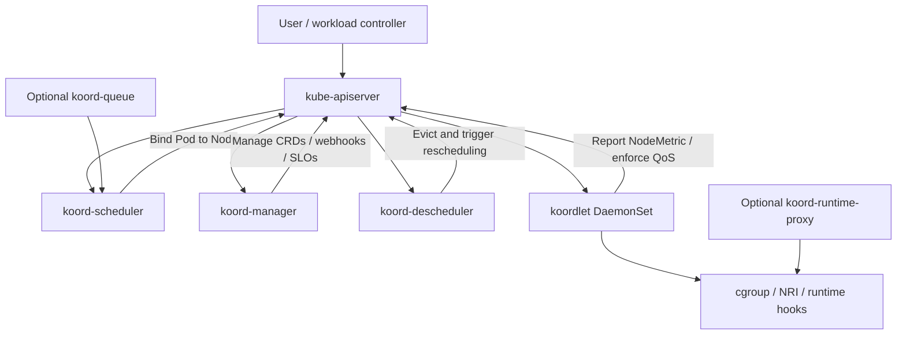
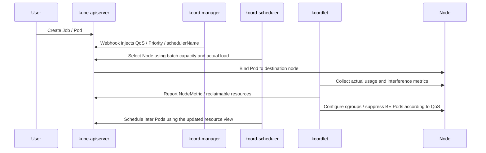

# What Is Koordinator?

## In One Sentence

Koordinator is a QoS-aware scheduling and resource-optimization system for Kubernetes. It extends scheduling, colocation, resource overcommitment, runtime isolation, rescheduling, and heterogeneous resource management so online services, offline batch jobs, AI training, Spark, Presto, and other workloads can share clusters more efficiently and reliably.

In other words:

> Kubernetes gets Pods running; Koordinator improves placement accuracy, colocation stability, and machine utilization.

Koordinator is neither a container runtime nor a kubelet replacement. It is a set of extensions around scheduling and node resource management: control-plane components handle scheduling, quotas, profiles, SLOs, and rescheduling, while node components collect metrics, isolate resources, detect interference, and enforce QoS.

## Why Koordinator Is Needed

Native Kubernetes provides a scheduler, requests/limits, PriorityClasses, QoS classes, HPA, VPA, and Cluster Autoscaler. Large production clusters still encounter several common problems.

### 1. Requests Differ from Actual Usage

Kubernetes scheduling primarily considers Pod `requests`. Applications often request far more than average usage for stability, reducing shortage risk but leaving CPU and memory underutilized even when a node appears fully allocated.

An online service might request eight CPU cores while usually using only two. A request-based scheduler cannot easily reuse the other six. Koordinator identifies allocated resources unlikely to be used in the short term and exposes them as reclaimable capacity for lower-priority tasks.

### 2. Online Services and Offline Jobs Have Different Goals

Online services, including web/RPC services, gateways, and database middleware, prioritize latency, jitter, and availability. Offline tasks, including reporting, log processing, model training, and transcoding, prioritize throughput and cost.

Simply placing both on one node can cause contention:

1. Batch jobs saturate CPUs and raise online-service P99 latency.
2. Batch memory usage causes online-service OOMs or frequent GC.
3. Disk I/O, network bandwidth, LLC, and memory bandwidth interfere.
4. Node load spikes before the scheduler notices.

Koordinator aims for controlled resource reuse with QoS guarantees: higher-priority workloads receive predictable resources, while lower-priority workloads use reclaimable resources and are limited, suppressed, or evicted as pressure rises.

### 3. Scheduling Is More Than Finding a Node with Free Resources

Production scheduling often considers:

1. Actual node load, not just declared requests.
2. NUMA, CPU topology, GPUs, RDMA, network interfaces, and heterogeneous resources.
3. Gang scheduling for big-data and AI tasks.
4. Multitenant quotas and elastic borrowing.
5. Resource defragmentation, reservations, and preemption.
6. Moving workloads away from hot nodes and rebalancing load.

Implementing these piecemeal in applications or scheduler plugins becomes complex. Koordinator integrates them into a scheduling and runtime resource-management system.

## Core Architecture

Koordinator includes control-plane and node components. A typical deployment contains:

1. `koord-scheduler`
2. `koord-manager`
3. `koordlet`
4. `koord-descheduler`
5. Optional `koord-runtime-proxy`.
6. Optional `koord-device-daemon`.
7. Optional `koord-queue`.

Their relationship can be simplified as follows:



Koordinator remains compatible with native workloads. You still use Pods, Deployments, Jobs, PriorityClasses, SchedulerName, CRDs, and webhooks, while assigning selected workloads to `koord-scheduler` and expressing finer scheduling semantics through Koordinator labels, annotations, extended resources, and CRDs.

## Main Components

### 1. koord-scheduler

`koord-scheduler` is the enhanced scheduler, typically deployed as a Deployment.

Rather than simply replacing kube-scheduler, it adds plugins and capabilities on top of the Kubernetes scheduling framework:

1. **QoS-aware scheduling**
   Makes decisions using workload QoS, priority, and resource models.

2. **Load-aware scheduling**
   Considers actual node load to avoid placing new Pods on already hot nodes.

3. **Resource overcommitment scheduling**
   Converts requested but temporarily unused high-priority resources into batch capacity for lower-priority Pods.

4. **Job scheduling**
   Supports gang scheduling, ElasticQuota, reservations, and heterogeneous resources for big-data and AI workloads.

5. **Fine-grained scheduling**
   Selects resources using CPU, NUMA, and device topology.

Pods generally opt into this scheduler explicitly:

```yaml
spec:
  schedulerName: koord-scheduler
```

Otherwise, Pods continue using `default-scheduler` and cannot access Koordinator scheduler extensions.

### 2. koord-manager

`koord-manager` is the control-plane management component, usually a Deployment using leader election for high availability.

Its responsibilities include:

1. Managing Koordinator CRDs.
2. Providing mutating and validating webhooks.
3. Maintaining colocation configuration.
4. Managing SLO policies.
5. Dynamically calculating reclaimable resources from node metrics.
6. Maintaining objects such as `ClusterColocationProfile`.

A common use of `ClusterColocationProfile` is automatically injecting workload semantics, such as `BE` QoS, `koord-batch` priority, and `koord-scheduler` into selected batch workloads.

### 3. koordlet

`koordlet` is the node component, typically a DaemonSet on every Node.

It is essential for colocation and QoS guarantees: a scheduler chooses placement, but runtime behavior must be observed and controlled on the node.

`koordlet` mainly:

1. Collects node, Pod, and container resource usage.
2. Generates and reports metrics objects such as `NodeMetric`.
3. Profiles resources and estimates reclaimable capacity.
4. Detects CPU, memory, network, and disk interference.
5. Configures cgroup, CPU, memory, and other isolation parameters according to QoS and priority.
6. Suppresses or evicts low-priority Pods under pressure.
7. Injects resource policies through NRI or runtime hooks during container lifecycles.

Think of it as Koordinator's node resource agent. Without it, the scheduler cannot easily learn real load or enforce node-level QoS.

### 4. koord-descheduler

`koord-descheduler` is an enhanced rescheduler that evaluates whether running Pods remain suitably placed.

Typical scenarios:

1. Moving some Pods from overloaded nodes.
2. Redistributing imbalanced cluster resources.
3. Gradually moving workloads to more suitable node pools with different costs.
4. Responding when node conditions change after initial placement.

It does not directly move containers. It evicts selected Pods according to policy, returning them to scheduling so the scheduler can choose better nodes.

### 5. koord-runtime-proxy

`koord-runtime-proxy` is optional and usually runs as a node systemd service. Between kubelet and the runtime, it intercepts CRI calls and injects resource-management policies during sandbox or container creation.

It suits policies that must be applied before startup, such as cpuset, RDT, or certain GPU-sharing environment settings.

Do not install it by default in production. Many node resource features now use NRI or koordlet runtime hooks; install the proxy only for features that specifically require it.

### 6. koord-device-daemon

For heterogeneous resources, Koordinator's `Device` CRD represents node GPUs, RDMA, FPGAs, and other devices. `koordlet` and `koord-device-daemon` coordinate discovery, reporting, and health management.

The scheduler considers more than device availability: topology, partial device resources, virtual GPUs, RDMA VFs, and fault isolation can inform placement.

These features mainly target AI, HPC, and big-data acceleration. Ordinary web services rarely need to focus on them.

### 7. koord-queue

Introduced in Koordinator v1.8, optional `koord-queue` provides job-level queuing and admission for multitenant AI/batch clusters.

Kubernetes schedules Pods, but many AI and batch workloads naturally form Jobs. A PyTorchJob may have several workers; Spark includes a driver and executors. Pod-only scheduling can let some components consume resources while others remain Pending.

`koord-queue` queues jobs before allowing them into scheduling when conditions are met. Integrated with ElasticQuota, it supports multiple queues, fair sharing, priorities, blocking strategies, and pre-scheduling admission.

Online-service clusters may not need it. Clusters with many AI training, Spark, Ray, Argo Workflow, or native Job workloads gain more from job-level queues.

## Core Concepts

### 1. Priority

Kubernetes already provides `PriorityClass`; Koordinator adds priority tiers designed for colocation.

Common classes:

| PriorityClass | Priority range | Typical workload |
| --- | --- | --- |
| `koord-prod` | `[9000, 9999]` | Core online and latency-sensitive services |
| `koord-mid` | `[7000, 7999]` | Important but somewhat elastic services, real-time computation, some AI tasks |
| `koord-batch` | `[5000, 5999]` | Offline batches, analytics, training |
| `koord-free` | `[3000, 3999]` | Low-priority, testing, and best-effort tasks |

PriorityClass defines the broad tier; Pod label `koordinator.sh/priority` expresses finer subpriorities. For example:

```yaml
apiVersion: v1
kind: Pod
metadata:
  name: batch-demo
  labels:
    koordinator.sh/priority: "5300"
spec:
  priorityClassName: koord-batch
  schedulerName: koord-scheduler
  containers:
    - name: app
      image: nginx
```

This preserves native Kubernetes priority compatibility while enabling finer ranking and resource controls within a tier.

### 2. QoS

Native Kubernetes has three main QoS classes:

1. `Guaranteed`
2. `Burstable`
3. `BestEffort`

These affect kubelet eviction and guarantees but are insufficiently detailed for complex colocation. Koordinator introduces independent `koordinator.sh/qosClass` semantics describing workload quality in colocated environments.

Supported classes can be summarized as:

| Koordinator QoS | Meaning | Typical scenario |
| --- | --- | --- |
| `SYSTEM` | System components needing latency protection and bounded resource use | DaemonSets and node system services |
| `LSE` | Latency Sensitive Exclusive; strong isolation requirements | Middleware and exclusive resource pools |
| `LSR` | Latency Sensitive Reserved; reserved, more predictable resources | Guaranteed online services and CPU-pinned services |
| `LS` | Latency Sensitive; shared resources with stable latency | Typical microservices and web services |
| `BE` | Best Effort; reclaimable resources, suppressible or evictable | Offline jobs, batches, low-cost computing |

Approximate relationships with Kubernetes QoS:

| Koordinator QoS | Kubernetes QoS |
| --- | --- |
| `SYSTEM` | No direct equivalent |
| `LSE` | `Guaranteed` |
| `LSR` | `Guaranteed` |
| `LS` | `Guaranteed` / `Burstable` |
| `BE` | `BestEffort` |

`koordinator.sh/qosClass` is not the native QoS class. Native QoS is derived automatically from requests/limits; Koordinator QoS represents colocation semantics injected through labels, profiles, or webhooks.

### 3. Resource Model

The colocation resource model has four reference levels:

1. **limit / request**
   Resources requested by high-priority Pods, as commonly used in Kubernetes scheduling.

2. **usage**
   Actual consumption, fluctuating over time.

3. **short-term reservation**
   Reservation predicted from short-term usage history: steadier than actual usage, but below requests.

4. **long-term reservation**
   Reservation estimated from longer history: more conservative and suitable for longer-lived jobs.

The basic idea is:

> Under controlled conditions, the difference between requests and reservations becomes reclaimable capacity for lower-priority workloads.

This capacity is typically exposed as extended resources to batch workloads:

```yaml
resources:
  requests:
    kubernetes.io/batch-cpu: "1000"
    kubernetes.io/batch-memory: 2Gi
  limits:
    kubernetes.io/batch-cpu: "1000"
    kubernetes.io/batch-memory: 2Gi
```

`kubernetes.io/batch-cpu` and `kubernetes.io/batch-memory` come from the node's reclaimable pool. They are calculated from online-workload requests, actual consumption, node load, and SLO policy, rather than appearing from nowhere.

### 4. SLO

SLO means Service Level Objective. In Koordinator, it influences node resource policy as well as describing service availability.

Common policies include:

1. CPU utilization watermarks.
2. Memory utilization watermarks.
3. CPU suppression for BE workloads.
4. Memory-pressure eviction for BE workloads.
5. CPU Burst for LS workloads.
6. Memory QoS。
7. LLC, memory-bandwidth, network-bandwidth, and blkio isolation.

As pressure rises, Koordinator protects high-priority, high-QoS workloads before limiting lower-priority ones.

## A Typical Colocation Workflow

Assume two workload types:

1. Online microservices: `LS`, `koord-prod`, requiring stable latency.
2. Offline batches: `BE`, `koord-batch`, able to tolerate suppression or retries.

The approximate flow is:



Three key responsibilities:

1. `koord-manager` converts workloads into Koordinator semantics.
2. `koord-scheduler` uses those semantics for placement.
3. `koordlet` continually observes nodes and enforces resource protection.

## Automatically Inject Colocation Configuration with ClusterColocationProfile

With many controllers and Job templates, manually adding `koordinator.sh/qosClass`, `priorityClassName`, and `schedulerName` everywhere is inconvenient. Use `ClusterColocationProfile` instead.

For example, automatically treat Pods labeled `app-type=batch` as batch workloads:

```yaml
apiVersion: config.koordinator.sh/v1alpha1
kind: ClusterColocationProfile
metadata:
  name: batch-workload-profile
spec:
  namespaceSelector:
    matchLabels:
      koordinator.sh/enable-colocation: "true"
  selector:
    matchLabels:
      app-type: batch
  qosClass: BE
  priorityClassName: koord-batch
  schedulerName: koord-scheduler
  labels:
    koordinator.sh/mutated: "true"
```

Then label the namespace:

```bash
kubectl create namespace batch-demo
kubectl label namespace batch-demo koordinator.sh/enable-colocation=true
```

New batch Pods need only the matching label:

```yaml
apiVersion: batch/v1
kind: Job
metadata:
  name: data-processing-job
  namespace: batch-demo
spec:
  template:
    metadata:
      labels:
        app-type: batch
    spec:
      containers:
        - name: worker
          image: python:3.9
          command: ["python", "-c", "print('hello koordinator')"]
          resources:
            requests:
              cpu: "2"
              memory: 4Gi
            limits:
              cpu: "2"
              memory: 4Gi
      restartPolicy: Never
```

The webhook injects Koordinator settings according to the profile. The resulting Pod may include:

```yaml
metadata:
  labels:
    koordinator.sh/qosClass: BE
    koordinator.sh/mutated: "true"
spec:
  priorityClassName: koord-batch
  schedulerName: koord-scheduler
```

Alternatively, declare everything explicitly:

```yaml
apiVersion: batch/v1
kind: Job
metadata:
  name: manual-batch-job
  namespace: batch-demo
spec:
  template:
    metadata:
      labels:
        koordinator.sh/qosClass: BE
    spec:
      priorityClassName: koord-batch
      schedulerName: koord-scheduler
      containers:
        - name: worker
          image: busybox:stable
          command: ["sh", "-c", "sleep 60"]
          resources:
            requests:
              kubernetes.io/batch-cpu: "1000"
              kubernetes.io/batch-memory: 2Gi
            limits:
              kubernetes.io/batch-cpu: "1000"
              kubernetes.io/batch-memory: 2Gi
      restartPolicy: Never
```

## Installation and Basic Checks

Koordinator is usually installed with Helm. Using v1.8.0:

```bash
helm repo add koordinator-sh https://koordinator-sh.github.io/charts/
helm repo update
helm install koordinator koordinator-sh/koordinator --version 1.8.0
```

Check components afterward:

```bash
kubectl get pod -n koordinator-system
```

Common components include:

```text
koord-manager
koord-scheduler
koord-descheduler
koordlet
koord-device-daemon
```

Check PriorityClasses:

```bash
kubectl get priorityclass | grep koord
```

Check reported node metrics:

```bash
kubectl get nodemetric
kubectl get nodemetric -o yaml
```

Inspect Node allocatable resources to verify reclaimable batch capacity:

```bash
kubectl get node <node-name> -o yaml | grep -A 20 allocatable
```

You may see resources such as:

```yaml
allocatable:
  cpu: "8"
  memory: 16Gi
  kubernetes.io/batch-cpu: "15000"
  kubernetes.io/batch-memory: 20Gi
```

This indicates Koordinator has calculated reclaimable capacity for batch workloads.

## Relationship to Native Kubernetes

### Koordinator Does Not Replace kube-scheduler

Although it provides `koord-scheduler`, Koordinator does not require all Pods to use it.

A common production approach:

1. Ordinary workloads retain `default-scheduler`.
2. Workloads needing colocation, load awareness, heterogeneous devices, gang scheduling, or ElasticQuota use `koord-scheduler`.
3. `schedulerName` explicitly selects the scheduling path.

This enables gradual adoption with lower risk.

### Koordinator Does Not Replace kubelet

kubelet remains responsible for:

1. Watching Pods assigned to its node.
2. Calling the runtime to create containers.
3. Managing volumes, probes, and Pod status.
4. Evictions and node-status reporting.

`koordlet` enhances resource management, observing state, adjusting isolation, and enforcing Koordinator QoS. It does not take over kubelet's core lifecycle responsibilities.

### Koordinator Does Not Replace HPA, VPA, or Cluster Autoscaler

These components solve different problems:

| Component | Main responsibility |
| --- | --- |
| HPA | Adjust replica counts from metrics |
| VPA | Recommend or adjust Pod requests |
| Cluster Autoscaler | Scale nodes according to Pending Pods |
| Koordinator | Scheduling extensions, colocation, QoS, overcommitment, and rescheduling |

They can work together. HPA-created Pods can use `koord-scheduler`; Cluster Autoscaler can add nodes when resources are insufficient; Koordinator improves utilization and placement on existing nodes.

## Suitable Scenarios

### 1. Colocating Online and Offline Workloads

This is the most characteristic Koordinator use case.

Online services keep predictable resources while offline tasks use reclaimable capacity. Under pressure, offline tasks are suppressed or evicted first to protect online latency.

Examples:

1. Microservices with big-data jobs.
2. Web services with log processing.
3. Online inference with offline training.
4. Persistent services with periodic batches.

### 2. Improving Resource Utilization

If CPU utilization stays low while requests fill nodes, Koordinator can turn idle resources into schedulable batch capacity.

Resource profiling, load testing, and SLO configuration must accompany this. Otherwise, online latency can rise along with utilization.

### 3. Big-Data and AI Scheduling

ElasticQuota, gang scheduling, job queues, reservations, and heterogeneous device scheduling address multitenant AI/batch needs that the default scheduler handles less effectively:

1. Schedule a multi-Pod job together or wait.
2. Provide tenant minimum/maximum quotas and elastic borrowing.
3. Coordinate GPU, RDMA, and NUMA topology globally.
4. Reserve or preempt resources for high-priority tasks.

### 4. Load-Aware Scheduling and Rescheduling

Clusters with hot nodes alongside idle nodes can improve continuously through load-aware placement and descheduling.

This particularly suits variable workloads, heterogeneous node sizes, and many scheduling constraints.

## Unsuitable Scenarios

Koordinator is powerful but is not the default solution to every Kubernetes resource problem.

### 1. Small or Simple Clusters

Small clusters with simple workloads and adequate utilization may gain unnecessary component complexity.

### 2. Colocation Without Clear SLOs

Colocation requires knowing which workloads to protect or sacrifice and which pressure thresholds trigger suppression or eviction.

Introducing it solely to increase utilization without clear rules creates considerable risk.

### 3. Offline Jobs That Cannot Retry

BE workloads may be limited or evicted under pressure. Offline jobs should ideally have:

1. Retry support.
2. Idempotency.
3. Checkpoint。
4. A reasonable `backoffLimit`.
5. Tolerance for variable completion times.

Tasks that cannot pause or slow down do not suit BE resources.

### 4. Insufficient Runtime or Kernel Support

Some QoS features depend on cgroups, NRI, kernel/runtime capabilities, and node filesystem mounts. Official guidance recommends Linux kernel 4.19 or newer for a better experience.

Check compatibility and permissions first with Kind, local test clusters, old kernels, unusual runtimes, and managed Kubernetes.

## Production Recommendations

### 1. Begin with Observation

Avoid aggressive overcommitment initially. A safer sequence is:

1. Deploy Koordinator.
2. Observe NodeMetric, actual load, and online-service latency.
3. Introduce a small batch workload subset.
4. Configure conservative SLO watermarks.
5. Gradually increase batch resource usage.

### 2. Define Workload Tiers Explicitly

At minimum, determine:

1. Which workloads are `koord-prod`.
2. Which are `koord-mid`.
3. Which are `koord-batch`.
4. Which may use `BE`.
5. Which must never be colocated.

Encode these rules in namespaces, labels, profiles, and admission policies rather than requiring every application team to interpret them.

### 3. Design Batch Workloads for Failure

Tasks using BE and batch resources should assume they may slow down, be evicted, or need retries.

Recommendations:

1. Set appropriate requests and limits.
2. Use Job/Workflow retry mechanisms.
3. Checkpoint important tasks.
4. Do not label strong-SLA jobs as BE.
5. Set realistic expectations for completion times.

### 4. Avoid Moving Every Pod to koord-scheduler at Once

Adopt gradually by namespace, business area, or workload type.

For example:

1. Start with low-risk batch namespaces.
2. Add AI and big-data tasks.
3. Only then consider finer QoS for online services.

### 5. Check Webhook and CRD Compatibility

Koordinator installs CRDs and webhooks. Before production upgrades, verify:

1. Whether managed clusters already provide the CRDs.
2. Expected webhook failurePolicy behavior.
3. Breaking changes.
4. API support in older Kubernetes versions.
5. Custom CNI configurations that might prevent apiserver access to webhooks.

### 6. Prepare Monitoring and Rollback First

Monitor at least:

1. Online-service P95/P99 latency.
2. Node CPU, memory, I/O, and network utilization.
3. BE suppression and eviction counts.
4. Scheduler latency and failure reasons.
5. Descheduler eviction behavior.
6. Koordinator component health.

If online services become unstable, be able to reduce overcommitment, disable profiles, pause batches, or roll back the Helm release quickly.

## Common Troubleshooting Commands

Inspect components:

```bash
kubectl get pod -n koordinator-system -o wide
```

Inspect injected Pod configuration:

```bash
kubectl get pod <pod-name> -n <namespace> -o yaml
```

Focus on:

```yaml
metadata:
  labels:
    koordinator.sh/qosClass: BE
    koordinator.sh/priority: "5300"
spec:
  priorityClassName: koord-batch
  schedulerName: koord-scheduler
```

Inspect scheduling failures:

```bash
kubectl describe pod <pod-name> -n <namespace>
```

Inspect node reclaimable resources:

```bash
kubectl get node <node-name> -o yaml | grep -A 30 allocatable
```

Inspect Koordinator node metrics:

```bash
kubectl get nodemetric
kubectl get nodemetric <node-name> -o yaml
```

Inspect `koordlet` logs:

```bash
kubectl logs -n koordinator-system <koordlet-pod-name>
```

Inspect descheduler behavior:

```bash
kubectl logs -n koordinator-system deploy/koord-descheduler
kubectl get events -A --sort-by='.lastTimestamp'
```

## Summary

Koordinator advances Kubernetes scheduling and node resource management from static allocation based on declarations to dynamic optimization using workload tiers, actual load, QoS targets, and resource profiles.

It addresses utilization, online/offline colocation, AI/batch scheduling, multitenant quotas, heterogeneous devices, and rebalancing in large clusters. Its components cooperate: `koord-scheduler` extends scheduling, `koord-manager` handles policies and webhooks, `koordlet` observes nodes and enforces QoS, and `koord-descheduler` rebalances running workloads.

Installing Koordinator does not automatically reduce machine counts. Define workload tiers and SLOs first, pilot on a small scale, monitor online latency and node pressure, then expand colocation gradually. Utilization improvements require observable, reversible, explainable QoS policies.

## References

1. [Koordinator website](https://koordinator.sh/)
2. [Koordinator Architecture Overview](https://koordinator.sh/docs/architecture/overview)
3. [Koordinator Resource Model](https://koordinator.sh/docs/architecture/resource-model)
4. [Koordinator Priority](https://koordinator.sh/docs/architecture/priority)
5. [Koordinator QoS](https://koordinator.sh/docs/architecture/qos)
6. [Koordinator Installation](https://koordinator.sh/docs/installation)
7. [ClusterColocationProfile user manual](https://koordinator.sh/docs/user-manuals/colocation-profile)
8. [Koordinator v1.8 Release Blog](https://koordinator.sh/blog/release-v1.8.0)
