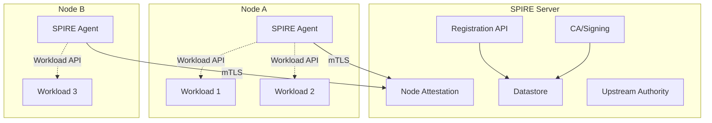
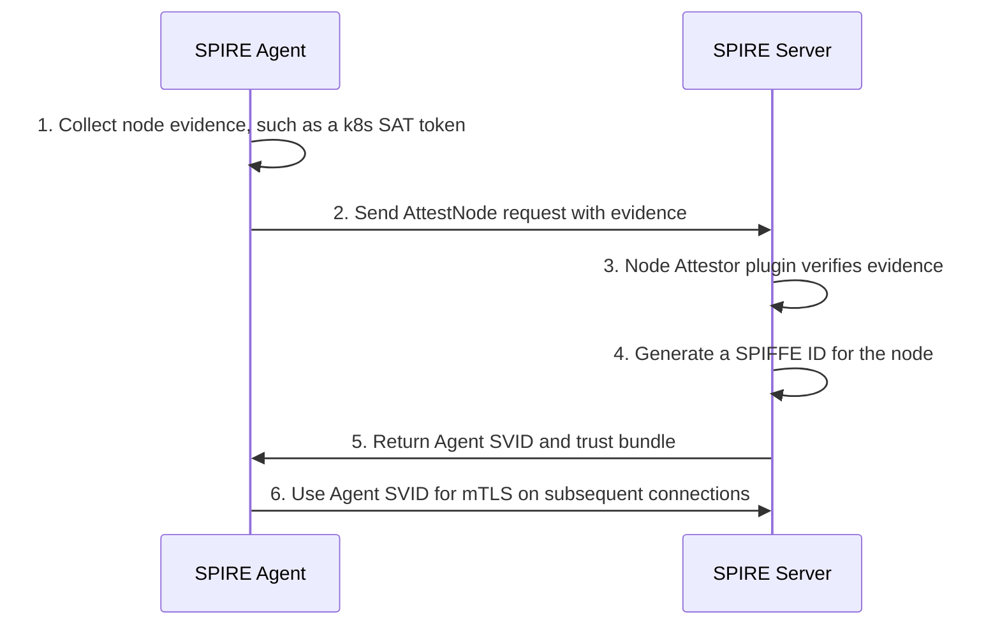
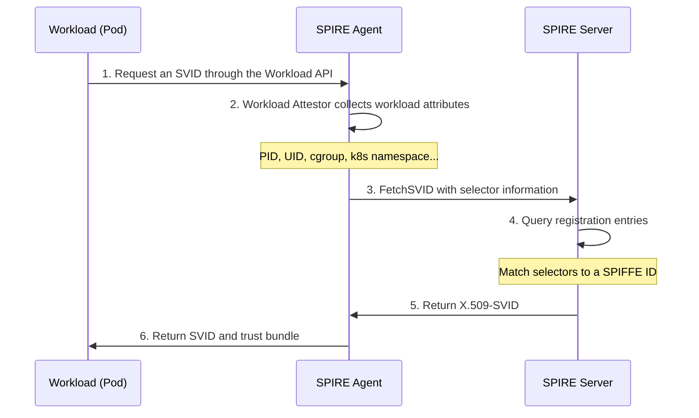
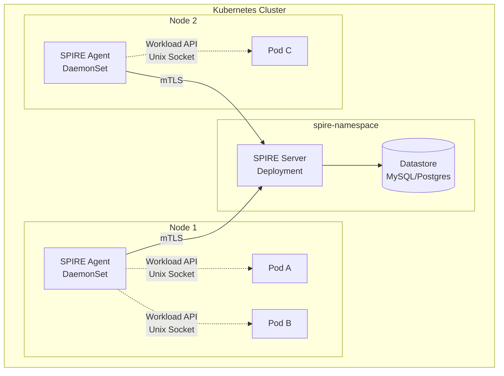

# SPIRE Concepts and Fundamentals

## I. Background: Why SPIRE?

In traditional network architectures, authentication between services commonly relies on IP addresses, ports, or static secrets. In cloud-native environments, microservices scale dynamically, Pods move, and container IP addresses change frequently. These conditions expose several problems with traditional authentication:

- **Unreliable IP identity**: Container IPs are assigned dynamically and cannot serve as stable identities.
- **Complex secret management**: Static secrets are difficult to distribute and rotate and are prone to leakage.
- **Heterogeneous platforms**: Kubernetes, bare metal, and virtual machines lack a unified identity system.
- **Zero-trust requirements**: Security boundaries no longer follow network boundaries; every service instance needs fine-grained authentication.

**SPIFFE (Secure Production Identity Framework For Everyone)** and **SPIRE (SPIFFE Runtime Environment)** were created to address these problems.

---

## II. Core Concepts

### 2.1 SPIFFE ID

A SPIFFE ID is the workload identity identifier defined by the SPIFFE standard. It uses a URI format:

```
spiffe://<trust-domain>/<workload-identifier>
```

For example:

```
spiffe://example.org/ns/production/sa/default
spiffe://prod.example.com/billing/payment
```

- **Trust Domain**: The prefix shared by SPIFFE IDs within an administrative boundary, usually corresponding to an organization or cluster, such as `example.org`.
- **Workload Identifier**: Uniquely identifies a workload within the trust domain. It can be based on a namespace, ServiceAccount, node name, or other attributes.

> Each workload has an independent, verifiable cryptographic identity that does not depend on an IP address or network location.

> 📖 **Trust domains explained**: A trust domain is the top-level organizational unit of SPIFFE identity and defines workload trust boundaries. Workloads in one trust domain trust each other by default; trust across domains requires federation. See [SPIRE Trust Domains Explained](../6.spire/2.%20spire-trust-domain.md).

### 2.2 SVID (SPIFFE Verifiable Identity Document)

An SVID is a verifiable document representing a SPIFFE ID. SPIRE supports two SVID formats:

1. **X.509-SVID**: An X.509 certificate containing a SPIFFE ID in its Subject or SAN. Used for TLS/mTLS communication.
2. **JWT-SVID**: A JWT token containing a SPIFFE ID and claims. Used for application-layer authentication, such as an OAuth2 bearer token.

Properties of X.509-SVIDs:
- Short validity periods, one hour by default, with automatic rotation.
- Issued by SPIRE Server and verifiable using the trust bundle.
- Private keys are generated locally by SPIRE Agent and are not shared with SPIRE Server.

### 2.3 Trust Bundle (Trust Roots)

A trust bundle is a set of CA certificates used to verify SVIDs belonging to other SPIFFE identities. Services in the same trust domain share a trust bundle. Different trust domains can exchange bundles through federation.

### 2.4 Workload API

The Workload API is the standard interface through which workloads obtain their own SVIDs and trust bundles. It is exposed through a local Unix domain socket, with workloads using gRPC to retrieve:

- Their own X.509-SVIDs, including certificates and private keys.
- Their own JWT-SVIDs.
- Trust bundles for verifying peer SVIDs.
- Subscription updates, with rotated certificates pushed automatically.

> The Workload API implements a SPIFFE standard and is not tied to SPIRE. Any SPIFFE-compatible system can use it.

---

## III. SPIRE Architecture

SPIRE consists of two main components: **SPIRE Server** and **SPIRE Agent**.



### 3.1 SPIRE Server

SPIRE Server is the trust domain's central control plane. It is responsible for:

- **Identity registration (Registration API)**: Manage mappings between SPIFFE IDs and workload selectors.
- **Certificate issuance (CA)**: Issue and rotate X.509-SVIDs and JWT-SVIDs.
- **Node attestation**: Verify the authenticity of nodes running SPIRE Agents.
- **Trust bundle management**: Maintain and distribute trust roots.
- **Federation**: Exchange trust bundles across trust domains for cross-domain authentication.

SPIRE Server is stateful and requires a datastore, such as SQLite, MySQL, or PostgreSQL, to persist registrations and records of issued SVIDs.

### 3.2 SPIRE Agent

SPIRE Agent runs on **every node**, as a DaemonSet in Kubernetes, and is responsible for:

- **Node attestation client**: Prove the identity of its host node to SPIRE Server.
- **Workload attestation**: Identify and verify local workloads using kernel-level information such as PID, UID, and cgroup membership.
- **Workload API service**: Expose a local Unix domain socket for workloads.

> SPIRE Agent **cannot** operate offline after initialization: it cannot cache information and issue certificates offline like Vault Agent. It must maintain communication with SPIRE Server.

### 3.3 Plugin Mechanisms

SPIRE implements authentication logic through plugins. Users can select or develop plugins for their environments:

| Plugin Type | Purpose | Common Implementations |
|---------|------|---------|
| **Node Attestor** | Verify node identity | `join_token`, `aws_iid`, `gcp_iit`, `k8s_sat` |
| **Workload Attestor** | Identify workloads | `k8s`, `unix`, `docker` |
| **Key Manager** | Manage Agent private keys | `memory`, `disk` |
| **Upstream Authority** | Integrate external CAs | `disk`, `aws_pca`, `vault` |

---

## IV. Main Workflows

### 4.1 Node Attestation

Node attestation establishes trust between SPIRE Agent and SPIRE Server:



After attestation, SPIRE Agent obtains a node-level SPIFFE ID, for example:

```
spiffe://example.org/spire/agent/k8s_sat/cluster1/node-abc123
```

All subsequent communication between the Agent and Server uses this Agent SVID for mutual TLS authentication.

### 4.2 Workload Attestation

A workload, such as a Pod or process, obtains its identity through SPIRE Agent as follows:



### 4.3 Registration Entries

A registration entry defines which SPIFFE ID a workload receives when it matches a set of selectors. For example:

```yaml
# Example: map Pods with a particular namespace and ServiceAccount to a SPIFFE ID
entry:
  spiffe_id: "spiffe://example.org/ns/production/sa/payment"
  parent_id: "spiffe://example.org/spire/agent/k8s_sat/cluster1/*"
  selectors:
    - "k8s:ns:production"
    - "k8s:sa:payment"
  ttl: 3600
```

- **spiffe_id**: The SPIFFE ID assigned to the workload.
- **parent_id**: The nodes on which the workload may run, expressed through an Agent SPIFFE ID pattern.
- **selectors**: Workload-matching conditions supplied by a Workload Attestor.
- **ttl**: SVID validity in seconds.

### 4.4 SVID Rotation

SPIRE rotates SVIDs automatically without manual intervention:

- **X.509-SVIDs**: As a certificate approaches expiration, typically at 50% of its TTL, SPIRE Agent requests a new certificate from the Server and pushes it to workloads through the Workload API.
- **JWT-SVIDs**: Issued on demand; consumers can request replacements after expiration.
- **Agent SVIDs**: The Agent's own certificates also rotate automatically, preventing identity expiration on long-running nodes.

---

## V. Kubernetes Integration

### 5.1 Deployment Topology

A typical SPIRE deployment in Kubernetes:



**Deployment choices**:
- Deploy SPIRE Agent as a DaemonSet, with one instance per node.
- Mount the Agent's Workload API socket into Pods through `hostPath`.
- Deploy SPIRE Server as a Deployment with persistent datastore storage.

### 5.2 Workload Identity Examples

In Kubernetes, SPIRE can give Pods fine-grained SPIFFE identities:

| Kubernetes Attribute | Example SPIFFE ID |
|----------------|---------------|
| Namespace + ServiceAccount | `spiffe://cluster.local/ns/prod/sa/api-server` |
| Deployment | `spiffe://cluster.local/ns/prod/deployment/frontend` |
| Node | `spiffe://cluster.local/node/worker-01` |
| Cluster + SA | `spiffe://cluster.local/k8s/cluster-a/sa/default` |

---

## VI. SPIRE Compared with Traditional Approaches

| Dimension | Traditional Static Secrets | Service Mesh (Istio) | SPIRE |
|------|-------------------|-----------------|-------|
| **Identity granularity** | Service | Pod | Process, with fine granularity |
| **Certificate management** | Manual distribution/rotation | Automatic (Citadel) | Automatic rotation |
| **Cross-platform support** | No standard | Primarily Kubernetes | Multi-cloud, bare metal, VMs |
| **Runtime dependency** | None | Sidecar (Envoy) | Workload API socket |
| **Zero trust** | Weak | Moderate (mTLS) | Strong (SPIFFE standard) |
| **Application changes** | High (embedded secrets) | Low (sidecar) | Low (socket calls) |

---

## VII. Summary

SPIRE provides a **standardized, automated, fine-grained** workload identity system for cloud-native environments:

1. **SPIFFE IDs** provide stable cryptographic identities for workloads.
2. **SVIDs** make identities verifiable, supporting both mTLS and JWT.
3. **The Workload API** decouples identity acquisition from applications, which no longer need to manage certificates themselves.
4. **Automatic rotation** removes the operational burden of certificate expiration.
5. **The plugin architecture** supports multi-cloud and hybrid-cloud environments.

In a zero-trust architecture, SPIRE serves as **identity infrastructure** for secure service-to-service communication. It provides a consistent solution whether it supplies transport-layer mTLS alongside a service mesh such as Istio or gives applications JWT tokens directly for API authentication.

---

## References

- [Official SPIFFE documentation](https://spiffe.io/docs/latest/spiffe-about/overview/)
- [Official SPIRE documentation](https://spiffe.io/docs/latest/spire-about/)
- [SPIRE GitHub](https://github.com/spiffe/spire)
- [SPIFFE standard](https://github.com/spiffe/spiffe/blob/main/standards/X509-SVID.md)
