# SPIRE Trust Domains Explained

## I. Why Are Trust Domains Needed?

Before defining a trust domain, consider several real-world scenarios and the problems that arise **without the concept of a trust domain**.

### Scenario 1: The Challenge of Service Authentication

Suppose a company has two Kubernetes clusters running different microservices:

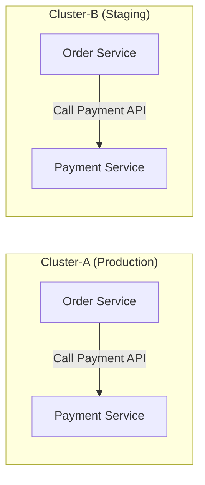

When `Order Service` calls `Payment Service`, the latter must answer a question:

> **Why should I believe you are the Order Service you claim to be?**

A traditional approach might be:
- Configure a shared secret and have `Order Service` present it when calling `Payment Service`.
- But what happens if the secret leaks? How is it rotated?
- Configuring individual secrets for hundreds or thousands of services becomes a management nightmare.

### Scenario 2: Separating Production and Staging

Consider a more difficult problem:

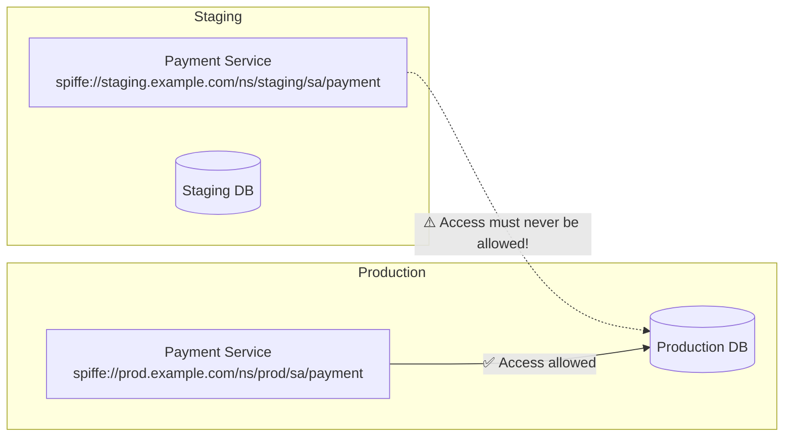

The staging `Payment Service` **must never** access the production database. IP allowlists and network policies alone are error-prone when IP addresses change dynamically. Access control needs to be **based on identity rather than network location**.

### Scenario 3: Collaboration Across Organizations

Your company and a partner jointly build a supply-chain platform:

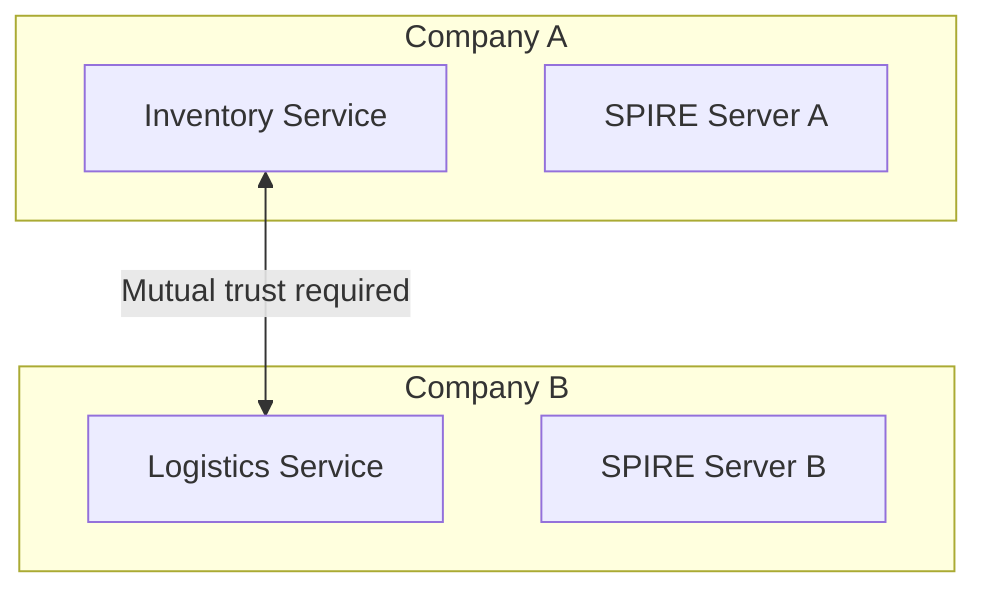

Company A's `Inventory Service` and Company B's `Logistics Service` need to call each other. Each company has its own security policies and CA infrastructure, and **neither wants to hand its root CA over to the other**.

---

**All three scenarios come down to the same question: how do you define a verifiable workload identity system with clear boundaries?**

That is the purpose of a trust domain.

---

## II. What Is a Trust Domain?

### 2.1 Definition

A trust domain is the **top-level organizational unit** in the SPIFFE identity system. It establishes:

- **An administrative boundary**: One SPIRE Server system manages all identities in a trust domain.
- **A trust boundary**: Workloads in the same domain **trust each other by default**; different domains **do not trust each other by default** and require explicit federation.
- **A cryptographic boundary**: A trust domain shares a root CA (trust bundle), which issues all its SVIDs.

Useful analogies include:

| Concept | Trust Domain Analogy |
|------|-----------|
| Kerberos realm | Principals in one realm are managed by one KDC |
| AWS account | Resources in one account can access each other by default; cross-account access needs an IAM role |
| DNS domain | Each domain uniquely identifies a namespace |
| Kubernetes namespace | Resources are isolated within namespaces; cross-namespace access requires explicit authorization |

A trust domain sits at a **higher level**, spanning clusters, environments, and even organizations.

### 2.2 An Intuitive View

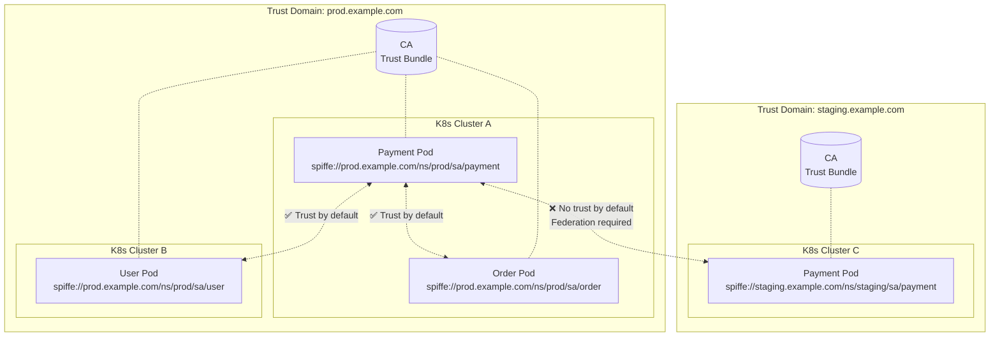

> Services in one trust domain speak the same trust language: their certificates come from the same CA, so they can verify one another. Services in different domains speak different trust languages and must exchange dictionaries—their trust bundles—to understand each other.

---

## III. How Trust Domains Address These Scenarios

### 3.1 Scenario 1: Service Authentication

With a trust domain, every workload has a SPIFFE ID:

```
Payment Service → spiffe://prod.example.com/ns/prod/sa/payment
Order Service   → spiffe://prod.example.com/ns/prod/sa/order
```

When `Order Service` calls `Payment Service`:

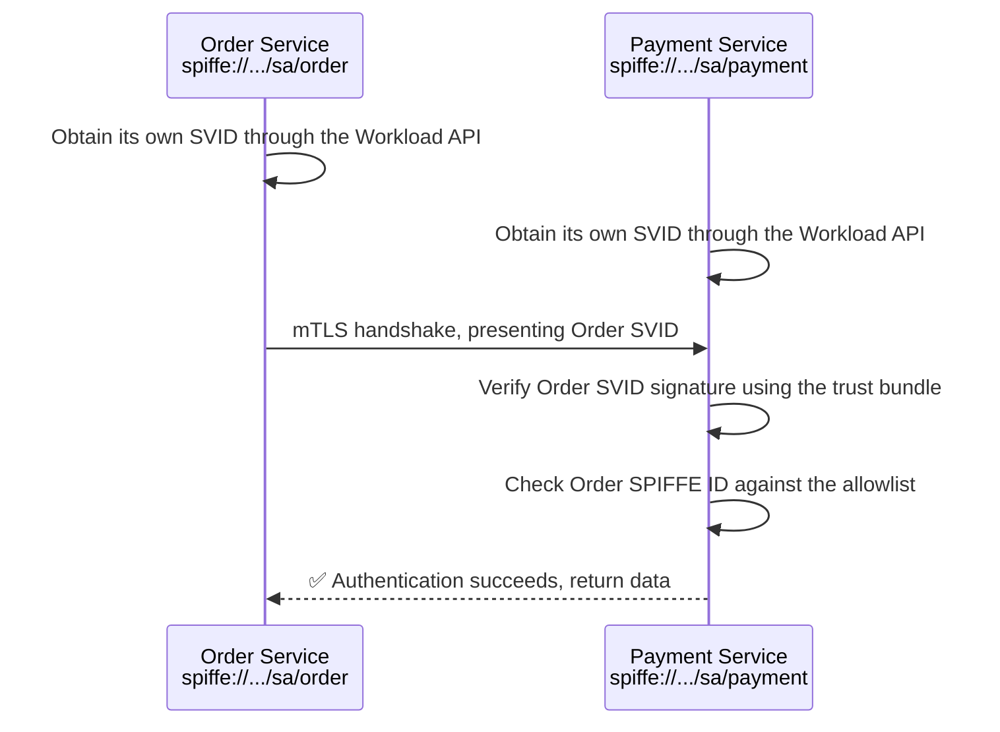

No shared secret needs to be configured. `Payment Service` only needs to:
1. Verify the peer certificate's signature using the trust bundle, confirming that the trust domain CA issued it.
2. Check the peer's SPIFFE ID to confirm the claimed identity.

### 3.2 Scenario 2: Environment Isolation

**Separate trust domains** provide isolation by default:

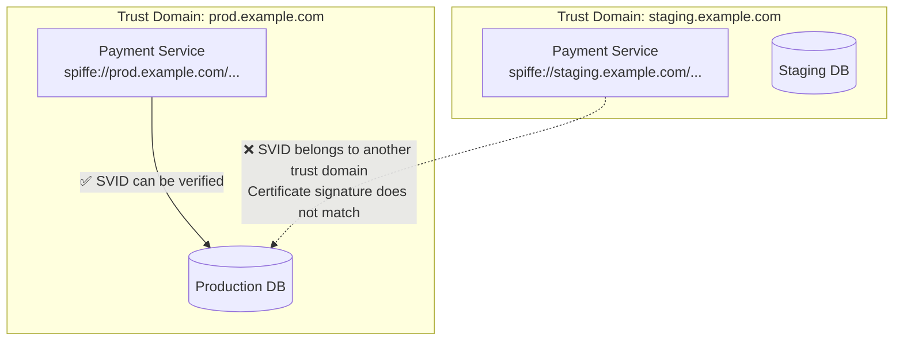

Even if staging traffic is routed to the production database, the database discovers during the mTLS handshake that:
- The peer certificate's SPIFFE ID is `spiffe://staging.example.com/...`
- Its own trust domain is `prod.example.com`
- **The production trust bundle cannot verify the certificate signature, so the connection is rejected**

This is **environment isolation based on cryptographic identity**, which is more reliable than network policy.

### 3.3 Scenario 3: Cross-Organization Collaboration

Each company maintains an independent trust domain and exchanges trust bundles through SPIRE federation:

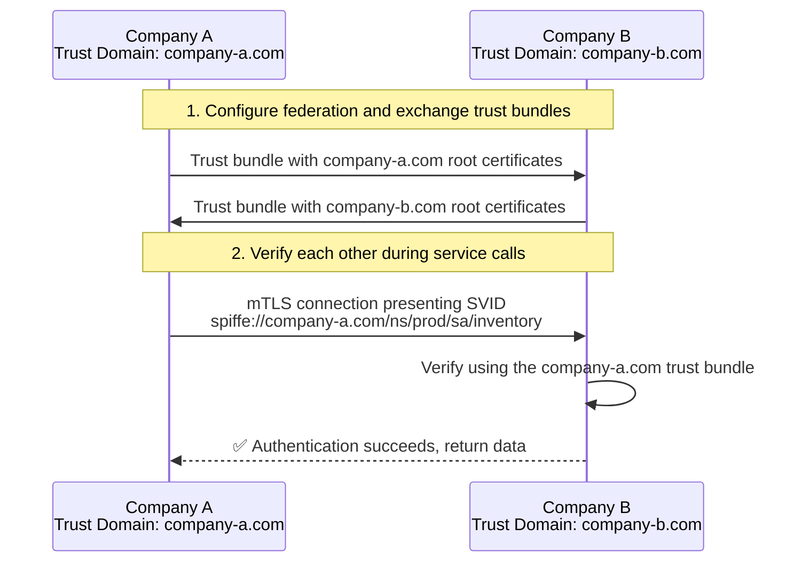

Advantages:
- **Neither party gives up its root CA private key**; they exchange only public certificates in trust bundles.
- **Identity boundaries remain clear**: Company A identities always belong to `company-a.com`, and Company B identities to `company-b.com`.
- **Authorization can be fine-grained**: Permit only selected SPIFFE IDs to access services across domains.

---

## IV. Main Properties of a Trust Domain

| Property | Description |
|------|------|
| **Global uniqueness** | Trust domain names must be globally unique; use a DNS domain owned by the organization |
| **Single trust root** | All SVIDs in one domain are issued by the same root CA |
| **Administrative independence** | Each domain is managed by an independent SPIRE Server or HA cluster |
| **Default isolation** | Different domains cannot access one another by default; federation must be established explicitly |
| **Resistance to forgery** | Workloads cannot forge SPIFFE IDs belonging to another domain because certificate signatures will not match |

---

## V. Naming Trust Domains

The SPIFFE specification recommends using **a domain you actually own** to ensure global uniqueness:

```
# ✅ Recommended: use a real domain owned by the organization
spiffe://prod.example.com/ns/default/sa/payment
spiffe://staging.example.com/ns/default/sa/payment
spiffe://k8s.us-east.example.com/ns/default/sa/api-gateway

# ❌ Not recommended: arbitrary names that may collide with others
spiffe://my-cluster/ns/default/sa/payment
spiffe://k8s-prod/ns/default/sa/payment
```

> **Why must names be globally unique?** Imagine two companies both using `spiffe://prod-cluster`. When they exchange trust bundles through federation, SPIFFE IDs cannot distinguish which company an identity belongs to, undermining security controls.

---

## VI. Trust Domain Deployment Patterns

### Pattern 1: One Trust Domain Across Multiple Clusters

All clusters share one trust domain managed by one SPIRE Server system.

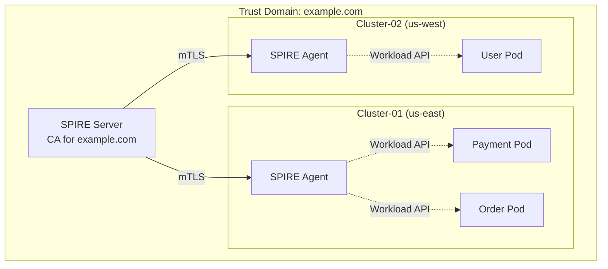

Example SPIFFE IDs:

```
spiffe://example.com/ns/prod/sa/payment     ← Runs in Cluster-01
spiffe://example.com/ns/prod/sa/order       ← Runs in Cluster-01
spiffe://example.com/ns/prod/sa/user        ← Runs in Cluster-02
```

**Advantages:**
- Trust requires no extra configuration; workloads across all clusters trust one another automatically.
- Simplest administration: maintain only one SPIRE Server system.
- Simple, consistent SPIFFE ID design.

**Disadvantages:**
- SPIRE Server is a single point of failure; HA is possible, but it remains one failure domain.
- SPIRE Server must be reachable across clusters, with network-latency constraints.
- Poor fit for independent operation by multiple teams.

**Suitable for:** Small to medium deployments, one operations team, and low latency between clusters.

---

### Pattern 2: Multiple Trust Domains with Federation

Each environment or cluster has an independent trust domain, with federation providing cross-domain authentication.

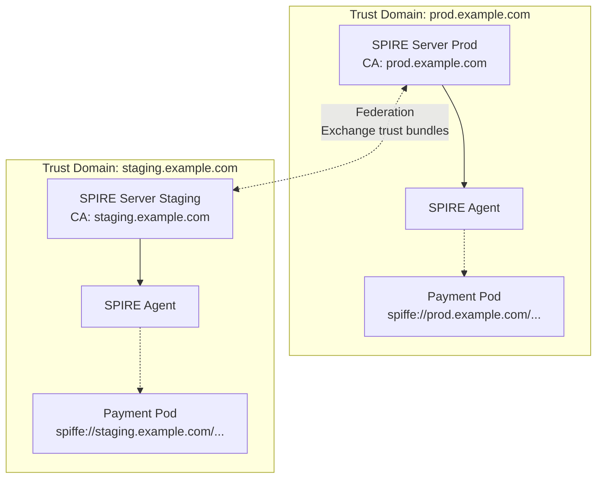

**Advantages:**
- Better fault isolation: a production SPIRE Server outage does not affect staging.
- Teams operate their own SPIRE deployments independently.
- Strict cryptographic isolation between environments, with no trust by default.

**Disadvantages:**
- Federation relationships must be configured and maintained.
- Trust bundles must be synchronized regularly.
- Greater operational complexity.

**Suitable for:** Large organizations, independently operated teams, and strict environment isolation.

---

### Pattern 3: Trust Domains Along Organizational Boundaries

For cross-company collaboration, each organization maintains its own trust domain.

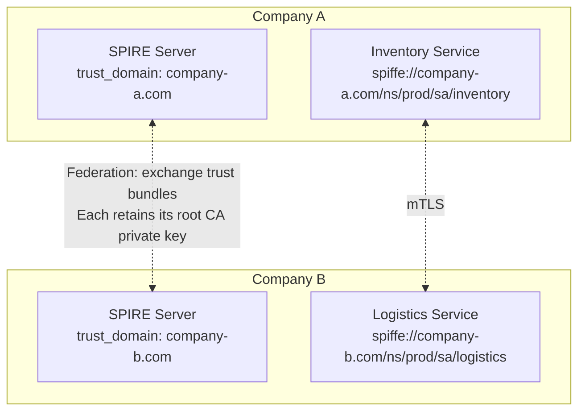

**Advantages:**
- Organizations remain fully independent and do not share root CA private keys.
- Identity boundaries align naturally with organizational boundaries.
- Supports compliance requirements in industries such as finance and healthcare.

**Disadvantages:**
- Federation configuration requires coordination across organizations.
- Trust bundle rotation requires cooperation between parties.

**Suitable for:** Cross-company partnerships, SaaS/customer integrations, and supply-chain collaboration.

---

## VII. Choosing a Trust Domain Strategy

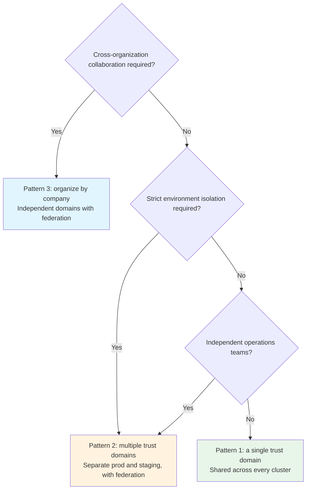

> **Practical recommendation**: When introducing SPIRE, start with **Pattern 1, a single trust domain**. Consider splitting it when:
> - SPIRE Server becomes a single-point bottleneck.
> - Teams have conflicting operational requirements for SPIRE.
> - Compliance requires strong isolation.
> - Cross-company or cross-organization integration is needed.

---

## VIII. Configuration Examples

### Configure the Trust Domain on SPIRE Server

```hocon
# spire-server.conf
server {
  trust_domain = "prod.example.com"    # Main trust domain setting
  bind_address = "0.0.0.0"
  bind_port = 8081

  ca_subject {
    country = ["CN"]
    organization = ["Example Corp"]
    common_name = "SPIRE CA for prod.example.com"
  }
}

plugins {
  DataStore "sql" {
    plugin_data {
      database_type = "mysql"
      connection_string = "root:password@tcp(mysql:3306)/spire?charset=utf8mb4"
    }
  }

  NodeAttestor "k8s_sat" {
    plugin_data {
      clusters = {
        "prod-cluster" = {
          service_account_allow_list = ["spire:spire-agent"]
        }
      }
    }
  }

  KeyManager "disk" {
    plugin_data {
      keys_path = "/opt/spire/data/keys.json"
    }
  }
}
```

### Configure the Trust Domain on SPIRE Agent

```hocon
# spire-agent.conf
agent {
  data_dir = "/opt/spire/data/agent"
  trust_domain = "prod.example.com"    # Must match the Server
  server_address = "spire-server.prod.svc.cluster.local"
  server_port = 8081
  log_level = "INFO"
}

plugins {
  NodeAttestor "k8s_sat" {
    plugin_data {
      # The Agent proves its identity using a Kubernetes ServiceAccount token
    }
  }

  WorkloadAttestor "k8s" {
    plugin_data {
      # Identify Pod namespace, service account, and other attributes
    }
  }

  KeyManager "disk" {
    plugin_data {
      keys_path = "/opt/spire/data/agent/keys.json"
    }
  }
}
```

### Registration Entries

```bash
# Register the production Payment service SPIFFE ID
spire-server entry create \
  -spiffeID spiffe://prod.example.com/ns/prod/sa/payment \
  -parentID spiffe://prod.example.com/spire/agent/k8s_sat/prod-cluster/* \
  -selector k8s:ns:prod \
  -selector k8s:sa:payment \
  -ttl 3600

# Register the staging Payment service SPIFFE ID in a different trust domain
spire-server entry create \
  -spiffeID spiffe://staging.example.com/ns/staging/sa/payment \
  -parentID spiffe://staging.example.com/spire/agent/k8s_sat/staging-cluster/* \
  -selector k8s:ns:staging \
  -selector k8s:sa:payment \
  -ttl 3600
```

---

## IX. Common Misconceptions

| Misconception | Reality |
|------|------|
| A trust domain equals a Kubernetes cluster | Not exactly. A domain can span multiple clusters or cover only part of one cluster. |
| Different trust domains can never communicate | They can, through **explicit federation**, which creates deliberate, controlled trust. |
| Trust domain names can be chosen arbitrarily | Names must be **globally unique**, or IDs will collide during federation. |
| One trust domain is better than multiple domains | There is no universally better choice; it depends on **organization size, isolation requirements, and operational capabilities**. |

---

## X. Summary

A trust domain defines important divisions within SPIFFE/SPIRE:

1. **It identifies which workloads belong together**: One trust domain means one identity system.
2. **It defines the default trust boundary**: Trust inside the domain, no trust outside it.
3. **It enables cross-organization collaboration**: Federation allows controlled mutual trust without giving up root CAs.

Understanding trust domains is the first step toward understanding the SPIFFE/SPIRE identity system.

---

## References

- [SPIFFE trust domain specification](https://github.com/spiffe/spiffe/blob/main/standards/SPIFFE-ID.md)
- [SPIRE federation documentation](https://spiffe.io/docs/latest/spire-about/federation/)
- [SPIRE Concepts and Fundamentals](/en/notes/kubernetes/yupcbxxy/)
