# SPIRE Identity Identifiers: SPIFFE ID, Parent ID, and Node Alias

## 1. Questions Raised by a Registration Entry

Suppose you are registering an identity for a Kubernetes Pod in SPIRE and see a command like this:

```bash
spire-server entry create \
  -spiffeID spiffe://example.com/ns/prod/sa/payment \
  -parentID spiffe://example.com/spire/agent/k8s_sat/prod-cluster/* \
  -selector k8s:ns:prod \
  -selector k8s:sa:payment
```

Looking at these parameters, you may wonder:

- I roughly understand `-spiffeID`: the identity ID assigned to the workload.
- What is `-parentID`, and why is a parent ID also required?
- What does the long string `spiffe://example.com/spire/agent/k8s_sat/prod-cluster/*` mean? What does the final `*` do?
- Can `parentID` be simplified so that this long string does not have to be repeated every time?

**These questions lead to the three concepts explained in this article: SPIFFE ID, Parent ID, and Node Alias.**

---

## 2. SPIFFE ID: A Workload's Identity Number

### 2.1 Basic Format

The SPIFFE standard defines the following SPIFFE ID format:

```
spiffe://<trust-domain>/<path>
```

Its parts are:

```
spiffe://example.com/ns/prod/sa/payment
  │         │            │
  │         │            └── path: workload path identifier
  │         └── trust-domain: the trust domain
  └── scheme: always spiffe://
```

### 2.2 Three Types of SPIFFE ID in SPIRE

In a SPIRE deployment, SPIFFE IDs have three role-based levels:

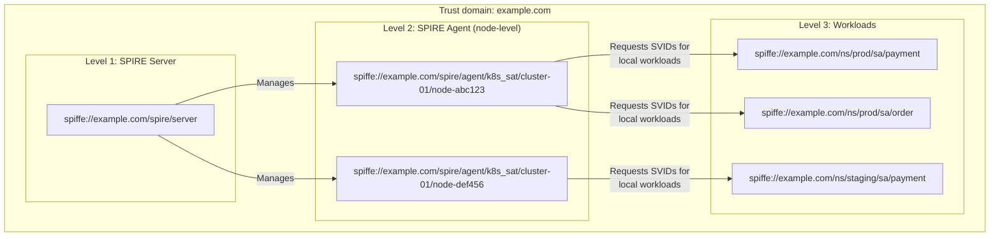

| Level | Owner | SPIFFE ID format | Example |
|------|--------|---------------|------|
| Server | SPIRE Server | `spiffe://<trust-domain>/spire/server` | `spiffe://example.com/spire/server` |
| Agent | SPIRE Agent on each node | `spiffe://<trust-domain>/spire/agent/<attestor>/<cluster>/<node>` | `spiffe://example.com/spire/agent/k8s_sat/prod-01/node-abc` |
| Workload | Application Pod/process | `spiffe://<trust-domain>/<custom-path>` | `spiffe://example.com/ns/prod/sa/payment` |

### 2.3 Naming Practices for Workload SPIFFE IDs

The path in a workload SPIFFE ID is freely designed. Common styles include:

```
# Style 1: mirror the Kubernetes hierarchy (recommended: intuitive and aligned with Kubernetes concepts)
spiffe://example.com/ns/prod/sa/payment
spiffe://example.com/ns/prod/sa/order
spiffe://example.com/ns/staging/sa/payment

# Style 2: organize by team or organization
spiffe://example.com/team-payments/api-server
spiffe://example.com/team-payments/worker
spiffe://example.com/team-logistics/shipping

# Style 3: organize by service type
spiffe://example.com/services/payment/v2
spiffe://example.com/jobs/data-export
spiffe://example.com/cron/cleanup

# Style 4: include cluster information
spiffe://example.com/us-east-1/prod/payment
spiffe://example.com/us-west-2/prod/payment
```

> **Recommendation**: style 1 is the most common because SPIRE's `k8s` Workload Attestor naturally identifies namespaces and service accounts. Mapping the path directly to them makes identities easier to understand and manage.

---

## 3. Parent ID: Who Vouches for This Identity?

### 3.1 What Is a Parent ID?

Parent ID is a required registration-entry field that answers an essential question:

> **Which SPIRE Agent should request this workload's SVID on its behalf?**

To understand Parent ID, first consider SPIRE's SVID issuance chain:

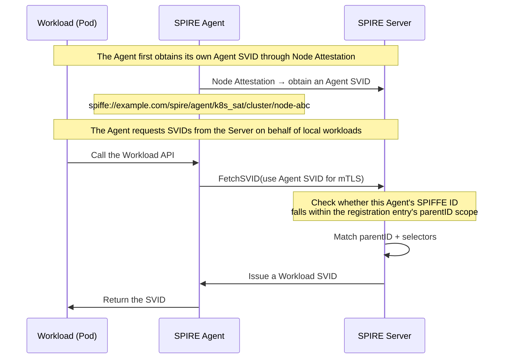

**The logic**: SPIRE Server does not issue SVIDs directly to workloads; SPIRE Agent intermediates their requests. Parent ID **restricts which Agents may request SVIDs for which workloads**.

### 3.2 Why Is Parent ID Necessary?

#### First, What Does SPIRE Server Check When Issuing an SVID?

When a workload requests an SVID, SPIRE Server performs **two matching steps**:

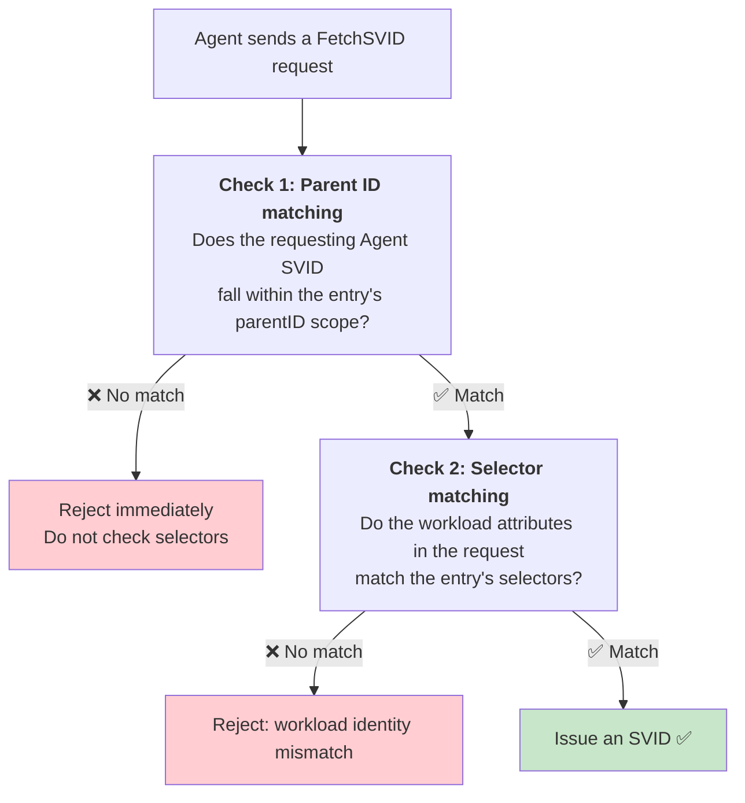

**Key point**: these checks run **in order**. Parent ID must pass before Selectors are checked. This deliberately verifies the trusted sponsor before verifying the identity of the sponsored workload.

#### How Parent ID Matching Works

When an Agent sends a `FetchSVID` request, the Server queries the database for matching registration entries. Parent ID matching determines which entries are **eligible** for subsequent Selector checks.

**The complete matching process has three steps:**

##### Step 1: Parse the Identity in Parent ID

A registration entry's `parentID` can take one of two forms:

```
Form 1: a full Agent SPIFFE ID (possibly containing a wildcard)
  spiffe://acme.com/spire/agent/k8s_sat/prod-cluster/node-abc
  spiffe://acme.com/spire/agent/k8s_sat/prod-cluster/*
  spiffe://acme.com/spire/agent/k8s_sat/*

Form 2: a Node Alias (if enabled)
  spiffe://acme.com/prod/us-east
  spiffe://acme.com/prod/all
```

The Server identifies the form using these rules:
- If parentID contains the `/spire/agent/` path, it is form 1: a full SPIFFE ID
- Otherwise, it is form 2: a Node Alias

##### Step 2: Obtain the Requesting Agent's Identity

The Agent sending `FetchSVID` must first obtain its own Agent SVID through Node Attestation. The Server maintains an identity mapping for Agents:

```
Agent SVID: spiffe://acme.com/spire/agent/k8s_sat/prod-cluster/node-001
  ├── X.509 certificate (currently valid)
  ├── Expiration time
  ├── Node Aliases (if configured): [prod/us-east, prod/all]
  └── Certificate public key
```

When a request arrives, the Server extracts the requester's certificate from the mTLS connection and reads its SPIFFE ID.

##### Step 3: Apply the Matching Rules

**Case A: parentID is a full SPIFFE ID**

```
Registration entry parentID: spiffe://acme.com/spire/agent/k8s_sat/prod-cluster/*
Requesting Agent SVID: spiffe://acme.com/spire/agent/k8s_sat/prod-cluster/node-001

Matching algorithm (prefix + wildcard):
  1. Extract the segment after the final / in parentID: "*"
  2. If it is "*" (a standalone wildcard), match all nodes under "prod-cluster/"
  3. Compare:
     parentID prefix: spiffe://acme.com/spire/agent/k8s_sat/prod-cluster/
     Agent SVID prefix: spiffe://acme.com/spire/agent/k8s_sat/prod-cluster/
     ✅ The prefixes match exactly!

Result: ✅ Match successful
```

**Pseudocode for the matching algorithm:**

```python
def matches_parent_id(request_agent_svid: str, parent_id: str) -> bool:
    # Case 1: exact match (no wildcard)
    if "*" not in parent_id:
        return request_agent_svid == parent_id

    # Case 2: wildcard match
    # Note: SPIRE supports only a trailing *, not a wildcard in the middle or beginning
    if parent_id.endswith("/*"):
        # Remove the trailing /* to obtain the prefix
        prefix = parent_id[:-2]  # Remove "/*"
        # The Agent SVID must begin with this prefix
        return request_agent_svid.startswith(prefix + "/")

    # Other wildcard formats are not currently supported
    return False

# Examples
print(matches_parent_id(
    "spiffe://acme.com/spire/agent/k8s_sat/prod-cluster/node-001",
    "spiffe://acme.com/spire/agent/k8s_sat/prod-cluster/*"
))  # True

print(matches_parent_id(
    "spiffe://acme.com/spire/agent/k8s_sat/test-cluster/node-001",
    "spiffe://acme.com/spire/agent/k8s_sat/prod-cluster/*"
))  # False (test-cluster != prod-cluster)
```

**Case B: parentID is a Node Alias**

```
Registration entry parentID: spiffe://acme.com/prod/us-east
Requesting Agent SVID: spiffe://acme.com/spire/agent/k8s_sat/prod-cluster/node-001
Requester aliases: [prod/us-east, prod/all]

Matching algorithm:
  1. The Server sees that parentID does not contain "/spire/agent/" → this is an alias
  2. Extract the alias: "prod/us-east"
  3. Query the Datastore: has node-001 declared the alias "prod/us-east"?
  4. Query result: node-001's alias list = [prod/us-east, prod/all]
  5. "prod/us-east" in [prod/us-east, prod/all] → ✅ Yes!

Result: ✅ Match successful
```

**Pseudocode for alias matching:**

```python
def matches_parent_id_alias(
    request_agent_svid: str,
    parent_id_alias: str,  # For example, "spiffe://acme.com/prod/us-east"
    agent_alias_mapping: dict  # Agent → Alias mapping in the Datastore
) -> bool:
    # Extract the alias portion of parent_id_alias
    # Format: spiffe://<trust_domain>/<alias_path>
    # Example: spiffe://acme.com/prod/us-east → alias_path = "prod/us-east"

    parts = parent_id_alias.split("/", 3)  # spiffe://acme.com/prod/us-east
    # parts[0] = "spiffe:"
    # parts[1] = ""
    # parts[2] = "<trust_domain>"
    # parts[3] = "prod/us-east"

    alias_path = parts[3] if len(parts) > 3 else None

    # Query the Datastore for the aliases declared by this Agent
    agent_aliases = agent_alias_mapping.get(request_agent_svid, [])

    # Check whether alias_path is in the list
    return alias_path in agent_aliases

# Examples
agent_mapping = {
    "spiffe://acme.com/spire/agent/k8s_sat/prod-cluster/node-001":
        ["prod/us-east", "prod/all"],
    "spiffe://acme.com/spire/agent/k8s_sat/test-cluster/node-001":
        ["staging/all"]
}

print(matches_parent_id_alias(
    "spiffe://acme.com/spire/agent/k8s_sat/prod-cluster/node-001",
    "spiffe://acme.com/prod/us-east",
    agent_mapping
))  # True

print(matches_parent_id_alias(
    "spiffe://acme.com/spire/agent/k8s_sat/test-cluster/node-001",
    "spiffe://acme.com/prod/us-east",
    agent_mapping
))  # False (the staging Agent does not have the prod/us-east alias)
```

##### A Complete Matching Example

The following scenario connects all these steps:

**Data in the Datastore:**

```
Registration entry Entry-1:
  spiffeID: spiffe://acme.com/ns/prod/sa/payment
  parentID: spiffe://acme.com/spire/agent/k8s_sat/prod-cluster/*
  selectors: [k8s:ns:production, k8s:sa:payment-service]

Registration entry Entry-2:
  spiffeID: spiffe://acme.com/ns/prod/sa/order
  parentID: spiffe://acme.com/prod/us-east    ← Alias
  selectors: [k8s:ns:production, k8s:sa:order-service]

Agent mapping table:
  Agent-A (SPIFFE ID: spiffe://acme.com/spire/agent/k8s_sat/prod-cluster/node-001)
    └── Aliases: [prod/us-east, prod/all]

  Agent-B (SPIFFE ID: spiffe://acme.com/spire/agent/k8s_sat/test-cluster/node-001)
    └── Aliases: [staging/all]
```

**Request 1: Agent-A Requests a Payment SVID**

```
Requester: Agent-A (spiffe://acme.com/spire/agent/k8s_sat/prod-cluster/node-001)
Workload: Pod (ns=production, sa=payment-service)

The Server checks registration entry Entry-1:

  Check 1: Parent ID matching
  ├─ Entry-1 parentID = spiffe://acme.com/spire/agent/k8s_sat/prod-cluster/*
  ├─ Agent-A SVID = spiffe://acme.com/spire/agent/k8s_sat/prod-cluster/node-001
  ├─ Prefix matches (spiffe://acme.com/spire/agent/k8s_sat/prod-cluster/) ✅
  └─ Parent ID check passes!

  Check 2: Selector matching
  ├─ Pod selectors = [k8s:ns:production, k8s:sa:payment-service]
  ├─ Entry-1 selectors = [k8s:ns:production, k8s:sa:payment-service]
  ├─ Exact match ✅
  └─ Selector check passes!

Result: ✅ Issue an SVID
```

**Request 2: Agent-B Requests a Payment SVID (Forged)**

```
Requester: Agent-B (spiffe://acme.com/spire/agent/k8s_sat/test-cluster/node-001)
Workload: forged Pod (ns=production, sa=payment-service)

The Server checks registration entry Entry-1:

  Check 1: Parent ID matching
  ├─ Entry-1 parentID = spiffe://acme.com/spire/agent/k8s_sat/prod-cluster/*
  ├─ Agent-B SVID = spiffe://acme.com/spire/agent/k8s_sat/test-cluster/node-001
  ├─ Prefix mismatch (test-cluster != prod-cluster) ❌
  └─ Parent ID check fails! Reject.

Result: ❌ Reject (do not proceed to Selector checks)
```

**Request 3: Agent-A Requests an Order SVID**

```
Requester: Agent-A (spiffe://acme.com/spire/agent/k8s_sat/prod-cluster/node-001)
Workload: Pod (ns=production, sa=order-service)

The Server checks registration entry Entry-2:

  Check 1: Parent ID matching (alias variant)
  ├─ Entry-2 parentID = spiffe://acme.com/prod/us-east  ← Alias
  ├─ Aliases declared by Agent-A = [prod/us-east, prod/all]
  ├─ "prod/us-east" in Aliases? ✅ Yes!
  └─ Parent ID check passes!

  Check 2: Selector matching
  ├─ Pod selectors = [k8s:ns:production, k8s:sa:order-service]
  ├─ Entry-2 selectors = [k8s:ns:production, k8s:sa:order-service]
  ├─ Exact match ✅
  └─ Selector check passes!

Result: ✅ Issue an SVID
```

---

#### What Happens Without a Parent ID Restriction?

Suppose Parent ID uses the broadest wildcard, `spiffe://example.com/spire/agent/*`. This means **any Agent in the trust domain can request this SVID**.

Consider a concrete attack scenario:

**Background:**
- The company has two environments: a production cluster and a test cluster.
- Both clusters belong to the same SPIRE trust domain, `example.com`.
- The production cluster runs `Payment Service`, whose SPIFFE ID is `spiffe://example.com/ns/prod/sa/payment`.
- The test cluster is accessible to all developers and outsourced teams and has weaker security.

**Attack steps:**

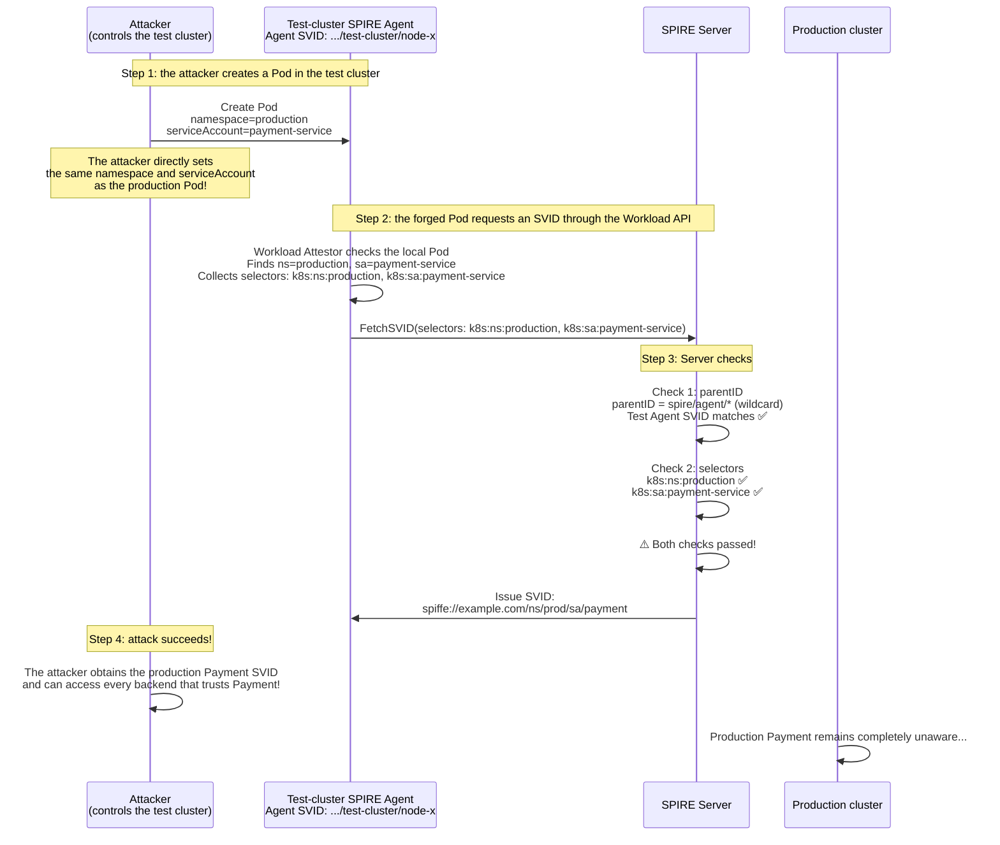

**Why the attacker succeeds:**
1. The attacker **deliberately sets** `namespace=production, serviceAccount=payment-service` in the test cluster.
2. SPIRE Agent's Workload Attestor identifies workload attributes using **kernel information**, such as cgroups and PIDs. Those attributes are **also real** in the test-cluster Pod. The Agent does not lie; it accurately reports what it observes.
3. Without a parentID restriction on the Agent's origin, the Server cannot distinguish a production-cluster request from a test-cluster request.

---

#### How Does Adding a Parent ID Restriction Stop the Attack?

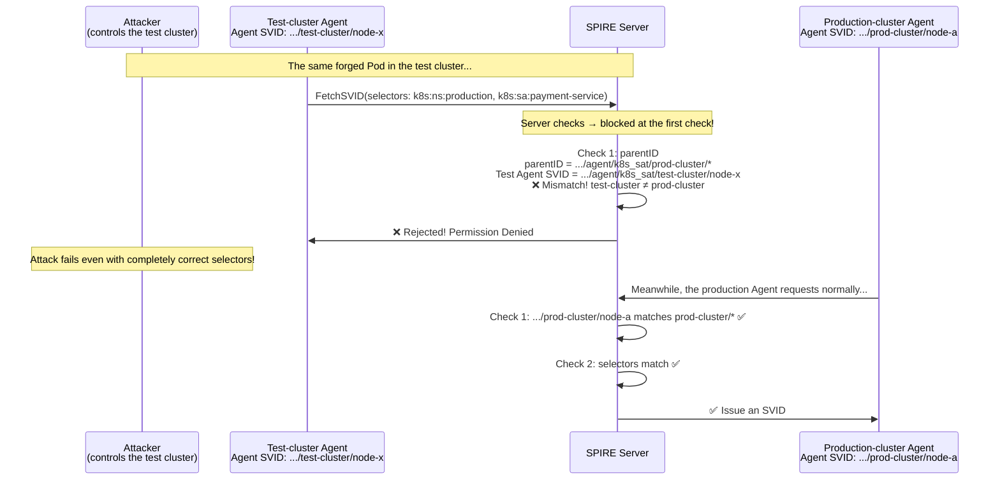

---

#### What If the Attacker Controls a Node in the Production Cluster?

This is a deeper problem. Suppose the attacker gains root access to a **noncritical node** in the production cluster:

```
Production cluster:
  node-critical: runs Payment Service
  node-compromised: controlled by the attacker
```

What happens if the attacker forges a Pod on `node-compromised`?

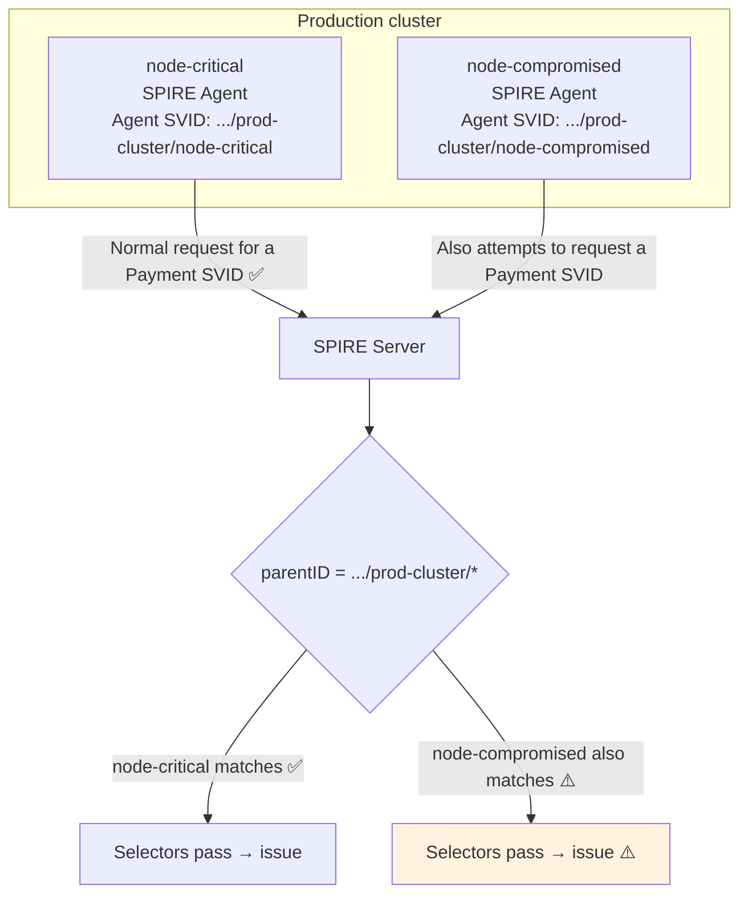

Here, **a cluster-wide parentID wildcard** (`*/prod-cluster/*`) indeed lets the attacker obtain an SVID. This is a limitation of Parent ID granularity: broader wildcards create broader security boundaries.

**How can this be prevented?** More precise Parent IDs help:

```bash
# Unsafe (cluster-wide wildcard: compromising any node enables impersonation):
-parentID spiffe://example.com/spire/agent/k8s_sat/prod-cluster/*

# Safer (specific nodes, or precise grouping with Node Alias):
-parentID spiffe://example.com/spire/agent/k8s_sat/prod-cluster/node-critical
-parentID spiffe://example.com/spire/agent/k8s_sat/prod-cluster/node-backup
```

You can go further with **node labels/taints + Node Alias** to constrain particular workloads to particular nodes:

```hocon
# Configure a special alias only on dedicated Payment nodes
# spire-agent.conf on dedicated nodes:
agent {
  aliases = ["prod-cluster/pci-nodes"]
}

# spire-agent.conf on general-purpose nodes:
agent {
  aliases = ["prod-cluster/general-nodes"]
}
```

```bash
# Payment registration entry: allow dedicated nodes only
spire-server entry create \
  -parentID spiffe://example.com/prod-cluster/pci-nodes \
  -spiffeID spiffe://example.com/ns/prod/sa/payment \
  -selector k8s:ns:production \
  -selector k8s:sa:payment-service \
  -ttl 3600
```

---

#### An Everyday Analogy: Opening a Bank Account

A real-world analogy makes this easier to understand:

| SPIRE concept | Banking analogy |
|-----------|---------|
| **SPIFFE ID** | Bank-card number (your identity identifier) |
| **Workload Attestor (Selectors)** | ID card + facial recognition (prove that you are who you claim to be) |
| **Parent ID** | **Only a designated branch may open the account** |
| **No Parent ID restriction** | Any branch can issue a card; if a branch is compromised, an attacker can issue cards for anyone |
| **With a Parent ID restriction** | Only headquarters/designated branches can issue cards; compromising a remote branch is insufficient |

Even with an ID card (matching selectors), entering the wrong branch (a parentID mismatch) means the clerk will not issue a card. This is **two-part verification**: it verifies both who you are and who is acting on your behalf.

---

#### Summary: The Defensive Roles of Selectors and Parent ID

| Security question | Mechanism | Protection |
|---------|---------|---------|
| **Who are you?** | Selectors (Workload Attestor) | Prevent workload impersonation, such as a forged Pod claiming to be Payment Service |
| **Who vouches for you?** | Parent ID (Agent restriction) | Prevent identity fabrication in untrusted environments, such as a compromised test cluster impersonating production |
| **Where are you?** | Parent ID + Node Alias (precise node restrictions) | Prevent identity fabrication on untrusted nodes within a trusted environment |

All three matter: without Parent ID, attackers can bypass selectors by changing environments; without selectors, attackers can run malicious workloads on legitimate nodes.

> Parent ID constrains **who is authorized to vouch for an identity**. Only designated Agent nodes may request the corresponding Workload SVID. **It is mandatory and fundamental to SPIRE's security model.**

### 3.3 Parent ID Format and Wildcards

Parent ID supports the `*` wildcard:

```bash
# Exact match: allow only the Agent on node-abc
-parentID spiffe://example.com/spire/agent/k8s_sat/prod-cluster/node-abc

# Prefix wildcard: allow every Agent in prod-cluster
-parentID spiffe://example.com/spire/agent/k8s_sat/prod-cluster/*

# Broad wildcard: allow all Agents attested through k8s_sat
-parentID spiffe://example.com/spire/agent/k8s_sat/*

# Broadest: allow every Agent in the trust domain (not recommended due to security risks)
-parentID spiffe://example.com/spire/agent/*
```

### 3.4 Typical Parent ID Usage Patterns

**Pattern 1: Cluster Isolation (Recommended)**

```
# Registration entry for the production cluster
-parentID spiffe://example.com/spire/agent/k8s_sat/prod-cluster/*

# Registration entry for the staging cluster
-parentID spiffe://example.com/spire/agent/k8s_sat/staging-cluster/*
```

Each cluster's Agents may request SVIDs only for workloads in their own cluster.

**Pattern 2: Node-Level Isolation (High-Security Scenarios)**

```
# Allow only designated nodes to run Payment
-parentID spiffe://example.com/spire/agent/k8s_sat/prod-cluster/node-pci-dedicated-01
-parentID spiffe://example.com/spire/agent/k8s_sat/prod-cluster/node-pci-dedicated-02
```

Suitable for compliance scenarios such as PCI-DSS, ensuring sensitive workloads run only on dedicated nodes.

**Pattern 3: Cross-Cluster Sharing (Requires Centralized Management)**

```
# The same service may run in multiple clusters
-parentID spiffe://example.com/spire/agent/k8s_sat/prod-us-east/*
-parentID spiffe://example.com/spire/agent/k8s_sat/prod-us-west/*
```

---

## 4. Node Alias: A Simpler Alias for Parent ID

> **In one sentence**: Node Alias gives each SPIRE Agent a **human-readable nickname**, which can replace its long, hard-to-remember SPIFFE ID in a registration entry's `parentID`.

### 4.1 The Pain of Managing Without Aliases

Suppose you are an SRE managing three clusters with 150 nodes in total:

```
Cluster prod-us-east   → 50 nodes (node-001–node-050)
Cluster prod-us-west   → 50 nodes (node-051–node-100)
Cluster staging        → 50 nodes (node-101–node-150)
```

After Node Attestation, each SPIRE Agent receives a SPIFFE ID resembling:

```
spiffe://acme.com/spire/agent/k8s_sat/prod-us-east/node-i-0a1b2c3d4e5f67890
```

You now need to register a SPIFFE ID for `Payment Service`, with the requirement that **Payment may run only in the US East production cluster**.

**Without Node Alias**, the registration entry must look like this:

```bash
spire-server entry create \
  -parentID spiffe://acme.com/spire/agent/k8s_sat/prod-us-east/* \
  -spiffeID spiffe://acme.com/ns/prod/sa/payment \
  -selector k8s:ns:production \
  -selector k8s:sa:payment-service
```

This may look reasonable, but **the problems are only beginning**:

**Problem 1: Wildcards Become Imprecise as Clusters Multiply**

Three months later, the company opens a second US East production cluster, `prod-us-east-2`. Is Payment allowed to run there?

```
# The existing wildcard covers only prod-us-east (the first cluster)
-parentID spiffe://acme.com/spire/agent/k8s_sat/prod-us-east/*

# To allow both US East clusters, one pattern will not work:
#   prod-us-east and prod-us-east-2 have no shared prefix!
#   You must write two entries:
-parentID spiffe://acme.com/spire/agent/k8s_sat/prod-us-east/*
-parentID spiffe://acme.com/spire/agent/k8s_sat/prod-us-east-2/*
```

**Problem 2: No Logical Grouping Across Clusters**

The intended business meaning is **all US East production nodes**, but Agent SPIFFE IDs follow an `attestor/cluster/node` structure rather than business logic. A wildcard such as `*-us-east-*` is unavailable because SPIRE supports only trailing `*` wildcards.

**Problem 3: Operators Cannot Easily Remember or Interpret IDs**

```bash
# What is this? Which cluster? Which environment?
-parentID spiffe://acme.com/spire/agent/k8s_sat/cluster-xyz-2024/node-abc
```

Node Alias addresses these problems.

---

### 4.2 How Node Alias Works

Node Alias operates in three steps:

#### Step 1: The Agent Includes Aliases When Introducing Itself

During Node Attestation, SPIRE Agent proves that it is a legitimate node and also declares its aliases:

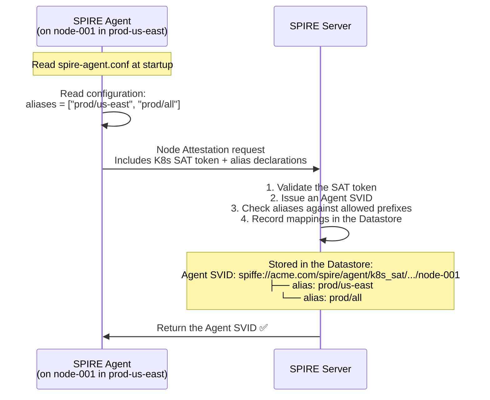

#### Step 2: The Server Maintains an Agent ↔ Alias Mapping

The Server maintains mappings like these in the Datastore:

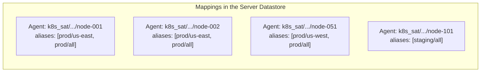

#### Step 3: Registration Entries Use Aliases Instead of Original Agent SPIFFE IDs

When writing a registration entry, use an alias in `-parentID` instead of the original Agent SPIFFE ID:

```bash
# Original form (long and difficult to interpret):
-parentID spiffe://acme.com/spire/agent/k8s_sat/prod-us-east/*

# Alias form (short and clear):
-parentID spiffe://acme.com/prod/us-east
```

**What happens during Server-side matching?**

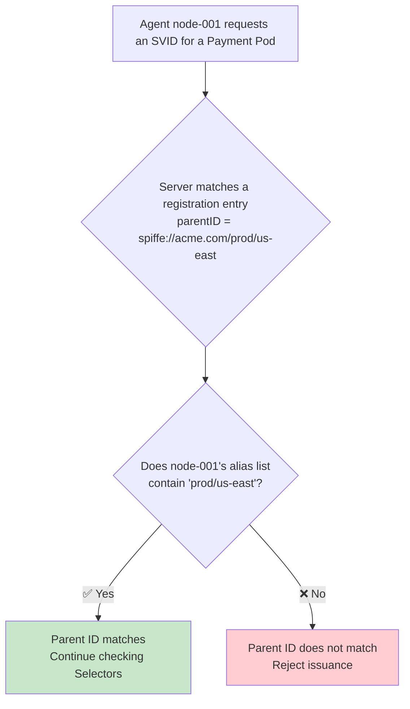

**Key point**: the Server looks up a mapping rather than matching string prefixes. It interprets `spiffe://acme.com/prod/us-east` as `trust_domain=acme.com, alias=prod/us-east`, then finds Agents that declared this alias.

---

### 4.3 A Complete Timeline from Agent Startup to SVID Issuance

The complete sequence from Agent startup to successfully obtaining an SVID for a workload is:

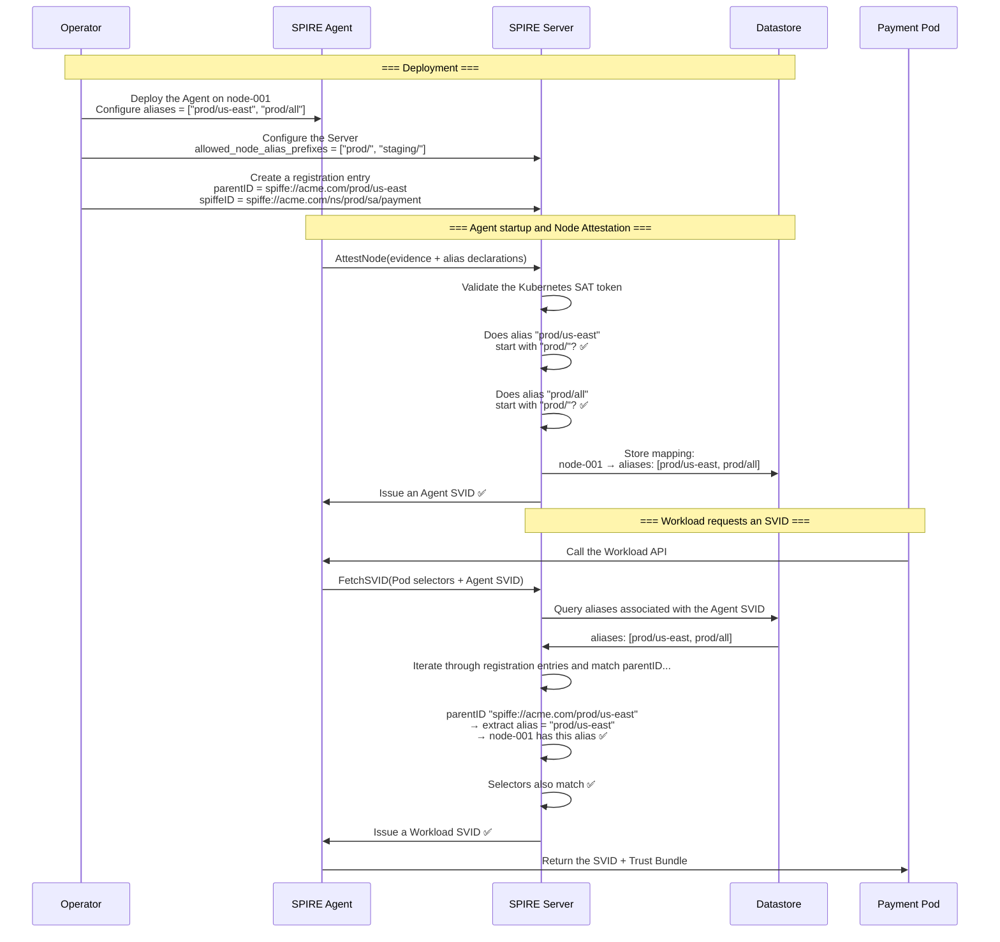

---

### 4.4 Security: Why Must the Server Restrict Alias Prefixes?

This is a critical security question. In the workflow above, the Agent **declares its own aliases** during Node Attestation. Without Server-side restrictions, a malicious Agent can claim any alias:

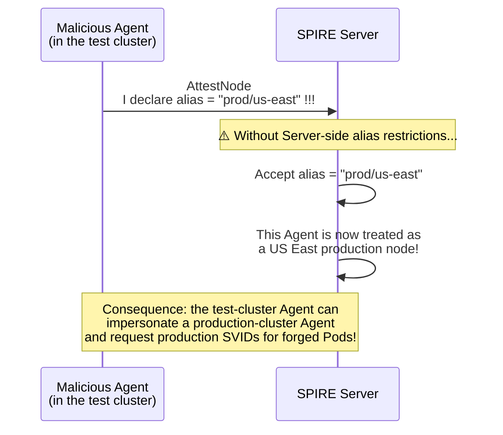

**`allowed_node_alias_prefixes` provides an allowlist that accepts only aliases with specified prefixes.**

```hocon
# spire-server.conf
server {
  trust_domain = "acme.com"

  experimental {
    # ⚠️ Security-critical configuration: allow only these prefixes
    allowed_node_alias_prefixes = [
      "prod/us-east",
      "prod/us-west",
      "prod/all",
      "staging/all"
    ]
  }
}
```

**Validation logic:**

```
Agent declares alias = "prod/us-east"
  → Server checks: does "prod/us-east" start with "prod/us-east"? ✅ Allow

Agent declares alias = "prod/all"
  → Server checks: is "prod/all" in the allowed list? ✅ Allow

Malicious Agent declares alias = "prod/us-east"
  → Server checks: but this Agent belongs to a test cluster
  → It has declared the alias, but its Node Attestation cannot prove production-cluster membership
  → ❌ Note: alias-prefix validation alone cannot prevent cross-cluster impersonation!
```

> **⚠️ Important**: `allowed_node_alias_prefixes` alone **cannot** prevent cross-cluster impersonation. It prevents Agents from inventing arbitrary aliases. The mechanism that prevents cross-cluster impersonation is Node Attestation: a test-cluster Agent cannot pass the production cluster's Kubernetes SAT authentication and therefore cannot obtain a production-cluster Agent SVID. Alias-prefix restrictions provide an **additional defense-in-depth layer**.

Layered defenses:

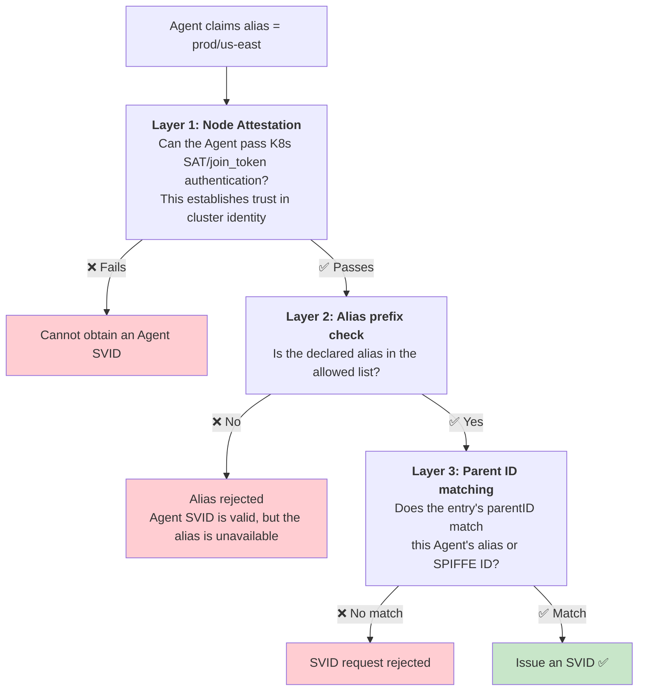

---

### 4.5 Complete Node Alias Configuration

#### 4.5.1 Agent Configuration

```hocon
# /opt/spire/conf/agent.conf
agent {
  data_dir = "/opt/spire/data/agent"
  trust_domain = "acme.com"
  server_address = "spire-server.spire.svc.cluster.local"
  server_port = 8081

  # ========== Node Alias configuration ==========
  # Each Agent may have multiple aliases (an array)
  # Aliases are free-form strings; use / to separate hierarchy levels
  aliases = [
    "prod/us-east",        # Region: all US East production nodes
    "prod/us-east/zone-a", # Availability zone: US East zone-a
    "prod/all",            # Global: all production nodes
    "pci-compliant"        # Compliance label: PCI-DSS-compliant nodes
  ]
}

plugins {
  NodeAttestor "k8s_sat" {
    plugin_data {
      cluster = "prod-us-east"
      service_account_allow_list = ["spire:spire-agent"]
    }
  }
  WorkloadAttestor "k8s" {
    plugin_data {
      skip_kubelet_verification = false
    }
  }
  KeyManager "memory" {
    plugin_data = {}
  }
}
```

**Configuration notes:**

| Point | Explanation |
|------|------|
| Aliases form an array | An Agent can belong to multiple groups, allowing grouping along multiple dimensions |
| Free-form format | Use `/` to separate levels, such as `environment/region/availability-zone` |
| Add role labels | For example, `pci-compliant` or `gpu-node`, grouped by hardware/compliance properties |
| Add global labels | For example, `prod/all`, for broader matching |

#### 4.5.2 Server Configuration

```hocon
# /opt/spire/conf/server.conf
server {
  bind_address = "0.0.0.0"
  bind_port = 8081
  trust_domain = "acme.com"

  # ========== Node Alias prefix allowlist ==========
  experimental {
    # ⚠️ Security-critical: every alias declared by an Agent must start with one of these prefixes
    # Otherwise the Server rejects the alias
    allowed_node_alias_prefixes = [
      "prod/us-east",
      "prod/us-west",
      "prod/all",
      "staging/all",
      "pci-compliant"
    ]
  }

  ca_subject {
    country = ["US"]
    organization = ["ACME Corp"]
    common_name = "SPIRE CA for acme.com"
  }
}

plugins {
  DataStore "sql" {
    plugin_data {
      database_type = "mysql"
      connection_string = "root:password@tcp(mysql:3306)/spire?charset=utf8mb4"
    }
  }
  NodeAttestor "k8s_sat" {
    plugin_data {
      clusters = {
        "prod-us-east" = {
          service_account_allow_list = ["spire:spire-agent"]
        }
        "prod-us-west" = {
          service_account_allow_list = ["spire:spire-agent"]
        }
        "staging" = {
          service_account_allow_list = ["spire:spire-agent"]
        }
      }
    }
  }
  KeyManager "disk" {
    plugin_data {
      keys_path = "/opt/spire/data/keys.json"
    }
  }
}
```

#### 4.5.3 Using Aliases in Registration Entries

Once configuration is complete, registration entries can use concise aliases:

```bash
# === US East production clusters only ===
spire-server entry create \
  -parentID spiffe://acme.com/prod/us-east \
  -spiffeID spiffe://acme.com/ns/prod/sa/payment \
  -selector k8s:ns:production \
  -selector k8s:sa:payment-service \
  -ttl 3600

# === All production clusters ===
spire-server entry create \
  -parentID spiffe://acme.com/prod/all \
  -spiffeID spiffe://acme.com/ns/prod/sa/api-gateway \
  -selector k8s:ns:production \
  -selector k8s:sa:api-gateway \
  -ttl 3600

# === PCI-compliant nodes only ===
spire-server entry create \
  -parentID spiffe://acme.com/pci-compliant \
  -spiffeID spiffe://acme.com/ns/prod/sa/payment-processor \
  -selector k8s:ns:production \
  -selector k8s:sa:payment-processor \
  -ttl 3600

# === Staging environment ===
spire-server entry create \
  -parentID spiffe://acme.com/staging/all \
  -spiffeID spiffe://acme.com/ns/staging/sa/payment \
  -selector k8s:ns:staging \
  -selector k8s:sa:payment-service \
  -ttl 3600
```

**Alias format in parentID**: `spiffe://<trust-domain>/<alias>`

Compare the forms with and without aliases:

```bash
# ❌ Without an alias: long, unclear, and limited wildcard support
-parentID spiffe://acme.com/spire/agent/k8s_sat/prod-us-east/*

# ✅ With an alias: short, clear meaning, and flexible grouping
-parentID spiffe://acme.com/prod/us-east
```

---

### 4.6 Node Alias Best Practices

#### Practice 1: Hierarchical Aliases for Both Broad and Precise Matching

Configure multiple alias levels per Agent so registration entries can choose the required granularity:

```hocon
# Agent on a zone-a node in US East production:
aliases = [
  "prod/all",           # Level 1: all production
  "prod/us-east",       # Level 2: US East
  "prod/us-east/zone-a" # Level 3: a specific availability zone
]
```

Registration entries can choose flexibly:

```bash
# Broad: any production node
-parentID spiffe://acme.com/prod/all

# Intermediate: US East only
-parentID spiffe://acme.com/prod/us-east

# Strict: a specific availability zone (high-availability requirements)
-parentID spiffe://acme.com/prod/us-east/zone-a
```

#### Practice 2: Label Aliases for Node Roles

```hocon
# GPU nodes:
aliases = ["prod/all", "gpu-node", "gpu-a100"]

# High-memory nodes:
aliases = ["prod/all", "high-mem-node"]

# Edge nodes:
aliases = ["prod/all", "edge-node"]
```

```bash
# Run AI training jobs only on A100 GPU nodes
-parentID spiffe://acme.com/gpu-a100

# Run big data processing only on high-memory nodes
-parentID spiffe://acme.com/high-mem
```

#### Practice 3: Inspect and Verify Aliases

```bash
# List all registered Agents and their aliases
$ spire-server agent list

SPIFFE ID                                                     Alias
spiffe://acme.com/spire/agent/k8s_sat/prod-us-east/node-001   prod/us-east, prod/all
spiffe://acme.com/spire/agent/k8s_sat/prod-us-east/node-002   prod/us-east, prod/all
spiffe://acme.com/spire/agent/k8s_sat/prod-us-west/node-051   prod/us-west, prod/all
spiffe://acme.com/spire/agent/k8s_sat/staging/node-101        staging/all

# Show details of a registration entry
$ spire-server entry show -spiffeID spiffe://acme.com/ns/prod/sa/payment

Entry ID      : a1b2c3d4-e5f6-7890-abcd-ef1234567890
SPIFFE ID     : spiffe://acme.com/ns/prod/sa/payment
Parent ID     : spiffe://acme.com/prod/us-east   ← Uses an alias!
Selectors     : k8s:ns:production, k8s:sa:payment-service
TTL           : 3600
```

---

### 4.7 Node Alias vs. Direct Agent SPIFFE IDs

| Dimension | Direct Agent SPIFFE ID | Node Alias |
|------|------------------------|----------------|
| **Readability** | `spiffe://acme.com/spire/agent/k8s_sat/prod-us-east/node-abc123` | `spiffe://acme.com/prod/us-east` |
| **Grouping** | Wildcards only on attestor/cluster prefixes | Free-form semantic grouping by region, role, compliance, etc. |
| **Cross-cluster expression** | Cannot express all US East clusters with different prefixes | Configure the `prod/us-east` alias on every US East Agent |
| **Flexibility under change** | Cluster rename requires changing every registration entry | Cluster rename requires changing only Agent-side aliases |
| **Security** | Embedded in the Agent SVID and cannot be forged | Requires `allowed_node_alias_prefixes` + Node Attestation |

---

### 4.8 Node Alias in One Sentence

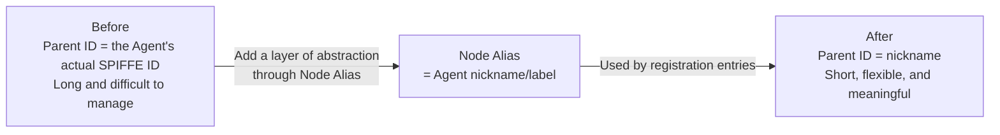

> Node Alias adds **logical grouping above the Agent's original SPIFFE ID**, allowing Parent ID constraints to use business meaning—region, environment, or node role—instead of physical identifiers such as attestor/cluster/node.

---

## 5. How the Three Concepts Fit Together

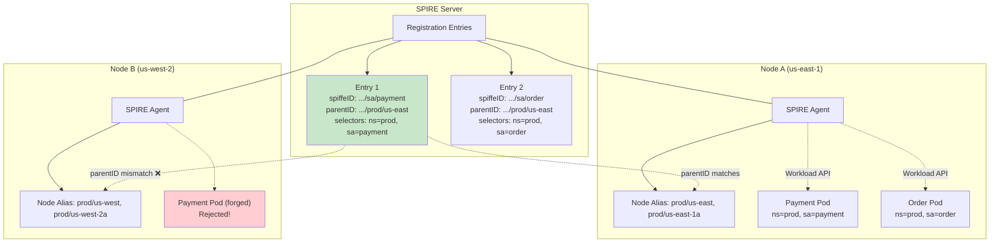

The main flow:

1. The Agent on **Node A** declares alias `prod/us-east`, while entry E1 has `parentID` `spiffe://example.com/prod/us-east` → **match succeeds** ✅
2. The Agent on **Node B** declares alias `prod/us-west`, which does not match E1's `parentID` → **match fails** ❌
3. The Payment Pod on Node A obtains an SVID for `spiffe://example.com/ns/prod/sa/payment` through the Workload API.
4. Even if someone creates an identical Pod on Node B, it cannot obtain the same SPIFFE ID.

---

## 6. Hands-On: A Complete Configuration from Scratch

### Scenario

An e-commerce company has two Kubernetes clusters:

- `prod-us-east`: production in US East
- `staging`: the staging environment

SPIRE identities must now be configured for the `payment` and `order` services.

### Step 1: Configure Agent Node Aliases

**Production-cluster Agent configuration** (`spire-agent-us-east.conf`):

```hocon
agent {
  trust_domain = "shop.example.com"
  server_address = "spire-server.prod.svc.cluster.local"
  server_port = 8081
  aliases = ["prod/us-east", "prod/all"]
}

plugins {
  NodeAttestor "k8s_sat" {
    plugin_data {
      cluster = "prod-us-east"
      service_account_allow_list = ["spire:spire-agent"]
    }
  }
  WorkloadAttestor "k8s" {
    plugin_data {
      skip_kubelet_verification = false
    }
  }
  KeyManager "memory" {
    plugin_data = {}
  }
}
```

**Staging-cluster Agent configuration** (`spire-agent-staging.conf`):

```hocon
agent {
  trust_domain = "shop.example.com"
  server_address = "spire-server.prod.svc.cluster.local"
  server_port = 8081
  aliases = ["staging/all"]
}
# ... other plugin configuration is similar
```

### Step 2: Allow Valid Alias Prefixes on the Server

```hocon
# spire-server.conf
server {
  trust_domain = "shop.example.com"

  experimental {
    allowed_node_alias_prefixes = [
      "prod/us-east",
      "prod/us-west",
      "prod/all",
      "staging/all"
    ]
  }
}
```

### Step 3: Create Registration Entries

```bash
# === Production Payment service ===
# Allow only US East production nodes
spire-server entry create \
  -spiffeID spiffe://shop.example.com/ns/prod/sa/payment \
  -parentID spiffe://shop.example.com/prod/us-east \
  -selector k8s:ns:production \
  -selector k8s:sa:payment-service \
  -ttl 3600

# === Production Order service ===
# May run on all production nodes (US East + US West)
spire-server entry create \
  -spiffeID spiffe://shop.example.com/ns/prod/sa/order \
  -parentID spiffe://shop.example.com/prod/all \
  -selector k8s:ns:production \
  -selector k8s:sa:order-service \
  -ttl 3600

# === Staging Payment service (for testing) ===
spire-server entry create \
  -spiffeID spiffe://shop.example.com/ns/staging/sa/payment \
  -parentID spiffe://shop.example.com/staging/all \
  -selector k8s:ns:staging \
  -selector k8s:sa:payment-service \
  -ttl 3600
```

### Step 4: Verify Registration Entries

```bash
$ spire-server entry show -spiffeID spiffe://shop.example.com/ns/prod/sa/payment

Entry ID      : a1b2c3d4-e5f6-7890-abcd-ef1234567890
SPIFFE ID     : spiffe://shop.example.com/ns/prod/sa/payment
Parent ID     : spiffe://shop.example.com/prod/us-east
Selectors     : k8s:ns:production, k8s:sa:payment-service
TTL           : 3600
```

### Verify the Result

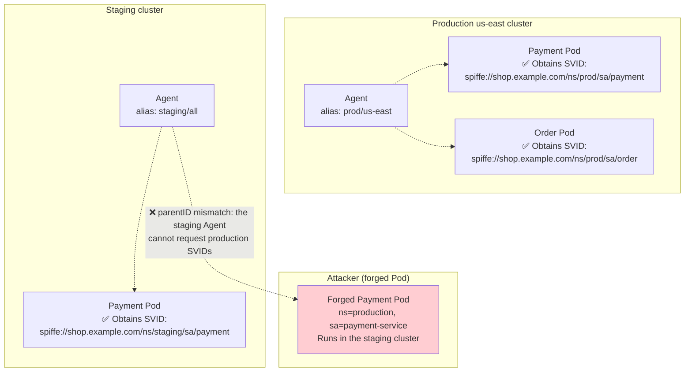

---

## 7. Frequently Asked Questions

### Q1: How Do Parent ID and SPIFFE ID Relate?

SPIFFE ID is the **workload identity** being requested. Parent ID is the **sponsor identity** that constrains access. A registration entry defines both: workloads matching these selectors and sponsored by these Agents (parentID) may obtain this SPIFFE ID.

### Q2: Can an Agent Have No Node Alias?

Yes. Node Alias is optional. Without aliases, the Agent's complete SPIFFE ID works as parentID. Aliases simply make management easier.

### Q3: Can Agent SPIFFE IDs and Node Aliases Be Used Together?

Yes. A registration entry's `parentID` may contain either the Agent's complete SPIFFE ID or an ID corresponding to an alias. Both can match.

### Q4: How Can I See Which Aliases a Node Has Registered?

```bash
# List Agents and their aliases
spire-server agent list

# Example output:
# SPIFFE ID                                            Alias
# spiffe://shop.example.com/spire/agent/k8s_sat/...   prod/us-east
# spiffe://shop.example.com/spire/agent/k8s_sat/...   staging/all
```

### Q5: Why Is Parent ID Necessary If Selectors Already Identify Namespace and Service Account?

Selectors answer **who the workload is**, using information such as PID, cgroup, and Kubernetes attributes derived from the kernel. Parent ID answers **who vouches for it**, based on which Agent sent the request.

They protect different boundaries:
- Selectors prevent **identity impersonation**: a forged Pod claims `ns:production, sa:payment`, but kernel information reveals the facts.
- Parent ID prevents **cross-node/cross-cluster impersonation**: even after fully compromising one cluster, an attacker cannot obtain SVIDs reserved for another cluster.

---

## 8. Summary

| Concept | Meaning in one sentence | Analogy |
|------|-----------|------|
| **SPIFFE ID** | The workload's identity identifier | Identity-card number |
| **Parent ID** | Who may vouch for this identity: the Agent requesting it | Police station: only a designated station may issue the identity card |
| **Node Alias** | A human-readable alias for Parent ID | The police station's displayed name, easier to remember than a code |

How they work together:

```
spiffe://shop.example.com/prod/us-east   ← Parent ID simplified through Node Alias
                  │            │
                  │            └── Workloads in this registration entry
                  │                may be sponsored only by Agents with alias=prod/us-east
                  │
                  └── Trust domain: shop.example.com
```

Understanding these concepts gives you the basic logic of SPIRE identity registration. The next article explores Federation and authentication across trust domains.

---

## References

- [SPIRE Concepts and Fundamentals](/en/notes/kubernetes/yupcbxxy/)
- [SPIRE Trust Domains in Detail](2.%20spire-trust-domain.md)
- [SPIRE Registration Entry Documentation](https://spiffe.io/docs/latest/spire-using/spire-server-registration/)
- [SPIRE Agent Node Alias Documentation](https://github.com/spiffe/spire/blob/main/doc/spire_agent.md#agent-configuration)
