# SPIRE Deployment and Workflow in Kubernetes

## I. Overall Architecture

A SPIRE deployment in Kubernetes has the following architecture:

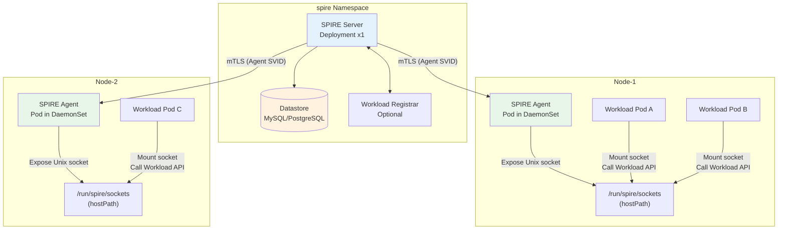

---

## II. Component Roles and Responsibilities

### 2.1 SPIRE Server (Control Plane)

SPIRE Server is the **central coordinator** of the trust domain, deployed as a Deployment in the `spire` namespace.

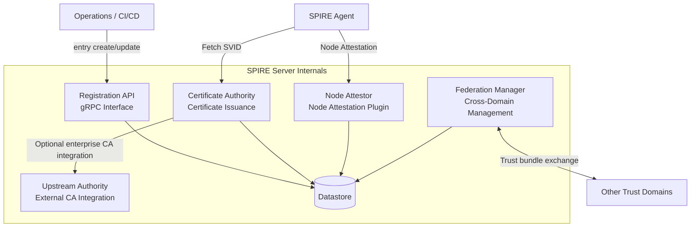

| Responsibility | Description |
|------|------|
| **Identity registration** | Manage SPIFFE ID-to-selector mappings, or registration entries, through the Registration API |
| **Certificate issuance (CA)** | Issue X.509-SVIDs and JWT-SVIDs for Agents and workloads |
| **Node attestation** | Verify the legitimacy of each SPIRE Agent's node through K8s SAT/PSAT or similar methods |
| **Trust bundle distribution** | Maintain root certificates and distribute them to all Agents and workloads |
| **Federation management** | Exchange trust bundles with other trust domains to establish cross-domain trust |

### 2.2 SPIRE Agent (Node Agent)

SPIRE Agent runs as a **DaemonSet**, with one instance on each Kubernetes node:

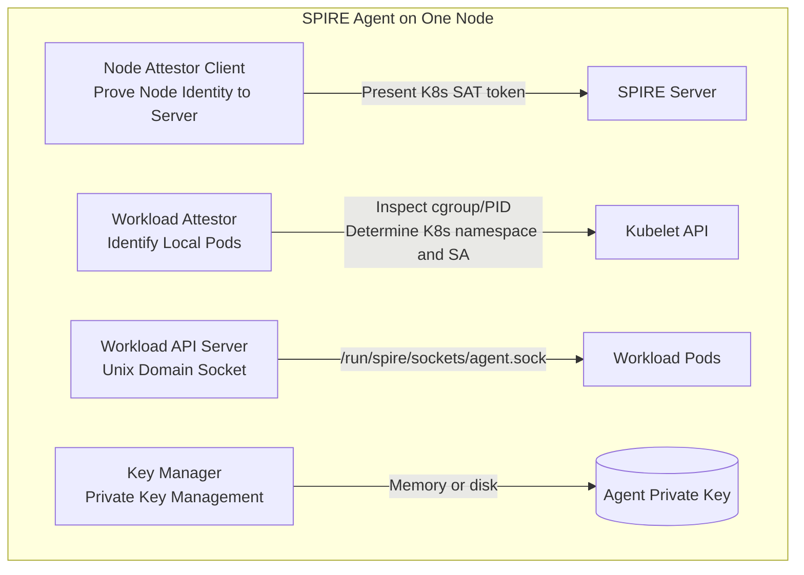

| Responsibility | Description |
|------|------|
| **Node identity proof** | Perform node attestation to prove the Agent runs on a legitimate Kubernetes node |
| **Workload identification** | Query the Kubelet API for Pod namespace, service account, labels, and other attributes |
| **SVID request proxying** | Request SVIDs from the Server on behalf of local workloads and cache them locally |
| **Workload API service** | Expose a Unix domain socket on the node for Pods to obtain SVIDs and trust bundles |
| **Automatic SVID rotation** | Request new certificates before expiration and push them through the Workload API |

### 2.3 Datastore (Persistent Storage)

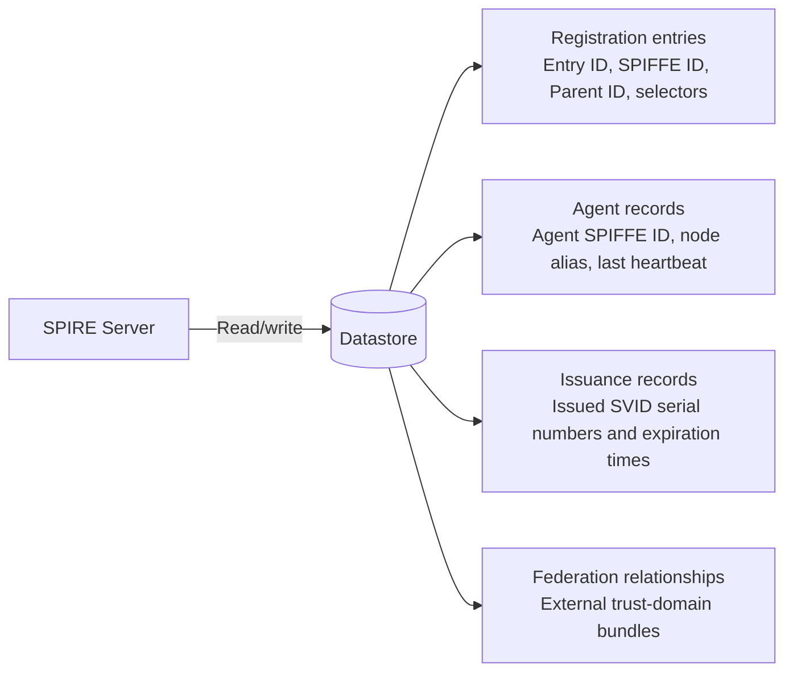

| Stored Data | Description |
|---------|------|
| **Registration entries** | SPIFFE ID-to-selector mappings, the central identity registration data |
| **Agent node information** | All attested Agents, their aliases, and last heartbeat times |
| **SVID issuance records** | Issued certificate serial numbers and expiration times for CRL/revocation management |
| **Federated bundles** | Trust bundles from other domains for cross-domain identity verification |

Supported datastore types:
- **SQLite**: Default, single-instance only, unsuitable for production
- **MySQL / PostgreSQL**: Recommended for production, supporting HA

### 2.4 Workload Registrar (Optional)

Workload Registrar is an **optional helper component** that automatically converts Kubernetes resources, such as Pods and Namespaces, into SPIRE registration entries, reducing manual `entry create` work.

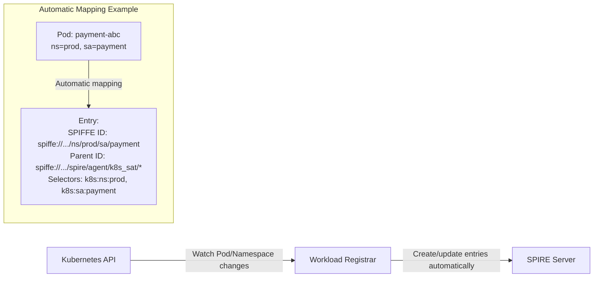

> Workload Registrar greatly reduces manual configuration when the Pod identity model is simple, such as one SPIFFE ID per ServiceAccount. Complex scenarios often still require manually created registration entries.

---

## III. Complete Workflow

SPIRE proceeds through **three stages** in Kubernetes, from startup to workload SVID issuance.

### 3.1 Stage One: Deployment and Initialization

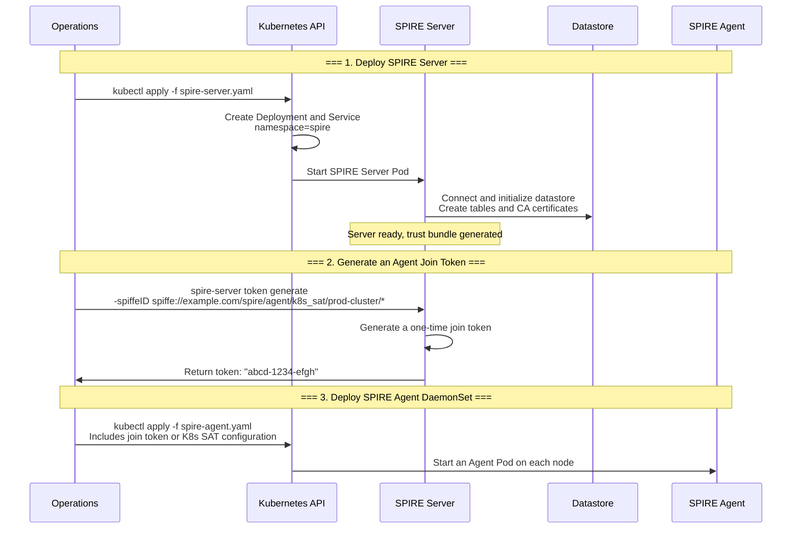

**Relevant Kubernetes resources**:

```yaml
# spire-server Service: expose the gRPC port for Agent connections
apiVersion: v1
kind: Service
metadata:
  name: spire-server
  namespace: spire
spec:
  selector:
    app: spire-server
  ports:
    - name: grpc
      port: 8081
      targetPort: 8081
---
# Agent DaemonSet: one per node
apiVersion: apps/v1
kind: DaemonSet
metadata:
  name: spire-agent
  namespace: spire
spec:
  selector:
    matchLabels:
      app: spire-agent
  template:
    spec:
      # Use hostPID to access host process information needed for workload attestation
      hostPID: true
      # Mount the host path where the Agent exposes its socket
      volumes:
        - name: spire-agent-socket
          hostPath:
            path: /run/spire/sockets
            type: DirectoryOrCreate
      containers:
        - name: spire-agent
          image: ghcr.io/spiffe/spire-agent:latest
          volumeMounts:
            - name: spire-agent-socket
              mountPath: /run/spire/sockets
```

### 3.2 Stage Two: Node Attestation

After startup, SPIRE Agent must first prove to the Server through node attestation that it runs on a legitimate Kubernetes node.

The most common Kubernetes attestation method is **K8s SAT (Service Account Token)**:

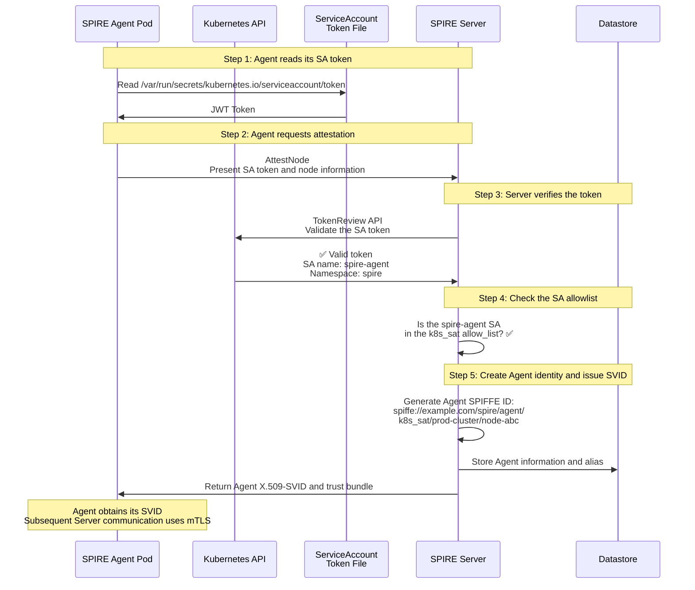

**How K8s SAT attestation works**:

```
Every Kubernetes Pod automatically mounts a ServiceAccount token
at /var/run/secrets/kubernetes.io/serviceaccount/token.

The token is a JWT issued by the Kubernetes control plane,
containing the Pod's ServiceAccount name and namespace.

SPIRE Agent sends it to SPIRE Server,
which verifies it through the Kubernetes TokenReview API,
confirming that the Agent runs on a legitimate Kubernetes node.
```

**Comparing two Kubernetes attestation methods**:

| Method | Mechanism | Advantages | Disadvantages |
|------|------|------|------|
| **k8s_sat** | Agent proves identity with a ServiceAccount token | Simple, no additional configuration | Pod-level token cannot distinguish a specific node |
| **k8s_psat** | Agent uses a projected ServiceAccount token with additional Pod information | Can bind to a particular Pod UID | More configuration and shorter token lifetime |

### 3.3 Stage Three: Workload SVID Issuance

An application Pod obtains its SPIFFE identity through the following flow. This **complete end-to-end diagram** covers the Workload API call through SVID issuance, including four kernel-level substeps in Step 2:

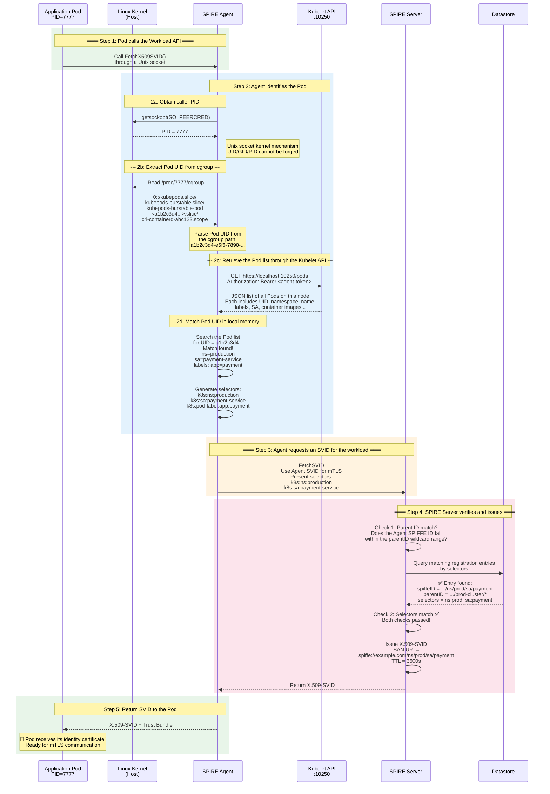

> **💡 Detail**: In Step 2c, the Agent calls **the local Kubelet HTTP API (`:10250/pods`)**, not the Kubernetes API Server. Kubelet is a node-local service with authoritative knowledge of local Pods and very low call latency. The Agent fetches the **complete Pod list** and matches by Pod UID in local memory. Nodes typically host only tens or hundreds of Pods, so retrieving the full list adds very little overhead.

| Property | Value |
|------|-----|
| **API endpoint** | `https://<node-ip>:10250/pods` |
| **Protocol** | HTTP REST, the native Kubelet API |
| **Port** | 10250, the default Kubelet read-only port |
| **Authentication** | The Agent uses its own client certificate, issued by SPIRE Server, or a bearer token |
| **Response** | Complete JSON descriptions of **all** Pods on this node |

**Why retrieve the entire list instead of querying a particular Pod UID?**

Kubelet's `/pods` API has no filter parameter for Pod UID; it returns all Pods on the node. The Agent then matches the UID **in local memory**. Although this may look inefficient, the response is usually small—tens to hundreds of Pods—and local matching takes almost no time.

**How does the Agent authenticate to Kubelet?**

SPIRE Agent must authenticate when calling the Kubelet API. It supports two approaches:

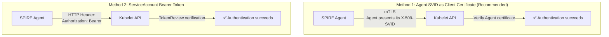

**What do the resulting selectors look like?**

The selectors generated here are later sent to SPIRE Server to match registration entries. For example, the `k8s` Workload Attestor can extract:

| Selector Type | Format | Example |
|--------------|------|--------|
| **Namespace** | `k8s:ns:<value>` | `k8s:ns:production` |
| **ServiceAccount** | `k8s:sa:<value>` | `k8s:sa:payment-service` |
| **Pod Name** | `k8s:pod-name:<value>` | `k8s:pod-name:payment-7f8d9c-abc` |
| **Pod UID** | `k8s:pod-uid:<value>` | `k8s:pod-uid:a1b2c3d4-e5f6...` |
| **Pod Label** | `k8s:pod-label:<key>:<value>` | `k8s:pod-label:app:payment` |
| **Pod Image** | `k8s:pod-image:<value>` | `k8s:pod-image:payment:v2.1.0` |
| **Node Name** | `k8s:node-name:<value>` | `k8s:node-name:worker-node-01` |

These selectors make registration flexible: match a namespace and service account, a particular Pod UID, or Pod labels.

**Comparison with the Kubernetes API Server**:

| Dimension | Kubelet API (the Agent's Approach) | Kubernetes API Server (Alternative) |
|------|----------------------------------|-------------------------------|
| **Scope** | Only Pods on **this node** | Pods across **the entire cluster** |
| **Network path** | Localhost with very low latency | Through the API Server, adding network latency |
| **Dependency** | Kubelet is required on the node | The API Server may be unreachable during a network partition |
| **Security** | Attack surface limited to the node | Attack surface extends to the API Server |
| **Why SPIRE chooses it** | ✅ Kubelet knows local Pods best | ❌ Retrieves excessive information, adding waste and risk |

---

## IV. How Pods Access the Workload API

A central part of Kubernetes integration is making the Agent's Unix socket available to Pods.

### 4.1 Mounting the Socket

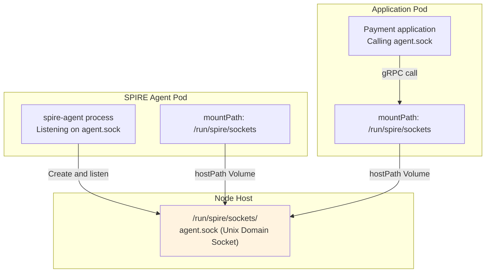

**Agent volume configuration in the DaemonSet**:

```yaml
volumes:
  - name: spire-agent-socket
    hostPath:
      path: /run/spire/sockets
      type: DirectoryOrCreate

containers:
  - name: spire-agent
    volumeMounts:
      - name: spire-agent-socket
        mountPath: /run/spire/sockets
```

**Application Pod volume configuration**:

```yaml
volumes:
  - name: spire-agent-socket
    hostPath:
      path: /run/spire/sockets
      type: DirectoryOrCreate

containers:
  - name: payment
    volumeMounts:
      - name: spire-agent-socket
        mountPath: /run/spire/sockets
        readOnly: true  # Read-only access is sufficient for the application Pod
```

### 4.2 Calling the Workload API from Application Code

Applications can use the official SPIFFE SDK instead of implementing the SPIFFE protocol themselves:

```go
// Go example
import (
    "github.com/spiffe/go-spiffe/v2/workloadapi"
)

func main() {
    // Connect to the local Workload API socket
    ctx := context.Background()
    client, err := workloadapi.New(ctx,
        workloadapi.WithAddr("unix:///run/spire/sockets/agent.sock"),
    )
    if err != nil {
        log.Fatal(err)
    }
    defer client.Close()

    // Obtain the current Pod's X.509-SVID
    svid, err := client.FetchX509SVID(ctx)
    if err != nil {
        log.Fatal(err)
    }

    // svid.Certificates is the certificate chain in PEM format
    // svid.PrivateKey is the private key
    // These can be used directly in TLS configuration
}
```

---

## V. SPIRE–Kubernetes Interaction Overview

The following architecture diagram brings these components and workflows together:

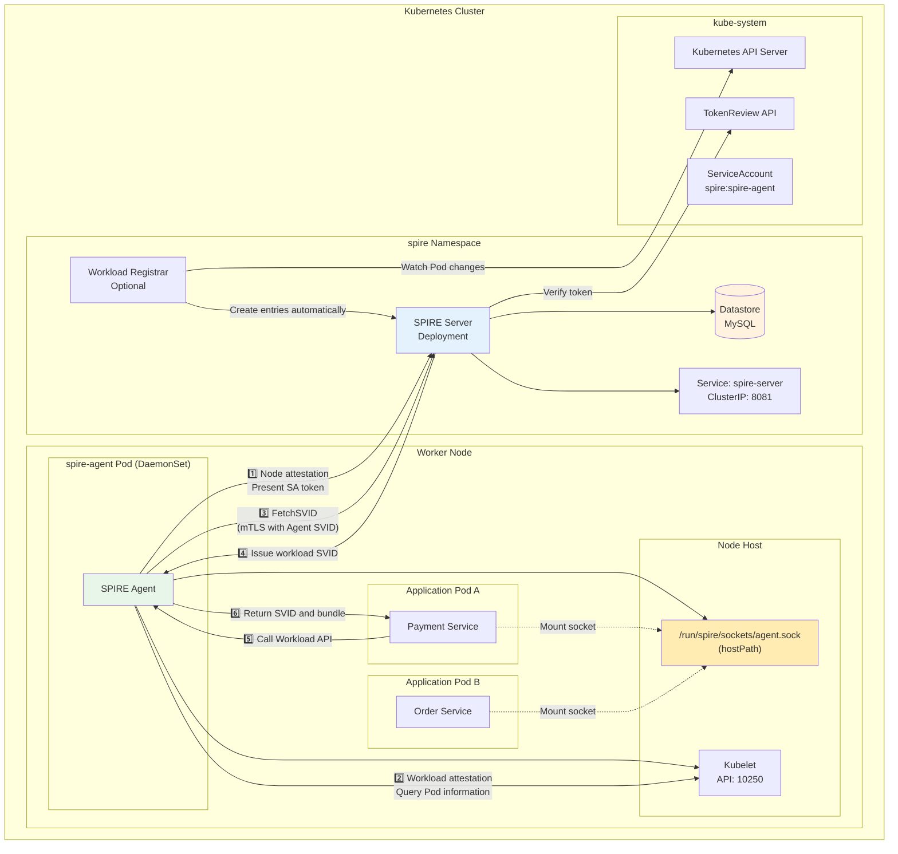

---

## VI. Automatic SVID Rotation

SPIRE rotates certificates automatically without manual intervention:

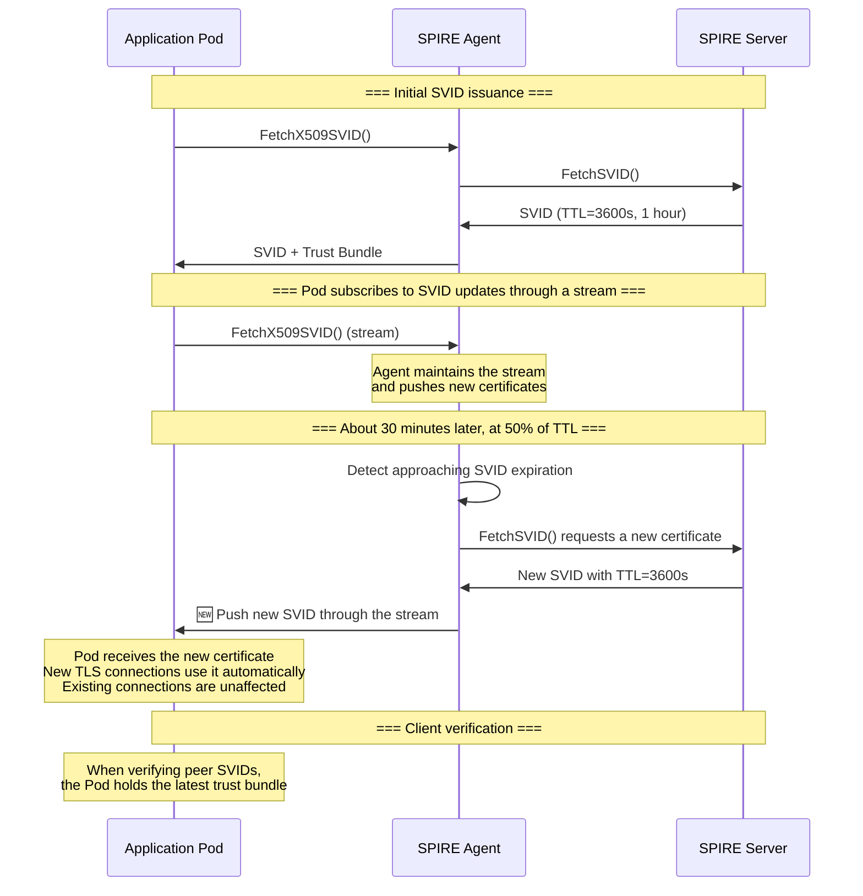

**Mechanisms**:
- The Agent initiates rotation at **50%** of the certificate TTL.
- The Agent maintains an **SVID cache**. During brief Server outages, issued SVIDs remain usable until expiration.
- Application Pods subscribe through the Workload API's **streaming mode**. New certificates are pushed immediately without restarting the Pod.

---

## VII. Common Deployment Patterns

### 7.1 Single-Cluster Deployment for Getting Started

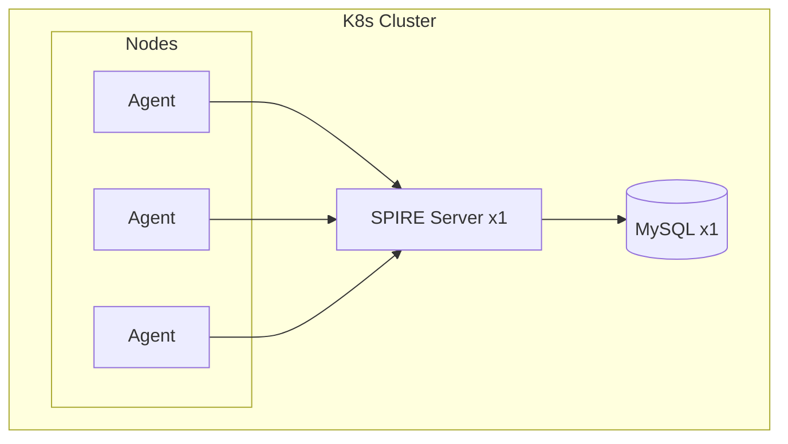

**Characteristics**: Simple, suitable for proofs of concept and small production deployments. The Server is a single point of failure and relies on Kubernetes self-healing.

### 7.2 High Availability for Production

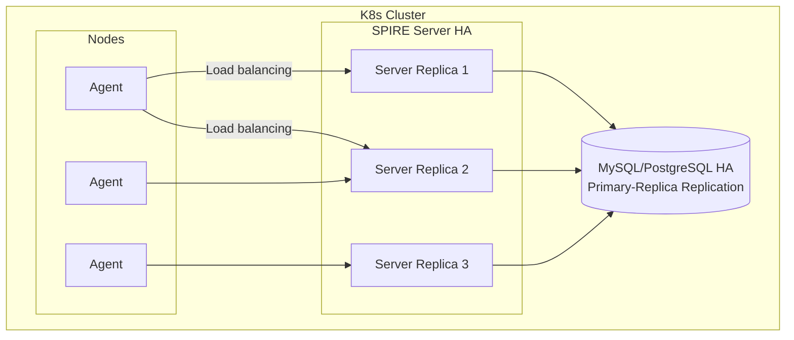

**Configuration**:
- Set `replicas: 3` on the SPIRE Server Deployment.
- Multiple Servers share one datastore for stateless horizontal scaling.
- Agents connect through a Kubernetes Service, which balances connections across Servers.

### 7.3 Shared Server Across Clusters for Unified Identity

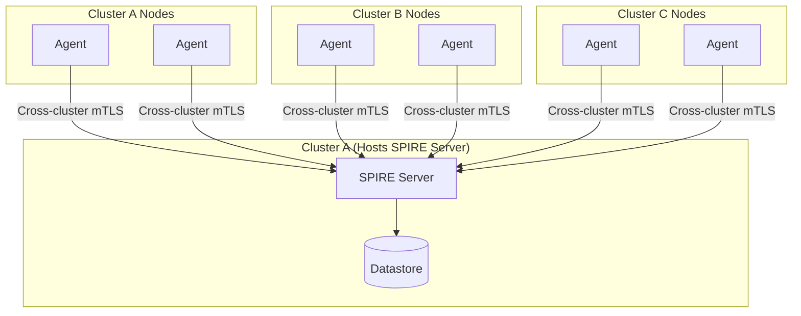

**Characteristics**: All clusters share one trust domain, so workloads trust one another by default. Low network latency between clusters is required.

---

## VIII. Security Boundaries

> **Conclusion**: If an attacker gains root on a node, SPIRE workload attestation **cannot defend against them**. Techniques such as `nsenter`, static Pod creation, and cgroup forgery can obtain the SVID of any Pod on that node.

This is an intentional boundary of SPIRE's security model. SPIRE ensures that identity attributes are mapped correctly to credentials; it does not ensure that the process requesting credentials is the original application. Protecting node integrity belongs to the infrastructure layer.

For attack-path analysis, countermeasures, and defense-in-depth architecture, see **[SPIRE Security Boundaries and Capability Model](5.%20spire-security-boundary.md)**.

---

## IX. Security Configuration Checklist

| Setting | Location | Description |
|--------|------|------|
| **Server CA private-key protection** | Server KeyManager | Use `disk` or KMS in production, rather than `memory` |
| **Agent Node Attestor** | Server `NodeAttestor "k8s_sat"` | Configure `service_account_allow_list` to restrict which SAs can act as Agents |
| **Agent Workload Attestor** | Agent `WorkloadAttestor "k8s"` | Set `skip_kubelet_verification = false` to verify the Kubelet certificate |
| **Workload API socket** | Pod hostPath | Set socket-directory permissions to `0700` to prevent cross-Pod access |
| **Agent SVID TTL** | Global Server configuration | One hour by default; shorten according to security requirements |
| **Node alias prefixes** | Server `allowed_node_alias_prefixes` | Required to prevent Agents from declaring arbitrary aliases |

---

## X. Debugging Guide

### Inspect Agent Status

```bash
# List all attested Agents
$ kubectl exec -n spire spire-server-0 -- \
  spire-server agent list

# Check Agent health
$ kubectl exec -n spire spire-agent-abc -- \
  spire-agent healthcheck
```

### Inspect Registration Entries

```bash
# List all registration entries
$ kubectl exec -n spire spire-server-0 -- \
  spire-server entry show

# Query by SPIFFE ID
$ kubectl exec -n spire spire-server-0 -- \
  spire-server entry show -spiffeID spiffe://example.com/ns/prod/sa/payment
```

### Test the Workload API Manually

```bash
# Enter an application Pod and verify SVID acquisition
$ kubectl exec -it payment-abc -- /bin/sh

# Test with the official tool
$ /opt/spire/bin/spire-agent api fetch x509 \
  -socketPath /run/spire/sockets/agent.sock
```

---

## XI. Summary

The complete SPIRE workflow in Kubernetes can be expressed in six steps:

```
1. Start SPIRE Server → 2. Deploy the Agent DaemonSet → 3. Perform node attestation
→ 4. Create registration entries → 5. Pod calls the Workload API → 6. Issue SVIDs and rotate automatically
```

Each component's main responsibility:

| Component | Responsibility |
|------|-----------|
| **SPIRE Server** | Issue and manage SPIFFE identities, including certificates and trust bundles |
| **SPIRE Agent** | Proxy local Pod identity requests on each node, connecting Pods to the Server |
| **Datastore** | Persist registration entries, Agent information, and certificate issuance records |
| **Workload Registrar** | Optionally map Kubernetes resources to SPIRE registration entries automatically |
| **Kubelet API** | Provide Pod namespace, SA, and other identity attributes to the Agent |
| **K8s SAT token** | Let the Agent prove to the Server that it runs on a legitimate Kubernetes node |

---

## References

- [SPIRE Concepts and Fundamentals](/en/notes/kubernetes/yupcbxxy/)
- [SPIRE Trust Domains Explained](2.%20spire-trust-domain.md)
- [SPIRE Identity: SPIFFE ID, Parent ID, and Node Alias](3.%20spiffe-id-parent-id-node-alias.md)
- [SPIRE Kubernetes Deployment Guide](https://spiffe.io/docs/latest/spire-using/spire-k8s/)
- [SPIRE Agent Configuration Reference](https://github.com/spiffe/spire/blob/main/doc/spire_agent.md)
