# SPIRE Security Boundaries and Capabilities

## 1. Opening Question

After learning how SPIRE works end to end, you may have a question:

> "If an attacker gains root access on a node, they can use `nsenter` to enter any Pod's namespaces, then call the Workload API to obtain that Pod's SVID. What use is SPIRE then?"

This is a valuable question. Answering it defines **SPIRE's security boundaries**: what it can and cannot prevent, and why it remains essential infrastructure for zero-trust architectures despite those limitations.

---

## 2. A World Without SPIRE

### 2.1 Scenario: Three Microservices Without a Unified Identity System

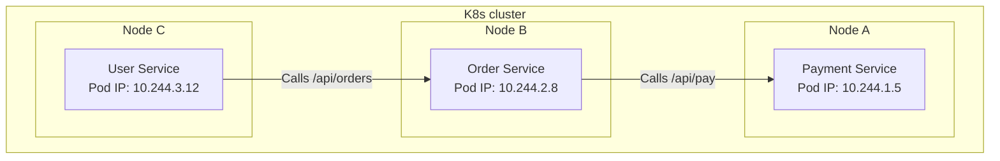

When Order Service calls Payment Service, how can Payment verify the caller's identity?

**Approach A: IP Allowlist**

```
Payment Service configuration:
  allowed_caller_ips:
    - 10.244.2.8  # Order Service's IP
```

Problems:
- A Pod's IP changes after a restart, invalidating the allowlist.
- An attacker can bypass it by spoofing an IP address, which is not difficult within the K8s network plane.
- It cannot distinguish two Order Service instances from Order Service plus a malicious Pod.

**Approach B: Shared Secret (API Key / Token)**

```bash
# Operations configures the same secret for Order Service and Payment Service
ORDER_SERVICE_SECRET="abc123xyz"
PAYMENT_SERVICE_SECRET="abc123xyz"

# Order includes the secret when calling Payment
curl -H "Authorization: Bearer abc123xyz" https://payment/api/pay
```

Problems:
- Once the secret leaks, **no caller's identity can be trusted**: you cannot tell whether a request came from Order Service or the attacker.
- Rotation is difficult: Order and Payment must be updated together, with authentication failures possible during the transition.
- Secrets usually reside in configuration files or environment variables, making them easy to expose.
- **Fine-grained service-to-service authorization** is unavailable: secret validation is all or nothing.

**Approach C: Kubernetes ServiceAccount Token**

```bash
# Order Service calls Payment using its SA token
curl -H "Authorization: Bearer $(cat /var/run/secrets/kubernetes.io/serviceaccount/token)" \
  https://payment/api/pay
```

Problems:
- SA tokens are **long-lived**, and before 1.24 could even remain valid forever.
- **Anyone or any process** holding the token can impersonate Order Service.
- The token's audience is the Kubernetes API Server, not Payment Service. Payment must call the K8s API for TokenReview, adding latency and a dependency.

### 2.2 The Source of Security Problems Without SPIRE

These three approaches share common weaknesses:

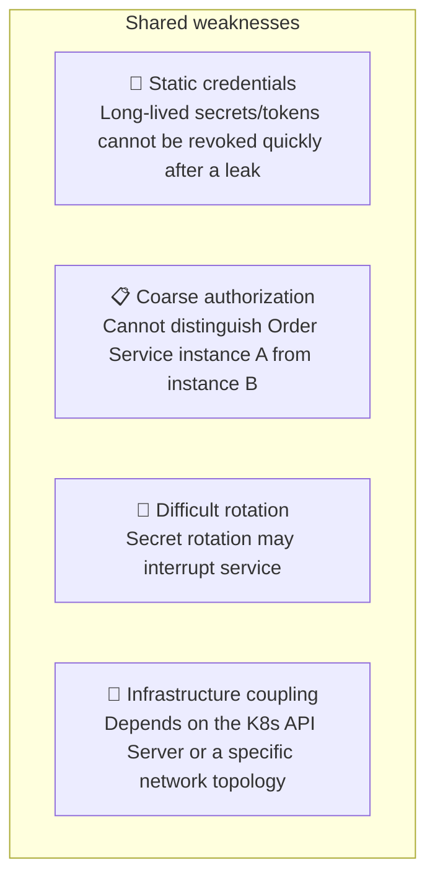

**Underlying problem**: There is no **standardized, dynamic, verifiable workload identity system**.

---

## 3. What Does SPIRE Solve?

### 3.1 Capability One: Standardized Cryptographic Identity

With SPIRE, every workload has a cryptographically verifiable identity:

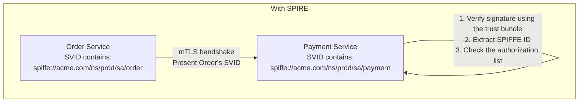

Comparison:

| Dimension | Without SPIRE | With SPIRE |
|------|---------|----------|
| **Identity format** | IP address / static secret / SA token | X.509 certificate with a SPIFFE ID embedded in the SAN |
| **Verification** | Requires an external service, such as TokenReview | Signature can be verified locally using the trust bundle |
| **Validity** | Long-lived / permanent | Short-lived, 1h by default, with automatic rotation |
| **Granularity** | "This secret" cannot distinguish instances | "This SPIFFE ID" identifies a specific Pod |
| **Cross-platform support** | Tied to K8s | Unified across clouds, bare metal, and VMs |

### 3.2 Capability Two: Automated Certificate Lifecycle

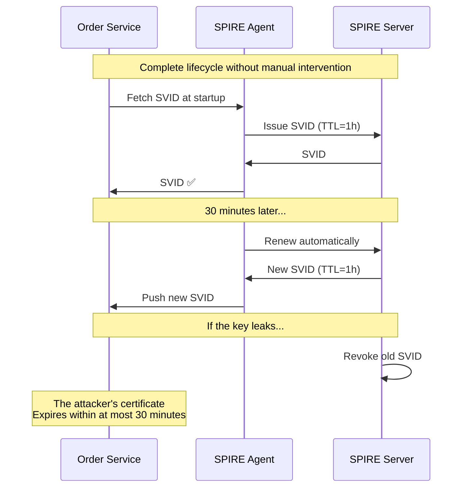

> **Benefit**: Operations staff do not need to generate, distribute, or rotate certificates manually. The exposure window after a certificate leak is limited to half the TTL.

### 3.3 Capability Three: Fine-Grained Service-to-Service Authorization

SPIRE enables **precise authorization based on SPIFFE IDs**:

```go
// Payment Service authorization logic
var allowedCallers = map[string][]string{
    "/api/pay": {
        "spiffe://acme.com/ns/prod/sa/order",       // Order Service may call this API
        "spiffe://acme.com/ns/prod/sa/api-gateway",  // API Gateway may also call it
    },
    "/api/refund": {
        "spiffe://acme.com/ns/prod/sa/admin-panel",  // Only Admin may issue refunds
    },
    "/api/admin/ledger": {
        "spiffe://acme.com/ns/prod/sa/auditor",      // Only the audit service may read the ledger
    },
}

func authMiddleware(next http.Handler) http.Handler {
    return http.HandlerFunc(func(w http.ResponseWriter, r *http.Request) {
        // Extract the peer SPIFFE ID from the mTLS connection
        callerID := getSPIFFEIDFromCert(r.TLS.PeerCertificates[0])

        // Exact match: check whether this SPIFFE ID may access this API
        allowed, ok := allowedCallers[r.URL.Path]
        if !ok || !contains(allowed, callerID) {
            http.Error(w, "Forbidden", 403)
            return
        }
        next.ServeHTTP(w, r)
    })
}
```

Such fine-grained authorization is almost impossible with traditional approaches, which cannot issue an independent, verifiable certificate to every microservice instance.

### 3.4 Scenario Comparison: With and Without SPIRE

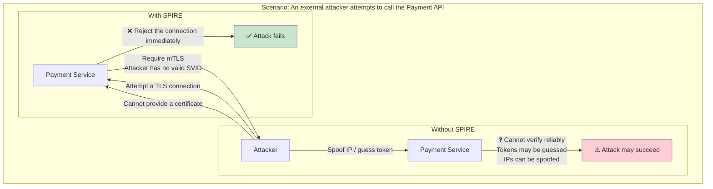

---

## 4. SPIRE's Boundaries: What Can It Not Prevent?

SPIRE is not a silver bullet. Understanding its boundaries allows you to evaluate its role in the wider security architecture.

### 4.1 Boundary One: Node Compromise with Root Access — Three Attack Paths

**Conclusion: SPIRE cannot prevent this.** After gaining root access on a node, an attacker has at least **three ways** to obtain the SVID of any Pod on that node. Each is examined below.

#### 4.1.1 Background: How the Agent Identifies a Pod

To understand why these attacks succeed, first examine the evidence used by the SPIRE Agent's `k8s` Workload Attestor:

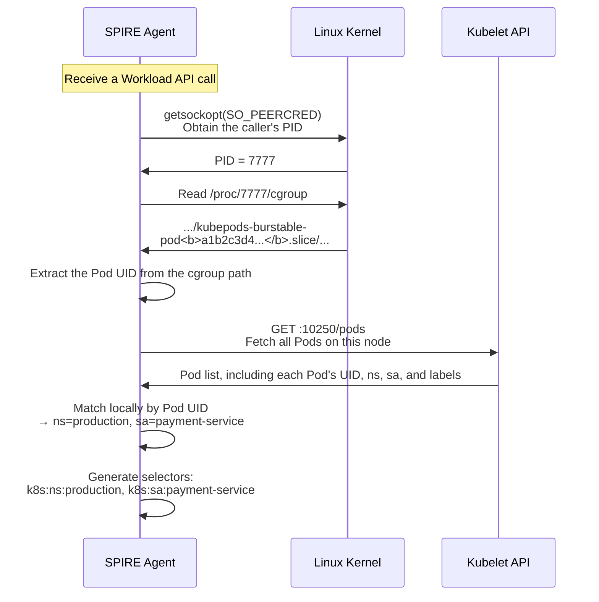

**Mechanism**: The Agent follows cgroup → Pod UID → Kubelet lookup → selectors. This chain relies entirely on information supplied by the kernel and does not inspect the caller's binary, memory, or other application-level characteristics.

---

#### 4.1.2 Attack Path A: Enter an Existing Pod with nsenter

The most direct method after obtaining root is to enter the target Pod's namespaces using `nsenter`, then call the Workload API:

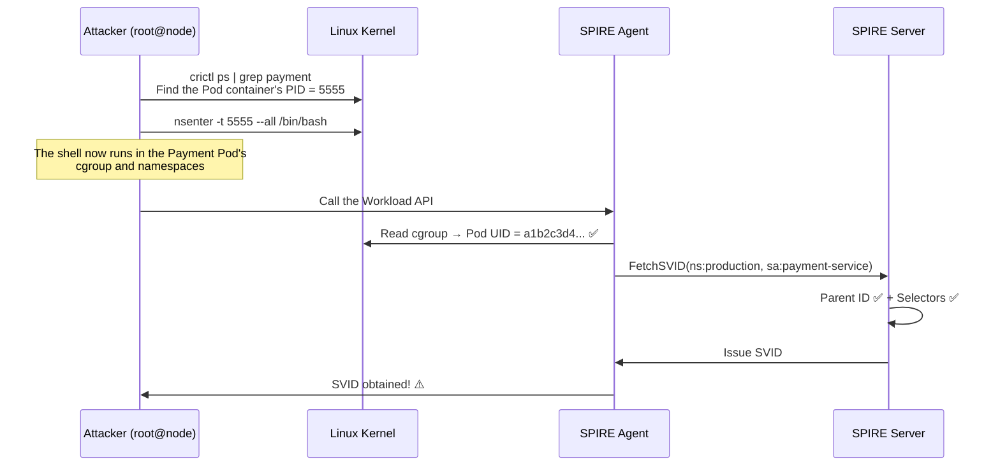

**Why it succeeds**: `nsenter` gives the attacker's process the target Pod's actual cgroup. The kernel reports genuine information to the Agent, which cannot distinguish the original application from an intruder.

---

#### 4.1.3 Attack Path B: Create a New Pod That Matches the Selectors

The previous method enters an existing Pod. Another approach is to **create a new Pod whose namespace and ServiceAccount match the registration entry's selectors**.

```
Registration entry:
  selectors: k8s:ns:production, k8s:sa:payment-service
  → SPIFFE ID: spiffe://acme.com/ns/prod/sa/payment

Attacker's reasoning:
  There is no need to enter the Payment Pod, just create another one!
  → New Pod: ns=production, sa=payment-service
  → The selectors still match
  → Obtain Payment's SPIFFE ID just the same
```

**B1: Create a Static Pod**

Besides managing Pods through the API Server, Kubelet watches a local manifest directory, `/etc/kubernetes/manifests/` by default, and automatically creates the Pods defined there:

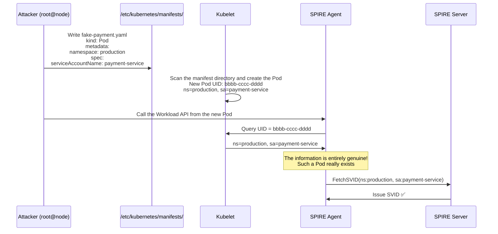

**Kubelet does not verify** whether this Pod should run on this node or whether this ServiceAccount really belongs to the Pod. It accepts the definition as supplied.

**B2: Forge cgroup Membership at a Lower Level**

Without creating a Pod, an attacker can manipulate the Linux cgroup filesystem directly, making the Agent believe the caller belongs to the target Pod:

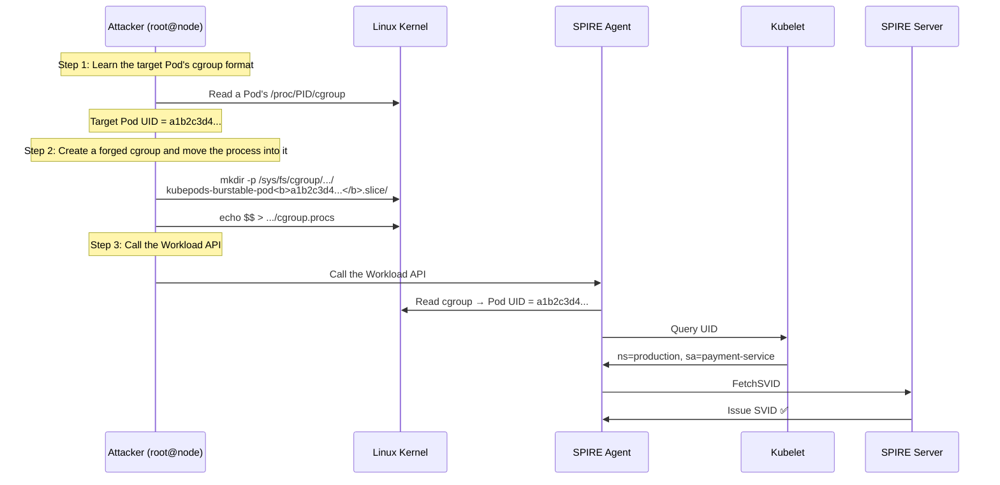

Linux cgroups expose a filesystem interface over which root has full read and write access. An attacker can create arbitrary path structures and move processes into arbitrary cgroups. The Agent trusts what it reads.

---

#### 4.1.4 Comparing the Three Paths: Why SPIRE Cannot Block Them

| Dimension | A: nsenter | B1: Static Pod | B2: Forged cgroup |
|------|-----------|---------------|-----------------|
| **Method** | Enter an existing Pod | Kubelet creates a new Pod that happens to match the selectors | Forge cgroup membership |
| **cgroup check** | Actual Pod's cgroup ✅ | New Pod's actual cgroup ✅ | Forged by the attacker, but accurately reported by the kernel ✅ |
| **Kubelet lookup** | Returns actual Pod information ✅ | Returns new Pod information set by the attacker ✅ | Returns target Pod information ✅ |
| **Selectors** | Actual Pod's namespace/SA ✅ | New Pod's namespace/SA matches ✅ | Target Pod's namespace/SA matches ✅ |
| **Can SPIRE detect it?** | ❌ | ❌ | ❌ |
| **Difficulty** | Low: one `nsenter` command | Medium: requires writing to the manifest directory | Medium: requires knowledge of cgroup formats |
| **Traces** | Few | Many: Kubelet logs | Few: cgroup filesystem |

**What the three paths share**: The attacker uses root access to create a genuine-looking state at the kernel/Kubelet layer. Every step of the Agent's identification chain, cgroup → Pod UID → Kubelet → selectors, receives genuine data, but the source of that data has been compromised.

> **Implication**: SPIRE guarantees a correct mapping between identity attributes and credentials: if a cgroup points to Pod A, it issues Pod A's SVID. It does not guarantee that the process requesting the credential should possess it. The latter is the responsibility of node security, rather than identity infrastructure.

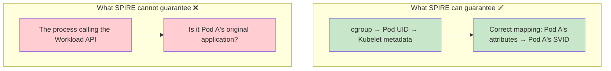

---

#### 4.1.5 Why Is This Not a SPIRE Defect?

The attacker already has root access. Root enables actions **far more serious** than obtaining a forged SVID:
- Read Pod memory directly, dumping process memory to obtain all runtime data
- Intercept Pod network traffic through tcpdump or a man-in-the-middle attack
- Kill the Pod process and listen on its port, taking over the service completely

SVID exposure is **one of many consequences** of a compromised node, rather than the root cause. Expecting SPIRE to prevent node-root compromise is like expecting a door lock to stop a thief from bulldozing the entire wall. These are security problems at different layers.

### 4.2 Boundary Two: The SPIRE Agent Itself Is Compromised

**SPIRE cannot prevent this.** If an attacker compromises the Agent process or the Pod hosting it, they can directly:
- Read the SVID cache in Agent memory.
- Tamper with Workload API responses.
- Use the Agent's SVID to request arbitrary SVIDs from the Server.

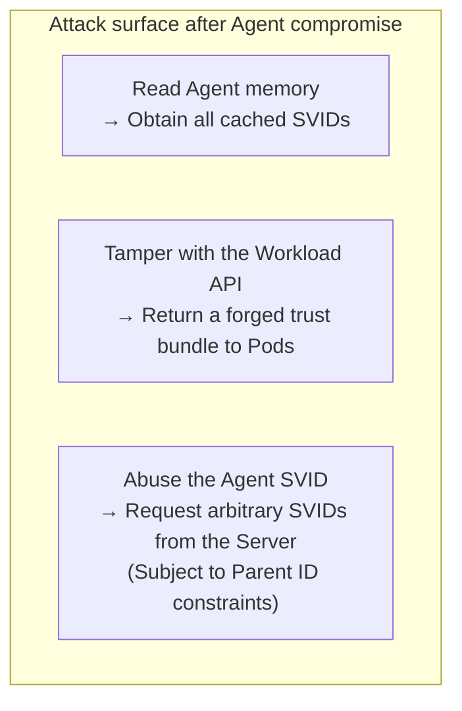

**Mitigation**: Run the Agent with minimum privileges, a dedicated ServiceAccount, and restricted RBAC permissions.

### 4.3 Boundary Three: Kubelet Is Compromised or Spoofed

**SPIRE cannot prevent this.** The Agent's `k8s` Workload Attestor depends on the Kubelet API for Pod information:

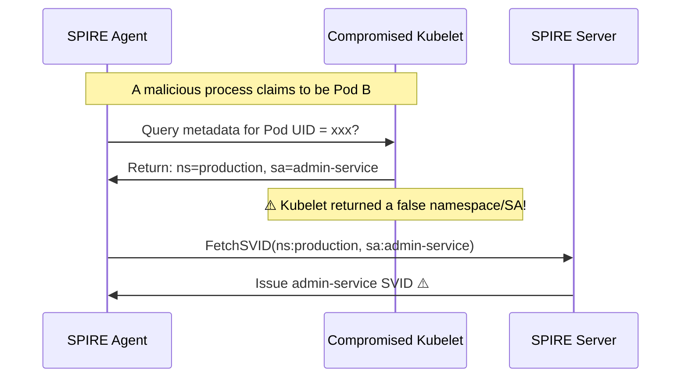

**Why is this a Kubelet problem rather than a SPIRE problem?** SPIRE's Workload Attestor **trusts Kubelet by design**. Kubelet is the Kubernetes node agent. If it is untrustworthy, Pod management for the entire node is already compromised.

**Mitigations**:
- Enable Kubelet certificate verification with `skip_kubelet_verification = false`.
- Use attestation methods such as `k8s_psat` that do not depend on Kubelet.
- Harden nodes to prevent Kubelet tampering.

### 4.4 Boundary Four: The SPIRE Server Is Compromised

**SPIRE absolutely cannot prevent this.** The Server holds the CA private key, so its compromise means the entire trust domain is compromised:

```
After taking control of the Server, an attacker can:
  → Issue SVIDs for arbitrary SPIFFE IDs
  → Modify registration entries to map the attacker's Pod to any SPIFFE ID
  → Replace the trust bundle so all services trust the attacker's forged CA
  → Delete audit logs and destroy evidence
```

**This is the highest-severity security threat** and requires the strongest protection:
- Protect the Server's CA private key with a KMS/HSM.
- Deploy the Server in a dedicated, hardened namespace.
- Strictly control access to the Server's datastore.
- Require auditing and approval for Server operations.

### 4.5 Boundary Five: The Application Has a Vulnerability

**SPIRE cannot prevent this.** If application code has a remote code execution (RCE) vulnerability:

```
The attacker executes code inside the Payment Pod through RCE
  → That code naturally runs in the Payment Pod's cgroup
  → It can call the Workload API without obstruction
  → It obtains a valid SVID for the Payment Pod
  → It accesses all downstream services as the Payment Pod
```

**Is this reasonable?** Yes. The attacker's code really runs inside the Payment Pod and **is** part of that Pod. SPIRE cannot distinguish normal application code from injected malicious code.

**This is the responsibility of application security, rather than identity infrastructure.**

---

## 5. SPIRE's Place in the Overall Security System

### 5.1 A Layered Security Model

SPIRE belongs to **Layer 3: Identity and Access Control**:

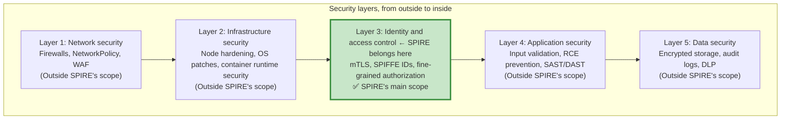

### 5.2 Which Layer's Problems Does SPIRE Address?

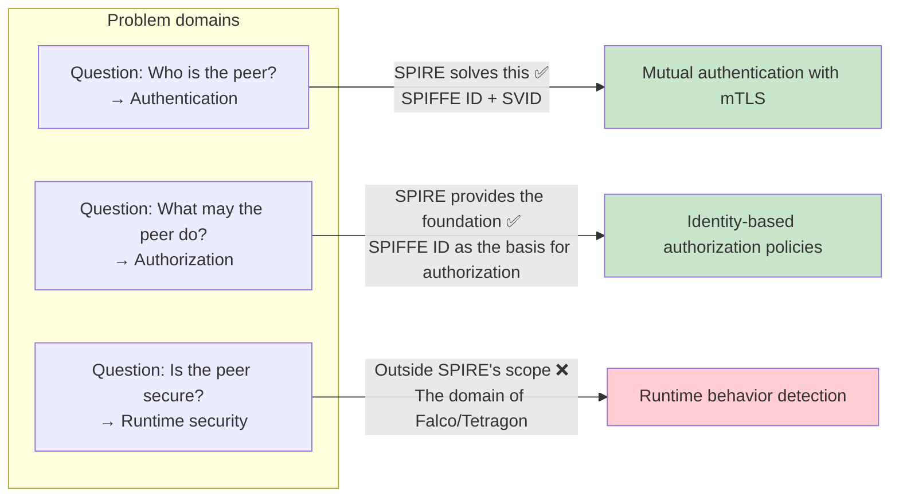

### 5.3 Responsibilities of Each Layer in Different Attacks

```mermaid
graph TB
    subgraph "Attack scenarios and protection layers"
        direction TB

        S1["Scenario: External attacker<br/>Attempts to call an internal API"]
        S1_D["✅ SPIRE can prevent this<br/>No valid SVID → mTLS handshake fails"]

        S2["Scenario: Pod A attempts<br/>To impersonate Pod B"]
        S2_D["✅ SPIRE can prevent this<br/>Different cgroup → Cannot obtain Pod B's SVID"]

        S3["Scenario: Pod in a test cluster<br/>Impersonates a production-cluster Pod"]
        S3_D["✅ SPIRE can prevent this<br/>Parent ID mismatch → Server refuses to sign"]

        S4["Scenario: Attacker gains node root<br/>And enters a Pod's namespaces"]
        S4_D["❌ SPIRE cannot prevent this<br/>→ Infrastructure security is needed<br/>(Node hardening, sandboxed runtimes)"]

        S5["Scenario: Application RCE<br/>Attacker executes code inside a Pod"]
        S5_D["❌ SPIRE cannot prevent this<br/>→ Application security is needed<br/>(Code review, WAF, RASP)"]

        S6["Scenario: SPIRE Server<br/>Is compromised"]
        S6_D["❌ SPIRE cannot prevent this<br/>→ HSM/KMS and access control are needed<br/>The highest protection level for identity infrastructure"]
    end

    style S1_D fill:#c8e6c9
    style S2_D fill:#c8e6c9
    style S3_D fill:#c8e6c9
    style S4_D fill:#fff3e0
    style S5_D fill:#fff3e0
    style S6_D fill:#ffcdd2
```

---

## 6. Building Defense in Depth Around SPIRE

Understanding SPIRE's boundaries calls for **building multiple defensive layers around it**, rather than abandoning it:

### 6.1 Complete Defensive Architecture

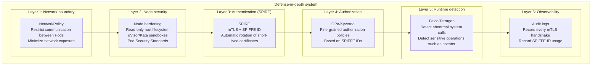

### 6.2 When One Layer Fails, the Next Still Protects

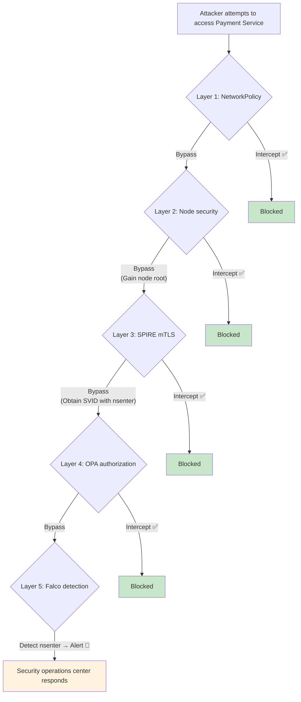

### 6.3 Configuration Example: SPIRE + OPA

**Scenario**: Even if an attacker obtains a Pod's SVID, OPA policies can further restrict what that SVID is permitted to do:

```rego
# OPA policy: allow specific SPIFFE IDs to access only specific APIs
package authz

default allow = false

# Rule 1: Order Service may call Payment's /api/pay
allow {
    input.spiffe_id == "spiffe://acme.com/ns/prod/sa/order"
    input.path == "/api/pay"
    input.method == "POST"
}

# Rule 2: Admin Service may call /api/refund
allow {
    input.spiffe_id == "spiffe://acme.com/ns/prod/sa/admin-panel"
    input.path == "/api/refund"
    input.method == "POST"
}

# Rule 3: The audit service may only GET the ledger
allow {
    input.spiffe_id == "spiffe://acme.com/ns/prod/sa/auditor"
    input.path == "/api/admin/ledger"
    input.method == "GET"
}
```

When Envoy or an API Gateway receives a request:
1. Extract the SPIFFE ID through mTLS.
2. Call OPA for a policy decision.
3. Reject the request if the SPIFFE ID is not on the allowlist, even when the SVID is valid.

### 6.4 Configuration Example: Detect nsenter and cgroup Tampering with Falco

```yaml
# Falco rule 1: detect nsenter, a signal of node compromise
- rule: NSEnter Detected
  desc: "Execution of the nsenter command detected"
  condition: >
    proc.name = "nsenter" and
    container.name != "spire-agent"
  output: >
    ⚠️ nsenter detected!
    user=%user.name command=%proc.cmdline
  priority: CRITICAL

# Falco rule 2: detect writes to the cgroup filesystem
- rule: Cgroup Modification by Non-Kubelet
  desc: "A process other than kubelet/containerd modified the cgroup structure"
  condition: >
    (open_write or create) and
    fd.name startswith "/sys/fs/cgroup/kubepods/" and
    proc.name not in (kubelet, containerd, runc)
  output: >
    ⚠️ Suspicious cgroup write detected!
    user=%user.name file=%fd.name proc=%proc.name
  priority: CRITICAL

# Falco rule 3: detect writes to Static Pod manifest files
- rule: Static Pod Manifest Written
  desc: "A Pod definition was written to the kubelet manifest directory"
  condition: >
    (open_write or create) and
    fd.name startswith "/etc/kubernetes/manifests/"
  output: >
    ⚠️ Static Pod manifest written!
    user=%user.name file=%fd.name
  priority: CRITICAL
```

### 6.5 Kubernetes-Specific Defenses

For the two K8s-specific attack paths, Static Pods and forged cgroups:

```yaml
# 1. Mount the kubelet manifest directory read-only to prevent Static Pods
# Or use a non-standard path and strictly restrict write access
---
# 2. Restrict access to the cgroup filesystem
# PodSecurityStandard: restricted
# Prohibit hostPath mounts of /sys/fs/cgroup
---
# 3. Use a sandboxed runtime to prevent nsenter and cgroup access
# gVisor / Kata Containers
# Inside the sandbox, attackers cannot access host namespaces or the cgroup filesystem
```

When Falco detects an anomaly:
1. Immediately alert the security operations center.
2. Automatically isolate the node with a cordon and taint.
3. Trigger the SVID revocation process.

---

## 7. Summary: Positioning SPIRE Correctly

### 7.1 In One Sentence

> SPIRE implements **the identity layer of a zero-trust architecture**, answering how to establish a peer's identity over an untrusted network. Whether that peer is secure is a question for other security layers.

### 7.2 What SPIRE Can and Cannot Do

| Category | SPIRE Can | SPIRE Cannot |
|------|-----------|-------------|
| **Authentication** | ✅ Provide a cryptographically verifiable SPIFFE ID for each workload | ❌ Verify whether workload application code has been tampered with |
| **Certificate management** | ✅ Automatically issue, rotate, and revoke X.509 and JWT SVIDs | ❌ Manage certificates outside the SPIFFE system |
| **Service-to-service authorization** | ✅ Supply SPIFFE IDs as input to authorization decisions | ❌ Define authorization rules, which is the role of OPA/Kyverno |
| **Node security** | ✅ Verify node membership through node attestation | ❌ Prevent attackers from gaining node root |
| **Pod isolation** | ✅ Distinguish Pods through cgroups | ❌ Prevent privilege escalation between processes within the same Pod |
| **Network protection** | ✅ Provide the certificates needed for mTLS | ❌ Act as a firewall or NetworkPolicy |
| **Runtime security** | ✅ Provide identity context to tools such as Falco | ❌ Detect abnormal behavior, which is the role of Falco/Tetragon |

### 7.3 Complete Architecture Overview

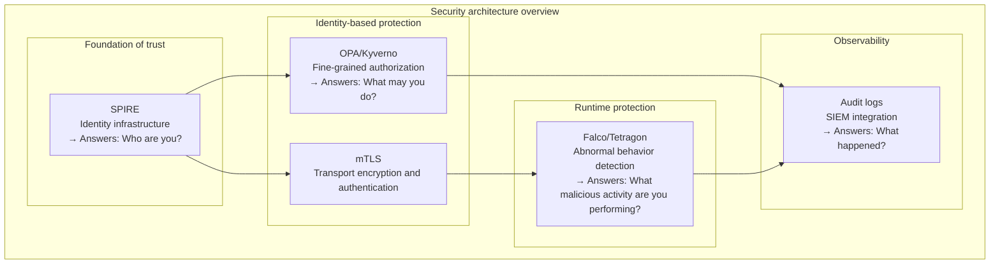

**SPIRE is the foundation of the system, but not the entire system.** Like a house's foundation, its absence causes collapse, yet the foundation alone cannot shelter you from wind and rain. Use SPIRE within a complete defense-in-depth architecture, with each layer fulfilling its own role.

---

## References

- [SPIRE Concepts and Fundamentals](/en/notes/kubernetes/yupcbxxy/)
- [SPIRE Deployment and Workflows in Kubernetes](4.%20spire-in-k8s.md)
- [SPIRE Identities: SPIFFE ID, Parent ID, and Node Alias](3.%20spiffe-id-parent-id-node-alias.md)
- [SPIFFE Security Model](https://spiffe.io/docs/latest/spiffe-about/spiffe-concepts/)
- [NIST SP 800-207: Zero Trust Architecture](https://www.nist.gov/publications/zero-trust-architecture)
