# SPIRE Components, Workflows, and MySQL Tables Explained

Starting from the SPIRE repository, this article reviews its main components and workflows, along with the tables and fields used by SPIRE Server's MySQL/SQL datastore.

## I. Main SPIRE Components

The SPIRE runtime primarily consists of two processes:

- `spire-server`
- `spire-agent`

They have different responsibilities and cooperate to manage SPIFFE identities.

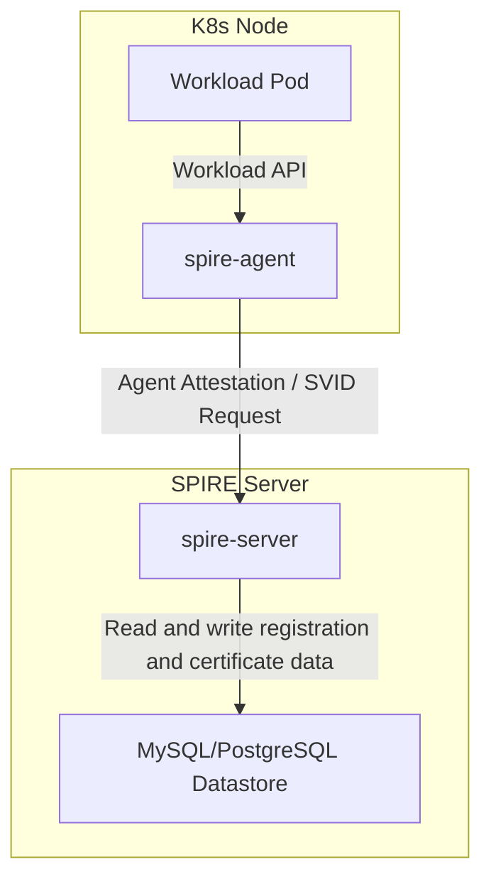

### 1.1 SPIRE Server

SPIRE Server is the central coordinator of a trust domain. It is responsible for:

- Managing registration entries for `SPIFFE IDs`
- Managing the `trust bundle` and CAs
- Providing attestation and SVID issuance
- Maintaining persistent data in the SQL datastore
- Enforcing authorization policies, handling registration-entry events, rotating CAs, and related tasks

The Server depends on these main submodules:

- `pkg/server/datastore` / `pkg/server/datastore/sqlstore`
- `pkg/server/ca`
- `pkg/server/registration`
- `pkg/server/bundle`
- `pkg/server/authpolicy`
- `pkg/server/endpoints`

### 1.2 SPIRE Agent

SPIRE Agent is deployed on each node to:

- Perform node attestation
- Obtain an Agent SVID from SPIRE Server
- Expose a local Workload API through which Pods obtain SVIDs and trust bundles
- Manage the local SVID cache and automatic rotation

Main Agent submodules:

- `pkg/agent/attestor/node`
- `pkg/agent/attestor/workload`
- `pkg/agent/manager`
- `pkg/agent/endpoints`
- `pkg/agent/storage`

### 1.3 What Does Controller Manager Mean in SPIRE?

The SPIRE repository does not contain a separate `spire-controller-manager` process.

Here, controller manager refers primarily to a **caller identity type**, defined by the `cluster_controller_manager` policy in `pkg/server/authpolicy/policy.rego`.

It means:

- Use a special SPIFFE ID as the caller
- Allow that caller to access, create, and update entries within its managed cluster UUID
- Enforce constraints on `hint`, `parent_id`, `entry.id`, and other fields to prevent cross-cluster operations

It is therefore a controlled caller category within SPIRE Server, rather than a standalone component.

## II. Main SPIRE Workflows

### 2.1 SPIRE Server Startup and Datastore Initialization

SPIRE Server startup proceeds as follows:

1. Read configuration and logging/metrics settings
2. Initialize the plugin catalog and discover its plugins
3. Initialize the database connection and check the schema
4. Load or create CA/JWT authorities
5. Load the trust bundle and read or write the `bundles` table
6. Initialize registration management, bundle management, authorization policies, and endpoint services
7. Start gRPC/HTTP listeners and wait for Agent and client requests

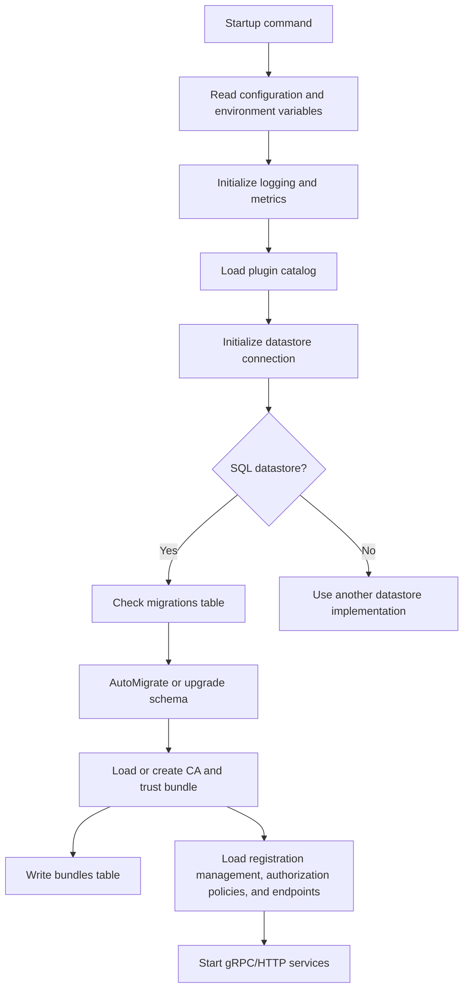

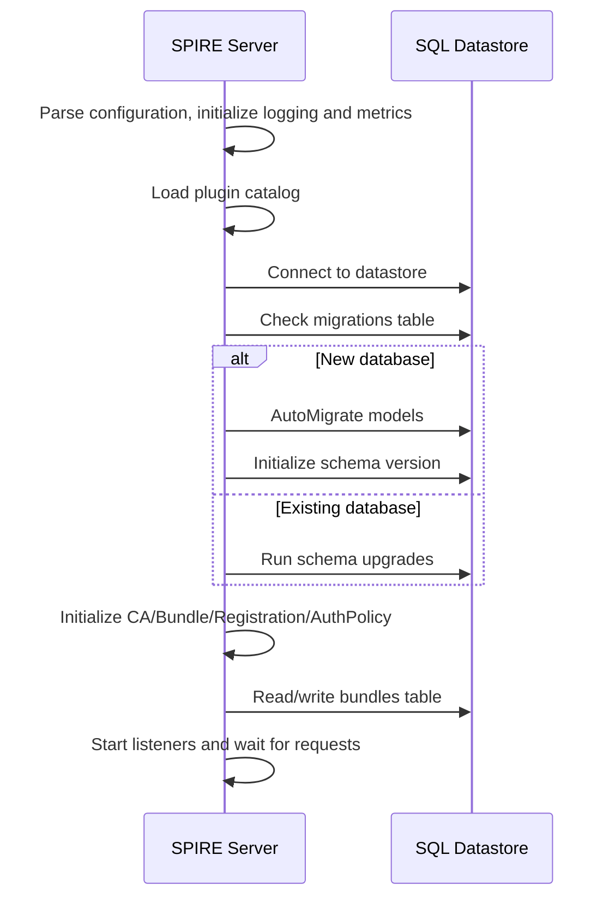

### 2.2 SPIRE Agent Startup and Node Attestation

SPIRE Agent startup proceeds as follows:

1. Read configuration and local directory settings
2. Initialize the local plugin catalog
3. Initialize local storage and cache directories
4. Start the Workload API and local socket
5. Perform node attestation: assemble node identity information and send it to the Server
6. Receive the Agent SVID and trust bundle
7. Cache the SVID and start periodic renewal
8. Wait for SVID requests from local workloads

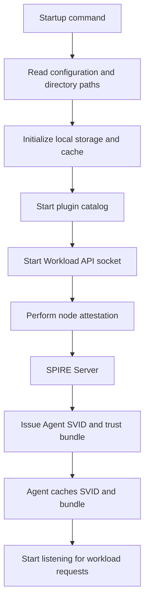

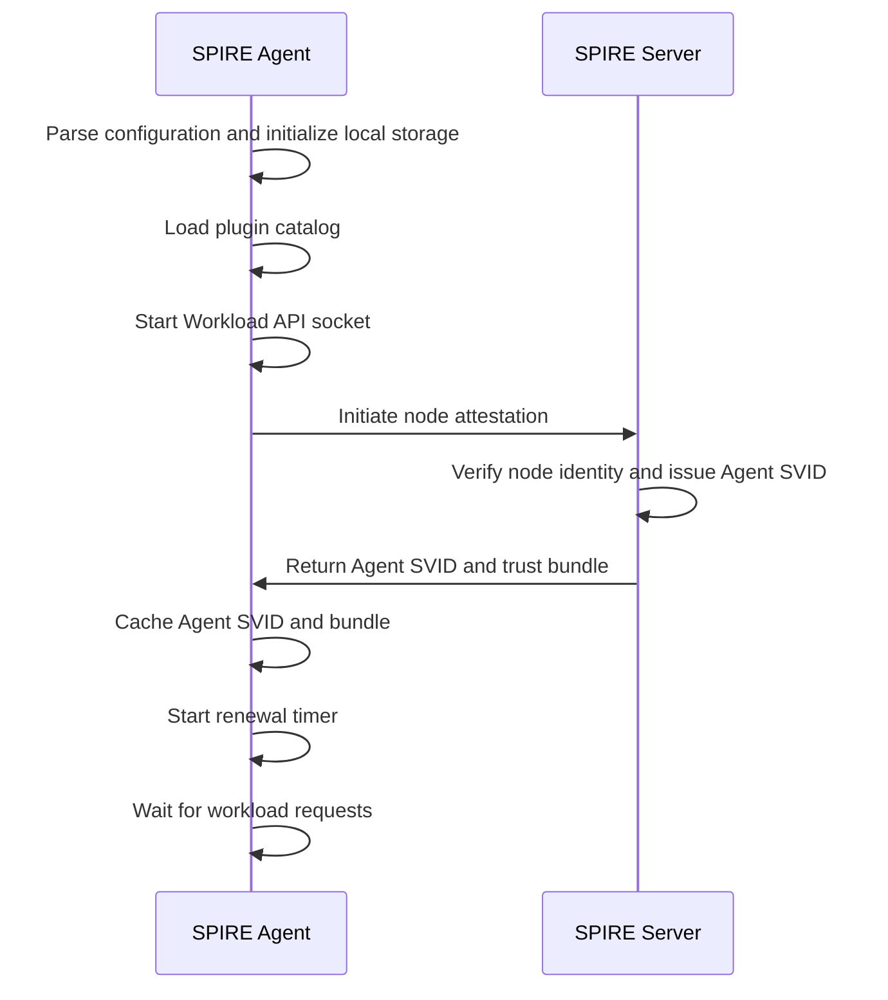

### 2.3 The Complete Workload SVID Acquisition Flow

When the Agent starts, it:

1. Reads local configuration
2. Creates local directories and storage
3. Starts the plugin catalog
4. Performs node attestation
5. Exposes local identity services through the Workload API

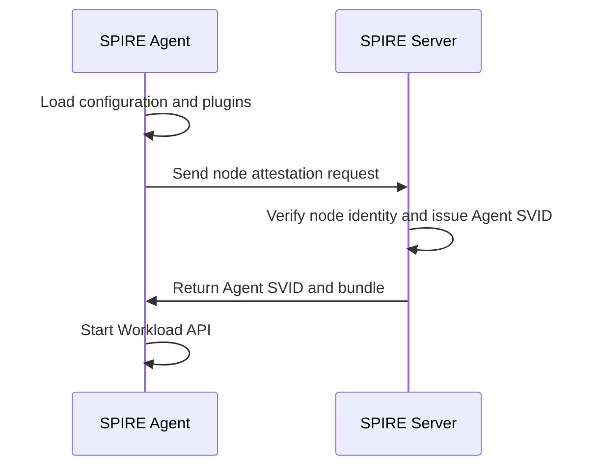

### 2.3 The Complete Workload SVID Acquisition Flow

This leads to one of SPIRE's main use cases: how a Pod obtains its identity.

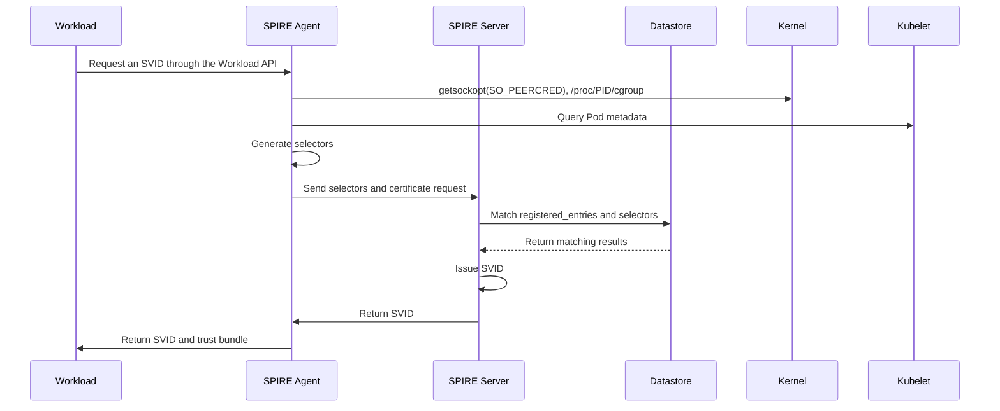

## III. SPIRE Server MySQL Tables

SPIRE Server's SQL datastore implementation is in `pkg/server/datastore/sqlstore`. GORM structs define the data models, and AutoMigrate creates the database tables.

### 3.1 Main Tables and Their Uses

#### 3.1.1 `bundles`
Purpose: store trust-domain trust bundles.

Fields:

- `id`
- `created_at`
- `updated_at`
- `trust_domain` `UNIQUE`
- `data`（MEDIUMBLOB）

Notes:

- Bundles contain CA certificate data
- Federation relationships with `registered_entries` are recorded through `federated_registration_entries`

Creation and usage:

- Trust bundles are generally generated during SPIRE Server initialization or when bundle-management plugins load.
- The Server constructs bundle data from configured CA roots, active X.509 authorities, or built-in bundle plugins.
- The generated bundle is written to `bundles` and used by the Server for SVID validation, signature verification, and distributing trust roots to Agents.
- SPIRE Agent retrieves and caches the bundle during startup or Server communication, then returns it to local workloads in Workload API responses.
- Workloads use the trust bundle to verify peer SVID signatures and establish SPIFFE-based mTLS trust chains.

#### 3.1.2 `attested_node_entries`
Purpose: store information about attested nodes (SPIRE Agents).

Fields:

- `id`
- `created_at`
- `updated_at`
- `spiffe_id` `UNIQUE`
- `data_type`
- `serial_number`
- `expires_at` `INDEX`
- `new_serial_number`
- `new_expires_at`
- `can_reattest`

Notes:

- Records node identities after Agent attestation
- Stores information about current and renewal certificates

#### 3.1.3 `attested_node_entries_events`
Purpose: record node events.

Fields:

- `id`
- `created_at`
- `updated_at`
- `spiffe_id`

Notes:

- Typically supports event-driven cache synchronization and iteration over node-related events

#### 3.1.4 `node_resolver_map_entries`
Purpose: store selectors generated by Node Attestors.

Fields:

- `id`
- `created_at`
- `updated_at`
- `spiffe_id`
- `type`
- `value`

Notes:

- Each selector maps to a node SPIFFE ID
- The Server consults this table to assist matching when querying node attributes

#### 3.1.5 `registered_entries`
Purpose: store SPIRE registration entries.

Fields:

- `id`
- `created_at`
- `updated_at`
- `entry_id` `UNIQUE`
- `spiffe_id` `INDEX`
- `parent_id` `INDEX`
- `ttl`
- `admin`
- `downstream`
- `expiry` `INDEX`
- `revision_number`
- `store_svid`
- `hint` `INDEX`
- `jwt_svid_ttl`

Notes:

- SPIRE's main registration table
- Each entry defines matching rules for a SPIFFE identity
- `parent_id` determines which Agent or class of Agents may request the entry

#### 3.1.6 `selectors`
Purpose: store selectors for registration entries.

Fields:

- `id`
- `created_at`
- `updated_at`
- `registered_entry_id`
- `type`
- `value`

Notes:

- Each registration entry has multiple selectors
- Selectors define workload-matching conditions

#### 3.1.7 `dns_names`
Purpose: store DNS names for entries.

Fields:

- `id`
- `created_at`
- `updated_at`
- `registered_entry_id`
- `value`

Notes:

- Used for entry-related DNS configuration

#### 3.1.8 `federated_trust_domains`
Purpose: store federated trust-domain configuration.

Fields:

- `id`
- `created_at`
- `updated_at`
- `trust_domain` `UNIQUE`
- `bundle_endpoint_url`
- `bundle_endpoint_profile`
- `endpoint_spiffeid`
- `implicit`

Notes:

- Stores details of federation with other trust domains

#### 3.1.9 `ca_journals`
Purpose: store CA rotation history and current CA metadata.

Fields:

- `id`
- `created_at`
- `updated_at`
- `data`（MEDIUMBLOB）
- `active_x509_authority_id` `INDEX`
- `active_jwt_authority_id` `INDEX`

Notes:

- Used for CA management and rotation
- `data` contains information about current and prepared CAs

#### 3.1.10 `join_tokens`
Purpose: store join tokens for nodes joining at startup.

Fields:

- `id`
- `created_at`
- `updated_at`
- `token` `UNIQUE`
- `expiry`

Notes:

- Stores temporary credentials used by nodes joining SPIRE Server

#### 3.1.11 `registered_entries_events`
Purpose: record registration-entry events.

Fields:

- `id`
- `created_at`
- `updated_at`
- `entry_id`

Notes:

- Records entry creation, modification, and deletion for incremental synchronization or event notifications

#### 3.1.12 `migrations`
Purpose: record schema and code versions.

Fields:

- `id`
- `created_at`
- `updated_at`
- `version`
- `code_version`

Notes:

- Managed by `pkg/server/datastore/sqlstore/migration.go`
- Used to determine whether the database needs upgrading

### 3.2 Relationships Between Tables

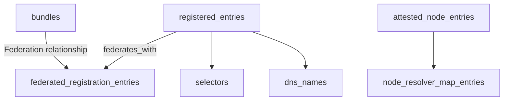

### 3.3 Main Write Paths

#### 3.3.1 Node Attestation Writes

- `attested_node_entries`
- `node_resolver_map_entries`
- `attested_node_entries_events`

These writes occur during Agent attestation through Server interfaces such as `CreateAttestedNode` and `SetNodeSelectors`.

#### 3.3.2 Registration Entry Writes

- `registered_entries`
- `selectors`
- `dns_names`
- `federated_registration_entries`
- `registered_entries_events`

These writes occur during `spire-server entry create/update/delete` or API changes.

#### 3.3.3 Bundle Writes

- `bundles`
- `federated_registration_entries`

These writes occur when bundles are set, appended, or deleted.

#### 3.3.4 CA Rotation Writes

- `ca_journals`

These writes occur during SPIRE Server CA rotation and history recording.

#### 3.3.5 Join Token Writes

- `join_tokens`

These writes temporarily allow nodes to join; tokens are read during node startup.

## IV. SPIRE Components and SQL Data Flow

### 4.1 A Typical Workload SVID Request Path

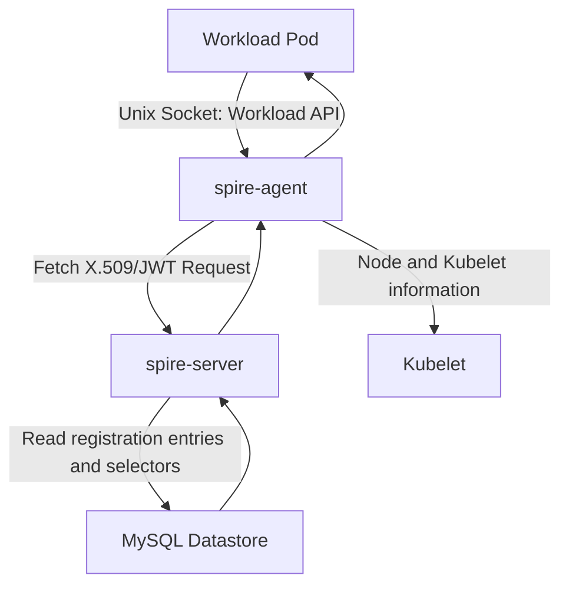

### 4.2 Node Attestation and Registration Writes

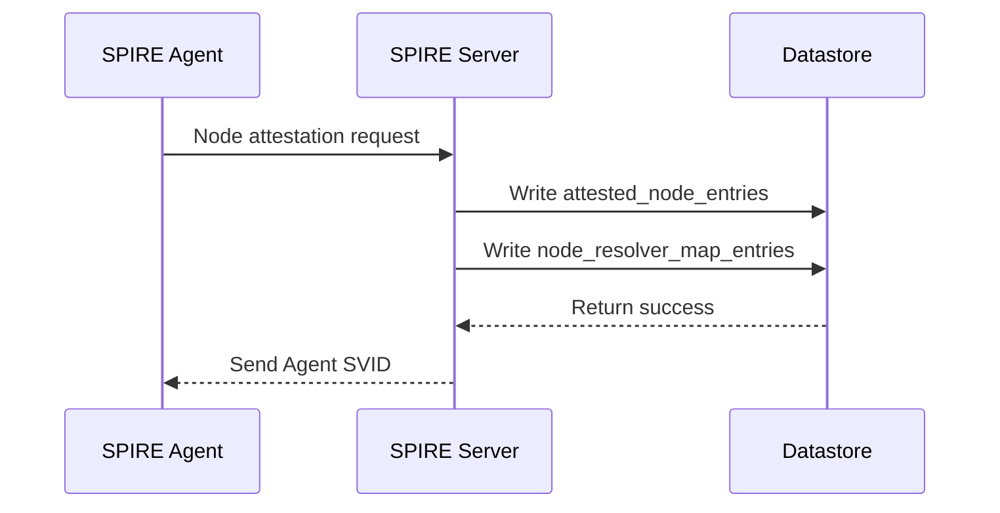

### 4.3 Registration Entry Creation

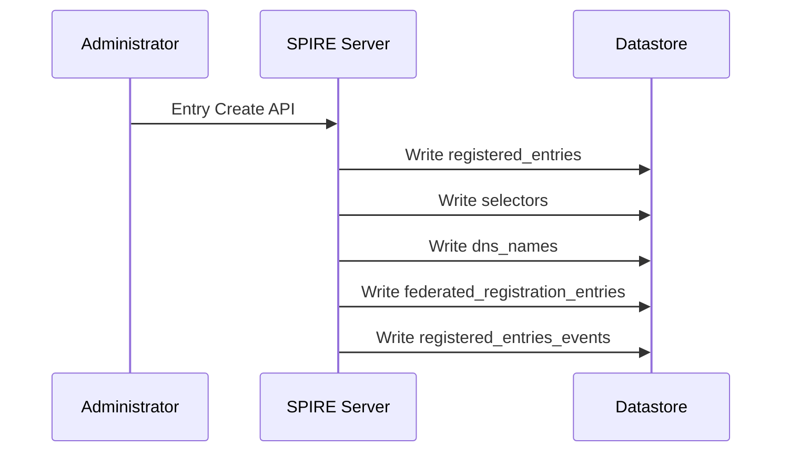

## V. The Controller Manager Permission Model in SPIRE Server

SPIRE Server's `authpolicy` module imposes specific restrictions on a caller category:

- Its SPIFFE ID follows `spiffe://<trust-domain>/cluster_controller_manager/cluster/<uuid>`
- It can access only registration entries belonging to that cluster UUID
- Its requests must include `hint = controller-manager-<uuid>`

This shows that SPIRE access control depends on both identity and the caller's semantic role.

## VI. Summary

SPIRE is more than a certificate issuer: it is distributed identity infrastructure composed of `spire-server` and `spire-agent`.

- `spire-server` centrally manages registration entries, bundles, CAs, authorization policies, and SQL tables
- `spire-agent` handles node-local identity brokering, the Workload API, and certificate rotation
- `controller manager` is a controlled caller identity category within SPIRE Server, not a separate process
- The main SQL datastore tables include:
  - `bundles`
  - `attested_node_entries`
  - `node_resolver_map_entries`
  - `registered_entries`
  - `selectors`
  - `dns_names`
  - `federated_trust_domains`
  - `ca_journals`
  - `join_tokens`
  - `registered_entries_events`
  - `migrations`

This article provides an end-to-end view from components to the data layer, helping explain how SPIRE operates in production.

---

## References

- SPIRE source directory: `pkg/server/datastore/sqlstore`
- Node Attestation：`pkg/agent/attestor/node`
- Workload Attestor：`pkg/agent/attestor/workload`
- Server authorization policy: `pkg/server/authpolicy/policy.rego`
