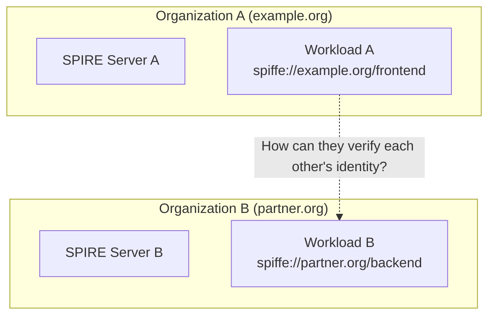
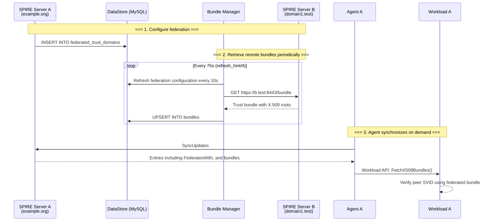
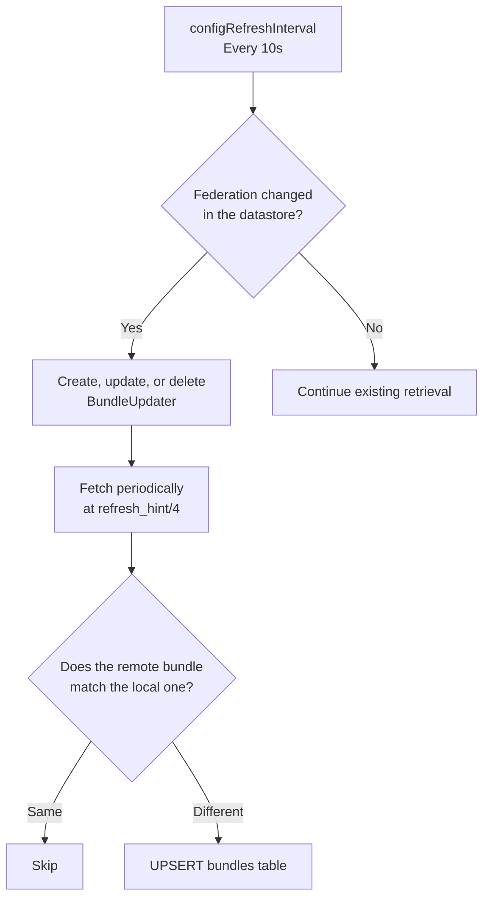
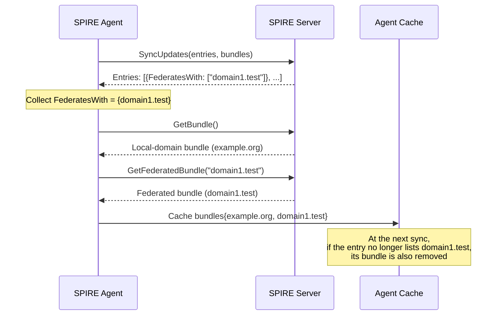
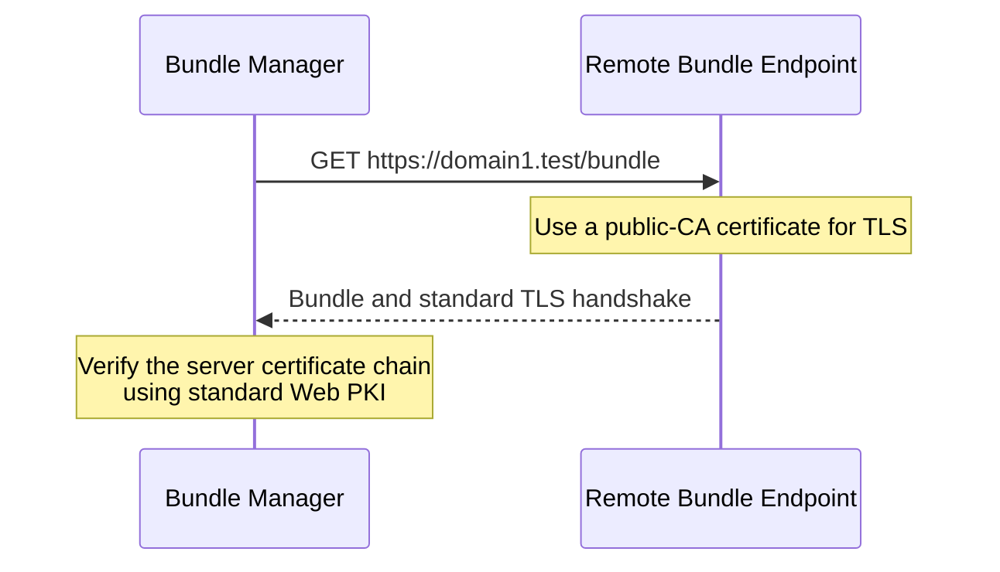
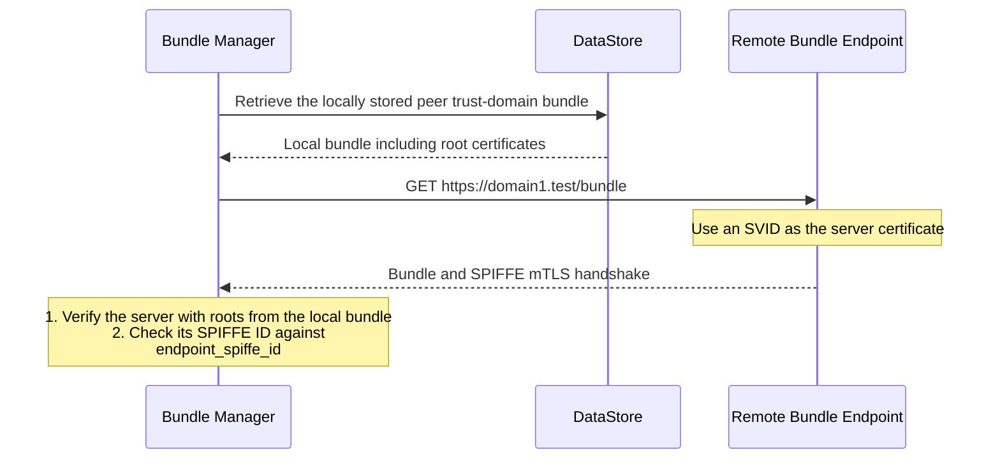
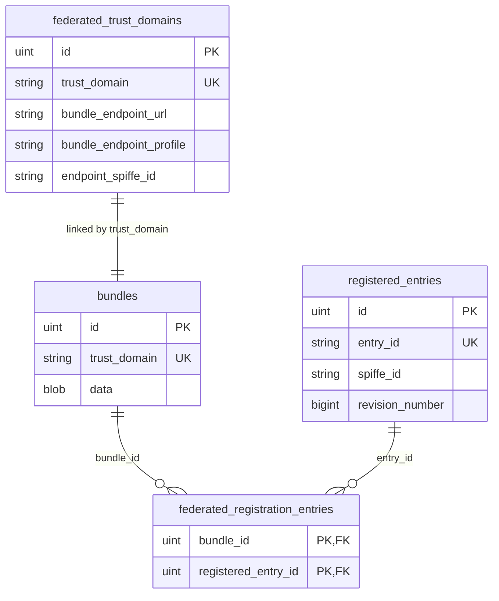
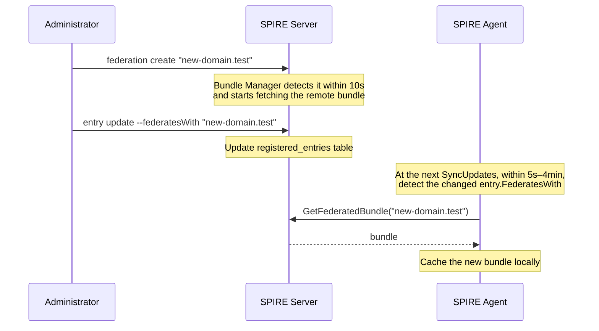

# SPIRE Federation in Depth

## I. Background: Why Federation?

Earlier articles discussed SPIRE trust domains: workloads in one domain share a root certificate and are managed by the same SPIRE Server. Production environments, however, often contain **multiple independent trust domains**:



**Federation** provides authentication across trust domains. It allows `spiffe://example.org/frontend` to verify and trust an identity such as `spiffe://partner.org/backend`.

Federation works by **extending trust chains**: each trust domain exposes its root certificates, or trust bundle, through a standard SPIFFE Bundle Endpoint. Other domains retrieve and cache that bundle periodically, enabling cross-domain authentication.

---

## II. Overall Architecture



The flow consists of three steps:

1. **Configure federation on the Server**: Tell SPIRE how to obtain the bundle for domain1.test
2. **Bundle Manager retrieves it periodically**: Fetch the remote Bundle Endpoint and store the bundle in the datastore
3. **Agents synchronize on demand**: Workload registration entries determine which federated bundles to retrieve

---

## III. Configuration Methods

SPIRE supports **static configuration** in the Server configuration file and a **dynamic API**, the Trust Domain API, for configuring federation.

### 3.1 Static Configuration (server_full.conf)

```hcl
server {
    federation {
        # Optional: expose this Server as a Bundle Endpoint
        bundle_endpoint {
            address = "0.0.0.0"
            port = 8443
            refresh_hint = "5m"
            profile "https_web" {
                acme {
                    domain_name = "example.org"
                    email = "admin@example.org"
                }
            }
        }

        # Configure external trust domains to federate with
        federates_with "domain1.test" {
            bundle_endpoint_url = "https://b.test:8443"
            bundle_endpoint_profile "https_spiffe" {
                endpoint_spiffe_id = "spiffe://domain1.test/spire/server"
            }
        }
        federates_with "domain2.test" {
            bundle_endpoint_url = "https://c.test:8443"
            bundle_endpoint_profile "https_web" {}
        }
    }
}
```

### 3.2 Dynamic API (Recommended)

```bash
# Create a federation relationship
spire-server federation create \
    -trustDomain "domain1.test" \
    -bundleEndpointURL "https://b.test:8443" \
    -bundleEndpointProfile "https_spiffe" \
    -endpointSPIFFEID "spiffe://domain1.test/spire/server"

# List all federation relationships
spire-server federation list

# Manually refresh the bundle for a particular domain
spire-server federation refresh -trustDomain "domain1.test"
```

### 3.3 Comparing the Two Profiles

| Profile | Verification | Use Case |
|---------|---------|---------|
| `https_web` | Standard TLS (Web PKI) | The peer uses a certificate issued by a public CA |
| `https_spiffe` | SPIFFE mTLS, verifying the peer's SPIFFE ID | The peer is SPIFFE-compatible; its bundle must already be available locally at runtime |

> **Note**: Static configuration **overrides** dynamic configuration with the same name, and static relationships do not appear in `federation list`. Use the API when dynamic management is needed.

---

## IV. How It Works

### 4.1 Bundle Manager: The Server's Periodic Fetcher

Bundle Manager is a background Server component implemented in `pkg/server/bundle/client/manager.go`:

```go
const (
    // Reload federation configuration every 10 seconds
    configRefreshInterval = time.Second * 10

    // Default refresh interval when the remote endpoint provides no refresh_hint
    defaultRefreshInterval = time.Minute * 5
)
```

Its behavior:

1. Reload `federated_trust_domains` from the datastore **every 10 seconds** to discover added or removed relationships
2. Create a `BundleUpdater` for each relationship and an HTTP client appropriate to its profile
3. **Fetch remote bundles periodically**, at `refresh_hint / 4`; the default refresh hint is five minutes, giving a 75-second fetch interval
4. Skip storage when the local bundle already exists and matches the remote one according to `bundle.Equal()`
5. If the bundle differs or is new, store it in protobuf format in `bundles`



### 4.2 Agent Synchronization: Fetching on Demand

Agents **require no federation configuration**. They automatically discover the federated bundles they need from the `FederatesWith` fields of registration entries.

Simplified synchronization logic from `pkg/agent/client/client.go`:

```go
func (c *client) SyncUpdates(ctx context.Context,
    cachedEntries map[string]*common.RegistrationEntry,
    cachedBundles map[string]*common.Bundle) (SyncStats, error) {

    // Step 1: Collect FederatesWith from all entries
    federatedTrustDomains := make(stringSet)
    for _, entry := range cachedEntries {
        for _, federatesWith := range entry.FederatesWith {
            federatedTrustDomains.Add(federatesWith)
        }
    }

    // Step 2: Fetch local-domain and federated bundles concurrently
    protoBundles, err := c.fetchBundles(ctx, federatedTrustDomains.Sorted())

    // Step 3: Update the cache, removing old federated bundles absent from the new list
    for k := range cachedBundles {
        delete(cachedBundles, k)
    }
    for _, b := range protoBundles {
        cachedBundles[bundle.TrustDomainId] = bundle
    }
}
```



Federated bundles are **fetched concurrently** using `fetchFederatedBundlesConcurrently`, preventing synchronization timeouts when many federation relationships exist:

```go
// pkg/agent/client/client.go
const maxBundleWorkers = 4  // Maximum concurrent workers

func (c *client) fetchFederatedBundlesConcurrently(...) {
    jobCh := make(chan string)
    // Start the worker pool
    for range min(maxBundleWorkers, len(trustDomains)) {
        wg.Go(func() {
            for trustDomain := range jobCh {
                bundle, err := c.fetchFederatedBundle(ctx, bundleClient, trustDomain)
                resultCh <- fetchBundleResult{bundle: bundle, err: err}
            }
        })
    }
    // Feed in all trust domains to fetch
    for _, b := range trustDomains {
        jobCh <- b
    }
}
```

### 4.3 Handshakes for the Two Profiles

**https_web mode (Web PKI):**



**https_spiffe mode (SPIFFE mTLS):**



> **Requirement**: `https_spiffe` needs the peer trust domain's bundle to exist locally first, creating a bootstrap dependency. Supply an initial bundle through `-bundle` when creating the federation relationship, or have administrators exchange initial root certificates manually.

---

## V. MySQL Tables Involved

### 5.1 `federated_trust_domains`: Federation Relationships

```sql
CREATE TABLE `federated_trust_domains` (
    `id`                      INTEGER PRIMARY KEY AUTO_INCREMENT,
    `created_at`              DATETIME,
    `updated_at`              DATETIME,
    `trust_domain`            VARCHAR(255) NOT NULL,
    `bundle_endpoint_url`     VARCHAR(255),
    `bundle_endpoint_profile` VARCHAR(255),    -- 'https_web' or 'https_spiffe'
    `endpoint_spiffe_id`      VARCHAR(255),    -- Peer SPIFFE ID for https_spiffe
    `implicit`                BOOL,
    UNIQUE INDEX `uix_federated_trust_domains_trust_domain` (`trust_domain`)
);
```

Stores federation configuration. Bundle Manager reads this table every 10 seconds to discover added or removed relationships.

### 5.2 `bundles`: Trust Bundles

```sql
CREATE TABLE `bundles` (
    `id`            INTEGER PRIMARY KEY AUTO_INCREMENT,
    `created_at`    DATETIME,
    `updated_at`    DATETIME,
    `trust_domain`  VARCHAR(255) NOT NULL,
    `data`          MEDIUMBLOB,            -- Protobuf-serialized common.Bundle
    UNIQUE INDEX `uix_bundles_trust_domain` (`trust_domain`)
);
```

**The local-domain bundle and all federated bundles share this table**, distinguished by `trust_domain`. The `data` field holds the binary serialization of a `common.Bundle` protobuf message, including X.509 root certificates and JWT signing public keys.

### 5.3 `federated_registration_entries`: Federation Associations

```sql
CREATE TABLE `federated_registration_entries` (
    `bundle_id`            INTEGER,
    `registered_entry_id`  INTEGER,
    PRIMARY KEY (`bundle_id`, `registered_entry_id`)
);
```

A many-to-many association table linking `bundles` and `registered_entries`. It records which workloads (entries) need which federated domains' trust bundles.

### 5.4 Table Relationships



---

## VI. What Do Agents and Workloads Need to Do?

### 6.1 Agents: No Configuration

The Agent configuration file, `conf/agent/agent_full.conf`, has **no federation configuration settings**. Agents discover required federated bundles entirely through entry `FederatesWith` fields.

### 6.2 Workloads: Declare Federation in Their Entries

Each workload that needs to communicate with another trust domain must explicitly declare `federates_with` in its registration entry:

```bash
# Specify federation when creating an entry
spire-server entry create \
    -spiffeID spiffe://example.org/my-workload \
    -parentID spiffe://example.org/my-agent \
    -selector unix:uid:1000 \
    -federatesWith "domain1.test"

# Update existing entries when federation is added later
spire-server entry update \
    -entryID "entry-id" \
    -federatesWith "domain1.test"
```

In Kubernetes, using k8s-workload-registrar:

```yaml
apiVersion: v1
kind: Pod
metadata:
  name: my-workload
  annotations:
    spire.spiffe.io/federates_with: "domain1.test,domain2.test"
```

### 6.3 What If Federation Is Configured Later?

If the federation relationship is **added later**, the complete workflow is:



---

## VII. Why Does Server Configuration Not Enable Federation Globally?

A common question is: **Why not have Agents automatically retrieve every federated bundle for their trust domain once federation is configured on the Server, avoiding configuration on each entry?**

The answer is SPIRE's **principle of least privilege**.

### 7.1 Three-Layer Security Model

| Layer | Configuration | Meaning |
|------|---------|------|
| **Server** | `federation.federates_with` | I know **how to retrieve** this domain's bundle |
| **Entry** | `RegistrationEntry.FederatesWith` | **This particular workload** is authorized to communicate with these domains |
| **Agent** | Automatically aggregate `FederatesWith` across entries | My workloads need these bundles, so I retrieve them |

### 7.2 Security Scenarios

One Agent node may host workloads with different roles:

```
Agent (node1)
├── Workload A (frontend)    → FederatesWith: ["partner.test"]   ← Federation needed
├── Workload B (backend)     → FederatesWith: ["database.test"]  ← Federation needed
└── Workload C (internal)    → FederatesWith: []                  ← Internal only; none needed
```

If an Agent retrieves every federated bundle configured on the Server:
- `Workload C`, an internal-only service, receives the root certificates for `partner.test`
- The internal service has no reason to trust that external domain, so this unnecessarily exposes trust material
- If `Workload C` is compromised, the attacker gains additional trust anchors, expanding the attack surface

### 7.3 Verification in the Tests

SPIRE tests in `client_test.go` verify entry-driven fetching precisely:

```go
// Scenario: no FederatesWith on the entry, so the Agent does not cache the federated bundle
tc.entryServer.entries = []*types.Entry{{
    Id: "0", /* No FederatesWith */
}}
syncUpdates()
// Result: only the local-domain bundle is present; domain1.test is absent
// cachedBundles = {"spiffe://example.org": ...}

// Scenario: add FederatesWith and the bundle is cached immediately
tc.entryServer.entries[0].FederatesWith = []string{"domain1.test"}
syncUpdates()
// cachedBundles = {"spiffe://example.org": ..., "spiffe://domain1.test": ...}

// Scenario: remove FederatesWith and the bundle is removed too
tc.entryServer.entries[0].FederatesWith = []string{"domain2.test"}
syncUpdates()
// The domain1.test bundle is removed; domain2.test appears
```

SPIRE's principle is that **every grant of trust must be a deliberate security decision**, not a side effect of configuration. Requiring an explicit declaration is safer than federating everything once a relationship is configured.

---

## VIII. Important Parameters

| Parameter | Default | Description |
|------|--------|------|
| `configRefreshInterval` | 10 seconds | How often Bundle Manager reloads federation configuration |
| `refresh_hint` | 5 minutes | Refresh interval suggested by the Bundle Endpoint |
| Actual fetch interval | `refresh_hint / 4` (75 seconds) | Fetch interval for each federated domain |
| `defaultSyncInterval` | 5 seconds | Initial Agent synchronization interval |
| `maxSVIDSyncInterval` | 4 minutes | Maximum Agent synchronization interval when SVIDs exist |
| `synchronizeMaxInterval` | 8 minutes | Maximum synchronization backoff |
| `maxBundleWorkers` | 4 | Maximum concurrency for Agent federated-bundle retrieval |

---

## IX. Compatibility Guarantees

SPIRE applies strict version-compatibility guarantees to federation:

- **Server version skew**: Servers in one cluster must remain within one minor version of each other
- **Agent–Server skew**: Agents may be at most one minor version older than the Server and must never be newer
- **Upgrade path**: Upgrade only one minor version at a time, with Servers upgraded before Agents
- **Plugin compatibility**: Breaking changes must retain backward compatibility for one version and log a deprecation warning

---

## X. Summary

SPIRE federation provides authentication across trust domains through these mechanisms:

1. **The Server configures how to retrieve bundles** by specifying the remote Bundle Endpoint connection
2. **Bundle Manager retrieves bundles periodically**, fetching the latest remote bundle every 75 seconds
3. **Agents fetch on demand**, retrieving only federated bundles declared by their workloads' entries
4. **Workloads use federation transparently**, obtaining the trust material they need through the standard Workload API
5. **Least privilege is enforced** through entry-level `FederatesWith`, preventing accidental expansion of trust boundaries

This balances security and usability. Although configuration takes more effort, it provides precise control over trust boundaries, a central requirement of a zero-trust security model.
