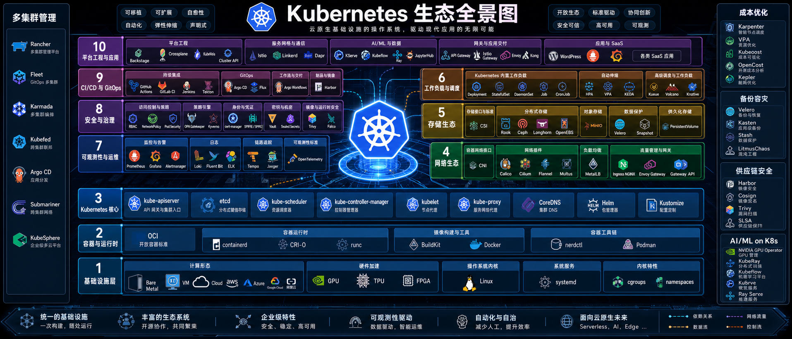

Notes on Kubernetes fundamentals, cluster networking, extensions, and workload identity. Start with the topics below, or browse the complete collection in the sidebar.

- [Local clusters with kind](/en/notes/kubernetes/rwl9lg2c/)
- [How Services work](/en/notes/kubernetes/hreo17tb/)
- [What containers really are](/en/notes/kubernetes/4iyz7vyg/)
- [Calico architecture and usage](/en/notes/kubernetes/ayl6l9u6/)
- [Multi-cluster management with Karmada](/en/notes/kubernetes/karmada/)
- [SPIRE concepts and fundamentals](/en/notes/kubernetes/yupcbxxy/)

Most notes were created with AI assistance to organize ideas, collect references, and support later lookup. They may contain omissions or errors; check the official documentation or your actual environment before relying on them.
