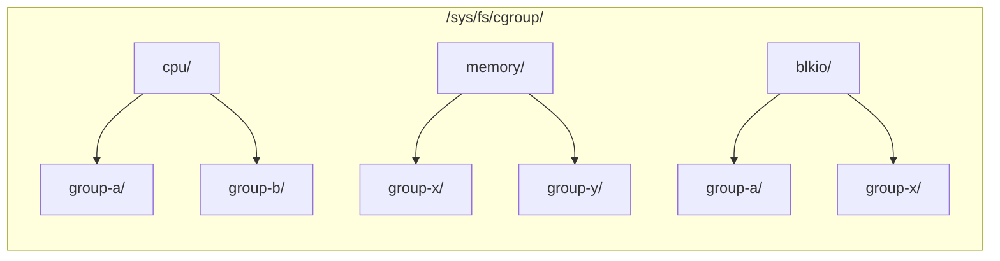

# cgroup v1 Explained

> This article complements [cgroup v2 Explained](/en/notes/linux/cgroup/). Modern distributions such as Ubuntu 22.04+, Debian 11+, and RHEL 9+ use cgroup v2 by default, so you can start with the v2 article. This article is for readers maintaining existing cgroup v1 environments or learning the differences between v1 and v2.

## The Architecture of cgroup v1

The defining architectural characteristic of cgroup v1 is that **each resource controller (subsystem) maintains its own independent hierarchy**.



This means:

- A process's CPU limit is managed in `/sys/fs/cgroup/cpu/group-a/`.
- Its memory limit may instead be managed in `/sys/fs/cgroup/memory/group-x/`.
- The two are completely independent, with no hierarchical relationship.

This contrasts sharply with the unified hierarchy in cgroup v2. In v2, a process belongs to just one cgroup directory, which contains all its control files, such as `cpu.max`, `memory.max`, and `io.max`.

## Mount Structure

The mount points for cgroup v1 look like this:

```bash
mount | grep cgroup
```

Typical output:

```text
tmpfs on /sys/fs/cgroup type tmpfs (ro,nosuid,nodev,noexec,mode=755)
cgroup on /sys/fs/cgroup/systemd type cgroup (rw,nosuid,nodev,noexec,relatime,xattr,name=systemd)
cgroup on /sys/fs/cgroup/cpu,cpuacct type cgroup (rw,nosuid,nodev,noexec,relatime,cpu,cpuacct)
cgroup on /sys/fs/cgroup/memory type cgroup (rw,nosuid,nodev,noexec,relatime,memory)
cgroup on /sys/fs/cgroup/blkio type cgroup (rw,nosuid,nodev,noexec,relatime,blkio)
cgroup on /sys/fs/cgroup/cpuset type cgroup (rw,nosuid,nodev,noexec,relatime,cpuset)
cgroup on /sys/fs/cgroup/devices type cgroup (rw,nosuid,nodev,noexec,relatime,devices)
cgroup on /sys/fs/cgroup/freezer type cgroup (rw,nosuid,nodev,noexec,relatime,freezer)
cgroup on /sys/fs/cgroup/net_cls,net_prio type cgroup (rw,nosuid,nodev,noexec,relatime,net_cls,net_prio)
cgroup on /sys/fs/cgroup/hugetlb type cgroup (rw,nosuid,nodev,noexec,relatime,hugetlb)
cgroup on /sys/fs/cgroup/pids type cgroup (rw,nosuid,nodev,noexec,relatime,pids)
cgroup on /sys/fs/cgroup/perf_event type cgroup (rw,nosuid,nodev,noexec,relatime,perf_event)
```

Each subsystem has its own line and independent mount point. You can mount or unmount any subsystem separately.

### Why Is cgroup “Mounted” as a Filesystem?

The many `cgroup on ...` entries in the output of `mount` may seem confusing: isn't cgroup a kernel resource-control mechanism? Why does it need to be “mounted” like a disk?

The answer lies in the classic Linux philosophy: **everything is a file**. cgroup exposes its kernel interface through **cgroupfs**, a **virtual filesystem (pseudo-filesystem)**. It belongs to the same category as `/proc` and `/sys`: these filesystems consume no disk space, and the kernel generates their contents on demand when they are read.

```bash
# For comparison: these are all virtual filesystems, not files on a disk
mount | grep -E "cgroup|proc|sysfs"
# proc on /proc type proc        ← Process information
# sysfs on /sys type sysfs       ← Kernel object information
# cgroup on /sys/fs/cgroup/...   ← Resource-control information
```

**Why choose a filesystem instead of custom system calls?**

| Approach | Advantages | Disadvantages |
|------|------|------|
| Custom system calls (`cgroup_limit(pid, type, value)`) | Precise semantics | Every new feature requires changes to the kernel, glibc, and bindings for every language |
| Virtual filesystem (`echo value > /sys/fs/cgroup/.../memory.max`) | Accessible from any language (`echo`, `cat`, C's `fopen`, Python's `open()`) | No type safety (string parsing); permissions depend on the file permission model |

Kernel developers chose the latter. A filesystem interface offers several practical benefits:

1. **No dependencies**: there is no need to update glibc or any userspace library; `echo` and `cat` are sufficient.
2. **Composability**: shell scripts, Python, Go, Rust—any language that can read and write files can operate cgroups.
3. **Reuse of the permission model**: Linux file permissions (`rwx`) and ACLs work directly, without designing another permission system.
4. **Discoverability**: `ls` shows the available controllers and files without needing to consult documentation.

**What mounting really does**: it “projects” the kernel's cgroup data structures into a directory tree visible to users. When you run:

```bash
mount -t cgroup -o cpu,cpuacct none /sys/fs/cgroup/cpu
```

In plain language, this says: “Kernel, please expose the interfaces for the cpu and cpuacct controllers as files under `/sys/fs/cgroup/cpu`.” Afterward, `mkdir` in that directory creates a cgroup, `echo` writes configuration, and `cat` reads statistics.

**Why does cgroup v1 have so many mount points?**

This directly reflects the v1 architecture: each controller has an independent tree and therefore a separate mount:

```bash
# v1: one mount per controller. The same process may appear under different mounts
/sys/fs/cgroup/cpu/group-a/       # Controls CPU
/sys/fs/cgroup/memory/group-x/    # Controls memory
/sys/fs/cgroup/blkio/group-a/     # Controls IO
# ↑ Three unrelated trees

# v2: one mount; all controllers belong to the same tree
/sys/fs/cgroup/group-a/
├── cpu.max       # CPU
├── memory.max    # Memory
└── io.max        # IO
# ↑ One tree; a process belongs to just one directory
```

Understanding why cgroup uses a filesystem gives its configuration files a clearer meaning: these are not ordinary files, but **resource-control interfaces generated by the kernel in real time**.

## Core Controllers and Files Explained

### 1. cpu — CPU Usage Quotas

The CPU controller in cgroup v1 uses CFS (Completely Fair Scheduler) to implement hard limits and weighted allocation.

**Core files:**

| File | Meaning |
|------|------|
| `cpu.cfs_period_us` | Scheduling period in microseconds; default `100000` (100 ms) |
| `cpu.cfs_quota_us` | CPU time allowed per period, in microseconds |
| `cpu.shares` | Relative CPU weight; default `1024` |
| `cpu.stat` | CPU statistics |

```bash
# Limit the process group to at most 1.5 CPU cores
# cfs_quota_us / cfs_period_us = 150000 / 100000 = 1.5 CPU
echo 150000 > /sys/fs/cgroup/cpu/mygroup/cpu.cfs_quota_us

# No limit (the default)
echo -1 > /sys/fs/cgroup/cpu/mygroup/cpu.cfs_quota_us

# Set relative weight (not a hard limit; matters only under CPU contention)
echo 512 > /sys/fs/cgroup/cpu/mygroup/cpu.shares

# Read CPU usage statistics
cat /sys/fs/cgroup/cpu/mygroup/cpu.stat
# nr_periods 1234       ← Number of scheduling periods elapsed
# nr_throttled 5        ← Number of periods throttled
# throttled_time 45678  ← Total time throttled (nanoseconds)
```

### 2. cpuacct — CPU Accounting (Usually Mounted Together with cpu)

**Read-only**: it collects statistics without imposing limits.

| File | Meaning |
|------|------|
| `cpuacct.usage` | Cumulative CPU usage time in nanoseconds |
| `cpuacct.usage_percpu` | Usage time for each CPU core |
| `cpuacct.stat` | Time broken down into user and system |

```bash
# Read the process group's total CPU time
cat /sys/fs/cgroup/cpu,cpuacct/mygroup/cpuacct.usage
# 98765432100000  (nanoseconds)

# Converted to seconds: 98765 seconds ≈ 27 hours
```

In cgroup v2, the functionality of `cpuacct` is merged into `cpu.stat` (the `usage_usec` field).

### 3. cpuset — CPU Core and NUMA Node Affinity

Bind processes to specified CPU cores and memory nodes.

| File | Meaning |
|------|------|
| `cpuset.cpus` | List of CPU cores the group may use |
| `cpuset.mems` | NUMA nodes the group may use |
| `cpuset.cpu_exclusive` | Whether CPU cores are exclusive |
| `cpuset.mem_exclusive` | Whether memory nodes are exclusive |
| `cpuset.memory_migrate` | Whether to migrate memory pages when moving processes |

```bash
# Bind to CPUs 0–3 and NUMA node 0
echo "0-3" > /sys/fs/cgroup/cpuset/mygroup/cpuset.cpus
echo "0" > /sys/fs/cgroup/cpuset/mygroup/cpuset.mems

# Create an exclusive CPU partition (other cgroups cannot use these CPUs)
echo 1 > /sys/fs/cgroup/cpuset/mygroup/cpuset.cpu_exclusive
```

Limitation: the v1 `cpuset` controller cannot create formal exclusive CPU partitions through `cpuset.cpus.partition`, as v2 can. In v1, `cpu_exclusive` is only a soft convention.

### 4. memory — Memory Limits

This is the most complex controller in cgroup v1 and the area with the greatest differences between v1 and v2.

**Core files:**

| File | Meaning |
|------|------|
| `memory.limit_in_bytes` | Hard memory limit |
| `memory.soft_limit_in_bytes` | Soft memory limit (applies only under global pressure) |
| `memory.usage_in_bytes` | Current memory usage |
| `memory.max_usage_in_bytes` | Historical peak usage |
| `memory.stat` | Detailed memory statistics |
| `memory.oom_control` | OOM behavior control |
| `memory.swappiness` | Tendency to swap (0–100) |
| `memory.move_charge_at_immigrate` | Handling of memory pages during migration |
| `memory.use_hierarchy` | Whether to account for memory in child cgroups |

```bash
# Limit memory to a maximum of 512 MiB
echo 536870912 > /sys/fs/cgroup/memory/mygroup/memory.limit_in_bytes

# Set a 256 MiB soft limit (try to reclaim the excess under global memory pressure)
echo 268435456 > /sys/fs/cgroup/memory/mygroup/memory.soft_limit_in_bytes

# Read current usage
cat /sys/fs/cgroup/memory/mygroup/memory.usage_in_bytes
# 412090368  (≈ 393 MiB)

# Read detailed statistics
cat /sys/fs/cgroup/memory/mygroup/memory.stat
# cache 12341248           ← Page cache
# rss 234123456            ← Anonymous resident memory
# mapped_file 567890       ← Files mapped with mmap
# swap 0                   ← Swap usage
# inactive_anon 12345678   ← Inactive anonymous pages (reclaimable)
# ...
```

**Limitations when reducing memory in cgroup v1 (important):**

In v1, `memory.limit_in_bytes` **cannot be reduced below the current `memory.usage_in_bytes`**:

```bash
# Assume current usage is 400 MiB
echo 268435456 > /sys/fs/cgroup/memory/mygroup/memory.limit_in_bytes
# bash: echo: write error: Device or resource busy  ← EBUSY!
```

This is why Kubernetes cannot perform a “NotRequired” in-place memory resize on cgroup v1: the container must restart (recreating the cgroup) to apply a lower memory limit.

**OOM control:**

```bash
# Disable the OOM killer for the current cgroup (not recommended)
echo 1 > /sys/fs/cgroup/memory/mygroup/memory.oom_control
# Processes hang during memory allocation instead of being killed
```

### 5. blkio — Block Device IO Limits

Limit read/write bandwidth and IOPS for block devices (disks).

**Core files:**

| File | Meaning |
|------|------|
| `blkio.throttle.read_bps_device` | Read bandwidth limit in bytes per second |
| `blkio.throttle.write_bps_device` | Write bandwidth limit in bytes per second |
| `blkio.throttle.read_iops_device` | Read IOPS limit |
| `blkio.throttle.write_iops_device` | Write IOPS limit |
| `blkio.weight` | IO weight (CFQ scheduler) |
| `blkio.time` | IO time statistics for each device |

```bash
# Format: <major>:<minor> <limit>
# Limit /dev/sda (8:0) to 10 MB/s reads and 5 MB/s writes
echo "8:0 10485760" > /sys/fs/cgroup/blkio/mygroup/blkio.throttle.read_bps_device
echo "8:0 5242880" > /sys/fs/cgroup/blkio/mygroup/blkio.throttle.write_bps_device

# Limit /dev/sda to at most 100 read IOPS
echo "8:0 100" > /sys/fs/cgroup/blkio/mygroup/blkio.throttle.read_iops_device

# View IO time distribution
cat /sys/fs/cgroup/blkio/mygroup/blkio.time
# 8:0 123456789  ← Cumulative IO time on device 8:0 (milliseconds)
```

**Limitations of cgroup v1 blkio:**
- `blkio.weight` only works with the CFQ scheduler (kernels 5.0+ use mq-deadline / kyber by default; CFQ was removed).
- IOPS and bandwidth limits (`throttle.*`) do not depend on CFQ and can work with any IO scheduler.
- The v2 `io` controller provides a more unified interface: a single `io.max` file configures both read/write bandwidth and IOPS.

### 6. freezer — Suspend and Resume Processes

| File | Meaning |
|------|------|
| `freezer.state` | `FROZEN` (suspended) / `THAWED` (running) / `FREEZING` (being suspended) |

```bash
# Suspend the process group
echo FROZEN > /sys/fs/cgroup/freezer/mygroup/freezer.state

# Resume it
echo THAWED > /sys/fs/cgroup/freezer/mygroup/freezer.state
```

cgroup v2 replaces the `freezer` subsystem with `cgroup.freeze` (write `1` or `0`), providing a simpler interface.

### 7. devices — Device Access Control

Control the read/write permissions that processes in a cgroup have on device files (`/dev/*`).

| File | Meaning |
|------|------|
| `devices.list` | Currently allowed device accesses |
| `devices.allow` | Add a device access rule |
| `devices.deny` | Remove a device access rule |

```bash
# Rule format: type major:minor access
# type: a=all, c=char, b=block
# access: r=read, w=write, m=mknod

# Allow access to /dev/null (char 1:3)
echo "c 1:3 rwm" > /sys/fs/cgroup/devices/mygroup/devices.allow

# Deny access to all block devices
echo "a *:* rwm" > /sys/fs/cgroup/devices/mygroup/devices.deny

# View current rules
cat /sys/fs/cgroup/devices/mygroup/devices.list
```

cgroup v2 replaces the `devices` controller with an eBPF Device Filter (attached to a cgroup device hook through the `bpf()` system call).

### 8. Other Controllers at a Glance

| Controller | Core file | Function |
|--------|---------|------|
| `net_cls` | `net_cls.classid` | Tag network packets with a classid for filtering by `tc` (traffic control) |
| `net_prio` | `net_prio.ifpriomap` | Set a process group's network priority on different network interfaces |
| `hugetlb` | `hugetlb.<size>.limit_in_bytes` | Limit huge-page memory usage (2 MiB / 1 GiB) |
| `pids` | `pids.max` | Limit the number of processes (same as v2) |
| `perf_event` | Used through the `perf_event_open()` system call | Sample performance events by cgroup, such as CPU cycles and cache misses |
| `rdma` | `rdma.max` | Limit RDMA (InfiniBand / RoCE) resources |

## The Distinct Process Membership Model of cgroup v1

This is one of the most fundamental differences between v1 and v2.

In cgroup v1, **a process can simultaneously belong to different cgroups in different subsystems**:

```bash
# PID 1234 belongs to different cgroups in different subsystems
cat /sys/fs/cgroup/cpu/group-a/cgroup.procs     # 1234 ← CPU limits in group-a
cat /sys/fs/cgroup/memory/group-x/cgroup.procs   # 1234 ← Memory limits in group-x
cat /sys/fs/cgroup/blkio/group-a/cgroup.procs    # 1234 ← IO limits also in group-a
```

This flexibility may look powerful, but it creates two serious problems:
1. **Management complexity**: there is no unified interface for viewing all resource limits on a process.
2. **No coordination between resources**: for example, the memory and IO controllers cannot cooperate because they live in separate trees.

cgroup v2 fixes this: `/sys/fs/cgroup/mygroup/` contains `cpu.max`, `memory.max`, and `io.max` together. Once a process is placed in `cgroup.procs`, all resource limits apply together.

## Operating cgroup v1 Manually

```bash
# Step 1: Confirm that the system uses cgroup v1
[ "$(stat -fc %T /sys/fs/cgroup/)" = "tmpfs" ] || \
  { echo "This system is not using cgroup v1"; exit 1; }

# Step 2: Create a cgroup in the cpu subsystem
sudo mkdir /sys/fs/cgroup/cpu/demo
ls /sys/fs/cgroup/cpu/demo/
# Files such as cpu.cfs_quota_us, cpu.shares, cpu.stat, and tasks are generated automatically

# Step 3: Limit CPU to 0.5 cores
echo 50000 | sudo tee /sys/fs/cgroup/cpu/demo/cpu.cfs_quota_us
echo 100000 | sudo tee /sys/fs/cgroup/cpu/demo/cpu.cfs_period_us

# Step 4: Limit memory to 64 MB (create a cgroup with the same name in the memory subsystem)
sudo mkdir /sys/fs/cgroup/memory/demo
echo 67108864 | sudo tee /sys/fs/cgroup/memory/demo/memory.limit_in_bytes

# Step 5: Add the process to the cgroup
# Note: add it separately in every subsystem!
echo $$ | sudo tee /sys/fs/cgroup/cpu/demo/tasks       # v1 uses tasks rather than cgroup.procs
echo $$ | sudo tee /sys/fs/cgroup/memory/demo/tasks

# Step 6: Verify
cat /sys/fs/cgroup/cpu/demo/cpu.cfs_quota_us   # 50000
cat /sys/fs/cgroup/memory/demo/memory.limit_in_bytes  # 67108864
```

> **Note**: cgroup v1 uses the `tasks` file to manage process membership (v2 uses `cgroup.procs`). `tasks` can contain thread IDs (TIDs), whereas `cgroup.procs` accepts only process IDs (PIDs).

## Key Changes from cgroup v1 to v2

| Scenario | cgroup v1 | cgroup v2 |
|------|-----------|-----------|
| Mount structure | Independent mount per controller | Unified mount at `/sys/fs/cgroup/` |
| Process membership | A process belongs to different nodes in different subsystems | A process belongs to just one cgroup |
| Process management files | `tasks` (may contain TIDs) | `cgroup.procs` (PIDs only) + `cgroup.threads` (TIDs only) |
| Hard CPU limit | `cpu.cfs_quota_us` / `cpu.cfs_period_us` | `cpu.max` (`$MAX $PERIOD`) |
| CPU weight | `cpu.shares` | `cpu.weight` |
| Hard memory limit | `memory.limit_in_bytes` | `memory.max` |
| Soft memory protection | `memory.soft_limit_in_bytes` (effective only under global pressure) | `memory.low` (best-effort protection) + `memory.min` (hard protection) |
| Memory throttling | Unsupported | `memory.high` |
| IO control | `blkio.throttle.*` (spread across multiple files) | `io.max` (one file with a unified format) |
| Freezing processes | `freezer` subsystem, `FROZEN` / `THAWED` | `cgroup.freeze`, write `1` / `0` |
| Device access | `devices` subsystem | eBPF Device Filter |
| Event notifications | Unsupported | `cgroup.events` (`poll()` / `inotify`) |
| Child controller management | None (controllers enabled independently) | `cgroup.subtree_control` (`+cpu` / `-memory`) |
| Hierarchy constraints | None | `cgroup.max.depth` / `cgroup.max.descendants` |
| Killing a process group | Unsupported | `cgroup.kill` |
| Reducing memory limits | Unreliable (`EBUSY`) | Natively supported |

## Why Migrate to cgroup v2?

1. **The kernel no longer adds new features to v1**: all new capabilities, such as `memory.high` throttling and PSI pressure monitoring, are implemented only in v2.
2. **In-place resource resize in Kubernetes 1.27+ strongly depends on v2**: a `NotRequired` in-place memory resize needs the ability to reduce v2's `memory.max` dynamically.
3. **containerd / CRI-O recommend v2**: container runtimes provide more complete v2 support, and the systemd cgroup driver works better with v2.
4. **More precise IO control**: the v2 `io` controller allows `rbps`, `wbps`, `riops`, and `wiops` to be configured in one file, with a more consistent interface.

## How to Tell Whether a System Uses v1 or v2

```bash
# A one-line command
[ "$(stat -fc %T /sys/fs/cgroup/)" = "cgroup2fs" ] && echo "cgroup v2" || echo "cgroup v1"

# Alternatively, inspect the mounts
mount | grep cgroup | head -3
# Multiple lines → v1
# One cgroup2 line → v2
```

## Summary

cgroup v1 was a foundation of early container technology, but its “one tree per controller” architecture encountered scalability and consistency limitations. cgroup v2 addresses these through a unified hierarchy, more complete memory protection, and simpler interfaces.

If you maintain an environment that still uses cgroup v1, this article can serve as an interface reference. When the prerequisites are met (kernel >= 5.8 and distribution support), consider migrating to v2 as soon as practical.
