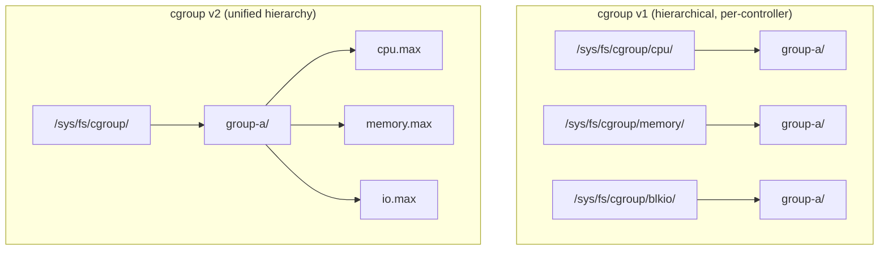
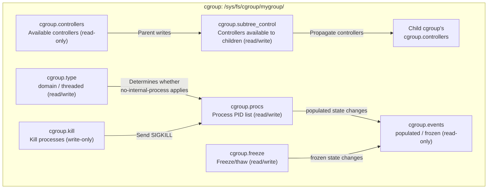
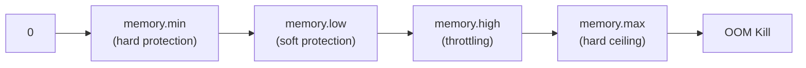

# cgroup v2 Explained

## The Idea in One Sentence

cgroup (Control Groups) is a Linux kernel mechanism for **limiting, isolating, and accounting for** the resource usage of a group of processes. It is a foundation of container technology: without cgroups, Docker and Kubernetes could not enforce limits on CPU, memory, and other resources.

> A cgroup puts several processes into a “control group” and tells that group: you may use at most 2 CPUs, 512 MiB of memory, and 100 MB/s of disk IO. Exceed those limits, and you will be throttled or killed.

## Why cgroups Are Needed

Before cgroups, Linux had limited ways to control process resources:

| Requirement | Before cgroups | With cgroups |
|------|------------|------------|
| Limit a process's CPU usage | `nice` / `renice` (adjust priority, but cannot impose a hard ceiling) | `cpu.max`, with quotas specified in microseconds |
| Limit a process's memory | `ulimit -m` (unreliable and ineffective in many scenarios) | `memory.max`, with kernel-enforced reclaim |
| Account for process IO | Almost impossible to track | `io.stat`, accurate to the byte |
| Isolate a group of processes | Not possible | Place the processes in a cgroup |

Google engineers introduced cgroups into the kernel in 2006 (Linux 2.6.24), initially under the name “process containers,” later renamed cgroups. The mechanism subsequently evolved into two versions: v1 and v2.

## cgroup v1 vs. v2

This is the most important background for understanding cgroups.

### Architectural Differences



The central problem with cgroup v1 is that **every controller (cpu, memory, blkio, etc.) mounts its own independent hierarchy**. A single process can therefore belong to different nodes at different levels in different subsystems, making management complex and prone to inconsistency.

cgroup v2 solves this with a **unified hierarchy**: all controllers share one tree, and a single cgroup directory contains the control files for cpu, memory, io, and other resources.

### Key Differences

| Feature | cgroup v1 | cgroup v2 |
|------|-----------|-----------|
| Hierarchy | Independent tree per controller | Unified tree ✅ |
| Process membership | A process can belong to nodes in different trees | A process belongs to only one cgroup ✅ |
| Reducing memory limits | Unreliable (rejected by the kernel) | Natively supported ✅ |
| Memory protection (soft limit) | `memory.soft_limit_in_bytes` | `memory.low` ✅ |
| IO control | `blkio` subsystem | `io` controller ✅ |
| PSI (Pressure Stall Information) | ❌ | ✅ |
| Kernel development status | Maintenance frozen | Main development focus |

### Checking the Version Used by the System

```bash
# Method 1: inspect the filesystem type of /sys/fs/cgroup
stat -fc %T /sys/fs/cgroup/
# Output cgroup2fs → cgroup v2 ✅
# Output tmpfs     → cgroup v1

# Method 2: inspect mount information
mount | grep cgroup
# cgroup v1: multiple lines, such as cgroup on /sys/fs/cgroup/cpu, cgroup on /sys/fs/cgroup/memory...
# cgroup v2: one line: cgroup2 on /sys/fs/cgroup type cgroup2

# Method 3: check for a unified-hierarchy interface file
ls /sys/fs/cgroup/cgroup.controllers 2>/dev/null && echo "cgroup v2" || echo "cgroup v1"
```

## Core cgroup v2 Files (Interface Files)

Before looking at individual resource controllers, understand the “skeleton” of cgroup v2. Every cgroup directory contains interface files prefixed with `cgroup.`. They define the hierarchy, process membership, controller enablement, and other fundamental behavior. They do not belong to a specific controller; they manage the unified cgroup v2 hierarchy itself.

### File Overview

```bash
# Files generated automatically after creating a cgroup
ls /sys/fs/cgroup/mygroup/
# cgroup.controllers      ← Controllers available to this cgroup
# cgroup.subtree_control  ← Controls which controllers apply to child cgroups
# cgroup.procs            ← PIDs of processes in this cgroup
# cgroup.threads          ← TIDs of threads in this cgroup (threaded mode)
# cgroup.events           ← Event notifications (for example, no remaining processes)
# cgroup.type             ← cgroup type: domain (default) or threaded
# cgroup.max.depth        ← Maximum permitted child-cgroup hierarchy depth
# cgroup.max.descendants  ← Maximum permitted number of child cgroups
# cgroup.stat             ← Statistics such as the number of child cgroups
# cgroup.freeze           ← Freeze/thaw all processes in the cgroup
# cgroup.kill             ← Kill all processes in the cgroup
```

### `cgroup.controllers` — Available Controllers

**Read-only**. Lists the resource controllers available to the current cgroup.

```bash
cat /sys/fs/cgroup/cgroup.controllers
# Example output:
# cpuset cpu io memory hugetlb pids rdma
```

This list depends on:
- Whether the controller was enabled when the kernel was compiled.
- Whether the parent enabled the controller in its `cgroup.subtree_control` (propagation down the hierarchy).

**Common misconception**: seeing `cpu` in `cgroup.controllers` does not mean child cgroups have inherited CPU control. You must explicitly write `+cpu` to the parent's `cgroup.subtree_control`.

### `cgroup.subtree_control` — Controller Switches for Child cgroups

**Read/write**. Determines which controllers propagate to **direct child cgroups**. This is one of the most important aspects of cgroup v2: controller enablement is explicit and hierarchical.

```bash
# View the controllers enabled for child cgroups
cat /sys/fs/cgroup/cgroup.subtree_control
# Output: cpu memory pids  (child cgroups can use these three controllers)

# Make the io controller available to child cgroups
echo "+io" > /sys/fs/cgroup/cgroup.subtree_control

# Remove the pids controller from child cgroups
echo "-pids" > /sys/fs/cgroup/cgroup.subtree_control
```

**The No Internal Process Rule**: when a parent's `cgroup.subtree_control` is nonempty (controllers are enabled for propagation), that parent cannot contain processes (`cgroup.procs` must be empty), unless it is the root cgroup. This keeps hierarchical resource control unambiguous:

```bash
# Example: a correct hierarchy
mkdir /sys/fs/cgroup/parent
echo "+cpu +memory" > /sys/fs/cgroup/parent/cgroup.subtree_control
# parent now cannot contain processes (unless it is a direct child of the root cgroup)

mkdir /sys/fs/cgroup/parent/child
echo $$ > /sys/fs/cgroup/parent/child/cgroup.procs  # ✅ Process placed in child
```

### `cgroup.procs` — Process Membership

**Read/write**. Lists and changes the processes belonging to this cgroup.

```bash
# View processes in this cgroup
cat /sys/fs/cgroup/mygroup/cgroup.procs
# One PID per line

# Move the current shell into mygroup
echo $$ > /sys/fs/cgroup/mygroup/cgroup.procs

# Move PID 1234 back to the parent cgroup
echo 1234 > /sys/fs/cgroup/cgroup.procs
```

**Important rules** (cgroup v2):
- A process belongs to only one cgroup (in v1, it can occupy different hierarchies in different subsystems).
- Writing a PID automatically removes the process from its previous cgroup.
- Only leaf cgroups (those without child cgroups) can contain processes (the No Internal Process Rule).

### `cgroup.events` — Event Notifications

**Read-only**. Monitor key cgroup events with `poll()` / `inotify`.

```bash
cat /sys/fs/cgroup/mygroup/cgroup.events
# populated 1  ← This cgroup or one of its descendants contains processes
# frozen 0     ← Not frozen
```

| Field | Meaning | Use |
|------|------|------|
| `populated` | `1` = has processes; `0` = empty | Container managers monitor this field to decide when a cgroup can be cleaned up |
| `frozen` | `1` = frozen; `0` = not frozen | Used with `cgroup.freeze` |

This is also one mechanism kubelet uses to determine whether a Pod has completely terminated: when the Pod cgroup's `populated` becomes `0`, all container processes have exited.

### `cgroup.type` — cgroup Type

**Read/write**. cgroups have two operating modes:

| Value | Meaning |
|----|------|
| `domain` | Default mode. May contain processes and have child cgroups, subject to the No Internal Process Rule |
| `threaded` | Thread mode. Manages different thread groups within one process; not subject to the No Internal Process Rule |

```bash
# Typical domain-mode layout (containers)
/sys/fs/cgroup/mypod/          # domain, nonempty subtree_control → cannot contain processes
├── cgroup.procs               # Empty
└── container-a/               # domain, leaf node → may contain processes
    └── cgroup.procs           # PID: 12345, 12346

# Typical threaded-mode layout
/sys/fs/cgroup/mythreaded/     # threaded
├── threads/                   # Manages individual threads
│   ├── cgroup.threads         # TID: 200, 201
```

### `cgroup.freeze` — Freeze a Process Group

**Read/write**. Suspend or resume execution of all processes in the cgroup.

```bash
# Freeze every process in mygroup
echo 1 > /sys/fs/cgroup/mygroup/cgroup.freeze

# Processes are now suspended; the CPU scheduler no longer schedules them
cat /sys/fs/cgroup/mygroup/cgroup.events | grep frozen
# frozen 1  ← Frozen

# Thaw them
echo 0 > /sys/fs/cgroup/mygroup/cgroup.freeze
```

Uses include freezing processes before container snapshots and pausing a target process group during debugging. Compared with the v1 `freezer` subsystem, v2's `cgroup.freeze` is simpler: one file, accepting `1` or `0`.

### `cgroup.kill` — Kill a Process Group

**Write-only**. Sends `SIGKILL` to every process in the cgroup.

```bash
# Kill every process in mygroup
echo 1 > /sys/fs/cgroup/mygroup/cgroup.kill
```

This is useful during container cleanup: it is more efficient and atomic than iterating through `cgroup.procs` and issuing `kill -9` for each process.

### `cgroup.max.depth` / `cgroup.max.descendants` — Hierarchy Constraints

**Read/write**. Limit child-cgroup nesting depth and total count to prevent uncontrolled hierarchy growth.

```bash
# Allow at most three levels of child cgroups beneath mygroup
echo 3 > /sys/fs/cgroup/mygroup/cgroup.max.depth

# Allow at most 100 descendant cgroups beneath mygroup
echo 100 > /sys/fs/cgroup/mygroup/cgroup.max.descendants
```

### `cgroup.stat` — Statistics

**Read-only**. Provides a statistical overview of this cgroup.

```bash
cat /sys/fs/cgroup/mygroup/cgroup.stat
# nr_descendants 5        ← Total descendant cgroups (recursive)
# nr_dying_descendants 0  ← Descendant cgroups being deleted
```

### How the Files Relate

The relationships between these files can be illustrated as follows:



## Core cgroup Controllers

Each controller, also called a subsystem, manages one kind of resource. The following are ordered by importance:

### 1. cpu — CPU Time Quotas

Controls the CPU time available to processes in the group.

**Core cgroup v2 files:**

| File | Meaning | Example |
|------|------|------|
| `cpu.max` | CPU bandwidth limit | `200000 100000` = at most 2 CPU cores |
| `cpu.weight` | CPU weight (relative proportion) | `100` (default); higher values receive more CPU time |
| `cpu.stat` | CPU usage statistics | `usage_usec`, `user_usec`, `system_usec` |

```bash
# Limit the process group to at most 1.5 CPU cores
# Format: $MAX $PERIOD (microseconds)
echo "150000 100000" > /sys/fs/cgroup/mygroup/cpu.max
# Meaning: at most 150 ms of execution per 100 ms period → 1.5 CPUs
```

**Corresponding cgroup v1 files:**
- `cpu.cfs_quota_us` + `cpu.cfs_period_us` (hard limit; corresponds to `cpu.max`).
- `cpu.shares` (relative weight; corresponds to `cpu.weight`).

### 2. memory — Memory Limits and Protection

This is the most complex and most important controller.

**Core cgroup v2 files:**

| File | Type | Meaning |
|------|------|------|
| `memory.max` | Hard limit | Hard ceiling on memory usage; exceeding it triggers OOM killing |
| `memory.min` | Hard protection | The `memory.min` portion is guaranteed protection from global reclaim |
| `memory.low` | Soft protection (best effort) | Avoid reclaim below this value unless there is no alternative |
| `memory.high` | Throttling threshold | Throttle memory allocation above this level without OOM killing |
| `memory.current` | Read-only | Current memory usage (including page cache) |
| `memory.swap.max` | Swap limit | Maximum swap usage |
| `memory.stat` | Read-only | Detailed memory statistics |
| `memory.oom.group` | Control | `1` = OOM-kill the whole cgroup; `0` = kill individual processes |

```bash
# Limit memory to 512 MiB
echo "536870912" > /sys/fs/cgroup/mygroup/memory.max

# Protect 128 MiB from reclaim
echo "134217728" > /sys/fs/cgroup/mygroup/memory.min

# Throttle above 400 MiB without killing processes
echo "419430400" > /sys/fs/cgroup/mygroup/memory.high

# Read current usage
cat /sys/fs/cgroup/mygroup/memory.current
```

**The difference between `memory.max` and `memory.high` (important):**

| | `memory.max` | `memory.high` |
|------|-------------|--------------|
| Behavior when exceeded | **OOM kill** — kill processes directly | **Throttle** — slow allocation; processes enter D state |
| Purpose | Hard isolation; the limit must not be exceeded | Soft limit permitting temporary excess usage |
| Kubernetes equivalent | `limits.memory` | No direct equivalent yet |
| Suitable use | Multi-tenant isolation | Cache applications |

**Corresponding cgroup v1 files:**
- `memory.limit_in_bytes` (corresponds to `memory.max`).
- `memory.soft_limit_in_bytes` (corresponds to `memory.low`, but with different semantics: v1's soft limit takes effect only under global memory pressure).

### 3. cpuset — CPU and NUMA Node Affinity

Bind processes to particular CPU cores and NUMA memory nodes, which is critical for latency-sensitive applications such as DPDK and real-time processing.

```bash
# Bind to CPU cores 0–3
echo "0-3" > /sys/fs/cgroup/mygroup/cpuset.cpus

# Bind to NUMA node 0
echo "0" > /sys/fs/cgroup/mygroup/cpuset.mems
```

`cpuset` changed relatively little between v1 and v2. The main v2 improvement is that `cpuset.cpus.partition` can create exclusive CPU partitions, preventing processes in the root cgroup from competing for those CPUs.

### 4. io — Block Device IO Control (v2) / blkio (v1)

Limit a process group's read/write throughput and IOPS on block devices (disks).

**Core cgroup v2 files:**

```bash
# Format: <major>:<minor> rbps=<read limit> wbps=<write limit> riops=<read IOPS> wiops=<write IOPS>
# Limit /dev/sda (8:0) to 10 MB/s reads and 5 MB/s writes
echo "8:0 rbps=10485760 wbps=5242880" > /sys/fs/cgroup/mygroup/io.max

# Read current IO statistics
cat /sys/fs/cgroup/mygroup/io.stat
```

### 5. pids — Process Count Limits

Prevent fork bombs by limiting the number of processes that may exist concurrently in a cgroup.

```bash
# Allow at most 100 processes
echo "100" > /sys/fs/cgroup/mygroup/pids.max

# Read the current process count
cat /sys/fs/cgroup/mygroup/pids.current
```

The Kubernetes `--pod-max-pids` feature is implemented using the pids controller.

### 6. Other Controllers

| Controller | v1/v2 | Function |
|--------|-------|------|
| `hugetlb` | v1 + v2 | Limit huge-page memory (HugeTLB) usage |
| `devices` | v1 only | Control access to device files (`/dev/*`) |
| `freezer` | v1 only | Suspend/resume all processes in a cgroup (replaced by `cgroup.freeze` in v2) |
| `net_cls` / `net_prio` | v1 only | Tag network packets for tc (traffic control) classification |
| `perf_event` | v1 + v2 | Monitor performance by cgroup |
| `rdma` | v1 + v2 | Limit RDMA/IB resources |

## cgroups and systemd

On modern Linux distributions, you should not manage cgroups by modifying `/sys/fs/cgroup` manually. **systemd is the single writer responsible for cgroup management** (the Single Writer principle).

### systemd's cgroup Hierarchy

```
/sys/fs/cgroup/
├── system.slice/          # System services
│   ├── sshd.service/
│   ├── nginx.service/
│   └── ...
├── user.slice/            # User sessions
│   └── user-1000.slice/
│       ├── session-1.scope/
│       └── ...
└── machine.slice/         # Virtual machines/containers (optional)
```

Every systemd service automatically receives a cgroup:

```bash
# View the nginx service's cgroup
systemctl status nginx | grep CGroup
# CGroup: /system.slice/nginx.service

# Read its CPU limit
cat /sys/fs/cgroup/system.slice/nginx.service/cpu.max

# Temporarily limit nginx CPU usage (lost after reboot)
systemctl set-property nginx.service CPUQuota=150%
# Equivalent to:
# echo "150000 100000" > /sys/fs/cgroup/system.slice/nginx.service/cpu.max

# Temporarily limit memory (lost after reboot)
systemctl set-property nginx.service MemoryMax=512M
# Equivalent to:
# echo "536870912" > /sys/fs/cgroup/system.slice/nginx.service/memory.max

# Persistence (write a drop-in file that survives reboot)
systemctl set-property --runtime nginx.service MemoryMax=512M  # --runtime means temporary
# Omitting --runtime writes to /etc/systemd/system.control/
```

### systemd-cgls: Visualize the cgroup Tree

```bash
# Display all cgroups as a tree
systemd-cgls

# Display only a particular service's child cgroups
systemd-cgls -u nginx.service
```

### systemd-cgtop: Real-Time cgroup Resource Monitoring

```bash
# Similar to top, but aggregated by cgroup
systemd-cgtop

# Example output:
# /sys/fs/cgroup                                tasks   %CPU   Memory  Input/s Output/s
# system.slice                                      42   12.3    1.2G        -        -
# system.slice/nginx.service                         2    5.1   256M        -        -
# user.slice                                        38    3.2   512M        -        -
```

## cgroups and Containers

cgroups provide the resource isolation underlying containers. A container is essentially a group of processes isolated by namespaces, plus a cgroup that limits resources.

### How Docker / containerd Use cgroups

When Docker creates a container:

```bash
# --memory limits container memory → written to memory.max
docker run --memory=512m --cpus=1.5 nginx

# Behind the scenes, this is equivalent to:
# 1. Create a cgroup under /sys/fs/cgroup/system.slice/docker-<containerID>.scope/
# 2. echo 536870912 > memory.max
# 3. echo "150000 100000" > cpu.max
# 4. Write the container process PID into cgroup.procs
```

You can inspect it with `docker inspect`:

```bash
docker inspect <container> | jq '.[0].HostConfig.CgroupParent'
docker inspect <container> | jq '.[0].HostConfig.Memory'
docker inspect <container> | jq '.[0].HostConfig.NanoCpus'
```

### How Kubernetes Uses cgroups

Kubernetes' Pod QoS model maps directly onto cgroups:

```
/sys/fs/cgroup/kubepods.slice/
├── kubepods-guaranteed.slice/       # Guaranteed Pods
│   └── pod<UID>.slice/
│       └── cri-containerd-<ID>.scope/
├── kubepods-burstable.slice/        # Burstable Pods
│   └── pod<UID>.slice/
│       └── cri-containerd-<ID>.scope/
└── kubepods-besteffort.slice/       # BestEffort Pods
    └── pod<UID>.slice/
        └── cri-containerd-<ID>.scope/
```

Pods with different QoS classes live under different parent cgroups. When node memory is tight, kubelet's eviction manager selects Pods in the order `besteffort` → `burstable` → `guaranteed`, with that priority implemented through the cgroup hierarchy.

```bash
# View a Pod's cgroup memory limit
kubectl exec <pod> -- cat /sys/fs/cgroup/memory.max

# View it on the host
POD_UID=$(kubectl get pod <pod> -o jsonpath='{.metadata.uid}')
cat /sys/fs/cgroup/kubepods.slice/kubepods-burstable.slice/kubepods-burstable-pod${POD_UID}.slice/memory.max
```

## Hands-On cgroup Management

Although production systems should use systemd or a container runtime to manage cgroups, manual operations are the best way to understand the underlying mechanism.

### Create a cgroup and Limit a Process

```bash
# Step 0: Make sure this is cgroup v2
[ "$(stat -fc %T /sys/fs/cgroup/)" = "cgroup2fs" ] || \
  { echo "cgroup v2 is required"; exit 1; }

# Step 1: Create a new cgroup
CGROUP_NAME="demo-limited"
sudo mkdir -p /sys/fs/cgroup/${CGROUP_NAME}

# Step 2: Check which controllers the new cgroup inherited
cat /sys/fs/cgroup/${CGROUP_NAME}/cgroup.controllers

# Step 3: Set a 64 MB memory limit
echo "67108864" | sudo tee /sys/fs/cgroup/${CGROUP_NAME}/memory.max

# Step 4: Set a CPU limit of 0.5 cores
echo "50000 100000" | sudo tee /sys/fs/cgroup/${CGROUP_NAME}/cpu.max

# Step 5: Start a test process
# Open a shell that continually allocates memory
sudo bash -c '
echo $$ > /sys/fs/cgroup/demo-limited/cgroup.procs
# This bash process and its children are now subject to the limits
stress --vm 1 --vm-bytes 100M --timeout 10s
'
# Expected: stress fails to allocate 100 MB (OOM), because the limit is only 64 MB
```

### Adjust Resource Limits Live (the Mechanism Behind Kubernetes In-Place Resize)

```bash
# Increase the memory limit at runtime
echo "134217728" | sudo tee /sys/fs/cgroup/demo-limited/memory.max
# 128 MB — running processes are unaffected

# Reduce the CPU limit at runtime
echo "25000 100000" | sudo tee /sys/fs/cgroup/demo-limited/cpu.max
# 0.25 cores — throttling begins immediately; processes slow down but are not killed
```

### View cgroup Statistics

```bash
# Memory statistics
cat /sys/fs/cgroup/demo-limited/memory.stat
# anon 12345678          ← Anonymous pages (memory actually used by processes)
# file 9876543           ← File cache pages
# kernel 3456789         ← Kernel data structures
# pgfault 12345          ← Page faults
# pgmajfault 67          ← Major page faults (require disk reads; higher counts hurt performance)

# CPU statistics
cat /sys/fs/cgroup/demo-limited/cpu.stat
# usage_usec 123456789   ← Total CPU usage time (microseconds)
# user_usec 100000000    ← Userspace time
# system_usec 23456789   ← Kernel time

# IO statistics
cat /sys/fs/cgroup/demo-limited/io.stat
# 8:0 rbytes=123456 wbytes=654321 rios=100 wios=50
```

## cgroup v2 Memory Protection in Detail

This is an important but easily overlooked feature. cgroup v2 provides three levels of memory protection, from strongest to weakest:

| File | Protection strength | Behavior |
|------|---------|------|
| `memory.min` | Hard protection | **Never** reclaimed unless OOM kills the entire cgroup |
| `memory.low` | Soft protection (best effort) | Avoid reclaiming this cgroup's memory before reclaiming other cgroups |
| `memory.max` | Hard limit | Exceeding it causes OOM or throttling |

**How the levels work together:**



When a container's memory usage is below `memory.min`, the kernel guarantees that this memory will not be reclaimed globally. Between `memory.low` and `memory.high`, protection is not absolute. Allocation slows above `memory.high`, and exceeding `memory.max` causes direct killing.

In Kubernetes:
- `memory.min` is usually set to the Pod's `requests.memory` (protecting the Pod from eviction).
- `memory.max` is set to the Pod's `limits.memory`.

```bash
# Inspect a Pod's memory protection configuration on the node
cat /sys/fs/cgroup/kubepods.slice/.../memory.min    # K8s may set this to requests.memory
cat /sys/fs/cgroup/kubepods.slice/.../memory.low    # Usually 0 (unused by default in K8s)
cat /sys/fs/cgroup/kubepods.slice/.../memory.max    # = limits.memory
cat /sys/fs/cgroup/kubepods.slice/.../memory.current # Current actual usage
```

## Common Problems and Debugging

### 1. A Process Cannot Join a cgroup

```bash
echo $$ > /sys/fs/cgroup/mygroup/cgroup.procs
# -bash: echo: write error: Invalid argument
```

Cause: cgroup v2 requires resource limits such as `memory.max` to be configured before adding processes. In addition, a process can belong to only one cgroup in v2; if it already belongs to `/sys/fs/cgroup/user.slice/...`, it needs to be moved out first.

### 2. Memory Limits Do Not Take Effect

Common causes:
- Reducing a v1 memory limit below current usage → the kernel returns `EBUSY`.
- In cgroup v2, ensure that none of the cgroup's children are using memory.

### 3. cgroup Information Is Not Visible Inside a Container

When Kubernetes mounts cgroup information inside a container, it exposes only the container's own child cgroup by default, not the host's root cgroup. An application that needs to discover its limit can read `/sys/fs/cgroup/memory.max`.

### 4. Migrating from cgroup v1 to v2

Most modern distributions (Ubuntu 22.04+, Debian 11+, RHEL 9+, Fedora 31+) use cgroup v2 by default. To switch manually:

```bash
# Edit /etc/default/grub
GRUB_CMDLINE_LINUX="systemd.unified_cgroup_hierarchy=1 cgroup_no_v1=all"

# Update grub and reboot
sudo update-grub && sudo reboot
```

## Summary

cgroups are a foundation of modern Linux resource management. Understanding them is essential for working with containers and diagnosing performance issues:

| Area | Key point |
|--------|------|
| **What it is** | A kernel mechanism for resource limits, isolation, and accounting for process groups |
| **v1 vs. v2** | v2 has one unified hierarchy with all controllers in a directory; v1 has an independent tree per controller |
| **Core controllers** | cpu (quota), memory (limits + protection), cpuset (affinity), io (disk), pids (process count) |
| **Relationship to systemd** | systemd is the single writer managing cgroups |
| **Relationship to containers** | Each container = namespace isolation + cgroup resource limits |
| **Relationship to K8s** | The QoS model maps onto the cgroup hierarchy; eviction follows hierarchy priority |
| **Three memory protection levels** | `memory.min` (hard protection) → `memory.low` (soft protection) → `memory.max` (hard ceiling) |
