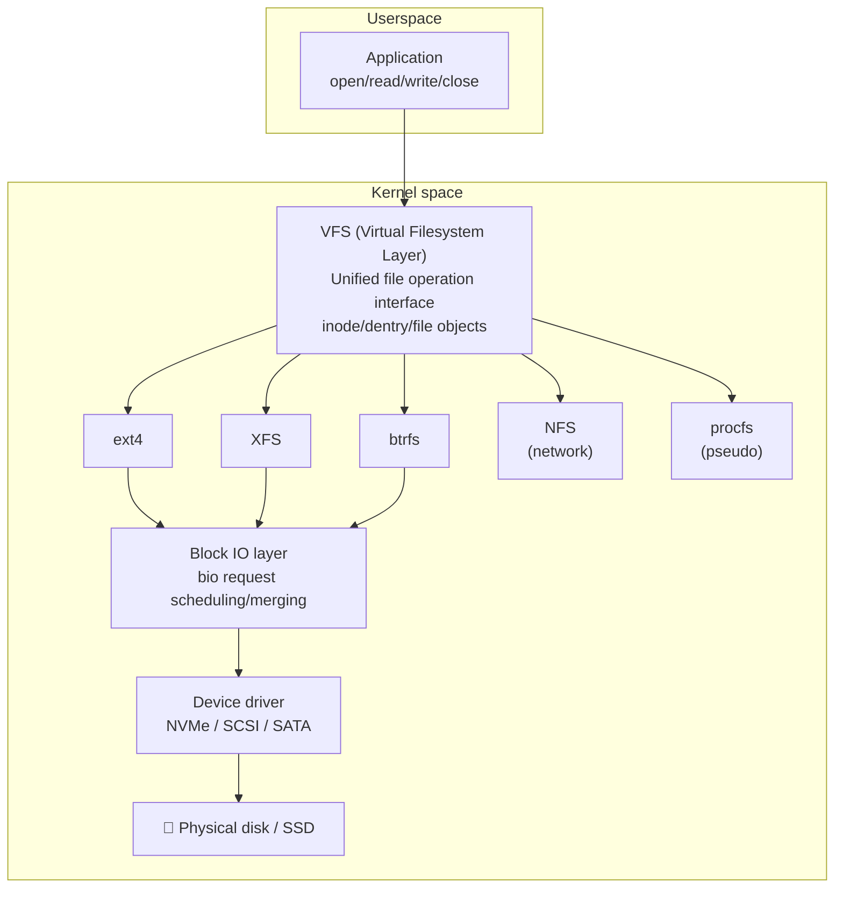
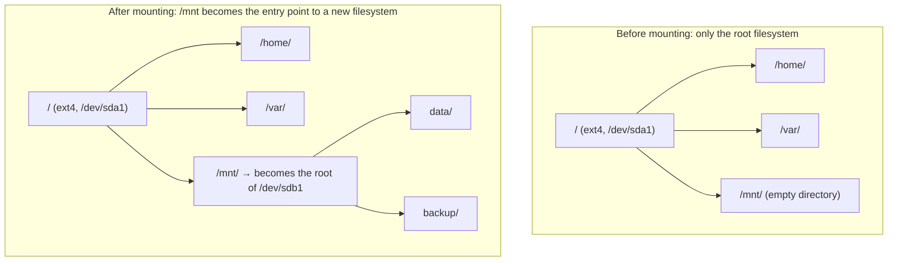
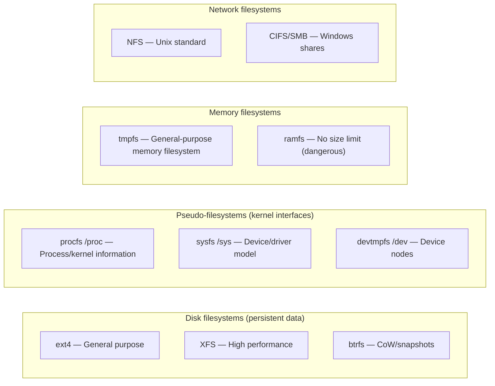
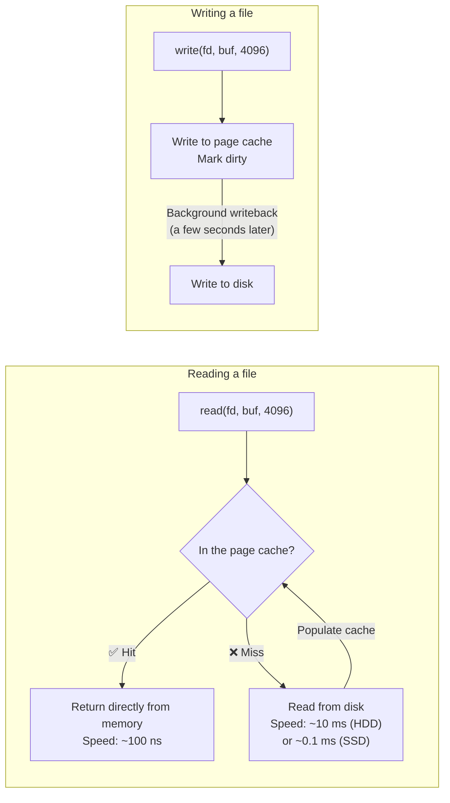
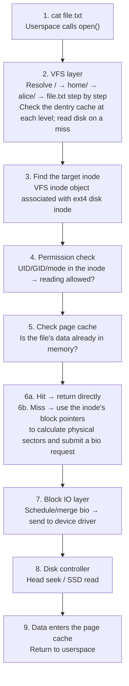

# An Overview of Linux Filesystems

## The Idea in One Sentence

A filesystem is the mechanism Linux uses to **organize and manage data** on a disk. It is more than “files and folders”: between typing `ls` and a disk head seeking data, an operation passes through four layers—VFS, a specific filesystem driver, the block IO layer, and a device driver.

> If a disk is a **blank notebook**, a filesystem is its **table of contents, page numbers, and index**, allowing you to quickly find what is written on page 5 of chapter 3.

## The Overall Architecture: A Four-Layer Model

The Linux filesystem is not a single entity, but a layered architecture. Each layer solves a different problem:



### Layer 1: VFS (Virtual File System)

VFS is the **universal translator** of Linux filesystems. Whether the underlying filesystem is ext4, XFS, NFS, or the `/proc` pseudo-filesystem, applications use the same system calls (`open`, `read`, `write`, and `close`).

```bash
# Dozens of filesystems, with their differences hidden from the user
cat /etc/passwd          # ext4
cat /proc/cpuinfo        # procfs (a pseudo-filesystem; the kernel generates data in real time)
cat /sys/class/net/lo    # sysfs
ls /mnt/nfs-server/      # NFS network filesystem
```

VFS defines four core kernel objects:

| Object | Meaning | Corresponding disk structure | Analogy |
|------|------|-------------|------|
| **super_block** | A mounted filesystem | Superblock | A library's “master catalog” |
| **inode** | Metadata for a file or directory | On-disk inode | A book's “catalog record” |
| **dentry** | Directory entry (a cache of filename → inode mappings) | Directory data block | A library's “title index card” |
| **file** | A file instance opened by a process | No on-disk equivalent | The particular book you have borrowed |

> This is why a running Linux process can access files on another filesystem: VFS hides all the differences.

### Layer 2: Specific Filesystems

Each filesystem implements its own disk layout. Common examples on Linux include:

| Filesystem | Role | Key features | Typical uses |
|---------|------|---------|---------|
| **ext4** | General-purpose default | Stable, mature, journaled | Root partitions, /home, general-purpose servers |
| **XFS** | High performance | Large files, high concurrency | Databases, large-file storage |
| **btrfs** | Next generation | Copy-on-write, snapshots, compression | Container image storage, NAS |
| **tmpfs** | Memory filesystem | Data in RAM, lost on power failure | `/tmp`, `/dev/shm` |
| **procfs** | Pseudo-filesystem | Exposes kernel data without disk usage | `/proc` |
| **sysfs** | Pseudo-filesystem | Device and driver information | `/sys` |
| **overlayfs** | Union filesystem | Multiple overlaid layers | Docker image layers |

### Layer 3: The Block IO Layer

All disk reads and writes eventually become operations on “blocks.” The block IO layer handles:

- **Scheduling**: merging and ordering IO requests to reduce disk-head movement (important for HDDs, less significant for SSDs).
- **Caching**: the page cache retains data already read in memory so subsequent reads can hit the cache directly.
- **The bio structure**: describes an IO operation—which sectors to read or write, how many bytes, and which memory pages receive the data.

### Layer 4: Device Drivers

These ultimately translate bio requests into SCSI/NVMe/ATA commands and send them to the hardware controller.

## How Filesystems Join the Directory Tree: Mounting

Windows assigns each partition a drive letter, such as C: or D:. Linux is different: all filesystems grow on **one directory tree**. Mounting “grafts” a filesystem onto a directory node.



```bash
# The essential mount operation
mount /dev/sdb1 /mnt
# Meaning: graft the filesystem on /dev/sdb1 onto the /mnt directory
# The original contents of /mnt are temporarily hidden and reappear after unmounting

# View all mount points
mount | head -5
# /dev/sda1 on / type ext4 (rw,relatime)
# devtmpfs on /dev type devtmpfs (rw)
# proc on /proc type proc (rw)
# tmpfs on /run type tmpfs (rw)
# /dev/sdb1 on /mnt type ext4 (rw)

# View disk partitions
lsblk
# NAME   MAJ:MIN RM  SIZE RO TYPE MOUNTPOINT
# sda      8:0    0  100G  0 disk
# └─sda1   8:1    0  100G  0 part /
# sdb      8:16   0  500G  0 disk
# └─sdb1   8:17   0  500G  0 part /mnt
```

> This explains why `df -h` displays several filesystems while `ls /` looks like one ordinary directory tree: mounting combines multiple filesystems seamlessly into a single tree.

### `/etc/fstab`: Automatic Mount Configuration at Boot

Mounts created with `mount` are temporary and disappear after reboot. To make a mount **persistent**, add it to `/etc/fstab` (File System Table). At startup, `systemd` or `init` mounts the entries in this file automatically.

```bash
cat /etc/fstab
```

Typical contents:

```
# <device>         <mount point> <type> <options>        <dump> <fsck order>
/dev/sda1          /         ext4    defaults         0      1
UUID=abc123...     /home     ext4    defaults         0      2
UUID=def456...     /var      xfs     defaults,noatime 0      2
tmpfs              /tmp      tmpfs   defaults,size=4G 0      0
//192.168.1.10/share /mnt/nas cifs  credentials=/etc/samba/cred,uid=1000 0 0
/dev/sdb1          /mnt/data ext4    noauto,user      0      0
```

**Field-by-field breakdown**:

| Field | Meaning | Examples |
|------|------|------|
| **Column 1: device** | What to mount | `/dev/sda1`, `UUID=xxx`, `tmpfs`, `//server/share` |
| **Column 2: mount point** | Directory to mount it on | `/`, `/home`, `/mnt/data` |
| **Column 3: filesystem type** | ext4/xfs/ntfs, etc. | `ext4`, `xfs`, `tmpfs`, `cifs`, `nfs` |
| **Column 4: mount options** | Comma-separated options | `defaults`, `noatime`, `ro`, `noexec` |
| **Column 5: dump** | Whether to back up with dump (0 = no) | Usually `0` |
| **Column 6: fsck order** | Check order at boot (0 = skip, 1 = root, 2 = others) | `1` for root; `2` or `0` for others |

**Common mount options**:

| Option | Effect |
|------|------|
| `defaults` | Equivalent to `rw,suid,dev,exec,auto,nouser,async` |
| `noatime` | Do not update atime on reads; **significantly improves IO performance** |
| `relatime` | A compromise that delays atime updates (the default on most distributions) |
| `ro` | Mount read-only |
| `noexec` | Prevent execution of binaries on the partition |
| `nosuid` | Ignore suid/sgid bits (security hardening) |
| `noauto` | Do not mount automatically at startup (manual `mount` required) |
| `user` | Allow ordinary users to mount/unmount |
| `size=4G` | Limit the maximum size of tmpfs |

### `/proc/mounts`: The Kernel's Current Mount State

`/etc/fstab` is **configuration**; `/proc/mounts` is **actual state**. It shows every filesystem currently mounted in the kernel:

```bash
cat /proc/mounts | head -10
# sysfs /sys sysfs rw,nosuid,nodev,noexec,relatime 0 0
# proc /proc proc rw,nosuid,nodev,noexec,relatime 0 0
# udev /dev devtmpfs rw,nosuid,relatime,size=... 0 0
# /dev/sda1 / ext4 rw,relatime,errors=remount-ro 0 0
# tmpfs /run tmpfs rw,nosuid,nodev,size=... 0 0
# ...
```

`/proc/mounts` is more reliable than the `mount` command: it comes directly from the kernel without any userspace cache. If the output of `mount` is confusing—for example, in a systemd-managed mount namespace—look at `/proc/mounts`.

### Practical Example: Adding a Persistent Mount from Scratch

```bash
# Scenario: a new disk /dev/sdb1 should be mounted permanently at /data

# 1. Create the mount point
sudo mkdir -p /data

# 2. Get the UUID (more reliable than /dev/sdb1 because device names can change)
sudo blkid /dev/sdb1
# /dev/sdb1: UUID="a1b2c3d4-..." TYPE="ext4"

# 3. Edit /etc/fstab by adding a line
echo "UUID=a1b2c3d4-...  /data  ext4  defaults,noatime  0  2" | sudo tee -a /etc/fstab

# 4. Validate the configuration (mount according to fstab immediately, without rebooting)
sudo mount -a
# No error → the configuration is correct

# 5. Confirm the mount
df -h /data
lsblk | grep sdb1
```

### Practical Example: Reading a Complex fstab Entry

```
UUID=abc123 /mnt/backup ext4 rw,noatime,nosuid,nodev,noexec 0 2
       │         │        │                │                 │  └─ fsck order: 2 (check after root)
       │         │        │                │                 └─ dump: 0 (no backup)
       │         │        │                └─ Options: read/write, no atime, disable suid, devices, execution
       │         │        └─ Type: ext4
       │         └─ Mount point: /mnt/backup
       └─ Device: identified by UUID (most stable)
```

This means: **mount an ext4 partition (UUID=abc123) at `/mnt/backup` with security hardening—allow reads and writes, disable atime updates for performance, and prevent suid, device-file use, and executable files to reduce security risks.**

### Practical Example: Using tmpfs to Speed Up Compilation

```bash
# Mount an 8 GB memory filesystem at /tmp for very fast IO
# Add this to /etc/fstab:
tmpfs /tmp tmpfs defaults,size=8G,mode=1777 0 0

# Verify
mount | grep /tmp
# tmpfs on /tmp type tmpfs (rw,relatime,size=8G)

# Effect: compilation temporary files stay in memory, improving speed severalfold
# Tradeoff: cleared on reboot; do not store data that must persist
```

### The Roles of Three Mount-Related Files

| File | Nature | Purpose | Writer |
|------|------|------|------|
| `/etc/fstab` | Configuration file | Defines what **should** be mounted | Administrator |
| `/proc/mounts` | Kernel state | Shows what is **actually mounted now** | Kernel |
| `/etc/mtab` | Compatibility symbolic link | Usually → `/proc/self/mounts` or `/proc/mounts` | Historical legacy |

## Filesystem Directory Layout: The FHS Standard

The Linux directory layout follows **FHS (Filesystem Hierarchy Standard)**. The kernel does not enforce this; it is a shared convention:

```mermaid
graph TD
  Root["/ Root directory"]
  Root --> Bin["/bin — Basic commands (ls, cp, cat)"]
  Root --> Boot["/boot — Kernel and boot files"]
  Root --> Dev["/dev — Device files (everything is a file!)"]
  Root --> Etc["/etc — Configuration files"]
  Root --> Home["/home — User home directories"]
  Root --> Lib["/lib — Shared libraries"]
  Root --> Media["/media — Removable media mount points"]
  Root --> Mnt["/mnt — Temporary mount points"]
  Root --> Opt["/opt — Third-party software"]
  Root --> Proc["/proc — Process and kernel information (pseudo-filesystem)"]
  Root --> Root2["/root — Root user's home directory"]
  Root --> Run["/run — Runtime data (tmpfs)"]
  Root --> Sbin["/sbin — System administration commands"]
  Root --> Sys["/sys — Device and driver information (pseudo-filesystem)"]
  Root --> Tmp["/tmp — Temporary files"]
  Root --> Usr["/usr — User programs and data"]
  Root --> Var["/var — Variable data (logs, caches)"]
```



An important distinction: which directories may be **separate filesystems**?

| Directory | Commonly mounted separately? | Reason |
|------|:------------:|------|
| `/` | — | The root filesystem is required |
| `/home` | ✅ | Isolates user data so it survives an OS reinstall |
| `/var` | ✅ | Growing logs/databases could fill the root partition |
| `/tmp` | ✅ | Often mounted as tmpfs (memory) for speed and automatic cleanup |
| `/boot` | ✅ | Some boot modes require a separate partition |
| `/usr` | Historically | Formerly used for diskless workstations; now usually part of `/` |

## Two Broad Categories: Filesystems on Disk and in Memory

Not every filesystem corresponds to a disk:



```bash
# Try the different types yourself
# Disk filesystem
ls -l /etc/hosts          # An ordinary file on ext4

# Pseudo-filesystems: contents are not on disk; the kernel generates them in real time
cat /proc/cpuinfo         # CPU information
cat /sys/class/net/eth0/address  # MAC address

# Memory filesystem: extremely fast, but disappears after reboot
echo "hello" > /dev/shm/test.txt
cat /dev/shm/test.txt     # hello
# /dev/shm is cleared on reboot

# Network filesystem
mount -t nfs 192.168.1.100:/exports /mnt/nfs
```

## Journaling and Copy-on-Write

A filesystem's greatest enemy is not power loss itself, but **a write interrupted halfway by power loss**, which leaves the filesystem inconsistent.

### Journaling Filesystems

A journaling filesystem (ext3/ext4 or XFS) first records “what I am going to do” in a journal before actually writing the data.

```
Normal write flow (using ext4 as an example):

  Step 1: Write “I will write the following data to block 50000” into the journal
  Step 2: Mark the journal entry as “pending commit”
  Step 3: Actually write the data to block 50000
  Step 4: Mark the journal entry as “completed”

Recovery after power loss:
  Scan the journal at startup:
    - “Pending commit” → replay to complete the write
    - “Completed” → ignore; the data is already safely on disk
    - No entry → nothing happened
```

This does not mean ext4 cannot fail; rather, it avoids **“half-failure”**: either a write finishes or it does not happen, without an intermediate state.

```bash
# Check whether ext4 has journaling enabled
sudo dumpe2fs /dev/sda1 2>/dev/null | grep features | grep has_journal
# Filesystem features: has_journal ext_attr resize_inode dir_index filetype ...

# Filesystem repair: fundamentally replaying/cleaning the journal
sudo fsck.ext4 /dev/sda1
```

### Copy-on-Write Filesystems (CoW)

btrfs and ZFS take a different approach: **never modify data in place**.

```
Changing a block in a traditional filesystem:
  Original data in block A → new data directly overwrites block A (in-place write)
  Risk: power fails halfway → block A mixes old and new data; the file is corrupted

Changing a block in a CoW filesystem:
  Original data in block A → new data written to block B → pointer updated to block B
  Block A remains unchanged until the write to block B is confirmed successful
  Risk: power fails halfway → the pointer still refers to block A; old data remains intact
```

An additional benefit: because the old data stays intact, **snapshots** are easy to create. A snapshot essentially preserves the old pointers.

```bash
# Create a btrfs snapshot (instant, with almost no space usage)
btrfs subvolume snapshot /mnt/btrfs /mnt/btrfs-snap

# Even if files in /mnt/btrfs are later changed or deleted, the snapshot retains the original versions
```

> **The distinction in one sentence**: journaling guarantees **consistency** (unfinished writes can be replayed); CoW guarantees **atomicity** (a write either takes full effect or has no effect). Both protect against power loss through different approaches.

## Page Cache: The In-Memory Filesystem Accelerator

Linux adds a **page cache** to file reads and writes, which is crucial to filesystem performance:



```bash
# Check page cache usage
free -h
#               total        used        free      shared  buff/cache   available
# Mem:           15Gi       4.0Gi       3.0Gi       500Mi       8.0Gi        10Gi
#                                                              ↑ 8 GB of page cache

# Drop caches manually (testing only! Do not do this in production)
echo 3 | sudo tee /proc/sys/vm/drop_caches

# Check how much of a file is cached
vmtouch /path/to/large/file
# Files: 1    Directories: 0    Resident Pages: 256/256  1M/1M  100%
#                                                      ↑ 100% in memory
```

> High `buff/cache` usage is **a good thing**: Linux uses spare memory for caching and releases it when applications need it. Those “full” memory pages are what improve performance.

## Putting It All Together: The Journey from `cat file.txt` to Disk



The [inode article](/en/notes/linux/inode/) examines steps 3, 5, and 6 of this sequence in detail. This article adds the VFS layer in steps 1–2 and the block IO layer in steps 7–8; together, they provide the full picture of Linux filesystems.

## Summary

Linux filesystems form a carefully organized four-layer architecture:

| Layer | Role | Core concepts |
|----|------|---------|
| **VFS** | Unified interface | inode / dentry / file / super_block |
| **Specific FS** | Disk layout | ext4 journaling / btrfs CoW / XFS extents |
| **Block IO layer** | Scheduling and caching | page cache / bio / IO scheduler |
| **Device driver** | Hardware communication | NVMe / SCSI / SATA commands |

**Several key ideas:**

1. **“Everything is a file”** — this extends beyond disk files: `/proc`, `/sys`, and `/dev` are filesystems, and even network sockets use file descriptors.
2. **Mount points instead of drive letters** — Linux uses one tree plus mounts in place of Windows' multiple drive letters; this is more flexible but also less obvious.
3. **Page cache is central to performance** — high `buff/cache` is not bad; Linux is exchanging spare memory for speed.
4. **Journaling and CoW protect data** — failure is still possible, but its consequences are constrained.

Together with [Linux Inodes Explained](/en/notes/linux/inode/), this provides both the “skeleton” (inodes/directories/data blocks) and the “overall architecture” (VFS/mounting/IO stack) of a filesystem.
