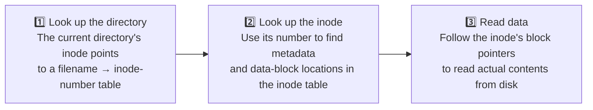
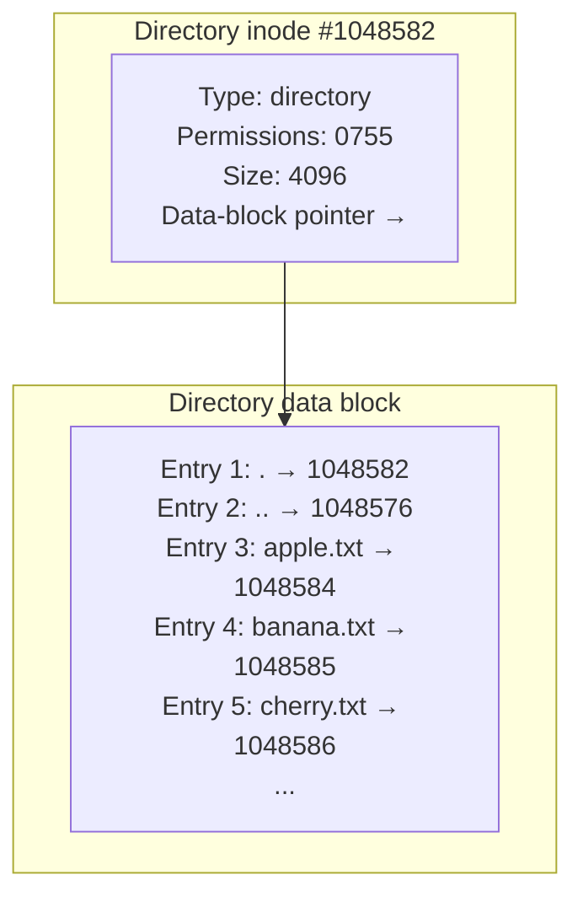
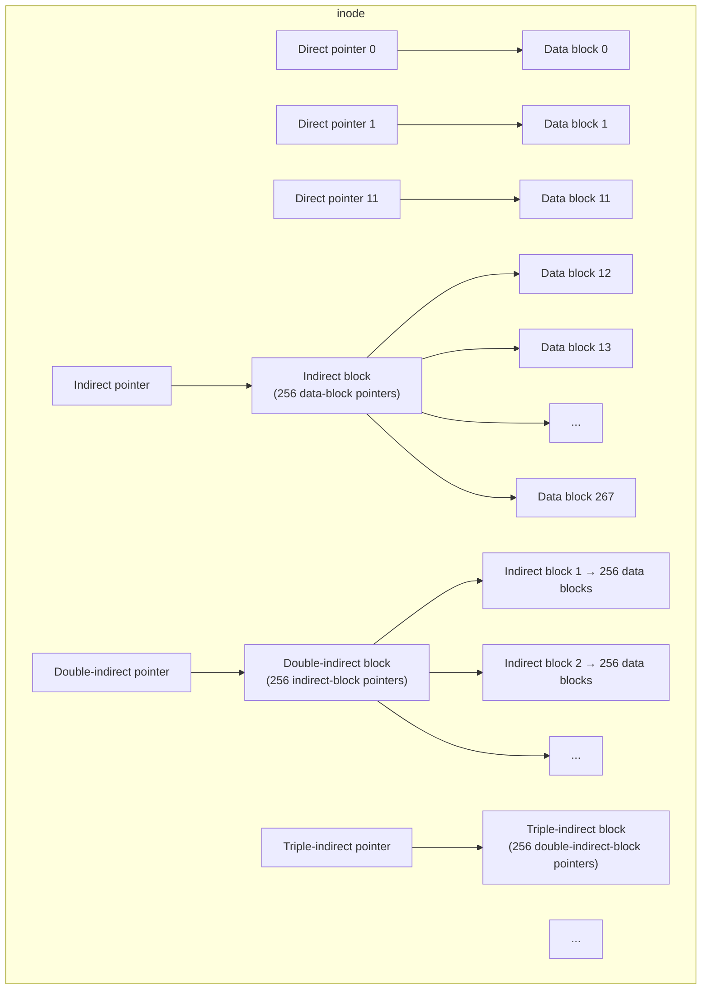
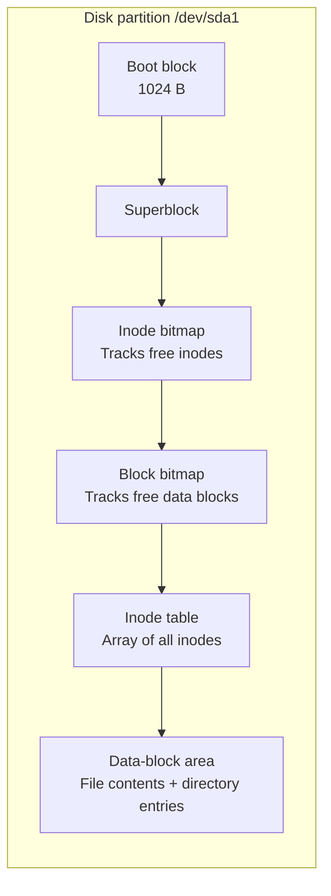
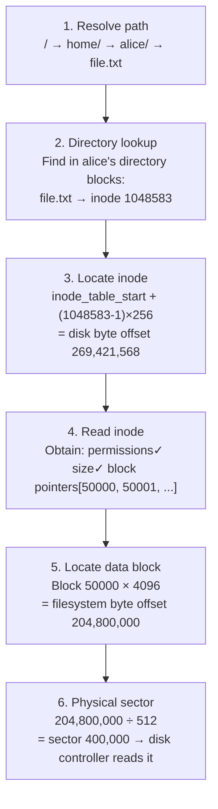
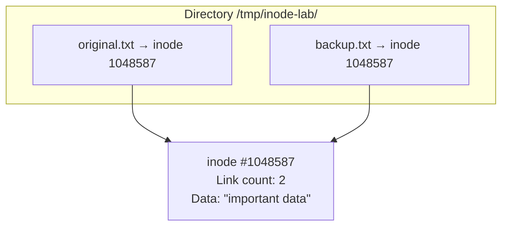
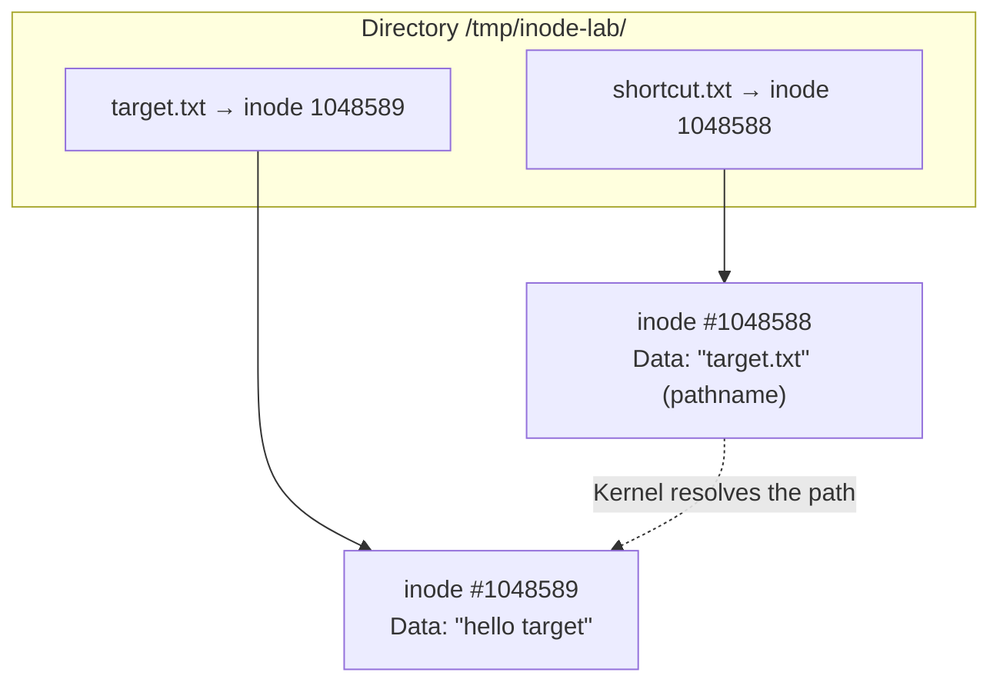
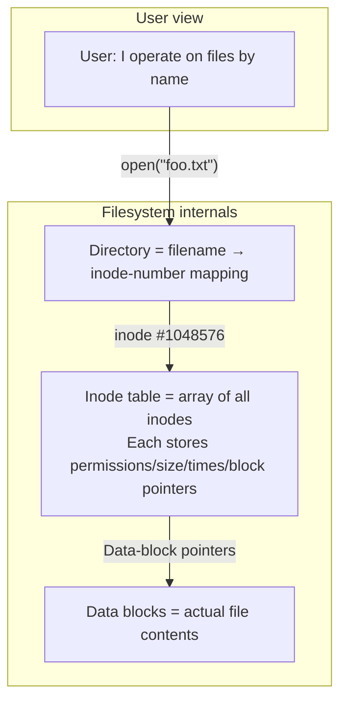

# Linux Inodes Explained

## Start with an Experiment

Open a terminal and run these commands to “see” an inode directly:

```bash
# Create a test directory
mkdir /tmp/inode-lab && cd /tmp/inode-lab

# Create a file
echo "hello" > file1.txt

# View its inode number with -i
ls -i
# 1048583 file1.txt    ← This number is the inode number

# Use stat for more details
stat file1.txt
```

`stat` produces output like this:

```
  File: file1.txt
  Size: 6             Blocks: 8          IO Block: 4096   regular file
Device: 259,1         Inode: 1048583      Links: 1
Access: (0644/-rw-r--r--)  Uid: ( 1000/   alice)   Gid: ( 1000/   alice)
Access: 2026-06-22 15:00:00.000000000 +0800
Modify: 2026-06-22 15:00:00.000000000 +0800
Change: 2026-06-22 15:00:00.000000000 +0800
```

There it is: **every file has an inode, like a dossier**, containing all information about the file except its name and contents.

## How Does the Filesystem Find a File?

When you type `cat file1.txt`, the kernel performs a three-step lookup:



**The filename is not stored in the inode; it is stored in the directory.** A directory is a special kind of file whose data contains a table like this:

```
Data in the /tmp/inode-lab directory (simplified):
┌──────────────┬──────────┐
│ Filename     │ Inode    │
├──────────────┼──────────┤
│ .            │ 1048582  │  ← "." points to the directory's own inode
│ ..           │ 1048576  │  ← ".." points to /tmp's inode
│ file1.txt    │ 1048583  │  ← "file1.txt" points to the file's inode
└──────────────┴──────────┘
```

**Verify it yourself**: the directory's inode and the inode referenced by `.` match:

```bash
ls -di /tmp/inode-lab            # The directory's own inode
# 1048582 /tmp/inode-lab

ls -aid /tmp/inode-lab/.         # The inode of "."
# 1048582 /tmp/inode-lab/.       ← Identical!
```

### How Can You View the Directory's Mapping Table?

The directory stores filename → inode mappings, and the way to view them is `ls -i`:

```bash
cd /tmp/inode-lab

# Create some example files
touch apple.txt banana.txt cherry.txt

# ls -i essentially reads the directory file and prints filename → inode mappings
ls -i
# 1048584 apple.txt
# 1048585 banana.txt
# 1048586 cherry.txt
# 1048582 file1.txt
# ↑ These are the directory's data! Each line is one directory entry

# stat shows the directory's own data size (more entries make the directory file larger)
stat /tmp/inode-lab | head -4
#   File: /tmp/inode-lab
#   Size: 4096       ← The directory file uses 4096 bytes to store filename → inode entries
#   ...
```

> `ls -i` is the most direct way to inspect this table. Creating a file adds a `(filename, inode number)` record to the directory's data blocks. Running `rm` removes the corresponding entry.

### Where Is the Directory Mapping Table Stored?

A directory is a **special file type**, `directory`, with its own inode. Its data blocks contain a **filename → inode mapping table** rather than ordinary file contents.



The full chain is:
1. The directory's inode points to its data blocks.
2. Those blocks store `(filename, inode number)` entries.
3. The kernel uses an entry's inode number to find the target file's inode in the inode table.
4. That inode points to the file's actual data blocks.

```bash
# Verify: the directory's inode is an ordinary number, and its type is directory
stat -c "%i %F" /tmp/inode-lab
# 1048582 directory

# A directory file grows as entries are added
mkdir /tmp/inode-lab/many
for i in $(seq 1 1000); do touch /tmp/inode-lab/many/file_$i; done
ls -ld /tmp/inode-lab/many
# drwxr-xr-x ... 20480 ... many  ← 1,000 entries grow the directory from 4096 to 20480 bytes
```

## What Exactly Does an Inode Store?

Continue experimenting to examine its fields:

```bash
cd /tmp/inode-lab

# 1. Inspect the current state
ls -i file1.txt        # Inode number
stat file1.txt         # All metadata
stat -c "%h" file1.txt # Link count only → 1
```

### Experiment 1: File Size and Link Count

```bash
# Append contents and see which inode fields change
echo "world" >> file1.txt
stat file1.txt
# Size changes from 6 to 12  ← Size changed
# Modify time is updated    ← mtime changed because contents changed
# Change time is updated    ← ctime changed because block pointers changed
# Inode number is unchanged ← The file's identity remains the same throughout its lifetime
```

### Experiment 2: Permission Changes

```bash
# Change permissions
chmod 600 file1.txt
stat file1.txt
# Access changes from 0644 to 0600  ← Permissions changed
# Modify stays unchanged           ← Contents did not change, so mtime does not change
# Change is updated                ← Metadata changed, so ctime must update
```

**Key insight**: `ctime` (change time) updates whenever **any inode metadata** changes—permissions, ownership, link count, or even opening a file for writing. `mtime` (modify time) changes only when file **contents** change.

### Experiment 3: An Inode Number Is a Lifetime Identity

```bash
# Rename the file
mv file1.txt file2.txt
ls -i
# 1048583 file2.txt     ← Same inode number! Only the directory-table name changed

# This makes mv extremely fast: one directory record changes, without touching contents or the inode
```

**This is why `mv` within one filesystem is O(1)**: it does not copy data, but updates one directory entry from the old filename to the new filename.

## How Are Inodes Allocated?

### Experiment 4: How Large Files Use Multiple Blocks—Indirect Pointers

An inode has a fixed size, typically 256 bytes, with limited space for direct block pointers. How can it represent a 10 GB file?

The answer is multiple levels of pointers. Instead of listing every block address directly, an inode uses a “pointer tree”:



Using ext4 with 4 KB blocks as an example, an inode has 15 pointer slots:

| Pointer type | Count | Each points to | Data covered |
|---------|------|---------|--------------|
| **Direct** | 12 | One 4 KB data block | 12 × 4 KB = **48 KB** |
| **Indirect** | 1 | An indirect block with 256 data-block pointers | 256 × 4 KB = **1 MB** |
| **Double-indirect** | 1 | 256 indirect blocks, each with 256 data-block pointers | 256² × 4 KB = **256 MB** |
| **Triple-indirect** | 1 | 256 double-indirect blocks, each with 256² data-block pointers | 256³ × 4 KB = **64 GB** |

> This explains how ext4 can support files up to 16 TB, depending on block size. Small files fit within the 48 KB covered by 12 direct pointers, with no extra indirect-block overhead.

**Walk through concrete examples:**

Assume an ext4 filesystem with 4 KB blocks and 4-byte pointers: one block holds 1,024 pointers. In actual ext4, a 4 KB block holds 256 16-byte extent descriptors; the simplified classic indirect-block model here is for understanding the idea.

```
Example 1: file size = 100 bytes
┌──────────────────────────────────────────────────────────────┐
│ Kernel: one data block is enough; direct pointer 0 points to it│
│ Inode overhead: 15 pointer slots, only one used                │
│ Read: inode → direct pointer 0 → data block → return data      │
└──────────────────────────────────────────────────────────────┘

Example 2: file size = 100 KB
┌──────────────────────────────────────────────────────────────┐
│ 100 KB ÷ 4 KB = 25 data blocks                                │
│ 12 direct pointers cover only the first 48 KB                  │
│ The remaining 13 data blocks require an indirect pointer      │
│ The kernel uses pointers 0–12 from the indirect block         │
│                                                              │
│ Reading at offset 60 KB:                                      │
│   60 KB > 48 KB → outside the direct-pointer range             │
│   60 KB - 48 KB = 12 KB                                       │
│   12 KB ÷ 4 KB = indirect pointer 3 → data block               │
└──────────────────────────────────────────────────────────────┘

Example 3: file size = 500 MB
┌──────────────────────────────────────────────────────────────┐
│ 500 MB ÷ 4 KB = 128000 data blocks                            │
│ Direct pointers: 12 blocks = 48 KB                            │
│ Indirect pointer: 256 blocks = 1 MB                           │
│ 48 KB + 1 MB remains far from enough                          │
│ Activate double-indirect pointers                            │
│   Level 1: double-indirect block holds 256 indirect pointers  │
│   Level 2: each indirect block holds 256 data-block pointers  │
│   Total: 256 × 256 = 65536 data blocks = 256 MB                │
│ Still below 500 MB → fill two double-indirect block pointers │
└──────────────────────────────────────────────────────────────┘

Example 4: file size = 10 GB (a Blu-ray movie)
┌──────────────────────────────────────────────────────────────┐
│ 10 GB ÷ 4 KB ≈ 2.62 million data blocks                       │
│ Activate the triple-indirect pointer                         │
│   Level 1: triple-indirect block → 256 double-indirect blocks │
│   Level 2: each double-indirect block → 256 indirect blocks   │
│   Level 3: each indirect block → 256 data blocks              │
│   Total: 256³ = 16,777,216 data blocks ≈ 64 GB                │
│ Only part of the available capacity is needed                 │
└──────────────────────────────────────────────────────────────┘
```

**An everyday analogy**: think of the inode as an **address book**.

- The address book has only 15 blank lines: 15 pointer slots.
- The first 12 lines contain friends' phone numbers directly (**direct pointers**), enough for 12 friends.
- Line 13 contains the location of another phone book with 256 numbers (**indirect pointer**).
- Line 14 points to a “phone-book directory” listing 256 phone books (**double indirection**).
- Line 15 adds one more level (**triple indirection**).

A small address book with enormous capacity—that is the elegance of the inode design.

```bash
# Experiment: compare block usage for files of different sizes
cd /tmp/inode-lab

# A 1 KB file uses only direct pointers
dd if=/dev/zero of=tiny.txt bs=1024 count=1 2>/dev/null
stat tiny.txt
# Size: 1024      Blocks: 8        ← One data block (eight 512-byte sectors)

# A 100 KB file begins using indirect pointers as well
dd if=/dev/zero of=medium.txt bs=1024 count=100 2>/dev/null
stat medium.txt
# Size: 102400    Blocks: 208      ← About 26 blocks, beyond the 12 direct pointers

# A 10 MB file uses indirect pointers extensively
dd if=/dev/zero of=large.txt bs=1M count=10 2>/dev/null
stat large.txt
# Size: 10485760  Blocks: 20480    ← 2560 data blocks

# Inspect the actual disk layout with filefrag (root required)
filefrag -v tiny.txt medium.txt large.txt 2>/dev/null || echo "Root privileges required"
# tiny.txt:   1 extent found    ← One contiguous range (ext4 replaces classic indirect blocks with extents)
# medium.txt: 1 extent found    ← Extents are more efficient than indirect blocks
# large.txt:  3 extents found   ← Large file spread across three noncontiguous ranges
```

## From Inode Number to Physical Disk Sector: The Complete Mapping

So far, “inodes point to blocks,” but **how does an inode number locate the inode's physical position on disk?** How does a block number become a sector number? Follow the complete chain below.

### Filesystem Layout on Disk

Formatting a partition, for example with `mkfs.ext4 /dev/sda1`, divides it into these regions:



The superblock records the filesystem's **global parameters**, including the starting position of the inode table:

| Key superblock information | Meaning | Example |
|-------------------|------|--------|
| `s_inodes_count` | Total inode count | 6553600 |
| `s_inode_size` | Bytes per inode | 256 |
| `s_first_ino` | First usable inode number | 11 (0–10 reserved) |
| `s_inode_table_blocks` | Blocks occupied by the inode table | … |
| `s_blocks_per_group` | Data blocks per block group | 32768 |

### Three Steps: Inode Number → Physical Inode Location

```
Given: inode number = 1048583; inode_size = 256 bytes
Question: at what byte offset does this inode reside on disk?

Step 1: starting position of the inode table
  inode_table_start = starting block number recorded in the superblock × block size
  Assume block 256 × 4096 = byte offset 1048576

Step 2: inode 1048583's offset within the table
  Inode numbering starts at 1, so:
  offset_in_table = (1048583 - 1) × 256 = 268,372,992 bytes

Step 3: absolute on-disk inode position
  inode_on_disk = 1,048,576 + 268,372,992 = byte offset 269,421,568
                = approximately 257 MiB
```

This is straightforward arithmetic: after obtaining an inode number, the kernel calculates its exact disk location and reads that block directly.

### From the Inode's Block Number to a Disk Sector

The pointers stored in an inode are **logical block numbers**, relative to the filesystem's beginning. The kernel converts them to physical sectors:

```
Given: data-block number in the inode = 50000; block size = 4096
Disk sector size = 512 bytes (traditional disk)

Logical block number → byte offset in the filesystem:
  50000 × 4096 = 204,800,000 bytes

Then → disk sector number:
  204,800,000 ÷ 512 = sector 400,000
```

### The Complete Mapping Chain

From typing `cat /home/alice/file.txt` to the disk head reaching the correct sector:



```bash
# Experiment: inspect inode-table information with dumpe2fs (ext filesystems)
sudo dumpe2fs /dev/sda1 2>/dev/null | grep -E "Inode count|Inode size|Inode table|Block size" | head -10
# Inode count:              6553600
# Inode size:               256
# Block size:               4096
# Inode table at 256-2816    ← Starts at block 256 and occupies 2560 blocks

# Verify by calculating inode 1048583's position manually
# inode_table_start_block = 256
# inode_table_start_byte = 256 × 4096 = 1,048,576
# inode_offset = (1048583 - 1) × 256 = 268,372,992
# inode_absolute_byte = 1,048,576 + 268,372,992 = 269,421,568
echo "inode 1048583 is approximately $((269421568 / 1024 / 1024)) MiB into the disk"

# Verify inode contents, including block pointers, with debugfs
sudo debugfs -R "stat <1048583>" /dev/sda1 2>/dev/null | head -20
# Inode: 1048583   Type: regular    Mode:  0644   Flags: 0x80000
# ...
# EXTENTS:
# (0): 50000          ← Data begins at logical block 50000
```

> **Reality is more complex**: modern ext4 uses **extents**, descriptions of contiguous ranges, by default instead of classic indirect blocks. An extent stores `(starting block, consecutive block count)`, which is much more efficient than one pointer per block. The principle remains the same: logical block → filesystem offset → physical sector.

### Experiment 5: Observe Inode-Number Allocation

```bash
cd /tmp/inode-lab

# Create three files consecutively and observe inode numbers
touch a.txt && ls -i a.txt
touch b.txt && ls -i b.txt
touch c.txt && ls -i c.txt

# Output resembles:
# 1048584 a.txt
# 1048585 b.txt
# 1048586 c.txt
# ↑ Consecutive allocation

# Remove the middle file
rm b.txt

# Create another file
touch d.txt && ls -i d.txt
# 1048585 d.txt    ← Reuses the inode number formerly assigned to b.txt!
```

Inode numbers are **recycled**. After a file is deleted, its inode returns to the free pool and may be assigned to a future file.

### Experiment 5: How Many Inodes Does a Filesystem Have?

```bash
# df -i reports inode usage, unlike df -h
df -i /tmp
# Filesystem      Inodes  IUsed   IFree IUse% Mounted on
# /dev/sda1      6553600 245678 6307922    4% /

# This filesystem can create at most 6,553,600 files and directories
# Once inodes run out, no new files can be created regardless of free disk space
```

**The inode count is fixed when the filesystem is formatted.** This explains why file creation can fail even though `df -h` reports free space: the inodes are exhausted.

## Hard Links: Give an Inode a Second Name

Filenames live only in directory tables. Therefore, **the same inode can have several names in those tables**. That is a hard link.

### Experiment 6: Create and Inspect a Hard Link

```bash
cd /tmp/inode-lab

echo "important data" > original.txt
ls -i original.txt
# 1048587 original.txt

# Create a hard link
ln original.txt backup.txt

# Inspect both inode numbers
ls -i original.txt backup.txt
# 1048587 backup.txt
# 1048587 original.txt     ← Exactly the same inode!

# Link count is now 2
stat -c "%h" original.txt
# 2
```



**The filenames are equal peers; neither is an “original” or a “copy.”** They point to the same inode.

### Experiment 7: Delete the “Original”

```bash
# Delete original.txt
rm original.txt

# backup.txt and its data remain
cat backup.txt
# important data

# But the link count falls to 1
stat -c "%h" backup.txt
# 1
```

The kernel's deletion logic is: remove directory entry → decrement inode link count → if the count reaches zero **and** no process has the file open, release its inode and data blocks.

### Experiment 8: Hard Links Cannot Cross Filesystems

```bash
# Assume /home and /tmp are different filesystems
ln /tmp/inode-lab/backup.txt ~/backup.txt
# ln: failed to create hard link '/home/alice/backup.txt' =>
#      '/tmp/inode-lab/backup.txt': Invalid cross-device link
```

A hard link is two filenames pointing to **the same inode number**, but inode numbers are unique only within a filesystem. That guarantee does not extend across filesystems.

### Experiment 9: Hard Links Cannot Target Directories

```bash
ln /tmp/inode-lab /tmp/inode-lab-link
# ln: /tmp/inode-lab: hard link not allowed for directory
```

Allowing directory hard links could create cycles: directory A contains B, which links back to A. Tools such as `find` and `du` could loop forever.

## Symbolic Links: Another Kind of Alias

A symbolic link takes a different approach: it is an **independent file**, with its own inode, whose contents are merely **the target pathname**.

### Experiment 10: Create and Inspect a Symbolic Link

```bash
cd /tmp/inode-lab

echo "hello target" > target.txt

# Create a symbolic link
ln -s target.txt shortcut.txt

# Compare inode numbers: they differ!
ls -i target.txt shortcut.txt
# 1048588 shortcut.txt     ← Different inode
# 1048589 target.txt        ← Different inode

# A symbolic link contains the target pathname
readlink shortcut.txt
# target.txt

# Removing the target leaves a dangling link
rm target.txt
cat shortcut.txt
# cat: shortcut.txt: No such file or directory

# The symbolic link's own inode still exists
ls -i shortcut.txt
# 1048588 shortcut.txt     ← Still present; only the target is gone
```



### Hard Links vs. Symbolic Links: A Quick Reference

| | Hard link | Symbolic link |
|---|--------|--------|
| Nature | Multiple directory entries point to **one inode** | Independent file containing a pathname |
| Inode number | Same as target | Different from target |
| Uses another inode? | No | Yes |
| After target removal | Data remains if link count > 0 | Dangling link; access fails |
| Crosses filesystems | ❌ | ✅ |
| Can target directories | ❌ | ✅ |
| Link count | `stat -c "%h"` increases by 1 | Does not affect the target's link count |

## The Death and Reuse of an Inode

### Experiment 11: Deleted File, but a Process Still Holds It

This is a classic production problem. Reproduce it as follows:

```bash
cd /tmp/inode-lab

# Create a 100 MB file
dd if=/dev/zero of=bigfile bs=1M count=100 2>/dev/null

# Keep it open in a process, simulating a service writing logs
tail -f bigfile &
# Save the background process PID
TAIL_PID=$!

# Inspect current disk usage
df -h /tmp | tail -1

# Delete the file
rm bigfile

# The file disappears from the directory...
ls -l bigfile
# ls: cannot access 'bigfile': No such file or directory

# But disk space has not returned!
df -h /tmp | tail -1
# Usage is unchanged because tail still holds the inode

# Find deleted files still in use
lsof -p $TAIL_PID 2>/dev/null | grep deleted
# tail  12345  alice  3r  REG  259,1  104857600  1048590 /tmp/inode-lab/bigfile (deleted)

# Space is released only after closing the process
kill $TAIL_PID
df -h /tmp | tail -1
# Space is back!
```

**Kernel reference counting**: an inode has two counters: the **link count**, recording directory references, and the **open count**, recording processes using it. Only when both reach zero are the inode and data blocks actually released.

```
Condition for actually deleting an inode:
  link count == 0 AND open count == 0

  Link count > 0 → rm cannot remove the data; another filename still references it
  Open count > 0 → lsof shows (deleted); release waits until the process closes it
```

> This also underpins seamless log rotation: `mv` the old log → signal the process to `open()` a new file → the old inode is released after the old descriptor is closed.

## Three Timestamps: atime, mtime, and ctime

Each inode has three timestamps. Experiments make their roles clear:

### Experiment 12: Trigger Each Timestamp

```bash
cd /tmp/inode-lab

echo "v1" > ts-test.txt
stat ts-test.txt
# Access: 2026-06-22 15:00  ← atime (access at creation)
# Modify: 2026-06-22 15:00  ← mtime (contents changed)
# Change: 2026-06-22 15:00  ← ctime (inode just allocated)

# — Wait a few seconds —

# Read: only atime updates
cat ts-test.txt
stat ts-test.txt
# Access: 2026-06-22 15:01  ← atime changed!
# Modify: 2026-06-22 15:00  ← Unchanged
# Change: 2026-06-22 15:00  ← Unchanged

# — Wait a few seconds —

# Change contents: both mtime and ctime update
echo "v2" > ts-test.txt
stat ts-test.txt
# Access: 2026-06-22 15:01
# Modify: 2026-06-22 15:02  ← mtime changed because contents changed
# Change: 2026-06-22 15:02  ← ctime changed too: block-pointer changes are metadata changes

# — Wait a few seconds —

# Change permissions: only ctime updates
chmod 444 ts-test.txt
stat ts-test.txt
# Access: 2026-06-22 15:01
# Modify: 2026-06-22 15:02  ← Unchanged: contents did not change
# Change: 2026-06-22 15:03  ← ctime changed because permissions are metadata
```

The triggering conditions:

| Operation | atime | mtime | ctime |
|------|:-----:|:-----:|:-----:|
| `cat file` (read) | ✅ | — | — |
| `echo "x" >> file` (write contents) | — | ✅ | ✅ |
| `chmod` / `chown` (change metadata) | — | — | ✅ |
| `ln` / `rm` (add/remove links) | — | — | ✅ |
| `mv` within one filesystem | — | — | ✅ |

### The Fundamental Difference Between ctime and mtime

People confuse them because they often update together, but their responsibilities differ:

- **mtime (content modification time)** answers “when was this file's **data** last changed?” Only content changes update it.
- **ctime (inode change time)** answers “when was this file's **dossier—the inode—last touched?” Permissions, ownership, hard-link count, and content modifications all update ctime whenever an inode field changes.

```
Operation          → What changes?        → mtime?             → ctime?
────────────────────────────────────────────────────────────────────────────────────────
echo "hi" >> f     → Data blocks + size   → ✅ Yes             → ✅ Size/block-pointer fields changed
chmod 755 f        → Permission bits      → ❌ Contents same   → ✅ Permission field changed
ln f g             → Link count of f      → ❌ Contents same   → ✅ Link-count field changed
cat f              → Nothing written      → ❌                → ❌ (atime is separate)
```

**An everyday analogy**: imagine your file is a book.
- **mtime** is the last time you edited its text, such as adding a chapter.
- **ctime** is the last time you changed anything about the book: the text, its cover (`chmod`), a label (`chown`), or an entry referring to it in the library catalog (`ln`).

Therefore, when mtime updates, ctime **always** updates too: changing contents necessarily changes inode block pointers or size. The converse is false: changing permissions updates only ctime, not mtime.

**`touch -t` cannot forge ctime.** If you suspect an mtime was manually altered, inspect ctime: ctime must be ≥ mtime because content modifications also update ctime.

```bash
# Forging mtime is easy
touch -t 202001010000 fake.txt
stat -c "%y" fake.txt  # mtime = 2020-01-01 ← Looks like a file from 2020
stat -c "%z" fake.txt  # ctime = 2026-06-22 ← Reveals that the real operation happened now
```

## When Things Go Wrong: Inode Troubleshooting

### Investigation 1: Inode Exhaustion

```bash
# Symptom: creating a file fails despite free space reported by df -h
touch newfile.txt
# touch: cannot touch 'newfile.txt': No space left on device

# Immediately inspect inode usage
df -i /
# Filesystem      Inodes  IUsed   IFree IUse% Mounted on
# /dev/sda1      6553600 6553600 0    100% /   ← All inodes exhausted!

# Find directories with the most small files
for d in /var/* /tmp/*; do
  count=$(find "$d" -type f 2>/dev/null | wc -l)
  [ "$count" -gt 1000 ] && printf "%8d  %s\n" "$count" "$d"
done | sort -rn | head
```

Common culprits include mail queues such as Postfix `maildrop`, PHP session files, Docker overlay2 layers, and npm/cargo caches.

### Investigation 2: Deleted Files Still Occupying Space

```bash
# Find (deleted) files, sorted by size
lsof -nP 2>/dev/null | grep '(deleted)' | \
  awk '{print $1, $2, $7, $9}' | sort -t' ' -k3 -rn | head -10

# Example output:
# java    12345  10737418240  /var/log/app.log (deleted)
#          ↑ PID           ↑ Occupies 10 GB!

# Remedy: restart the process or signal it to reopen the file
kill -HUP 12345
```

### Investigation 3: Find Old Inodes to Help Clean Up Old Files

```bash
# Find files created more than 180 days ago
find /data -type f -ctime +180 -ls 2>/dev/null | head -20

# Alternatively, sort by inode number (lower numbers generally indicate earlier creation)
find /data -type f -printf "%i %p\n" 2>/dev/null | sort -n | head -20
```

## Summary

The inode is central to filesystems. The model to retain is:



**Three core points:**

1. **Inodes and filenames are separate**: inodes do not store names; directories do. This enables hard links and atomic `mv` operations.
2. **Inodes have reference counts**: link count (names pointing to the inode) plus open count (processes using it). Both must reach zero before release, explaining why `rm` may not free space.
3. **The number of inodes is limited**: fixed at formatting time. If `df -i` shows exhaustion, new files cannot be created even when `df -h` shows free space.

Together with [Linux Namespaces Explained](/en/notes/linux/namespace/) and [cgroup v2 Explained](/en/notes/linux/cgroup/), this covers the kernel foundations of containers from the perspectives of filesystems, resource isolation, and resource limits.
