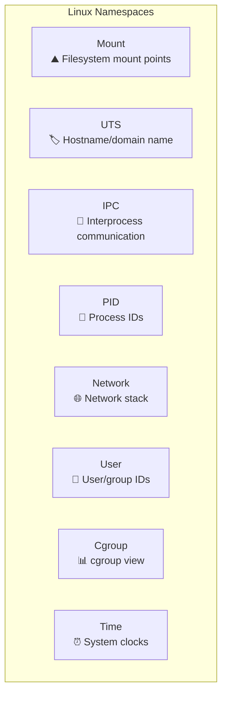
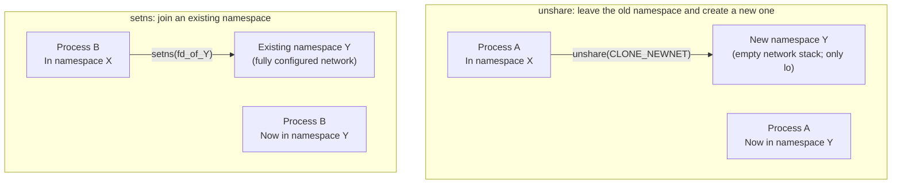
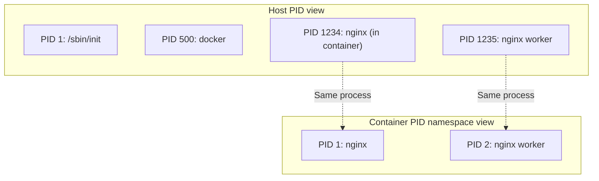
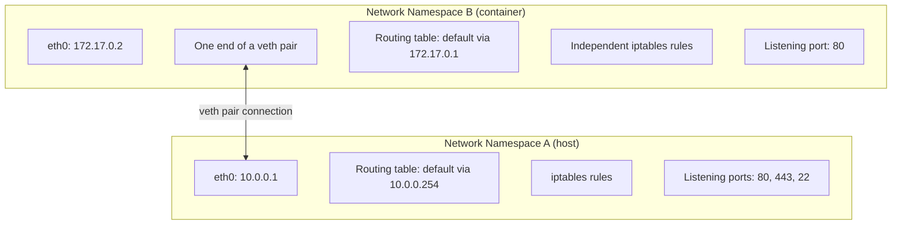
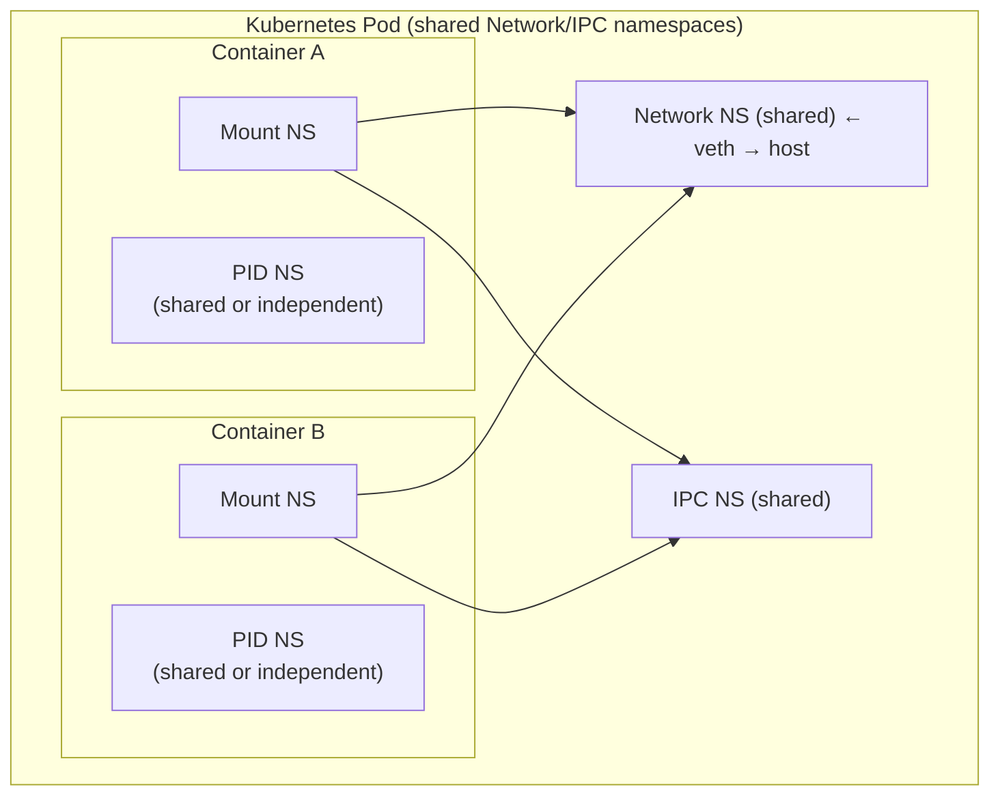
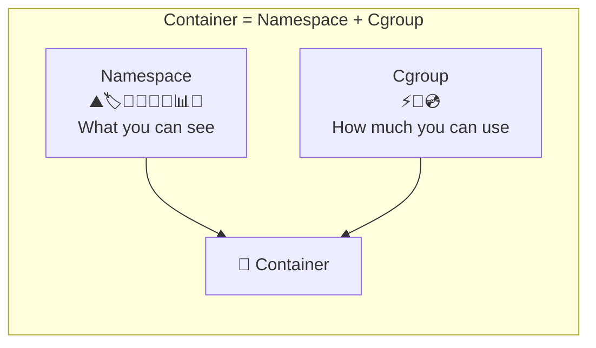

# Linux Namespaces Explained

## The Idea in One Sentence

A namespace is a Linux kernel mechanism for **resource isolation**. It gives a group of processes an independent view of system resources, as though they owned a machine. If cgroups answer “how many resources can you use?”, namespaces answer “which resources can you see?”

> cgroup = **quota** (how much you can use); namespace = **visibility** (what you can see). Together they form the foundation of container technology.

## Why Namespaces Are Needed

Before namespaces, all Linux processes shared one global view of resources:

- Every process saw the same `hostname`.
- Every process shared one PID space, with a single init process at PID 1.
- Every process saw the same network interfaces, such as `eth0` and `lo`.
- Every process shared the same filesystem root.
- The root user was the same root (UID 0) for every process.

The problem was that **processes could not be truly isolated**. Multiple services on one machine interfered with one another: changing the hostname affected everyone, a mounted filesystem was visible to all processes, and network-port conflicts were commonplace.

Namespaces solve this at the kernel level. First introduced in 2002 with Linux 2.4.19, they gradually expanded to cover different dimensions of the operating system.

## The Complete Picture: Eight Isolation Dimensions

As of Linux 6.x, the kernel supports **eight namespace types**, each isolating one operating-system dimension:



| # | Namespace | Introduced | Isolates | Flag |
|---|-----------|---------|---------|------|
| 1 | **Mount** | Linux 2.4.19 (2002) | Filesystem mount points | `CLONE_NEWNS` |
| 2 | **UTS** | Linux 2.6.19 (2006) | Hostname and NIS domain name | `CLONE_NEWUTS` |
| 3 | **IPC** | Linux 2.6.19 (2006) | System V IPC and POSIX message queues | `CLONE_NEWIPC` |
| 4 | **PID** | Linux 2.6.24 (2008) | Process PID space | `CLONE_NEWPID` |
| 5 | **Network** | Linux 2.6.24 (2008) | Network devices, IPs, ports, routes, iptables | `CLONE_NEWNET` |
| 6 | **User** | Linux 3.8 (2013) | UID/GID mappings | `CLONE_NEWUSER` |
| 7 | **Cgroup** | Linux 4.6 (2016) | cgroup root view | `CLONE_NEWCGROUP` |
| 8 | **Time** | Linux 5.6 (2020) | System clocks (`CLOCK_MONOTONIC`, `CLOCK_BOOTTIME`) | `CLONE_NEWTIME` |

> These eight namespaces cover eight operating-system dimensions. When you run `docker run`, Docker creates all eight namespace types for the container, depending on configuration, making it appear to own a machine.

## Three Core Namespace System Calls

Three system calls provide the core namespace operations:

| System call | Purpose | Typical use |
|---------|------|---------|
| `clone(flags)` | Create a process and place it in new namespaces | Create the initial process at container startup |
| `unshare(flags)` | Move the current process into new namespaces | `unshare -n ping 8.8.8.8` |
| `setns(fd)` | Join an existing namespace | `nsenter -t $PID -n` to enter a container's network |

### clone — Isolation at Creation

```c
// Create a process together with new UTS, PID, and Network namespaces
// The child sees an independent hostname, PID space, and network stack
int flags = CLONE_NEWUTS | CLONE_NEWPID | CLONE_NEWNET;
pid_t child_pid = clone(child_func, child_stack, flags, NULL);
```

`clone` underpins container runtimes. When you run `docker run`, the container process is created with `clone` and a collection of `CLONE_NEW*` flags.

### unshare — Isolation at Runtime

```bash
# The unshare command lets you experiment with namespaces from a shell
# Create new network and UTS namespaces and run a command in them
unshare --net --uts /bin/bash
hostname isolated-box    # Change the hostname without affecting the host
ip link                  # Only lo is visible, not the host's eth0
```

The distinctive feature of `unshare` is that an **already running** process can leave its current namespace for a newly created one. `clone` operates on a new process; `unshare` operates on the current process.

### setns — Join an Existing Namespace

```bash
# Join an existing process's namespace
# First find the target PID
ls -l /proc/1234/ns/net    # Inspect process 1234's network namespace

# Enter its network namespace
nsenter -t 1234 -n /bin/bash
# This shell now sees exactly the same network environment as process 1234
```

This is a powerful container-debugging tool: `setns` is the mechanism underneath `docker exec`. When you use `kubectl exec` to enter a Pod, kubelet likewise uses this mechanism to place the debugging process in the container's namespaces.

### unshare vs. setns: The Difference at a Glance

These calls are easy to confuse. Their CLI tools, `unshare` and `nsenter`, both appear to “switch namespaces,” but they move in different directions:



| Dimension | `unshare` | `setns` |
|------|-----------|---------|
| **Direction** | **Leave** the current namespace and create a **new** one | **Join** an **existing** namespace |
| **Namespace state** | Newly created, blank/initial state | Existing and potentially configured |
| **Command-line tool** | `unshare` | `nsenter` |
| **Effect on the original namespace** | Unaffected; it still exists | Unaffected; the process leaves it |
| **CAP_SYS_ADMIN** | Required unless combined with a user namespace | Required unless joining a user namespace you already own |
| **Typical question** | “I want an independent network stack for this process” | “I want to see the world inside this container” |
| **Underlying operation** | Create a namespace and switch into it | Switch into an existing namespace |
| **Special PID-namespace constraint** | Can only create one for children (`clone`); cannot unshare the current process's own PID namespace | Can only join a descendant PID namespace, not a sibling or ancestor |

**An analogy:**

- `unshare` is **moving out** of a shared apartment into a **new, empty apartment**. There is no furniture (network configuration), and the walls are bare (an empty mount table). You must furnish everything yourself.
- `setns` is **opening someone else's door** with your key and **stepping inside**. Their apartment may already be fully equipped with IP addresses, routes, and mounted disks; you are entering to experience that environment.

**Practical comparison:**

```bash
# === unshare: give the shell a brand-new, empty network namespace ===
unshare --net /bin/bash
ip addr show
# 1: lo: ... state UNKNOWN ...   ← Only lo; no configured network
# You must create veth devices and configure IP addresses, routes, etc. from scratch

# === setns (nsenter): enter an already configured container network ===
docker run -d --name mynginx nginx
nsenter -t $(docker inspect -f '{{.State.Pid}}' mynginx) -n /bin/bash
ip addr show
# 1: lo: ...
# 2: eth0@if5: ... inet 172.17.0.2/16 ...  ← IP address, routes, and more already exist
# You have entered the network environment Docker configured
```

**Why are both system calls necessary?**

They address different stages of the namespace lifecycle:

1. **Creation** (`clone` / `unshare`): something must **create** a namespace. Container runtimes such as runc and containerd use `clone` to establish initial namespaces, then `unshare` to isolate additional dimensions after startup.
2. **Access** (`setns`): something must be able to **enter** a namespace that already exists. Debugging tools such as `docker exec`, `kubectl exec`, and `nsenter` rely on `setns` to enter a target container's world.

> Without `setns`, you could never enter a running container's namespaces: `unshare` would only give you a new, empty namespace, rather than the container environment you wanted to inspect.

### Namespace Files in /proc

Each process exposes its namespace information under `/proc/[pid]/ns/`:

```bash
ls -l /proc/$$/ns/
# Example output:
# lrwxrwxrwx 1 root root 0 Jun 22 10:00 cgroup -> 'cgroup:[4026531835]'
# lrwxrwxrwx 1 root root 0 Jun 22 10:00 ipc -> 'ipc:[4026531839]'
# lrwxrwxrwx 1 root root 0 Jun 22 10:00 mnt -> 'mnt:[4026531841]'
# lrwxrwxrwx 1 root root 0 Jun 22 10:00 net -> 'net:[4026531840]'
# lrwxrwxrwx 1 root root 0 Jun 22 10:00 pid -> 'pid:[4026531836]'
# lrwxrwxrwx 1 root root 0 Jun 22 10:00 pid_for_children -> 'pid:[4026531836]'
# lrwxrwxrwx 1 root root 0 Jun 22 10:00 time -> 'time:[4026531834]'
# lrwxrwxrwx 1 root root 0 Jun 22 10:00 time_for_children -> 'time:[4026531834]'
# lrwxrwxrwx 1 root root 0 Jun 22 10:00 user -> 'user:[4026531837]'
# lrwxrwxrwx 1 root root 0 Jun 22 10:00 uts -> 'uts:[4026531838]'
```

The number in brackets, such as `4026531835`, is the namespace's **inode number**. Processes in the same namespace reference the same inode, which lets you check whether two processes share a namespace:

```bash
# Determine whether processes A and B share a network namespace
[ "$(readlink /proc/1234/ns/net)" = "$(readlink /proc/5678/ns/net)" ] \
  && echo "Same network namespace" || echo "Different network namespace"
```

## The Eight Namespace Types in Detail

### 1. Mount Namespace — Filesystem Isolation

**The first namespace type, introduced in Linux 2.4.19 in 2002**, was the starting point for the entire namespace mechanism.

A Mount namespace isolates the **view of filesystem mount points**. `mount` and `umount` operations within one mount namespace do not affect other namespaces.

```bash
# Experiment: see different /tmp contents in two mount namespaces
unshare --mount --fork /bin/bash
mount -t tmpfs tmpfs /tmp
echo "hello" > /tmp/test.txt
# In another terminal: ls /tmp/test.txt → file does not exist
```

**Why were Mount namespaces implemented first?**

In 2001, projects such as Linux VServer needed separate filesystem roots (`chroot`) for virtual environments. But `chroot` had a serious flaw: a process could escape through `chdir` + `chroot` or `fchdir`. Kernel developers recognized the need for real isolation at the VFS level. Mount namespaces followed, giving each namespace an independent mount-point list and addressing escape at the underlying level.

**Core features:**

| Feature | Description |
|------|------|
| Mount-point isolation | `mount`/`umount` in one namespace do not affect others |
| Mount propagation | Control whether mount events propagate between namespaces (`shared`/`slave`/`private`/`unbindable`) |
| Independent root through pivot_root | Each mount namespace can have its own `/`, forming the basis of container filesystem isolation |

**Mount propagation types:**

```bash
# Inspect mount propagation types
cat /proc/self/mountinfo | grep "/"
# shared:1  ← shared: mount events propagate in both directions
# master:1 ← slave: receives events only from its master
# (No shared/master marker) ← private: fully isolated
```

| Propagation type | Meaning | Container use |
|---------|------|---------|
| `shared` | Mount events propagate both ways | A disk mounted on the host also appears in the container |
| `slave` | Receives mount events only from the master | Container sees host mounts, but container mounts do not affect the host |
| `private` | Completely isolated; no propagation | Default mode; host and container do not affect each other |
| `unbindable` | Like private, but cannot be bind-mounted | Security-sensitive situations |

**Relationship to containers:** this is the foundation of container filesystem isolation. Docker's image layers (overlay2) are assembled within a mount namespace: each container sees the overlaid filesystem in its own namespace, while the host sees the original directories.

### 2. UTS Namespace — Hostname Isolation

**UTS** comes from Unix history: **Unix Time-sharing System**. It isolates two pieces of information:

- `hostname`.
- `domainname` (the largely obsolete NIS domain name).

```bash
# A quick experiment
unshare --uts /bin/bash
hostname container-01
hostname  # Output: container-01

# In another terminal
hostname  # Still the original hostname
```

UTS namespaces isolate little information, but are an important part of a container's sense of identity. Inside a container, `hostname` shows its container ID rather than the host's name.

```bash
# Inside a Docker container
docker run -it --hostname my-app alpine hostname
# my-app

# Inspect the container's UTS namespace
ls -l /proc/$(docker inspect -f '{{.State.Pid}}' <container>)/ns/uts
```

### 3. IPC Namespace — Interprocess Communication Isolation

IPC namespaces isolate System V IPC objects and POSIX message queues:

| Isolated resource | Description |
|---------|------|
| System V shared memory (`shmget`) | Processes in different namespaces cannot access the same shared-memory segment using the same key |
| System V semaphores (`semget`) | Semaphore sets are independent across namespaces |
| System V message queues (`msgget`) | Message queues are independent across namespaces |
| POSIX message queues (`mq_open`) | `/myqueue` in different namespaces refers to different queues |

```bash
# Experiment: the same key creates different shared memory in different IPC namespaces
unshare --ipc /bin/bash
ipcmk -M 1024   # Create shared memory, key=0x00000000
ipcs -m         # List shared-memory segments

# In another terminal
ipcs -m         # The segment created above is not visible
```

**Why does IPC isolation matter?** With multiple applications on a shared host, process A might accidentally read or write process B's data through shared memory without IPC namespaces. IPC namespaces define the communication boundary.

> Linux manages POSIX message queues through the `mqueue` filesystem, usually mounted at `/dev/mqueue`, so they also depend on correct Mount-namespace isolation.

### 4. PID Namespace — Process-ID Isolation

PID namespaces are particularly intuitive: they give processes in different namespaces **independent PID numbering spaces**.



**Key properties:**

1. **Nested PIDs**: PID namespaces can be nested. Processes in a child namespace have different PIDs in the parent namespace.
2. **Special role of PID 1**: PID 1 acts as `init` in each namespace, adopting orphaned processes and handling signals. If PID 1 exits, the kernel sends `SIGKILL` to every process in that namespace.
3. **Visibility only downward**: a process sees processes in its own PID namespace and descendant PID namespaces, but not other processes in ancestor namespaces.

```bash
# View a process's PIDs at different namespace levels
cat /proc/1234/status | grep -E "^Pid|^NSpid"
# Pid:    1234
# NSpid:  1234    1
# Meaning: PID 1234 in the parent namespace, PID 1 in its current namespace
```

**Relationship to containers:** this explains why `ps aux` inside a container shows only container processes:

```bash
# Inside Docker
docker run -it alpine ps aux
# PID   USER     TIME  COMMAND
#   1   root     0:00  /bin/sh
#   7   root     0:00  ps aux
# Only two processes are visible, rather than hundreds on the host
```

### 5. Network Namespace — Network-Stack Isolation

**The most complex and one of the most frequently used namespace types.** A Network namespace contains a complete, independent network stack:



Each Network namespace has its own:

| Resource | Description |
|------|------|
| Network devices | `lo`, `eth0`, `docker0`, etc. |
| IP addresses | Each namespace can have independent IP addresses |
| Routing table | Independent routing policy |
| iptables/nftables rules | Completely independent firewall rules |
| Port space | Different namespaces can listen on the same port number simultaneously |
| `/proc/net` | Shows only this namespace's network information |
| Socket isolation | Sockets in different namespaces are not mutually visible |

```bash
# Create two network namespaces and connect them
# 1. Create both namespaces
ip netns add ns1
ip netns add ns2

# 2. Create a veth pair to connect them
ip link add veth1 type veth peer name veth2

# 3. Assign each end
ip link set veth1 netns ns1
ip link set veth2 netns ns2

# 4. Configure IP addresses and bring interfaces up
ip netns exec ns1 ip addr add 10.0.0.1/24 dev veth1
ip netns exec ns1 ip link set veth1 up
ip netns exec ns1 ip link set lo up

ip netns exec ns2 ip addr add 10.0.0.2/24 dev veth2
ip netns exec ns2 ip link set veth2 up
ip netns exec ns2 ip link set lo up

# 5. ns1 and ns2 can now ping each other
ip netns exec ns1 ping 10.0.0.2  # ✅ Reachable
```

**Relationship to containers:** Docker's network models—bridge, host, none, and overlay—are built on Network namespaces. Each container has its own network namespace; the Docker daemon connects it to the host and outside world using veth pairs, bridges, and iptables.

### 6. User Namespace — User-Privilege Isolation

**The most powerful namespace, and also the most complex.** A User namespace lets a process be root (UID 0) inside the namespace while remaining an ordinary user on the host.

```bash
# Experiment: an ordinary user creates a network namespace without a user namespace
unshare --net ip link add dummy0 type dummy
# RTNETLINK answers: Operation not permitted  ← Fails! Root is required

# With a user namespace
unshare --user --net --map-root-user /bin/bash
# You are now root inside the new user namespace
id      # uid=0(root) gid=0(root)
ip link add dummy0 type dummy  # ✅ Success!
```

**Core concept: UID/GID mapping**

A User namespace maps internal UIDs/GIDs to host UIDs/GIDs through `/proc/[pid]/uid_map` and `/proc/[pid]/gid_map`:

```bash
# Format: inside-uid outside-uid length
# Meaning: inside-uid in the namespace maps to outside-uid on the host
echo "0 1000 1" > /proc/$$/uid_map
# Meaning: UID 0 (root) inside maps to UID 1000 (ordinary user) on the host
```

```
Inside namespace: UID 0 → Host: UID 1000
Inside namespace: UID 1 → Host: UID 1001
Inside namespace: UID 2 → Host: UID 1002
```

**This enables a major capability: unprivileged users can create containers.** It is the basis of rootless containers; both Podman and Docker's rootless mode depend on User namespaces.

> User namespaces were introduced in 2013 with Linux 3.8, but matured only after Linux 4.x. They expose the largest kernel attack surface of any namespace type, because almost every kernel subsystem must understand UID mappings.

### 7. Cgroup Namespace — cgroup-View Isolation

Introduced in Linux 4.6 in 2016, Cgroup namespaces addressed a longstanding issue: processes reading `/proc/self/cgroup` inside a container saw host cgroup paths, exposing the orchestration system's internal structure.

```bash
# Without a cgroup namespace (old behavior)
docker run -it alpine cat /proc/1/cgroup
# 12:cpuset:/docker/a1b2c3d4...    ← Exposes the container ID

# With a cgroup namespace (new behavior)
docker run -it alpine cat /proc/1/cgroup
# 12:cpuset:/                        ← Sees only "/", as though it were the root
```

A Cgroup namespace isolates the **root view** of the cgroup filesystem. A process inside one sees its cgroup path relative to that namespace's root cgroup.

### 8. Time Namespace — Clock Isolation

The newest namespace, introduced in 2020 with Linux 5.6, isolates two system clocks:

| Clock | Meaning |
|------|------|
| `CLOCK_MONOTONIC` | Time elapsed since boot (not adjustable) |
| `CLOCK_BOOTTIME` | A monotonic-clock variant that includes suspended time |

```bash
# Inspect offsets supported by the time namespace
cat /proc/$$/timens_offsets
# monotonic           0           0
# boottime            0           0

# Offset the monotonic clock by one hour inside a time namespace
unshare --time --boottime 3600 0 /bin/bash
cat /proc/self/timens_offsets
# monotonic           0           0
# boottime         3600           0
```

**Main use:** container snapshot restoration and migration. After migrating a container between machines, Time namespaces can keep its `CLOCK_MONOTONIC` continuous, preventing application errors caused by detecting a clock jump.

## General Namespace Properties

### Lifecycle: A Namespace Lives While It Is Used

The kernel manages namespace lifetimes automatically: **when no processes remain in a namespace, it is destroyed**.

An important exception is that bind-mounting `/proc/[pid]/ns/[type]` keeps the namespace alive even when it contains no processes.

```bash
# Keep a network namespace alive even without processes inside it
touch /var/run/netns/myns
ip netns add myns
mount --bind /proc/1234/ns/net /var/run/netns/myns
# Even if process 1234 exits, the myns network namespace remains alive
```

This is how `ip netns` works: it maintains bind mounts under `/var/run/netns/` so empty network namespaces are not reclaimed automatically.

### Namespace Types Can Be Combined Independently

The eight types are not all-or-nothing; choose the combination you need:

```bash
# Isolate only the network and hostname, leaving PID and Mount shared
unshare --net --uts /bin/bash

# Docker creates a complete container with all namespaces by default
# You can also choose to share specific namespaces
docker run --network=host ...    # Share the host Network namespace
docker run --pid=host ...        # Share the host PID namespace
docker run --ipc=host ...        # Share the host IPC namespace
```

The Kubernetes Pod model follows this idea: containers in the same Pod share Network and IPC namespaces while retaining independent Mount namespaces.



### List All Namespaces on the System

```bash
# List every namespace, grouped by type
lsns

# Example output:
#         NS TYPE   NPROCS   PID USER   COMMAND
# 4026531835 cgroup    156     1 root   /sbin/init
# 4026531836 pid       150     1 root   /sbin/init
# 4026531837 user      156     1 root   /sbin/init
# 4026531838 uts       155     1 root   /sbin/init
# 4026531839 ipc       155     1 root   /sbin/init
# 4026531840 net       153     1 root   /sbin/init
# 4026531841 mnt       139     1 root   /sbin/init
# 4026532500 net         2  1234 root   /usr/bin/docker-proxy
# 4026532501 mnt         1  5678 root   nginx: master process

# Show namespaces for a specific process
lsns -p 5678

# Show only one type
lsns -t net
```

## Namespaces vs. cgroups: A Comparison

These are often mentioned together, but solve different problems:



| Dimension | Namespace | Cgroup |
|------|-----------|--------|
| **Core purpose** | Resource **isolation** | Resource **limitation** |
| **Problem addressed** | Process A cannot see process B's resources | Process A cannot exhaust process B's resources |
| **Interface** | `clone` / `unshare` / `setns` system calls | Filesystem interface at `/sys/fs/cgroup/` |
| **Where to inspect** | `/proc/[pid]/ns/` | `/proc/[pid]/cgroup` |
| **Optionality** | Each namespace type is optional | Each controller is optional |
| **History** | Started in 2002; eight types | Started in 2006; v1 with over a dozen subsystems, then v2 |
| **Importance to containers** | Without namespaces, containers are ordinary processes | Without cgroups, one container can overwhelm the machine |

**A concrete analogy:**

- A namespace is your apartment's **walls**: you cannot see other tenants, and they cannot see you.
- A cgroup is your apartment's **electricity and water meters**: you receive a limited allocation, and exceeding it cuts off supply.

A complete container needs both. Walls without meters let one tenant consume all utilities; meters without walls leave tenants able to see and interfere with each other.

## Summary

Linux namespaces are the container world's “invisibility cloak.” Eight namespace types cover eight operating-system dimensions, making each container appear to be the only environment in its universe:

1. **Mount** — see your own rootfs instead of the host filesystem.
2. **UTS** — have your own hostname.
3. **IPC** — isolate shared memory, semaphores, and message queues from others.
4. **PID** — `ps aux` shows only your own processes.
5. **Network** — have your own interfaces, IP addresses, ports, and firewall.
6. **User** — be root inside a container while remaining an ordinary user on the host.
7. **Cgroup** — your cgroup path appears to be the root.
8. **Time** — offset clocks for snapshot restoration.

Understanding namespaces is essential not only for containers, but also for the Kubernetes Pod sharing model, rootless containers, and Linux security. Together with [cgroup v2 Explained](/en/notes/linux/cgroup/), this covers the two kernel foundations of container technology.
