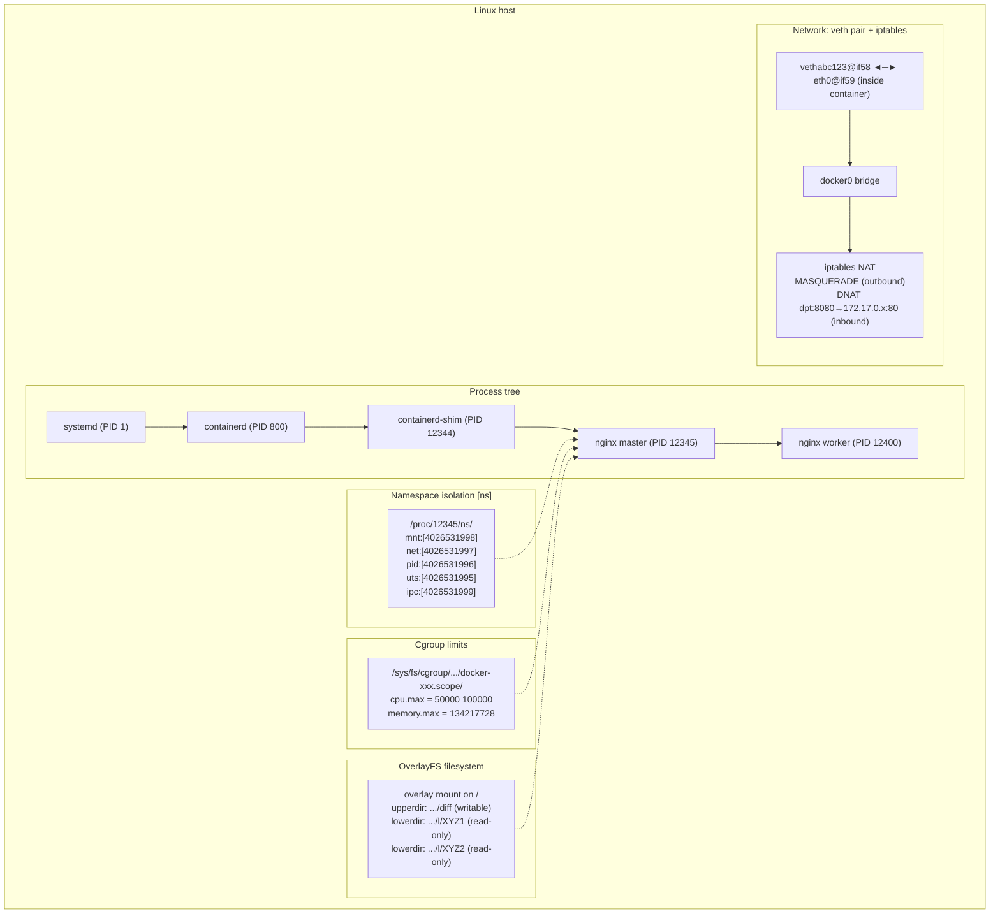

# Docker Containers from a Linux Perspective: Just an Ordinary Process Under Constraints

## The Idea in One Sentence

From Linux's perspective, a Docker container involves **no magic**: it is an ordinary process confined by namespaces and restrained by cgroups. You can see it with `ps aux` on the host, its `/proc/<pid>/` directory exists as usual, and `kill -9` can terminate it. Docker merely automates the tedious steps involved in creating an isolated process.

> Understand **container = process + namespaces (restricted visibility) + cgroup (resource limits) + overlayfs (filesystem)**, and you understand the essence of container technology.

## Start with an Experiment: Find Your Container Process

Start an Nginx container, then find it on the host:

```bash
# Start an Nginx container
docker run -d --name my-nginx --memory 128m --cpus 0.5 nginx:latest

# Find it on the host
ps aux | grep nginx
# Example output:
# root     12345  0.0  0.1 123456 12345 ?  Ssl  10:00  0:00 nginx: master process nginx -g daemon off;
# The nginx process appears in the host's process list; it is not hidden at all
```

This first observation reveals the central fact: **container processes run directly on the host kernel and are fully visible to the host's `ps`.**

## 1. The Process Perspective: A Container Is a Process

### 1.1 Find the Container Process PID

```bash
# Method 1: docker inspect
docker inspect my-nginx --format '{{.State.Pid}}'
# Output: 12345

# Method 2: docker top
docker top my-nginx
# Output:
# UID   PID   PPID  C  STIME  TTY  TIME     CMD
# root  12345 12344 0  10:00  ?    00:00:00 nginx: master process nginx -g daemon off;
# 101   12400 12345 0  10:00  ?    00:00:00 nginx: worker process
```

You now have the actual host PID: `12345`. Starting with this PID, you can inspect all its Linux information just as you would for any ordinary process.

### 1.2 Inspect the Process Tree: Who Is the Container Process's Parent?

```bash
pstree -ps 12345
# Example output:
# systemd(1)───containerd(800)───containerd-shim(12344)───nginx(12345)───nginx(12400)
```

The chain of parent processes is straightforward:

```
systemd (host init)
  └── containerd (container runtime)
       └── containerd-shim (shim process, handling stdio and exit status)
            └── nginx (your container process!)
                 └── nginx worker
```

`containerd-shim` is an intermediary process with two responsibilities:
- Keep the container's stdin/stdout/stderr pipes open so `docker logs` can show its output.
- Report the exit code to containerd when the container process exits.

> This also explains why a `containerd-shim` process may remain briefly after `docker stop`: it waits for the container to exit completely before cleaning up.

### 1.3 The Container Process's proc Directory: Nothing Is Missing

```bash
# The container's /proc directory is also accessible on the host
ls /proc/12345/
# Output is exactly like that of an ordinary process:
# attr/  cmdline  cwd/  environ  exe  fd/  maps  mounts  ns/  root/  stat  status  ...
```

Next, we will explore these key files one by one to see how a container process differs from an ordinary process.

## 2. The Namespace Perspective: The Container's Enclosure

Namespaces are central to container isolation. **Once a process enters a namespace, the world it sees changes—but `/proc/<pid>/ns/` reveals the truth.**

### 2.1 Compare Container and Host Namespaces

```bash
# View the container process's namespaces
sudo ls -l /proc/12345/ns/
# Example output:
# lrwxrwxrwx 1 root root 0 Jun 25 10:00 cgroup -> cgroup:[4026532000]
# lrwxrwxrwx 1 root root 0 Jun 25 10:00 ipc    -> ipc:[4026531999]
# lrwxrwxrwx 1 root root 0 Jun 25 10:00 mnt    -> mnt:[4026531998]
# lrwxrwxrwx 1 root root 0 Jun 25 10:00 net    -> net:[4026531997]
# lrwxrwxrwx 1 root root 0 Jun 25 10:00 pid    -> pid:[4026531996]
# lrwxrwxrwx 1 root root 0 Jun 25 10:00 uts    -> uts:[4026531995]
# lrwxrwxrwx 1 root root 0 Jun 25 10:00 user   -> user:[4026531837]

# Compare them with the current shell's (host) namespaces
sudo ls -l /proc/$$/ns/
# Example output:
# lrwxrwxrwx 1 root root 0 Jun 25 10:00 cgroup -> cgroup:[4026531835]
# lrwxrwxrwx 1 root root 0 Jun 25 10:00 ipc    -> ipc:[4026531839]
# lrwxrwxrwx 1 root root 0 Jun 25 10:00 mnt    -> mnt:[4026531841]
# lrwxrwxrwx 1 root root 0 Jun 25 10:00 net    -> net:[4026531840]
# lrwxrwxrwx 1 root root 0 Jun 25 10:00 pid    -> pid:[4026531836]
# lrwxrwxrwx 1 root root 0 Jun 25 10:00 uts    -> uts:[4026531838]
# lrwxrwxrwx 1 root root 0 Jun 25 10:00 user   -> user:[4026531837]
```

The key observation: **the numbers in brackets differ** (possibly excepting user), showing that the container process occupies **new namespaces**. This is the basis of isolation.

```
┌──────────────────────────────────────┐  ┌──────────────────────────────────────┐
│       Host shell ($$)                │  │       Container nginx (12345)        │
│                                      │  │                                      │
│  mnt:[4026531841] ← Different home    │  │  mnt:[4026531998] ← Different home    │
│  net:[4026531840] ← Different network │  │  net:[4026531997] ← Different network │
│  pid:[4026531836] ← Different IDs     │  │  pid:[4026531996] ← Different IDs     │
│  uts:[4026531838] ← Different hostname│  │  uts:[4026531995] ← Different hostname│
│  ipc:[4026531839] ← Different IPC     │  │  ipc:[4026531999] ← Different IPC     │
└──────────────────────────────────────┘  └──────────────────────────────────────┘
```

### 2.2 Peek into the Container's World from the Host

Using `/proc/<pid>/root`, you can run commands on the host that view the container's filesystem:

```bash
# View the container's root directory (its "/", as seen from the host)
sudo ls /proc/12345/root/
# Output: bin  boot  dev  etc  home  lib  media  mnt  opt  proc  root  run  sbin  srv  sys  tmp  usr  var
# These are the extracted contents of the nginx image!

# View the container's processes (its "/proc", as seen from the host)
sudo ls /proc/12345/root/proc/
# Output: 1  10  ... (PIDs visible inside the container)

# Compare with the host /proc: the view is completely different
ls /proc/
# Output: 1  2  3  ... 800 ... 12345 ... (every process on the host)
```

### 2.3 nsenter: Step into the Container's Perspective

`nsenter` lets you **temporarily join** the namespaces of a running container:

```bash
# Enter all the container's namespaces (equivalent to docker exec, but directly from the host)
sudo nsenter -t 12345 -a /bin/bash

# You are now inside the container:
hostname      # Shows the container hostname, not the host hostname
ip addr       # Shows only the container's network interfaces
ps aux        # Shows only container processes, with PIDs starting at 1
ls /          # Shows the container image filesystem

exit  # Leave the container
```

```bash
# Advanced use: join only the network namespace to troubleshoot networking
sudo nsenter -t 12345 -n ip addr
# Shows the container's network configuration; useful for debugging

# Join only the mount namespace to inspect container files
sudo nsenter -t 12345 -m ls /etc/nginx/
```

> Fundamentally, `docker exec` wraps the same idea as `nsenter`: use a container's PID to join its namespaces.

### 2.4 PID 1 Inside the Container vs. the Actual Host PID

```bash
# View from inside the container
docker exec my-nginx ps aux
# Output:
# USER  PID  %CPU %MEM    VSZ   RSS TTY  STAT  START  TIME  COMMAND
# root    1   0.0  0.1  12345  6789 ?    Ss    10:00  0:00  nginx: master process
# nginx  10   0.0  0.1  12345  6789 ?    S     10:00  0:00  nginx: worker process

# View the same process from the host
ps aux | grep 12345
# Output:
# root  12345  0.0  0.1  12345  6789 ?  Ss  10:00  0:00  nginx: master process
# 101   12400  0.0  0.1  12345  6789 ?  S   10:00  0:00  nginx: worker process
```

The same process appears as PID 1 inside the container because of its PID namespace, and as PID 12345 on the host, its actual global PID. **A PID namespace merely “translates” PID numbering; the process itself is unchanged.**

## 3. The Cgroup Perspective: The Container's Restraints

Cgroups limit the resources available to a container. Settings such as `docker run --memory 128m --cpus 0.5` ultimately become values written to files under `/sys/fs/cgroup/`.

### 3.1 Find the Container's cgroup Path

```bash
# Method 1: inspect /proc/<pid>/cgroup
cat /proc/12345/cgroup
# Example cgroup v2 output (one line):
# 0::/system.slice/docker-abc123def456.scope

# Method 2: use docker inspect
docker inspect my-nginx --format '{{.HostConfig.CgroupParent}}'
```

### 3.2 Inspect the Container's Resource Limits

```bash
# Assume the cgroup path is /sys/fs/cgroup/system.slice/docker-abc123.scope/
CGPATH="/sys/fs/cgroup/system.slice/docker-abc123def456.scope"

# Read the CPU limit (we specified --cpus 0.5)
cat $CGPATH/cpu.max
# Output: 50000 100000
# Meaning: at most 50000 microseconds (50 ms) per 100000-microsecond (100 ms) period → 0.5 cores

# Read the memory limit (we specified --memory 128m)
cat $CGPATH/memory.max
# Output: 134217728
# Meaning: 134217728 bytes = 128 MiB

# Read current memory usage
cat $CGPATH/memory.current
# Output: 52428800  ← About 50 MB

# List every process in the container
cat $CGPATH/cgroup.procs
# Output:
# 12345
# 12400
# These are the PIDs confined to this cgroup
```

### 3.3 Live Verification: How cgroup Limits Take Effect

```bash
# Run a memory-intensive command inside the container
docker exec my-nginx sh -c "dd if=/dev/zero of=/dev/null bs=100M count=10"
# No problem, because it only writes to /dev/null

# A test that really consumes memory, using a stress operation in the container
docker exec my-nginx sh -c "tail /dev/zero"
# With memory.max=128M, this command will soon be OOMKilled

# Observe cgroup events on the host
cat /sys/fs/cgroup/system.slice/docker-abc123def456.scope/memory.events
# Output:
# low 0
# high 0
# max 1234      ← Times the memory.max limit was reached
# oom 1         ← Number of OOM-kill occurrences!
# oom_kill 1    ← Number of processes actually killed
```

### 3.4 Comparison: What Happens without cgroup Limits?

```bash
# Start a container without a memory limit for comparison
docker run -d --name no-limit-nginx nginx:latest
NO_LIMIT_PID=$(docker inspect no-limit-nginx --format '{{.State.Pid}}')

# Inspect its cgroup memory limit
cat /proc/$NO_LIMIT_PID/cgroup
# Find the corresponding cgroup path
cat /sys/fs/cgroup/system.slice/docker-xxx.scope/memory.max
# Output: max
# "max" means unlimited: it can use all host memory
```

### 3.5 Change cgroup Limits Manually without Restarting the Container

```bash
# Change the container's memory limit to 256M; it applies immediately!
echo "268435456" | sudo tee /sys/fs/cgroup/system.slice/docker-abc123def456.scope/memory.max

# Change the CPU limit to 1 core
echo "100000 100000" | sudo tee /sys/fs/cgroup/system.slice/docker-abc123def456.scope/cpu.max

# No container restart is needed; the kernel enforces the new limits immediately
docker stats my-nginx --no-stream
# MEM LIMIT now shows 256 MiB
```

> This is the underlying mechanism allowing Kubernetes to adjust resource limits dynamically without restarting a Pod: write directly to cgroup files.

## 4. The Filesystem Perspective: OverlayFS Layers

Docker's layered images rely on OverlayFS, a union filesystem.

### 4.1 View the Container's Mount Information

```bash
# Inspect mounts through the container's /proc/<pid>/mountinfo
cat /proc/12345/mountinfo | grep overlay
# Output resembles:
# ... overlay / overlay rw,relatime,lowerdir=/var/lib/docker/overlay2/l/XYZ1:/var/lib/docker/overlay2/l/XYZ2,upperdir=/var/lib/docker/overlay2/ABC123/diff,workdir=/var/lib/docker/overlay2/ABC123/work ...
```

Interpreting this output:

```
/var/lib/docker/overlay2/ABC123/diff   ← upperdir (writable layer; all container changes go here)
/var/lib/docker/overlay2/l/XYZ1        ← lowerdir layer 1 (read-only image layer)
/var/lib/docker/overlay2/l/XYZ2        ← lowerdir layer 2 (read-only image layer)
```

```
┌──────────────────────────────┐
│  Upper Dir (read/write)      │  ← Container deletions/modifications are recorded here
│  /var/lib/docker/overlay2/   │     All changes shown by docker diff are here
│  ABC123/diff                │
├──────────────────────────────┤
│  Lower Dir 2 (read-only)     │  ← Created by RUN apt-get install nginx
│  /var/lib/docker/overlay2/   │
│  l/XYZ2                     │
├──────────────────────────────┤
│  Lower Dir 1 (read-only)     │  ← Created by FROM ubuntu:22.04
│  /var/lib/docker/overlay2/   │
│  l/XYZ1                     │
└──────────────────────────────┘
```

### 4.2 Inspect the Container's Writable Layer Directly from the Host

```bash
# Obtain the container's merged directory (the complete overlay view)
MERGED=$(cat /proc/12345/mountinfo | grep ' / ' | awk '{print $5}')
echo $MERGED
# Output: /var/lib/docker/overlay2/ABC123/merged

# These are the actual contents visible at "/" inside the container
sudo ls $MERGED
# Output: bin  boot  dev  etc  home  lib  ...

# Compare: exactly the same view as /proc/12345/root
sudo ls /proc/12345/root/
```

### 4.3 Verify OverlayFS Copy-on-Write

```bash
# Modify a file inside the container
docker exec my-nginx sh -c "echo hello > /tmp/test.txt"

# Find this file on the host
# It does not exist in lowerdir (the read-only layer)
sudo ls /var/lib/docker/overlay2/l/XYZ1/tmp/ 2>/dev/null
# No output

# It appears in upperdir (the writable layer)!
sudo ls /var/lib/docker/overlay2/ABC123/diff/tmp/
# Output: test.txt

sudo cat /var/lib/docker/overlay2/ABC123/diff/tmp/test.txt
# Output: hello
```

If you **modify** a file already present in the image, such as `/etc/nginx/nginx.conf`:
- The original file in lowerdir remains unchanged.
- The modified copy is written to upperdir.
- In the merged view, the upperdir file hides the same-named file in lowerdir.

This is OverlayFS **copy-on-write**: copy only what changes; unchanged content is shared among all containers.

### 4.4 docker diff: Quickly See Container Changes

```bash
docker diff my-nginx
# Output:
# C /root          ← Changed
# A /tmp/test.txt  ← Added
# C /etc/nginx/nginx.conf  ← Changed configuration file
```

Fundamentally, `docker diff` compares upperdir and lowerdir.

## 5. The Network Perspective: Veth Pairs and iptables

### 5.1 Inspect the Container's Network Interfaces

```bash
# On the host, run ip in the container's network namespace
sudo nsenter -t 12345 -n ip addr
# Output:
# 1: lo: ...
# 58: eth0@if59: ...
# The container has only one eth0

# Back in the host view, find the other end of the veth pair
ip link show | grep veth
# Output:
# 59: vethabc123@if58: ...
```

Notice the matching indices:
- Container: `eth0@if59` (index 58, peer index 59).
- Host: `vethabc123@if58` (index 59, peer index 58).

**A veth pair is a virtual network cable**: one end is inside the container (eth0), and the other connects to the host's Docker bridge.

```
┌─────────────────┐         ┌─────────────────────┐
│ Container(net ns)│         │ Host (host net ns)  │
│                 │         │                     │
│  eth0@if59      │  veth   │  vethabc123@if58    │
│  (index 58)     │◄══════►│  (index 59)         │
│  172.17.0.2/16  │  pair   │  master: docker0    │
│                 │         │                     │
└─────────────────┘         └──────────┬──────────┘
                                       │
                                ┌──────▼──────┐
                                │   docker0   │
                                │   bridge    │
                                │ 172.17.0.1  │
                                └──────┬──────┘
                                       │
                                  ┌────▼────┐
                                  │  NAT    │
                                  │(iptables)│
                                  └────┬────┘
                                       │
                                  Host eth0
                                  (external network)
```

### 5.2 Inspect iptables Rules: How Containers Reach the Internet

```bash
# View NAT rules added by Docker
sudo iptables -t nat -L POSTROUTING | grep docker
# Output resembles:
# MASQUERADE  all  --  172.17.0.0/16  anywhere
```

This rule means traffic originating from the container network `172.17.0.0/16` undergoes SNAT (source address translation) before leaving the host interface, appearing to come from the host IP.

```bash
# Access the internet from inside the container
docker exec my-nginx curl ifconfig.me
# The output is the host's public IP, not the container's 172.17.0.2

# That is iptables MASQUERADE at work
```

### 5.3 Inspect Port Publishing: DNAT Rules

```bash
# Start a container with a published port
docker run -d --name nginx-port -p 8080:80 nginx:latest
PID=$(docker inspect nginx-port --format '{{.State.Pid}}')

# View the iptables DNAT rule
sudo iptables -t nat -L DOCKER | grep 8080
# Output resembles:
# DNAT  tcp  --  anywhere  anywhere  tcp dpt:8080 to:172.17.0.3:80
```

`-p 8080:80` fundamentally adds a DNAT rule: host port 8080 → container address 172.17.0.3:80.

## 6. The Complete Picture: Putting the Pieces Together

Here is everything that actually happens in Linux after running `docker run -d --name my-nginx --memory 128m --cpus 0.5 -p 8080:80 nginx:latest`:



The key observations:

- **Process**: `ps aux | grep nginx` shows it with a real host PID.
- **Namespaces**: `/proc/<pid>/ns/` contains independent namespace identifiers in brackets.
- **Cgroup**: `/sys/fs/cgroup/.../docker-xxx.scope/` holds its resource limits.
- **Filesystem**: `/proc/<pid>/mountinfo` reveals the overlay lowerdir and upperdir.
- **Network**: one veth end lives in the container and the other on the host bridge; iptables handles NAT.

## 7. Summary: Containers Are Not Mysterious Technology

| What you might assume | What Linux actually sees |
|:---|:---|
| A container is a lightweight virtual machine | A container is an **ordinary process** that `kill -9` can terminate |
| A container has its own kernel | A container **has no kernel**; it invokes the host kernel's syscalls directly |
| A container has an independent filesystem | It is a view assembled by OverlayFS from several image layers |
| A container has its own IP and network card | It has a **virtual** eth0 linked to the host bridge through a veth pair |
| `docker run -m 128m` is magic | It writes a number into `/sys/fs/cgroup/.../memory.max` |
| Containers start quickly because of advanced technology | They are **just starting a process**, without booting a kernel |

**The entire secret of containers lies in three Linux kernel features**:

$$
\text{Container} = \text{Namespace} + \text{Cgroup} + \text{OverlayFS}
$$

Docker, containerd, and Podman build on these three technologies to provide conveniences such as image management, network configuration, and log collection. Peel those layers away, and Linux sees only an ordinary process confined by namespaces and constrained by cgroups.
