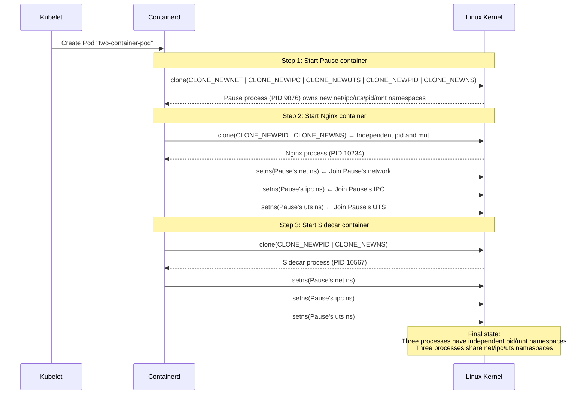

# Multi-Container Kubernetes Pods from a Linux Perspective: Processes Sharing a Set of Namespaces

## The Idea in One Sentence

A Kubernetes Pod containing multiple containers can seem remarkable: they share an IP address and port space and can communicate through `localhost`. From Linux's perspective, however, **a Pod is a group of processes whose Network, IPC, and UTS namespaces point to the same kernel objects, while their Mount and PID namespaces remain independent**. A long-lived Pause process acts as the “landlord,” anchoring those shared namespaces.

> If you have read “Docker Containers from a Linux Perspective,” understanding Pods requires just one additional concept: **some namespace symbolic links for multiple containers point to the same identifier in brackets**.

## Start with an Experiment: Create a Two-Container Pod

Use the classic sidecar pattern: an Nginx main container plus a Busybox sidecar:

```yaml
# pod-demo.yaml
apiVersion: v1
kind: Pod
metadata:
  name: two-container-pod
spec:
  containers:
  - name: nginx
    image: nginx:latest
    ports:
    - containerPort: 80
  - name: sidecar
    image: busybox:latest
    command: ["sh", "-c", "while true; do echo 'sidecar alive'; sleep 10; done"]
```

```bash
kubectl apply -f pod-demo.yaml
```

Once the Pod is running, SSH directly into its Kubernetes node and dissect it with native Linux commands.

## 1. The Process Perspective: How Many Host Processes Represent a Pod?

### 1.1 Find All the Pod's Processes

```bash
# First find the Pause container (every Pod has one)
crictl ps | grep two-container-pod
# Output resembles:
# CONTAINER ID   IMAGE                              STATE     NAME       POD ID
# abc123def456   registry.k8s.io/pause:3.9          Running   (pause)    789...
# 111222333444   nginx:latest                       Running   nginx      789...
# 555666777888   busybox:latest                     Running   sidecar    789...

# Obtain each container's host PID
PAUSE_PID=$(crictl inspect abc123def456 | jq '.info.pid')
NGINX_PID=$(crictl inspect 111222333444 | jq '.info.pid')
SIDECAR_PID=$(crictl inspect 555666777888 | jq '.info.pid')
echo "Pause: $PAUSE_PID, Nginx: $NGINX_PID, Sidecar: $SIDECAR_PID"
# Example output: Pause: 9876, Nginx: 10234, Sidecar: 10567
```

Three containers, three processes, all clearly visible on the host.

### 1.2 Inspect the Process Tree: Pause Is the Landlord

```bash
pstree -ps $PAUSE_PID
# Example output:
# systemd(1)───containerd(800)───containerd-shim(9870)───pause(9876)

pstree -ps $NGINX_PID
# Example output:
# systemd(1)───containerd(800)───containerd-shim(10230)───nginx(10234)───nginx(10235)

pstree -ps $SIDECAR_PID
# Example output:
# systemd(1)───containerd(800)───containerd-shim(10560)───sleep(10567)
```

The key observation: **Pause, Nginx, and the sidecar are not parent and child processes**. Each has its own `containerd-shim` parent, but they share certain namespaces. That is the central mechanism behind a Pod.

```
                     systemd
                        │
                   containerd
                   /    |    \
          shim(Pause) shim(nginx) shim(sidecar)
               |          |           |
            pause(9876) nginx(10234) sleep(10567)
               |          |
               └─ shared net/ipc/uts ns ─┘
```

## 2. The Namespace Perspective: Shared and Independent Parts

This is the most important part of understanding Pods. Compare the `/proc/<pid>/ns/` directories for all three processes directly.

### 2.1 Shared Namespaces: Network, IPC, and UTS

```bash
# Inspect namespace symbolic links for the three processes
# Compare the inode numbers (the numbers in brackets)
sudo ls -l /proc/9876/ns/net /proc/10234/ns/net /proc/10567/ns/net
# Output:
# lrwxrwxrwx ... net -> net:[4026532222]
# lrwxrwxrwx ... net -> net:[4026532222]  ← Identical!
# lrwxrwxrwx ... net -> net:[4026532222]  ← Identical!

sudo ls -l /proc/9876/ns/ipc /proc/10234/ns/ipc /proc/10567/ns/ipc
# Output:
# lrwxrwxrwx ... ipc -> ipc:[4026532221]
# lrwxrwxrwx ... ipc -> ipc:[4026532221]  ← Identical!
# lrwxrwxrwx ... ipc -> ipc:[4026532221]  ← Identical!

sudo ls -l /proc/9876/ns/uts /proc/10234/ns/uts /proc/10567/ns/uts
# Output:
# lrwxrwxrwx ... uts -> uts:[4026532220]
# lrwxrwxrwx ... uts -> uts:[4026532220]  ← Identical!
# lrwxrwxrwx ... uts -> uts:[4026532220]  ← Identical!
```

**The identifiers for Network, IPC, and UTS match exactly**, meaning the three container processes reference **the same kernel namespace objects**. They see the same network stack and hostname, and share the same IPC resources.

### 2.2 Independent Namespaces: Mount and PID

```bash
# Mount namespaces are independent
sudo ls -l /proc/9876/ns/mnt /proc/10234/ns/mnt /proc/10567/ns/mnt
# Output:
# lrwxrwxrwx ... mnt -> mnt:[4026532223]
# lrwxrwxrwx ... mnt -> mnt:[4026532224]  ← Different!
# lrwxrwxrwx ... mnt -> mnt:[4026532225]  ← Different!

# PID namespaces are independent
sudo ls -l /proc/9876/ns/pid /proc/10234/ns/pid /proc/10567/ns/pid
# Output:
# lrwxrwxrwx ... pid -> pid:[4026532226]
# lrwxrwxrwx ... pid -> pid:[4026532227]  ← Different!
# lrwxrwxrwx ... pid -> pid:[4026532228]  ← Different!
```

Mount and PID namespaces remain independent: each container has its own root filesystem and PID numbering space.

### 2.3 The Pod Namespace-Sharing Model in One Diagram

```
┌────────────────────────────────────────────────────────────┐
│                         Pod                                │
│                                                            │
│   Shared namespaces (same kernel objects):                 │
│   ┌──────────────────────────────────────────────────┐     │
│   │  Network NS  net:[4026532222]                    │     │
│   │  IPC NS      ipc:[4026532221]                    │     │
│   │  UTS NS      uts:[4026532220]                    │     │
│   └──────────────────────────────────────────────────┘     │
│         ▲                ▲                ▲                │
│         │                │                │                │
│   ┌─────┴─────┐    ┌─────┴─────┐    ┌─────┴─────┐         │
│   │  Pause    │    │  Nginx    │    │  Sidecar  │         │
│   │  (9876)   │    │  (10234)  │    │  (10567)  │         │
│   │           │    │           │    │           │         │
│   │ Own mnt   │    │ Own mnt   │    │ Own mnt   │         │
│   │ mnt:[..3] │    │ mnt:[..4] │    │ mnt:[..5] │         │
│   │ Own pid   │    │ Own pid   │    │ Own pid   │         │
│   │ pid:[..6] │    │ pid:[..7] │    │ pid:[..8] │         │
│   └───────────┘    └───────────┘    └───────────┘         │
│                                                            │
│   Pause anchors the net/ipc/uts namespaces                  │
│   While Pause lives, the kernel does not reclaim them      │
└────────────────────────────────────────────────────────────┘
```

## 3. Verify the Sharing with Commands

Diagrams alone are not enough; verify the behavior directly.

### 3.1 Shared Network Namespace: Communication through localhost

```bash
# Enter the Nginx container's network namespace
sudo nsenter -t $NGINX_PID -n ip addr
# Output:
# 1: lo: <LOOPBACK,UP,LOWER_UP> ...
# 3: eth0@if4: <BROADCAST,...> ... 10.244.1.5/24 ...
# Nginx has IP 10.244.1.5

# Inspect the sidecar's network namespace
sudo nsenter -t $SIDECAR_PID -n ip addr
# Exactly the same output and the same IP, 10.244.1.5!
# They share one network namespace
```

Now verify the most important consequence:

```bash
# Access Nginx through localhost from the sidecar
kubectl exec two-container-pod -c sidecar -- wget -qO- http://localhost:80
# Output: Nginx welcome-page HTML!
# Success: localhost belongs to the same network namespace
```

```bash
# Conversely, access the sidecar from Nginx if the sidecar opens a port
# localhost works in this direction too, since both share the same network namespace
```

> This explains why containers in one Pod **must not listen on the same port**: they share a port space, and `localhost:80` refers to the same port for Nginx and the sidecar.

### 3.2 Shared UTS Namespace: The Same Hostname

```bash
# Inspect the Nginx container's hostname
sudo nsenter -t $NGINX_PID -u hostname
# Output: two-container-pod

# Inspect the sidecar's hostname
sudo nsenter -t $SIDECAR_PID -u hostname
# Output: two-container-pod  ← Exactly the same!
```

Sharing a UTS namespace means `hostname` in either container sees the same value. By default, this hostname is the Pod name.

### 3.3 Independent Mount Namespaces: Different Filesystems

```bash
# Nginx container's root filesystem
sudo ls /proc/$NGINX_PID/root/
# Output: bin  boot  dev  etc  home  ...  usr  var
# Contents of the nginx:latest image

# Sidecar's root filesystem
sudo ls /proc/$SIDECAR_PID/root/
# Output: bin  dev  etc  home  ...  tmp  usr  var
# Contents of busybox:latest, with many fewer directories

# Look for busybox commands in Nginx
sudo ls /proc/$NGINX_PID/root/bin/ | grep busybox
# No output: the Nginx image has no busybox

# Look for nginx in the sidecar
sudo ls /proc/$SIDECAR_PID/root/usr/sbin/ | grep nginx
# No output: the busybox image has no nginx
```

Independent Mount namespaces mean each container sees **its own extracted image contents**, not those of the other container.

### 3.4 Independent PID Namespaces: Each Starts at PID 1

```bash
# View from inside Nginx
sudo nsenter -t $NGINX_PID -p -m ps aux
# Output:
# PID  USER  COMMAND
#   1  root  nginx: master process
#   7  nginx nginx: worker process
#   ...

# View from inside the sidecar
sudo nsenter -t $SIDECAR_PID -p -m ps aux
# Output:
# PID  USER  COMMAND
#   1  root  sleep 10
#   ...
```

The two PID 1 processes are different processes, but each container's own view starts numbering at 1.

### 3.5 `shareProcessNamespace`: PID Namespaces Can Be Shared Too

Kubernetes provides `shareProcessNamespace: true`, allowing containers in a Pod to see each other's processes:

```yaml
# pod-share-pid.yaml
apiVersion: v1
kind: Pod
metadata:
  name: share-pid-pod
spec:
  shareProcessNamespace: true   # The key setting!
  containers:
  - name: nginx
    image: nginx:latest
  - name: sidecar
    image: busybox:latest
    command: ["sh", "-c", "sleep 3600"]
```

```bash
kubectl apply -f pod-share-pid.yaml

# Find the process PIDs
NGINX_PID2=$(crictl inspect ... | jq '.info.pid')
SIDECAR_PID2=$(crictl inspect ... | jq '.info.pid')

# Check PID namespaces: now they match!
sudo ls -l /proc/$NGINX_PID2/ns/pid /proc/$SIDECAR_PID2/ns/pid
# Output:
# lrwxrwxrwx ... pid -> pid:[4026533000]
# lrwxrwxrwx ... pid -> pid:[4026533000]  ← Identical!

# The sidecar can now see Nginx processes
kubectl exec share-pid-pod -c sidecar -- ps aux
# Output:
# PID  USER  COMMAND
#   1  root  /pause              ← Pause process
#   7  root  nginx: master       ← Nginx is visible!
#  13  nginx nginx: worker
#  14  root  sleep 3600          ← The sidecar itself
```

> With `shareProcessNamespace`, the sidecar can see Nginx processes directly and even inspect their runtime information through `/proc/<pid>`. This is useful for monitoring and signal delivery, but also means containers can affect one another through `/proc`.

## 4. Volume Sharing: How Independent Mount Namespaces See One Directory

Containers in a Pod share directories through `volumes`. From Linux's perspective, **how can processes in separate mount namespaces see the same directory?**

### 4.1 Experiment: Create a Pod with a Shared Volume

```yaml
# pod-with-volume.yaml
apiVersion: v1
kind: Pod
metadata:
  name: volume-pod
spec:
  containers:
  - name: writer
    image: busybox:latest
    command: ["sh", "-c", "while true; do date >> /shared/log.txt; sleep 2; done"]
    volumeMounts:
    - name: shared-data
      mountPath: /shared
  - name: reader
    image: busybox:latest
    command: ["sh", "-c", "while true; do tail -1 /shared/log.txt; sleep 2; done"]
    volumeMounts:
    - name: shared-data
      mountPath: /shared
  volumes:
  - name: shared-data
    emptyDir: {}
```

```bash
kubectl apply -f pod-with-volume.yaml

# Once the Pod runs, reader sees what writer writes
kubectl logs volume-pod -c reader
# Output: Thu Jun 25 15:00:01 UTC 2026
#         Thu Jun 25 15:00:03 UTC 2026
#         ...
```

### 4.2 The Linux View: What Mount Information Reveals

```bash
# Obtain both container PIDs
WRITER_PID=$(crictl inspect ... | jq '.info.pid')
READER_PID=$(crictl inspect ... | jq '.info.pid')

# Check mount namespaces: they are independent
sudo ls -l /proc/$WRITER_PID/ns/mnt /proc/$READER_PID/ns/mnt
# Output: two different identifiers in brackets (independent mount namespaces)

# But inspect their mount information
sudo cat /proc/$WRITER_PID/mountinfo | grep shared
# Output resembles:
# ... /var/lib/kubelet/pods/<pod-uid>/volumes/kubernetes.io~empty-dir/shared-data /shared ...

sudo cat /proc/$READER_PID/mountinfo | grep shared
# Output resembles:
# ... /var/lib/kubelet/pods/<pod-uid>/volumes/kubernetes.io~empty-dir/shared-data /shared ...
```

The key observation: **although the containers have independent mount namespaces, both mount the same host directory into their own filesystem.**

```
Host directory:
/var/lib/kubelet/pods/<uid>/volumes/.../shared-data/
                    │
          ┌─────────┴─────────┐
          ▼                   ▼
   Writer container's      Reader container's
   mount namespace         mount namespace
   /shared ──bind──►      /shared ──bind──►
   Same host directory     Same host directory
```

**What volume sharing really means**: the mount namespace itself is not shared. kubelet **bind-mounts** the same host directory onto corresponding paths in two independent mount namespaces. Writes ultimately reach the same host directory, so both containers see them.

```bash
# You can inspect the shared data directly on the host
sudo ls /var/lib/kubelet/pods/<pod-uid>/volumes/kubernetes.io~empty-dir/shared-data/
# Output: log.txt

sudo cat /var/lib/kubelet/pods/<pod-uid>/volumes/kubernetes.io~empty-dir/shared-data/log.txt
# Shows everything written by the writer container
```

## 5. The Pause Container: Pod Landlord and Namespace Anchor

### 5.1 What Pause Does

The Pause image is tiny, approximately 700 KB. Its entire behavior is essentially:

```c
// Core Pause-container logic (simplified)
#include <unistd.h>
int main() {
    // Block all signals
    sigset_t mask;
    sigfillset(&mask);
    sigprocmask(SIG_BLOCK, &mask, NULL);

    // Sleep forever without doing anything
    while (1) {
        pause();  // Wait for a signal; with all signals blocked, it never wakes
    }
}
```

Its only purpose is to **stay alive**.

### 5.2 Why It Must Stay Alive

Namespaces have an important property: **when the last process in a namespace exits, the kernel reclaims that namespace.**

```
Without Pause:
  Nginx(10234) starts → creates net NS → Nginx crashes → net NS reclaimed
  → Sidecar's net NS disappears too → Pod networking breaks

With Pause:
  Pause(9876) starts → creates net/ipc/uts NS → Pause never exits
  → Nginx joins Pause's net NS → Nginx crashes → net NS survives (Pause is alive)
  → Nginx restarts → rejoins Pause's net NS → networking is unaffected
```

```bash
# Verify: stopping Nginx does not change the Pod IP
# (Kubernetes automatically restarts the Nginx container)
kubectl get pod two-container-pod -o wide
# Record IP: 10.244.1.5

# Simulate an Nginx container failure
crictl stop 111222333444

# After Kubernetes restarts Nginx
kubectl get pod two-container-pod -o wide
# IP remains 10.244.1.5: Pause is alive, so the network namespace did not change
```

### 5.3 Verify on the Host

```bash
# Use lsns to inspect the namespace held by Pause
lsns -t net | grep 9876
# Output:
# 4026532222 net  3  9876 root  /pause
# NPROCS=3 means three processes use this network namespace (Pause + Nginx + Sidecar)

# Find all processes referencing this network namespace
sudo ls -l /proc/*/ns/net | grep 4026532222
# All three processes reference the same net:[4026532222]
```

## 6. The Full Flow: From Pod Creation to Running

Put together the Linux operations behind Kubernetes creating a Pod:



From the system-call perspective:

| Step | System calls | Effect |
|:---|:---|:---|
| Start Pause | `clone(NEWNET\|NEWIPC\|NEWUTS\|NEWPID\|NEWNS)` | Create a complete set of new namespaces |
| Start Nginx | `clone(NEWPID\|NEWNS)` + `setns(Pause's net)` + `setns(Pause's ipc)` + `setns(Pause's uts)` | New pid/mnt; reuse Pause's net/ipc/uts |
| Start Sidecar | Same as Nginx | New pid/mnt; reuse Pause's net/ipc/uts |

## 7. Summary: What a Pod Looks Like to Linux

| Pod property | Linux implementation | How to verify |
|:---|:---|:---|
| Containers share an IP | Every process's `/proc/PID/ns/net` points to the same identifier | `ls -l /proc/*/ns/net \| grep 4026532222` |
| Containers communicate through localhost | Shared network namespace; localhost uses the same lo interface | `nsenter -t PID -n curl localhost:80` |
| Containers have independent filesystems | Each has an independent Mount namespace | `ls -l /proc/*/ns/mnt`; identifiers differ |
| Containers share a volume | kubelet bind-mounts the same host directory into each mount namespace | `cat /proc/*/mountinfo \| grep shared` |
| Each container sees PIDs starting at 1 | Each has an independent PID namespace | `nsenter -t PID -p ps aux`; each sees a different PID 1 |
| Other container failures do not lose the Pod IP | The long-lived Pause process anchors namespaces | `lsns -t net`; NPROCS >= 1 |

**The complete Pod formula**:

$$
\text{Pod} = \text{Pause process (anchors shared NS)} + \sum_{i=1}^{n} \text{Application container process (own NS + shared NS)}
$$

Think of a Pod as a shared apartment:
- **Pause** is the lead tenant with a long-term lease: as long as it stays, the apartment remains.
- **Network/IPC/UTS namespaces** are shared spaces such as the living room, kitchen, and Wi-Fi.
- **Mount/PID namespaces** are private bedrooms, independently furnished without interfering with one another.
- **A volume** is a shared storage room: physically the same room, with a door from each tenant's bedroom.

Docker presents an isolated process; a Kubernetes Pod presents processes with a mixture of shared and isolated resources. The underlying mechanism is the same in both cases: different combinations of Linux namespaces.
