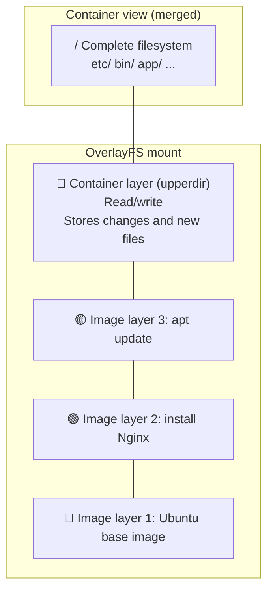
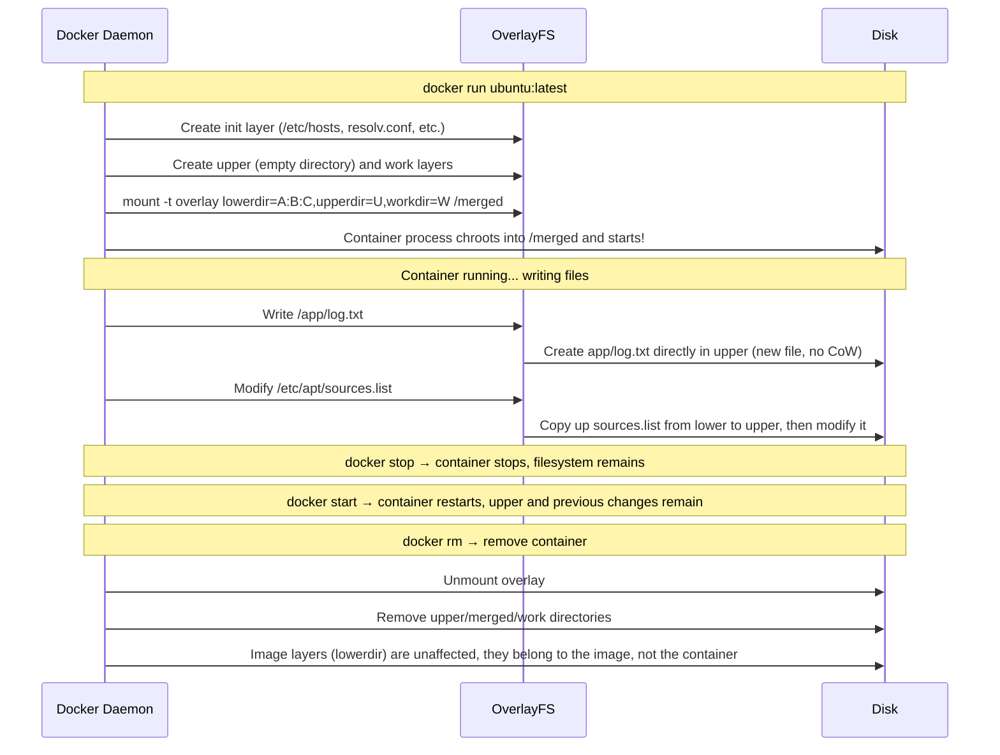

# Docker Filesystems Uncovered: Your Image Is a Stack of Directories

## The Idea in One Sentence

The “layers” of a Docker image are not magic: **OverlayFS, a union filesystem**, stacks several read-only directories and places a writable layer on top. When you use `docker run`, the kernel presents a “merged view” of those directories to the container process. **Deleting files inside a container does not reclaim image space, writing files triggers copy-on-write, and image pulls can reuse shared layers**—all these everyday behaviors come from OverlayFS.

> Understand **image = multiple read-only lower layers stacked together; container = one additional writable upper layer**, and Docker filesystems hold no mysteries.

## Start with an Experiment: Dissect a Docker Image

Pull a simple image to see what its “layers” actually are:

```bash
# Pull an alpine image
docker pull alpine:latest

# Inspect the image layers
docker history alpine:latest
# Example output:
# IMAGE          CREATED       CREATED BY                       SIZE
# a606584aa4aa   2 weeks ago   /bin/sh -c #(nop)  CMD [...]    0B
# <missing>      2 weeks ago   /bin/sh -c #(nop) ADD file:...  7.79MB
```

Each row represents a layer. For information absent from `docker history`, use `docker inspect`:

```bash
docker inspect alpine:latest | jq '.[0].RootFS'
# Example output:
# {
#   "Type": "layers",
#   "Layers": [
#     "sha256:d8a5e7c5b0e6...",
#     "sha256:a1b2c3d4e5f6..."
#   ]
# }
```

These `sha256` values are the content-addressable IDs of individual layers. Next, we will inspect Docker's data directory to see what they look like on the host.

## 1. OverlayFS Basics: Three Directories Form a Merged View

Before diving into Docker, create an OverlayFS manually with native Linux commands to understand its core concepts:

```bash
# Create experiment directories
mkdir -p /tmp/overlay-demo/{lower,upper,work,merged}

# Lower layer: add read-only files
echo "hello from lower" > /tmp/overlay-demo/lower/base.txt
echo "this file only in lower" > /tmp/overlay-demo/lower/only-lower.txt

# Upper layer: add a same-named file with different contents to demonstrate overriding
echo "hello from upper" > /tmp/overlay-demo/upper/base.txt
echo "this file only in upper" > /tmp/overlay-demo/upper/only-upper.txt

# Mount OverlayFS: lower below, upper above, merged as the combined view
# -t overlay: select the overlay filesystem type
#   Second overlay: device name (virtual; no actual device, so any label works)
# -o: mount options
#   lowerdir: read-only lower directories (multiple allowed, colon-separated; leftmost is highest)
#   upperdir: read/write top directory (all changes go here)
#   workdir: internal kernel work directory; a temporary staging area for copy-on-write
#            (must be empty and on the same filesystem as upperdir).
#            When changing a lower file, the kernel prepares a copy in workdir and uses rename(2)
#            to move it atomically into upperdir, so copy-up appears completely or not at all,
#            never as a half-written file.
# Final argument: mount target, where the merged view is presented
mount -t overlay overlay \
  -o lowerdir=/tmp/overlay-demo/lower,upperdir=/tmp/overlay-demo/upper,workdir=/tmp/overlay-demo/work \
  /tmp/overlay-demo/merged

# Inspect the merged result
ls /tmp/overlay-demo/merged/
# Output: base.txt  only-lower.txt  only-upper.txt

cat /tmp/overlay-demo/merged/base.txt
# Output: hello from upper   ← The upper file hides the same-named lower file!
```

This experiment reveals OverlayFS's central rules:

```
Merged view = upper layer ∪ lower layer
Rules: an upper file overrides a same-named lower file
       Deletions are recorded using whiteout files
       Creation/modification occurs only in upper (copy-on-write)
```

The picture looks like this:



> For **a deeper explanation of `mount`**—how VFS works, a detailed comparison of tmpfs, bind mounts, procfs, and overlay, and how to use `/proc/mounts` and `findmnt`—see [How mount Works: Grafting Filesystems onto the Directory Tree](/en/notes/linux/mount/). This article keeps only the details directly relevant to OverlayFS.

When Docker starts a container, it essentially uses a mount command to combine multiple lower layers and one upper layer into a merged view:

| Docker operation | Underlying mount operation |
|-------------|------------------|
| `docker run` | Create upper/work directories → `mount -t overlay lowerdir=... /var/lib/docker/overlay2/xxx/merged` |
| `docker run -v /host:/container` | `mount --bind /host /var/lib/docker/overlay2/xxx/merged/container` |
| `docker run --tmpfs /container/tmp` | `mount -t tmpfs tmpfs /var/lib/docker/overlay2/xxx/merged/container/tmp` |
| `docker rm` | `umount /var/lib/docker/overlay2/xxx/merged` → remove upper/work directories |

> In one sentence: **the entire filesystem visible inside a Docker container is a virtual view produced by a carefully arranged overlay mount.**

### Key Concepts at a Glance

| Concept | OverlayFS term | Docker term | Permissions |
|------|---------------|------------|------|
| Lower layer | `lowerdir` | Image layer | Read-only |
| Top layer | `upperdir` | Container layer | Read/write |
| Work layer | `workdir` | Internal use | Internal |
| Merged view | `merged` | `/` as seen inside the container | — |

## 2. Explore Docker's Data Directory

Docker uses OverlayFS as its default storage driver. The actual data location depends on the Docker version and storage backend:

| Scenario | Typical data path |
|------|-------------|
| Traditional Docker (manages overlay2 itself) | `/var/lib/docker/overlay2/` |
| Newer Docker (containerd snapshotter) | `/var/lib/containerd/io.containerd.snapshotter.v1.overlayfs/snapshots/` |

> **Note**: `docker info | grep "Storage Driver"` may show `overlayfs` rather than `overlay2`. Do not let the name confuse you: whatever the paths, the underlying mechanism is OverlayFS. The following examples trace mounts through the kernel interface, which **works across versions**.

```bash
# First, see where Docker actually mounted overlay
mount | grep overlay | head -3
# Example output (traditional overlay2):
# overlay on /var/lib/docker/overlay2/abc123.../merged type overlay (rw,...)
# Example output (containerd snapshotter):
# overlay on /var/lib/docker/rootfs/overlayfs/22a72a... type overlay (rw,...)
# Example layout:
# (Traditional overlay2)
# l/              ← Shortened layer-ID symbolic links (avoid mount-argument length limits)
# abc123.../      ← Each image layer is a directory
# def456.../
# ghi789.../
# jkl012...-init/ ← Container init layer (contains /etc/hosts, /etc/resolv.conf, etc.)
# mno345.../      ← Container writable layer (upperdir)
#
# (containerd snapshotter)
# snapshots/      ← All image and container writable layers are here
#   ├── 56/fs/    ← Image layer (read-only)
#   ├── 57/fs/
#   └── 63/fs/    ← Container writable layer (upperdir)
```

### 2.1 Trace a Running Container's Filesystem

```bash
# Start a container first
docker run -d --name fs-demo alpine:latest sleep 3600

# Obtain its overlay layer information
# GraphDriver can be null in newer Docker; use mount directly, which works across versions

# Step 1: find the overlay mount in mount output using the container ID prefix
CONTAINER_ID=$(docker inspect fs-demo | jq -r '.[0].Id')
mount | grep "$(echo $CONTAINER_ID | cut -c1-12)"
# Example output (traditional overlay2):
# overlay on /var/lib/docker/overlay2/mno345.../merged type overlay (rw,relatime,lowerdir=...:...,upperdir=...,workdir=...)
#                 └─ MergedDir (mount point, "/" seen by container processes) ─┘
#
# Example output (containerd snapshotter, real environment):
# overlay on /var/lib/docker/rootfs/overlayfs/22a72a477964... type overlay (rw,relatime,
#                 └─────────── MergedDir (mount point) ───────────┘
#   lowerdir=/var/lib/containerd/io.containerd.snapshotter.v1.overlayfs/snapshots/62/fs:
#            /var/lib/containerd/io.containerd.snapshotter.v1.overlayfs/snapshots/61/fs:
#            ... (7 layers in total, numbered 56–62),
#   upperdir=/var/lib/containerd/io.containerd.snapshotter.v1.overlayfs/snapshots/63/fs,
#   workdir=/var/lib/containerd/io.containerd.snapshotter.v1.overlayfs/snapshots/63/work,
#   nouserxattr)
#
#   Note: in containerd mode, image and container layers both live under
#   /var/lib/containerd/io.containerd.snapshotter.v1.overlayfs/snapshots/.
#   The higher-numbered fs/ is upperdir; lower-numbered fs/ directories are image lowerdirs.

# Step 2: replace commas with newlines for a clearer parameter list
mount | grep "$(echo $CONTAINER_ID | cut -c1-12)" | tr ',' '\n'
# lowerdir=/var/lib/containerd/.../snapshots/56/fs:/var/lib/containerd/.../snapshots/55/fs:...
# upperdir=/var/lib/containerd/.../snapshots/63/fs
# workdir=/var/lib/containerd/.../snapshots/63/work
```

A compact reference:

```
LowerDir  → All read-only image layers (colon-separated; leftmost is the highest image layer)
UpperDir  → Container writable layer (all files created/modified in the container live here)
MergedDir → Mount-point path (the "/" seen by container processes)
WorkDir   → Internal OverlayFS work directory (usually not relevant to you)
```

> Actual paths vary by Docker version: traditional overlay2 uses `/var/lib/docker/overlay2/<id>/diff`, while containerd uses `/var/lib/containerd/.../snapshots/<id>/fs`. You do not need to memorize the paths: `mount | grep <container-ID>` reveals them.

#### What Is the Relationship Between Images and Containers on Disk?

A common misconception is that “images also have overlay mounts.” **An image has no overlay mount: it is a collection of ordinary directories on disk, one per layer. Only when a container starts does `mount -t overlay` stack those directories.**

```
Image (static directories on disk)          Container (dynamic overlay mount)
┌────────────────────────┐                ┌─────────────────────────┐
│ snapshots/56/fs/       │  ── lowerdir ──→│                         │
│   ├── bin/             │                │  mount -t overlay       │
│   └── etc/             │                │  lowerdir=56:57:...:62  │
│                        │                │  upperdir=63            │
│ snapshots/57/fs/       │  ── lowerdir ──→│  workdir=63/work        │
│   └── usr/             │                │  /.../rootfs/overlayfs/ │
│                        │                │           ↑             │
│ ... (middle layers)    │                │   / seen by processes   │
│                        │                └─────────────────────────┘
│ snapshots/62/fs/       │  ── lowerdir ──→
│   └── app/             │                ┌─────────────────────────┐
│                        │                │ snapshots/63/fs/        │
│ (read-only layers)     │                │   ← Container writable  │
└────────────────────────┘                │   layer (empty upperdir)│
                                          └─────────────────────────┘
```

Key points:
- **Image layer** = an ordinary directory on disk, corresponding to a `RUN`/`COPY` instruction in the Dockerfile. These directories are not mounted individually; they are the raw material referenced by overlay.
- **Container** = image layers (lowerdir) plus a new empty directory (upperdir), combined by `mount -t overlay` into a merged view. The `overlay on ... type overlay` entry in `mount` output is the container's “filesystem.”
- **Multiple containers from the same image** share the same read-only lowerdir directories without affecting each other, while each receives its own upperdir. This is the basis of image-layer reuse.

> In containerd mode, image and container layers share the `snapshots/` directory and are distinguished by number: lower numbers are read-only image layers, while the highest number is the writable container layer. `mount` tells you directly which is which: `lowerdir` references image layers, and `upperdir` references the container layer.

### 2.2 Verification: Where Does a File Written in the Container Go?

```bash
# Create a file inside the container
docker exec fs-demo sh -c "echo 'created inside container' > /inside.txt"

# Find it on the host by extracting upperdir from mount output (works across Docker versions)
CONTAINER_ID=$(docker inspect fs-demo | jq -r '.[0].Id')
UPPER_DIR=$(mount | grep "$(echo $CONTAINER_ID | cut -c1-12)" | tr ',' '\n' | grep upperdir | cut -d= -f2)
echo "$UPPER_DIR"
# Example output (traditional overlay2): /var/lib/docker/overlay2/abc123.../diff
# Example output (containerd):          /var/lib/containerd/.../snapshots/63/fs
#                             ↑ Regardless of path length, this is the writable container layer

cat "$UPPER_DIR/inside.txt"
# Output: created inside container
#  ↑ This is where the container-written file resides on the host!

ls -la "$UPPER_DIR/"
# /inside.txt appears here!
# The image layers (lowerdir) are completely unchanged.

# You can also locate the container by browsing directories manually:
# Traditional overlay2 → ls -lt /var/lib/docker/overlay2/ | head -5 (skip l/ and -init directories)
# containerd           → ls /var/lib/containerd/.../snapshots/ (the recently modified, highest-numbered fs/)
```

### 2.3 Verification: What Happens When an Existing Image File Changes?

```bash
# Modify /etc/alpine-release, supplied by the alpine image
docker exec fs-demo sh -c "echo 'modified' >> /etc/alpine-release"

# Obtain the container's upper-layer path
CONTAINER_ID=$(docker inspect fs-demo | jq -r '.[0].Id')
UPPER_DIR=$(mount | grep "$(echo $CONTAINER_ID | cut -c1-12)" | tr ',' '\n' | grep upperdir | cut -d= -f2)
echo "$UPPER_DIR"
# Example output: /var/lib/containerd/.../snapshots/63/fs  ← Container writable layer

cat "$UPPER_DIR/etc/alpine-release"
# Output: ...modified  ← The file was copied to upper and modified there!
#                      The original image-layer file was never touched

# Inspect the lower-layer list (the original file remains unchanged)
mount | grep "$(echo $CONTAINER_ID | cut -c1-12)" | tr ',' '\n' | grep lowerdir
# Example output: lowerdir=/var/lib/containerd/.../snapshots/56/fs:/var/lib/containerd/.../snapshots/55/fs:...
#           ↑ Multiple lower layers are colon-separated; leftmost is the highest image layer
# /etc/alpine-release in the lower layer still has its original contents
```

This is **copy-on-write (CoW)**: when modifying an image file, OverlayFS first **copies** it from lower to upper, then **modifies** the upper copy. The original lower-layer file is never touched.

## 3. Two Sides of Copy-on-Write: Performance and Space

### 3.1 Benefit: Image-Layer Reuse

```bash
# Assume you pull two images based on alpine
docker pull nginx:alpine
docker pull redis:alpine

# Inspect their shared layers
docker inspect nginx:alpine | jq '.[0].RootFS.Layers'
docker inspect redis:alpine | jq '.[0].RootFS.Layers'
# The lowest layers have identical sha256 values!
# Docker stores them only once, explaining why docker pull can be so fast.
```

There is only one `diff` directory for the alpine base layer on disk, shared by several images:

```
/var/lib/docker/overlay2/
├── sha256_alpine_base/       ← Shared by nginx and redis
│   └── diff/
│       ├── bin/
│       ├── etc/
│       └── ...
├── sha256_nginx_layer/       ← Unique to nginx
│   └── diff/
│       └── usr/sbin/nginx
├── sha256_redis_layer/       ← Unique to redis
│   └── diff/
│       └── usr/bin/redis-server
```

### 3.2 Caution: Deleting Container Files Does Not Reclaim Disk Space

This is one of the easiest traps for Docker beginners:

```bash
# Your image contains a 1 GB log file, which you delete inside the container
docker exec fs-demo rm /var/log/huge.log

# Disk space is not reclaimed! Deletion only adds a whiteout marker in upper;
# huge.log in lower still occupies exactly the same space.

# How can you actually reduce image size?
# Delete it in the same Dockerfile layer (deleting in a later RUN does not help):
# ❌ Wrong:
#   RUN curl -o /tmp/huge.tar.gz ...  && tar xzf /tmp/huge.tar.gz
#   RUN rm /tmp/huge.tar.gz             # The earlier layer is already fixed; deletion does not shrink it
# ✅ Correct:
#   RUN curl -o /tmp/huge.tar.gz ... && tar xzf /tmp/huge.tar.gz && rm /tmp/huge.tar.gz
#   All three commands share one RUN and one layer, so the intermediate file is never preserved.
```

In plain terms, **a layer is set in stone once created**. Deleting in a later layer merely attaches a note saying “this file is deleted”; the writing on the stone remains.

### 3.3 The Performance Cost of Copy-on-Write

File lookup order, whose cost grows with the number of layers:

```
Opening /etc/nginx/nginx.conf:
  1. Search upper → not found
  2. Search lower layer 1 → not found
  3. Search lower layer 2 → found; return it
  4. If absent from every layer → ENOENT

Conclusion: more layers increase the first-open lookup cost.
            The kernel has an inode cache, so frequently accessed files are not a problem.
```

File writing flow:

```
First write to a large file already in the image (for example, a 500 MB database file):
  1. Copy the entire 500 MB file from lower to upper (time-consuming!)
  2. Perform the write on the upper copy

Conclusion: the first write to a large file has noticeable latency (copy-up overhead).
            Small files and log-appending workloads are usually barely affected.
```

## 4. Each Dockerfile Instruction Represents a Layer

With that background, reconsider the instructions in a Dockerfile:

```dockerfile
FROM ubuntu:22.04           # Layer 1: ubuntu base image
RUN apt-get update           # Layer 2: apt cache update (tens of MB)
RUN apt-get install -y nginx # Layer 3: install nginx (tens of MB)
COPY app/ /app/              # Layer 4: application code
RUN chmod +x /app/start.sh   # Layer 5: permission change (almost no space, but another layer)
CMD ["/app/start.sh"]        # Not a layer (metadata only)
```

Every `RUN`, `COPY`, and `ADD` creates **an independent read-only layer**. More layers cause more problems:

- Image size grows: the apt cache in layer 2 still occupies space even if deleted later.
- Mount arguments become longer, subject to a kernel limit of one memory page.
- File lookup overhead increases.

The central Dockerfile best practice is therefore **combining layers**:

```dockerfile
# ✅ Good: install and clean up in the same layer
RUN apt-get update && \
    apt-get install -y nginx && \
    rm -rf /var/lib/apt/lists/*    # Deleted in the same layer, so the cache consumes no image space
```

## 5. The Complete Container Filesystem Lifecycle

This sequence diagram summarizes all changes from `docker run` to `docker rm`:



## 6. How `docker commit` Works: Turn upper into a New Image Layer

You may have used `docker commit` to save a modified container as an image:

```bash
# Install curl inside the container
docker exec fs-demo apk add curl

# Commit it as a new image
docker commit fs-demo alpine-with-curl:v1

# The new image has an additional layer!
docker history alpine-with-curl:v1
```

Fundamentally, `docker commit` **packages the upper directory as a tar archive** and appends it as a new layer to the image's layer list. All existing lower layers stay unchanged.

## 7. Common Problems at a Glance

| Problem | Cause | Solution |
|------|------|------|
| `df -h` inside the container reports a full disk while the host has space | Docker's default 10 GB container storage limit | `docker run --storage-opt size=20G` or change daemon configuration |
| Some layers download extremely quickly during `docker pull` | They are shared with locally available images and reused | Normal behavior indicating a shared base image |
| Deleting a large container file does not free disk space | Only a whiteout was added to upper; the original remains in lower | Delete within the same layer when rebuilding, or use `docker system prune` to clean unused image layers |
| `overlay2: too many levels of symbolic links` | Too many layers; the kernel detects recursive links | Reduce image layers by combining RUN instructions |
| `/var/lib/docker/overlay2` keeps growing | Writable layers of stopped containers are not removed automatically | Use `docker system prune -a` to clean stopped containers and unused images |

## Summary

From bottom to top, a Docker filesystem has this structure:

```
🧱 Base image → 🧱 Intermediate image → 🧱 Top image → 🔴 Writable container layer (upper)
│                                                   │
└──────── These read-only layers are shared ─────────┘    └── Private to each container
```

- **Each layer** is an ordinary directory on disk (`/var/lib/docker/overlay2/<id>/diff/`).
- **Each layer** is immutable after creation; changes occur only in the container's upper layer.
- **Layer sharing** explains fast `docker pull` operations and efficient disk use.
- **CoW** preserves image-layer immutability, but introduces overhead on the first write to large files.

Ultimately, **Docker's filesystem is Linux OverlayFS with a convenient CLI around it**. Manually mounting the `diff` directories under `/var/lib/docker/overlay2/` produces the same result. Docker handles the bookkeeping of which layers each container uses and in what order.
