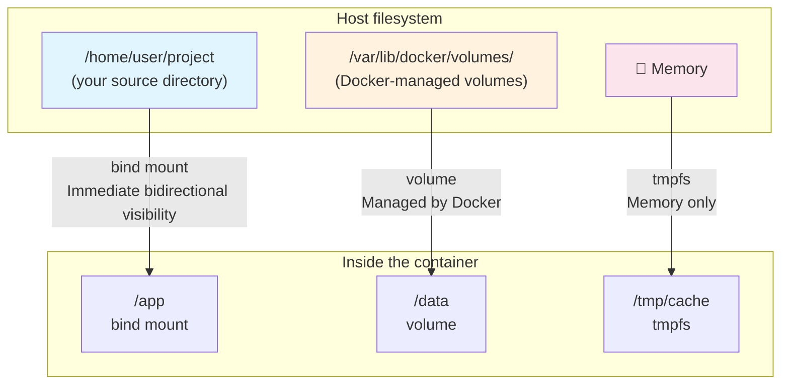
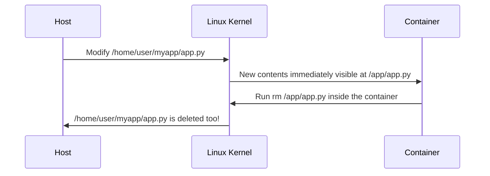
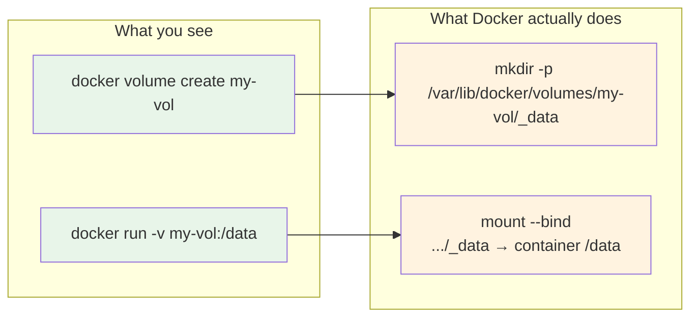
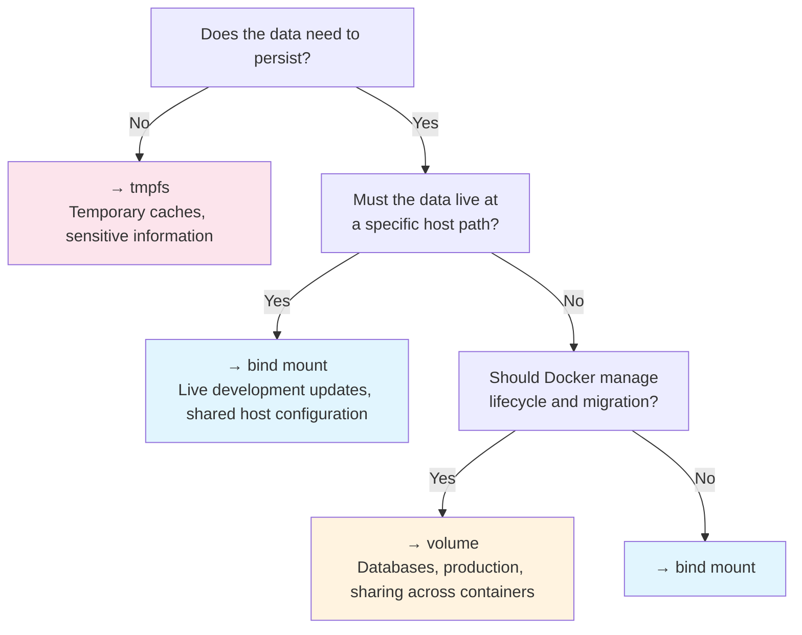

# Docker Mounts Explained: Bind Mounts, Volumes, and tmpfs in Theory and Practice

## The Idea in One Sentence

Docker provides three ways to “put external data into a container”: **bind mounts** (direct mappings of host directories), **volumes** (independent storage managed by Docker), and **tmpfs** (temporary storage entirely in memory). All ultimately use the Linux kernel's `mount` system call; they differ in **who manages their lifecycle, where data resides, and their performance characteristics**. Understanding these three mount types gives you a complete grasp of container data management.

> Remember: **bind mount = host path ↔ container path (you manage it)**; **volume = Docker-managed storage ↔ container path (Docker manages it)**; **tmpfs = memory ↔ container path (gone at shutdown)**. With that, Docker mounts hold no mysteries.

## First, the Overall Picture



## 1. The Three Mount Types at a Glance

Use all three in one `docker run` command:

```bash
docker run -d --name demo \
  # 1️⃣ bind mount: host directory → container directory
  --mount type=bind,source=/home/user/myapp,target=/app \
  # 2️⃣ volume: Docker-managed volume → container directory
  --mount type=volume,source=my-data,target=/data \
  # 3️⃣ tmpfs: memory → container directory
  --mount type=tmpfs,target=/tmp/cache \
  nginx:latest
```

The main differences:

| Feature | bind mount | volume | tmpfs |
|------|-----------|--------|-------|
| **Where data resides** | Any host path | `/var/lib/docker/volumes/` | Memory |
| **Who manages the lifecycle** | You, manually | Docker | Kernel |
| **Data after container deletion** | Retained on the host | Retained (unless `docker rm -v`) | Gone |
| **Can multiple containers share it?** | ✅ Yes | ✅ Yes (recommended) | ❌ No (independent for each container) |
| **Performance** | Host disk performance | Host disk performance | Memory performance |
| **Portability** | Poor (depends on host paths) | Good (Docker abstraction) | Good |
| **Suitable uses** | Live code updates during development | Database persistence, shared configuration | Temporary caches, sensitive information |

## 2. Bind Mounts: Direct Access to Host Directories

### 2.1 How They Work

A bind mount is fundamentally Linux's `mount --bind` system call. When creating a container, Docker performs the following inside the container's mount namespace:

```bash
# Docker's underlying operation is equivalent to this command:
mount --bind /home/user/myapp /var/lib/docker/overlay2/xxx/merged/app
```

**The key point**: this is not a “copy,” but **two entry points to the same inode**. The host and container see **the same data**, and changes on either side are immediately visible to the other.



> ⚠️ **Warning**: bind mounts work in both directions! Running `rm -rf /app/*` inside the container really deletes the files on your host.

### 2.2 Practice: Live Code Updates During Development

This is the classic bind-mount use case: edit code on the host, and the change immediately appears in the container.

```bash
# Assume this project layout:
# ~/myapp/
#   ├── app.py
#   ├── requirements.txt
#   └── templates/

# Start a development container with the source directory mounted
docker run -d --name dev-app \
  --mount type=bind,source=$HOME/myapp,target=/app \
  --workdir /app \
  python:3.11 \
  python app.py

# Modify the code on the host
echo 'print("hot reload!")' >> ~/myapp/app.py

# The container sees the change immediately
docker exec dev-app cat /app/app.py
# Output includes: print("hot reload!")
```

#### Read-Only Bind Mounts

Add `readonly` if the container should not modify host files:

```bash
docker run -d --name safe-app \
  --mount type=bind,source=$HOME/myapp,target=/app,readonly \
  python:3.11

# Writing inside the container fails
docker exec safe-app touch /app/new-file.txt
# touch: cannot touch '/app/new-file.txt': Read-only file system
```

### 2.3 Bind-Mount “Permission Hell”

The most common bind-mount problem is **mismatched file permissions**. Container and host UIDs/GIDs can be completely different:

```bash
# On the host, your user has uid=1000
ls -ln ~/myapp/app.py
# -rw-r--r-- 1 1000 1000 1234 Jul 10 10:00 app.py

# The container runs as root (uid=0) by default
docker run --rm --mount type=bind,source=$HOME/myapp,target=/app alpine id
# uid=0(root) gid=0(root) — access to uid=1000 files usually works because of root capabilities

# But if the container runs as a non-root user (for example, nginx with uid=101):
docker run --rm --user 101 \
  --mount type=bind,source=$HOME/myapp,target=/app \
  alpine cat /app/app.py
# cat: can't open '/app/app.py': Permission denied  ← Failure!
```

**Solutions**:

```bash
# Option 1: match the container user's UID to the host user's UID
docker run --user $(id -u):$(id -g) ...

# Option 2: create a matching user in the Dockerfile
# RUN addgroup --gid 1000 appuser && adduser --uid 1000 --gid 1000 appuser

# Option 3: relax file permissions (quick, but not recommended)
chmod 666 ~/myapp/app.py
```

### 2.4 A Bind-Mount Pitfall: Hiding Existing Image Files

```bash
# The image originally has config.json under /app
docker run --rm alpine sh -c 'mkdir -p /app && echo "original" > /app/config.json && cat /app/config.json'
# Output: original

# Bind-mount an empty directory onto /app:
mkdir /tmp/empty-dir
docker run --rm \
  --mount type=bind,source=/tmp/empty-dir,target=/app \
  alpine ls /app/
# Empty output! The original config.json in the image is hidden
```

> This is the “covering” behavior of mounts, exactly as with Linux's `mount` command. The original directory contents are temporarily hidden and reappear after `umount`.

## 3. Volumes: Let Docker Manage Storage

### 3.1 How They Work

A volume is a Docker abstraction. You do not need to care where data lives on the host: Docker creates a directory at `/var/lib/docker/volumes/<volume-name>/_data/` to store it.

```bash
# Create a volume
docker volume create my-vol

# What Docker does behind the scenes:
# mkdir -p /var/lib/docker/volumes/my-vol/_data

# When starting a container, Docker performs:
# mount --bind /var/lib/docker/volumes/my-vol/_data \
#        /var/lib/docker/overlay2/xxx/merged/app/data
```

**It is still fundamentally a bind mount!** A volume simply manages the host-side source path for you. You do not specify that path manually. Consequently, volume performance matches the host disk's performance.



### 3.2 Why Choose a Volume over a Bind Mount?

| Scenario | Bind mount | Volume |
|------|--------------|-----------|
| Live code updates during development | ✅ | ❌ (path is not intuitive) |
| Database persistence (MySQL, Postgres) | ❌ | ✅ |
| Configuration shared across containers | ❌ | ✅ |
| Docker should manage the lifecycle | ❌ | ✅ |
| Production deployment | ❌ | ✅ |
| Host path is uncertain or not portable | ❌ | ✅ |

A volume's main advantage is **portability**: you do not need to know the host path under `/var/lib/docker/volumes/`; all operations use `docker volume` commands.

### 3.3 Practice: Persisting a Database with a Volume

```bash
# Create a PostgreSQL database with persistent data in a volume
docker run -d --name my-postgres \
  --mount type=volume,source=pg-data,target=/var/lib/postgresql/data \
  -e POSTGRES_PASSWORD=secret \
  postgres:16

# Create a table and insert data
docker exec my-postgres psql -U postgres -c "
  CREATE TABLE users (id SERIAL PRIMARY KEY, name TEXT);
  INSERT INTO users (name) VALUES ('Alice'), ('Bob');
  SELECT * FROM users;
"
#  id | name
#  ----+-------
#   1 | Alice
#   2 | Bob

# Remove the container
docker rm -f my-postgres

# Create another container with the same volume
docker run -d --name my-postgres-2 \
  --mount type=volume,source=pg-data,target=/var/lib/postgresql/data \
  -e POSTGRES_PASSWORD=secret \
  postgres:16

# The data is still there!
docker exec my-postgres-2 psql -U postgres -c "SELECT * FROM users;"
#  id | name
#  ----+-------
#   1 | Alice
#   2 | Bob
```

This is the central value of volumes: **the container lifecycle and the data lifecycle are independent**.

### 3.4 Common Volume Operations

```bash
# List all volumes
docker volume ls

# Inspect a volume (find its actual host-side path)
docker volume inspect pg-data
# Output includes:
# "Mountpoint": "/var/lib/docker/volumes/pg-data/_data"

# Back up volume data
docker run --rm \
  --mount type=volume,source=pg-data,target=/data \
  --mount type=bind,source=$(pwd),target=/backup \
  alpine tar czf /backup/pg-data-backup.tar.gz -C /data .

# Restore volume data
docker run --rm \
  --mount type=volume,source=pg-data-restore,target=/data \
  --mount type=bind,source=$(pwd),target=/backup \
  alpine tar xzf /backup/pg-data-backup.tar.gz -C /data

# Remove a volume (ensure no containers are using it first)
docker volume rm pg-data

# Clean up all unused volumes
docker volume prune
```

### 3.5 The Initial Population Mechanism

This is a useful design: when an **empty** volume is mounted onto a **nonempty** container directory, Docker automatically **copies that directory's image contents into the volume**:

```bash
# The nginx image has a default index.html under /usr/share/nginx/html/
# Create an empty volume and mount it onto that directory
docker volume create nginx-html

docker run -d --name web \
  --mount type=volume,source=nginx-html,target=/usr/share/nginx/html \
  nginx:latest

# The volume now contains nginx's default HTML files!
docker run --rm \
  --mount type=volume,source=nginx-html,target=/data \
  alpine ls /data/
# Output: 50x.html  index.html  ← Copied automatically from the image
```

> ⚠️ **Note**: this population happens only when the volume is **newly created and empty**. Existing data is not overwritten. Bind mounts **do not** provide this behavior: they directly cover whatever the image originally contained.

## 4. tmpfs: Use Memory as a Disk

### 4.1 How It Works

A tmpfs mount creates a filesystem directly in kernel memory, without touching disk:

```bash
# Docker's underlying operation is equivalent to:
mount -t tmpfs -o size=64M tmpfs /var/lib/docker/overlay2/xxx/merged/tmp/cache
```

**Two defining characteristics**:
1. **Extremely fast**: all reads and writes are in memory, without disk I/O.
2. **Lost on power-off**: data disappears when the container stops or restarts.

### 4.2 Practice: Caching Sensitive Information

```bash
# Scenario: an application stores temporary API tokens in /tmp/secrets
# tmpfs ensures tokens are cleared automatically when the container restarts
docker run -d --name api-server \
  --mount type=tmpfs,target=/tmp/secrets,tmpfs-size=65536000 \
  my-api:latest

# Write a token
docker exec api-server sh -c 'echo "sk-abc123..." > /tmp/secrets/token'

# Restart the container
docker restart api-server

# The token is gone!
docker exec api-server cat /tmp/secrets/token
# cat: can't open '/tmp/secrets/token': No such file or directory
```

#### Common tmpfs Options

```bash
docker run --rm \
  --mount type=tmpfs,target=/tmp/cache,tmpfs-size=128M,tmpfs-mode=1777 \
  alpine sh -c 'df -h /tmp/cache && ls -ld /tmp/cache'
# Filesystem      Size  Used Avail Use% Mounted on
# tmpfs           128M     0  128M   0% /tmp/cache
# drwxrwxrwt    2 root  root    40 Jul 10 10:00 /tmp/cache
```

Options explained:
- `tmpfs-size`: maximum memory usage in bytes; omitting a limit can lead to OOM.
- `tmpfs-mode`: file permission mode; `1777` = readable/writable by everyone plus the sticky bit (like `/tmp`).

### 4.3 Comparing tmpfs and Volume Speed

```bash
# Create a volume
docker volume create speed-test-vol

# Compare the time to write 1,000 small files
echo "=== volume (disk) ==="
time docker run --rm \
  --mount type=volume,source=speed-test-vol,target=/data \
  alpine sh -c 'for i in $(seq 1 1000); do echo "hello" > /data/file-$i.txt; done'

echo "=== tmpfs (memory) ==="
time docker run --rm \
  --mount type=tmpfs,target=/data \
  alpine sh -c 'for i in $(seq 1 1000); do echo "hello" > /data/file-$i.txt; done'

# tmpfs is typically 10–100 times faster (depending on the disk type)
```

## 5. Comparing the Underlying Mounts

`findmnt` or `/proc/mounts` reveals the actual mount entries Docker creates:

```bash
# Start a container using all three mount types
docker run -d --name mount-demo \
  --mount type=bind,source=/tmp/host-dir,target=/app/bind \
  --mount type=volume,source=demo-vol,target=/app/vol \
  --mount type=tmpfs,target=/app/tmp \
  alpine sleep 3600

# Inspect the container's mount entries on the host
grep -E 'bind|vol|tmpfs' /proc/mounts | grep docker | head -5
```

Typical output (simplified):

```
# Bind-mount entry:
/dev/sda1 on /var/lib/docker/overlay2/xxx/merged/app/bind type ext4 (rw,relatime)
#                      ↑ Still the original filesystem type (ext4/xfs, etc.)

# Volume entry:
/dev/sda1 on /var/lib/docker/overlay2/xxx/merged/app/vol type ext4 (rw,relatime)
#                      ↑ Also a bind mount, sourced from /var/lib/docker/volumes/

# tmpfs entry:
tmpfs on /var/lib/docker/overlay2/xxx/merged/app/tmp type tmpfs (rw,relatime,size=65536k)
```

> **Key observation**: bind mounts and volumes are **both bind mounts at the kernel level**; only source-path management differs. tmpfs is a separate filesystem type.

## 6. Two Syntaxes: `-v` and `--mount`

Docker provides two mount syntaxes:

```bash
# Older syntax: -v (concise but ambiguous)
docker run -v /host/path:/container/path:ro    # Bind mount
docker run -v my-vol:/container/path            # Volume (no / in the name, so Docker treats it as a volume)
docker run -v /container/path                   # Anonymous volume

# Newer syntax: --mount (explicit and recommended)
docker run --mount type=bind,source=/host/path,target=/container/path,readonly
docker run --mount type=volume,source=my-vol,target=/container/path
docker run --mount type=tmpfs,target=/container/path
```

**Prefer `--mount`**, because:
- `-v` behavior depends on the argument format and can be ambiguous.
- With `-v`, Docker **automatically creates a directory** if the bind-mount source does not exist, potentially causing mysterious empty-directory mounts.
- `--mount` is clearer and less prone to misuse.

## 7. Common Troubleshooting Questions

### Q1: Writing a File in the Container Returns “Permission denied”

```bash
# 1. First check whether this is a bind-mount permission issue
docker inspect my-container | jq '.[0].Mounts'

# 2. Check permissions on the host path
ls -la /host/path/

# 3. Check the container's runtime user
docker exec my-container id

# 4. If SELinux is responsible (CentOS/RHEL), add the :Z label
docker run -v /host/path:/container/path:Z ...
```

### Q2: Data Is in a Volume, but Where Is It on the Host?

```bash
# View the volume's actual storage path
docker volume inspect my-vol | jq '.[0].Mountpoint'
# Output: "/var/lib/docker/volumes/my-vol/_data"
```

### Q3: The Container Is Gone but Its Volume Remains—How Do I Clean Up?

```bash
# Find volumes unused by any container
docker volume ls -f dangling=true

# Clean them up together
docker volume prune
```

## 8. Summary: Which Type Should You Use?



| Your need | Recommended type |
|---------|---------|
| “Code changes should appear in the container immediately” | bind mount |
| “Database data must survive” | volume |
| “Several containers share a configuration directory” | volume |
| “Discard the API token after use” | tmpfs |
| “The container generates logs that the host needs to collect” | bind mount |
| “Production deployments must be portable” | volume |
| “Temporary files with frequent reads and writes” | tmpfs |

Remember three statements:
- **bind mount**: this host location ↔ that container location; you decide.
- **volume**: Docker, manage some storage for me and mount it here.
- **tmpfs**: give me some memory to use, and discard it at shutdown.
