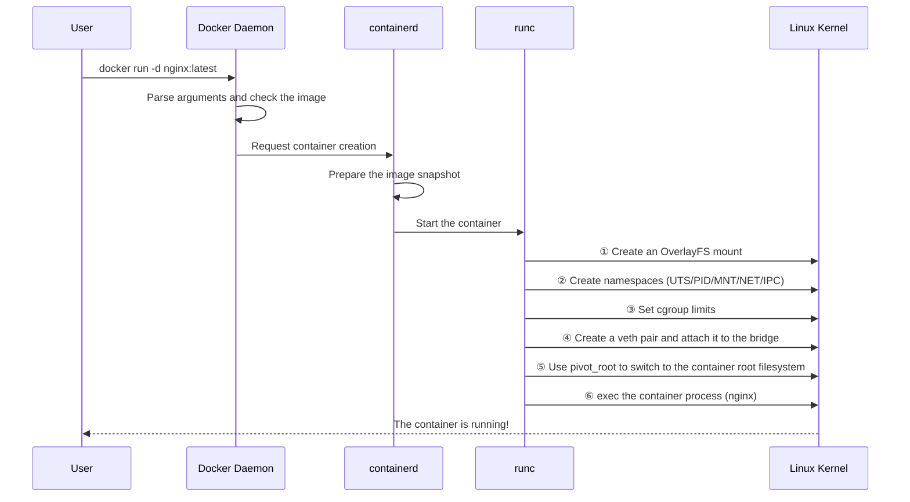
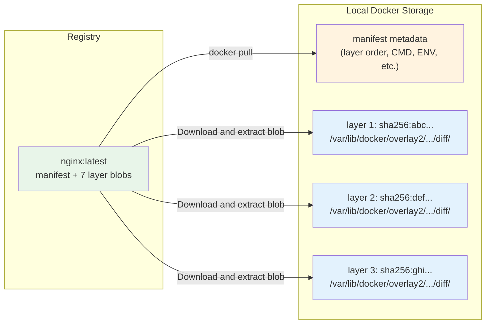
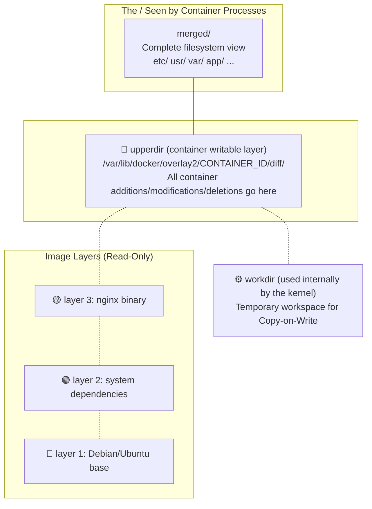
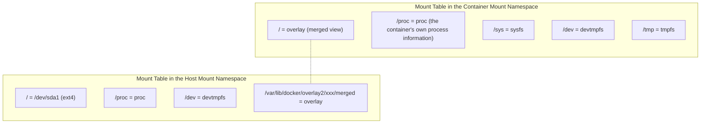
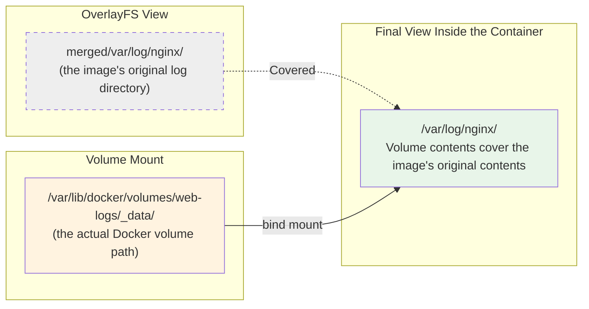
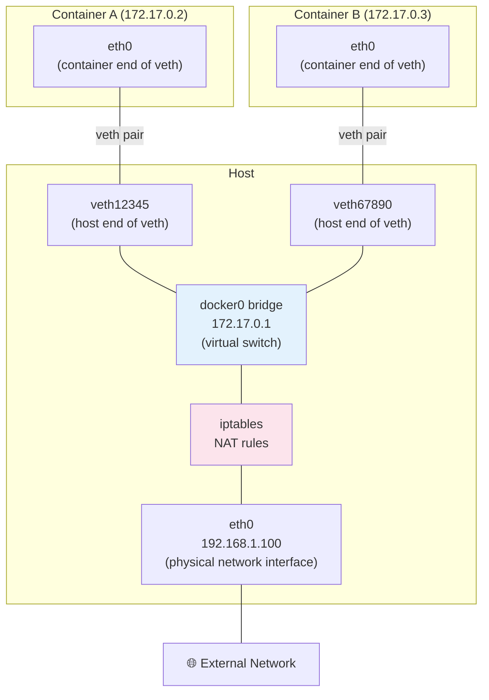
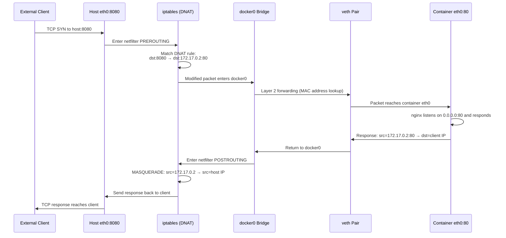

# What Happens Behind docker run: A Complete Journey Through Container Startup

## Understanding It in One Sentence

When you enter `docker run -d --name web -p 8080:80 -v /host/data:/data --memory 256m nginx:latest`, Docker performs a chain of operations: **pull the image → unpack its layers → create an OverlayFS union mount → create namespace isolation → set cgroup resource limits → connect a veth virtual cable to the docker0 bridge → configure iptables NAT rules → mount user-specified volumes → switch the root filesystem with pivot_root → finally execute the container's ENTRYPOINT/CMD**. This takes roughly 0.5–2 seconds, and involves far more kernel mechanisms than you might expect.

> Once you understand `docker run` as **prepare the filesystem (OverlayFS) → create an isolated environment (namespaces) → set resource limits (cgroups) → connect networking (veth+bridge+NAT) → start a process**, you understand how a container appears out of thin air.

## Start with the Big Picture



Let's split this into nine steps and see exactly what Docker does.

## Step 1: Dissect the docker run Command

Start with a typical command. Every command-line argument corresponds to a set of kernel operations behind the scenes:

```bash
docker run -d --name web \
  -p 8080:80 \                      # ← Port mapping (iptables DNAT)
  --mount type=bind,src=/host/data,dst=/data \  # ← bind mount
  --mount type=volume,src=web-logs,dst=/var/log/nginx \  # ← volume
  --memory 256m --cpus 1 \          # ← cgroup resource limits
  --restart always \                # ← Docker restart policy
  nginx:latest                      # ← Image name
```

Expanding this command, Docker needs to do the following:

| Argument | What happens behind the scenes | Kernel mechanisms involved |
|------|-------------|---------------|
| `nginx:latest` | Pull the image, unpack each layer, and prepare rootfs | OverlayFS |
| `-p 8080:80` | Create a veth interface and configure iptables NAT | net namespace, iptables |
| `--mount bind` | Perform a bind mount in the container's mount namespace | mount namespace, VFS |
| `--mount volume` | Perform a bind mount in the container's mount namespace | mount namespace, VFS |
| `--memory 256m` | Write the cgroup memory limit file | cgroup |
| `--cpus 1` | Write the cgroup CPU quota file | cgroup |

## Step 2: Prepare the Image—From Registry to Local Snapshot



If the image already exists locally, the pull is skipped. Once the Docker daemon obtains the image, it has two main things:

```bash
# 1. The image manifest: describes layer order and metadata
docker inspect nginx:latest | jq '.[0].RootFS'
# {
#   "Type": "layers",
#   "Layers": [
#     "sha256:a1b2c3d4...",   ← Layer 1 (the bottom layer, e.g. Debian base)
#     "sha256:e5f6g7h8...",   ← Layer 2 (e.g. dependencies from apt install)
#     "sha256:i9j0k1l2...",   ← Layer 3 (e.g. the nginx binary)
#     ...
#   ]
# }

# 2. The actual directory for each layer on disk
ls /var/lib/docker/overlay2/
# Each directory is a "layer", containing files added/modified in that layer
# a1b2c3d4.../
#   └── diff/    ← Filesystem delta (this layer's diff against the previous layer)
#       ├── etc/
#       ├── usr/
#       └── var/
```

Each layer is a directory holding the files it adds or modifies. These directories eventually become OverlayFS `lowerdir` entries.

## Step 3: Create the Container's OverlayFS—Stack the Layers

This is the most central step in `docker run`. Docker, through containerd/runc, creates four directories and executes a mount command:

```bash
# What Docker actually does on the host (simplified):

# 1. Create directories dedicated to this container
CONTAINER_ID="abc123..."
mkdir -p /var/lib/docker/overlay2/$CONTAINER_ID/{diff,work,merged}
#                                        diff   = upperdir (container writable layer)
#                                        work   = workdir (internal OverlayFS work directory)
#                                        merged = mount point (the "/" seen by container processes)

# 2. Stack the image's read-only layers and add the container writable layer
mount -t overlay overlay \
  -o lowerdir=/var/lib/docker/overlay2/layer3/diff:\
             /var/lib/docker/overlay2/layer2/diff:\
             /var/lib/docker/overlay2/layer1/diff,\
     upperdir=/var/lib/docker/overlay2/$CONTAINER_ID/diff,\
     workdir=/var/lib/docker/overlay2/$CONTAINER_ID/work \
  /var/lib/docker/overlay2/$CONTAINER_ID/merged
```

This diagram illustrates the four-part structure:



**The container process has not started yet**, but its root filesystem is ready. You can already view the container's complete filesystem directly on the host:

```bash
# View the container filesystem directly on the host!
ls /var/lib/docker/overlay2/$CONTAINER_ID/merged/
# bin/  boot/  dev/  etc/  home/  lib/  ...  ← Exactly what the container sees!

# You can even create files directly here
echo "hello from host" > /var/lib/docker/overlay2/$CONTAINER_ID/merged/test.txt

# The file becomes visible once the container starts
docker exec web cat /test.txt
# hello from host
```

## Step 4: Create a Mount Namespace—Separate the Container Filesystem from the Host

The OverlayFS mount is ready, but there is more to do. The container needs a **separate, clean mount table**; the host's `/proc`, `/sys`, `/boot`, and other mounts must not be directly exposed to it.

Docker creates a new **mount namespace**, then mounts the necessary pseudo-filesystems inside it:

```bash
# Kernel operations (triggered by runc):

# 1. Create a new mount namespace
unshare --mount /bin/bash

# 2. First ensure all mounts in the new namespace are "private"
#    (Prevent container mount operations from propagating to the host)
mount --make-rprivate /

# 3. pivot_root: switch the container root filesystem to the OverlayFS merged directory
#    The key step: the container process's "/" now points to merged
pivot_root /var/lib/docker/overlay2/$CONTAINER_ID/merged \
           /var/lib/docker/overlay2/$CONTAINER_ID/merged/.pivot

# 4. Mount the required pseudo-filesystems inside the new root filesystem
mount -t proc  proc  /proc    # Process information
mount -t sysfs sysfs /sys     # Device and kernel information
mount -t tmpfs tmpfs /tmp     # Temporary files
mount -t devtmpfs devtmpfs /dev  # Device files
```

**pivot_root vs chroot**:

```
chroot: Only changes the process's "/" path; the process can still see the old root filesystem
        (It can escape through ../../)

pivot_root: Actually replaces the root of the entire mount namespace
            (The old root moves into a subdirectory and can be unmounted, preventing escape)
```

> Docker uses `pivot_root` instead of `chroot` for greater security: container processes cannot escape to the host filesystem through `../../`.

At this point, the container filesystem can be represented as an **overlay diagram**:



**The key point**: the two namespaces have **completely independent** mount tables. `mount` might show seven mount points inside the container and over 40 on the host, without either affecting the other.

## Step 5: User-Specified Mounts—Volumes and Bind Mounts

Once OverlayFS and the basic pseudo-filesystems are mounted, Docker processes the user's `-v` / `--mount` arguments. These essentially add bind mounts or tmpfs mounts inside the container's mount namespace:

```bash
# Underlying operations for --mount type=bind,src=/host/data,dst=/data:
mkdir -p /var/lib/docker/overlay2/$CONTAINER_ID/merged/data
mount --rbind /host/data \
       /var/lib/docker/overlay2/$CONTAINER_ID/merged/data
#  ↑ --rbind, rather than --bind, brings submounts under /host/data into the container too

# Underlying operations for --mount type=volume,src=web-logs,dst=/var/log/nginx:
# 1. Docker first finds (or creates) the volume's actual path
#    The volume path is: /var/lib/docker/volumes/web-logs/_data/
# 2. It then performs a bind mount:
mount --rbind /var/lib/docker/volumes/web-logs/_data \
       /var/lib/docker/overlay2/$CONTAINER_ID/merged/var/log/nginx
```

**Mount stacking order** determines the final view:

```
/var/log/nginx/ as seen by a container process:
  ① The overlay merged layer contains a /var/log/nginx/ directory
       ↓ Covered!
  ② bind mount: web-logs volume → /var/log/nginx/
       ↓ Takes effect
  ③ Accessing /var/log/nginx/ inside the container actually reads/writes volume data
```



## Step 6: Create Networking—veth Pair + Bridge + iptables NAT

If the filesystem is the container's body, networking is its circulatory system. Docker creates a set of virtual network devices for each container:

### 6.1 How the Default Bridge Mode Works

```bash
# Network operations behind docker run -p 8080:80 nginx:

# 1. Create a veth pair (a virtual network cable)
#    veth interfaces always come in pairs: one end in the container, one on the host bridge
#    Like a virtual cable, data entering one end comes out of the other
ip link add veth12345 type veth peer name veth12345-c

# 2. Move one end into the container's net namespace
ip link set veth12345-c netns $CONTAINER_PID
#    Inside the container, this appears as eth0

# 3. Configure the container veth's IP address and route
nsenter -t $CONTAINER_PID -n ip addr add 172.17.0.2/16 dev eth0
nsenter -t $CONTAINER_PID -n ip link set eth0 up
nsenter -t $CONTAINER_PID -n ip route add default via 172.17.0.1

# 4. Attach the other end to the docker0 bridge
ip link set veth12345 master docker0
ip link set veth12345 up

# 5. Configure iptables DNAT rules (the core of port mapping)
#    Traffic arriving on host port 8080 → forward to container port 80
iptables -t nat -A DOCKER ! -i docker0 \
  -p tcp --dport 8080 -j DNAT --to-destination 172.17.0.2:80

# 6. Configure SNAT/MASQUERADE (allow the container to reach external networks)
#    Replace the source IP of outgoing container packets with the host IP
iptables -t nat -A POSTROUTING -s 172.17.0.0/16 ! -o docker0 \
  -j MASQUERADE
```

The topology of veth pairs and the bridge:



### 6.2 Experiment: Observe Container Networking from the Host

```bash
# Start a container with a published port
docker run -d --name web -p 8080:80 nginx:latest

# 1. View host veth interfaces
ip link show | grep veth
# vetha1b2c3d@if12: <BROADCAST,MULTICAST,UP> ...
# ↑ One end is on the host, the other in the container (@if12 refers to the peer)

# 2. View devices on the docker0 bridge
brctl show docker0
# bridge name   bridge id           STP enabled   interfaces
# docker0       8000.0242abc...     no            vetha1b2c3d

# 3. View iptables NAT rules on the host
iptables -t nat -L DOCKER -n
# Chain DOCKER (1 references)
# target  prot opt source      destination
# DNAT    tcp  --  0.0.0.0/0  0.0.0.0/0  tcp dpt:8080 to:172.17.0.2:80
# ↑ All TCP traffic to host port 8080 is DNATed to container port 80

# 4. Ping the container IP directly from the host
ping 172.17.0.2
# PING 172.17.0.2 (172.17.0.2) 56(84) bytes of data.
# 64 bytes from 172.17.0.2: icmp_seq=1 ttl=64 time=0.05 ms
# ↑ The host can directly reach the container's internal IP

# 5. Enter the container's net namespace to see its view
CONTAINER_PID=$(docker inspect web --format '{{.State.Pid}}')
nsenter -t $CONTAINER_PID -n ip addr
# 1: lo: <LOOPBACK,UP,LOWER_UP> ...
# 12: eth0@if13: <BROADCAST,MULTICAST,UP,LOWER_UP> ...
#     inet 172.17.0.2/16 brd 172.17.255.255 scope global eth0
# ↑ The container sees only lo and eth0, not the host's network interfaces
```

### 6.3 The Complete Path of an HTTP Request

For `curl http://HOST_IP:8080`, trace how a request reaches nginx inside the container:



## Step 7: The Namespace Family—Six Dimensions of Isolation

Docker isolates more than the filesystem and network. Linux namespaces provide **six dimensions of isolation**:

| Namespace type | What it isolates | Effect inside the container | What happens without it |
|---------------|---------|------------|-------------|
| **Mount** | Mount point list | `df` in the container shows a completely different view from the host | The container can access all host filesystems |
| **PID** | Process ID space | nginx has PID=1 in the container and PID=12345 on the host | `ps` in the container can see all host processes |
| **Network** | Network interfaces and routes | `ip addr` in the container shows only lo and eth0 | The container directly uses host networking, causing port conflicts |
| **UTS** | Hostname and domain name | `hostname` in the container equals the container ID | Changing the container hostname affects the host |
| **IPC** | Interprocess communication (semaphores, shared memory) | Container shared memory is isolated from the host | Other containers or the host may read the container's shared memory |
| **User** | User and group ID mappings | Container root (uid=0) can map to host uid=1000 | Container root is host root, which is extremely dangerous |

### 7.1 Experiment: Inspect the Container's Namespaces

```bash
# Start a container
docker run -d --name ns-demo nginx:latest

# Obtain its PID
PID=$(docker inspect ns-demo --format '{{.State.Pid}}')

# Check which namespaces the process belongs to
ls -la /proc/$PID/ns/
# Output:
# lrwxrwxrwx cgroup -> 'cgroup:[4026531835]'
# lrwxrwxrwx ipc    -> 'ipc:[4026532778]'     ← IPC namespace
# lrwxrwxrwx mnt    -> 'mnt:[4026532776]'     ← Mount namespace
# lrwxrwxrwx net    -> 'net:[4026532781]'     ← Network namespace
# lrwxrwxrwx pid    -> 'pid:[4026532779]'     ← PID namespace
# lrwxrwxrwx uts    -> 'uts:[4026532777]'     ← UTS namespace
# ...
# Numbers in [] are namespace inode numbers; the same number means the same namespace

# Compare with the namespaces of a normal host process
ls -la /proc/1/ns/
# Notice the inode numbers in brackets: entirely different from the container!
# This shows the container runs in separate namespaces
```

### 7.2 Experiment: Enter Container Namespaces with nsenter

```bash
# Enter the PID namespace to view container processes
nsenter -t $PID -p ps aux
# PID   USER     TIME  COMMAND
#    1  root      0:00 nginx: master process nginx -g daemon off;
#    7  nginx     0:00 nginx: worker process
# ↑ The nginx master is PID 1 inside the container, but $PID on the host

# Enter the UTS namespace to view the hostname
nsenter -t $PID -u hostname
# ns-demo  ← The container hostname

# Enter the network namespace to view networking
nsenter -t $PID -n ip addr
# Only lo and eth0 ← Host interfaces are invisible
```

### 7.3 Experiment: Share Namespaces Across Containers

Docker also allows multiple containers to **share a namespace**, a core mechanism behind Kubernetes Pods:

```bash
# Start a "base" container
docker run -d --name base nginx:latest

# Start another container sharing base's network namespace
docker run -d --name shared-net \
  --network container:base \
  alpine sleep 3600

# Verify that both containers see the same network interface
docker exec base ip addr
# eth0@...: 172.17.0.2/16

docker exec shared-net ip addr
# eth0@...: 172.17.0.2/16  ← Same IP! Same interface!
# They share the net namespace
```

> Kubernetes Pods use this principle: all containers in a Pod share the net namespace (and IPC namespace), allowing them to communicate through `localhost`.

## Step 8: Cgroups—Put Bounds on the Container

Namespaces determine what a container can see (isolation); cgroups determine how much it can use (limits). Docker creates a set of cgroup controllers for each container:

```bash
# cgroup operations behind docker run --memory 256m --cpus 1 nginx:

# 1. Create the container's cgroup directory
CGROUP_PATH="/sys/fs/cgroup/system.slice/docker-$CONTAINER_ID.scope"
mkdir -p $CGROUP_PATH

# 2. Set memory limits (memory cgroup)
echo "268435456" > $CGROUP_PATH/memory.max        # 256MB
echo "268435456" > $CGROUP_PATH/memory.high       # Soft limit

# 3. Set the CPU limit (cpu cgroup)
echo "100000" > $CGROUP_PATH/cpu.max              # 1 CPU core
#       ↑ 100000 microseconds / a 100000-microsecond period = 1 full CPU

# 4. Write the container process PID to cgroup.procs
echo $CONTAINER_PID > $CGROUP_PATH/cgroup.procs
```

**Main cgroup v2 controllers**:

| Controller | File path | Docker argument | Purpose |
|--------|---------|------------|------|
| `memory` | `memory.max` | `--memory 256m` | Hard limit; processes exceeding it are OOM-killed |
| `memory` | `memory.high` | — | Soft limit; exceeding it triggers memory reclaim |
| `cpu` | `cpu.max` | `--cpus 1.5` | Maximum CPU usage |
| `cpu` | `cpu.weight` | `--cpu-shares` | CPU weight (proportional allocation under contention) |
| `io` | `io.max` | `--blkio-weight` | Disk I/O limits |
| `pids` | `pids.max` | `--pids-limit 100` | Maximum process count |

### Experiment: Inspect the Container's cgroup Settings

```bash
# Start a container with resource limits
docker run -d --name cg-demo \
  --memory 256m --cpus 1 \
  nginx:latest

PID=$(docker inspect cg-demo --format '{{.State.Pid}}')

# Find the container process's cgroup path
cat /proc/$PID/cgroup
# 0::/system.slice/docker-abc123...scope

# View the memory limit
cat /sys/fs/cgroup/system.slice/docker-abc123...scope/memory.max
# 268435456  ← 256MB

# View the CPU limit
cat /sys/fs/cgroup/system.slice/docker-abc123...scope/cpu.max
# 100000 100000  ← At most 100ms per 100ms period = 1 CPU

# Try to exceed the memory limit inside the container
docker exec cg-demo sh -c \
  "dd if=/dev/zero of=/dev/null bs=1G count=10 2>&1 & sleep 1"
# The container is OOM-killed and changes to Exited (137)
```

## Step 9: Start the Process—exec the Container Entrypoint

Everything is ready. The last step is to start the container's main process.

```bash
# runc's final operation (simplified):
# Execute the image's ENTRYPOINT/CMD inside all of the container's namespaces

# Essentially equivalent to:
nsenter --all -t $CONTAINER_PID \
  chroot /var/lib/docker/overlay2/$CONTAINER_ID/merged \
  /usr/sbin/nginx -g 'daemon off;'
```

This process is the container's soul: it is PID=1 inside the container and an ordinary PID on the host. **When the process exits, the container stops.**

```bash
# View the nginx image's default startup command
docker inspect nginx:latest | jq '.[0].Config.Cmd'
# ["nginx", "-g", "daemon off;"]
#  ↑ The command for the PID=1 process after the container starts

# Docker appends arguments following docker run to CMD
docker run nginx:latest echo "hello"
# Actually executes: nginx -g 'daemon off;' echo "hello"
# But ENTRYPOINT overrides it
```

## The Complete Flow: From docker run to a Running Container

Joining these nine steps gives the complete `docker run` journey:

```mermaid
graph TD
    A["🟢 docker run -d --name web -p 8080:80 -v /data:/data --memory 256m nginx:latest"] --> B

    B["📦 Check the local image"] -->|Present locally| D
    B -->|Not present locally| C["📥 Pull from the Registry<br/>Download manifest + layer blobs"]
    C --> D

    D["📂 Prepare rootfs"] --> D1["Unpack layers into /var/lib/docker/overlay2/<layer>/diff/"]
    D1 --> D2["Create the container's upperdir and workdir"]
    D2 --> D3["mount -t overlay: lowerdir + upperdir → merged"]

    D3 --> E["🔒 Create Namespaces"]
    E --> E1["unshare: create UTS/PID/MNT/NET/IPC namespaces"]
    E1 --> E2["pivot_root to merged in the new MNT namespace"]
    E2 --> E3["Mount pseudo-filesystems: /proc, /sys, /dev, /tmp, etc."]

    E3 --> F["💾 Process User Mounts"]
    F --> F1["bind mount: /host/data → merged/data"]
    F1 --> F2["bind mount: volume web-logs → merged/var/log/nginx"]

    F2 --> G["🌐 Configure Networking"]
    G --> G1["Create a veth pair"]
    G1 --> G2["Move one end into the container NET namespace → eth0"]
    G2 --> G3["Attach the other end to the docker0 bridge"]
    G3 --> G4["Configure iptables DNAT/SNAT rules"]

    G4 --> H["⚖️ Configure Cgroups"]
    H --> H1["Create the cgroup directory"]
    H1 --> H2["Write limits to memory.max, cpu.max, etc."]
    H2 --> H3["Write the container PID to cgroup.procs"]

    H3 --> I["🚀 Start the Process"]
    I --> I1["exec the container's ENTRYPOINT/CMD"]
    I1 --> I2["The container process runs as an ordinary PID on the host"]

    style A fill:#e8f5e9
    style I2 fill:#c8e6c9
```



## See What docker run Does with strace

To move beyond theory, trace `runc` system calls directly and verify the steps above:

```bash
# Start a container in a terminal and trace runc with strace
strace -f -e trace=mount,unshare,pivot_root,clone,execve \
  docker run --rm alpine echo "hello" 2>&1 | head -30

# You will see a system-call sequence like this:
#
# unshare(CLONE_NEWNS|CLONE_NEWUTS|CLONE_NEWIPC|
#         CLONE_NEWPID|CLONE_NEWNET)      = 0     ← Create namespaces
# mount("overlay", ".../merged", "overlay", MS_RELATIME,
#       "lowerdir=...,upperdir=...,workdir=...") = 0  ← OverlayFS mount
# mount("proc", ".../merged/proc", "proc", ...) = 0    ← Mount /proc
# mount("tmpfs", ".../merged/dev", "tmpfs", ...) = 0   ← Mount /dev
# pivot_root(".../merged", ".../merged/.pivot") = 0    ← Switch root filesystem
# execve("/bin/echo", ["echo", "hello"], ...)  = 0     ← Execute container command
```

## Common Question: Why Is docker run Sometimes So Slow?

Understanding the complete flow helps identify slow startup causes:

| Symptom | Possible cause | Relevant step |
|------|---------|---------|
| Stuck pulling the image | Slow Registry connection or large image layers | Step 2 |
| Stuck at "creating container" | Disk I/O bottleneck (unpacking layers, creating overlay) | Steps 3 and 4 |
| Stuck mapping a port | Port is already occupied | Step 6 |
| Immediately Exited | ENTRYPOINT/CMD finishes and exits | Step 9 |
| OOMKilled | Memory limit is too small and exceeded during startup | Step 8 |

## One-Sentence Summary

`docker run` is no black magic: it is a carefully orchestrated sequence of Linux kernel operations: **overlay mounts assemble a filesystem → namespaces establish isolation → veth+bridge+NAT connect networking → cgroups limit resources → exec starts the process**. You can verify every step on the host with standard Linux commands (`ls /proc/$PID/ns/`, `cat /proc/mounts`, `iptables -t nat -L`, `cat /sys/fs/cgroup/...`). A container is simply an elegant packaging of these kernel mechanisms.
