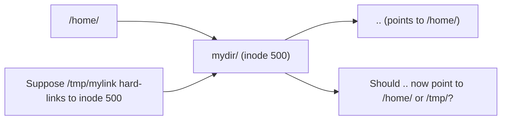

# Linux Symbolic and Hard Links: Understanding Their Differences Through Inodes

## The Idea in One Sentence

**Hard links are multiple names for one inode**, like one person holding two identity cards. **A symbolic link is a signpost pointing to a target pathname**, like a road sign saying “500 meters ahead.” A hard link and the original name are equal at the kernel level; neither can be identified as the “original.” A symbolic link is an independent special file containing a target-path string.

> After deleting the “original file,” hard-linked data remains because the inode reference count is not zero. A symbolic link becomes dangling immediately because its signpost points to a path that no longer exists.

## Start with an Experiment: Compare All Three Cases

```bash
# Preparation: create an original file and a directory
mkdir /tmp/link-lab && cd /tmp/link-lab
echo "I am the original content" > original.txt
mkdir subdir

# Create a hard link: a second name for the same inode
ln original.txt hardlink.txt

# Create symbolic links: special files pointing to paths
ln -s original.txt symlink.txt
ln -s /tmp/link-lab/original.txt symlink-absolute.txt   # Absolute-path symlink
ln -s ../link-lab/original.txt subdir/symlink-relative.txt  # Relative-path symlink

# ===== Observation 1: inspect their appearance =====
ls -li
# Example output:
# 1048583 -rw-r--r-- 2 user user 27 Jun 26 10:00 hardlink.txt
# 1048583 -rw-r--r-- 2 user user 27 Jun 26 10:00 original.txt
#  ↑↑↑↑↑↑↑                                   ↑
#  Same inode number!                    Link count = 2
#
# 1048584 lrwxrwxrwx 1 user user 12 Jun 26 10:00 symlink.txt -> original.txt
#           ↑                              ↑
#      File type l (link)             Size: 12 bytes, the length of "original.txt"!
#                                    Its contents are the target pathname

# ===== Observation 2: cat reads both =====
cat hardlink.txt   # I am the original content
cat symlink.txt    # I am the original content  ← The kernel follows the link automatically

# ===== Observation 3: a change through either name is visible through the other =====
echo "appended line" >> original.txt
cat hardlink.txt   # I am the original content\nappended line  ← Updated!
cat symlink.txt    # I am the original content\nappended line  ← Updated via the signpost!

# ===== Observation 4: delete the original—the crucial difference =====
rm original.txt

cat hardlink.txt
# I am the original content
# appended line
# ↑ Still readable! The inode and data remain; only one name disappeared

cat symlink.txt
# cat: symlink.txt: No such file or directory
# ↑ Broken! The target path is gone: a dangling symlink

# Inspect the hard link's inode information
ls -li hardlink.txt
# 1048583 -rw-r--r-- 1 user user 43 Jun 26 10:05 hardlink.txt
#                         ↑ Link count fell from 2 to 1
# Inode 1048583 remains alive with intact data

# Inspect the remaining symbolic link
ls -l symlink.txt
# lrwxrwxrwx 1 user user 12 Jun 26 10:00 symlink.txt -> original.txt
# The link itself remains, but its target is missing; it is usually highlighted in red
```

This experiment reveals the fundamental difference. Next, examine why from the kernel's perspective.

## 1. Start with Inodes: A Filename Is Not the File's Identity

Before understanding links, grasp this fact: **on Linux, the inode identifies the file; the filename does not.**

```
Actual disk structure:

  ┌────────────────────┐     ┌─────────────────────────────┐
  │ Directory entry    │     │         inode               │
  │                    │     │                             │
  │ Filename: "a.txt" │────→│ Inode number: 1048583        │
  │ Inode: 1048583     │     │ File size: 27 bytes         │
  └────────────────────┘     │ Block pointer: → [block 8821]│
                             │ Link count: 2               │
  ┌────────────────────┐     │ Permissions: rw-r--r--       │
  │ Directory entry    │     │ Owner: user                 │
  │                    │     └─────────────────────────────┘
  │ Filename: "b.txt" │────↗
  │ Inode: 1048583     │    One inode, two filenames: a hard link!
  └────────────────────┘
```

Key conclusions:
- **File contents reside in disk data blocks**; the inode records where those blocks are.
- **Filenames reside in directories**, acting as aliases for inode numbers.
- **A hard link gives one inode several filenames**. Deleting a file removes a directory entry and decrements its link count; the data blocks are released when the count reaches zero.
- **A symbolic link also has its own inode**, but stores a target-path string rather than the target's file contents.

> For inode details, see [Linux Inodes Explained](/en/notes/linux/inode/).

## 2. Hard-Link Rules and Restrictions

### 2.1 Three Things Hard Links Cannot Do

```bash
# 1. Cannot cross filesystems
ln /home/user/file.txt /mnt/usb/link.txt
# ln: failed to create hard link '/mnt/usb/link.txt' => '/home/user/file.txt':
# Invalid cross-device link
# Reason: inode numbers are unique only within one filesystem; another may reuse the number

# 2. Cannot hard-link directories as an ordinary user
ln /tmp/mydir /tmp/mydir-link
# ln: /tmp/mydir: hard link not allowed for directory
# Reason: avoid directory cycles that could make find and rm -rf loop forever
# Exception: root can do this on some filesystems, but it is extremely dangerous

# 3. Cannot link a nonexistent file: the inode must already exist
ln nonexistent.txt link.txt
# ln: failed to access 'nonexistent.txt': No such file or directory
```

### 2.2 Why Are Directory Hard Links Disallowed?

A classic interview question, illustrated below:



Every directory has a `..` entry pointing to its parent. With two parents for the same directory inode, `..` can point to only one, leaving the other a “false parent.” Filesystem traversal by `find`, `pwd`, and backup tools becomes confused.

### 2.3 Typical Hard-Link Uses

```bash
# Use 1: backups/snapshots; this is the idea behind rsync --link-dest
# Create a file snapshot without additional data space
cp -l important.db important.db.backup
# -l creates a hard link instead of a copy; the two names share the same blocks
# Subsequent changes to important.db trigger CoW on some filesystems such as btrfs

# Use 2: save disk space through deduplication
# Identical files in two directories can be replaced by hard links
# Tools include rdfind, fdupes, and hardlink

# Use 3: protect against accidental deletion
# An extra hard link to an important configuration keeps the data after one name is deleted
ln /etc/nginx/nginx.conf /root/nginx.conf.master
# Even if /etc/nginx/nginx.conf is overwritten or deleted, an anchor remains under /root/
```

## 3. Symbolic Links in Depth

### 3.1 A Symbolic Link Is a Path-String File

```bash
# Create a symbolic link
ln -s /usr/local/bin/python3 /usr/bin/python

# Inspect what it is
stat /usr/bin/python
#   File: /usr/bin/python -> /usr/local/bin/python3
#   Size: 24              ← The length of target path "/usr/local/bin/python3"
#   Blocks: 0             ← Short contents fit inside the inode, with no extra disk block
#   IO Block: 4096   regular empty file? No: it is a symbolic link

# Read its contents (the target path) with readlink
readlink /usr/bin/python
# /usr/local/bin/python3
```

The symbolic-link file has three characteristics:
1. **Its own inode**, distinct from the target's.
2. **Contents consisting of the target pathname**, usually short enough to fit in the inode without a data block.
3. **Permissions always shown as `lrwxrwxrwx`**: the link's own permissions are irrelevant; access checks use the target's permissions.

### 3.2 Absolute vs. Relative Paths When Moving Directories

```bash
# Assume this layout:
# /project/
#   ├── src/
#   │   └── app.py
#   └── bin/
#       └── (links will go here)

cd /project/bin

# Option A: absolute path; moving the whole project breaks it
ln -s /project/src/app.py app-abs
# Rename /project to /project-v2 and the link points to a nonexistent location

# Option B: relative path; valid while bin/ and src/ retain their relative positions
ln -s ../src/app.py app-rel
# Renaming or moving /project is fine if the bin/../src/app.py relationship stays intact
```

> Rule of thumb: **use relative links within one project and absolute links for system-wide locations such as `/usr/bin`.**

### 3.3 Typical Symbolic-Link Uses

```bash
# Use 1: version switching, the most common use
# /usr/bin/python → /usr/bin/python3.12
# Changing one link switches versions without changing every script's shebang
ln -sf /usr/bin/python3.12 /usr/bin/python3
ln -sf /usr/bin/python3 /usr/bin/python

# Use 2: simplify deeply nested paths
# Link a long path into a convenient location
ln -s /var/lib/docker/volumes/app-data/_data /home/user/app-data
# Access it through ~/app-data afterward

# Use 3: version-controlled configuration files
# Keep the actual configuration in Git and link it where the system expects it
ln -s ~/dotfiles/.zshrc ~/.zshrc
ln -s ~/dotfiles/nvim ~/.config/nvim
# All configurations are now managed in Git under ~/dotfiles/

# Use 4: library version management with sonames
ls -l /usr/lib/x86_64-linux-gnu/libc.so*
# lrwxrwxrwx libc.so.6 -> libc-2.35.so     ← Symbolic link!
# Programs link to libc.so.6 and actually load libc-2.35.so
# Upgrading to libc-2.36.so only requires changing the link, not recompiling every program
```

## 4. A Complete Comparison

| Dimension | Hard link: `ln` | Symbolic link: `ln -s` |
|------|-----------|-------------|
| **Nature** | Multiple directory entries for one inode | Independent file containing a target pathname |
| **Inode number** | Same as the target | Different; has its own inode |
| **Cross-filesystem** | ❌ Inode numbers are unique only within one FS | ✅ Stores a string |
| **Directory target** | ❌ Prevents directory cycles | ✅ |
| **Nonexistent target** | ❌ | ✅ Dangling link; access fails |
| **After target removal** | Data remains while inode reference count > 0 | Becomes dangling |
| **`ls -l` appearance** | Looks ordinary except for link count > 1 | Shows `-> target` and file type `l` |
| **Disk usage** | Only a directory entry, usually tens of bytes | One inode plus potential pathname storage |
| **Size in `stat`** | Same as target, sharing its inode | Length of the pathname string |
| **Permissions** | Same inode permission fields as target | Always `lrwxrwxrwx`; actual access uses target permissions |
| **Moving/renaming** | Independent entries; moving one does not affect the other | Absolute links break; relative links may survive |
| **Typical uses** | Backup snapshots, deduplication, accidental-deletion protection | Version switching, shorter paths, configuration and library management |

## 5. A Complete Experiment Showing Every Difference

```bash
#!/bin/bash
# Complete link-comparison experiment

cd /tmp && rm -rf link-full-lab && mkdir link-full-lab && cd link-full-lab

echo "=== Step 1: create the original and both links ==="
echo "original content" > original.txt
ln original.txt hard.txt
ln -s original.txt soft.txt

echo "=== Step 2: inspect inode numbers (-i) and link counts (second column) ==="
ls -li
# 1048583 -rw-r--r-- 2 ... hard.txt      ← Same inode as original.txt; link count 2
# 1048583 -rw-r--r-- 2 ... original.txt  ← Link count 2
# 1048584 lrwxrwxrwx 1 ... soft.txt -> original.txt  ← Different inode; link count 1

echo "=== Step 3: write through the hard link; the original changes too ==="
echo "modified via hard link" > hard.txt
cat original.txt   # modified via hard link  ← Same inode!

echo "=== Step 4: write through the symbolic link; the original changes too ==="
echo "modified via soft link" > soft.txt
cat original.txt   # modified via soft link  ← Kernel follows soft.txt → original.txt, then writes

echo "=== Step 5: compare stat; hard link and original are identical ==="
stat original.txt | grep -E 'Inode|Links|Size'
stat hard.txt     | grep -E 'Inode|Links|Size'
# Inode and Links match; the kernel cannot distinguish an original

echo "=== Step 6: compare stat; symbolic link and original differ ==="
stat soft.txt     | grep -E 'Inode|Links|Size'
# Inode: 1048584  ← Different from original.txt!
# Size: 12         ← Only the character count of "original.txt"

echo "=== Step 7: delete the original ==="
rm original.txt

echo "=== Step 8: the hard link survives ==="
cat hard.txt      # modified via soft link  ← Data intact
ls -li hard.txt
# 1048583 -rw-r--r-- 1 ... hard.txt  ← Link count fell from 2 to 1

echo "=== Step 9: the symbolic link is dangling ==="
cat soft.txt
# cat: soft.txt: No such file or directory
ls -l soft.txt
# lrwxrwxrwx 1 ... soft.txt -> original.txt  ← Broken link highlighted in red

echo "=== Step 10: cross-filesystem test ==="
# /tmp and ~ usually share a filesystem; use a USB drive to test another one
# If /mnt/usb is a different filesystem, such as vfat:
#   ln original.txt /mnt/usb/hard.txt       → Invalid cross-device link
#   ln -s /tmp/link-full-lab/original.txt /mnt/usb/soft.txt  → Success!

echo "=== Step 11: directory-link test ==="
mkdir mydir
# ln mydir mydir-hard                        → hard link not allowed for directory
ln -s mydir mydir-soft                      # → Success!
ls -l | grep mydir
# lrwxrwxrwx ... mydir-soft -> mydir
```

## 6. Common Pitfalls

### Pitfall 1: Copying a Symbolic Link

```bash
# cp dereferences symbolic links by default: it copies target contents, not the link
cp soft.txt soft-copy.txt
cat soft-copy.txt     # An ordinary copy of the target contents, not a link

# Preserve the link with -P (--no-dereference)
cp -P soft.txt soft-copy-as-link.txt
ls -l soft-copy-as-link.txt
# lrwxrwxrwx ... soft-copy-as-link.txt -> original.txt  ← Link preserved
```

### Pitfall 2: `ls -l` Does Not Show the Target's Actual Size

```bash
# A symbolic link's reported size is often mistaken for its target's size
ls -l soft.txt
# lrwxrwxrwx 1 user user 12 Jun 26 10:00 soft.txt -> really-long-filename.txt
#                        ↑↑
#                  12 bytes is the length of "original.txt", not the target's size!

# To view the target's actual size:
ls -lL soft.txt    # -L means --dereference: follow the link
# -rw-r--r-- 1 user user 43 Jun 26 10:00 soft.txt  ← 43 bytes is the target's actual size
```

### Pitfall 3: The Base for Resolving Relative Links

```bash
# A relative link resolves from the link's containing directory, not the current working directory
cd /tmp
ln -s ../etc/passwd /tmp/passwd-link
# passwd-link contains "../etc/passwd"
# Resolution: /tmp/../etc/passwd → /etc/passwd  ✅ Correct

# Moving the link changes the base directory
mv /tmp/passwd-link /home/user/
cat /home/user/passwd-link
# Resolution: /home/user/../etc/passwd → /home/etc/passwd  ❌ Does not exist!
```

## 7. Hard Links, Symbolic Links, and Bind Mounts

Bind mounts also make the same contents appear at different paths. This is where the three mechanisms can become confusing: what is actually different?

### 7.1 The Distinction: Who Performs the Redirection?

Compare a Linux filesystem to a book:

```
Imagine a book with a table of contents:

┌─────────────────────────────────────────────────────────────┐
│ Book = disk                                                 │
│ Contents page = filename → page number (inode) index        │
│ Text on a page = data blocks                                │
└─────────────────────────────────────────────────────────────┘
```

Suppose the data is on page 100:

| Mechanism | Analogy | What happens when you read? |
|------|------|-------------------|
| **Hard link** | Two index entries: `a.txt` → page 100 and `b.txt` → page 100 | Read page 100 directly. **There is no redirection**; two entries point to one page |
| **Symbolic link** | `c.txt` → page 200; page 200 says “see page 100” | Read the signpost on page 200, **then turn to** page 100; an extra step |
| **Bind mount** | A note in the preface says “anyone requesting page 300 should go directly to page 100” | **Before** the page is read, the kernel intercepts the request and substitutes page 100 transparently |

**The essential difference is who intercepts path resolution, and at which step:**

When the kernel resolves a path such as `/mnt/point/file.txt`, it follows a **fixed sequence**:

```
Standard kernel pathname-resolution sequence:

/  →  mnt  →  point  →  file.txt
│       │         │           │
│       │         │           └── Step 4: return inode and open file
│       │         │
│       │         └── Step 3: look up file.txt inside point
│       │              After finding the dentry, check for a symbolic link
│       │              ├── No → obtain inode and continue
│       │              └── Yes (type l) → read its pathname,
│       │                  return to step 1 and resolve that path ← Symbolic link intervenes here
│       │
│       └── Step 2: look up mnt below /
│            After finding the dentry, check the mount tree
│            ├── Is /mnt a mount point? No → continue
│            └── Is /mnt a mount point? Yes → continue at the mount source
│                 ← Bind mount intervenes here
│
└── Step 1: begin at /
```

**Key insight: the check order is fixed—mount tree before directory lookup, then symbolic-link inspection.**

Place each mechanism in that flow to see where it takes effect:

```
═══════════════════════════════════════════════════════════════
Example 1: hard link—no special trigger at all
═══════════════════════════════════════════════════════════════

Setup: /tmp/a.txt and /tmp/b.txt both point to inode 1048583

Access: cat /tmp/a.txt

Step 1: start at /
Step 2: look up tmp under / → not a mount point → obtain /tmp's dentry
Step 3: look up a.txt under /tmp → not a symbolic link → obtain inode 1048583
Step 4: return inode 1048583 and read its blocks → "hello world"

Access: cat /tmp/b.txt

Step 1: start at /
Step 2: look up tmp under / → not a mount point → obtain /tmp's dentry
Step 3: look up b.txt under /tmp → not a symbolic link → inode 1048583, the same one!
Step 4: return inode 1048583 and read its blocks → "hello world"

🟢 Conclusion: hard links trigger no special behavior.
               Path A resolves to inode X, and path B resolves to the same inode X.
               No jumps, redirection, or special handling occur.
               The two names are completely equal.


═══════════════════════════════════════════════════════════════
Example 2: symbolic link—restart resolution at step 3
═══════════════════════════════════════════════════════════════

Setup: /tmp/link → /usr/data/file.txt (symbolic link)

Access: cat /tmp/link

Step 1: start at /
Step 2: look up tmp under / → not a mount point → obtain dentry
Step 3: look up link under /tmp → symbolic link (type l)!
         ↓
         Read the link → pathname "/usr/data/file.txt"
         ↓
         🚨 Return to step 1 and resolve /usr/data/file.txt from scratch!
         ↓
Step 1 (second pass): start at /
Step 2 (second pass): look up usr → not a mount point → continue to data
Step 3 (second pass): look up file.txt under data → not a symlink → inode 9876
Step 4 (second pass): return inode 9876 and read blocks → "real content"

🟡 Conclusion: symbolic links restart pathname resolution partway through.
               The second pass follows the same procedure, including mount-tree checks
               and the possibility of encountering another symbolic link.
               Links can therefore form chains, but the kernel follows at most 40 to prevent loops.


═══════════════════════════════════════════════════════════════
Example 3: bind mount—path substitution at step 2
═══════════════════════════════════════════════════════════════

Setup: mount --bind /source /mnt/point
Accessing anything under /mnt/point automatically continues under /source

Access: cat /mnt/point/file.txt

Step 1: start at /
Step 2: look up mnt under /, then point
        Obtain the dentry for /mnt/point
        Then check the mount tree!
        → /mnt/point is a mount point bound to /source
        → Replace the current location /mnt/point with /source
        → Resolve the remaining file.txt inside /source
        This occurs after looking up point's dentry and before looking up file.txt
Step 3: look up file.txt in /source → not a symlink → inode 5555
Step 4: return inode 5555 and read its blocks

🔵 Conclusion: a bind mount does not skip a step; it inserts path substitution
               between steps 2 and 3, replacing the mount-point path with the source.
               Subsequent steps remain unaware of that substitution.
               Both symbolic and hard links operate normally in the substituted location.


═══════════════════════════════════════════════════════════════
The order in which the mechanisms take effect:
═══════════════════════════════════════════════════════════════

What if /mnt/point is both a bind-mount target and a symbolic link?
Answer: the mount tree is checked before symbolic links.

Access: cat /mnt/point

Step 1: start at /
Step 2: look up mnt, then point
        Check the mount tree: is /mnt/point a mount point?
        ├── Yes → move to the source directory, such as /source, and continue there
        └── No → continue to step 3, where it may be recognized as a symlink

🟣 In other words:
   Bind mounts intervene during the mount-tree check, at the end of step 2.
   Symbolic links intervene during the dentry-type check in step 3.
   Hard links do not intervene; they are simply two dentries pointing to one inode.

   Order: mount tree → dentry lookup → symbolic-link check
          (first)                       (last)
```

### 7.2 A Revealing Experiment: Observe the Timeline

```bash
cd /tmp && rm -rf link-vs-mount && mkdir link-vs-mount && cd link-vs-mount
mkdir source
echo "hello world" > source/file.txt

# Create three aliases
ln source/file.txt hard.txt                        # Hard link
ln -s source/file.txt soft.txt                     # Symbolic link
mkdir bind-point && mount --bind source bind-point  # Bind mount

# ──── Moment 1: initial state ────
cat hard.txt      # hello world
cat soft.txt      # hello world
cat bind-point/file.txt  # hello world
# All look the same? Keep going

# ──── Moment 2: modify the source ────
echo "modified" >> source/file.txt
cat hard.txt      # hello world\nmodified  ← Updated: same inode
cat soft.txt      # hello world\nmodified  ← Updated: signpost points to the changed file
cat bind-point/file.txt  # hello world\nmodified  ← Updated: VFS reaches the changed directory
# Still the same?

# ──── Moment 3: delete the source—the turning point ────
rm source/file.txt

```bash
cd /tmp && rm -rf link-vs-mount && mkdir link-vs-mount && cd link-vs-mount
mkdir source
echo "hello world" > source/file.txt

# Create three aliases
ln source/file.txt hard.txt                        # Hard link
ln -s source/file.txt soft.txt                     # Symbolic link
mkdir bind-point && mount --bind source bind-point  # Bind mount

# ──── Moment 1: initial state ────
cat hard.txt      # hello world
cat soft.txt      # hello world
cat bind-point/file.txt  # hello world
# All look the same? Keep going

# ──── Moment 2: modify the source ────
echo "modified" >> source/file.txt
cat hard.txt      # hello world\nmodified  ← Updated: same inode
cat soft.txt      # hello world\nmodified  ← Updated: signpost points to the changed file
cat bind-point/file.txt  # hello world\nmodified  ← Updated: VFS reaches the changed directory
# Still the same?

# ──── Moment 3: delete the source—the turning point ────
rm source/file.txt

cat hard.txt
# hello world
# modified
# ↑ Still alive! Inode reference count falls from 2 to 1; data blocks remain

cat soft.txt
# cat: soft.txt: No such file or directory
# ↑ Broken! Its signposted path no longer exists

cat bind-point/file.txt
# cat: bind-point/file.txt: No such file or directory
# ↑ Also inaccessible! The source directory no longer contains that file

# ──── Moment 4: recreate the same filename in the source directory ────
echo "BRAND NEW FILE" > source/file.txt

cat hard.txt
# hello world
# modified
# ↑ Still the old contents! hard.txt anchors inode 1048583, distinct from the new file's inode

cat soft.txt
# BRAND NEW FILE
# ↑ Works again! The path source/file.txt exists again and resolves to the new file

cat bind-point/file.txt
# BRAND NEW FILE
# ↑ Also works again! The bind mount reaches source/, where file.txt exists again
```

**This experiment reveals the essential distinction**:
- A hard link anchors an **inode**, the data's identity; while the inode remains, so does the data.
- A symbolic link anchors a **pathname string**, reading whatever currently resides at that path.
- A bind mount anchors a **source directory** through VFS, exposing whatever that directory contains.

### 7.3 Why Do They Look Similar in Everyday Use?

Because 99% of the time, the source file remains in place. During normal operation all three support reads and writes with similar results. **Their differences emerge in unusual situations**: source deletion, moving directories, crossing filesystems, or applying read-only restrictions.

### 7.4 A Decision Guide

```
Give a file another name to protect against accidental deletion? → Hard link: same inode, another name survives
Create a shortcut to a file on another filesystem?                → Symbolic link: pathname-based cross-filesystem linking
Expose an entire directory?                                      → Symbolic link for simplicity; bind mount for read-only options
Prevent even root from modifying a directory?                     → bind mount -o remount,ro,bind
Access a host directory inside a container?                       → Bind mount: Docker -v / Kubernetes hostPath
Attach tmpfs at a subdirectory?                                   → mount: attaching a new filesystem, not a link
```

### 7.5 A Quick Reference

| | Hard link: `ln` | Symbolic link: `ln -s` | Bind mount: `mount --bind` |
|---|---|---|---|
| **Anchors** | Inode, the data itself | Pathname string | Source directory at the VFS level |
| **After source deletion** | Data remains intact | Dangling link | Mount view becomes empty; recreating the source restores access |
| **Directories** | ❌ | ✅ | ✅ |
| **Across filesystems** | ❌ | ✅ | ✅ |
| **Can be read-only** | ❌ | ❌ | ✅ |
| **Transparency to programs** | Completely transparent | `stat` identifies a link | Completely transparent |
| **Memory aid** | One file, two names | A signpost pointing to a path | Kernel-level directory grafting |

> For bind-mount details, see [How mount Works](/en/notes/linux/mount/).

## Summary

## Summary

```
Hard link: Name A ──┐
                    ├──→ [inode 1048583] ──→ [data blocks: "hello world"]
           Name B ──┘
           One inode has several equal names; removing one name leaves the data

Symlink:   Name C ──→ [inode 1048584] ──→ [data: "/path/to/A"]
                                                      │
                                     Kernel follows the path ──→ [inode 1048583] ──→ [data blocks]
           Independent file storing a signpost; the kernel follows it during access
```

- **Hard links are alternate identities**: inode reference counts determine the data's lifetime.
- **Symbolic links are road signs**: they store only a pathname, regardless of whether the road still exists.
- **Everyday rule**: use symbolic links across filesystems, for directories, or when the link should be visible as a link. Use hard links within one filesystem for accidental-deletion protection and snapshots.
