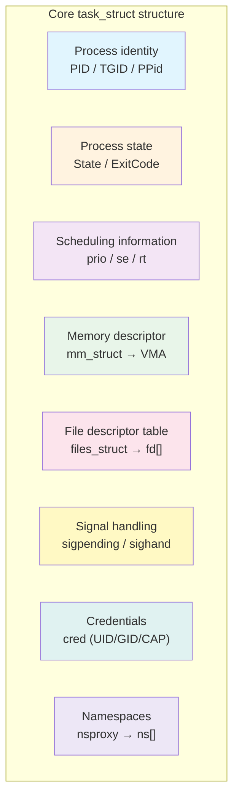
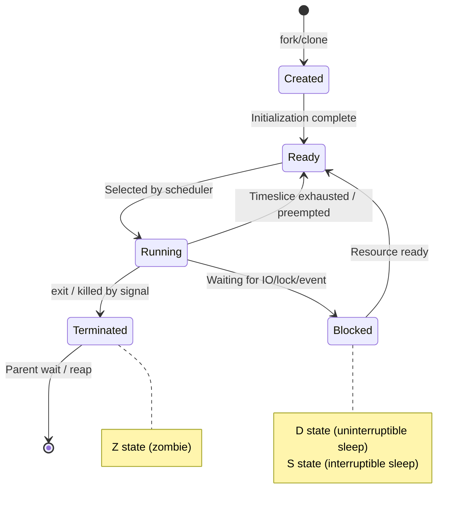
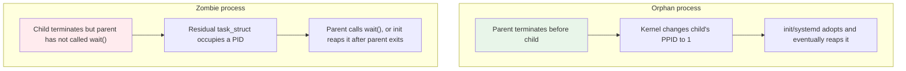
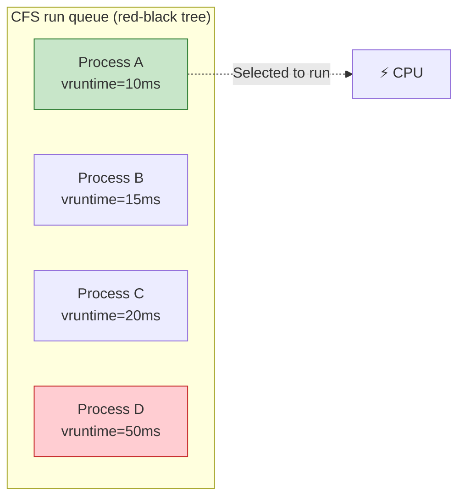
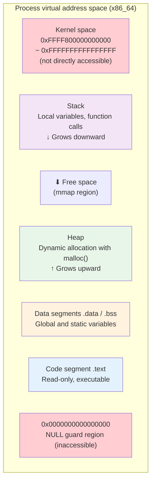
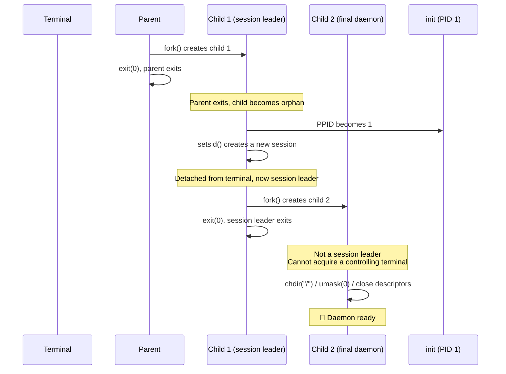
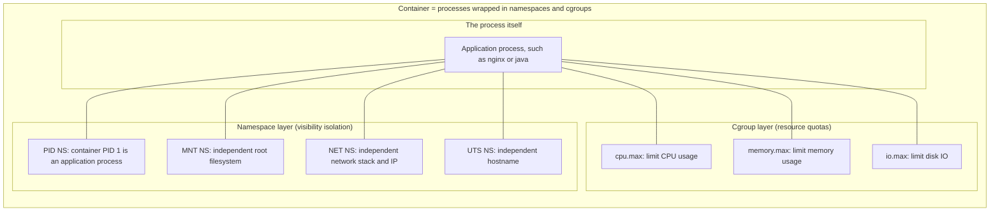

# Linux Process Management Explained

## The Idea in One Sentence

A process is Linux's central abstraction: **an executing instance of a program**, and the basic unit to which the operating system assigns CPU time, memory, file descriptors, and other resources. The kernel's process-management mechanisms allow hundreds or thousands of processes to run concurrently on one machine **safely, fairly, and efficiently**.

> If an operating system is a factory, processes are its workers. Process management is the factory's operating policy: hiring workers (creation), assigning tasks (scheduling), paying them (resource allocation), dismissing them (termination), and preventing fights (isolation).

## What a Process Really Is: The Kernel's task_struct

To the Linux kernel, a process is a `task_struct`. The kernel manages all process information through this structure. Each process also has a directory under `/proc`, named by its PID.

```bash
# Inspect task_struct information for the current shell itself
cat /proc/self/status | head -20
```

Example output:

```
Name:   cat
Umask:  0022
State:  R (running)
Tgid:   12345
Ngid:   0
Pid:    12345
PPid:   12300
TracerPid:      0
Uid:    1000    1000    1000    1000
Gid:    1000    1000    1000    1000
FDSize: 256
Groups: 4 20 24 27 30 46 120 1000
VmPeak:     2560 kB
VmSize:     2432 kB
VmLck:         0 kB
VmPin:         0 kB
VmHWM:       640 kB
VmRSS:       640 kB
```

Key fields:
- `State`: process state, discussed below.
- `Pid` / `PPid`: process ID and parent process ID.
- `Uid` / `Gid`: four IDs—real, effective, saved, and filesystem.
- `VmRSS`: physical memory actually occupied.
- `VmSize`: virtual-memory size.

### Core task_struct Fields



> **Important distinction: PID vs. TGID**
> - PID (Process ID): the kernel's task identifier. Every thread has a unique PID.
> - TGID (Thread Group ID): the process identifier from userspace. All threads in one process share a TGID.
> - For a single-threaded process, PID == TGID.
> - For a multithreaded process, TGID is the main thread's PID, while each other thread has its own PID.
>
> The PID displayed by `ps` is therefore **actually the TGID**. `ls /proc/<pid>/task/` shows all threads under that TGID, with each subdirectory named after a true kernel PID.

## The Process Lifecycle: A Five-State Model

A Linux process moves between several states during its lifetime. Understanding them is fundamental to troubleshooting.



### States Explained

| State | Abbreviation | ps STAT | Meaning | Typical scenarios |
|------|------|---------|------|----------|
| Running | R | `R` | Running or waiting on a run queue | CPU-intensive computation, normally running processes |
| Interruptible Sleep | S | `S` | Interruptible sleep, awaiting an event | Waiting for input, network data, or `sleep 10` |
| Uninterruptible Sleep | D | `D` | **Uninterruptible sleep**, usually awaiting IO | Disk reads/writes, NFS responses |
| Stopped | T | `T` | Suspended by SIGSTOP / SIGTSTP | `Ctrl+Z`, debugger breakpoints |
| Zombie | Z | `Z` | Terminated but not yet reaped by its parent | Parent has not called `wait()` |
| Dead | X | `X` | Dead and about to be fully reclaimed | Extremely brief; rarely observed |

> ⚠️ **The D-state trap**: a D-state process **cannot be killed, even with `kill -9`**, because it is waiting in kernel mode for IO to complete, and signals are handled only on return to userspace. If IO hangs, for example because an NFS server is down, the process may remain in D state indefinitely. Recovery requires restoring IO or rebooting the machine.

### Practice: Observe Process States

```bash
# Start a sleep process and observe its state
sleep 100 &
# [1] 45678

# Inspect state: S means interruptible sleep
ps aux | grep sleep
# user  45678  0.0  0.0   7240   640 pts/0  S  10:00  0:00 sleep 100

# Suspend it with Ctrl+Z
# Or use kill -STOP 45678
# Check again: T means stopped
ps aux | grep sleep
# user  45678  0.0  0.0   7240   640 pts/0  T  10:00  0:00 sleep 100

# Resume it
kill -CONT 45678
```

```bash
# Produce a D-state process (root required; use caution)
# Method: read from an NFS mount, then disconnect the network or stop the NFS server
# Try this only in a test environment:

# 1. Mount a loop device
sudo mount -o loop /tmp/test.img /mnt/test

# 2. Start repeated IO from another terminal
dd if=/dev/zero of=/mnt/test/bigfile bs=1M count=1000 &

# 3. Detach the loop device to simulate hung IO
sudo losetup -d /dev/loopX  # Stuck in D state!
```

## The Process Family Tree: Parents and Children

All Linux processes form a tree rooted at PID 1, `init` or systemd.

```bash
# View the process tree
pstree -p | head -20
```

Output:
```
systemd(1)─┬─ModemManager(852)─┬─{ModemManager}(880)
           │                   └─{ModemManager}(890)
           ├─NetworkManager(853)─┬─{NetworkManager}(869)
           │                     └─{NetworkManager}(876)
           ├─accounts-daemon(854)─┬─{accounts-daemon}(862)
           │                      └─{accounts-daemon}(876)
           ├─containerd(870)─┬─containerd-shim(1234)─┬─nginx(1235)───nginx(1236)
           │                 │                        └─{containerd-shim}(1237)
           │                 └─{containerd}(1040)
           ...
```

Key concepts follow.

### fork() — A Process Makes a Copy of Itself

`fork()` is the way Unix/Linux creates processes. Calling it copies the current process's `task_struct`, producing an almost identical child.

```c
#include <stdio.h>
#include <unistd.h>

int main() {
    pid_t pid = fork();

    if (pid == 0) {
        // Child: fork() returns 0
        printf("I'm child,  PID=%d, PPID=%d\n", getpid(), getppid());
    } else if (pid > 0) {
        // Parent: fork() returns the child's PID
        printf("I'm parent, PID=%d, child PID=%d\n", getpid(), pid);
    } else {
        // fork failed
        perror("fork failed");
    }
    return 0;
}
```

Output:
```
I'm parent, PID=1000, child PID=1001
I'm child,  PID=1001, PPID=1000
```

> 💡 **Copy-on-write (CoW)**: modern Linux does not copy all memory during `fork()`. Parent and child share pages marked read-only. A write by either triggers a page fault, causing the kernel to copy that page. This is why `fork()` is fast.

### Orphan and Zombie Processes

These are often confused but mean very different things:



- **Orphan**: harmless; init automatically adopts and reaps it.
- **Zombie**: its memory has been released, but it **still occupies a PID**. Many zombies can exhaust PIDs and prevent new process creation.

### Practice: Create and Observe a Zombie

```c
// zombie.c — create a zombie process
#include <stdio.h>
#include <stdlib.h>
#include <unistd.h>

int main() {
    pid_t pid = fork();

    if (pid == 0) {
        // Child exits immediately
        printf("Child (PID=%d) exiting...\n", getpid());
        exit(0);
    } else {
        // Parent deliberately sleeps without calling wait()
        printf("Parent (PID=%d), child PID=%d\n", getpid(), pid);
        printf("Run 'ps aux | grep Z' in another terminal to see zombie\n");
        sleep(60);  // The child remains a zombie during these 60 seconds
        // After the parent exits, init reaps the zombie
    }
    return 0;
}
```

Compile and run:
```bash
gcc -o zombie zombie.c
./zombie &
# Inspect it from another terminal
ps aux | grep -w Z
# user  12346  0.0  0.0      0     0 pts/0  Z+  10:05  0:00 [zombie] <defunct>
```

> **How do you clean up a zombie?** Terminate its parent. Its PPID becomes 1, and init/systemd automatically calls `wait()` to reap it.

## Process Scheduling: Who Gets the CPU Next?

The Linux scheduler's core job is to **choose the next process to run among hundreds or thousands of ready processes**.

### CFS: Completely Fair Scheduler

Since Linux 2.6.23, CFS has been the default scheduler. Its central idea is:

> CFS allocates CPU according to **virtual runtime (`vruntime`)**, rather than simple timeslices. Every process accumulates vruntime, and CFS chooses the process with the **smallest** value. CPU-intensive processes accumulate it quickly; IO-intensive processes accumulate it slowly, balancing fairness and priority naturally.



### Nice Values and Priorities

| Nice value | Priority | Meaning | CPU effect |
|---------|------|------|-------------|
| -20 | Highest | “I am important; give me more CPU” | Slowest vruntime growth; more CPU time |
| 0 | Default | Normal priority | vruntime grows with actual execution time |
| 19 | Lowest | “I can wait; let others go first” | Fastest vruntime growth; less CPU time |

```bash
# View nice values
ps -eo pid,ni,comm | head -20

# Start a CPU-intensive job at low priority
nice -n 19 sha256sum /dev/zero &

# Adjust an existing process's priority
renice -n -5 -p <PID>   # Increase priority (root required)
renice -n 10 -p <PID>   # Lower priority
```

### Practice: Observe CPU Scheduling

```bash
# Terminal 1: start two CPU-intensive processes
dd if=/dev/zero of=/dev/null bs=1M &
dd if=/dev/zero of=/dev/null bs=1M &

# Terminal 2: observe whether CPU allocation is fair
top -p <PID1>,<PID2>
# Each dd should receive roughly 50% CPU

# Terminal 2: change one process's nice value
renice -n 19 -p <PID1>   # Lower PID1's priority
# PID2 receives more CPU because PID1's vruntime grows faster
```

## Process Memory Layout

Linux processes follow a common virtual-memory layout:



### Practice: Inspect Memory Mappings

```bash
# Inspect a process's memory layout
cat /proc/self/maps
```

Simplified example output:
```
00400000-00401000 r-xp ... /usr/bin/cat          # Code segment
00600000-00601000 r--p ... /usr/bin/cat          # Read-only data
00601000-00602000 rw-p ... /usr/bin/cat          # Read/write data
01a00000-01a21000 rw-p ... [heap]                # Heap
7f1234000000-7f1234021000 rw-p ...               # mmap region
7ffe00000000-7ffe00021000 rw-p ... [stack]       # Stack
7ffe00030000-7ffe00031000 r-xp ... [vdso]        # vDSO
ffffffffff600000-ffffffffff601000 r-xp ... [vsyscall]  # vsyscall
```

### Process Memory Metrics

```bash
# Inspect detailed memory metrics
cat /proc/<PID>/status | grep -E "Vm|Rss"
```

| Metric | Meaning | Notes |
|------|------|------|
| VmSize | Total virtual-memory size | Includes memory not physically allocated; often large |
| VmRSS | Resident physical memory | **Actual physical memory occupied; the most important metric** |
| VmData | Data-segment size | .data + .bss + heap |
| VmStk | Stack size | Usually small; default 8 MB |
| VmExe | Code-segment size | .text |
| VmLib | Shared-library mappings | Dynamically linked libraries |
| VmSwap | Memory swapped out | Higher values indicate greater memory pressure |

## Signals: Asynchronous Communication Between Processes

Signals are Linux's lightest IPC mechanism: fundamentally an asynchronous notification that something happened.

### Core Signals at a Glance

| Signal | Number | Default action | Meaning | Catchable? | Ignorable? |
|------|------|---------|------|---------|---------|
| SIGINT | 2 | Term | Terminal interrupt, Ctrl+C | ✅ | ✅ |
| SIGQUIT | 3 | Core | Terminal quit, Ctrl+\, with core dump | ✅ | ✅ |
| SIGKILL | 9 | Term | **Unconditional termination; cannot be caught or ignored** | ❌ | ❌ |
| SIGTERM | 15 | Term | Graceful termination; default for kill | ✅ | ✅ |
| SIGSTOP | 19 | Stop | **Unconditional suspension; cannot be caught or ignored** | ❌ | ❌ |
| SIGCONT | 18 | Cont | Resume a stopped process | ✅ | ✅ |
| SIGCHLD | 17 | Ignore | Child process state changed | ✅ | ✅ |
| SIGPIPE | 13 | Term | Write to a pipe with no reader | ✅ | ✅ |
| SIGHUP | 1 | Term | Terminal hangup; also used to reload configuration | ✅ | ✅ |
| SIGUSR1 | 10 | Term | User-defined signal 1 | ✅ | ✅ |
| SIGUSR2 | 12 | Term | User-defined signal 2 | ✅ | ✅ |

### Practice: Signal Handling

```bash
# kill sends SIGTERM (15) by default, allowing graceful exit
kill <PID>

# SIGKILL (9) kills immediately, without a cleanup opportunity
kill -9 <PID>

# List all signals
kill -l
```

```c
// signal_demo.c — demonstrate catching signals
#include <stdio.h>
#include <stdlib.h>
#include <signal.h>
#include <unistd.h>

void handle_sigint(int sig) {
    printf("\nCaught SIGINT (%d), but I won't die!\n", sig);
    printf("Try Ctrl+\\ (SIGQUIT) or kill -9 instead.\n");
}

void handle_sigterm(int sig) {
    printf("\nCaught SIGTERM (%d), cleaning up...\n", sig);
    exit(0);  // Graceful exit
}

int main() {
    // Catch SIGINT (Ctrl+C)
    signal(SIGINT, handle_sigint);

    // Catch SIGTERM
    signal(SIGTERM, handle_sigterm);

    printf("My PID is %d\n", getpid());
    printf("Press Ctrl+C to test SIGINT capture\n");
    printf("Run 'kill %d' to test SIGTERM\n", getpid());

    while (1) {
        printf(".");
        fflush(stdout);
        sleep(1);
    }
    return 0;
}
```

> 💡 **SIGTERM vs. SIGKILL**: send `SIGTERM` first for graceful shutdown, allowing connection cleanup and state saving. Use `SIGKILL` only if the process is stuck and ignores `SIGTERM`. Kubernetes follows the same sequence: send `SIGTERM`, wait `terminationGracePeriodSeconds`, then send `SIGKILL`.

## Daemons

A daemon is a long-running service process operating in the background without a terminal. Examples include sshd, nginx, and systemd-journald.

Typical characteristics:
- Parent is usually PID 1, init/systemd.
- No controlling terminal; `tty` shows `?`.
- Working directory is usually `/`.
- File descriptors 0, 1, and 2 usually point to `/dev/null`.

```bash
# Find daemon processes: non-kernel processes without a TTY
ps -eo pid,ppid,tty,comm | awk '$3 == "?" {print}'
```

### The Steps to Become a Daemon

A userspace program traditionally daemonizes through **double-fork**:

```c
// daemon_demo.c — standard daemonization steps
#include <stdio.h>
#include <stdlib.h>
#include <unistd.h>
#include <sys/stat.h>
#include <fcntl.h>

void daemonize() {
    // Step 1: first fork; parent exits
    pid_t pid = fork();
    if (pid > 0) exit(0);  // Parent exits; child continues
    if (pid < 0) exit(1);

    // Step 2: create a session and detach from the original terminal
    setsid();  // Child becomes session leader with no associated terminal

    // Step 3: fork again to stop being session leader and prevent reacquiring a terminal
    pid = fork();
    if (pid > 0) exit(0);
    if (pid < 0) exit(1);

    // Step 4: reset the working directory
    chdir("/");

    // Step 5: reset umask
    umask(0);

    // Step 6: close inherited descriptors and redirect stdin/stdout/stderr
    close(STDIN_FILENO);
    close(STDOUT_FILENO);
    close(STDERR_FILENO);
    open("/dev/null", O_RDONLY);  // stdin → /dev/null
    open("/dev/null", O_WRONLY);  // stdout → /dev/null
    open("/dev/null", O_WRONLY);  // stderr → /dev/null
}

int main() {
    daemonize();
    // Main daemon logic
    while (1) {
        // Perform background work...
        sleep(10);
    }
    return 0;
}
```



## The /proc Filesystem

`/proc` is a virtual filesystem exposed by the Linux kernel and the first stop for process troubleshooting. Every file under `/proc/<PID>/` is a dynamically generated “health report.”

### Common Troubleshooting Reference

```bash
cat /proc/<PID>/status       # Process state, memory, UID/GID, etc.; most commonly used
cat /proc/<PID>/cmdline      # Startup command
ls -la /proc/<PID>/fd/       # All open file descriptors
cat /proc/<PID>/maps         # Virtual-memory mappings
cat /proc/<PID>/smaps        # Detailed memory accounting; Pss is most accurate
cat /proc/<PID>/oom_score    # OOM-killer score
cat /proc/<PID>/cgroup       # cgroup membership; identify the container
cat /proc/<PID>/stack        # Kernel stack; diagnose D-state hangs
ls -la /proc/<PID>/root/     # Process root filesystem; extremely useful for containers
```

### `/proc/<PID>/root` — Particularly Useful for Containers

`/proc/<PID>/root` points to **the root directory as viewed by that process**. For a container process, it points to the container root filesystem's actual host location. This means:

```bash
# Access container files from the host without docker exec
PID=$(docker inspect --format '{{.State.Pid}}' nginx)
cat /proc/$PID/root/etc/nginx/nginx.conf  # Read container configuration
cp /proc/$PID/root/var/log/nginx/error.log /tmp/  # Copy logs out of the container
```

> 📖 **Further reading**: [The /proc Filesystem Explained](/en/notes/linux/proc-filesystem/) covers field meanings, container-root behavior, sysctl tuning, and complete troubleshooting examples.

## Process Management and Containers

A container is **a group of processes isolated by namespaces and limited by cgroups**. Understanding process management is a prerequisite for understanding containers.



Key points:
- PID 1 inside the container **is your application**, such as `java -jar app.jar`, rather than init/systemd.
- PID 1 has special responsibilities: **reap zombie processes** and **handle signals correctly**.
- If PID 1 does not handle SIGTERM, the container waits for `terminationGracePeriodSeconds` before being forcibly killed with SIGKILL.
- Use `tini` or `--init` as PID 1 with your Docker setup to handle signals and reap zombies correctly.

## Common Process-Management Commands

```bash
# === Inspect processes ===
ps aux                  # Detailed information for all processes
ps -eo pid,ppid,ni,stat,comm,args  # Custom columns
pstree -p               # Process tree
pgrep -a nginx          # Find processes by name
pidof nginx             # Get PIDs by name

# === Live monitoring ===
top                     # Interactive process monitor
htop                    # Enhanced top; requires installation
pidstat 1               # Per-second process CPU, memory, and IO statistics

# === Process control ===
kill <PID>              # Send SIGTERM for graceful termination
kill -9 <PID>           # Force termination
kill -STOP <PID>        # Suspend
kill -CONT <PID>        # Resume
kill -HUP <PID>         # Often reloads configuration, as with nginx -s reload
killall -9 <process-name> # Kill by name

# === Priority ===
nice -n 10 <command>    # Start at lower priority
renice -n -5 -p <PID>   # Adjust priority

# === Background jobs ===
command &               # Run in background
Ctrl+Z                  # Suspend foreground job
jobs                    # List background jobs
fg %1                   # Bring job 1 to foreground
bg %1                   # Resume stopped job 1 in background
nohup command &         # Ignore SIGHUP and continue after terminal exit
disown -h %1            # Detach job 1 from the shell's job control

# === /proc debugging ===
strace -p <PID>         # Trace syscalls; useful for diagnosing hangs
lsof -p <PID>           # List all files opened by the process
cat /proc/<PID>/stack   # View kernel stack for D-state debugging
```

## Summary

The central ideas in Linux process management:

1. **Process representation**: the kernel manages everything about a process through `task_struct`.
2. **Lifecycle**: creation (`fork`) → ready → running → blocked/stopped → terminated → reaped.
3. **Fair scheduling**: CFS allocates CPU using vruntime, with nice values affecting weights.
4. **Signals**: lightweight asynchronous notifications; SIGTERM permits graceful exit, SIGKILL forces termination.
5. **Memory isolation**: each process has its own virtual address space; CoW improves `fork` performance.
6. **Container foundation**: namespace visibility isolation + cgroup resource limits = container.

Understanding process management means understanding half an operating system. The other half is memory management and filesystems, but that is another story.

---

> 📚 **Further reading**:
> - [Linux Namespaces Explained](/en/notes/linux/namespace/)
> - [cgroup v2 Explained](/en/notes/linux/cgroup/)
> - [What Containers Really Are: The Kubernetes Perspective](/en/notes/kubernetes/4iyz7vyg/)
