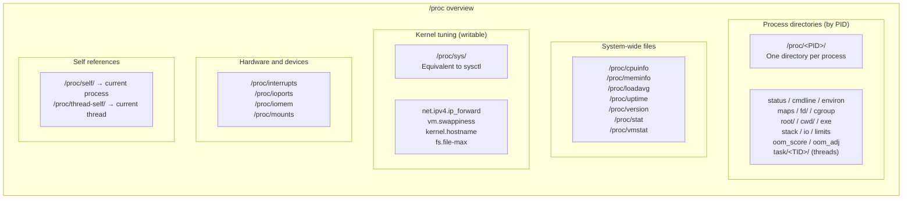
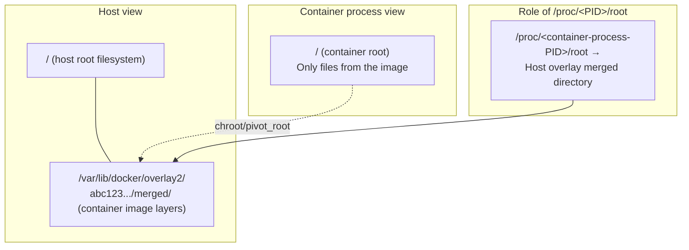

# The /proc Filesystem Explained: A Runtime Window into the Linux Kernel

## The Idea in One Sentence

`/proc` is a **pseudo-filesystem**: it is not stored on disk, and the kernel **generates its contents dynamically** when they are read. Think of it as a “read-only control panel” exposed to userspace. Reading and writing its files lets you observe, and sometimes modify, the runtime state of the kernel and individual processes.

> `/proc` resembles a car's OBD-II diagnostic interface: while the car runs, a diagnostic tool reveals engine speed, coolant temperature, and fault codes. `/proc` is Linux's equivalent.

## /proc Does Not Contain “Real Files”

This is the most important point about `/proc`:

```bash
# It looks like an ordinary file, but reading it always produces the current state
cat /proc/meminfo     # Regenerated on every read; no disk usage
ls -la /proc/meminfo  # Size is 0, yet reading returns contents!
# -r--r--r-- 1 root root 0 Jun 25 10:00 /proc/meminfo
```

Files in `/proc` have two key properties:

| Property | Description |
|------|------|
| **No disk usage** | Contents are generated through kernel interfaces such as `seq_file` / `proc_create`, without being written to disk |
| **Current state** | Each `read()` reflects current kernel state, rather than stale stored data |

## The Overall /proc Structure



## The /proc/&lt;PID&gt;/ Process Directory

Process directories are the most frequently used part of `/proc`. The following sections cover their most important files.

### 1. `status` — The Process Identity Card

```bash
cat /proc/self/status
```

<details>
<summary>Expand the complete example output</summary>

```
Name:   bash
Umask:  0022
State:  S (sleeping)
Tgid:   1234
Ngid:   0
Pid:    1234
PPid:   1230
TracerPid:      0
Uid:    1000    1000    1000    1000
Gid:    1000    1000    1000    1000
FDSize: 256
Groups: 4 20 24 27 30 46 120 1000
NStgid: 1234
NSpid:  1234
NSpgid: 1234
NSsid:  1234
VmPeak:   128456 kB
VmSize:   125832 kB
VmLck:         0 kB
VmPin:         0 kB
VmHWM:      5840 kB
VmRSS:      5216 kB
RssAnon:    2048 kB
RssFile:    3168 kB
RssShmem:      0 kB
VmData:     3024 kB
VmStk:       132 kB
VmExe:       964 kB
VmLib:      2148 kB
VmPTE:        60 kB
VmSwap:        0 kB
HugetlbPages:  0 kB
CoreDumping:    0
THP_enabled:    1
Threads:        1
SigQ:   0/63342
SigPnd: 0000000000000000
ShdPnd: 0000000000000000
SigBlk: 0000000000010000
SigIgn: 0000000000384004
SigCgt: 000000004b813efb
CapInh: 0000000000000000
CapPrm: 0000000000000000
CapEff: 0000000000000000
CapBnd: 000001ffffffffff
CapAmb: 0000000000000000
NoNewPrivs:     0
Seccomp:        0
Seccomp_filters:        0
Speculation_Store_Bypass:       thread vulnerable
SpeculationIndirectBranch:        conditional enabled
Cpus_allowed:   3f
Cpus_allowed_list:      0-5
Mems_allowed:   00000000,00000000,00000000,00000000,00000000,00000000,00000000,00000000,00000000,00000000,00000000,00000000,00000000,00000000,00000000,00000000,00000000,00000000,00000000,00000000,00000000,00000000,00000000,00000000,00000000,00000000,00000000,00000000,00000000,00000000,00000000,00000001
Mems_allowed_list:      0
voluntary_ctxt_switches:        152
nonvoluntary_ctxt_switches:     8
```
</details>

#### Fields by Category

**Identity**
| Field | Meaning |
|------|------|
| `Name` | Executable name |
| `Pid` | Process ID from the kernel's perspective |
| `PPid` | Parent process ID |
| `Tgid` | Thread group ID; the userspace PID |
| `Uid` / `Gid` | Four values: real, effective, saved, filesystem |

**Memory metrics** (kB)
| Field | Meaning | Importance |
|------|------|----------|
| `VmPeak` | Peak virtual memory | ⭐ |
| `VmSize` | Current virtual memory | ⭐⭐ |
| **`VmRSS`** | **Resident physical memory actually occupied** | ⭐⭐⭐⭐⭐ |
| `VmHWM` | Historical RSS peak, the high-water mark | ⭐⭐⭐ |
| `VmSwap` | Memory swapped out | ⭐⭐⭐ |
| `VmData` | Data-segment size: heap + .data + .bss | ⭐⭐ |
| `VmStk` | Stack size | ⭐ |
| `RssAnon` | Anonymous-page RSS, from malloc/mmap, etc. | ⭐⭐⭐ |
| `RssFile` | File-mapped RSS, such as executable code and shared libraries | ⭐⭐⭐ |

> 💡 **RSS is one of the least inflated metrics**. For container OOM handling, the kernel also considers RSS plus page cache and related memory. The memory shown by `docker stats` is broadly comparable to RSS.

**Signals**
| Field | Meaning |
|------|------|
| `SigPnd` | Pending-signal bitmap for this process |
| `ShdPnd` | Pending signals shared by the thread group |
| `SigBlk` | Blocked-signal bitmap |
| `SigIgn` | Ignored-signal bitmap |
| `SigCgt` | Caught-signal bitmap |

**Security and capabilities**
| Field | Meaning |
|------|------|
| `CapPrm` / `CapEff` / `CapBnd` | Linux capability bitmaps |
| `Seccomp` | Seccomp mode: 0 = disabled, 1 = strict, 2 = filter |

**CPU affinity and scheduling**
| Field | Meaning |
|------|------|
| `Cpus_allowed_list` | CPU cores on which the process may run |
| `voluntary_ctxt_switches` | Voluntary context switches, such as IO waits |
| `nonvoluntary_ctxt_switches` | Involuntary switches, such as timeslice exhaustion |

### 2. `fd/` and `fdinfo/` — File Descriptors

Start here when investigating file-descriptor leaks.

```bash
# Inspect all file descriptors opened by the process
ls -la /proc/<PID>/fd/

# Example output
# lrwx------ 1 root root 64 Jun 25 10:00 0 -> /dev/null
# lrwx------ 1 root root 64 Jun 25 10:00 1 -> /dev/null
# lrwx------ 1 root root 64 Jun 25 10:00 2 -> /dev/null
# lrwx------ 1 root root 64 Jun 25 10:00 3 -> socket:[45678]
# lrwx------ 1 root root 64 Jun 25 10:00 4 -> /var/log/nginx/access.log
# lrwx------ 1 root root 64 Jun 25 10:00 5 -> anon_inode:[eventpoll]
# lr-x------ 1 root root 64 Jun 25 10:00 6 -> pipe:[98765]

# Inspect descriptor details such as offset and flags
cat /proc/<PID>/fdinfo/4
# pos:    1048576       # Current file offset
# flags:  0100001       # O_WRONLY | O_APPEND
# mnt_id: 15
```

> 🔍 **Troubleshooting tip**: for `Too many open files`, count descriptors with `ls /proc/<PID>/fd/ | wc -l`, then compare against `cat /proc/<PID>/limits | grep "open files"`.

### 3. `maps` and `smaps` — Virtual-Memory Maps

```bash
cat /proc/self/maps
```

Simplified example output:
```
55a8b0000000-55a8b0001000 r-xp 00000000 fd:01 123456  /usr/bin/bash
55a8b0002000-55a8b0003000 r--p 00001000 fd:01 123456  /usr/bin/bash
55a8b0003000-55a8b0004000 rw-p 00002000 fd:01 123456  /usr/bin/bash
55a8b1a00000-55a8b1a21000 rw-p 00000000 00:00 0       [heap]
7f1234000000-7f1234021000 rw-p 00000000 00:00 0
7f1234021000-7f1238000000 ---p 00000000 00:00 0
7f123c000000-7f123c021000 rw-p 00000000 00:00 0
7ffc00000000-7ffc00021000 rw-p 00000000 00:00 0       [stack]
7ffc00030000-7ffc00031000 r-xp 00000000 00:00 0       [vdso]
ffffffffff600000-ffffffffff601000 --xp 00000000 00:00 0 [vsyscall]
```

Format: `start-end  permissions  offset  device  inode  pathname`

Permissions:
- `r` = readable, `w` = writable, `x` = executable.
- `p` = private mapping; `s` = shared mapping.

`smaps` expands `maps` with detailed memory accounting for every VMA:

```bash
cat /proc/self/smaps | head -30
```

For each mapping, `smaps` additionally reports:
- `Rss`: resident physical memory.
- `Pss`: RSS apportioned according to sharing, **the most accurate process-memory metric for containers**.
- `Shared_Clean` / `Shared_Dirty`: shared pages.
- `Private_Clean` / `Private_Dirty`: private pages.
- `Swap`: swapped-out size of the mapping.
- `SwapPss`: proportionally apportioned swap.

> 💡 **Pss vs. RSS**: if several processes share `libc.so`, RSS counts that memory once for each process. Pss divides it among them, better reflecting an individual process's memory cost in container environments.

### 4. `cmdline` vs. `comm`

```bash
# cmdline: complete startup command, with NUL-separated arguments
cat /proc/<PID>/cmdline | tr '\0' ' '
# /usr/bin/python3 /app/server.py --port 8080

# comm: executable name only, limited to 15 characters by the kernel
cat /proc/<PID>/comm
# python3
```

> ⚠️ `prctl(PR_SET_NAME)` can change `comm`, so do not rely on it alone to establish process identity.

### 5. `cgroup` — The Process's cgroup Path

```bash
cat /proc/<PID>/cgroup
# 0::/system.slice/docker-abc123.scope
# Or with cgroup v1:
# 12:memory:/docker/abc123
# 11:cpu:/docker/abc123
```

In container environments, this is a key way to determine which container owns a process.

### 6. `oom_score` and `oom_score_adj`

These participate in the scoring used by the OOM killer to choose victims:

```bash
# oom_score: current dynamically calculated score; higher means more likely to be killed
cat /proc/<PID>/oom_score
# 25

# oom_score_adj: manual adjustment, from -1000 to 1000
# -1000 = completely exempt; never kill
#   0   = default; let the kernel decide
# 1000  = preferred victim
cat /proc/<PID>/oom_score_adj
# 0

# Protect a process from the OOM killer
echo -1000 > /proc/<PID>/oom_score_adj
```

> 🔍 Kubernetes implements Pod QoS classes—Guaranteed, Burstable, and BestEffort—through cgroup `memory.oom.group` and process `oom_score_adj` settings. BestEffort Pods receive an `oom_score_adj` of 1000 and are killed first.

### 7. `stack` — Kernel Stack

Useful for investigating processes stuck in D state, uninterruptible sleep:

```bash
cat /proc/<PID>/stack
# [<0>] blk_mq_get_tag+0x11c/0x2c0
# [<0>] __blk_mq_alloc_request+0x16e/0x260
# [<0>] blk_mq_submit_bio+0x3c1/0x6c0
# [<0>] submit_bio_noacct+0x53a/0x6e0
# ...
```

A process stuck in NFS or block-device IO functions reveals the cause of its D state.

### 8. `io` — Per-Process IO Statistics

```bash
cat /proc/<PID>/io
# rchar: 4678923           # Bytes read, including page-cache hits
# wchar: 1289456           # Bytes written, including page cache
# syscr: 892               # Read system calls
# syscw: 456               # Write system calls
# read_bytes: 409600       # Bytes actually read from storage
# write_bytes: 204800      # Bytes actually written to storage
# cancelled_write_bytes: 0 # Cancelled writes
```

> 💡 `rchar` can greatly exceed `read_bytes`: the difference is data served from page cache without actual disk IO.

### 9. `exe`, `cwd`, and `root` — Three Special Symbolic Links

These define a process's filesystem “coordinate system”:

```bash
# exe: the executable file
ls -la /proc/<PID>/exe
# lrwxrwxrwx 1 root root 0 Jun 25 10:00 exe -> /usr/bin/python3

# cwd: the current working directory
ls -la /proc/<PID>/cwd
# lrwxrwxrwx 1 root root 0 Jun 25 10:00 cwd -> /app

# root: the root directory seen by the process; see the next section
ls -la /proc/<PID>/root
# lrwxrwxrwx 1 root root 0 Jun 25 10:00 root -> /
```

---

## 🔑 Focus: `/proc/<PID>/root` and Containers

### What It Is

`/proc/<PID>/root` is a symbolic link pointing to **that process's root filesystem**. Normally, without containers or chroot, it points to the host's `/`. A containerized or chrooted process instead exposes **the root directory from its own perspective**.



### What This Means for a Container

When you start a Docker container:

```bash
docker run -d --name nginx nginx
```

Docker:
1. Prepares its root filesystem by combining image layers into a merged directory with a storage driver such as overlay2.
2. Uses `pivot_root` or `chroot` to switch the process root to that directory.
3. The kernel records a reference to the root in `task_struct`.

Consequently:

```bash
# The nginx process sees the container root filesystem at /
# On the host:
ls /proc/<container-nginx-PID>/root/
# Output contains the container's etc/, usr/, var/, etc.
# These are not the host's corresponding directories

# Confirm it
ls /proc/<container-nginx-PID>/root/etc/nginx/
# nginx.conf ... — the nginx configuration inside the container!
```

### Practice: Access Container Files from the Host

This is a useful operations technique: **access container files directly from the host without `docker exec`**.

```bash
# 1. Find the container process PID
docker inspect --format '{{.State.Pid}}' <container-name>
# Or
ps aux | grep <process-name>

# 2. Access its filesystem through /proc/<PID>/root
# No need to enter the container or use docker exec

# Read the container's /etc/hosts
cat /proc/12345/root/etc/hosts

# Inspect processes visible inside the container through its /proc
ls /proc/12345/root/proc/

# Modify a container configuration file
echo "debug=true" >> /proc/12345/root/etc/app/config.ini

# List the container root filesystem
ls -la /proc/12345/root/

# Copy a log out to the host
cp /proc/12345/root/var/log/app/app.log /tmp/app.log

# "cd into the container" (switch the current process's root to the container root; use caution)
cd /proc/12345/root && ls
# ./etc now refers to the container's /etc
```

> ⚠️ **Note**: access through `/proc/<PID>/root` can bypass a container's read-only-layer restrictions. Even if its root filesystem is read-only (`docker run --read-only`), writing to `/proc/<PID>/root/` from the host remains possible because these writes reach the overlay upper layer rather than the lower layer.

### `/proc/<PID>/root` vs. `docker cp` vs. `docker exec`

| Method | Mechanism | Suitable use |
|------|------|----------|
| `docker exec -it <container> bash` | Start a process in the container namespaces | Everyday debugging; requires a shell in the container |
| `docker cp` | Docker daemon transfers files through a tar stream | Copy files into or out of containers |
| `/proc/<PID>/root/` | Access a process root directly through kernel VFS | **Shell-less containers, crashed containers, emergency recovery** |

### Recovery When a Container Crashes

When `docker exec` cannot enter a container—for example, its init process is stuck or it is in Created state—`/proc/<PID>/root` can provide an alternative:

```bash
# Scenario: container repeatedly restarts; exec fails, but its process may exist briefly
# 1. Capture the PID quickly
PID=$(docker inspect --format '{{.State.Pid}}' <container-name>)

# 2. Inspect the filesystem through /proc/<PID>/root
# Read application logs
cat /proc/$PID/root/var/log/app/error.log

# Check configuration
cat /proc/$PID/root/etc/app/config.yaml

# Inspect disk usage
du -sh /proc/$PID/root/var/log/
```

### Security: Permissions on `/proc/<PID>/root`

```bash
# Host root can see everything
# Whether an ordinary user can access /proc/<PID>/root depends on ptrace permissions

# Inspect ptrace scope: who may inspect another process?
cat /proc/sys/kernel/yama/ptrace_scope
# 0 = Any process can ptrace (traditional, less secure behavior)
# 1 = Only parent processes or root (default; safer)
# 2 = Only root with CAP_SYS_PTRACE
# 3 = Entirely forbidden

# With ptrace_scope=1, ordinary users can access only their own /proc/<PID>/root
# Root is unaffected
```

> 🔒 Container security: `/proc/<PID>/root` is a **privileged access channel**. A process with `CAP_SYS_PTRACE` can access any container filesystem on the host. This explains why Kubernetes should restrict container capabilities and why privileged containers are dangerous.

---

## Writable Kernel Tuning Parameters: sysctl

Files under `/proc/sys/` are **readable and writable**, allowing runtime kernel tuning. `sysctl` essentially reads and writes these files.

```bash
# Count all tunable parameters
sysctl -a | wc -l  # Usually over 1,000

# === Common network tuning ===
# Enable IP forwarding to make Linux act as a router
echo 1 > /proc/sys/net/ipv4/ip_forward
# Equivalent to
sysctl -w net.ipv4.ip_forward=1

# Adjust a TIME_WAIT-related setting
sysctl net.ipv4.tcp_tw_reuse=1

# === Common memory tuning ===
# Adjust tendency to swap: 0–100; lower values make swapping less likely
cat /proc/sys/vm/swappiness  # Default: 60
echo 10 > /proc/sys/vm/swappiness

# Inspect the dirty-page percentage that triggers writeback
cat /proc/sys/vm/dirty_ratio  # Default: 20 (%)

# === Filesystem tuning ===
# Maximum file handles
cat /proc/sys/fs/file-max
# Maximum inotify watches
cat /proc/sys/fs/inotify/max_user_watches
```

### Kernel Parameter Categories

| Category | Meaning | Examples |
|---------|------|------|
| `kernel.*` | Core kernel behavior | `kernel.hostname`, `kernel.pid_max` |
| `net.*` | Network protocol stack | `net.ipv4.tcp_syncookies`, `net.core.somaxconn` |
| `vm.*` | Virtual-memory management | `vm.swappiness`, `vm.overcommit_memory` |
| `fs.*` | Filesystems | `fs.file-max`, `fs.inotify.max_user_watches` |
| `user.*` | User resource limits | `user.max_user_namespaces` |

> ⚠️ Changes to `/proc/sys/` **do not persist** across reboot. For persistence, use `/etc/sysctl.conf` or `/etc/sysctl.d/*.conf`.

---

## System-Wide Information Files

```bash
# === CPU ===
cat /proc/cpuinfo          # CPU model, cores, frequency, cache, flags
cat /proc/stat             # CPU time: user/system/idle/iowait, etc.

# === Memory ===
cat /proc/meminfo          # Global memory: MemTotal/MemFree/Buffers/Cached, etc.
cat /proc/vmstat           # Virtual-memory events: pgfault/pgscan, etc.

# === Load ===
cat /proc/loadavg          # 1/5/15-minute load averages + runnable/total processes
cat /proc/uptime           # Seconds since boot + idle seconds

# === Kernel version ===
cat /proc/version          # Kernel version and build information

# === Disks and devices ===
cat /proc/mounts           # Current mounts; more current than /etc/fstab
cat /proc/partitions       # Disk partitions
cat /proc/diskstats        # Disk IO statistics
cat /proc/interrupts       # Interrupt counts by CPU core

# === Filesystems ===
cat /proc/filesystems      # Filesystem types supported by the kernel
```

---

## A Complete Troubleshooting Example

### Scenario: Container Memory Keeps Growing, Suggesting a Leak

```bash
# 1. Find the main container process PID
PID=$(docker inspect --format '{{.State.Pid}}' myapp)

# 2. Establish a memory baseline
cat /proc/$PID/status | grep -E "VmRSS|VmSize|RssAnon|VmHWM"
# VmRSS:    512000 kB    # 512 MB RSS
# VmHWM:    524000 kB    # Historical peak: 524 MB

# 3. Check again after a few minutes
cat /proc/$PID/status | grep VmRSS
# VmRSS:    612000 kB    # Grew to 612 MB, confirming the trend

# 4. Examine memory composition
# Is the heap growing?
cat /proc/$PID/smaps | grep -A 20 '\[heap\]' | grep -E "^(Rss|Pss|Size):"

# Inspect anonymous memory from malloc/mmap
cat /proc/$PID/status | grep RssAnon
# Continually growing RssAnon suggests an application memory leak

# 5. Check OOM risk
cat /proc/$PID/oom_score
# A score above 600 suggests it is close to being killed
# Compare against cgroup limits
cat /proc/$PID/cgroup  # Identify the cgroup
cat /sys/fs/cgroup/memory/.../memory.limit_in_bytes  # cgroup memory limit

# 6. Trace brk/mmap to see whether allocation calls are frequent
strace -p $PID -e brk,mmap -c -S time &
sleep 30
kill %1
# Review syscall statistics for allocation frequency

# 7. If the container crashes but its process remains, inspect its files directly
ls -la /proc/$PID/root/tmp/          # Access container /tmp
cat /proc/$PID/root/var/log/app/*.log  # Inspect application logs
```

---

## Limitations of /proc

| Limitation | Description |
|------|------|
| **Not an atomic snapshot** | State changes between two reads of `/proc/meminfo`; different files are read at different times |
| **Performance cost** | Frequently reading large files such as `/proc/<PID>/smaps` can consume noticeable CPU |
| **Kernel-version differences** | File formats may vary between kernel versions |
| **Not all information is here** | Most cgroup v2 information is under `/sys/fs/cgroup/`; network namespace details are under `/var/run/netns/` |
| **Different container view** | A container's `/proc` is filtered by namespaces and differs from the host view |

---

## Summary

| Category | Purpose | Key files |
|------|------|----------|
| Process diagnosis | Understand a process's state | `status`, `maps`, `fd/`, `stack` |
| Memory analysis | Determine usage and where memory goes | `status` (RSS), `smaps` (Pss), `maps` |
| Container recovery | Access container files from the host | **`/proc/<PID>/root/`** |
| Kernel tuning | Change kernel parameters at runtime | `/proc/sys/` |
| System monitoring | View global system state | `meminfo`, `cpuinfo`, `loadavg`, `stat` |

`/proc` gives operators and developers an overview of Linux's internal state. The kernel knows what each process is doing, and `/proc` is how it reports that information to us. Mastering it provides a large part of the skill needed to diagnose Linux problems.

---

> 📚 **Further reading**:
> - [Linux Process Management Explained](/en/notes/linux/process-management/)
> - [Linux Namespaces Explained](/en/notes/linux/namespace/)
> - [cgroup v2 Explained](/en/notes/linux/cgroup/)
> - Linux kernel documentation: [proc.txt](https://www.kernel.org/doc/Documentation/filesystems/proc.txt)
> - `man 5 proc` — the official, authoritative `/proc` reference
