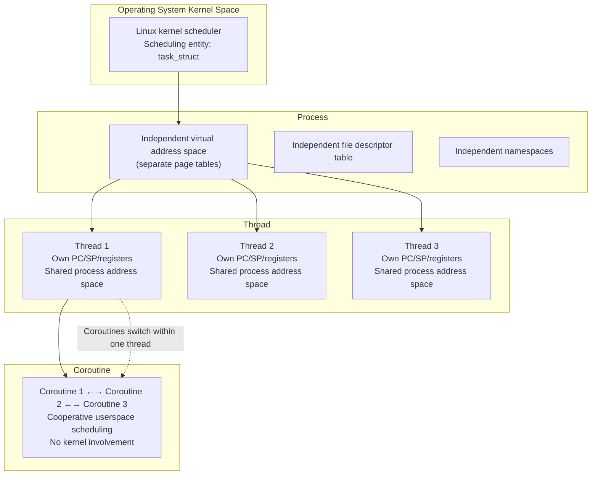
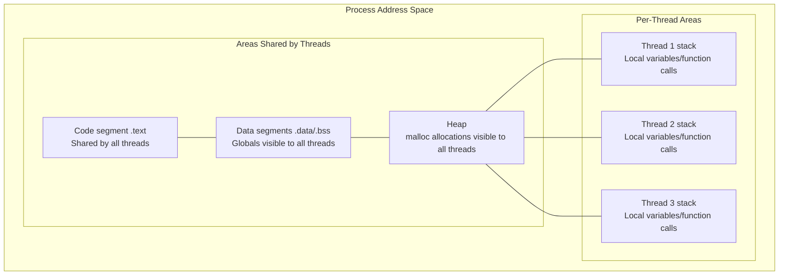
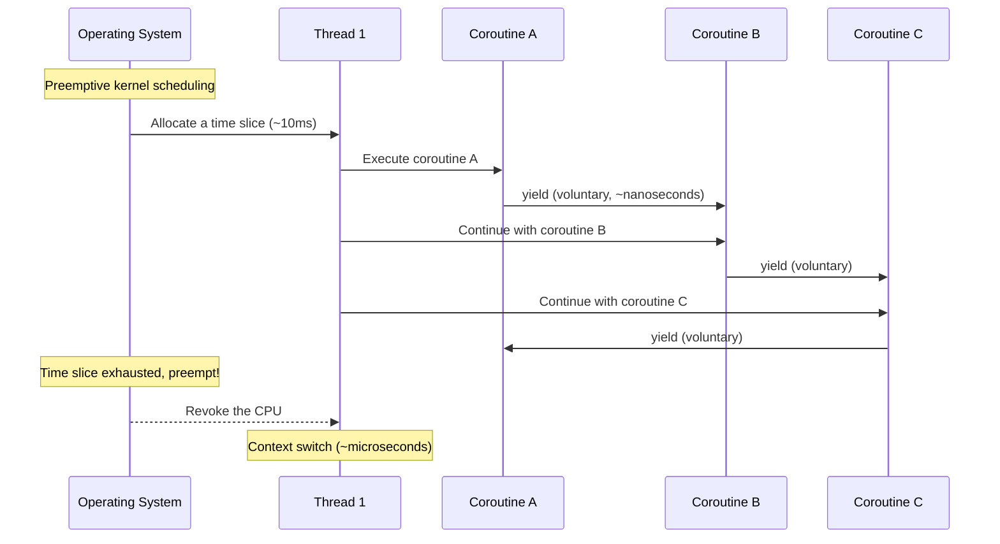
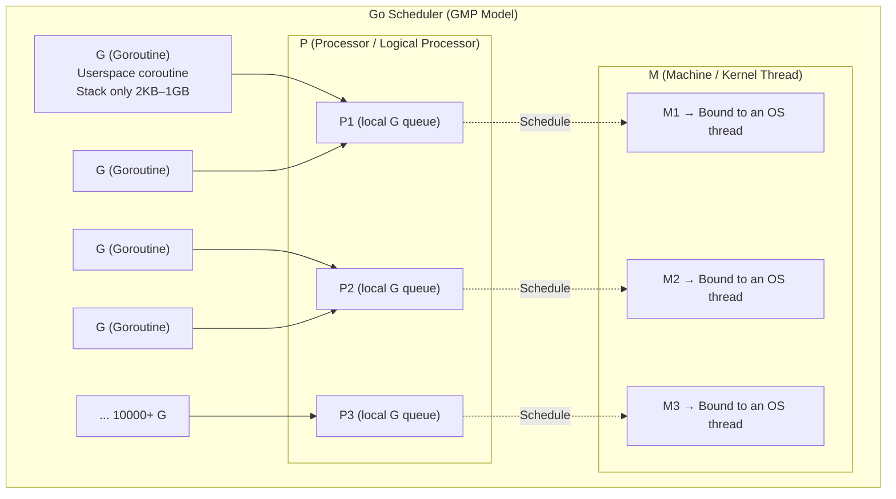
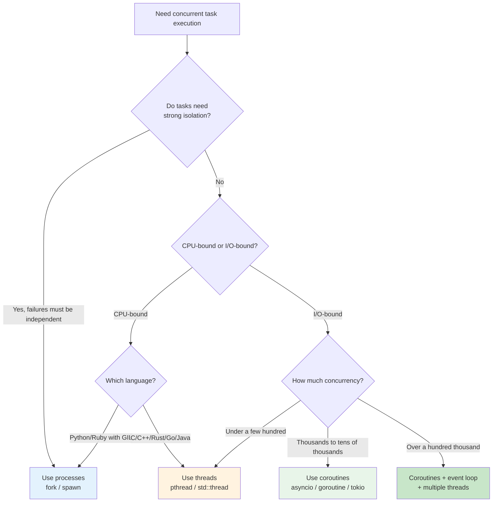
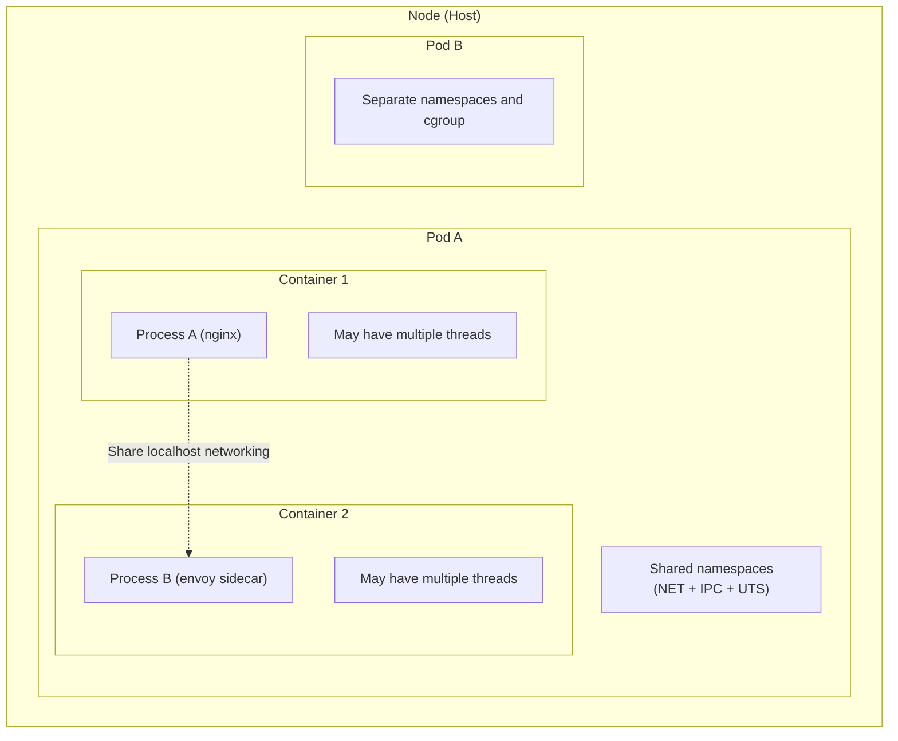
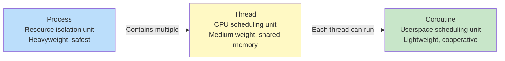

# Processes, Threads, and Coroutines: Their Relationships and Evolution

## Understanding Them in One Sentence

Processes, threads, and coroutines are **concurrent execution units at different levels of granularity** in operating systems and programming languages. Their relationship can be summarized in one sentence:

> **A process is the smallest unit of resource allocation, a thread is the smallest unit of CPU scheduling, and a coroutine is a lightweight thread in userspace.** A process resembles a detached house with its own resources; threads resemble housemates sharing those resources; coroutines resemble the efficient task lists housemates use to arrange their own work.

## The Overall Relationship



## Key Differences

| Dimension | Process | Thread | Coroutine |
|------|------|------|------|
| **Scheduler** | Kernel CFS scheduler | Kernel CFS scheduler | **The userspace program itself** |
| **Memory** | Fully separate, isolated by page tables | Shared process address space, separate stack | Shared thread stack or small separate stack |
| **Context-switch cost** | ~1–10μs, involving page-table switching | ~0.1–1μs, switching registers only | **~10–100ns**, comparable to a function call |
| **Creation/destruction cost** | High (fork + exec) | Medium (clone + stack allocation) | **Very low** (a few KB of stack allocated in userspace) |
| **Communication** | Pipes, shared memory, sockets | Shared memory, mutexes, condition variables | Direct function calls, channels |
| **Isolation** | ⭐⭐⭐⭐⭐ Strongest | ⭐⭐⭐ Moderate | ⭐ Weakest, within one thread |
| **Impact of one crash** | Does not affect other processes | **May bring down the entire process** | Affects only the current thread |
| **Typical count** | Tens to hundreds | Hundreds to thousands | **Tens to hundreds of thousands** |
| **Visible to the kernel?** | Yes (`task_struct`) | Yes (`task_struct`) | **No** |
| **Preemption** | Preemptive | Preemptive | **Cooperative**, yielding voluntarily |

## 1. Processes: Containers for Resource Isolation

The previous two articles covered processes in detail. Here is a quick review:

```c
// Each process has separate resources
// Three processes do not affect one another
pid_t pid = fork();
if (pid == 0) {
    // Child process 1: its own memory space
    int x = 10;  // This x is visible only to the child
    x++;
    printf("child: x=%d\n", x);  // x=11
} else {
    // Parent: an entirely different memory space
    int x = 10;  // This x is visible only to the parent
    printf("parent: x=%d\n", x);  // x=10
}
```

**The defining feature of processes** is resource isolation, prioritizing safety. One process crashing does not affect others.

### Hands-On Observation: Create Processes and Inspect Them on Linux

Write a program that creates two child processes, then inspect them with Linux tools.

First, understand what `fork()` does:

> `fork()` is the **only** Linux system call that creates a new process. It **copies the current process in full**: code, data, heap, stack, file descriptors, register state, and so on. The kernel then has two nearly identical processes: the original is the **parent**, and the copy is the **child**. Both continue **simultaneously** from the line after `fork()`. The only difference is its return value: the parent receives the child's PID; the child receives 0.

```c
// process_lab.c — Create child processes and keep them running for observation
#include <stdio.h>
#include <unistd.h>
#include <sys/wait.h>

int main() {
    pid_t p1, p2;

    printf("Parent PID: %d\n", getpid());

    // ┌──────────────────────────────────────────────────────────────┐
    // │ The counterintuitive part of fork(): called once, returns twice│
    // │                                                              │
    // │ Before fork(), only one process is running (the current one)  │
    // │ After fork(), two processes are running:                      │
    // │                                                              │
    // │   Process A (original = parent)                               │
    // │     └─ fork() returns the child's PID (e.g. 12346)             │
    // │        → p1 = 12346, so p1 > 0 and the if branch is skipped    │
    // │                                                              │
    // │   Process B (new = child)                                     │
    // │     └─ fork() returns 0                                       │
    // │        → p1 = 0, so p1 == 0 and it enters the if branch!       │
    // │                                                              │
    // │ Both continue after fork() with exactly the same code.        │
    // │ The only difference is the value returned by fork().          │
    // │ Thus if (p1 == 0) means:                                      │
    // │   "Am I currently in the child process?"                      │
    // └──────────────────────────────────────────────────────────────┘
    p1 = fork();
    if (p1 == 0) {
        // Only the child reaches this point (p1 == 0)
        printf("Child 1: PID=%d, PPID=%d\n", getpid(), getppid());
        while (1) sleep(10);
    }

    // Only the parent reaches here (p1 > 0, containing child 1's PID)
    // The child remains in while(1) above and never reaches this line

    p2 = fork();         // The parent forks again, creating a second child
    if (p2 == 0) {
        // Only child 2 reaches this point
        printf("Child 2: PID=%d, PPID=%d\n", getpid(), getppid());
        while (1) sleep(10);
    }

    // Only the parent reaches here
    printf("Parent: I have two children: %d and %d\n", p1, p2);
    while (1) sleep(10);
}
```

```bash
# Compile and run
gcc -o process_lab process_lab.c
./process_lab &

# === Observation 1: inspect the process tree with ps ===
ps -eo pid,ppid,stat,comm | grep process_lab
# Example output:
# 12345  6789  S  process_lab    ← Parent
# 12346 12345  S  process_lab    ← Child 1 (PPID=12345)
# 12347 12345  S  process_lab    ← Child 2 (PPID=12345)

# Three separate processes; the children have the same parent PPID

# === Observation 2: pstree makes the tree clearer ===
pstree -p 12345
# process_lab(12345)─┬─process_lab(12346)
#                     └─process_lab(12347)

# === Observation 3: each process has a separate memory space ===
# Inspect parent memory
cat /proc/12345/status | grep -E "^VmRSS|^VmSize"
# VmSize:  2432 kB
# VmRSS:    640 kB

# Inspect child 1 memory: a fully separate instance
cat /proc/12346/status | grep -E "^VmRSS|^VmSize"
# VmSize:  2432 kB
# VmRSS:    640 kB
# VmSize is almost identical: fork copies the address space, but CoW shares physical memory until written

# === Observation 4: each process has its own /proc directory ===
ls /proc/12345/fd/   # Parent file descriptors
ls /proc/12346/fd/   # Child 1 file descriptors: separate!

# === Observation 5: process isolation means one crash does not affect the others ===
kill -9 12346        # Kill child 1
ps -eo pid,ppid,comm | grep process_lab
# Parent (12345) and child 2 (12347) are still running!
```

> 🔍 **Key finding**: the three processes have **three independent /proc directories**, separate `status` files, and distinct PIDs. Their only connection is PPID, the parent-child relationship.

## 2. Threads: Lightweight Processes Sharing a Space

Threads address two problems with processes:
1. **Expensive creation**: forking copies page tables, file descriptor tables, and more.
2. **Slow communication**: interprocess communication must go through the kernel, using pipes, shared memory, and similar mechanisms.

Threads let multiple execution flows **share one process's resources**, including memory and file descriptors, while keeping separate execution contexts: PC, SP, and registers.

### The Thread Memory Model



> 💡 **Key idea**: threads have their own stacks and registers but share the heap, data segments, and code segment. Therefore:
> - Memory allocated with `malloc` in one thread **can be read and written directly** by others, without IPC.
> - A global-variable change in one thread is **immediately visible** to others and needs synchronization.
> - If one thread calls `free` on memory that another later accesses, the latter **crashes**.

### Practical Example: Shared Memory Across Threads

```c
#include <stdio.h>
#include <pthread.h>
#include <unistd.h>

// ╔═══════════════════════════════════════════════════════════════╗
// ║ SHARED MEMORY DEMO: two threads contend to update one global  ║
// ║                                                               ║
// ║ Key differences compared with fork:                            ║
// ║ - After fork(), parent and child have separate variable copies ║
// ║ - After pthread_create(), all threads share the same globals   ║
// ║ - No pipe/shared-mem is needed; threads read/write directly     ║
// ║ - Consequently, a mutex is needed to keep the data consistent   ║
// ╚═══════════════════════════════════════════════════════════════╝

// Global variable in the process's .data segment
// All threads share this one variable, not separate copies!
int shared_counter = 0;

// Mutex: a gate protecting shared variables
// Only one thread can enter the critical section at a time
pthread_mutex_t mutex = PTHREAD_MUTEX_INITIALIZER;

void* worker(void* arg) {
    int id = *(int*)arg;        // Obtain the thread number

    for (int i = 0; i < 100000; i++) {
        // ┌── Start of critical section ──────────────────┐
        // │ Lock: if another thread already holds it,      │
        // │       this thread blocks here and waits        │
        pthread_mutex_lock(&mutex);

        // shared_counter++ becomes three CPU instructions:
        //   1. MOV  eax, [shared_counter]   // Read memory into a register
        //   2. ADD  eax, 1                   // Increment the register
        //   3. MOV  [shared_counter], eax   // Write back to memory
        // Without a lock, both threads may execute step 1 simultaneously,
        // read the same old value, and apply only one increment, losing an update
        shared_counter++;

        // │ Unlock: allow other threads to enter           │
        pthread_mutex_unlock(&mutex);
        // └── End of critical section ─────────────────────┘
    }
    printf("Thread %d done\n", id);
    return NULL;
}

int main() {
    pthread_t t1, t2;          // Thread handles (similar to file descriptors)
    int id1 = 1, id2 = 2;

    // pthread_create is not fork()!
    // - It creates a new execution flow, not a copy of the process
    // - The new thread starts at worker(), not the line after create
    // - The new and main threads share globals, heap, and file descriptors
    // - The main thread continues rather than stopping at create
    pthread_create(&t1, NULL, worker, &id1);
    pthread_create(&t2, NULL, worker, &id2);

    // pthread_join: wait for a specified thread to finish
    // Similar to waitpid() for children, but waiting for a thread
    // Without join, main may exit first → process ends → all threads are forcibly terminated
    pthread_join(t1, NULL);
    pthread_join(t2, NULL);

    // With a working mutex, the result must be 200000
    // Removing lock/unlock will probably produce a result below 200000
    printf("Final counter: %d (expected 200000)\n", shared_counter);
    return 0;
}
```

> ⚠️ Without `pthread_mutex_lock/unlock`, the final `shared_counter` is usually **below** 200000. `counter++` is not atomic: it reads, adds one, then writes back. Two threads may read the same value, increment it separately, and write the same result, losing an update. This is a **race condition**.

### Threads from the Kernel's Perspective

Linux represents both threads and processes as **`task_struct`** objects. The distinction lies in the arguments passed to `clone()` when creating them.

> `clone()` is the **only** Linux kernel system call for creating a new execution flow, whether process or thread. `fork()` and `pthread_create()` are wrappers around it, passing different flags:
>
> - **Both call `clone()`**: `fork()` and `pthread_create()` ultimately reach the `clone()` system call.
> - **The difference is flags**: `CLONE_*` flags determine what the parent and child share.

| High-level interface | Underlying system call | clone flags | Shared resources | Result |
|----------|-------------|------------|---------|------|
| `fork()` | `clone(SIGCHLD, ...)` | Almost no sharing flags | Almost nothing | **Independent process** |
| `pthread_create()` | `clone(CLONE_VM \| CLONE_FS \| CLONE_FILES \| CLONE_SIGHAND, ...)` | Share memory + filesystem + fd + signals | Address space, filesystem information, fd table, signal handlers | **Thread** |

**Key flags**:

| Flag | Meaning | Effect when absent, as with fork |
|------|------|-------------------------------------|
| `CLONE_VM` | Share virtual memory | Separate parent/child address spaces using Copy-on-Write |
| `CLONE_FS` | Share filesystem information: root, pwd, umask | Separate filesystem information |
| `CLONE_FILES` | Share file descriptor table | Separate fd tables, though descriptors refer to the same kernel file objects |
| `CLONE_SIGHAND` | Share signal handler table | Separate signal handler configurations |
| `CLONE_THREAD` | Belong to the same thread group, sharing TGID | Separate thread groups with separate PIDs |

A simple way to remember:

> `fork()` = `clone()` with **share nothing** → a process.\
> `pthread_create()` = `clone()` with **share everything possible** → a thread.\
> Linux makes no fundamental distinction between processes and threads; only the degree of sharing differs.

Once the `clone()` flags make sense, thread identifiers in the kernel become clearer. There is a **particularly easy trap**, however: `ps` column names are misleading.

#### The Truth: Each Kernel Task Has Only One PID

The kernel assigns each `task_struct` one globally unique number called its **PID**. Whether the task is a process or a thread, the kernel sees a `task_struct` with a PID. **There is no kernel "SPID"; `ps` invented that name.**

#### What Is `Tgid` in `/proc/<PID>/status`?

Tasks created with `CLONE_THREAD`, meaning threads, share a **TGID** (Thread Group ID). It equals the PID of the first task in the group, the main thread. Userspace uses TGID to treat the thread group as one process.

#### The Source of Confusion: `ps` Column Names

In trying to be user-friendly, `ps` made a poor naming choice:

| `ps` column | Actual kernel field | Reality |
|-------------|-------------------|------|
| `PID` in `ps` | **TGID** | `ps` calls TGID "PID", misleading the reader |
| `SPID` in `ps -T` | **PID**, the real kernel identifier | `ps` needs the additional name "SPID" to display the actual kernel PID |

> 💡 **PID and SPID are not two distinct things**: SPID is the actual kernel PID. `ps` created the "SPID" column only because it already uses "PID" for TGID. This is a historical naming issue in `ps`, not a kernel problem.

#### A Diagram to Make It Clear

```
Output of ps -T -p 23456:
  PID   SPID   COMMAND
 23456  23456  thread_lab    ← Main thread: TGID=23456, kernel PID=23456 (equal)
 23456  23457  thread_lab    ← Worker thread: TGID=23456, kernel PID=23457
 23456  23458  thread_lab    ← Worker thread: TGID=23456, kernel PID=23458
  ↑      ↑
  │      └── SPID = actual kernel PID, unique to each thread
  └── ps "PID" = TGID, shared by all threads in the process

Subdirectory names in /proc/23456/task/:
  23456/  23457/  23458/  23459/
    ↑       ↑       ↑       ↑
    └── Actual kernel PIDs, corresponding to SPID in ps -T
        The main thread happens to have PID == TGID; worker threads do not
```

Remember two rules:
- **Kernel view**: every thread has a unique PID, while threads in the same group share TGID.
- **`ps` view**: "PID" means TGID; "SPID" in `ps -T` means the kernel PID.

```bash
# View threads in a multithreaded process
ps -T -p <PID>
# SPID = each thread's actual kernel PID
# PID  = TGID, identical for all threads

# Or:
ls /proc/<PID>/task/
# Each subdirectory name is one thread's kernel PID
```

### Hands-On Observation: Create Threads and Inspect Them on Linux

Modify the `shared_counter` example to keep threads alive for observation:

```c
// thread_lab.c — Create 3 threads and keep them running
#include <stdio.h>
#include <pthread.h>
#include <unistd.h>

void* worker(void* arg) {
    int id = *(int*)arg;
    printf("Thread %d: my TID (kernel PID) = %d\n", id, gettid());
    while (1) sleep(10);  // Sleep to allow observation
    return NULL;
}

int main() {
    pthread_t t1, t2, t3;
    int id1 = 1, id2 = 2, id3 = 3;

    printf("Main process PID: %d\n", getpid());

    pthread_create(&t1, NULL, worker, &id1);
    pthread_create(&t2, NULL, worker, &id2);
    pthread_create(&t3, NULL, worker, &id3);

    // The main thread sleeps too
    while (1) sleep(10);
}
```

```bash
# Compile, linking the pthread library
gcc -o thread_lab thread_lab.c -pthread
./thread_lab &

# === Observation 1: ps shows only process-level information by default ===
ps aux | grep thread_lab
# user  23456  0.0  0.0   2560   960 pts/0  Sl  10:00  0:00 ./thread_lab
# Only 1 process appears! Threads are hidden by default

# === Observation 2: ps -T shows threads ===
ps -T -p 23456
#   PID   SPID  STAT  COMMAND
# 23456  23456  Sl    thread_lab    ← Main thread
# 23456  23457  Sl    thread_lab    ← Thread 1 (different SPID!)
# 23456  23458  Sl    thread_lab    ← Thread 2
# 23456  23459  Sl    thread_lab    ← Thread 3
# Same PID (23456), different SPIDs (thread IDs)!

# === Observation 3: view threads through /proc/<PID>/task/ ===
ls /proc/23456/task/
# 23456/  23457/  23458/  23459/
# Each subdirectory represents a thread!

# Each thread has its own status
cat /proc/23456/task/23457/status | grep -E "^Name|^Pid|^Tgid"
# Name:   thread_lab
# Tgid:   23456    ← Thread group ID = main thread PID
# Pid:    23457    ← This thread's own kernel PID

cat /proc/23456/task/23456/status | grep -E "^Name|^Pid|^Tgid"
# Name:   thread_lab
# Tgid:   23456
# Pid:    23456    ← Main thread: Pid == Tgid

# === Observation 4: threads share file descriptors, unlike processes! ===
ls -la /proc/23456/fd/           # File descriptors from the main process view
ls -la /proc/23456/task/23457/fd/ # Thread 1 file descriptors
# Identical contents, because threads share the file descriptor table!

# === Observation 5: visualize with htop (recommended!) ===
# F2 → Display options → enable "Show custom thread names"
# Or directly:
htop -p 23456
# Press H to toggle thread display
# Multiple threads appear under one process, each with its own CPU usage

# === Observation 6: view threads with top ===
top -H -p 23456
# Shows CPU usage for each thread

# === Observation 7: thread memory is shared ===
# In each /proc/<PID>/task/<TID>/status:
# VmRSS main thread: 960 kB
# VmRSS thread 1:    960 kB ← Same as main!
# VmRSS thread 2:    960 kB ← Same as main!
# RSS is a process-level statistic; threads read the same data
```

> 🔍 **Key findings**:
> - Four threads, one main plus three workers, have **one PID from userspace's perspective**, but **four task_struct objects in the kernel**.
> - The file descriptor table is **fully shared**: a file opened by one thread is accessible to others through the same fd number.
> - Memory statistics such as VmRSS are **process-level**; every thread sees the same value.
> - `ps` hides threads by default; use `-T` or `-L` to show them.

## 3. Coroutines: Cooperative Tasks in Userspace

Coroutines are the youngest of these three concepts, though their origins date to the 1960s. As Go goroutines, Python asyncio, and Kotlin coroutines have become popular, coroutines have become central to highly concurrent programming.

### What Problem Do Coroutines Solve?

Threads are lighter than processes, but still have bottlenecks:

```bash
# What happens with 10000 threads on an 8-core machine?
# Default 8MB stack per thread → 10000 × 8MB = 80GB of virtual memory
# Add context-switch overhead → CPU spends most time switching rather than executing
# This is the root of the C10K problem
```

The coroutine approach is to **move scheduling from the kernel back to userspace**. One thread can run thousands of coroutines, which **cooperatively** yield execution with almost no switching cost.

### The Core Difference Between Coroutines and Threads



### Practical Example: Python Coroutines

```python
import asyncio
import time

# === Traditional multithreading approach (limited by the GIL) ===
def io_task_sync(n):
    """Simulate an I/O-bound task."""
    print(f"Task {n}: starting")
    time.sleep(1)  # Blocks the entire thread!
    print(f"Task {n}: done")

# Running 3 tasks sequentially takes 3 seconds
# Even 3 Python threads cannot fully utilize execution because of the GIL

# === Coroutine approach ===
async def io_task_async(n):
    """The same task, implemented as a coroutine."""
    print(f"Task {n}: starting")
    await asyncio.sleep(1)  # Yield control without blocking!
    print(f"Task {n}: done")

async def main():
    # Three tasks run "simultaneously", taking about 1 second total
    await asyncio.gather(
        io_task_async(1),
        io_task_async(2),
        io_task_async(3),
    )

# asyncio.run(main())
# Output:
# Task 1: starting
# Task 2: starting
# Task 3: starting
# (About 1 second later)
# Task 1: done
# Task 2: done
# Task 3: done
```

> 💡 `time.sleep(1)` vs `await asyncio.sleep(1)`:
> - `time.sleep(1)` **blocks the entire thread**, which can do nothing else during that second.
> - `await asyncio.sleep(1)` **suspends the current coroutine**, immediately letting the thread run others before returning one second later.

### Practical Example: Go Goroutines

Go makes coroutines first-class language features through goroutines:

```go
package main

import (
    "fmt"
    "sync"
    "time"
)

func worker(id int, wg *sync.WaitGroup) {
    defer wg.Done()
    fmt.Printf("Worker %d starting\n", id)
    time.Sleep(100 * time.Millisecond) // Simulate I/O
    fmt.Printf("Worker %d done\n", id)
}

func main() {
    var wg sync.WaitGroup

    // Easily start 10000 goroutines
    // Each starts with a stack of only ~2KB
    // 10000 × 2KB = 20MB, compared with 80GB for threads
    for i := 0; i < 10000; i++ {
        wg.Add(1)
        go worker(i, &wg) // The "go" keyword creates a goroutine
    }

    wg.Wait()
    fmt.Println("All workers done")
}
```

Go's GMP scheduling model is the key to its efficiency:



Go scheduler essentials:
- **G** = goroutine, a userspace coroutine; there can be hundreds of thousands.
- **M** = machine, corresponding to an OS thread; the count is limited, with a default maximum of 10000.
- **P** = processor, a logical processor; its count usually equals CPU cores (`GOMAXPROCS`).
- Go schedules Gs in **userspace**, involving the kernel only when necessary.

### Hands-On Observation: Create Coroutines and Inspect Them on Linux

The most interesting property of coroutines is that **the kernel does not know they exist**. Verify this with Python and Go.

#### Observe Python asyncio Coroutines

```python
# coroutine_lab.py — Create 1000 coroutines and inspect the OS view
import asyncio
import os
import time

async def worker(n):
    """Each coroutine sleeps for 10 seconds without blocking."""
    print(f"Coroutine {n}: started")
    await asyncio.sleep(10)  # Yield control without blocking
    print(f"Coroutine {n}: done")

async def main():
    print(f"Process PID: {os.getpid()}")
    print(f"Press Ctrl+C after checking /proc/{os.getpid()}")

    # Create 1000 coroutines
    tasks = [asyncio.create_task(worker(i)) for i in range(1000)]
    print(f"Created {len(tasks)} coroutines")
    print("Now check another terminal...")

    await asyncio.gather(*tasks)

if __name__ == "__main__":
    asyncio.run(main())
```

```bash
# Terminal 1: run
python3 coroutine_lab.py &
# Process PID: 34567
# Created 1000 coroutines
# Now check another terminal...

# === Terminal 2: inspect the OS view ===
PID=34567

# 1. Count processes with ps: only 1!
ps -T -p $PID
#   PID   SPID  STAT  COMMAND
# 34567  34567  Sl    python3
# There may be only one thread, or a few helper threads

# 2. Count threads
ls /proc/$PID/task/ | wc -l
# 1 (or a very small number, such as 1–3)
# 1000 coroutines → the OS sees only 1 thread!

# 3. Inspect memory: 1000 coroutines use very little
cat /proc/$PID/status | grep VmRSS
# VmRSS: about 15–30 MB (for 1000 coroutines!)
# By comparison, 1000 thread stacks alone need 1000×8MB = 8GB

# 4. Observe system calls with strace: coroutine switches are invisible
strace -p $PID -e clone,futex -f 2>&1 | head -20
# Only a few futex calls from the event loop, no clone calls to create threads
```

#### Observe Go Goroutines

```go
// goroutine_lab.go — Create 10000 goroutines
package main

import (
    "fmt"
    "os"
    "os/signal"
    "sync"
    "syscall"
)

func main() {
    fmt.Printf("Process PID: %d\n", os.Getpid())
    fmt.Println("Press Ctrl+C to exit")

    var wg sync.WaitGroup

    // Create 10000 goroutines
    for i := 0; i < 10000; i++ {
        wg.Add(1)
        go func(id int) {
            defer wg.Done()
            select {} // Block forever to keep the goroutine alive
        }(i)
    }

    fmt.Println("Created 10000 goroutines, check /proc now...")

    // Wait for Ctrl+C
    sigCh := make(chan os.Signal, 1)
    signal.Notify(sigCh, syscall.SIGINT, syscall.SIGTERM)
    <-sigCh
    fmt.Println("Exiting...")
}
```

```bash
# Terminal 1: compile and run
go build -o goroutine_lab goroutine_lab.go
./goroutine_lab &
# Process PID: 45678
# Created 10000 goroutines, check /proc now...

# === Terminal 2: observe ===
PID=45678

# 1. Count threads: Go uses GOMAXPROCS threads by default
ls /proc/$PID/task/ | wc -l
# Around 5–8: a small set of Go runtime system threads
# 10000 goroutines → the kernel sees only a handful of threads!

# 2. Inspect memory: surprisingly little
cat /proc/$PID/status | grep -E "VmRSS|VmSize"
# VmSize: about 400–800 MB (virtual memory, including reserved stack space)
# VmRSS:  about 15–50 MB   (actual physical memory)
# 10000 goroutines need only tens of MB of physical memory!

# 3. Compare with 10000 threads
# Thread stacks alone require 10000 × 8MB = 80GB of virtual memory
# Add scheduling overhead, and the CPU spends most of its time switching contexts

# 4. Verify with strace: no flood of clone calls
timeout 3 strace -p $PID -c 2>&1
# Almost no clone() system calls
# The Go runtime uses a few OS threads plus userspace scheduling
```

> 🔍 **Key findings**:
> - **1000 Python coroutines** → OS view: one process, one thread, ~20MB memory.
> - **10000 Go goroutines** → OS view: one process, 5–8 threads, ~30MB memory.
> - Coroutine switches bypass the kernel; `strace` shows no scheduling-related system calls.
> - This is why coroutines can support C10K/C100K concurrency: they bypass kernel overhead entirely.

## 4. From C10K to C10M: Practical Applications

The history of concurrent programming is one of continually reducing overhead per connection:

| Era | Model | Per-connection overhead | Memory for 100000 connections |
|------|------|-----------|----------------|
| Apache prefork | One process per connection | ~10MB | ~1TB 💀 Impossible |
| Nginx / Tomcat NIO | One thread per connection | ~8MB stack | ~800GB 💀 Impractical |
| Netty / Node.js | Event loop + a few threads | A few KB of state | A few hundred MB ✅ |
| **Go / Rust tokio** | **Coroutines + a few threads** | **~2KB per goroutine** | **~200MB** ✅✅ |

```python
# Easily handle 10000 concurrent connections with Python asyncio
import asyncio

async def handle_client(reader, writer):
    data = await reader.read(1024)
    # Process the request...
    writer.close()

async def main():
    server = await asyncio.start_server(
        handle_client, '0.0.0.0', 8888)
    # 10000 connections need only 1 thread!
    async with server:
        await server.serve_forever()

# Core idea:
# 1 thread + 10000 coroutines = 10000 concurrent connections
# Coroutines yield automatically during I/O waits, letting the thread handle others
```

## 5. Which One Should You Use?

| Scenario | Recommended | Reason |
|------|------|------|
| Strong isolation, independent failures | **Processes** | Chrome uses a process per tab |
| CPU-bound computation, such as scientific work or video encoding | **Threads** | Use multiple cores in languages without a GIL |
| I/O-bound work, such as web services or database proxies | **Coroutines** | High concurrency with low overhead |
| Mixed workloads, such as Go backend services | **Coroutines + threads** | Go's GMP model |
| CPU-bound Python | **Multiple processes** | Bypass the GIL |
| I/O-bound Python | **Coroutines (asyncio)** | High concurrency in one thread |
| High-performance C/C++ services | **Threads + a coroutine library** | libco, boost.fiber |

### Decision Flowchart



## 6. The Container and Kubernetes Perspective

In Kubernetes, the Pod is the smallest scheduling unit:



The key relationships:
- **Kubernetes Pod** = a group of **processes** sharing namespaces.
- **Container** = a **process**, potentially multithreaded, constrained by cgroups.
- **Inside application code**, **coroutines** can provide high concurrency; Kubernetes does not see them.

> 💡 Kubernetes resource controls, including CPU requests/limits, apply to **all processes and threads in the Pod**. If a Go service starts 10000 goroutines in a Pod, Kubernetes sees one process with a few threads, and CPU limits are calculated against the Pod's total.

## Summary



Remember their relationship in one sentence:

> Processes are how the **operating system** manages resources; threads are how the **operating system** schedules CPUs; coroutines are how **programmers** manage concurrency. The operating system knows nothing about coroutines: to it, ten thousand coroutines are just a few busy threads.

## 7. A Complete Comparison Experiment

Run all three labs together and summarize the differences observed on Linux:

| Observation | Processes (process_lab) | Threads (thread_lab) | Coroutines (coroutine_lab) |
|--------|-------------------|-------------------|----------------------|
| Count visible in `ps aux` | 3 processes | 1 process | 1 process |
| Directories under `/proc/.../task/` | 1 per process | 4 under one process | 1–8 under one process |
| Shared file descriptors? | ❌ Independent | ✅ Fully shared | ✅ Fully shared |
| Shared memory? | ❌ Separate address spaces | ✅ Shared heap/data segments | ✅ Shared |
| Total VmRSS | 3 × ~640KB ≈ 2MB | ~960KB, shared | ~20MB for 1000 coroutines |
| Creation visible in `strace` | `clone()` without special flags | `clone(CLONE_VM\|...)` | **No clone calls** |
| Execution units visible to kernel | 3 task_struct objects | 4 task_struct objects | 1 task_struct object |
| Crash isolation | ✅ Independent failures | ❌ One thread's segfault crashes all | ❌ A coroutine panic may bring down its thread |

### A Picture Is Worth a Thousand Words

```bash
# Create 3 processes / 3 threads / 3000 coroutines on Linux simultaneously
# Then inspect them side by side with these commands:

# Terminal 1: process view
watch -n 1 'ps -eo pid,ppid,nlwp,comm | head -20'
# nlwp = thread count (number of light-weight processes)
# Coroutine programs have a small nlwp; process/thread programs show their actual count

# Terminal 2: live memory view
watch -n 1 'cat /proc/<PID>/status | grep -E "VmRSS|Threads"'

# Terminal 3: kernel scheduling
vmstat 1
# Watch the cs (context switch) column
# Many threads → high cs
# Many coroutines → cs barely increases
```

---

> 📚 **Further reading**:
> - [Linux Process Management Explained](/en/notes/linux/process-management/)
> - [The `/proc` Filesystem Explained](/en/notes/linux/proc-filesystem/)
> - [Linux Namespaces Explained](/en/notes/linux/namespace/)
> - [cgroup v2 Explained](/en/notes/linux/cgroup/)
